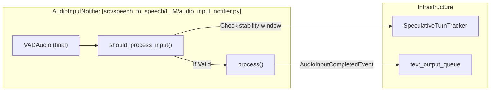

<!-- source: DeepWiki mcp.deepwiki.com · repo huggingface/speech-to-speech · extra page Other STT Handlers and Audio-Input Mode · fetched 2026-10-26 -->

# Other STT Handlers and Audio-Input Mode

<details>
<summary>Relevant source files</summary>

The following files were used as context for generating this wiki page:

- [src/speech_to_speech/LLM/audio_input_notifier.py](src/speech_to_speech/LLM/audio_input_notifier.py)
- [src/speech_to_speech/STT/paraformer_handler.py](src/speech_to_speech/STT/paraformer_handler.py)
- [src/speech_to_speech/STT/qwen3_asr_handler.py](src/speech_to_speech/STT/qwen3_asr_handler.py)
- [src/speech_to_speech/arguments_classes/qwen3_asr_stt_arguments.py](src/speech_to_speech/arguments_classes/qwen3_asr_stt_arguments.py)
- [tests/test_audio_input_notifier.py](tests/test_audio_input_notifier.py)
- [tests/test_paraformer_transcription_events.py](tests/test_paraformer_transcription_events.py)
- [tests/test_qwen3_asr_transcription_events.py](tests/test_qwen3_asr_transcription_events.py)
- [tests/test_stt_session_language_reset.py](tests/test_stt_session_language_reset.py)

</details>


## Purpose and Scope

This page documents the technical implementation and architecture of alternative Speech-to-Text (STT) handlers in the speech-to-speech system, specifically the **Qwen3-ASR** handler and the **Paraformer** (FunASR) handler. It also details the **session language reset behavior** ensuring state hygiene across connections, and the **AudioInputNotifier** which manages the direct audio-to-LLM path when the STT stage is disabled (`--stt none`).

---

## Qwen3-ASR STT Handler

### Implementation Details

The `Qwen3ASRSTTHandler` integrates Qwen3-ASR speech recognition checkpoints through the Hugging Face `transformers` library [src/speech_to_speech/STT/qwen3_asr_handler.py:68-75](). It handles device resolution (`auto`, `cuda`, `mps`, `cpu`), dtype selection, language fallback policies, and optional contextual prompt injection [src/speech_to_speech/STT/qwen3_asr_handler.py:41-98]().

```mermaid
graph TD
    subgraph "Qwen3ASRSTTHandler [src/speech_to_speech/STT/qwen3_asr_handler.py]"
        "Qwen3ASRSTTHandler.setup()"["setup()"]
        "Qwen3ASRSTTHandler.configure_language()"["configure_language()"]
        "Qwen3ASRSTTHandler.warmup()"["warmup()"]
        "Qwen3ASRSTTHandler._transcribe()"["_transcribe()"]
        "Qwen3ASRSTTHandler.process()"["process(vad_audio)"]
    end
    
    subgraph "Transformers Integration"
        PROC["transformers.AutoProcessor"]
        REQ["processor.apply_transcription_request()"]
        GEN["model.generate()"]
    end
    
    "Qwen3ASRSTTHandler.setup()" -->|"Load processor & model"| PROC
    "Qwen3ASRSTTHandler.setup()" --> "Qwen3ASRSTTHandler.configure_language()"
    "Qwen3ASRSTTHandler.setup()" --> "Qwen3ASRSTTHandler.warmup()"
    "Qwen3ASRSTTHandler.process()" --> "Qwen3ASRSTTHandler._transcribe()"
    "_transcribe()" --> REQ
    REQ --> GEN
```

**Key Mechanisms:**
- **Language Policy (`auto` vs Forced):** In `auto` mode, the model identifies the language on every final turn, reporting it with the `-auto` suffix (e.g., `en-auto`) [src/speech_to_speech/STT/qwen3_asr_handler.py:71-74](), [src/speech_to_speech/STT/qwen3_asr_handler.py:145](). Because progressive windows are short and may compromise language identification, they reuse `self.last_language` from the preceding final turn [src/speech_to_speech/STT/qwen3_asr_handler.py:71-74](), [src/speech_to_speech/STT/qwen3_asr_handler.py:150-151]().
- **Prompt Bias:** If provided via `qwen3_asr_prompt`, optional context or hotwords are passed to `apply_transcription_request` (requiring `transformers>=5.15.1`) [src/speech_to_speech/STT/qwen3_asr_handler.py:63-66](), [src/speech_to_speech/STT/qwen3_asr_handler.py:94-96]().
- **Configuration Dataclass:** Configured via `Qwen3ASRSTTHandlerArguments`, exposing parameters such as `qwen3_asr_model_name`, `qwen3_asr_device`, `qwen3_asr_torch_dtype`, `qwen3_asr_language`, and `qwen3_asr_prompt` [src/speech_to_speech/arguments_classes/qwen3_asr_stt_arguments.py:6-52]().

**Sources:** [src/speech_to_speech/STT/qwen3_asr_handler.py:1-159](), [src/speech_to_speech/arguments_classes/qwen3_asr_stt_arguments.py:1-52]()

---

## Paraformer (FunASR) STT Handler

### Implementation Details

The `ParaformerSTTHandler` uses the `funasr` library to execute Paraformer models [src/speech_to_speech/STT/paraformer_handler.py:38-44](). Paraformer is a non-autoregressive speech recognition model, predicting tokens in parallel to achieve high throughput, primarily optimized for Chinese transcription [src/speech_to_speech/STT/paraformer_handler.py:19-24]().

```mermaid
graph TB
    subgraph "ParaformerSTTHandler [src/speech_to_speech/STT/paraformer_handler.py]"
        "ParaformerSTTHandler.setup()"["setup()"]
        "ParaformerSTTHandler.warmup()"["warmup()"]
        "ParaformerSTTHandler.process()"["process(vad_audio)"]
    end
    
    subgraph "FunASR Library"
        AUTO["funasr.AutoModel"]
        GEN["AutoModel.generate()"]
    end
    
    "ParaformerSTTHandler.setup()" -->|"Load model"| AUTO
    "ParaformerSTTHandler.setup()" --> "ParaformerSTTHandler.warmup()"
    "ParaformerSTTHandler.warmup()" -->|"Dummy inference"| GEN
    "ParaformerSTTHandler.process()" -->|"Generate transcription"| GEN
    GEN -->|"MPS cache clear (Apple Silicon)"| "ParaformerSTTHandler.process()"
```

**Key Mechanisms:**
- **Language Extraction:** Automatically parses the language code from the model name (e.g., `paraformer-en` sets `self.language = "en"`, defaulting to `"zh"` if unspecified) [src/speech_to_speech/STT/paraformer_handler.py:33-35]().
- **Progressive vs. Final Lanes:** If `vad_audio.mode == "progressive"`, it yields a `PartialTranscription` event [src/speech_to_speech/STT/paraformer_handler.py:67-72](). Otherwise, it yields a final `Transcription` message containing the `language_code` and `speech_stopped_at_s` [src/speech_to_speech/STT/paraformer_handler.py:74-80]().
- **Device Memory Management:** Explicitly invokes `torch.mps.empty_cache()` if `self.device == "mps"` after inference [src/speech_to_speech/STT/paraformer_handler.py:60-62]().

**Sources:** [src/speech_to_speech/STT/paraformer_handler.py:1-80](), [tests/test_paraformer_transcription_events.py:1-131]()

---

## Session Language Reset Behavior

Because pipeline units and STT handlers are reused across client connections, transient conversation state—specifically `last_language`—must not leak into subsequent sessions [tests/test_stt_session_language_reset.py:1-11]().

**Key Mechanisms:**
- **Base Handler Contract:** `BaseSTTHandler` defines `start_language` and `last_language` attributes [tests/test_stt_session_language_reset.py:163-166]().
- **Session Cleanup (`on_session_end`):** When a session terminates (`SESSION_END`), handlers invoke `on_session_end()`, which restores `self.last_language` to its initial configured state (`self.start_language`) [tests/test_stt_session_language_reset.py:80-116](). This prevents a previous client's detected language from incorrectly biasing the next conversation session [tests/test_stt_session_language_reset.py:1-11]().

**Sources:** [tests/test_stt_session_language_reset.py:1-168]()

---

## Audio-Input Mode: AudioInputNotifier

When the speech-to-speech system is configured with `--stt none`, the transcription stage is bypassed entirely. In this mode, raw VAD-gated audio is routed directly to the LLM via the `AudioInputNotifier` [src/speech_to_speech/LLM/audio_input_notifier.py:18-19]().



**Key Mechanisms:**
- **Stability Window Filtering:** `should_process_input` inspects `VADAudio` frames, ignoring `progressive` updates and verifying that the final audio chunk has cleared the stability window via `SpeculativeTurnTracker.is_latest_after_stability_window` [src/speech_to_speech/LLM/audio_input_notifier.py:31-41]().
- **Side-Channel Event Dispatch:** Instead of yielding standard transcription messages through the primary pipeline queue, `process()` emits an `AudioInputCompletedEvent` directly into the `text_output_queue` for the `RealtimeService` to build native audio prompts [src/speech_to_speech/LLM/audio_input_notifier.py:52-63]().

**Sources:** [src/speech_to_speech/LLM/audio_input_notifier.py:1-63](), [tests/test_audio_input_notifier.py:1-80]()

---

