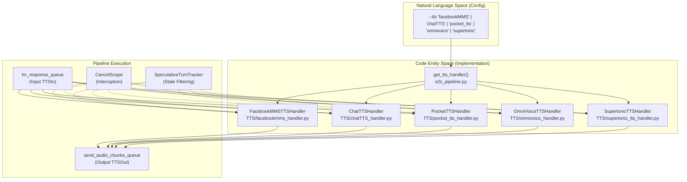
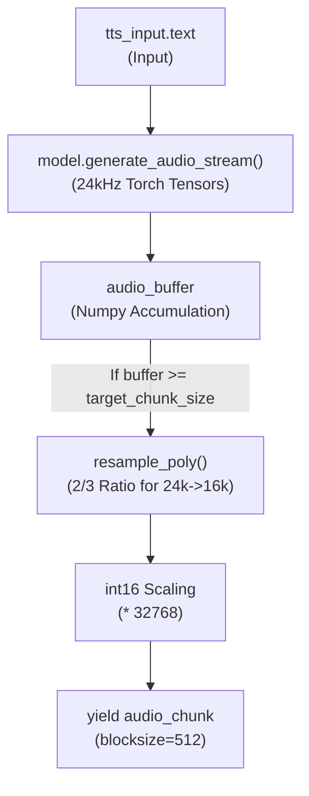

<!-- source: DeepWiki mcp.deepwiki.com · repo huggingface/speech-to-speech · extra page Other TTS Engines · fetched 2026-10-26 -->

# Other TTS Engines

Relevant source files

The following files were used as context for generating this wiki page:

- [archive/STT/__init__.py](archive/STT/__init__.py)
- [archive/STT/moonshine_handler.py](archive/STT/moonshine_handler.py)
- [archive/TTS/__init__.py](archive/TTS/__init__.py)
- [archive/TTS/parler_handler.py](archive/TTS/parler_handler.py)
- [archive/__init__.py](archive/__init__.py)
- [archive/arguments_classes/__init__.py](archive/arguments_classes/__init__.py)
- [archive/arguments_classes/parler_tts_arguments.py](archive/arguments_classes/parler_tts_arguments.py)
- [scripts/benchmark_tts.py](scripts/benchmark_tts.py)
- [src/speech_to_speech/TTS/chatTTS_handler.py](src/speech_to_speech/TTS/chatTTS_handler.py)
- [src/speech_to_speech/TTS/facebookmms_handler.py](src/speech_to_speech/TTS/facebookmms_handler.py)
- [src/speech_to_speech/TTS/omnivoice_handler.py](src/speech_to_speech/TTS/omnivoice_handler.py)
- [src/speech_to_speech/TTS/pocket_tts_handler.py](src/speech_to_speech/TTS/pocket_tts_handler.py)
- [src/speech_to_speech/TTS/supertonic_tts_handler.py](src/speech_to_speech/TTS/supertonic_tts_handler.py)
- [src/speech_to_speech/arguments_classes/omnivoice_tts_arguments.py](src/speech_to_speech/arguments_classes/omnivoice_tts_arguments.py)
- [src/speech_to_speech/arguments_classes/pocket_tts_arguments.py](src/speech_to_speech/arguments_classes/pocket_tts_arguments.py)
- [src/speech_to_speech/arguments_classes/supertonic_tts_arguments.py](src/speech_to_speech/arguments_classes/supertonic_tts_arguments.py)
- [tests/test_omnivoice_tts_handler.py](tests/test_omnivoice_tts_handler.py)
- [tests/test_pocket_tts_handler.py](tests/test_pocket_tts_handler.py)
- [tests/test_supertonic_tts_handler.py](tests/test_supertonic_tts_handler.py)

This document covers the additional Text-to-Speech (TTS) handler implementations available in the speech-to-speech pipeline: **Facebook MMS**, **ChatTTS**, **Pocket TTS**, **OmniVoice**, and **Supertonic**. These handlers provide specialized capabilities including support for 40+ languages, conversational prosody, and low-latency voice cloning. This page also briefly mentions the archived MeloTTS and Parler handlers.

For general TTS architecture and the handler plugin system, see [Handler Plugin System and Backend Registry]().

## Overview

The speech-to-speech system includes several TTS implementations beyond the primary Qwen3 and OpenAI-compatible handlers. These additional handlers conform to the `BaseHandler` interface [src/speech_to_speech/baseHandler.py:11-20](), consuming text from the pipeline and producing audio chunks (usually 16kHz int16 PCM) [src/speech_to_speech/TTS/pocket_tts_handler.py:32-33]().

### Handler Comparison

| Handler | Selection String | Implementation Class | Primary Use Case | Language Support | Streaming | Voice Cloning/Design |
|---------|------------------|---------------------|------------------|------------------|-----------|----------------------|
| **Facebook MMS** | `facebookMMS` | `FacebookMMSTTSHandler` | Massive Multilingual support | 47 languages (mapped) | Simulated | No |
| **ChatTTS** | `chatTTS` | `ChatTTSHandler` | Natural conversational speech | English/Chinese optimized | Yes | Random speaker |
| **Pocket TTS** | `pocket_tts` | `PocketTTSHandler` | Fast voice cloning (Kyutai Labs) | English (multi-voice) | Yes | Yes (from presets/audio) |
| **OmniVoice** | `omnivoice` | `OmniVoiceTTSHandler` | High-quality voice cloning/design | Multilingual | No (blocking) | Yes (from audio/prompt/instruct) |
| **Supertonic** | `supertonic` | `SupertonicTTSHandler` | High-quality, fast synthesis | 30+ languages | No (blocking) | No |

**Sources:** [src/speech_to_speech/TTS/facebookmms_handler.py:66](), [src/speech_to_speech/TTS/chatTTS_handler.py:24](), [src/speech_to_speech/TTS/pocket_tts_handler.py:22](), [src/speech_to_speech/TTS/omnivoice_handler.py:24](), [src/speech_to_speech/TTS/supertonic_tts_handler.py:60]()

### Handler Selection and Data Flow

The following diagram bridges the high-level configuration to the specific code entities responsible for synthesis.

**Sources:** [src/speech_to_speech/TTS/facebookmms_handler.py:142-162](), [src/speech_to_speech/TTS/chatTTS_handler.py:53-73](), [src/speech_to_speech/TTS/pocket_tts_handler.py:103-123](), [src/speech_to_speech/TTS/omnivoice_handler.py:103-124](), [src/speech_to_speech/TTS/supertonic_tts_handler.py:141-161]()

---

## Facebook MMS TTS Handler

The `FacebookMMSTTSHandler` utilizes the VITS-based Massively Multilingual Speech (MMS) models from Meta. It is designed for broad language coverage, supporting 47 distinct mappings from Whisper language codes to MMS model identifiers.

### Language Mapping
The handler maintains a `WHISPER_LANGUAGE_TO_FACEBOOK_LANGUAGE` dictionary to translate standard ISO codes (e.g., `en`, `fr`) to the 3-letter codes used by MMS (e.g., `eng`, `fra`) [src/speech_to_speech/TTS/facebookmms_handler.py:23-62]().

### Implementation Details
- **Dynamic Loading**: The `load_model` function is called during `setup` and can be re-invoked during `process` if a new `language_code` is detected in the input [src/speech_to_speech/TTS/facebookmms_handler.py:94-106](), [src/speech_to_speech/TTS/facebookmms_handler.py:177-187]().
- **Streaming**: Although the underlying VITS model is non-streaming, the handler simulates streaming by yielding the full audio in `chunk_size` blocks (default 512) [src/speech_to_speech/TTS/facebookmms_handler.py:75]().
- **Warmup**: The handler performs a warmup pass with a dummy string to ensure the model is loaded and ready for inference [src/speech_to_speech/TTS/facebookmms_handler.py:108-110]().

**Sources:** [src/speech_to_speech/TTS/facebookmms_handler.py:66-111](), [src/speech_to_speech/TTS/facebookmms_handler.py:177-187]()

---

## ChatTTS Handler

`ChatTTSHandler` wraps the ChatTTS library, which is optimized for conversational tasks. It supports random speaker embedding generation and streaming inference.

### Key Features
- **Speaker Embedding**: During `setup`, it calls `self.model.sample_random_speaker()` to initialize `InferCodeParams` [src/speech_to_speech/TTS/chatTTS_handler.py:43-46]().
- **MPS Optimization**: On Apple Silicon (`device="mps"`), the handler explicitly calls `torch.mps.synchronize()` and `torch.mps.empty_cache()` to manage memory during synthesis [src/speech_to_speech/TTS/chatTTS_handler.py:79-85]().
- **Streaming Inference**: It uses `self.model.infer(..., stream=True)` to receive partial audio generators, resampling from 24kHz to 16kHz and yielding chunks as they become available [src/speech_to_speech/TTS/chatTTS_handler.py:87-106]().

**Sources:** [src/speech_to_speech/TTS/chatTTS_handler.py:24-52](), [src/speech_to_speech/TTS/chatTTS_handler.py:87-117]()

---

## Pocket TTS Handler

The `PocketTTSHandler` integrates the `pocket-tts` model from Kyutai Labs. It is a high-performance, low-latency model supporting voice cloning from audio prompts.

### Voice Configuration
The handler supports three types of voices via the `voice` argument [src/speech_to_speech/TTS/pocket_tts_handler.py:47-51]():
1. **Presets**: 'alba', 'marius', 'javert', 'jean', 'fantine', 'cosette', 'eponine', 'azelma'.
2. **Local Files**: Path to a `.wav` or `.mp3` for cloning.
3. **HF Paths**: `hf://kyutai/tts-voices/...`

### Processing Pipeline
Pocket TTS generates audio at **24kHz**. The handler implements precise resampling logic to convert to the pipeline's **16kHz** standard while maintaining block alignment [src/speech_to_speech/TTS/pocket_tts_handler.py:139-153]().

**Sources:** [src/speech_to_speech/TTS/pocket_tts_handler.py:137-153](), [src/speech_to_speech/TTS/pocket_tts_handler.py:157-180]()

### Arguments
The `PocketTTSHandlerArguments` dataclass defines the configurable parameters for this handler [src/speech_to_speech/arguments_classes/pocket_tts_arguments.py:4-35]():
- `pocket_tts_device`: Device to run the model on (`cpu`, `cuda`, `mps`). Default is `cpu`.
- `pocket_tts_voice`: Voice to use (preset name, local file path, or Hugging Face path). Default is `jean`.
- `pocket_tts_sample_rate`: Output sample rate. Default is 16000 Hz.
- `pocket_tts_blocksize`: Size of audio blocks to yield. Default is 512.
- `pocket_tts_max_tokens`: Maximum tokens to generate per sentence. Default is 50.
- `pocket_tts_language`: PocketTTS language/model configuration to load. Default is `english`.

**Sources:** [src/speech_to_speech/arguments_classes/pocket_tts_arguments.py:4-35]()

---

## OmniVoice TTS Handler

The `OmniVoiceTTSHandler` integrates the OmniVoice model from k2-fsa. It supports high-quality voice cloning and voice design through various input methods.

### Key Features
- **Voice Cloning**: Can clone a voice from a reference audio (`ref_audio` and `ref_text`) or load a pre-saved `VoiceClonePrompt` [src/speech_to_speech/TTS/omnivoice_handler.py:92-97]().
- **Voice Design**: Allows for explicit voice instructions via the `instruct` argument (e.g., "female, low pitch") [src/speech_to_speech/TTS/omnivoice_handler.py:142]().
- **Device and Dtype**: Supports `auto`, `cuda`, `mps`, `xpu`, or `cpu` devices and `float16`, `bfloat16`, or `float32` dtypes [src/speech_to_speech/TTS/omnivoice_handler.py:29-30](), [src/speech_to_speech/TTS/omnivoice_handler.py:61-65]().
- **Blocking Generation**: OmniVoice generation is a blocking operation. If a cancellation occurs during generation, the completed audio buffer is discarded before being yielded [src/speech_to_speech/TTS/omnivoice_handler.py:147-151]().
- **Resampling**: Resamples the generated audio (default 24kHz) to the pipeline's 16kHz sample rate [src/speech_to_speech/TTS/omnivoice_handler.py:156-163]().

### Arguments
The `OmniVoiceTTSHandlerArguments` dataclass defines the configurable parameters for this handler [src/speech_to_speech/arguments_classes/omnivoice_tts_arguments.py:5-58]():
- `omnivoice_model_name`: Hugging Face model ID or local path. Default is `k2-fsa/OmniVoice`.
- `omnivoice_device`: Device to run the model on. Default is `auto`.
- `omnivoice_dtype`: Torch dtype for inference. Default is `float16`.
- `omnivoice_ref_audio`: Path to reference audio for voice cloning. Requires `omnivoice_ref_text`.
- `omnivoice_ref_text`: Transcript of `omnivoice_ref_audio`.
- `omnivoice_voice_clone_prompt`: Path to a saved `VoiceClonePrompt`. Mutually exclusive with `ref_audio`/`ref_text`.
- `omnivoice_instruct`: Voice-design instruction. Cannot be combined with voice cloning.
- `omnivoice_language`: Optional target language name or code.
- `omnivoice_num_steps`: Number of diffusion decoding steps. Default is 32.
- `omnivoice_speed`: Speaking-speed factor. Default is 1.0.
- `omnivoice_blocksize`: Audio output block size in 16 kHz samples. Default is 512.

**Sources:** [src/speech_to_speech/TTS/omnivoice_handler.py:24-98](), [src/speech_to_speech/TTS/omnivoice_handler.py:131-166](), [src/speech_to_speech/arguments_classes/omnivoice_tts_arguments.py:5-58]()

---

## Supertonic TTS Handler

The `SupertonicTTSHandler` integrates the Supertonic TTS library, offering fast and high-quality speech synthesis.

### Key Features
- **Language Support**: Supports over 30 languages, with a fallback mechanism if the requested language is not supported [src/speech_to_speech/TTS/supertonic_tts_handler.py:22-57](), [src/speech_to_speech/TTS/supertonic_tts_handler.py:120-133]().
- **Voice Styles**: Allows selection of different voice styles (e.g., "M1" for male voice 1) [src/speech_to_speech/TTS/supertonic_tts_handler.py:100]().
- **Blocking Generation**: Similar to OmniVoice, Supertonic's `synthesize` method is blocking. Cancellation checks are performed before and after the synthesis call, and before yielding each audio block [src/speech_to_speech/TTS/supertonic_tts_handler.py:181-184](), [src/speech_to_speech/TTS/supertonic_tts_handler.py:201-203]().
- **Resampling**: Supertonic generates audio at 44.1kHz. The handler resamples it to 16kHz and converts it to `int16` format [src/speech_to_speech/TTS/supertonic_tts_handler.py:187-196]().

### Arguments
The `SupertonicTTSHandlerArguments` dataclass defines the configurable parameters for this handler [src/speech_to_speech/arguments_classes/supertonic_tts_arguments.py:4-21]():
- `supertonic_tts_voice`: Voice style (e.g., "M1", "F3"). Default is "M1".
- `supertonic_tts_lang`: Language code. Default is "na" (auto/language-agnostic).
- `supertonic_tts_speed`: Speed modifier (0.7 to 2.0). Default is 1.0.
- `supertonic_tts_blocksize`: Audio chunk size in samples. Default is 512.

**Sources:** [src/speech_to_speech/TTS/supertonic_tts_handler.py:60-112](), [src/speech_to_speech/TTS/supertonic_tts_handler.py:169-205](), [src/speech_to_speech/arguments_classes/supertonic_tts_arguments.py:4-21]()

---

## Archived Handlers

Several handlers have been moved to the `archive/` directory and are no longer actively maintained in the main pipeline but remain available for reference:

- **MeloTTS**: `MeloTTSHandler` [archive/TTS/melo_handler.py:24]().
- **Parler TTS**: `ParlerTTSHandler` [archive/TTS/parler_handler.py:52](). Supports descriptive voice control (e.g., "Jenny speaks at a slightly slow pace") [archive/TTS/parler_handler.py:62-64]().

**Sources:** [archive/TTS/melo_handler.py:24](), [archive/TTS/parler_handler.py:52](), [archive/TTS/parler_handler.py:62-64]()

---

## Common Handler Logic

### Interruption Handling
All handlers check the `CancelScope` during their generation loops. If `self.cancel_scope.is_stale(gen)` returns true (indicating a user barge-in), the handler immediately stops processing [src/speech_to_speech/TTS/facebookmms_handler.py:164](), [src/speech_to_speech/TTS/chatTTS_handler.py:92-98](), [src/speech_to_speech/TTS/pocket_tts_handler.py:162-164](), [src/speech_to_speech/TTS/omnivoice_handler.py:99-100](), [src/speech_to_speech/TTS/supertonic_tts_handler.py:135-136]().

### Speculative Turn Management
Handlers validate incoming `TTSIn` against the `SpeculativeTurnTracker`. If the `turn_id` is stale (e.g., due to a turn reopening), the input is dropped [src/speech_to_speech/TTS/facebookmms_handler.py:143-160](), [src/speech_to_speech/TTS/chatTTS_handler.py:54-71](), [src/speech_to_speech/TTS/pocket_tts_handler.py:103-123](), [src/speech_to_speech/TTS/omnivoice_handler.py:103-124](), [src/speech_to_speech/TTS/supertonic_tts_handler.py:141-161]().

### End of Response
When an `EndOfResponse` message is received, handlers yield `AUDIO_RESPONSE_DONE` to signal the audio player that the current response sequence is finished [src/speech_to_speech/TTS/facebookmms_handler.py:144-153](), [src/speech_to_speech/TTS/chatTTS_handler.py:55-64](), [src/speech_to_speech/TTS/pocket_tts_handler.py:100-109](), [src/speech_to_speech/TTS/omnivoice_handler.py:104-112](), [src/speech_to_speech/TTS/supertonic_tts_handler.py:142-149]().

**Sources:** [src/speech_to_speech/TTS/facebookmms_handler.py:142-164](), [src/speech_to_speech/TTS/chatTTS_handler.py:53-98](), [src/speech_to_speech/TTS/pocket_tts_handler.py:98-164](), [src/speech_to_speech/TTS/omnivoice_handler.py:103-151](), [src/speech_to_speech/TTS/supertonic_tts_handler.py:141-203]()

---

