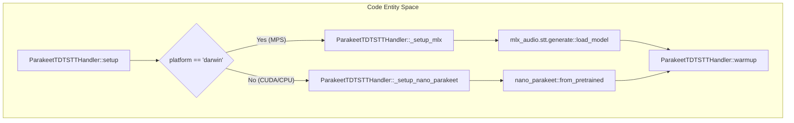
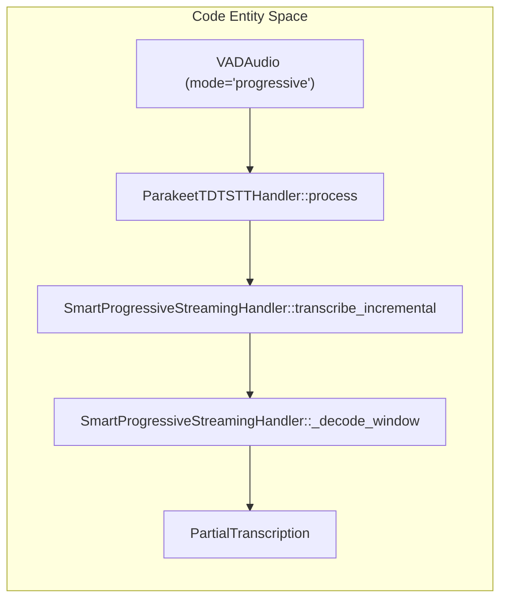
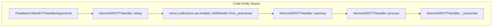

<!-- source: DeepWiki mcp.deepwiki.com · repo huggingface/speech-to-speech · extra page Parakeet and NeMo ASR Handlers · fetched 2026-10-26 -->

# Parakeet and NeMo ASR Handlers

Relevant source files

The following files were used as context for generating this wiki page:

- [src/speech_to_speech/STT/nemo_asr_handler.py](src/speech_to_speech/STT/nemo_asr_handler.py)
- [src/speech_to_speech/STT/parakeet_tdt_handler.py](src/speech_to_speech/STT/parakeet_tdt_handler.py)
- [src/speech_to_speech/STT/smart_progressive_streaming.py](src/speech_to_speech/STT/smart_progressive_streaming.py)
- [src/speech_to_speech/arguments_classes/parakeet_unified_stt_arguments.py](src/speech_to_speech/arguments_classes/parakeet_unified_stt_arguments.py)
- [tests/test_nemo_asr_handler.py](tests/test_nemo_asr_handler.py)
- [tests/test_parakeet_language_detection.py](tests/test_parakeet_language_detection.py)
- [tests/test_parakeet_transcription_events.py](tests/test_parakeet_transcription_events.py)

## Purpose and Scope

The Parakeet and NeMo ASR handlers provide high-performance speech-to-text capabilities within the pipeline. This section covers two primary implementations:
1. **Parakeet TDT 0.6B v3 Handler (`ParakeetTDTSTTHandler`)**: An optimized transducer supporting 25 European languages with automatic language detection, dual-backend execution (`mlx-audio` for Apple Silicon and `nano-parakeet` for CUDA/CPU), and smart progressive streaming [src/speech_to_speech/STT/parakeet_tdt_handler.py:1-10]().
2. **NeMo ASR / Parakeet Unified Handler (`NemoASRSTTHandler`)**: A PyTorch-based integration using NeMo checkpoints through `ASRModel.transcribe`, paired with `ParakeetUnifiedSTTHandlerArguments` [src/speech_to_speech/STT/nemo_asr_handler.py:66-67](), [src/speech_to_speech/arguments_classes/parakeet_unified_stt_arguments.py:5-17]().

Sources: [src/speech_to_speech/STT/parakeet_tdt_handler.py:1-10](), [src/speech_to_speech/STT/nemo_asr_handler.py:66-67](), [src/speech_to_speech/arguments_classes/parakeet_unified_stt_arguments.py:5-17]()

---

## Parakeet TDT Dual-Backend Architecture

The `ParakeetTDTSTTHandler` dynamically selects its backend during the `setup` phase based on the detected hardware device [src/speech_to_speech/STT/parakeet_tdt_handler.py:133-158]().

| Backend | Platform | Library | Model Identifier |
| :--- | :--- | :--- | :--- |
| **MLX** | Apple Silicon (MPS) | `mlx-audio` | `mlx-community/parakeet-tdt-0.6b-v3` [src/speech_to_speech/STT/parakeet_tdt_handler.py:5-5]() |
| **nano-parakeet** | CUDA / CPU | `nano-parakeet` | `nvidia/parakeet-tdt-0.6b-v3` [src/speech_to_speech/STT/parakeet_tdt_handler.py:6-6]() |

### Implementation Logic
The handler checks platform constraints in `setup()` [src/speech_to_speech/STT/parakeet_tdt_handler.py:133-141](). On Darwin (`platform == "darwin"`), it defaults to `mps` and invokes `_setup_mlx()` [src/speech_to_speech/STT/parakeet_tdt_handler.py:134-136](). Otherwise, it selects `cuda` (if available) or `cpu` and calls `_setup_nano_parakeet()` [src/speech_to_speech/STT/parakeet_tdt_handler.py:137-139]().

Sources: [src/speech_to_speech/STT/parakeet_tdt_handler.py:102-192]()

---

## Smart Progressive Streaming

When `enable_live_transcription` is enabled, `ParakeetTDTSTTHandler` instantiates `SmartProgressiveStreamingHandler` to emit partial transcriptions incrementally [src/speech_to_speech/STT/parakeet_tdt_handler.py:162-172]().

### Window Management Strategy
The streaming handler manages a growing audio window up to 15 seconds [src/speech_to_speech/STT/smart_progressive_streaming.py:33-34](). When the window exceeds this duration, it uses sentence boundaries to slide the window:
1. Completed sentences are designated as `fixed_sentences` and excluded from re-transcription [src/speech_to_speech/STT/smart_progressive_streaming.py:36-37]().
2. The active decoding window starts immediately following the last fixed sentence, incorporating a `sentence_buffer` [src/speech_to_speech/STT/smart_progressive_streaming.py:44-52]().

Sources: [src/speech_to_speech/STT/smart_progressive_streaming.py:28-157](), [tests/test_parakeet_transcription_events.py:101-120]()

---

## Language Detection via Lingua

`ParakeetTDTSTTHandler` integrates the `lingua-py` library for automatic language detection across 25 supported European languages [src/speech_to_speech/STT/parakeet_tdt_handler.py:30-88]().

1. **Preloading:** `_build_lingua_detector()` preloads language models during initialization to avoid latency spikes on initial requests [src/speech_to_speech/STT/parakeet_tdt_handler.py:82-88]().
2. **Length Threshold:** Short text segments bypass language detection to prevent classification errors [tests/test_parakeet_language_detection.py:35-46]().
3. **Code Mapping:** Maps ISO codes such as Norwegian Bokmål (`nb` to `no`) to align with model expectations [src/speech_to_speech/STT/parakeet_tdt_handler.py:69-70]().

Sources: [src/speech_to_speech/STT/parakeet_tdt_handler.py:30-89](), [tests/test_parakeet_language_detection.py:7-77]()

---

## Parakeet Unified / NeMo ASR Handler

The `NemoASRSTTHandler` provides Speech-to-Text inference via NVIDIA NeMo ASR checkpoints (`ASRModel.from_pretrained`) [src/speech_to_speech/STT/nemo_asr_handler.py:66-87]().

### Configuration and Arguments
Configured via `ParakeetUnifiedSTTHandlerArguments`, which defines:
- `parakeet_unified_model_name`: Checkpoint identifier (default `"nvidia/parakeet-unified-en-0.6b"`) [src/speech_to_speech/arguments_classes/parakeet_unified_stt_arguments.py:6-9]().
- `parakeet_unified_device`: Execution device (`"auto"`, `"cuda"`, `"cpu"`) [src/speech_to_speech/arguments_classes/parakeet_unified_stt_arguments.py:10-13]().
- `parakeet_unified_language`: Language code reported with final transcriptions (default `"en"`) [src/speech_to_speech/arguments_classes/parakeet_unified_stt_arguments.py:14-17]().

### Execution Flow
1. **Setup:** Resolves the compute device, validates the language parameter, and loads the `ASRModel` [src/speech_to_speech/STT/nemo_asr_handler.py:69-87]().
2. **Warmup:** Runs a zero-tensor dummy transcription via `_transcribe()` to initialize CUDA kernels [src/speech_to_speech/STT/nemo_asr_handler.py:92-98]().
3. **Processing:** The `process()` method handles `VADAudio` inputs, generating either `PartialTranscription` (for progressive mode) or `Transcription` events [src/speech_to_speech/STT/nemo_asr_handler.py:105-122]().

Sources: [src/speech_to_speech/STT/nemo_asr_handler.py:66-122](), [src/speech_to_speech/arguments_classes/parakeet_unified_stt_arguments.py:1-17](), [tests/test_nemo_asr_handler.py:84-145]()

---

