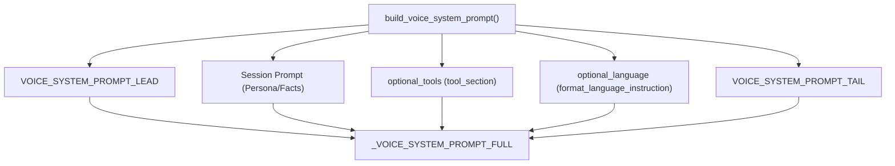
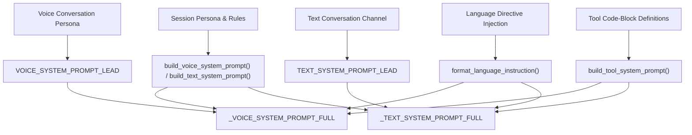
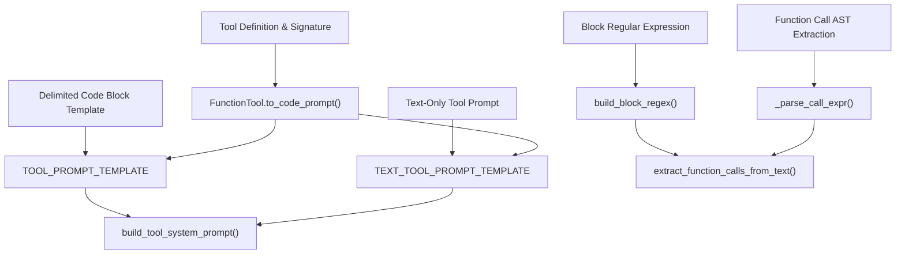

<!-- source: DeepWiki mcp.deepwiki.com · repo huggingface/speech-to-speech · extra page Prompts: Voice, Text and Language Directives · fetched 2026-10-26 -->

# Prompts: Voice, Text and Language Directives

<details>
<summary>Relevant source files</summary>

The following files were used as context for generating this wiki page:

- [src/speech_to_speech/LLM/text_prompt.py](src/speech_to_speech/LLM/text_prompt.py)
- [src/speech_to_speech/LLM/tool_call/function_call.py](src/speech_to_speech/LLM/tool_call/function_call.py)
- [src/speech_to_speech/LLM/tool_call/tool_prompt.py](src/speech_to_speech/LLM/tool_call/tool_prompt.py)
- [src/speech_to_speech/LLM/voice_prompt.py](src/speech_to_speech/LLM/voice_prompt.py)
- [tests/test_language_prompt.py](tests/test_language_prompt.py)
- [tests/test_text_prompt.py](tests/test_text_prompt.py)
- [tests/test_voice_prompt.py](tests/test_voice_prompt.py)
- [tests/tool_call/test_function_parser.py](tests/tool_call/test_function_parser.py)

</details>


## Purpose and Scope

This page details the system-prompt assembly infrastructure across the `speech_to_speech` codebase, focusing on `src/speech_to_speech/LLM/voice_prompt.py` and `src/speech_to_speech/LLM/text_prompt.py`. It covers how spoken-style conversation constraints are enforced, how text-channel prompts differ, how language directives are dynamically injected into active turns via `--enable_lang_prompt`, and how tool-calling instructions are structured via `src/speech_to_speech/LLM/tool_call/tool_prompt.py`.

Sources: `src/speech_to_speech/LLM/voice_prompt.py:1-53`, `src/speech_to_speech/LLM/text_prompt.py:1-49`, `src/speech_to_speech/LLM/tool_call/tool_prompt.py:1-98`

---

## 1. Voice Prompt Architecture (`voice_prompt.py`)

The voice-channel system prompt structures the interaction for low-latency audio conversations where the model's output is synthesized into speech via Text-to-Speech (TTS). 

### Structure and Assembly

`src/speech_to_speech/LLM/voice_prompt.py` constructs prompts using a strict structural sandwich: a lead block, session prompt context, optional tool definitions, optional language hints, and a tail rules block (`VOICE_SYSTEM_PROMPT_TAIL`) containing the strongest constraints [src/speech_to_speech/LLM/voice_prompt.py:1-53]().


Sources: `src/speech_to_speech/LLM/voice_prompt.py:5-53`

### Key Voice Rules
* **Conciseness:** Replies are restricted by default to one spoken sentence (two if needed) [src/speech_to_speech/LLM/voice_prompt.py:12]().
* **Formatting Restrictions:** Markdown, bullets, headings, and visual action/emote text (e.g., `*laughs*`) are explicitly forbidden [src/speech_to_speech/LLM/voice_prompt.py:13]().
* **Noisy Transcript Handling:** Transcripts from STT are treated as noisy; the model is instructed to correct likely mishearings only when explicitly asked or when meaning strictly depends on it [src/speech_to_speech/LLM/voice_prompt.py:14]().
* **Tool Choreography:** 
  * Information tools require immediate action with at most one brief acknowledgement before the first call, followed by silent subsequent calls [src/speech_to_speech/LLM/voice_prompt.py:17]().
  * Expression, background, or physical-action tools require speaking first (e.g., using a short pattern like `"Sure, here's my best <emotion>."`), and prohibit a second spoken comment unless the result contains user-facing information [src/speech_to_speech/LLM/voice_prompt.py:18]().
  * Tool names and function tags must never appear in spoken output [src/speech_to_speech/LLM/voice_prompt.py:16]().

Sources: `src/speech_to_speech/LLM/voice_prompt.py:10-22`, `tests/test_voice_prompt.py:56-99`

---

## 2. Text Prompt Architecture (`text_prompt.py`)

When operating in text-only channels or interfaces, `src/speech_to_speech/LLM/text_prompt.py` bypasses voice-specific constraints in favor of written-channel conventions.

### Structure and Assembly

`build_text_system_prompt()` uses a parallel layout to the voice prompt, substituting written rules (`TEXT_SYSTEM_PROMPT_TAIL`) [src/speech_to_speech/LLM/text_prompt.py:1-48]().

| Prompt Component | Voice Variant (`voice_prompt.py`) | Text Variant (`text_prompt.py`) |
| :--- | :--- | :--- |
| **Lead Statement** | "You are in a spoken conversation. The user speaks and hears you." [src/speech_to_speech/LLM/voice_prompt.py:6]() | "You are a helpful assistant in a text conversation." [src/speech_to_speech/LLM/text_prompt.py:6]() |
| **Formatting Policy** | No markdown, bullets, or visual formatting [src/speech_to_speech/LLM/voice_prompt.py:13]() | Markdown encouraged when helpful (lists, tables, code blocks) [src/speech_to_speech/LLM/text_prompt.py:12]() |
| **Tool Pre-amble** | Strict speech choreography (speak first vs silent calls) [src/speech_to_speech/LLM/voice_prompt.py:17-18]() | Direct execution; no preamble sentence required [src/speech_to_speech/LLM/text_prompt.py:14]() |

Sources: `src/speech_to_speech/LLM/voice_prompt.py:5-22`, `src/speech_to_speech/LLM/text_prompt.py:5-17`, `tests/test_text_prompt.py:1-30`

---

## 3. Language Directive Injection

Language directives are dynamically appended to system prompts when `--enable_lang_prompt` is active. This ensures that models targeted via STT backends (such as Parakeet TDT or Whisper) respond in the detected input language without injecting a second consecutive user message into the chat history (which would violate strict chat templates such as Ministral) [tests/test_language_prompt.py:1-14]().

### Flow of Language Directives

```mermaid
graph TD
    A["STT Output (language_code)"] -->| "--enable_lang_prompt=True" | B["Format Language Instruction"]
    B --> C["format_language_instruction(language_name)"]
    C --> D["Optional Language Hint Added to System Prompt"]
    D --> E["build_voice_system_prompt / build_text_system_prompt"]
```
Sources: `tests/test_language_prompt.py:1-129`, `src/speech_to_speech/LLM/utils.py:1`

If an unknown or unnameable language code is received, the directive is omitted rather than formatting invalid strings like `reply in None` [tests/test_language_prompt.py:122-128]().

Sources: `tests/test_language_prompt.py:1-129`

---

## 4. Tool Prompt Integration (`tool_prompt.py`)

When local models or backends require delimited code-block tool calling, `src/speech_to_speech/LLM/tool_call/tool_prompt.py` provides template renderers that append tool signatures to the system prompt [src/speech_to_speech/LLM/tool_call/tool_prompt.py:1-98]().

### Templates and Delimiters
* **`ENTER_CODE` / `END_CODE`:** Defaults to `<code>` and `</code>` [src/speech_to_speech/LLM/tool_call/tool_prompt.py:18-19]().
* **`TOOL_PROMPT_TEMPLATE`:** Injects tool definitions via `FunctionTool.to_code_prompt()` and enforces single-block separation and strict named argument rules for voice/local modes [src/speech_to_speech/LLM/tool_call/tool_prompt.py:29-46]().
* **`TEXT_TOOL_PROMPT_TEMPLATE`:** Variant used when `text_only=True`, dropping voice choreography guidance and explicitly permitting direct tool calls without preamble sentences [src/speech_to_speech/LLM/tool_call/tool_prompt.py:50-68]().

```python
def build_tool_system_prompt(
    tools: list[FunctionTool],
    enter_code: str = ENTER_CODE,
    end_code: str = END_CODE,
    *,
    text_only: bool = False,
) -> str:
    ...
```
Sources: `src/speech_to_speech/LLM/tool_call/tool_prompt.py:76-98`

Sources: `src/speech_to_speech/LLM/tool_call/tool_prompt.py:1-98`, `tests/test_voice_prompt.py:100-135`

---

## 5. Natural Language Space to Code Entity Mapping

The following diagrams bridge natural language concepts to their concrete code entities within the prompt construction subsystem.

### System-Prompt Construction Mapping


Sources: `src/speech_to_speech/LLM/voice_prompt.py:5-53`, `src/speech_to_speech/LLM/text_prompt.py:5-48`, `src/speech_to_speech/LLM/tool_call/tool_prompt.py:76-98`

### Tool Prompt and Parsing Mapping


Sources: `src/speech_to_speech/LLM/tool_call/tool_prompt.py:1-110`, `src/speech_to_speech/LLM/tool_call/function_call.py:157-178`

---

