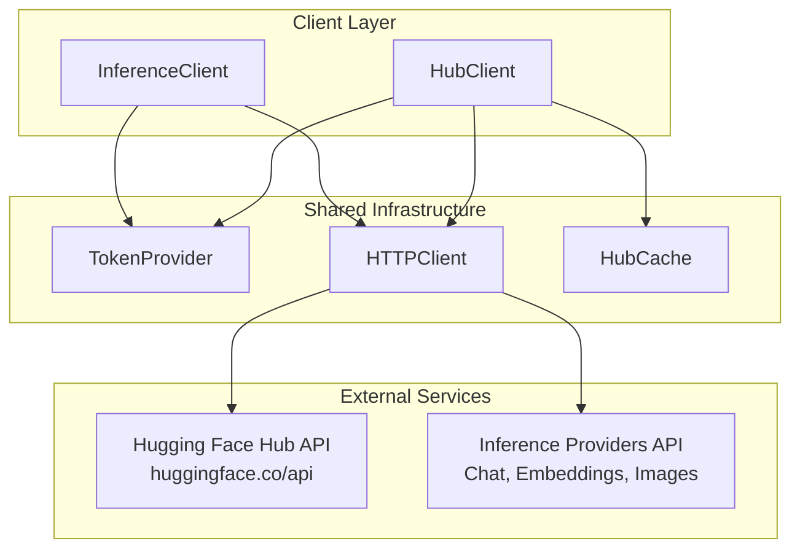
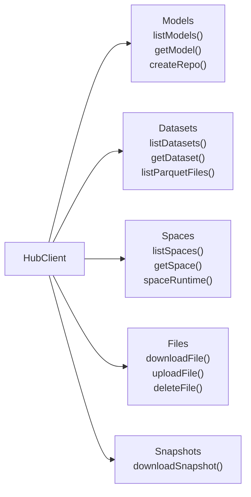
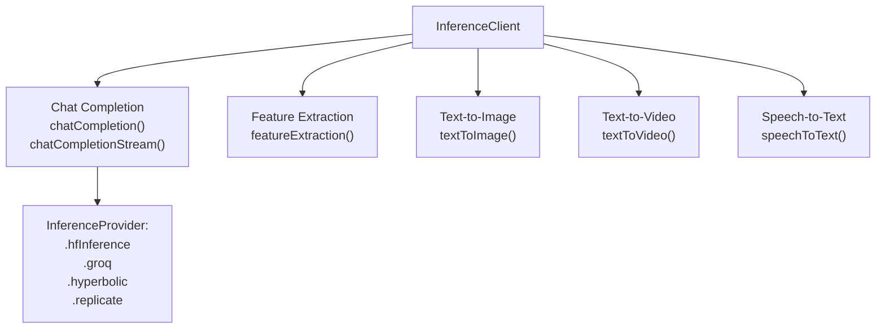
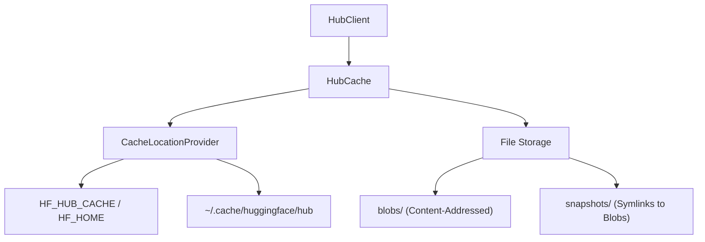

<!-- source: DeepWiki mcp.deepwiki.com · repo huggingface/swift-huggingface · page 1 Overview · fetched 2026-10-26 -->

# Overview

<details>
<summary>Relevant source files</summary>

The following files were used as context for generating this wiki page:

- [Package.swift](Package.swift)
- [README.md](README.md)
- [Tests/HubBenchmarks/DownloadSnapshotBenchmarks.swift](Tests/HubBenchmarks/DownloadSnapshotBenchmarks.swift)

</details>


## Purpose and Scope

This document provides a high-level introduction to the `swift-huggingface` SDK, a Swift client library for interacting with Hugging Face services. The SDK provides two primary interfaces: `HubClient` for managing repository resources (models, datasets, spaces, and files), and `InferenceClient` for executing AI inference tasks (chat completion, embeddings, image generation, and more).

The SDK is designed for Swift 6.0+ and supports a wide range of platforms including macOS, iOS, watchOS, tvOS, visionOS, and Linux [README.md:9-12](). It features a Python-compatible caching system and robust authentication strategies suitable for both CLI tools and user-facing applications [README.md:53-66]().

**Sources:** [README.md:1-27](), [Package.swift:8-15]()

---

## System Architecture

The `swift-huggingface` SDK is organized around two main client classes that share common infrastructure for authentication, HTTP communication, and local caching.

### Architecture Overview
Title: High-Level System Architecture


**Sources:** [README.md:1-7](), [README.md:104-132](), [README.md:845-850]()

---

## Main Client Interfaces

### HubClient - Repository Management

The `HubClient` class provides comprehensive management of Hugging Face Hub resources. It handles three primary repository types: models, datasets, and spaces [README.md:98-204](). The client supports operations including listing and searching repositories, managing files (upload, download, delete), and repository-level settings.

Title: HubClient Interface Space


Key capabilities include:
- **Repository Operations**: Create, update, and move repositories [README.md:205-235]().
- **File Management**: Download individual files or entire repository snapshots with glob pattern filtering [README.md:281-306]().
- **Caching**: Automatic caching of downloaded files in a structure compatible with the `huggingface_hub` Python library [README.md:107-116]().
- **User Information**: Accessing profile and organization details via `whoami()` [README.md:237-252]().

**Sources:** [README.md:71-306](), [Tests/HubBenchmarks/DownloadSnapshotBenchmarks.swift:43-47]()

### InferenceClient - AI Task Execution

The `InferenceClient` class provides a task-oriented API for running AI inference operations. It abstracts away provider-specific details and supports multiple inference backends [README.md:845-850]().

Title: InferenceClient Task Mapping


Supported tasks include:
- **Chat Completion**: Conversational AI with streaming support and tool calling [README.md:852-895]().
- **Feature Extraction**: Generating embeddings for text [README.md:905-915]().
- **Image/Video Generation**: Creating visual media from text prompts [README.md:921-945]().
- **Speech-to-Text**: Audio transcription [README.md:951-965]().

**Sources:** [README.md:845-965]()

---

## Core Infrastructure Components

### Authentication Layer

The SDK implements a flexible authentication system through `TokenProvider` strategies. For development, tokens are automatically detected from environment variables (e.g., `HF_TOKEN`) or local cache files [README.md:53-66]().

For user-facing applications, `HuggingFaceAuthenticationManager` provides OAuth 2.0 support with PKCE, allowing users to sign in and authorize the app securely [README.md:75-94]().

**Sources:** [README.md:53-94]()

### Caching System

The `HubCache` class implements content-addressed storage. It uses a hierarchy of `blobs`, `refs`, and `snapshots` to store repository files efficiently [README.md:107-116]().

Title: HubCache Data Flow


The cache is shared with the Python `huggingface_hub` library when possible, enabling seamless interoperability between Swift and Python tools on the same machine [README.md:109-115]().

**Sources:** [README.md:107-132](), [Tests/HubBenchmarks/DownloadSnapshotBenchmarks.swift:13-28]()

---

## Platform and Installation

### Requirements
- **Swift**: 6.0+ [README.md:11]()
- **Platforms**: macOS 13+, iOS 16+, watchOS 9+, tvOS 16+, visionOS 1+, and Linux [Package.swift:8-15]()

### Installation
The SDK is distributed via Swift Package Manager. It includes an optional `Xet` trait for enhanced transport support [README.md:26-49]().

```swift
dependencies: [
    .package(url: "https://github.com/huggingface/swift-huggingface.git", from: "0.9.0")
]
```

**Sources:** [Package.swift:1-32](), [README.md:14-24]()

---

## Quick Start Summary

```swift
import HuggingFace

// Hub Operations (Auto-detects HF_TOKEN)
let hub = HubClient.default
let modelInfo = try await hub.getModel("gpt2")

// Inference Operations
let inference = InferenceClient.default
let output = try await inference.chatCompletion(
    model: "meta-llama/Llama-3.1-8B-Instruct",
    messages: [.user("What is Swift?")]
)
```

**Sources:** [README.md:71-72](), [README.md:104-105](), [README.md:852-858]()

---

