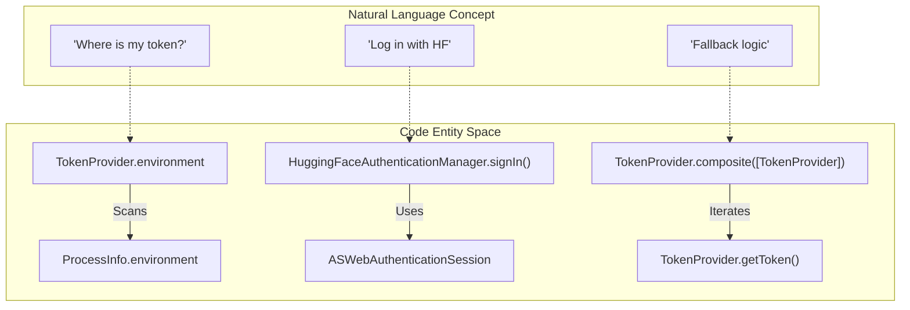
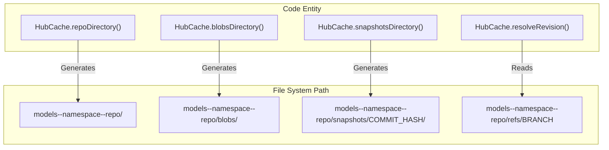

<!-- source: DeepWiki mcp.deepwiki.com · repo huggingface/swift-huggingface · page 10 Glossary · fetched 2026-10-26 -->

# Glossary

Relevant source files

The following files were used as context for generating this wiki page:

- [README.md](README.md)
- [Sources/HuggingFace/Hub/Git.swift](Sources/HuggingFace/Hub/Git.swift)
- [Sources/HuggingFace/Hub/HubCache.swift](Sources/HuggingFace/Hub/HubCache.swift)
- [Sources/HuggingFace/Hub/HubClient+Files.swift](Sources/HuggingFace/Hub/HubClient+Files.swift)
- [Sources/HuggingFace/InferenceProviders/Provider.swift](Sources/HuggingFace/InferenceProviders/Provider.swift)
- [Sources/HuggingFace/OAuth/HuggingFaceAuthenticationManager.swift](Sources/HuggingFace/OAuth/HuggingFaceAuthenticationManager.swift)
- [Sources/HuggingFace/Shared/CacheLocationProvider.swift](Sources/HuggingFace/Shared/CacheLocationProvider.swift)
- [Sources/HuggingFace/Shared/Extensions/URL+Extensions.swift](Sources/HuggingFace/Shared/Extensions/URL+Extensions.swift)
- [Sources/HuggingFace/Shared/Extensions/URLSession+Linux.swift](Sources/HuggingFace/Shared/Extensions/URLSession+Linux.swift)
- [Sources/HuggingFace/Shared/HTTPClient.swift](Sources/HuggingFace/Shared/HTTPClient.swift)
- [Sources/HuggingFace/Shared/TokenProvider.swift](Sources/HuggingFace/Shared/TokenProvider.swift)
- [Tests/HuggingFaceTests/OAuthTests/HuggingFaceAuthenticationManagerTests.swift](Tests/HuggingFaceTests/OAuthTests/HuggingFaceAuthenticationManagerTests.swift)
- [Tests/HuggingFaceTests/OAuthTests/OAuthClientTests.swift](Tests/HuggingFaceTests/OAuthTests/OAuthClientTests.swift)

This glossary defines codebase-specific terms, jargon, and domain concepts used throughout the `swift-huggingface` SDK. It serves as a reference for onboarding engineers to understand the relationships between high-level concepts and their technical implementations.

## Core Concepts

### HubClient
The primary interface for interacting with the Hugging Face Hub API. It manages repository metadata, file operations, and user information.
*   **Implementation**: `HubClient` uses an underlying `HTTPClient` for networking and an optional `HubCache` for local file persistence.
*   **Key Files**: [Sources/HuggingFace/Hub/HubClient+Files.swift:90-110](), [README.md:100-105]()
*   **Sources**: `Sources/HuggingFace/Hub/HubClient+Files.swift`, `README.md`

### InferenceClient
A client dedicated to running AI tasks (Chat, Text-to-Image, etc.) via various backends like Hugging Face Inference API, Groq, or Replicate.
*   **Key Files**: [README.md:280-295](), [Sources/HuggingFace/InferenceProviders/Provider.swift:1-20]()
*   **Sources**: `README.md`, `Sources/HuggingFace/InferenceProviders/Provider.swift`

### Repo (ID & Kind)
The Hub organizes data into three repository types (Models, Datasets, and Spaces). A `Repo.ID` uniquely identifies a repository via its namespace (user or organization) and name.
*   **Implementation**: `Repo.Kind` is an enum with values `.model`, `.dataset`, and `.space`.
*   **Key Files**: [Sources/HuggingFace/Hub/HubClient+Files.swift:103-105](), [Sources/HuggingFace/Hub/HubCache.swift:114-118]()
*   **Sources**: `Sources/HuggingFace/Hub/HubClient+Files.swift`, `Sources/HuggingFace/Hub/HubCache.swift`

---

## Authentication Terminology

### TokenProvider
A flexible enum-based strategy for retrieving authentication tokens. It supports environment variables, fixed strings, OAuth flows, and custom closures.
*   **Strategies**:
    *   `.environment`: Automatically scans `HF_TOKEN`, `HF_HOME/token`, etc.
    *   `.oauth`: Uses a closure to fetch/refresh tokens from an `AuthenticationManager`.
    *   `.composite`: Chains multiple providers in order of priority.
*   **Key Files**: [Sources/HuggingFace/Shared/TokenProvider.swift:92-165]()
*   **Sources**: `Sources/HuggingFace/Shared/TokenProvider.swift`

### OAuth Manager
The `HuggingFaceAuthenticationManager` handles the OAuth 2.0 PKCE flow on Apple platforms using `ASWebAuthenticationSession`.
*   **Implementation**: Manages `isAuthenticated` state and persists tokens in the Keychain.
*   **Key Files**: [Sources/HuggingFace/OAuth/HuggingFaceAuthenticationManager.swift:13-57]()
*   **Sources**: `Sources/HuggingFace/OAuth/HuggingFaceAuthenticationManager.swift`

### Natural Language to Authentication Code Space
The following diagram maps the high-level authentication concepts to the specific code entities that implement them.

**Diagram: Authentication Logic Mapping**

**Sources**: `Sources/HuggingFace/Shared/TokenProvider.swift`, `Sources/HuggingFace/OAuth/HuggingFaceAuthenticationManager.swift`

---

## Caching and Storage

### HubCache
A Python-compatible cache manager that implements content-addressed storage. It allows the Swift SDK to share files with the `huggingface_hub` Python library.
*   **Structure**: Uses `blobs` for actual content, `refs` for branch-to-hash mapping, and `snapshots` for symlinked directory structures.
*   **Key Files**: [Sources/HuggingFace/Hub/HubCache.swift:14-28](), [Sources/HuggingFace/Hub/HubCache.swift:114-145]()
*   **Sources**: `Sources/HuggingFace/Hub/HubCache.swift`

### CacheLocationProvider
Determines the root directory for the cache.
*   **Priority**: `HF_HUB_CACHE` > `HF_HOME/hub` > Platform Default (`~/.cache/...`).
*   **Key Files**: [Sources/HuggingFace/Shared/CacheLocationProvider.swift:66-106]()
*   **Sources**: `Sources/HuggingFace/Shared/CacheLocationProvider.swift`

### ETag
A unique identifier for a file version on the Hub. In the cache, the ETag (or SHA) is used as the filename within the `blobs/` directory to ensure deduplication.
*   **Key Files**: [Sources/HuggingFace/Hub/HubCache.swift:22-28](), [Sources/HuggingFace/Hub/HubCache.swift:62-69]()
*   **Sources**: `Sources/HuggingFace/Hub/HubCache.swift`

---

## Git and File Operations

### TreeEntry
Represents a node in the repository's file tree, which can be either a `.file` or a `.directory`.
*   **Key Files**: [Sources/HuggingFace/Hub/Git.swift:6-23]()
*   **Sources**: `Sources/HuggingFace/Hub/Git.swift`

### FileDownloadTransport
An enum that controls how files are pulled from the Hub.
*   **Values**: `.lfs` (Large File Storage), `.xet` (High-performance data transfer), or `.automatic`.
*   **Key Files**: [Sources/HuggingFace/Hub/HubClient+Files.swift:36-68]()
*   **Sources**: `Sources/HuggingFace/Hub/HubClient+Files.swift`

### Code Entity to File System Mapping
This diagram bridges the Hub's logical structures to their physical representation in the local `HubCache`.

**Diagram: Cache Hierarchy Mapping**

**Sources**: `Sources/HuggingFace/Hub/HubCache.swift`

---

## Infrastructure and Platform

### HTTPClient
A shared internal utility that wraps `URLSession`. It handles JSON decoding (using `.iso8601WithFractionalSeconds`), User-Agent injection, and paginated responses.
*   **Key Files**: [Sources/HuggingFace/Shared/HTTPClient.swift:19-60](), [Sources/HuggingFace/Shared/HTTPClient.swift:110-144]()
*   **Sources**: `Sources/HuggingFace/Shared/HTTPClient.swift`

### FoundationNetworking Compatibility
The codebase uses conditional imports (`#if canImport(FoundationNetworking)`) to support Linux.
*   **Linux Shims**: Since `URLSession` on Linux lacks certain `async` methods, the SDK provides compatibility wrappers like `data(for:)` and `asyncDownload`.
*   **Key Files**: [Sources/HuggingFace/Shared/Extensions/URLSession+Linux.swift:10-34](), [Sources/HuggingFace/Shared/Extensions/URL+Extensions.swift:4-15]()
*   **Sources**: `Sources/HuggingFace/Shared/Extensions/URLSession+Linux.swift`, `Sources/HuggingFace/Shared/Extensions/URL+Extensions.swift`

### Xet
An optional trait for high-performance file downloads, specifically for very large files.
*   **Implementation**: Enabled via the `Xet` package trait. It is triggered by the `FileDownloadTransport.xet` case or `.automatic` when files exceed 16MiB.
*   **Key Files**: [Sources/HuggingFace/Hub/HubClient+Files.swift:12-16](), [README.md:26-49]()
*   **Sources**: `Sources/HuggingFace/Hub/HubClient+Files.swift`, `README.md`