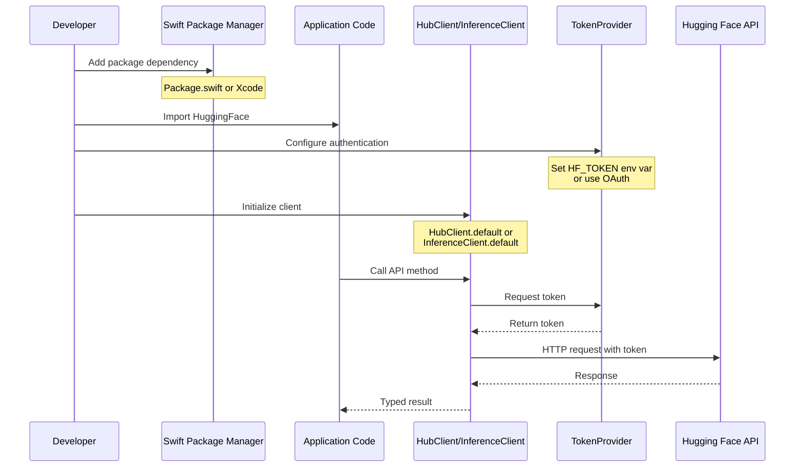

<!-- source: DeepWiki mcp.deepwiki.com · repo huggingface/swift-huggingface · page 2 Getting Started · fetched 2026-10-26 -->

# Getting Started

<details>
<summary>Relevant source files</summary>

The following files were used as context for generating this wiki page:

- [Package.swift](Package.swift)
- [Package@swift-6.0.swift](Package@swift-6.0.swift)
- [README.md](README.md)
- [Tests/HubBenchmarks/DownloadSnapshotBenchmarks.swift](Tests/HubBenchmarks/DownloadSnapshotBenchmarks.swift)

</details>


This document provides a practical guide for new users to begin using the swift-huggingface SDK. It covers system requirements, installation procedures, authentication configuration, and the two primary client interfaces that form the SDK's public API.

For detailed installation instructions, see [Installation](#2.1). For authentication configuration options, see [Authentication Setup](#2.2). For working code examples, see [Quick Start Examples](#2.3).

## Overview

The swift-huggingface SDK provides two primary client interfaces for interacting with Hugging Face services:

| Client | Purpose | Primary Use Cases |
|--------|---------|-------------------|
| `HubClient` | Repository and file management | Listing/searching models, downloading files, uploading content, managing repositories |
| `InferenceClient` | AI task execution | Chat completion, embeddings, text-to-image, speech-to-text |

Both clients share common infrastructure for authentication, HTTP communication, and error handling, but expose different APIs optimized for their respective domains.

## System Requirements

The SDK supports multiple Apple platforms and Linux:

| Platform | Minimum Version | Notes |
|----------|----------------|-------|
| macOS | 13.0+ | Full feature support including OAuth |
| iOS | 16.0+ | Full feature support including OAuth |
| tvOS | 16.0+ | Full feature support |
| watchOS | 9.0+ | Full feature support |
| visionOS | 1.0+ | Full feature support |
| macCatalyst | 16.0+ | Full feature support |
| Linux | Any | Limited OAuth support (file-based token storage) |

**Swift Version**: 6.0 or higher is required.

Sources: [Package.swift:8-15](), [Package@swift-6.0.swift:8-15](), [README.md:11-12]()

## Architecture Overview

The following diagram illustrates how the main components connect when getting started with the SDK:

```mermaid
graph TB
    subgraph "UserCode"
        ["App"]
    end
    
    subgraph "SDKEntryPoints"
        ["HubClient.default"]
        ["InferenceClient.default"]
        ["HubClient(tokenProvider:)"]
        ["InferenceClient(tokenProvider:)"]
    end
    
    subgraph "TokenProviderOptions"
        ["TPEnv"] -- ".environment<br/>Auto-detect from env/files" --> TPEnvNode
        ["TPFixed"] -- ".fixed(String)<br/>Hardcoded token" --> TPFixedNode
        ["TPOAuth"] -- ".oauth(manager:)<br/>OAuth 2.0 flow" --> TPOAuthNode
        ["TPComposite"] -- ".composite<br/>Fallback chain" --> TPCompositeNode
    end
    
    subgraph "AuthenticationSources"
        ["EnvVar"] -- "Environment Variables<br/>HF_TOKEN, HUGGING_FACE_HUB_TOKEN" --> EnvVarNode
        ["EnvPath"] -- "HF_TOKEN_PATH" --> EnvPathNode
        ["FileCache"] -- "~/.cache/huggingface/token" --> FileCacheNode
        ["FileHF"] -- "~/.huggingface/token" --> FileHFNode
        ["OAuthMgr"] -- "HuggingFaceAuthenticationManager" --> OAuthMgrNode
    end
    
    ["App"] --> ["HubClient.default"]
    ["App"] --> ["InferenceClient.default"]
    ["App"] --> ["HubClient(tokenProvider:)"]
    ["App"] --> ["InferenceClient(tokenProvider:)"]
    
    ["HubClient.default"] -.uses.-> ["TPEnv"]
    ["InferenceClient.default"] -.uses.-> ["TPEnv"]
    
    ["HubClient(tokenProvider:)"] --> ["TPEnv"]
    ["HubClient(tokenProvider:)"] --> ["TPFixed"]
    ["HubClient(tokenProvider:)"] --> ["TPOAuth"]
    ["HubClient(tokenProvider:)"] --> ["TPComposite"]
    
    ["InferenceClient(tokenProvider:)"] --> ["TPEnv"]
    ["InferenceClient(tokenProvider:)"] --> ["TPFixed"]
    ["InferenceClient(tokenProvider:)"] --> ["TPOAuth"]
    ["InferenceClient(tokenProvider:)"] --> ["TPComposite"]
    
    ["TPEnv"] -.checks.-> ["EnvVar"]
    ["TPEnv"] -.checks.-> ["EnvPath"]
    ["TPEnv"] -.checks.-> ["FileCache"]
    ["TPEnv"] -.checks.-> ["FileHF"]
    
    ["TPOAuth"] --> ["OAuthMgr"]
```

Sources: [README.md:53-94]()

## Client Initialization Patterns

The SDK provides multiple initialization patterns depending on your deployment scenario:

### Default Clients with Auto-Detected Authentication

The simplest approach uses the `.default` static property, which automatically detects authentication tokens from standard locations:

```swift
let hubClient = HubClient.default
let inferenceClient = InferenceClient.default
```

This pattern checks the following locations in order:
1. `HF_TOKEN` environment variable
2. `HUGGING_FACE_HUB_TOKEN` environment variable
3. Path specified in `HF_TOKEN_PATH` environment variable
4. `$HF_HOME/token` file
5. `~/.cache/huggingface/token` (standard HF CLI location)
6. `~/.huggingface/token` (legacy fallback)

Sources: [README.md:57-71]()

### Explicit TokenProvider Configuration

For more control over authentication, construct clients with explicit `TokenProvider` instances:

| TokenProvider | Use Case | Example |
|--------------|----------|---------|
| `.environment` | Auto-detect from standard locations | `HubClient(tokenProvider: .environment)` |
| `.fixed("token")` | Hardcoded token (testing/CI) | `HubClient(tokenProvider: .fixed("hf_..."))` |
| `.oauth(manager:)` | User-facing OAuth flow | `InferenceClient(tokenProvider: .oauth(manager: authManager))` |
| `.composite([...])` | Fallback chain | `HubClient(tokenProvider: .composite([.oauth(...), .environment]))` |

The `.composite` provider tries each strategy in order until one succeeds, enabling graceful degradation across environments.

Sources: [README.md:75-94]()

## Code Entity Reference

The following diagram maps natural language concepts to actual code entities in the SDK:

```mermaid
graph LR
    subgraph "PublicAPIClasses"
        ["HubClient"]
        ["InferenceClient"]
        ["TokenProvider"]
        ["HuggingFaceAuthenticationManager"]
    end
    
    subgraph "CoreTypes"
        ["RepoID"] -- "Repo.ID<br/>Repository identifier" --> RepoIDNode
        ["RepoKind"] -- "Repo.Kind<br/>.model / .dataset / .space" --> RepoKindNode
        ["ChatMessage"] -- "ChatCompletion.Message<br/>Chat message structure" --> ChatMessageNode
        ["FileStruct"] -- "File<br/>File metadata" --> FileStructNode
    end
    
    subgraph "Infrastructure"
        ["HTTPClient"]
        ["HubCache"]
        ["FileLock"]
    end
    
    ["HubClient"] --> ["TokenProvider"]
    ["HubClient"] --> ["HTTPClient"]
    ["HubClient"] -.optional.-> ["HubCache"]
    
    ["InferenceClient"] --> ["TokenProvider"]
    ["InferenceClient"] --> ["HTTPClient"]
    
    ["TokenProvider"] -.delegates.-> ["HuggingFaceAuthenticationManager"]
    
    ["HubClient"] --> ["RepoID"]
    ["HubClient"] --> ["RepoKind"]
    ["HubClient"] --> ["FileStruct"]
    
    ["InferenceClient"] --> ["ChatMessage"]
    
    ["HubCache"] --> ["FileLock"]
```

Sources: [README.md:1-285](), [Package.swift:1-61]()

## Typical Getting Started Workflow

The standard workflow for new SDK users follows this sequence:



Sources: [README.md:14-94]()

## Installation Overview

The SDK is distributed via Swift Package Manager. Add the dependency to your `Package.swift`:

```swift
dependencies: [
    .package(url: "https://github.com/huggingface/swift-huggingface.git", from: "0.9.0")
]
```

The package declares external dependencies that are automatically resolved:
- `EventSource` (1.0.0+): Server-Sent Events parsing for streaming responses [Package.swift:29]()
- `swift-crypto` (1.0.0 - 5.0.0): Cryptographic operations [Package.swift:30]()
- `swift-xet` (0.2.0+): Optional Xet transport support [Package.swift:31]()

For detailed installation instructions including the optional `Xet` trait, see [Installation](#2.1).

Sources: [README.md:16-49](), [Package.swift:22-32]()

## Authentication Configuration Overview

Authentication is required for most API operations. The SDK supports three primary strategies:

### 1. Environment-Based (Recommended for Development)

Set one of the following environment variables:
- `HF_TOKEN`: Primary token location [README.md:60]()
- `HUGGING_FACE_HUB_TOKEN`: Alternative name [README.md:61]()
- `HF_TOKEN_PATH`: Path to file containing token [README.md:62]()

### 2. OAuth 2.0 with PKCE (Recommended for User-Facing Apps)

For applications that need to authenticate end users:

```swift
let authManager = try HuggingFaceAuthenticationManager(
    clientID: "your_client_id",
    redirectURL: URL(string: "yourapp://oauth/callback")!,
    scope: [.openid, .profile, .email],
    keychainService: "com.yourapp.huggingface",
    keychainAccount: "user_token"
)

try await authManager.signIn()
let client = InferenceClient(tokenProvider: .oauth(manager: authManager))
```

### 3. Fixed Token (Testing/CI)

For testing or CI environments where tokens are managed externally:

```swift
let client = HubClient(tokenProvider: .fixed("hf_your_token_here"))
```

For comprehensive authentication setup information, see [Authentication Setup](#2.2).

Sources: [README.md:75-94]()

## Client Capabilities Summary

### HubClient Capabilities

`HubClient` provides repository and file management operations:

| Operation Category | Examples |
|-------------------|----------|
| Repository listing | `listModels()`, `listDatasets()`, `listSpaces()` |
| Repository details | `getModel()`, `getDataset()`, `getSpace()` |
| File operations | `downloadFile()`, `uploadFile()`, `deleteFile()` |
| Snapshots | `downloadSnapshot()` with glob pattern filtering |
| Repository management | `createRepo()`, `moveRepo()`, `updateRepoSettings()` |

For detailed usage, see [HubClient - Repository Management](#3).

### InferenceClient Capabilities

`InferenceClient` provides AI task execution:

| Task | Method | Streaming Support |
|------|--------|------------------|
| Chat completion | `chatCompletion()` | Yes |
| Embeddings | `featureExtraction()` | No |
| Text-to-image | `textToImage()` | No |

For detailed usage, see [InferenceClient - AI Tasks](#4).

Sources: [README.md:98-285]()

## Next Steps

After completing the installation and authentication setup:

1. **Review Quick Start Examples**: See [Quick Start Examples](#2.3) for common tasks.
2. **Explore HubClient**: See [HubClient - Repository Management](#3) for file and repository operations.
3. **Explore InferenceClient**: See [InferenceClient - AI Tasks](#4) for AI inference tasks.
4. **Configure Caching**: See [Caching System](#6) to optimize file downloads.
5. **Understand Error Handling**: See [Error Handling](#7.2) for robust error management.

Sources: [README.md:107-132]()

---

