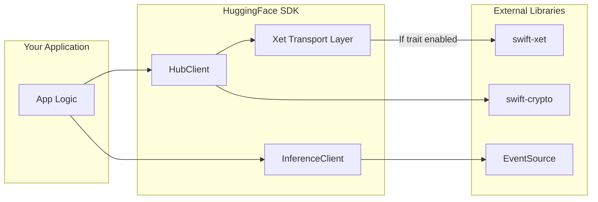
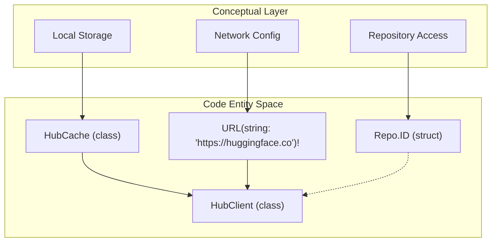

<!-- source: DeepWiki mcp.deepwiki.com · repo huggingface/swift-huggingface · page 2.1 Installation · fetched 2026-10-26 -->

# Installation

<details>
<summary>Relevant source files</summary>

The following files were used as context for generating this wiki page:

- [Package.resolved](Package.resolved)
- [Package.swift](Package.swift)
- [Package@swift-6.0.swift](Package@swift-6.0.swift)
- [Tests/HubBenchmarks/DownloadSnapshotBenchmarks.swift](Tests/HubBenchmarks/DownloadSnapshotBenchmarks.swift)

</details>


This page covers adding the swift-huggingface SDK to your Swift project using Swift Package Manager, including platform requirements and the optional Xet trait for optimized large file transfers.

## Overview

The swift-huggingface SDK is distributed as a Swift Package and can be integrated into projects using Swift Package Manager (SPM). The package provides the `HuggingFace` library, which includes both `HubClient` for repository management and `InferenceClient` for AI inference tasks.

## System Requirements

The SDK has specific platform and Swift version requirements defined in the package manifest:

| Component | Minimum Version | Notes |
|-----------|----------------|-------|
| **Swift** | 6.0+ | Swift 6.1+ recommended for latest toolchain features [Package.swift:1-2]() |
| **macOS** | 13.0 | Full feature support [Package.swift:9]() |
| **iOS** | 16.0 | Full feature support [Package.swift:11]() |
| **Mac Catalyst** | 16.0 | Full feature support [Package.swift:10]() |
| **watchOS** | 9.0 | Full feature support [Package.swift:12]() |
| **tvOS** | 16.0 | Full feature support [Package.swift:13]() |
| **visionOS** | 1.0 | Full feature support [Package.swift:14]() |
| **Linux** | Supported | Core Hub and Inference functionality |

Sources: [Package.swift:1-15]()

## Package Dependencies and Traits

The SDK relies on several key dependencies for networking, security, and optimized data transfer.

### External Dependencies
- **EventSource**: Handles Server-Sent Events (SSE) for streaming chat completion [Package.swift:29]().
- **Swift Crypto**: Provides cryptographic primitives for secure operations [Package.swift:30]().
- **Swift Xet**: Optional dependency for high-performance large file transfers [Package.swift:31]().

### The Xet Trait
Starting with Swift 6.1, the package introduces **Traits** to manage optional functionality. The `Xet` trait enables support for the Xet transport protocol, which is optimized for deduplication and efficient transfer of large model weights.

| Trait Name | Description | Condition |
|------------|-------------|-----------|
| `Xet` | Enables Xet transport support and adds `swift-xet` dependency. | Defined in [Package.swift:22-27]() |

**Data Flow with Xet Enabled:**



Sources: [Package.swift:22-45](), [Package.resolved:14-21](), [Package.resolved:86-93](), [Package.resolved:212-219]()

## Installation Methods

### Method 1: Package.swift (Recommended)

Add the dependency to your `Package.swift` file. To enable the optional Xet support, include the `Xet` trait in your target dependencies.

```swift
// Package.swift
let package = Package(
    name: "MyAIProject",
    dependencies: [
        .package(url: "https://github.com/huggingface/swift-huggingface.git", from: "0.1.0")
    ],
    targets: [
        .target(
            name: "MyTarget",
            dependencies: [
                .product(
                    name: "HuggingFace", 
                    package: "swift-huggingface",
                    condition: .when(traits: ["Xet"]) // Optional: Enable Xet support
                )
            ]
        )
    ]
)
```

Sources: [Package.swift:16-45]()

### Method 2: Xcode Integration

1. In Xcode, select **File** > **Add Package Dependencies...**
2. Enter the repository URL: `https://github.com/huggingface/swift-huggingface.git`
3. Select the versioning rule (e.g., Up to Next Major Version).
4. **Traits Selection**: If using Xcode 16+ (Swift 6.1+), you can toggle the `Xet` trait in the package configuration screen to enable optimized large file downloads.

## Verifying Installation

To verify the installation, you can instantiate a `HubClient` and check its configuration.

### Natural Language to Code Entity Mapping

The following diagram bridges the conceptual requirements of the SDK with the actual code entities used for initialization and verification.



### Verification Snippet
You can run a simple test to ensure the clients are available:

```swift
import HuggingFace
import Foundation

// Verify HubClient initialization
let cache = HubCache() // Default cache location
let client = HubClient(cache: cache)

// Verify Repo ID parsing
let repo: Repo.ID = "mlx-community/Qwen3-0.6B-Base-DQ5"
print("Successfully initialized client for \(repo)")
```

Sources: [Tests/HubBenchmarks/DownloadSnapshotBenchmarks.swift:22-28](), [Tests/HubBenchmarks/DownloadSnapshotBenchmarks.swift:32]()

## Troubleshooting

### Build Failures with Xet
If you encounter build errors related to `Xet`, ensure you are using Swift 6.1 or later if you have enabled the `Xet` trait. The `Package.swift` uses conditional defines `HUGGINGFACE_ENABLE_XET` to manage this feature [Package.swift:43]().

### Cache Directory Permissions
The `HubCache` defaults to system cache directories. On Darwin platforms, this is typically in the user's `Library/Caches` folder [Tests/HubBenchmarks/DownloadSnapshotBenchmarks.swift:13-16](). Ensure your application has write permissions to the designated cache path.

Sources: [Package.swift:1](), [Package.swift:42-45](), [Tests/HubBenchmarks/DownloadSnapshotBenchmarks.swift:13-20]()

---

