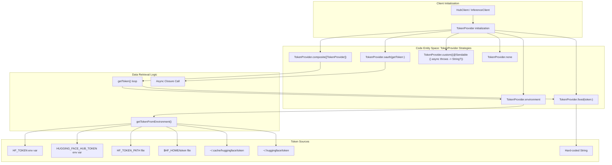
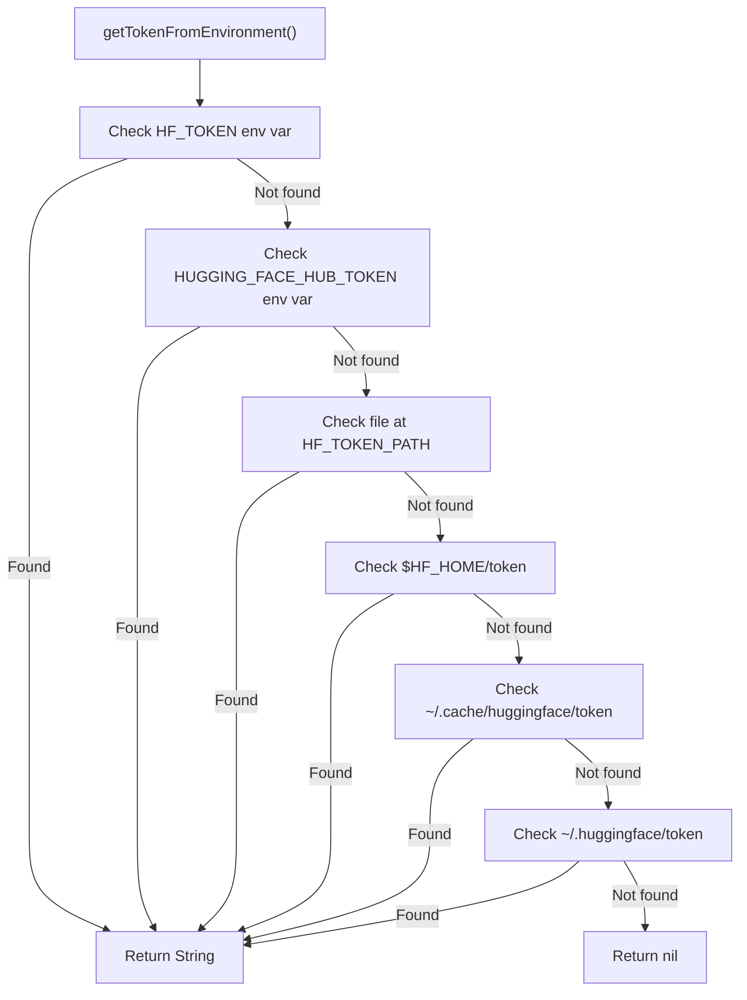
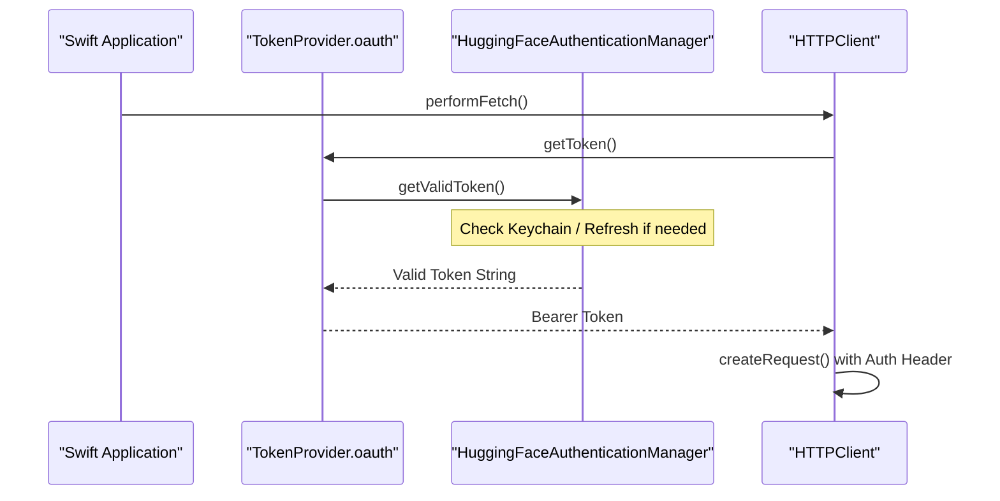
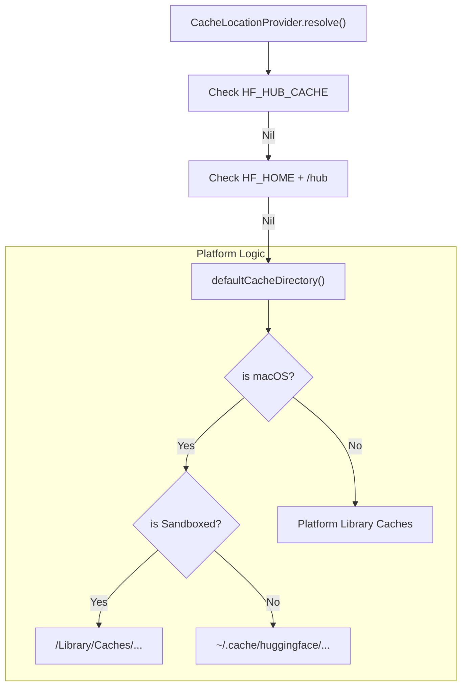

<!-- source: DeepWiki mcp.deepwiki.com · repo huggingface/swift-huggingface · page 2.2 Authentication Setup · fetched 2026-10-26 -->

# Authentication Setup

<details>
<summary>Relevant source files</summary>

The following files were used as context for generating this wiki page:

- [Sources/HuggingFace/Hub/HubClient.swift](Sources/HuggingFace/Hub/HubClient.swift)
- [Sources/HuggingFace/Shared/HTTPClient.swift](Sources/HuggingFace/Shared/HTTPClient.swift)
- [Sources/HuggingFace/Shared/TokenProvider.swift](Sources/HuggingFace/Shared/TokenProvider.swift)
- [Tests/HuggingFaceTests/HubTests/CacheLocationProviderTests.swift](Tests/HuggingFaceTests/HubTests/CacheLocationProviderTests.swift)

</details>


This page provides a practical guide to configuring authentication for the `swift-huggingface` SDK in different deployment scenarios. Authentication is handled through the `TokenProvider` abstraction, which supports multiple strategies including environment variables, token files, OAuth flows, and custom implementations.

For detailed information about the authentication system architecture and implementation details, see [Authentication System](). For OAuth-specific implementation details, see [OAuth 2.0 with PKCE]().

---

## Overview of Authentication Methods

The SDK supports multiple authentication strategies through the `TokenProvider` enum, allowing you to choose the method that best fits your deployment scenario.

| Strategy | Use Case | Platform Support |
|----------|----------|------------------|
| `.environment` | Development, CI/CD, server deployments | All platforms |
| `.fixed(token:)` | Testing, single-user applications | All platforms |
| `.oauth(getToken:)` | User-facing applications requiring sign-in | macOS 14+, iOS 17+ |
| `.composite([...])` | Multi-environment with fallbacks | All platforms |
| `.custom(...)` | Custom authentication logic | All platforms |
| `.none` | Public API access without authentication | All platforms |

Sources: [Sources/HuggingFace/Shared/TokenProvider.swift:92-165]()

---

## Authentication Flow

### Natural Language to Code Entity Space: Token Resolution



**Authentication Flow Overview**: This diagram maps the `TokenProvider` enum cases to the internal logic used to resolve strings from various system sources.

Sources: [Sources/HuggingFace/Shared/TokenProvider.swift:183-209](), [Sources/HuggingFace/Shared/HTTPClient.swift:45-60]()

---

## Environment-Based Authentication (Recommended)

Environment-based authentication is the default and most flexible approach for development, CI/CD, and server deployments. It automatically detects tokens from multiple standard locations.

### Token Detection Order

The `getTokenFromEnvironment()` function checks sources in the following priority order:



**Token Detection Priority**: The implementation iterates through these sources, returning the first valid token found.

Sources: [Sources/HuggingFace/Shared/TokenProvider.swift:109-121](), [Sources/HuggingFace/Hub/HubClient.swift:21-29]()

### Setup Instructions

**Option 1: Environment Variable (Recommended for CI/CD)**

Set either `HF_TOKEN` or `HUGGING_FACE_HUB_TOKEN`:

```bash
export HF_TOKEN="hf_..."
```

**Option 2: Token File (Recommended for Local Development)**

Store your token in the standard Hugging Face CLI location:

```bash
echo "hf_..." > ~/.cache/huggingface/token
```

### Usage

```swift
import HuggingFace

// HubClient.init defaults to .environment
let client = HubClient() 

// Verify authentication via the computed property
if let token = await client.bearerToken {
    print("Authenticated with token: \(token)")
}
```

Sources: [Sources/HuggingFace/Hub/HubClient.swift:109-121](), [Sources/HuggingFace/Hub/HubClient.swift:94-98]()

---

## Fixed Token Authentication

Fixed token authentication is useful for testing or when you need to explicitly control the token source.

### Setup

```swift
import HuggingFace

// HubClient supports string literals for tokenProvider
let client = HubClient(host: HubClient.defaultHost, bearerToken: "hf_abc123")

// Or via explicit TokenProvider
let explicitClient = HubClient(
    host: HubClient.defaultHost, 
    tokenProvider: .fixed(token: "hf_abc123")
)
```

Sources: [Sources/HuggingFace/Hub/HubClient.swift:132-146](), [Sources/HuggingFace/Shared/TokenProvider.swift:107]()

---

## OAuth Authentication

OAuth authentication is designed for user-facing applications that need to authenticate individual users through Hugging Face's OAuth 2.0 flow.

### OAuth Token Retrieval Flow



**OAuth Integration**: The `TokenProvider.oauth` case wraps an asynchronous closure, typically provided by the `HuggingFaceAuthenticationManager`.

Sources: [Sources/HuggingFace/Shared/TokenProvider.swift:37-48](), [Sources/HuggingFace/Shared/TokenProvider.swift:191-192]()

### Setup Instructions

```swift
import HuggingFace

// 1. Initialize the manager (requires Client ID from HF Settings)
let authManager = try HuggingFaceAuthenticationManager(
    clientID: "your-client-id",
    redirectURL: URL(string: "myapp://oauth")!,
    scope: .basic
)

// 2. Create client using the oauth factory
let client = HubClient(
    host: HubClient.defaultHost,
    tokenProvider: .oauth(manager: authManager)
)
```

Sources: [Sources/HuggingFace/Shared/TokenProvider.swift:40-47]()

---

## Composite Authentication Strategies

Composite strategies allow you to combine multiple authentication methods with automatic fallback. The provider tries each strategy in order until one returns a non-nil token.

### Composite Usage Patterns

```swift
// Try OAuth first, fall back to environment variables, then a fixed token
let client = HubClient(
    host: HubClient.defaultHost,
    tokenProvider: [
        .oauth(manager: authManager), 
        .environment,                 
        .fixed(token: "hf_fallback")
    ]
)
```

Sources: [Sources/HuggingFace/Shared/TokenProvider.swift:55-61](), [Sources/HuggingFace/Shared/TokenProvider.swift:194-200]()

---

## Platform-Specific Cache & Token Storage

The SDK automatically detects the appropriate storage locations based on the platform and sandbox status.

| Platform | Variable | Default Path Logic |
|----------|----------|--------------------|
| **macOS (Non-Sandboxed)** | `HF_HOME` | `~/.cache/huggingface/hub` |
| **Apple (Sandboxed)** | `HF_HOME` | `Library/Caches/huggingface/hub` |
| **Linux** | `HF_HOME` | `~/.cache/huggingface/hub` |

Sources: [Sources/HuggingFace/Hub/HubClient.swift:33-45](), [Tests/HuggingFaceTests/HubTests/CacheLocationProviderTests.swift:103-136]()

### Implementation Detail: Cache Location Resolution



Sources: [Tests/HuggingFaceTests/HubTests/CacheLocationProviderTests.swift:82-136](), [Sources/HuggingFace/Hub/HubClient.swift:37-45]()

---

