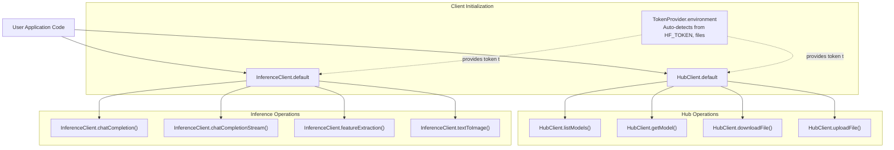
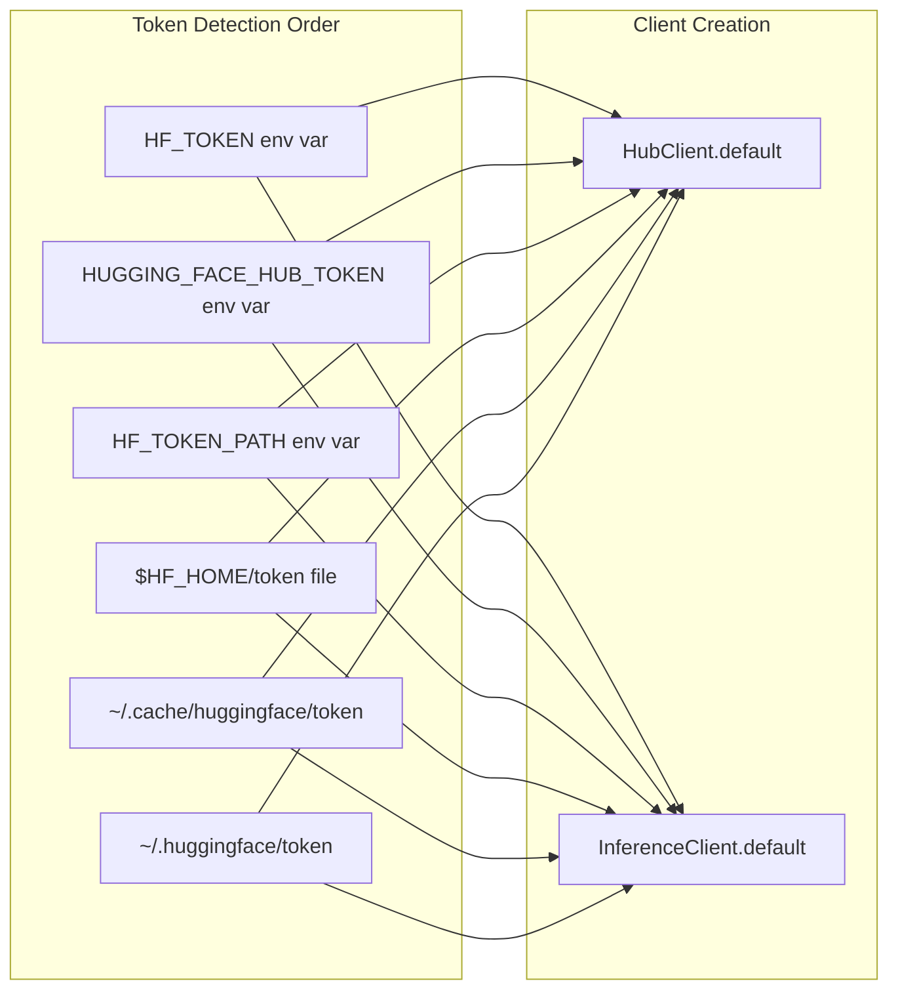
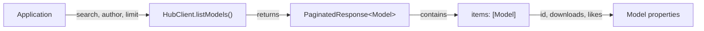
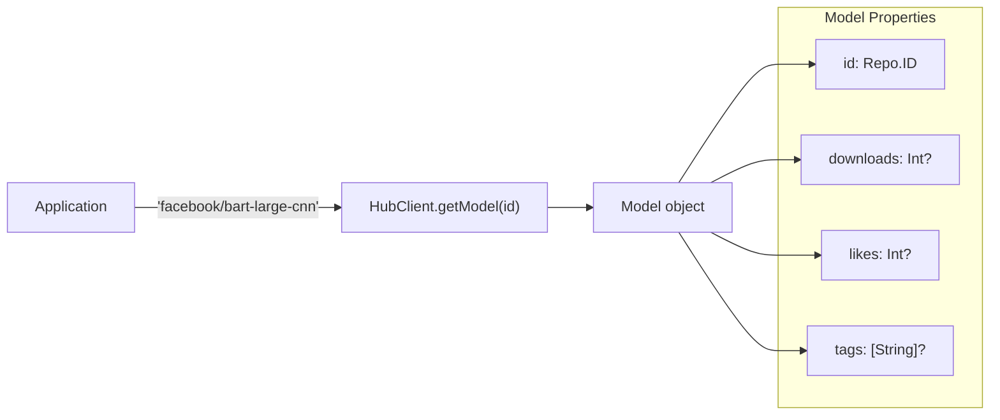
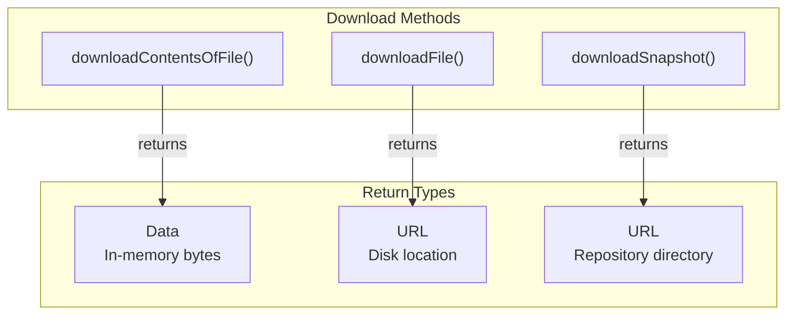
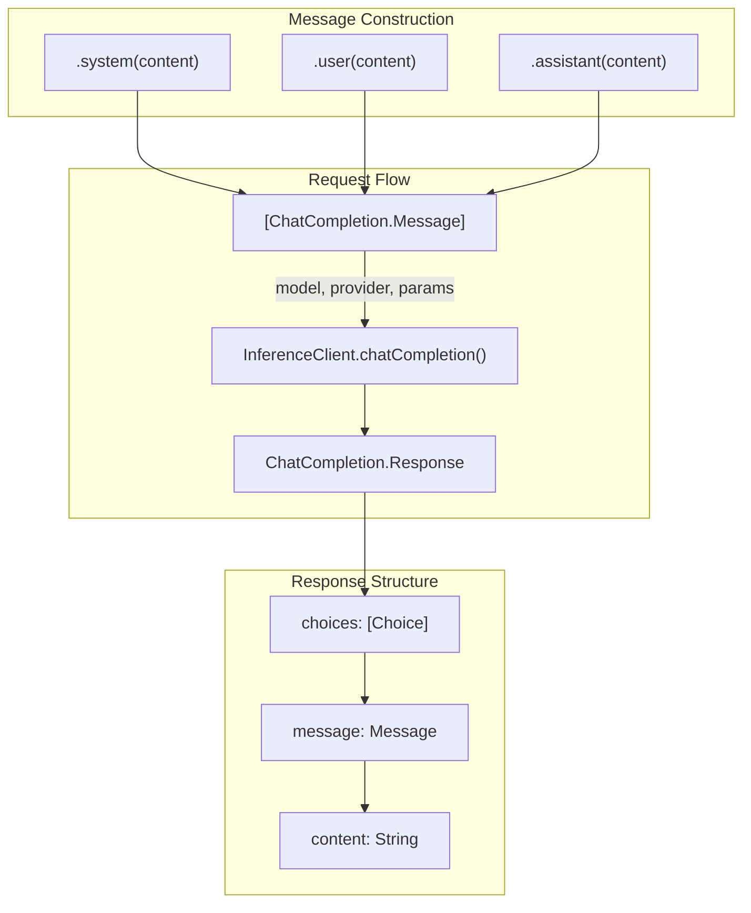
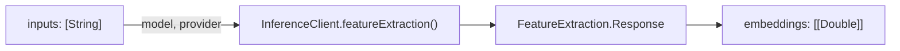
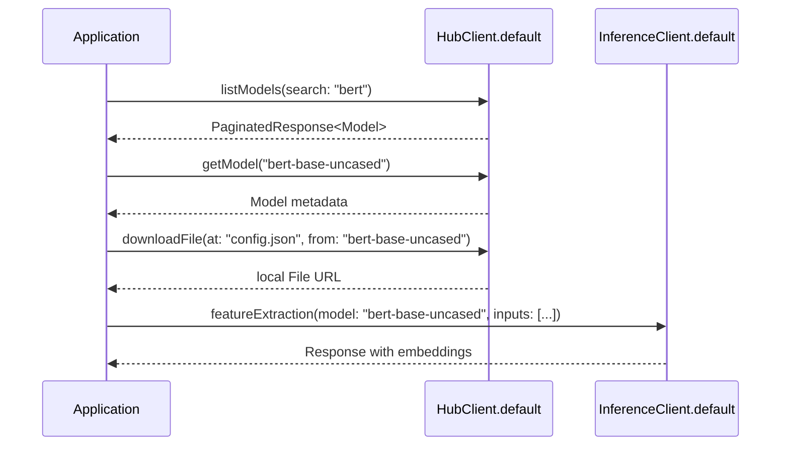

<!-- source: DeepWiki mcp.deepwiki.com · repo huggingface/swift-huggingface · page 2.3 Quick Start Examples · fetched 2026-10-26 -->

# Quick Start Examples

<details>
<summary>Relevant source files</summary>

The following files were used as context for generating this wiki page:

- [README.md](README.md)
- [Sources/HuggingFace/Hub/HubClient+Models.swift](Sources/HuggingFace/Hub/HubClient+Models.swift)
- [Sources/HuggingFace/InferenceProviders/InferenceClient.swift](Sources/HuggingFace/InferenceProviders/InferenceClient.swift)

</details>


This page provides practical code examples for common tasks to help you start using the swift-huggingface SDK immediately. It demonstrates basic usage patterns for both repository management (`HubClient`) and AI inference (`InferenceClient`).

For installation instructions, see [Installation](#2.1). For detailed authentication configuration, see [Authentication Setup](#2.2). For comprehensive HubClient operations, see [HubClient - Repository Management](#3). For detailed inference capabilities, see [InferenceClient - AI Tasks](#4).

## Overview of Basic Usage Patterns

The SDK provides two primary client interfaces that follow consistent initialization and usage patterns:



Sources: [README.md:67-105](), [README.md:845-858](), [Sources/HuggingFace/InferenceProviders/InferenceClient.swift:24-33]()

## Creating Clients

Both `HubClient` and `InferenceClient` provide a `.default` singleton for convenience. These instances automatically detect authentication tokens from environment variables and standard file locations.



### Basic Client Initialization

The simplest way to create clients uses automatic authentication:

| Client Type | Code | Authentication |
|-------------|------|----------------|
| Hub Client | `HubClient.default` | Auto-detected from environment [README.md:70-71]() |
| Inference Client | `InferenceClient.default` | Auto-detected from environment [Sources/HuggingFace/InferenceProviders/InferenceClient.swift:33-33]() |

For custom configuration (custom host, explicit token, user agent), clients can be initialized with specific parameters:

| Parameter | Type | Purpose |
|-----------|------|---------|
| `host` | `URL` | Custom API endpoint [Sources/HuggingFace/InferenceProviders/InferenceClient.swift:89-89]() |
| `userAgent` | `String?` | Custom user agent for requests [Sources/HuggingFace/InferenceProviders/InferenceClient.swift:90-90]() |
| `bearerToken` | `String?` | Explicit authentication token [Sources/HuggingFace/InferenceProviders/InferenceClient.swift:91-91]() |
| `tokenProvider` | `TokenProvider` | Advanced authentication strategy [Sources/HuggingFace/InferenceProviders/InferenceClient.swift:112-112]() |

Sources: [README.md:53-73](), [Sources/HuggingFace/InferenceProviders/InferenceClient.swift:13-33](), [Sources/HuggingFace/InferenceProviders/InferenceClient.swift:68-120]()

## HubClient Examples

### Listing Models

The `listModels()` method searches and filters models on the Hugging Face Hub. It returns a `PaginatedResponse<Model>` containing metadata-rich model objects.



Key parameters for filtering model lists:

| Parameter | Type | Description |
|-----------|------|-------------|
| `search` | `String?` | Filter based on substrings for repos [Sources/HuggingFace/Hub/HubClient+Models.swift:70-70]() |
| `author` | `String?` | Filter models by an author or organization [Sources/HuggingFace/Hub/HubClient+Models.swift:71-71]() |
| `filter` | `String?` | Filter based on tags (e.g., "text-classification") [Sources/HuggingFace/Hub/HubClient+Models.swift:72-72]() |
| `sort` | `String?` | Property to use when sorting (e.g., "downloads") [Sources/HuggingFace/Hub/HubClient+Models.swift:73-73]() |
| `limit` | `Int?` | Limit the number of models fetched [Sources/HuggingFace/Hub/HubClient+Models.swift:75-75]() |

Sources: [README.md:137-146](), [Sources/HuggingFace/Hub/HubClient+Models.swift:69-111]()

### Getting Model Information

The `getModel()` method retrieves detailed metadata for a specific model by its repository ID (format: `"namespace/repo-name"`):



Sources: [README.md:148-152](), [Sources/HuggingFace/Hub/HubClient+Models.swift:126-157]()

### Downloading Files

The SDK provides multiple methods for downloading files from repositories, integrated with the `HubCache` system.



#### Download File Contents to Memory

For small files (configuration, metadata), download directly to `Data`:

| Use Case | Method | Returns |
|----------|--------|---------|
| Configuration files | `downloadContentsOfFile(at:from:)` | `Data` |
| Small text/JSON files | `downloadContentsOfFile(at:from:kind:revision:)` | `Data` |

#### Download File to Disk

For large files (models, datasets), download directly to disk with optional progress tracking. The client handles local caching automatically in a Python-compatible directory structure.

| Feature | Parameter | Type |
|---------|-----------|------|
| Source path | `at` | `String` |
| Repository | `from` | `Repo.ID` |
| Progress tracking | `progress` | `Progress?` |

Sources: [README.md:107-132](), [README.md:412-528]()

## InferenceClient Examples

### Chat Completion

The `chatCompletion()` method generates conversational responses using language models. Messages use the `ChatCompletion.Message` type with role-based constructors.



Key parameters for chat completion:

| Parameter | Type | Description |
|-----------|------|-------------|
| `model` | `String` | Model ID (e.g., `"meta-llama/Llama-3.3-70B-Instruct"`) |
| `messages` | `[ChatCompletion.Message]` | Conversation history |
| `provider` | `InferenceProvider?` | Backend (e.g., `.groq`, `.hfInference`) |
| `temperature` | `Double?` | Randomness (0.0-1.0) |

Sources: [README.md:859-906]()

### Feature Extraction (Embeddings)

The `featureExtraction()` method generates dense vector embeddings for semantic similarity:



Sources: [README.md:908-926]()

### Text-to-Image Generation

The `textToImage()` method generates images from text prompts with configurable parameters:

```mermaid
graph TB
    subgraph "Input Parameters"
        Prompt["prompt: String"]
        NegPrompt["negativePrompt: String?"]
        Width["width: Int?"]
        Height["height: Int?"]
    end
    
    subgraph "Generation"
        T2IMethod["InferenceClient.textToImage()"]
        Provider["provider: InferenceProvider?"]
    end
    
    subgraph "Response"
        Response["TextToImage.Response"]
        Image["image: Data"]
    end
    
    Prompt --> T2IMethod
    NegPrompt --> T2IMethod
    Width --> T2IMethod
    Height --> T2IMethod
    Provider --> T2IMethod
    
    T2IMethod --> Response
    Response --> Image
```

Sources: [README.md:928-961]()

## Complete Example Workflows

### Workflow 1: Search, Download, and Use a Model



Sources: [README.md:84-104](), [README.md:412-428](), [README.md:908-926]()

## Error Handling Pattern

All SDK methods throw errors conforming to `HTTPClientError`.

| Error Case | When Thrown |
|------------|-------------|
| `.requestError(detail)` | Request construction fails |
| `.responseError(response, detail)` | HTTP status indicates failure |
| `.decodingError(response, detail)` | JSON parsing fails |
| `.unexpectedError(detail)` | Unexpected condition |

Sources: [README.md:614-629]()

## Next Steps

- **Repository Operations**: See [Models, Datasets, and Spaces](#3.1)
- **File Management**: See [File Operations](#3.2)
- **Advanced Chat**: See [Chat Completion](#4.1)
- **Authentication**: See [TokenProvider Strategies](#5.1)
- **Caching**: See [Cache Architecture](#6.1)

Sources: [README.md:1-1020]()

---

