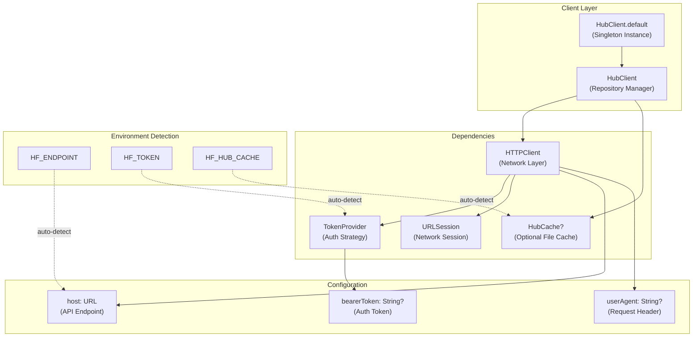
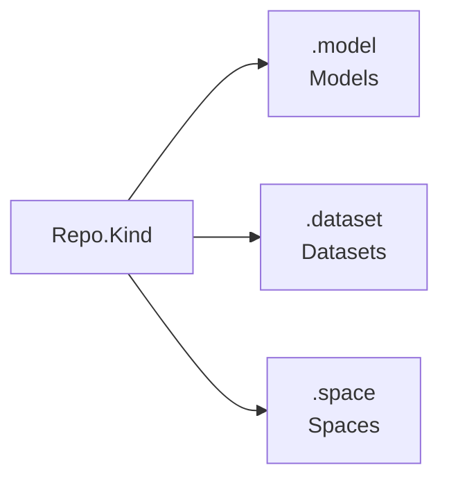
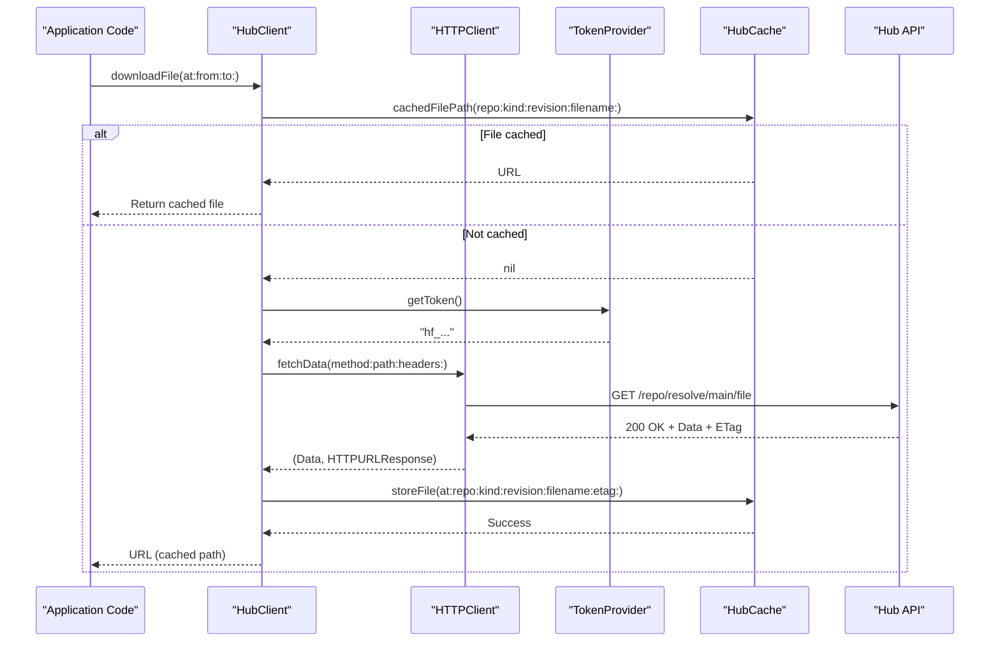

<!-- source: DeepWiki mcp.deepwiki.com · repo huggingface/swift-huggingface · page 3 HubClient - Repository Management · fetched 2026-10-26 -->

# HubClient - Repository Management

<details>
<summary>Relevant source files</summary>

The following files were used as context for generating this wiki page:

- [README.md](README.md)
- [Sources/HuggingFace/Hub/HubClient.swift](Sources/HuggingFace/Hub/HubClient.swift)
- [Tests/HuggingFaceTests/HubTests/CacheLocationProviderTests.swift](Tests/HuggingFaceTests/HubTests/CacheLocationProviderTests.swift)

</details>


## Purpose and Scope

This document provides a comprehensive overview of the `HubClient` class, the primary interface for managing Hugging Face Hub resources including models, datasets, spaces, and their associated files. `HubClient` handles repository discovery, metadata retrieval, file operations, and community interactions.

For AI inference tasks (chat completion, embeddings, image generation), see [InferenceClient - AI Tasks](#4). For in-depth authentication configuration, see [Authentication System](#5). For cache architecture details, see [Caching System](#6).

Sources: [Sources/HuggingFace/Hub/HubClient.swift:7-180](), [README.md:98-815]()

## Overview

`HubClient` is a `Sendable` client class that provides methods for interacting with the Hugging Face Hub API at `https://huggingface.co` (or a custom endpoint). It supports three types of repositories—models, datasets, and spaces—with consistent APIs across all types. The client integrates with `TokenProvider` for authentication, `HTTPClient` for network communication, and optionally `HubCache` for Python-compatible local caching.

Sources: [Sources/HuggingFace/Hub/HubClient.swift:7-51]()

### Component Architecture



**Component Architecture**: The `HubClient` wraps an `HTTPClient` for network operations and optionally integrates with `HubCache` for file storage. The `HubClient.default` singleton uses environment-based auto-detection for configuration.

Sources: [Sources/HuggingFace/Hub/HubClient.swift:51-180]()

## Initialization and Configuration

### Default Client

The simplest initialization uses environment-based auto-detection:

```swift
let client = HubClient.default
```

This singleton instance automatically detects:
- **Host**: From `HF_ENDPOINT` environment variable (defaults to `https://huggingface.co`) [Sources/HuggingFace/Hub/HubClient.swift:52-53]()
- **Authentication**: Via `TokenProvider.environment` [Sources/HuggingFace/Hub/HubClient.swift:118]()
- **Cache**: Via `HubCache.default` [Sources/HuggingFace/Hub/HubClient.swift:112]()

Sources: [Sources/HuggingFace/Hub/HubClient.swift:51-60](), [Sources/HuggingFace/Hub/HubClient.swift:109-121]()

### Custom Configuration

For explicit configuration control:

```swift
// With explicit host and token
let client = HubClient(
    host: URL(string: "https://huggingface.co")!,
    bearerToken: "hf_..."
)

// With custom session and cache
let client = HubClient(
    session: URLSession(configuration: .ephemeral),
    host: URL(string: "https://huggingface.co")!,
    userAgent: "MyApp/1.0",
    tokenProvider: .fixed(token: "hf_..."),
    cache: HubCache(location: .fixed(directory: customCacheURL))
)

// With caching disabled
let client = HubClient(
    host: URL(string: "https://huggingface.co")!,
    cache: nil
)
```

Sources: [Sources/HuggingFace/Hub/HubClient.swift:132-180]()

### Configuration Properties

| Property | Type | Description |
|----------|------|-------------|
| `host` | `URL` | API endpoint (default: `https://huggingface.co`) |
| `userAgent` | `String?` | User-Agent header value |
| `bearerToken` | `String?` | Authentication token (async computed) |
| `cache` | `HubCache?` | File cache instance (nil disables caching) |
| `session` | `URLSession` | Underlying network session |

Sources: [Sources/HuggingFace/Hub/HubClient.swift:79-98]()

## Repository Types and Identifiers

### Repository Kinds

HubClient supports three repository types via `Repo.Kind`:



**Repository Kinds**: Each kind corresponds to a different API namespace and has distinct capabilities.

Sources: [README.md:209-214]()

### Repository Identifiers

Repositories are identified using `Repo.ID`, which follows the format `namespace/repo-name`:

| Format | Example | Description |
|--------|---------|-------------|
| `owner/name` | `openai-community/gpt2` | User or organization repository |
| `datasets/name` | `datasets/squad` | Dataset with explicit prefix |
| `spaces/name` | `spaces/stabilityai/stable-diffusion` | Space with explicit prefix |

Sources: [README.md:149-193]()

## Core Operation Categories

HubClient provides seven major categories of functionality, each detailed in its own subsection:

### Models, Datasets, and Spaces
Basic repository management: listing, searching, creating, updating, moving, and configuring repositories.
**Key Methods**: `listModels()`, `listDatasets()`, `listSpaces()`, `getModel()`, `getDataset()`, `getSpace()`, `createRepo()`, `updateRepoSettings()`, `moveRepo()`
For details, see [Models, Datasets, and Spaces](#3.1).
Sources: [README.md:134-235]()

### File Operations
Upload, download, delete, and list files within repositories. Supports LFS files, batch operations, progress tracking, and resumable downloads.
**Key Methods**: `listFiles()`, `getFile()`, `downloadFile()`, `uploadFile()`, `uploadFiles()`, `deleteFile()`
For details, see [File Operations](#3.2).
Sources: [README.md:381-529]()

### Repository Snapshots
Download complete repository contents or filtered subsets using glob patterns. Integrates with HubCache for efficient storage and uses the commit fast path optimization.
**Key Methods**: `downloadSnapshot()`
For details, see [Repository Snapshots](#3.3).
Sources: [README.md:495-528]()

### Discussions and Community Features
Manage discussions, comments, collections, and papers. Supports pull requests, issue tracking, and content organization.
**Key Methods**: `listDiscussions()`, `getDiscussion()`, `addCommentToDiscussion()`, `listCollections()`, `getCollection()`, `listPapers()`, `getPaper()`
For details, see [Discussions and Community Features](#3.4).
Sources: [README.md:202-288](), [README.md:339-379]()

### Organizations
Query organization information, list members, manage billing, and create resource groups.
**Key Methods**: `listOrganizations()`, `getOrganization()`, `listOrganizationMembers()`, `getOrganizationBillingUsage()`, `createOrganizationResourceGroup()`
For details, see [Organizations](#3.5).
Sources: [README.md:290-337]()

### Access Control and Gated Resources
Request and grant access to gated repositories. Manage access requests and generate access reports.
**Key Methods**: `requestModelAccess()`, `requestDatasetAccess()`, `listModelAccessRequests()`, `grantModelAccess()`, `handleModelAccessRequest()`, `getModelUserAccessReport()`
For details, see [Access Control and Gated Resources](#3.6).
Sources: [README.md:531-561]()

### Advanced Repository Operations
Git-like operations (tags, commits, tree traversal), security scanning, and repository maintenance.
**Key Methods**: `createModelTag()`, `superSquashModel()`, `scanModel()`, `setModelResourceGroup()`, `compareModelRevisions()`, `modelCommits()`, `modelRefs()`, `modelTree()`
For details, see [Advanced Repository Operations](#3.7).
Sources: [README.md:675-815]()

## Request Flow Architecture



**Request Flow**: File downloads first check the cache. On cache miss, `HTTPClient` authenticates via `TokenProvider`, fetches from the API, and stores results in `HubCache` using content-addressed storage.

Sources: [Sources/HuggingFace/Hub/HubClient.swift:164-180](), [README.md:109-126]()

## Error Handling

HubClient methods throw `HTTPClientError` for network and API errors. These errors categorize failures into request construction issues, HTTP response errors (like 404 or 403), decoding failures, and unexpected system errors.

For cache-related errors, `HubCache` operations may throw errors when path components contain unsafe characters (e.g., "..", null bytes).

See [Error Handling](#7.2) for comprehensive error handling patterns.

Sources: [README.md:613-629]()

## Cache Integration

When `cache` is non-nil, HubClient automatically stores downloaded files in a Python-compatible cache structure. The cache location is auto-detected from environment variables like `HF_HUB_CACHE` or `HF_HOME`.

**Detection Order:**
1. `HF_HUB_CACHE`
2. `HF_HOME/hub`
3. Platform default (`~/.cache/huggingface/hub` or app-scoped `Library/Caches`)

For detailed cache architecture, see [Cache Architecture](#6.1).

Sources: [Sources/HuggingFace/Hub/HubClient.swift:33-47](), [Tests/HuggingFaceTests/HubTests/CacheLocationProviderTests.swift:82-101]()

## Next Steps

This overview introduced HubClient's architecture and capabilities. For detailed guidance on specific operations:

- **[Models, Datasets, and Spaces](#3.1)**: Repository listing, searching, and management
- **[File Operations](#3.2)**: Upload, download, and file manipulation
- **[Repository Snapshots](#3.3)**: Bulk repository downloads
- **[Discussions and Community Features](#3.4)**: Community interaction APIs
- **[Organizations](#3.5)**: Organization and team management
- **[Access Control and Gated Resources](#3.6)**: Permission management
- **[Advanced Repository Operations](#3.7)**: Git operations and maintenance

For authentication configuration, see [Authentication System](#5). For cache management, see [Caching System](#6).

---

