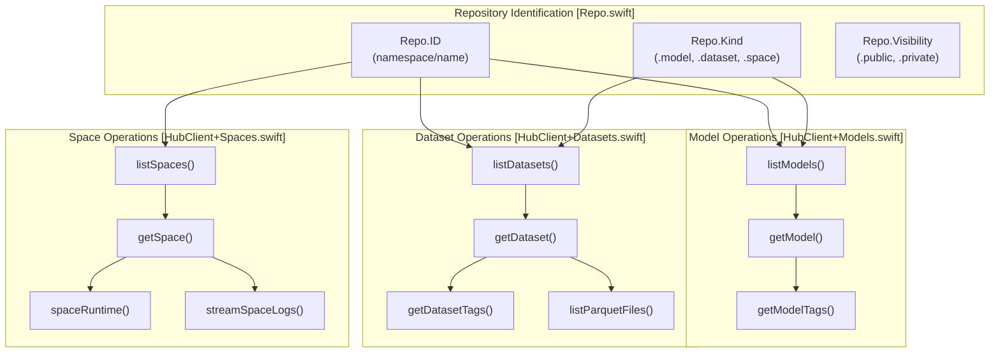
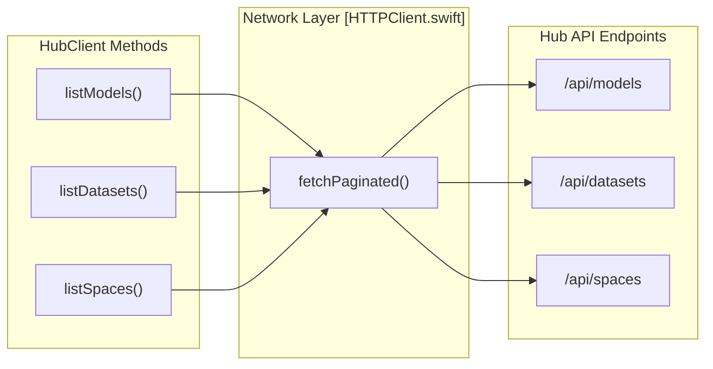

<!-- source: DeepWiki mcp.deepwiki.com · repo huggingface/swift-huggingface · page 3.1 Models, Datasets, and Spaces · fetched 2026-10-26 -->

# Models, Datasets, and Spaces

Relevant source files

The following files were used as context for generating this wiki page:

- [Sources/HuggingFace/Hub/Dataset.swift](Sources/HuggingFace/Hub/Dataset.swift)
- [Sources/HuggingFace/Hub/HubClient+Datasets.swift](Sources/HuggingFace/Hub/HubClient+Datasets.swift)
- [Sources/HuggingFace/Hub/HubClient+Models.swift](Sources/HuggingFace/Hub/HubClient+Models.swift)
- [Sources/HuggingFace/Hub/HubClient+Spaces.swift](Sources/HuggingFace/Hub/HubClient+Spaces.swift)
- [Sources/HuggingFace/Hub/Model.swift](Sources/HuggingFace/Hub/Model.swift)
- [Sources/HuggingFace/Hub/Repo.swift](Sources/HuggingFace/Hub/Repo.swift)
- [Sources/HuggingFace/Hub/Space.swift](Sources/HuggingFace/Hub/Space.swift)
- [Tests/HuggingFaceTests/HubTests/DatasetTests.swift](Tests/HuggingFaceTests/HubTests/DatasetTests.swift)
- [Tests/HuggingFaceTests/HubTests/ModelTests.swift](Tests/HuggingFaceTests/HubTests/ModelTests.swift)
- [Tests/HuggingFaceTests/HubTests/SpaceTests.swift](Tests/HuggingFaceTests/HubTests/SpaceTests.swift)

## Purpose and Scope

This page covers the three primary repository types in the Hugging Face Hub—**models**, **datasets**, and **spaces**—and the operations for listing, searching, retrieving details, and managing these repositories through `HubClient`. These operations form the foundation for working with Hub resources.

For file operations within repositories (uploading, downloading, deleting files), see **3.2 File Operations**. For access control and gated resources, see **3.6 Access Control and Gated Resources**. For advanced repository operations like tagging and commit squashing, see **3.7 Advanced Repository Operations**.

## Repository Types

The Hub organizes content into three distinct repository types, each serving a different purpose, represented by the `Repo.Kind` enum [Sources/HuggingFace/Hub/Repo.swift:27-52]().

| Repository Type | `Repo.Kind` | Primary Use Case | Example ID |
|----------------|-------------|------------------|------------|
| **Models** | `.model` | Pre-trained models, weights, and configurations | `"facebook/bart-large-cnn"` |
| **Datasets** | `.dataset` | Training data, evaluation sets, Parquet files | `"datasets/squad"` |
| **Spaces** | `.space` | Interactive demos, Gradio/Streamlit apps | `"stabilityai/stable-diffusion"` |

All repositories are identified using `Repo.ID`, a struct consisting of a `namespace` and `name` [Sources/HuggingFace/Hub/Repo.swift:8-24](). It conforms to `ExpressibleByStringLiteral`, allowing initialization from strings like `"user/repo"` [Sources/HuggingFace/Hub/Repo.swift:226-228]().

**Diagram: Repository Type System and HubClient Interface**

Sources: [Sources/HuggingFace/Hub/Repo.swift:4-189](), [Sources/HuggingFace/Hub/HubClient+Models.swift:5-165](), [Sources/HuggingFace/Hub/HubClient+Datasets.swift:5-165](), [Sources/HuggingFace/Hub/HubClient+Spaces.swift:5-185]()

## Listing and Searching Repositories

Each repository type supports listing with filtering, searching, and sorting capabilities. These methods return a `PaginatedResponse<T>` [Sources/HuggingFace/Hub/HubClient+Models.swift:110]().

### Models

The `listModels()` method [Sources/HuggingFace/Hub/HubClient+Models.swift:69-111]() allows for granular filtering:

*   **Search**: Filter by substrings in repository names or usernames.
*   **Pipeline Tag**: Filter by task (e.g., `"text-classification"`, `"text-generation"`).
*   **Inference**: Filter by inference availability (e.g., `warm`) [Sources/HuggingFace/Hub/HubClient+Models.swift:7-9]().
*   **Expandable Fields**: Use `ModelExpandField` to include additional metadata like `siblings`, `spaces`, or `safetensors` in the response [Sources/HuggingFace/Hub/HubClient+Models.swift:12-44]().

### Datasets

The `listDatasets()` method [Sources/HuggingFace/Hub/HubClient+Datasets.swift:52-94]() provides dataset-specific filters:

*   **Size Categories**: Filter by dataset size (e.g., `"10K<n<100K"`) [Tests/HuggingFaceTests/HubTests/DatasetTests.swift:137]().
*   **Language**: Filter by specific languages or language creators.
*   **Expandable Fields**: Use `DatasetExpandField` to include `citation`, `usedStorage`, or `siblings` [Sources/HuggingFace/Hub/HubClient+Datasets.swift:7-27]().

### Spaces

The `listSpaces()` method [Sources/HuggingFace/Hub/HubClient+Spaces.swift:44-72]() includes:

*   **Linked Repos**: Filter by spaces linked to specific models or datasets.
*   **Expandable Fields**: Use `SpaceExpandField` to include `runtime`, `sdk`, or `subdomain` [Sources/HuggingFace/Hub/HubClient+Spaces.swift:7-26]().

**Diagram: Listing Request Flow**

Sources: [Sources/HuggingFace/Hub/HubClient+Models.swift:110](), [Sources/HuggingFace/Hub/HubClient+Datasets.swift:93](), [Sources/HuggingFace/Hub/HubClient+Spaces.swift:71]()

## Retrieving Repository Details

To fetch the full metadata for a specific repository, `HubClient` provides `getModel`, `getDataset`, and `getSpace`.

### Detailed Metadata Structures

| Type | Struct | Key Fields |
|------|--------|------------|
| **Model** | `Model` | `pipelineTag`, `library`, `config`, `safetensors` [Sources/HuggingFace/Hub/Model.swift:4-121]() |
| **Dataset** | `Dataset` | `description`, `citation`, `paperswithcodeID`, `siblings` [Sources/HuggingFace/Hub/Dataset.swift:4-101]() |
| **Space** | `Space` | `sdk`, `runtime`, `subdomain`, `datasets`, `models` [Sources/HuggingFace/Hub/Space.swift:4-206]() |

### Revision Support
All "get" methods support a `revision` parameter [Sources/HuggingFace/Hub/HubClient+Models.swift:127](). This allows retrieving metadata from a specific branch, tag, or commit hash. If `nil`, the API defaults to the `main` branch.

### Space Runtime and Lifecycle
Spaces have unique operational methods:
*   **`spaceRuntime(_:)`**: Retrieves current execution state (e.g., `RUNNING`, `BUILDING`) and hardware info [Sources/HuggingFace/Hub/HubClient+Spaces.swift:116-124]().
*   **`sleepSpace(_:)`**: Puts a space into sleep mode [Sources/HuggingFace/Hub/HubClient+Spaces.swift:131-139]().
*   **`restartSpace(_:factory:)`**: Restarts the space, optionally rebuilding from scratch [Sources/HuggingFace/Hub/HubClient+Spaces.swift:148-160]().
*   **`streamSpaceLogs(_:logType:)`**: Returns an `AsyncThrowingStream` of `Space.LogEntry` [Sources/HuggingFace/Hub/HubClient+Spaces.swift:170-182]().

Sources: [Sources/HuggingFace/Hub/HubClient+Spaces.swift:111-182](), [Sources/HuggingFace/Hub/Space.swift:159-182]()

## Parquet Files (Datasets Only)

The SDK provides a specialized method `listParquetFiles(_:subset:split:)` to locate Parquet data files hosted on the Hub [Sources/HuggingFace/Hub/HubClient+Datasets.swift:149-164]().

The `ParquetFileInfo` struct handles decoding the complex URL patterns used by the Hub API [Sources/HuggingFace/Hub/Dataset.swift:106-191](). It can extract the `dataset`, `config`, and `split` directly from the URL path if the JSON response provides a single string [Sources/HuggingFace/Hub/Dataset.swift:134-181]().

Sources: [Sources/HuggingFace/Hub/HubClient+Datasets.swift:149-164](), [Sources/HuggingFace/Hub/Dataset.swift:106-191]()

## Tags and Metadata

Repository categorization is handled through a system of tags.

*   **`getModelTags()`**: Fetches available model tags organized by type (e.g., task, library) [Sources/HuggingFace/Hub/HubClient+Models.swift:163-165]().
*   **`getDatasetTags()`**: Fetches available dataset tags (e.g., language, size) [Sources/HuggingFace/Hub/HubClient+Datasets.swift:137-139]().

These return a `Tags` object, which maps category names to lists of tag definitions.

Sources: [Sources/HuggingFace/Hub/HubClient+Models.swift:163-165](), [Sources/HuggingFace/Hub/HubClient+Datasets.swift:137-139]()

## Repository Management

The SDK supports creating and configuring repositories.

### Creating Repositories
The unified `createRepo` method (available via `HubClient`) creates a new repository on the Hub. For Spaces, a `Repo.SpaceConfiguration` can be provided to specify the SDK (Gradio, Streamlit, etc.), hardware tier, and environment variables/secrets [Sources/HuggingFace/Hub/Repo.swift:134-188]().

### Repository Settings
The `Repo.Settings` struct allows modifying repository attributes [Sources/HuggingFace/Hub/Repo.swift:87-131]():
*   **Visibility**: Toggle between `.public` and `.private` [Sources/HuggingFace/Hub/Repo.swift:55-84]().
*   **Gating**: Configure access request requirements (`.manual`, `.auto`, or `.notGated`) [Sources/HuggingFace/Hub/Model.swift:126-135]().
*   **XET Storage**: Enable or disable Xet-based storage [Sources/HuggingFace/Hub/Repo.swift:92]().

Sources: [Sources/HuggingFace/Hub/Repo.swift:54-188](), [Sources/HuggingFace/Hub/Model.swift:125-176]()

---

