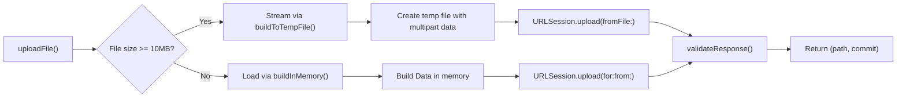
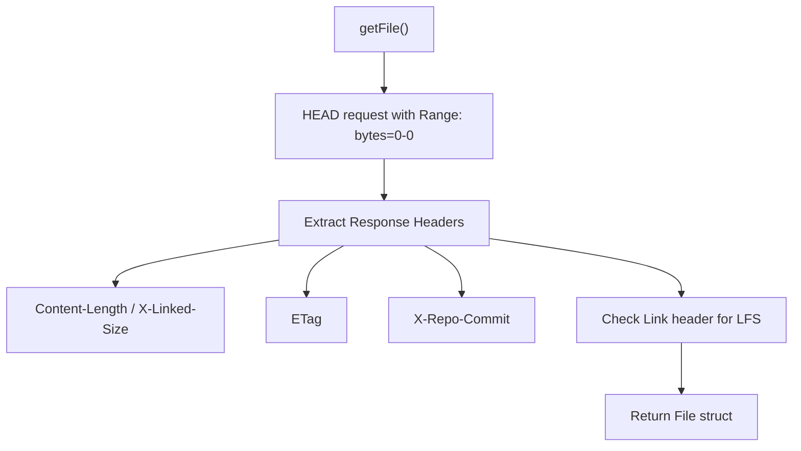

<!-- source: DeepWiki mcp.deepwiki.com · repo huggingface/swift-huggingface · page 3.2 File Operations · fetched 2026-10-26 -->

# File Operations

Relevant source files

The following files were used as context for generating this wiki page:

- [.gitignore](.gitignore)
- [.swift-format](.swift-format)
- [Sources/HuggingFace/Hub/File.swift](Sources/HuggingFace/Hub/File.swift)
- [Sources/HuggingFace/Hub/HubClient+Files.swift](Sources/HuggingFace/Hub/HubClient+Files.swift)
- [Sources/HuggingFace/Shared/MultipartBuilder.swift](Sources/HuggingFace/Shared/MultipartBuilder.swift)
- [Tests/HuggingFaceTests/HubTests/FileOperationsTests.swift](Tests/HuggingFaceTests/HubTests/FileOperationsTests.swift)
- [Tests/HuggingFaceTests/HubTests/HubClientTests.swift](Tests/HuggingFaceTests/HubTests/HubClientTests.swift)

This document covers file management operations in `HubClient` for interacting with repository files on the Hugging Face Hub. File operations include uploading, downloading, deleting, and querying files in model, dataset, and space repositories.

**Sources:** [Sources/HuggingFace/Hub/HubClient+Files.swift:1-1045]()

## Overview

`HubClient` provides comprehensive file operations organized into four categories:

| Operation Category | Key Methods | Description |
|-------------------|-------------|-------------|
| **Upload** | `uploadFile()`, `uploadFiles()` | Upload single or multiple files to repositories |
| **Download** | `downloadContentsOfFile()`, `downloadFile()` | Download file contents as data or save to local path |
| **Delete** | `deleteFile()`, `deleteFiles()` | Remove files from repositories |
| **Query** | `listFiles()`, `getFile()`, `fileExists()` | List and retrieve file metadata |

All file operations support:
- Multiple repository types (models, datasets, spaces) [Sources/HuggingFace/Hub/HubClient+Files.swift:103-104]()
- Git revisions (branches, tags, commit hashes) [Sources/HuggingFace/Hub/HubClient+Files.swift:105]()
- Automatic authentication via `TokenProvider` [Sources/HuggingFace/Hub/HubClient+Files.swift:136]()
- Integration with the Python-compatible cache system [Sources/HuggingFace/Hub/HubClient+Files.swift:297-310]()
- Git Large File Storage (LFS) detection and handling [Sources/HuggingFace/Hub/File.swift:17-18]()

**Sources:** [Sources/HuggingFace/Hub/HubClient+Files.swift:90-750](), [Sources/HuggingFace/Hub/File.swift:1-163]()

## File Operations Architecture

The following diagram maps high-level operations to the internal classes and endpoints used within the SDK.

```mermaid
graph TB
    subgraph "Public API [HubClient+Files.swift]"
        uploadFile["uploadFile()"]
        uploadFiles["uploadFiles()"]
        downloadContentsOfFile["downloadContentsOfFile()"]
        downloadFile["downloadFile()"]
        resumeDownloadFile["resumeDownloadFile()"]
        deleteFile["deleteFile()"]
        deleteFiles["deleteFiles()"]
        listFiles["listFiles()"]
        getFile["getFile()"]
        fileExists["fileExists()"]
    end
    
    subgraph "Data Structures [File.swift]"
        FileBatch["FileBatch"]
        FileBatchEntry["FileBatch.Entry"]
        File["File (metadata struct)"]
        LocalDownloadFileMetadata["LocalDownloadFileMetadata"]
    end
    
    subgraph "Internal Components"
        MultipartBuilder["MultipartBuilder [MultipartBuilder.swift]"]
        URLSession["URLSession (Foundation)"]
        HubCache["HubCache [HubCache.swift]"]
    end
    
    subgraph "HTTP Endpoints"
        UploadEndpoint["/api/{kind}/{repo}/upload/{branch}"]
        ResolveEndpoint["/{repo}/resolve/{revision}/{path}"]
        RawEndpoint["/{repo}/raw/{revision}/{path}"]
        TreeEndpoint["/api/{kind}/{repo}/tree/{revision}"]
        CommitEndpoint["/api/{kind}/{repo}/commit/{branch}"]
    end
    
    uploadFile --> MultipartBuilder
    uploadFiles --> FileBatch
    FileBatch --> FileBatchEntry
    uploadFile --> UploadEndpoint
    uploadFiles --> UploadEndpoint
    
    MultipartBuilder --> URLSession
    
    downloadContentsOfFile --> ResolveEndpoint
    downloadContentsOfFile --> RawEndpoint
    downloadFile --> ResolveEndpoint
    downloadFile --> RawEndpoint
    resumeDownloadFile --> URLSession
    
    downloadContentsOfFile --> HubCache
    downloadFile --> HubCache
    
    deleteFile --> deleteFiles
    deleteFiles --> CommitEndpoint
    
    listFiles --> TreeEndpoint
    getFile --> ResolveEndpoint
    getFile --> File
    fileExists --> getFile
```

**Sources:** [Sources/HuggingFace/Hub/HubClient+Files.swift:90-650](), [Sources/HuggingFace/Hub/File.swift:1-163](), [Sources/HuggingFace/Shared/MultipartBuilder.swift:8-50]()

## Upload Operations

### Single File Upload

The `uploadFile()` method uploads a single file to a repository using `multipart/form-data`. The method automatically detects file size and uses streaming for files larger than 10MB to avoid memory pressure.

**Implementation details:**
- **File size threshold:** 10MB (10 * 1024 * 1024 bytes) determines the streaming strategy [Sources/HuggingFace/Hub/HubClient+Files.swift:146-147]().
- **Streaming strategy:** Uses `MultipartBuilder.buildToTempFile()` for large files [Sources/HuggingFace/Hub/HubClient+Files.swift:154-158]().
- **MIME type detection:** Automatically inferred from file extension [Sources/HuggingFace/Hub/HubClient+Files.swift:149](), [Sources/HuggingFace/Hub/HubClient+Files.swift:851-951]().
- **Expect header:** Set to `100-continue` for large uploads to check server readiness [Sources/HuggingFace/Hub/HubClient+Files.swift:153]().

**Sources:** [Sources/HuggingFace/Hub/HubClient+Files.swift:121-188](), [Sources/HuggingFace/Shared/MultipartBuilder.swift:73-116]()

### Batch File Upload

The `uploadFiles()` method uploads multiple files concurrently using `FileBatch`. Concurrency is controlled via the `maxConcurrent` parameter.

- **Default concurrency:** 3 concurrent uploads [Sources/HuggingFace/Hub/HubClient+Files.swift:205]().
- **Mechanism:** Uses a `TaskGroup` to manage concurrent `uploadFile` calls [Sources/HuggingFace/Hub/HubClient+Files.swift:233-270]().
- **Result preservation:** Results are collected and returned as an array of path/commit tuples [Sources/HuggingFace/Hub/HubClient+Files.swift:271]().

**Sources:** [Sources/HuggingFace/Hub/HubClient+Files.swift:199-273](), [Sources/HuggingFace/Hub/File.swift:77-139]()

## Download Operations

### Download to Data

The `downloadContentsOfFile()` method downloads file contents into memory as `Data`. This method integrates with the cache system, checking for cached files before making network requests.

- **Cache lookup:** Checks `hubCache.cachedFilePath` before initiating a network request [Sources/HuggingFace/Hub/HubClient+Files.swift:297-306]().
- **Endpoint selection:** Can use either the `resolve` or `raw` endpoint [Sources/HuggingFace/Hub/HubClient+Files.swift:308-314]().
- **Cache storage:** If a download occurs and an ETag is present, the result is stored in the cache [Sources/HuggingFace/Hub/HubClient+Files.swift:322-336]().

**Sources:** [Sources/HuggingFace/Hub/HubClient+Files.swift:288-339]()

### Download to File with Progress

The `downloadFile()` method downloads a file to a specified local path using `URLSession.downloadTask`.

| Feature | Implementation | Details |
|---------|---------------|---------|
| **Progress tracking** | `Progress` object | Updates via `DownloadProgressDelegate` [Sources/HuggingFace/Hub/HubClient+Files.swift:401-426](). |
| **Cache integration** | Pre-download check | Copies from cache if available [Sources/HuggingFace/Hub/HubClient+Files.swift:363-382](). |
| **Xet Support** | `FileDownloadTransport` | Can automatically select Xet for large files (>= 16MiB) [Sources/HuggingFace/Hub/HubClient+Files.swift:16-68](). |

**Sources:** [Sources/HuggingFace/Hub/HubClient+Files.swift:352-433](), [Sources/HuggingFace/Hub/HubClient+Files.swift:499-525]()

### Resume Capability (Apple Platforms Only)

The `resumeDownloadFile()` method allows resuming interrupted downloads using resume data. This feature is restricted to platforms where `FoundationNetworking` is not used (non-Linux) [Sources/HuggingFace/Hub/HubClient+Files.swift:434-435]().

**Sources:** [Sources/HuggingFace/Hub/HubClient+Files.swift:434-462]()

## Delete Operations

File deletion uses the Hub's commit API, which allows batching multiple delete operations into a single atomic commit.

- **Single file:** `deleteFile()` wraps the path into a single-item array [Sources/HuggingFace/Hub/HubClient+Files.swift:537-548]().
- **Multiple files:** `deleteFiles()` constructs a JSON payload with `op: "delete"` for each path [Sources/HuggingFace/Hub/HubClient+Files.swift:565-578]().

**Sources:** [Sources/HuggingFace/Hub/HubClient+Files.swift:537-583]()

## Query Operations

### List Files and Tree Traversal

The `listFiles()` method retrieves the file tree for a repository at a specific revision.

- **Endpoint:** `/api/{kind}/{repo}/tree/{revision}` [Sources/HuggingFace/Hub/HubClient+Files.swift:616-621]().
- **Recursion:** Supports the `recursive` parameter to fetch nested directory contents [Sources/HuggingFace/Hub/HubClient+Files.swift:611]().
- **Return Type:** Array of `Git.TreeEntry` [Sources/HuggingFace/Hub/HubClient+Files.swift:613]().

**Sources:** [Sources/HuggingFace/Hub/HubClient+Files.swift:611-627]()

### Get File Metadata

The `getFile()` method retrieves metadata (size, ETag, LFS status) using a HEAD request with a byte-range of `0-0` to minimize bandwidth.

**Key Headers:**
- `X-Linked-Size`: Used to determine the actual size of LFS files [Sources/HuggingFace/Hub/HubClient+Files.swift:662-664]().
- `Link`: Parsed to detect LFS pointers [Sources/HuggingFace/Hub/HubClient+Files.swift:664]().

**Sources:** [Sources/HuggingFace/Hub/HubClient+Files.swift:636-677]()

## MultipartBuilder Implementation

The `MultipartBuilder` is an internal utility for constructing `multipart/form-data` bodies. It is critical for the `uploadFile` operation.

- **In-Memory:** `buildInMemory()` concatenates `Data` chunks [Sources/HuggingFace/Shared/MultipartBuilder.swift:54-68]().
- **Streaming:** `buildToTempFile()` writes to a `FileHandle` and uses an `InputStream` to stream file contents in 64KB chunks [Sources/HuggingFace/Shared/MultipartBuilder.swift:73-116](), [Sources/HuggingFace/Shared/MultipartBuilder.swift:175-176]().

**Sources:** [Sources/HuggingFace/Shared/MultipartBuilder.swift:8-188]()

---

