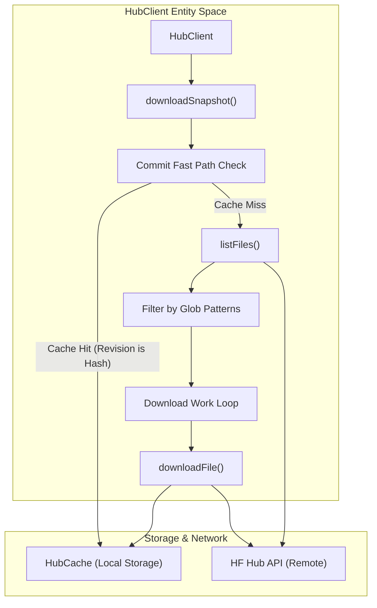
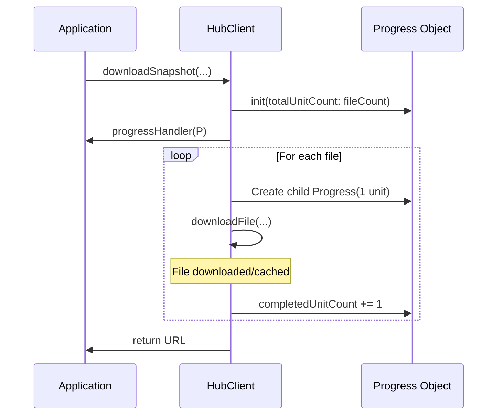

<!-- source: DeepWiki mcp.deepwiki.com · repo huggingface/swift-huggingface · page 3.3 Repository Snapshots · fetched 2026-10-26 -->

# Repository Snapshots

<details>
<summary>Relevant source files</summary>

The following files were used as context for generating this wiki page:

- [Package.swift](Package.swift)
- [Sources/HuggingFace/Hub/HubClient+Files.swift](Sources/HuggingFace/Hub/HubClient+Files.swift)
- [Tests/HubBenchmarks/DownloadSnapshotBenchmarks.swift](Tests/HubBenchmarks/DownloadSnapshotBenchmarks.swift)
- [Tests/HuggingFaceTests/HubTests/FileOperationsTests.swift](Tests/HuggingFaceTests/HubTests/FileOperationsTests.swift)

</details>


## Purpose and Scope

Repository snapshots provide functionality for downloading entire Hugging Face repositories or filtered subsets of repository files to a local directory. This feature enables bulk download operations with progress tracking, glob pattern filtering, and a specialized "commit fast path" optimization for cached data.

For information about downloading individual files, see [File Operations](3.2). For cache architecture details, see [Cache Architecture](6.1).

Sources: [Sources/HuggingFace/Hub/HubClient+Files.swift:578-638]()

## Overview

The snapshot download system retrieves files from a repository at a specific revision and stores them in a local directory structure. The system leverages the Python-compatible cache to avoid redundant downloads and enable cross-client cache sharing.

### Snapshot Download Architecture



**Snapshot Download Flow**: The operation first attempts a fast path if a commit hash is provided. If not cached, it lists files, filters them via glob patterns, and processes downloads.

Sources: [Sources/HuggingFace/Hub/HubClient+Files.swift:594-638](), [Tests/HubBenchmarks/DownloadSnapshotBenchmarks.swift:31-93]()

## Function Signature

The `downloadSnapshot` method is defined in the `HubClient+Files.swift` extension:

```swift
func downloadSnapshot(
    of repo: Repo.ID,
    kind: Repo.Kind = .model,
    to destination: URL? = nil,
    revision: String = "main",
    matching globs: [String] = [],
    progressHandler: ((Progress) -> Void)? = nil
) async throws -> URL
```

Sources: [Sources/HuggingFace/Hub/HubClient+Files.swift:594-601]()

### Parameters

| Parameter | Type | Default | Description |
|-----------|------|---------|-------------|
| `repo` | `Repo.ID` | Required | Repository identifier (namespace/name) |
| `kind` | `Repo.Kind` | `.model` | Repository type: `.model`, `.dataset`, or `.space` |
| `destination` | `URL?` | `nil` | Local directory path. If `nil`, returns the cache path. |
| `revision` | `String` | `"main"` | Git revision (branch name, tag, or commit hash) |
| `globs` | `[String]` | `[]` | Glob patterns to filter files (empty array downloads all) |
| `progressHandler` | `((Progress) -> Void)?` | `nil` | Optional closure receiving progress updates |

Sources: [Sources/HuggingFace/Hub/HubClient+Files.swift:587-592]()

## Implementation Details

### Commit Fast Path Optimization

If the `revision` provided is a full commit hash (40 hex characters) and a `HubCache` is present, the system checks if the snapshot directory for that specific commit already exists locally. If it does, and no specific `destination` URL was requested, the system returns the cached path immediately, bypassing the network call to list files.

Sources: [Sources/HuggingFace/Hub/HubClient+Files.swift:602-613](), [Tests/HubBenchmarks/DownloadSnapshotBenchmarks.swift:31-47]()

### File Listing and Glob Filtering

If the fast path is not applicable, the system:
1. Calls `listFiles(in:kind:revision:recursive:)` to get the tree.
2. Filters the `Git.TreeEntry` array using POSIX `fnmatch`.

```swift
.filter { entry in
    guard !globs.isEmpty else { return true }
    return globs.contains { glob in
        fnmatch(glob, entry.path, 0) == 0
    }
}
```

Sources: [Sources/HuggingFace/Hub/HubClient+Files.swift:615-620]()

### Download Transport Selection

The system supports multiple transport mechanisms via the `FileDownloadTransport` enum. This is particularly relevant for large files.

| Transport | Behavior |
|-----------|----------|
| `.automatic` | Selects Xet for files ≥ 16MiB, LFS otherwise. |
| `.lfs` | Forces classic LFS download. |
| `.xet` | Forces Xet download (requires `HUGGINGFACE_ENABLE_XET`). |

Sources: [Sources/HuggingFace/Hub/HubClient+Files.swift:36-68](), [Package.swift:22-27]()

### Progress Tracking

Progress is managed via a parent `Progress` object where the `totalUnitCount` is derived from the number of files.



Sources: [Sources/HuggingFace/Hub/HubClient+Files.swift:632-658](), [Tests/HuggingFaceTests/HubTests/FileOperationsTests.swift:123-154]()

## Cache Integration

### Storage Strategy
The `HubCache` organizes snapshots by commit hash. Even if a user requests a branch (e.g., `main`), the SDK resolves this to a commit hash during the first file download and populates the `snapshots/<hash>/` directory.

1. **Blobs**: Content-addressed storage based on ETags.
2. **Refs**: Mapping of branch names to commit hashes.
3. **Snapshots**: Symlinks from human-readable paths to the blob storage.

Sources: [Sources/HuggingFace/Hub/HubClient+Files.swift:260-280](), [Sources/HuggingFace/Hub/HubClient+Files.swift:302-317]()

## Usage Examples

### Download with Glob Filtering
To download only configuration and model weights, excluding large optimizer states or documentation:

```swift
let url = try await client.downloadSnapshot(
    of: "openai-community/gpt2",
    matching: ["config.json", "*.safetensors"]
)
```

Sources: [Tests/HubBenchmarks/DownloadSnapshotBenchmarks.swift:96-100]()

### Handling Xet for Large Files
If the `Xet` trait is enabled in `Package.swift`, the SDK can use Xet for efficient block-level transfers of large files.

```swift
// Requires 'Xet' trait enabled in SPM
let url = try await client.downloadSnapshot(
    of: "some-org/massive-repo",
    matching: ["model.safetensors"]
)
```

Sources: [Package.swift:33-45](), [Tests/HubBenchmarks/DownloadSnapshotBenchmarks.swift:164-189]()

## Practical Considerations

### Cancellation
The loop checks `Task.isCancelled` before starting each file download. If cancelled, the function returns the `destination` URL containing whatever files were completed up to that point.

Sources: [Sources/HuggingFace/Hub/HubClient+Files.swift:653-655]()

### Concurrency
While individual file downloads may use internal concurrency (especially via Xet), the `downloadSnapshot` loop processes the file list sequentially to ensure predictable progress reporting and avoid resource exhaustion on the local file system.

Sources: [Sources/HuggingFace/Hub/HubClient+Files.swift:646-658](), [Tests/HuggingFaceTests/HubTests/FileOperationsTests.swift:71-121]()

---

