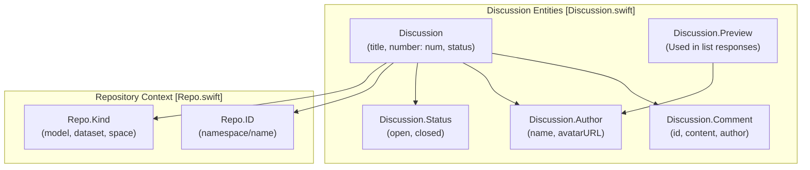
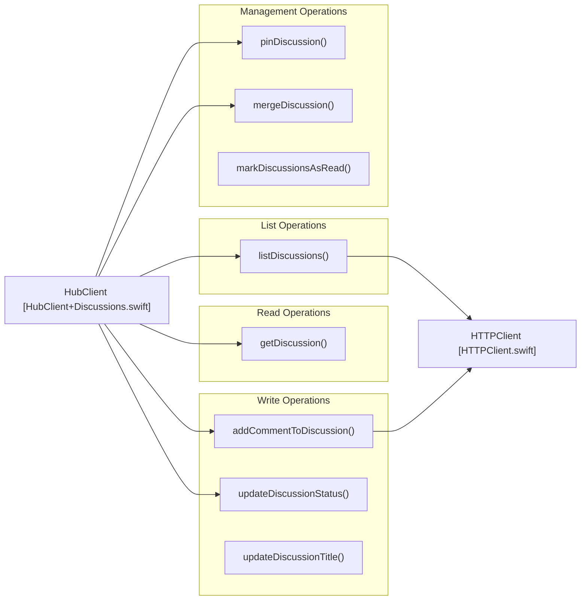
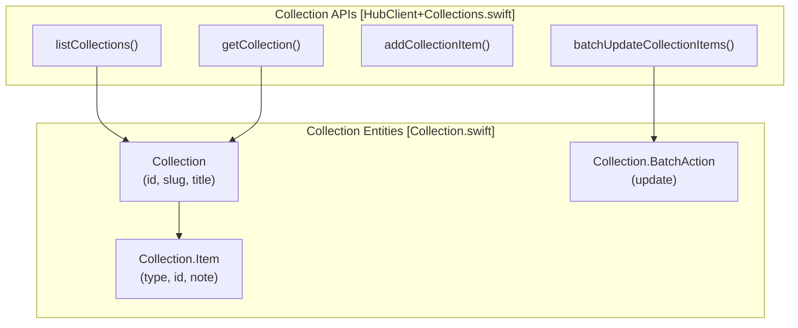

<!-- source: DeepWiki mcp.deepwiki.com · repo huggingface/swift-huggingface · page 3.4 Discussions and Community Features · fetched 2026-10-26 -->

# Discussions and Community Features

<details>
<summary>Relevant source files</summary>

The following files were used as context for generating this wiki page:

- [Sources/HuggingFace/Hub/Collection.swift](Sources/HuggingFace/Hub/Collection.swift)
- [Sources/HuggingFace/Hub/Discussion.swift](Sources/HuggingFace/Hub/Discussion.swift)
- [Sources/HuggingFace/Hub/HubClient+Collections.swift](Sources/HuggingFace/Hub/HubClient+Collections.swift)
- [Sources/HuggingFace/Hub/HubClient+Discussions.swift](Sources/HuggingFace/Hub/HubClient+Discussions.swift)
- [Sources/HuggingFace/Hub/HubClient+Git.swift](Sources/HuggingFace/Hub/HubClient+Git.swift)
- [Sources/HuggingFace/Hub/HubClient+OAuth.swift](Sources/HuggingFace/Hub/HubClient+OAuth.swift)
- [Sources/HuggingFace/Hub/HubClient+Papers.swift](Sources/HuggingFace/Hub/HubClient+Papers.swift)
- [Sources/HuggingFace/Hub/HubClient+User.swift](Sources/HuggingFace/Hub/HubClient+User.swift)
- [Sources/HuggingFace/Hub/Paper.swift](Sources/HuggingFace/Hub/Paper.swift)
- [Tests/HuggingFaceTests/HubTests/DiscussionTests.swift](Tests/HuggingFaceTests/HubTests/DiscussionTests.swift)

</details>


## Purpose and Scope

This document covers the `HubClient` APIs for interacting with community features on the Hugging Face Hub: discussions, collections, and papers. These features enable collaboration, content curation, and research discovery across models, datasets, and spaces.

For repository management operations, see [Models, Datasets, and Spaces](#3.1). For organization-level features, see [Organizations](#3.5).

## Overview of Community Features

The `HubClient` provides three main categories of community interaction APIs:

| Feature | Purpose | Primary Use Cases |
|---------|---------|-------------------|
| **Discussions** | Issue tracking and pull requests | Bug reports, feature requests, model contributions, community feedback |
| **Collections** | Content curation | Organizing related models/datasets, creating themed lists, showcasing projects |
| **Papers** | Research paper tracking | Discovering papers, tracking citations, linking models to research |

All community features support authentication via the standard `TokenProvider` system and work uniformly across repository types (`models`, `datasets`, `spaces`).

Sources: [Sources/HuggingFace/Hub/HubClient+Discussions.swift:5-20](), [Sources/HuggingFace/Hub/HubClient+Collections.swift:3-5](), [Sources/HuggingFace/Hub/HubClient+Papers.swift:3-5]()

## Discussions System Architecture

### Discussion Data Model

The `Discussion` struct represents both issues and pull requests on the Hub.

Title: "Discussion Data Model Mapping"


The `Discussion` type represents both issues and pull requests, distinguished by the `isPullRequest` field [Sources/HuggingFace/Hub/Discussion.swift:107-108](). Each discussion contains metadata and an optional array of `Comment` objects [Sources/HuggingFace/Hub/Discussion.swift:147-148]().

Sources: [Sources/HuggingFace/Hub/Discussion.swift:4-172]()

### Core Discussion Operations

Title: "Discussion API Flow"


Sources: [Sources/HuggingFace/Hub/HubClient+Discussions.swift:21-204]()

### Listing and Filtering Discussions

The `listDiscussions` method returns paginated results with filtering support [Sources/HuggingFace/Hub/HubClient+Discussions.swift:21-30]().

**Parameters:**

| Parameter | Type | Purpose |
|-----------|------|---------|
| `kind` | `Repo.Kind` | Repository type (`.model`, `.dataset`, `.space`) |
| `id` | `Repo.ID` | Repository identifier |
| `page` | `Int?` | Page number for pagination |
| `type` | `String?` | Filter by type ("all", "discussion", "pull_request") |
| `status` | `String?` | Filter by status ("all", "open", "closed") |
| `author` | `String?` | Filter by author username |
| `search` | `String?` | Search term to filter discussions |
| `sort` | `String?` | Sort order ("recently-created", "trending", "reactions") |

**Return Value:**
- A tuple containing: `(discussions: [Discussion.Preview], count: Int, start: Int, numberOfClosedDiscussions: Int?)` [Sources/HuggingFace/Hub/HubClient+Discussions.swift:30]().

Sources: [Sources/HuggingFace/Hub/HubClient+Discussions.swift:21-51](), [Tests/HuggingFaceTests/HubTests/DiscussionTests.swift:31-108]()

### Retrieving Discussion Details

The `getDiscussion` method fetches complete information including the comment thread [Sources/HuggingFace/Hub/HubClient+Discussions.swift:63-71]().

```swift
public func getDiscussion(
    kind: Repo.Kind,
    _ id: Repo.ID,
    number: Int
) async throws -> Discussion
```

The returned `Discussion` object contains full metadata, including `comments` [Sources/HuggingFace/Hub/Discussion.swift:147](), `status` [Sources/HuggingFace/Hub/Discussion.swift:129](), and `isPullRequest` [Sources/HuggingFace/Hub/Discussion.swift:138]().

Sources: [Sources/HuggingFace/Hub/HubClient+Discussions.swift:63-71](), [Sources/HuggingFace/Hub/Discussion.swift:122-172]()

### Adding Comments and Management

*   **Add Comment**: `addCommentToDiscussion` sends a POST request with a `comment` string [Sources/HuggingFace/Hub/HubClient+Discussions.swift:84-96]().
*   **Update Status**: `updateDiscussionStatus` changes the state using a PATCH request [Sources/HuggingFace/Hub/HubClient+Discussions.swift:151-163]().
*   **Update Title**: `updateDiscussionTitle` renames the discussion [Sources/HuggingFace/Hub/HubClient+Discussions.swift:176-188]().
*   **Pin/Merge**: `pinDiscussion` and `mergeDiscussion` perform administrative actions on specific discussion numbers [Sources/HuggingFace/Hub/HubClient+Discussions.swift:108-138]().

Sources: [Sources/HuggingFace/Hub/HubClient+Discussions.swift:73-188]()

## Collections System

Collections organize related repositories (models, datasets, spaces) and papers into curated lists.

Title: "Collections Entity Mapping"


### Listing and Retrieving Collections

*   **List Collections**: `listCollections` supports filtering by `owner`, `search` term, and `sort` order [Sources/HuggingFace/Hub/HubClient+Collections.swift:15-29](). It returns a `PaginatedResponse<Collection>`.
*   **Get Collection**: `getCollection` retrieves a specific collection using its slug [Sources/HuggingFace/Hub/HubClient+Collections.swift:36-38]().

Sources: [Sources/HuggingFace/Hub/HubClient+Collections.swift:6-38]()

### Managing Collection Items

*   **Add Item**: `addCollectionItem` adds a `Collection.Item` (specifying `type` and `id`) to a collection [Sources/HuggingFace/Hub/HubClient+Collections.swift:52-70]().
*   **Batch Update**: `batchUpdateCollectionItems` allows updating notes or positions for multiple items using `Collection.BatchAction` [Sources/HuggingFace/Hub/HubClient+Collections.swift:81-99]().
*   **Delete Item**: `deleteCollectionItem` removes an item by its specific `itemId` [Sources/HuggingFace/Hub/HubClient+Collections.swift:110-119]().

Sources: [Sources/HuggingFace/Hub/HubClient+Collections.swift:42-119](), [Sources/HuggingFace/Hub/Collection.swift:39-108]()

## Papers System

The Papers API enables discovery and tracking of research papers on the Hub.

### Paper Data Model

The `Paper` struct contains research metadata including `arXivID`, `summary`, and associated Hub resources (`models`, `datasets`, `spaces`) [Sources/HuggingFace/Hub/Paper.swift:4-59]().

### Paper Operations

*   **List Papers**: `listPapers` provides a paginated search for papers [Sources/HuggingFace/Hub/HubClient+Papers.swift:14-26]().
*   **Get Paper**: `getPaper` retrieves detailed information for a paper by ID (e.g., arXiv ID) [Sources/HuggingFace/Hub/HubClient+Papers.swift:33-35]().
*   **Daily Papers**: `listDailyPapers` returns a list of `DailyPaper` objects, which include the paper metadata plus submission details like `submittedBy` and `numberOfComments` [Sources/HuggingFace/Hub/HubClient+Papers.swift:49-69](), [Sources/HuggingFace/Hub/Paper.swift:64-91]().

Sources: [Sources/HuggingFace/Hub/HubClient+Papers.swift:6-69](), [Sources/HuggingFace/Hub/Paper.swift:4-91]()

## API Endpoint Mapping

| Method | HTTP Method | Endpoint Pattern |
|--------|-------------|------------------|
| `listDiscussions` | GET | `/api/{kind.pluralized}/{id}/discussions` |
| `getDiscussion` | GET | `/api/{kind.pluralized}/{id}/discussions/{number}` |
| `addCommentToDiscussion` | POST | `/api/{kind.pluralized}/{id}/discussions/{number}/comment` |
| `updateDiscussionStatus` | PATCH | `/api/{kind.pluralized}/{id}/discussions/{number}/status` |
| `listCollections` | GET | `/api/collections` |
| `getCollection` | GET | `/api/collections/{slug}` |
| `listPapers` | GET | `/api/papers` |
| `listDailyPapers` | GET | `/api/daily_papers` |

Sources: [Sources/HuggingFace/Hub/HubClient+Discussions.swift:32,69,91,158](), [Sources/HuggingFace/Hub/HubClient+Collections.swift:28,37](), [Sources/HuggingFace/Hub/HubClient+Papers.swift:25,68]()

---

