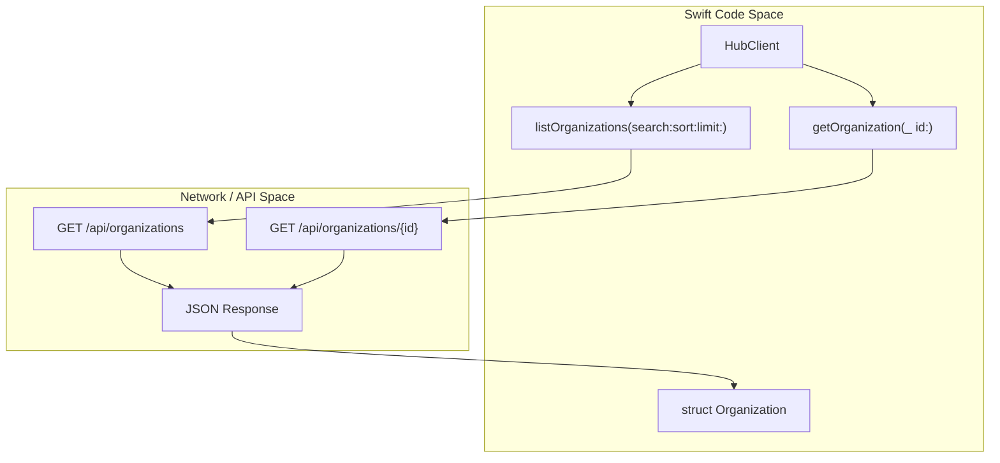
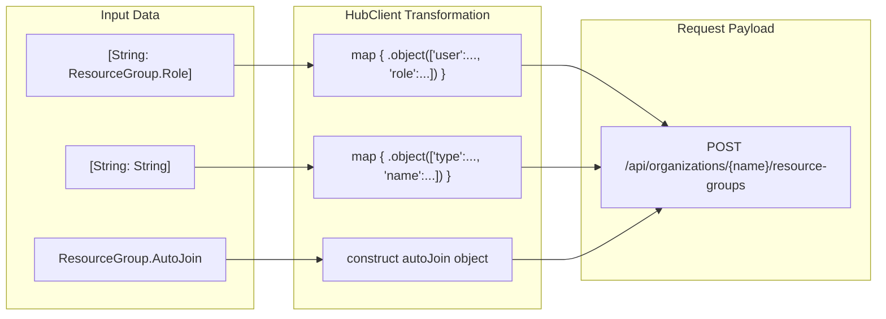

<!-- source: DeepWiki mcp.deepwiki.com · repo huggingface/swift-huggingface · page 3.5 Organizations · fetched 2026-10-26 -->

# Organizations

<details>
<summary>Relevant source files</summary>

The following files were used as context for generating this wiki page:

- [Sources/HuggingFace/Hub/AccessRequest.swift](Sources/HuggingFace/Hub/AccessRequest.swift)
- [Sources/HuggingFace/Hub/Billing.swift](Sources/HuggingFace/Hub/Billing.swift)
- [Sources/HuggingFace/Hub/HubClient+Organizations.swift](Sources/HuggingFace/Hub/HubClient+Organizations.swift)
- [Sources/HuggingFace/Hub/Organization.swift](Sources/HuggingFace/Hub/Organization.swift)
- [Sources/HuggingFace/Hub/ResourceGroup.swift](Sources/HuggingFace/Hub/ResourceGroup.swift)
- [Tests/HuggingFaceTests/HubTests/CollectionTests.swift](Tests/HuggingFaceTests/HubTests/CollectionTests.swift)
- [Tests/HuggingFaceTests/HubTests/OrganizationTests.swift](Tests/HuggingFaceTests/HubTests/OrganizationTests.swift)
- [Tests/HuggingFaceTests/HubTests/PaperTests.swift](Tests/HuggingFaceTests/HubTests/PaperTests.swift)
- [Tests/HuggingFaceTests/HubTests/UserTests.swift](Tests/HuggingFaceTests/HubTests/UserTests.swift)
- [Tests/HuggingFaceTests/InferenceProvidersTests/ChatCompletionTests.swift](Tests/HuggingFaceTests/InferenceProvidersTests/ChatCompletionTests.swift)
- [Tests/HuggingFaceTests/InferenceProvidersTests/FeatureExtractionTests.swift](Tests/HuggingFaceTests/InferenceProvidersTests/FeatureExtractionTests.swift)

</details>


Organizations on the Hugging Face Hub are collaborative entities that own repositories (models, datasets, spaces) and manage team members with varying access levels. The `swift-huggingface` SDK provides a dedicated API via `HubClient` to list organizations, retrieve metadata, manage memberships, monitor billing usage, and configure resource groups for fine-grained access control.

## Organization Management Overview

The organization API is implemented as an extension to `HubClient`. It interfaces with the Hub's REST API to provide both public data discovery and privileged management operations.

| Operation Category | Methods | Auth Required | File Reference |
|-------------------|---------|---------------|----------------|
| **Discovery** | `listOrganizations`, `getOrganization` | No | [Sources/HuggingFace/Hub/HubClient+Organizations.swift:14-35]() |
| **Membership** | `listOrganizationMembers` | Yes | [Sources/HuggingFace/Hub/HubClient+Organizations.swift:44-46]() |
| **Billing** | `getOrganizationBillingUsage`, `getOrganizationBillingUsageLive` | Yes | [Sources/HuggingFace/Hub/HubClient+Organizations.swift:59-78]() |
| **Resource Groups** | `createOrganizationResourceGroup` | Yes | [Sources/HuggingFace/Hub/HubClient+Organizations.swift:95-137]() |

**Sources:** [Sources/HuggingFace/Hub/HubClient+Organizations.swift:1-139]()

## Data Entities

The SDK defines several structures to represent organization-related data, ensuring type safety when interacting with the Hub API.

### The Organization Model
The `Organization` struct contains metadata about the entity, including its type (Enterprise or Community) and resource counts.

```swift
public struct Organization: Codable, Sendable {
    public let name: String
    public let fullName: String?
    public let avatarURL: String?
    public let isEnterprise: Bool?
    public let createdAt: Date?
    public let numberOfMembers: Int?
    public let numberOfModels: Int?
    public let numberOfDatasets: Int?
    public let numberOfSpaces: Int?
}
```
**Sources:** [Sources/HuggingFace/Hub/Organization.swift:4-51]()

### Member and Role Models
Members are represented by the `Organization.Member` nested struct, which includes their Hub username and their specific role within the organization (e.g., "admin", "read").

**Sources:** [Sources/HuggingFace/Hub/Organization.swift:55-77]()

## Organization Discovery

The discovery API allows users to search for organizations and retrieve detailed profiles.

### Listing and Searching
The `listOrganizations` method supports filtering and sorting. It returns a `PaginatedResponse`, which encapsulates the list of items and logic for fetching subsequent pages.

**Entity Mapping: Discovery Flow**

**Sources:** [Sources/HuggingFace/Hub/HubClient+Organizations.swift:14-35](), [Tests/HuggingFaceTests/HubTests/OrganizationTests.swift:27-153]()

## Billing and Usage

The SDK provides deep integration with the Hub's billing system, allowing organizations to programmatically monitor costs and resource consumption.

### Billing Usage Structures
Billing data is hierarchical, organized into `Billing.Usage`, which contains `LineItem` entries and `Period` metadata.

*   **LineItem**: Represents a specific cost driver (e.g., a specific Inference Endpoint or Space hardware). It includes `totalCostMicroUSD` and `quantity`. [Sources/HuggingFace/Hub/Billing.swift:7-58]()
*   **Period**: Defines the date range for the billing cycle and associated `Invoice` or `Charge` objects. [Sources/HuggingFace/Hub/Billing.swift:68-136]()

### Fetching Usage
1.  **Historical**: `getOrganizationBillingUsage(name:periodId:)` fetches usage for a closed billing cycle. [Sources/HuggingFace/Hub/HubClient+Organizations.swift:59-67]()
2.  **Live**: `getOrganizationBillingUsageLive(name:)` fetches real-time usage for the current, ongoing period. [Sources/HuggingFace/Hub/HubClient+Organizations.swift:76-78]()

**Sources:** [Sources/HuggingFace/Hub/Billing.swift:3-199](), [Sources/HuggingFace/Hub/HubClient+Organizations.swift:48-79]()

## Resource Groups

Resource groups are a powerful feature for managing access to subsets of repositories within an organization. They allow administrators to group specific users and repositories together.

### Creating a Resource Group
The `createOrganizationResourceGroup` method is one of the most complex POST operations in the Hub API, requiring the construction of nested arrays for users and repositories.

**Implementation Logic:**
1.  **URL Building**: The client appends `resource-groups` to the organization's API path. [Sources/HuggingFace/Hub/HubClient+Organizations.swift:103-107]()
2.  **Parameter Mapping**: 
    *   `users` dictionary is mapped to an array of objects containing `user` and `role`. [Sources/HuggingFace/Hub/HubClient+Organizations.swift:110-119]()
    *   `repos` dictionary is mapped to an array of objects containing `type` and `name`. [Sources/HuggingFace/Hub/HubClient+Organizations.swift:120-129]()
3.  **AutoJoin**: Configures whether new organization members are automatically added to this group. [Sources/HuggingFace/Hub/HubClient+Organizations.swift:130-134]()

**Entity Mapping: Resource Group Configuration**

**Sources:** [Sources/HuggingFace/Hub/HubClient+Organizations.swift:95-137](), [Sources/HuggingFace/Hub/ResourceGroup.swift:4-45]()

## Authentication and Permissions

Most organization operations require a valid `bearerToken` with specific scopes.

*   **Public Access**: Listing organizations and getting basic metadata. [Tests/HuggingFaceTests/HubTests/OrganizationTests.swift:68-76]()
*   **Member Access**: Listing members of an organization requires the caller to be part of that organization. [Sources/HuggingFace/Hub/HubClient+Organizations.swift:39-46]()
*   **Admin Access**: Creating resource groups and viewing billing usage requires administrative or billing-specific permissions. [Sources/HuggingFace/Hub/HubClient+Organizations.swift:52, 84]()

The `whoami()` method can be used to verify the current user's organization memberships and roles. [Tests/HuggingFaceTests/HubTests/UserTests.swift:31-73]()

**Sources:** [Sources/HuggingFace/Hub/HubClient+Organizations.swift:1-139](), [Tests/HuggingFaceTests/HubTests/UserTests.swift:31-132]()

---

