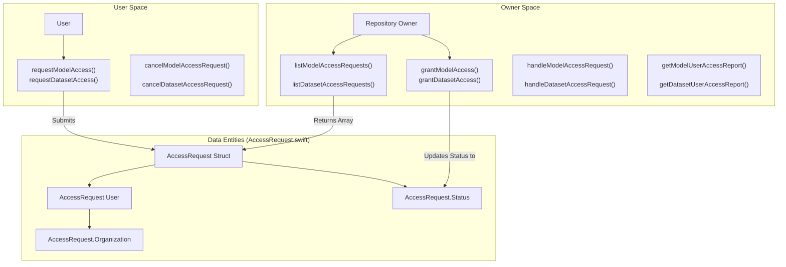
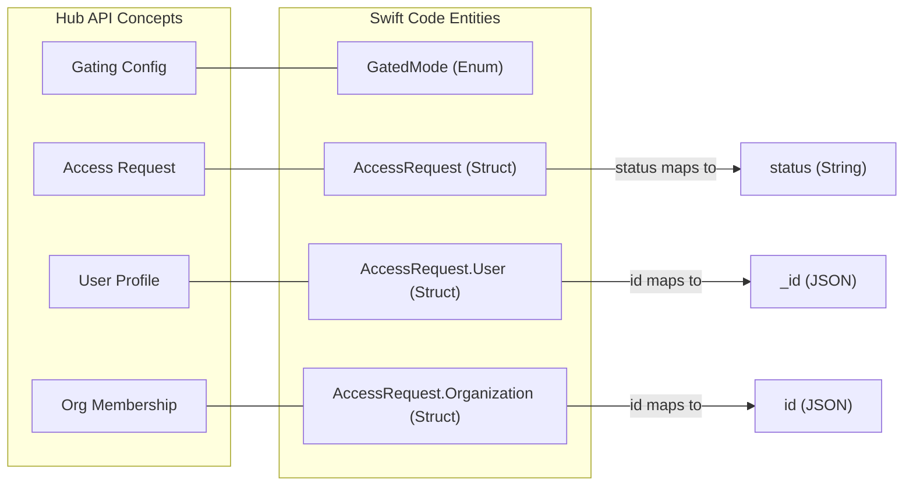

<!-- source: DeepWiki mcp.deepwiki.com · repo huggingface/swift-huggingface · page 3.6 Access Control and Gated Resources · fetched 2026-10-26 -->

# Access Control and Gated Resources

Relevant source files

The following files were used as context for generating this wiki page:

- [Sources/HuggingFace/Hub/AccessRequest.swift](Sources/HuggingFace/Hub/AccessRequest.swift)
- [Sources/HuggingFace/Hub/Billing.swift](Sources/HuggingFace/Hub/Billing.swift)
- [Tests/HuggingFaceTests/HubTests/GatedModeTests.swift](Tests/HuggingFaceTests/HubTests/GatedModeTests.swift)
- [Tests/HuggingFaceTests/HubTests/GitTests.swift](Tests/HuggingFaceTests/HubTests/GitTests.swift)

This page documents the access control system for gated repositories on Hugging Face Hub. Gated resources are models or datasets that require explicit permission before users can download or use them. This system enables repository owners to control who can access their resources, optionally collect information from requesters, and maintain compliance with licensing requirements.

---

## Overview of Gated Resources

Gated repositories restrict access to authorized users only. When a repository is gated, users must submit an access request before they can download files or use the resource. Repository owners can configure gating to be either automatic (instantly approved) or manual (requires owner review).

### Gating Modes

The `GatedMode` enum defines how a repository handles access requests. It supports decoding from both boolean values and strings to maintain compatibility with different Hub API response formats [Tests/HuggingFaceTests/HubTests/GatedModeTests.swift:12-56]().

| Mode | Hub API Value | Behavior |
|------|----------|----------|
| `.notGated` | `false` | No gating; public access [Tests/HuggingFaceTests/HubTests/GatedModeTests.swift:16-19]() |
| `.auto` | `"auto"` or `true` | Access granted immediately upon request [Tests/HuggingFaceTests/HubTests/GatedModeTests.swift:21-24, 40-43]() |
| `.manual` | `"manual"` | Access requires owner approval [Tests/HuggingFaceTests/HubTests/GatedModeTests.swift:26-29, 53-56]() |

---

## Access Request Workflow

The following diagram illustrates the interaction between users, repository owners, and the Hub's internal access control structures.

### Logic Flow and Code Entities

**Sources:** [Sources/HuggingFace/Hub/AccessRequest.swift:4-127]().

---

## Data Structures

### AccessRequest

The `AccessRequest` structure represents a user's request for access to a gated repository [Sources/HuggingFace/Hub/AccessRequest.swift:4-26]().

| Property | Type | Description |
|:---|:---|:---|
| `user` | `User` | The user who made the request [Sources/HuggingFace/Hub/AccessRequest.swift:6](). |
| `grantedBy` | `User?` | The user who granted the request, if applicable [Sources/HuggingFace/Hub/AccessRequest.swift:9](). |
| `status` | `Status` | Current state: `.accepted`, `.rejected`, or `.pending` [Sources/HuggingFace/Hub/AccessRequest.swift:12-19](). |
| `fields` | `[String: String]?` | Additional form data (e.g., "reason", "org") [Sources/HuggingFace/Hub/AccessRequest.swift:22](). |
| `timestamp` | `Date` | When the request was created [Sources/HuggingFace/Hub/AccessRequest.swift:25](). |

### AccessRequest.User

This nested structure contains detailed metadata about the requester, including their activity metrics on the Hub [Sources/HuggingFace/Hub/AccessRequest.swift:28-111]().

*   **Identity:** `id`, `user` (username), `fullName`, `email`, `avatarURL` [Sources/HuggingFace/Hub/AccessRequest.swift:30-48]().
*   **Stats:** `numberOfModels`, `numberOfDatasets`, `numberOfFollowers`, etc [Sources/HuggingFace/Hub/AccessRequest.swift:51-75]().
*   **Affiliations:** `organizations` (Array of `AccessRequest.Organization`) [Sources/HuggingFace/Hub/AccessRequest.swift:87]().

---

## Repository Access Management

### Requesting Access
Users submit access requests to obtain permission. The request may include additional information such as the reason for access or institutional affiliation via the `fields` dictionary in `AccessRequest` [Sources/HuggingFace/Hub/AccessRequest.swift:22]().

### Listing and Filtering Requests
Repository owners can retrieve requests filtered by their `AccessRequest.Status` [Sources/HuggingFace/Hub/AccessRequest.swift:12-16](). This allows for building dashboards to process `.pending` requests.

### Access Reports
Owners can retrieve comprehensive access reports. While the SDK provides the raw data for these reports, they contain sensitive user information and require high-level administrative tokens.

---

## API Mapping and Entity Association

The following diagram maps high-level Hub concepts to the specific Swift types and properties used for access control.

### Entity Mapping: Hub to Code

**Sources:** [Sources/HuggingFace/Hub/AccessRequest.swift:90-127](), [Tests/HuggingFaceTests/HubTests/GatedModeTests.swift:10-57]().

---

## Related Billing Entities

Access to certain resources or organizations may be tied to billing status. The `Billing` namespace provides structures for tracking usage and entities associated with paid tiers [Sources/HuggingFace/Hub/Billing.swift:3-199]().

*   **Billing.Usage:** Tracks `LineItem` costs in micro USD [Sources/HuggingFace/Hub/Billing.swift:5-65]().
*   **Billing.Period:** Defines the timeframe for usage, associated with either a `user` or `org` [Sources/HuggingFace/Hub/Billing.swift:68-136]().
*   **Billing.Entity.Kind:** Distinguishes between individual `user` billing and `organization` (org) billing [Sources/HuggingFace/Hub/Billing.swift:86-89]().

**Sources:** [Sources/HuggingFace/Hub/Billing.swift:3-199](), [Sources/HuggingFace/Hub/AccessRequest.swift:4-127](), [Tests/HuggingFaceTests/HubTests/GatedModeTests.swift:1-58]().

---

