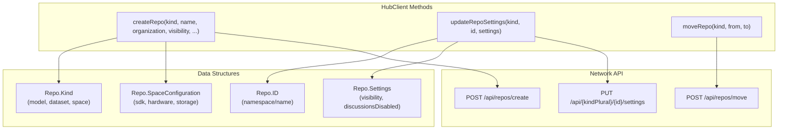
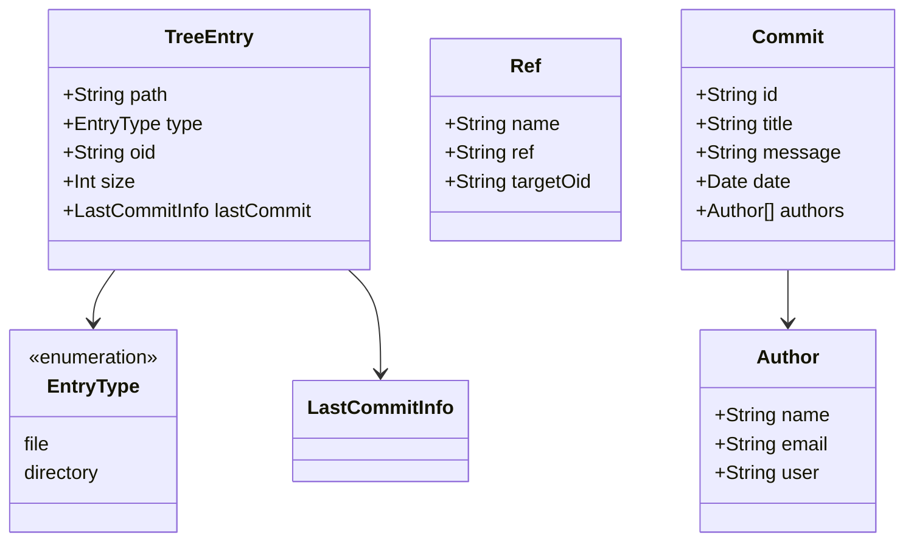

<!-- source: DeepWiki mcp.deepwiki.com · repo huggingface/swift-huggingface · page 3.7 Advanced Repository Operations · fetched 2026-10-26 -->

# Advanced Repository Operations

<details>
<summary>Relevant source files</summary>

The following files were used as context for generating this wiki page:

- [Sources/HuggingFace/Hub/Git.swift](Sources/HuggingFace/Hub/Git.swift)
- [Sources/HuggingFace/Hub/HubClient+Repos.swift](Sources/HuggingFace/Hub/HubClient+Repos.swift)
- [Tests/HuggingFaceTests/HubTests/GatedModeTests.swift](Tests/HuggingFaceTests/HubTests/GatedModeTests.swift)
- [Tests/HuggingFaceTests/HubTests/GitTests.swift](Tests/HuggingFaceTests/HubTests/GitTests.swift)
- [Tests/HuggingFaceTests/HubTests/RepoIDTests.swift](Tests/HuggingFaceTests/HubTests/RepoIDTests.swift)
- [Tests/HuggingFaceTests/HubTests/RepoTests.swift](Tests/HuggingFaceTests/HubTests/RepoTests.swift)

</details>


This document covers advanced Git-like operations and administrative features for repositories on the Hugging Face Hub using the `HubClient`. These operations include creating tags for versioning, optimizing commit history with super-squash, traversing repository trees, and managing repository settings.

---

## Overview of Advanced Operations

The `HubClient` provides administrative and maintenance operations that mirror Git version control workflows but are tailored for machine learning repositories. These operations apply consistently across repository types: models, datasets, and spaces.

### Operation Categories

| Operation Category | Purpose | Key Entities |
|-------------------|---------|--------------|
| **Tag Creation** | Create immutable references to specific commits for versioning | `Git.Ref`, `Git.Commit` |
| **Super-Squash** | Compress commit history into a single commit for cleanup | `Git.Commit` |
| **Tree Traversal**| Navigate repository file structures and commit history | `Git.TreeEntry`, `Git.Author` |
| **Repo Management**| Create, move, and update repository-wide settings | `Repo.ID`, `Repo.Settings` |

Sources: [Sources/HuggingFace/Hub/HubClient+Repos.swift:5-128](), [Sources/HuggingFace/Hub/Git.swift:4-104]()

---

## Repository Life Cycle and Settings

The `HubClient` provides methods to manage the lifecycle of a repository, from creation to moving and updating metadata.

### Data Flow: Repository Creation and Configuration



Sources: [Sources/HuggingFace/Hub/HubClient+Repos.swift:20-28](), [Sources/HuggingFace/Hub/HubClient+Repos.swift:88-92](), [Sources/HuggingFace/Hub/HubClient+Repos.swift:115-119]()

### Implementation Details

*   **Creation**: The `createRepo` function handles complex logic for Space repositories, requiring a `Repo.SpaceConfiguration` [Sources/HuggingFace/Hub/HubClient+Repos.swift:29-31](). It maps Swift enums to the Hub's internal API parameters like `private` for visibility [Sources/HuggingFace/Hub/HubClient+Repos.swift:33-37]().
*   **Settings**: `updateRepoSettings` uses a `JSONEncoder` to transform a `Repo.Settings` object into a dictionary of parameters for a `PUT` request [Sources/HuggingFace/Hub/HubClient+Repos.swift:100-104]().
*   **Moving**: `moveRepo` allows renaming or transferring ownership by specifying `from` and `to` `Repo.ID` values [Sources/HuggingFace/Hub/HubClient+Repos.swift:115-127]().

---

## Git-Like Tree Traversal

The SDK provides structures to navigate the internal Git state of a repository without requiring a local clone. This is powered by the `Git` namespace.

### Code Entity Space: Git Structures



Sources: [Sources/HuggingFace/Hub/Git.swift:6-103]()

### Tree and Ref Decoding
The SDK handles complex JSON responses from the Hub's Git API, including:
*   **Tree Entries**: Decoding both files (with OIDs and sizes) and directories (where OIDs may be null) [Tests/HuggingFaceTests/HubTests/GitTests.swift:11-63]().
*   **References**: Parsing lists of branches and tags into `Git.Ref` objects [Tests/HuggingFaceTests/HubTests/GitTests.swift:83-125]().
*   **Commits**: Extracting metadata including the title (first line), full message, and parent commit IDs [Sources/HuggingFace/Hub/Git.swift:67-85]().

---

## Creating Tags

Tags provide immutable references to specific commits in a repository's history. They are commonly used for versioning releases (e.g., `v1.0`).

### Tag Creation Logic

Each repository type (Model, Dataset, Space) has a dedicated method for creating tags (e.g., `createModelTag`). These methods construct a URL following the pattern:
`POST /api/{repoType}/{namespace}/{repo}/tag/{revision}`

The request includes:
1.  **Revision**: The commit hash or branch to tag.
2.  **Tag Name**: The string identifier for the tag.
3.  **Message**: An optional description for the tag.

Sources: [Sources/HuggingFace/Hub/HubClient+Models.swift:229-259](), [Sources/HuggingFace/Hub/HubClient+Datasets.swift:259-290]()

---

## Super-Squash Commits

Super-squash is a history optimization operation that compresses all commits in a branch into a single commit. This is useful for cleaning up repositories with extensive histories or removing sensitive data from the commit log.

### Operation Behavior

The super-squash operation:
1.  Takes all commits in the specified revision's history.
2.  Combines them into a single new commit with a provided message.
3.  Returns the new commit hash.

### Implementation Structure

The methods (e.g., `superSquashModel` at [Sources/HuggingFace/Hub/HubClient+Models.swift:261-289]()) follow this pattern:

```swift
// Build URL: /api/{type}/{ns}/{repo}/super-squash/{rev}
let url = httpClient.host
    .appending(path: "api")
    .appending(path: kind.pluralized)
    .appending(path: id.namespace)
    .appending(path: id.name)
    .appending(path: "super-squash")
    .appending(component: revision)

// Execute POST with the squash message
struct Response: Decodable { let commitID: String }
let resp: Response = try await httpClient.fetch(.post, url: url, params: ["message": .string(message)])
return resp.commitID
```

Sources: [Sources/HuggingFace/Hub/HubClient+Models.swift:261-289](), [Sources/HuggingFace/Hub/HubClient+Datasets.swift:291-320]()

---

## Security Scanning

The scan operation initiates an asynchronous security and malware scan on a repository. This checks for potentially malicious files (like pickled models) and security vulnerabilities.

### Implementation Details

Methods like `scanModel(_:)` [Sources/HuggingFace/Hub/HubClient+Models.swift:213-227]() and `scanDataset(_:)` [Sources/HuggingFace/Hub/HubClient+Datasets.swift:243-257]() send a `POST` request to the `/scan` endpoint.
*   **Return Value**: A `Bool` indicating if the scan was successfully initiated.
*   **Asynchronous Nature**: The actual scanning happens on Hugging Face infrastructure; results are typically viewed via the Hub web interface.

---

## Resource Groups

Resource groups allow organizations to manage repository access and billing at a team level.

### Assignment Logic

Repositories can be assigned to a group during creation [Sources/HuggingFace/Hub/HubClient+Repos.swift:42-44]() or updated later using methods like `setModelResourceGroup` [Sources/HuggingFace/Hub/HubClient+Models.swift:187-211]().

*   **URL**: `POST /api/{repoType}/{id}/resource-group`
*   **Parameters**: A `resourceGroupId` string, or `null` to unassign the repository [Sources/HuggingFace/Hub/HubClient+Models.swift:207-209]().

Sources: [Sources/HuggingFace/Hub/HubClient+Repos.swift:15-27](), [Sources/HuggingFace/Hub/HubClient+Models.swift:187-211]()

---

