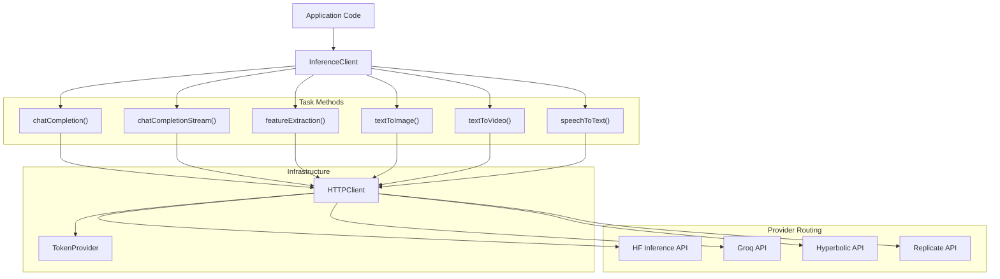
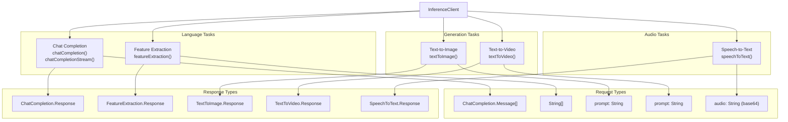
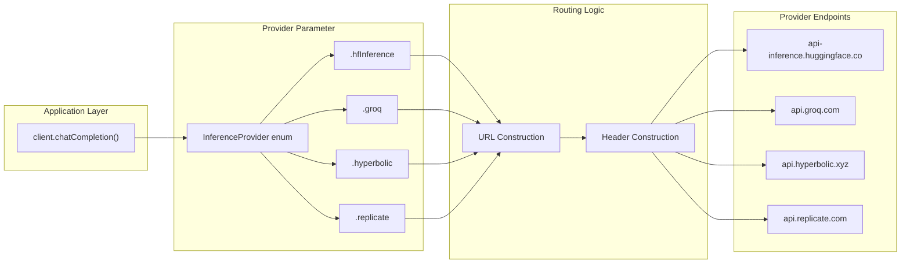
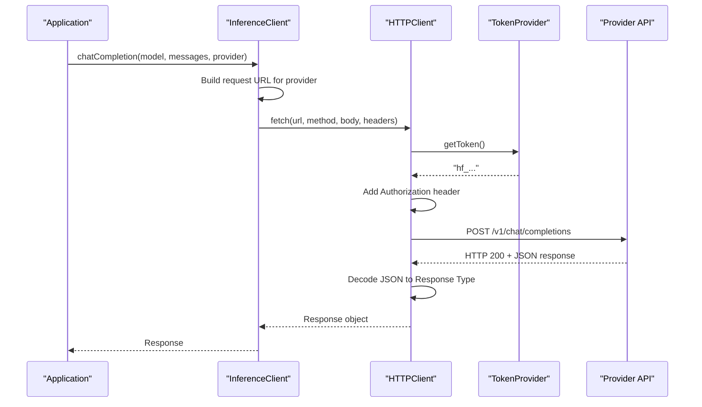

<!-- source: DeepWiki mcp.deepwiki.com · repo huggingface/swift-huggingface · page 4 InferenceClient - AI Tasks · fetched 2026-10-26 -->

# InferenceClient - AI Tasks

<details>
<summary>Relevant source files</summary>

The following files were used as context for generating this wiki page:

- [README.md](README.md)
- [Sources/HuggingFace/InferenceProviders/InferenceClient.swift](Sources/HuggingFace/InferenceProviders/InferenceClient.swift)

</details>


## Purpose and Scope

This page provides an overview of the `InferenceClient` component and its role in executing AI inference tasks. The `InferenceClient` provides a unified Swift interface for running various AI operations including chat completion, embeddings generation, image/video synthesis, and speech transcription across multiple inference providers.

For detailed information about specific capabilities:
- Chat completion and streaming: see [Chat Completion](#4.1)
- Text embeddings: see [Feature Extraction (Embeddings)](#4.2)
- Image and video synthesis: see [Image and Video Generation](#4.3)
- Audio transcription: see [Speech-to-Text](#4.4)
- Provider configuration: see [Inference Providers](#4.5)

For repository management and file operations, see [HubClient - Repository Management](#3).
For authentication setup, see [Authentication System](#5).

## InferenceClient Architecture

The `InferenceClient` is one of two primary client interfaces in the swift-huggingface SDK, specializing in AI task execution. It orchestrates communication with various inference provider APIs while handling authentication, request serialization, and response parsing.

Title: InferenceClient Architecture


**InferenceClient Architecture**: The client provides task-specific methods that route through `HTTPClient` for network communication and `TokenProvider` for authentication.

Sources: [Sources/HuggingFace/InferenceProviders/InferenceClient.swift:7-24](), [Sources/HuggingFace/InferenceProviders/InferenceClient.swift:114-120]()

## Creating an InferenceClient

### Default Client

The simplest way to create an `InferenceClient` is using the `default` static property, which automatically detects authentication credentials from environment variables or token files and uses the default router host [Sources/HuggingFace/InferenceProviders/InferenceClient.swift:25-33]().

```swift
let client = InferenceClient.default
```

The default client looks for credentials in standard locations such as `HF_TOKEN` or `~/.cache/huggingface/token` [Sources/HuggingFace/InferenceProviders/InferenceClient.swift:13-19]().

### Custom Configuration

For advanced scenarios requiring custom session configuration, base URLs, or authentication strategies:

```swift
// Custom session configuration
let configuration = URLSessionConfiguration.default
configuration.timeoutIntervalForRequest = 30
let session = URLSession(configuration: configuration)

let client = InferenceClient(
    session: session,
    host: URL(string: "https://router.huggingface.co")!,
    userAgent: "MyApp/1.0"
)
```

Sources: [Sources/HuggingFace/InferenceProviders/InferenceClient.swift:80-99]()

### Authentication Strategies

The `InferenceClient` supports multiple authentication approaches through the `TokenProvider` abstraction [Sources/HuggingFace/InferenceProviders/InferenceClient.swift:108-112]():

| Strategy | Usage | Typical Scenario |
|----------|-------|------------------|
| `.environment` | Auto-detected from env vars/files | Development, CI/CD |
| `.fixed(token:)` | Static token string | Server applications |
| `.oauth(manager:)` | Dynamic OAuth tokens | User-facing apps |
| `.none` | No authentication | Public models/endpoints |

```swift
// Fixed token
let client = InferenceClient(host: myHost, bearerToken: "hf_...")

// OAuth-based
let authManager = try HuggingFaceAuthenticationManager(...)
let client = InferenceClient(host: myHost, tokenProvider: .oauth(manager: authManager))
```

Sources: [Sources/HuggingFace/InferenceProviders/InferenceClient.swift:87-112](), [README.md:81-94]()

## Task Type Taxonomy

The `InferenceClient` organizes AI capabilities into distinct task categories, each with dedicated methods and data structures:

Title: Task Method Mapping


### Language Tasks

**Chat Completion** provides conversational AI capabilities with support for multi-turn dialogues, system prompts, tool calling, and vision-language models. For details, see [Chat Completion](#4.1).

**Feature Extraction** generates text embeddings (vector representations) for semantic search and similarity comparison. For details, see [Feature Extraction (Embeddings)](#4.2).

### Generation Tasks

**Text-to-Image** synthesizes images from text prompts with control over dimensions and guidance. For details, see [Image and Video Generation](#4.3).

**Text-to-Video** generates video sequences from textual descriptions. For details, see [Image and Video Generation](#4.3).

### Audio Tasks

**Speech-to-Text** transcribes audio files to text with optional language specification. For details, see [Speech-to-Text](#4.4).

## Provider Selection Architecture

The `InferenceClient` uses dynamic provider routing, allowing the same task to execute on different inference backends.

Title: Provider Routing Flow


### Provider Compatibility

Different tasks support different provider combinations. For a detailed compatibility matrix and configuration guide, see [Inference Providers](#4.5).

## Request/Response Flow

The typical lifecycle of an inference request follows this sequence:

Title: Standard Request Flow


Sources: [Sources/HuggingFace/InferenceProviders/InferenceClient.swift:114-120]()

## Next Steps

- **[Chat Completion](#4.1)**: Multi-turn conversations, streaming, vision models, tool calling.
- **[Feature Extraction (Embeddings)](#4.2)**: Text embeddings for semantic search.
- **[Image and Video Generation](#4.3)**: Text-to-image/video synthesis parameters.
- **[Speech-to-Text](#4.4)**: Audio transcription and translation.
- **[Inference Providers](#4.5)**: Provider selection, configuration, and compatibility.

---

