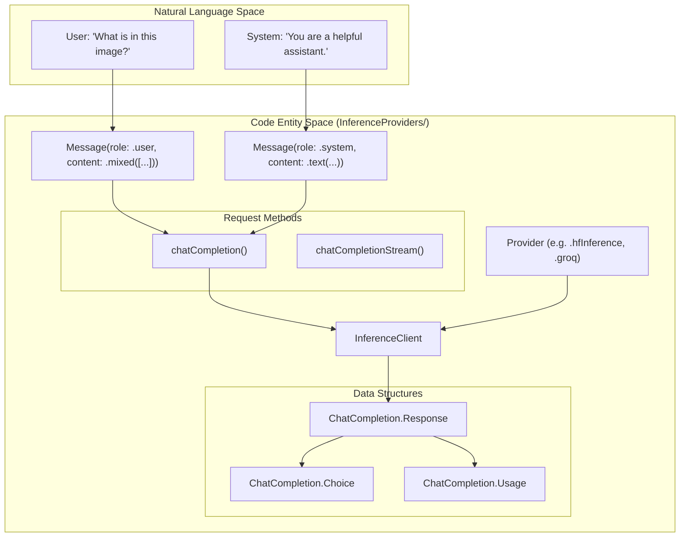
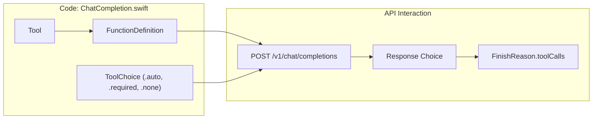

<!-- source: DeepWiki mcp.deepwiki.com · repo huggingface/swift-huggingface · page 4.1 Chat Completion · fetched 2026-10-26 -->

# Chat Completion

<details>
<summary>Relevant source files</summary>

The following files were used as context for generating this wiki page:

- [Sources/HuggingFace/InferenceProviders/ChatCompletion.swift](Sources/HuggingFace/InferenceProviders/ChatCompletion.swift)
- [Sources/HuggingFace/InferenceProviders/FeatureExtraction.swift](Sources/HuggingFace/InferenceProviders/FeatureExtraction.swift)
- [Sources/HuggingFace/InferenceProviders/Message.swift](Sources/HuggingFace/InferenceProviders/Message.swift)
- [Tests/HuggingFaceTests/HubTests/CollectionTests.swift](Tests/HuggingFaceTests/HubTests/CollectionTests.swift)
- [Tests/HuggingFaceTests/HubTests/GitOperationsTests.swift](Tests/HuggingFaceTests/HubTests/GitOperationsTests.swift)
- [Tests/HuggingFaceTests/HubTests/OrganizationTests.swift](Tests/HuggingFaceTests/HubTests/OrganizationTests.swift)
- [Tests/HuggingFaceTests/HubTests/PaperTests.swift](Tests/HuggingFaceTests/HubTests/PaperTests.swift)
- [Tests/HuggingFaceTests/HubTests/UserTests.swift](Tests/HuggingFaceTests/HubTests/UserTests.swift)
- [Tests/HuggingFaceTests/InferenceProvidersTests/ChatCompletionTests.swift](Tests/HuggingFaceTests/InferenceProvidersTests/ChatCompletionTests.swift)
- [Tests/HuggingFaceTests/InferenceProvidersTests/FeatureExtractionTests.swift](Tests/HuggingFaceTests/InferenceProvidersTests/FeatureExtractionTests.swift)
- [Tests/HuggingFaceTests/InferenceProvidersTests/MessageCodableTests.swift](Tests/HuggingFaceTests/InferenceProvidersTests/MessageCodableTests.swift)
- [Tests/HuggingFaceTests/InferenceProvidersTests/ProviderTests.swift](Tests/HuggingFaceTests/InferenceProvidersTests/ProviderTests.swift)
- [Tests/HuggingFaceTests/OAuthTests/TokenStorageTests.swift](Tests/HuggingFaceTests/OAuthTests/TokenStorageTests.swift)
- [Tests/HuggingFaceTests/SharedTests/MultipartBuilderTests.swift](Tests/HuggingFaceTests/SharedTests/MultipartBuilderTests.swift)

</details>


Chat completion provides conversational AI capabilities through the `InferenceClient` [Sources/HuggingFace/InferenceProviders/ChatCompletion.swift:21-21](). This system enables applications to send messages to language models and receive contextual responses, supporting text-only conversations, vision-language interactions, function/tool calling, and streaming responses.

For inference provider configuration and selection, see **Inference Providers (4.5)**. For authentication setup, see **Authentication Setup (2.2)**. For other inference tasks like embeddings or image generation, see **Feature Extraction (4.2)** and **Image and Video Generation (4.3)**.

## Overview

Chat completion requests are made through the `InferenceClient`'s `chatCompletion()` [Sources/HuggingFace/InferenceProviders/ChatCompletion.swift:33-56]() and `chatCompletionStream()` [Sources/HuggingFace/InferenceProviders/ChatCompletion.swift:101-120]() methods. The system follows the OpenAI-compatible chat completion API format, allowing messages with different roles, multimodal content (text and images), tool/function calling, and structured output formats.

### Chat Completion Data Flow
The following diagram maps the relationship between the natural language intent and the code entities used to fulfill the request.


Sources: [Sources/HuggingFace/InferenceProviders/ChatCompletion.swift:33-120](), [Sources/HuggingFace/InferenceProviders/Message.swift:4-15](), [Tests/HuggingFaceTests/InferenceProvidersTests/ChatCompletionTests.swift:69-76]()

## Message Structure

Messages are the fundamental building blocks of chat completion requests. Each message has a role (`system`, `user`, `assistant`, or `tool`) and content that can be simple text or mixed multimodal content [Sources/HuggingFace/InferenceProviders/Message.swift:19-35]().

### Message Roles

The `Message.Role` type represents individual roles in a conversation:

| Role | Purpose | Code Symbol |
|------|---------|-------------|
| `system` | Set behavior and context for the model | `.system` |
| `user` | Input from the end user | `.user` |
| `assistant` | Previous responses from the model | `.assistant` |
| `tool` | Results from tool/function execution | `.tool` |

Sources: [Sources/HuggingFace/InferenceProviders/Message.swift:19-35](), [Tests/HuggingFaceTests/InferenceProvidersTests/MessageCodableTests.swift:11-20]()

### Multimodal Content

For vision-language models, messages can contain mixed content combining text and images using the `.mixed` enum case [Sources/HuggingFace/InferenceProviders/Message.swift:51-54]():

```swift
let message = Message(
    role: .user,
    content: .mixed([
        .text("What is in this image?"),
        .image(url: "https://example.com/image.jpg", detail: .high)
    ])
)
```

The `ImageDetail` parameter controls image processing resolution [Sources/HuggingFace/InferenceProviders/Message.swift:80-87]():
- `.auto`: Model chooses optimal resolution (default) [Tests/HuggingFaceTests/InferenceProvidersTests/MessageCodableTests.swift:58-60]().
- `.high`: High-resolution processing for detailed analysis.
- `.low`: Lower resolution for faster processing.

Sources: [Sources/HuggingFace/InferenceProviders/Message.swift:51-87](), [Tests/HuggingFaceTests/InferenceProvidersTests/MessageCodableTests.swift:24-61]()

## Making Requests

### Basic Chat Completion

The `chatCompletion()` method sends a synchronous request and returns a complete `ChatCompletion.Response` [Sources/HuggingFace/InferenceProviders/ChatCompletion.swift:33-56]():

```swift
let result = try await client.chatCompletion(
    model: "gpt-3.5-turbo",
    messages: [Message(role: .user, content: .text("Hello!"))]
)
```

### Request Parameters

| Parameter | Type | Description |
|-----------|------|-------------|
| `model` | `String` | Model identifier [Sources/HuggingFace/InferenceProviders/ChatCompletion.swift:34-34]() |
| `messages` | `[Message]` | Conversation history [Sources/HuggingFace/InferenceProviders/ChatCompletion.swift:35-35]() |
| `provider` | `Provider?` | Inference backend selection [Sources/HuggingFace/InferenceProviders/ChatCompletion.swift:36-36]() |
| `temperature` | `Double?` | Sampling temperature (0.0-2.0) [Sources/HuggingFace/InferenceProviders/ChatCompletion.swift:37-37]() |
| `maxTokens` | `Int?` | Maximum tokens in response [Sources/HuggingFace/InferenceProviders/ChatCompletion.swift:39-39]() |
| `tools` | `[ChatCompletion.Tool]?` | Available functions/tools [Sources/HuggingFace/InferenceProviders/ChatCompletion.swift:45-45]() |
| `responseFormat` | `ChatCompletion.ResponseFormat?` | Output format (text or jsonObject) [Sources/HuggingFace/InferenceProviders/ChatCompletion.swift:47-47]() |

Sources: [Sources/HuggingFace/InferenceProviders/ChatCompletion.swift:33-56](), [Tests/HuggingFaceTests/InferenceProvidersTests/ChatCompletionTests.swift:166-181]()

### Streaming Chat Completion

The `chatCompletionStream()` method returns an `AsyncThrowingStream` that yields `ChatCompletion.Response` chunks [Sources/HuggingFace/InferenceProviders/ChatCompletion.swift:101-120]():

```swift
let stream = try client.chatCompletionStream(
    model: "gpt-3.5-turbo",
    messages: messages
)

for try await chunk in stream {
    if let content = chunk.choices.first?.delta?.content {
        print(content)
    }
}
```

Sources: [Sources/HuggingFace/InferenceProviders/ChatCompletion.swift:101-120](), [Tests/HuggingFaceTests/InferenceProvidersTests/ChatCompletionTests.swift:360-414]()

## Tool Calling

Tool calling enables models to invoke external functions. The model provides structured arguments that the client can then execute [Tests/HuggingFaceTests/InferenceProvidersTests/ChatCompletionTests.swift:245-306]().

### Tool Definition Logic


Sources: [Sources/HuggingFace/InferenceProviders/ChatCompletion.swift:125-170](), [Tests/HuggingFaceTests/InferenceProvidersTests/ChatCompletionTests.swift:151-165]()

## Response Structure

The `ChatCompletion.Response` object contains metadata and an array of `Choice` objects [Sources/HuggingFace/InferenceProviders/ChatCompletion.swift:210-234]().

### Key Components

- **`id`**: Unique identifier for the completion [Sources/HuggingFace/InferenceProviders/ChatCompletion.swift:212-212]().
- **`choices`**: Array of response alternatives [Sources/HuggingFace/InferenceProviders/ChatCompletion.swift:222-222]().
- **`usage`**: Token consumption statistics (`promptTokens`, `completionTokens`, `totalTokens`) [Sources/HuggingFace/InferenceProviders/ChatCompletion.swift:225-225](), [Sources/HuggingFace/InferenceProviders/ChatCompletion.swift:283-290]().
- **`finishReason`**: Why the model stopped generating (e.g., `.stop`, `.length`, `.toolCalls`) [Sources/HuggingFace/InferenceProviders/ChatCompletion.swift:250-250](), [Sources/HuggingFace/InferenceProviders/ChatCompletion.swift:269-277]().

Sources: [Sources/HuggingFace/InferenceProviders/ChatCompletion.swift:210-290](), [Tests/HuggingFaceTests/InferenceProvidersTests/ChatCompletionTests.swift:78-87]()

## Feature Extraction (Embeddings)

While related to chat, feature extraction is a distinct task in the `InferenceClient` [Sources/HuggingFace/InferenceProviders/FeatureExtraction.swift:21-21](). It transforms text into numerical vectors (embeddings).

```swift
let result = try await client.featureExtraction(
    model: "sentence-transformers/all-MiniLM-L6-v2",
    input: "Hello, world!"
)
let vector = result.embeddings.first // [Double]
```

Sources: [Sources/HuggingFace/InferenceProviders/FeatureExtraction.swift:33-90](), [Tests/HuggingFaceTests/InferenceProvidersTests/FeatureExtractionTests.swift:57-68]()

---

