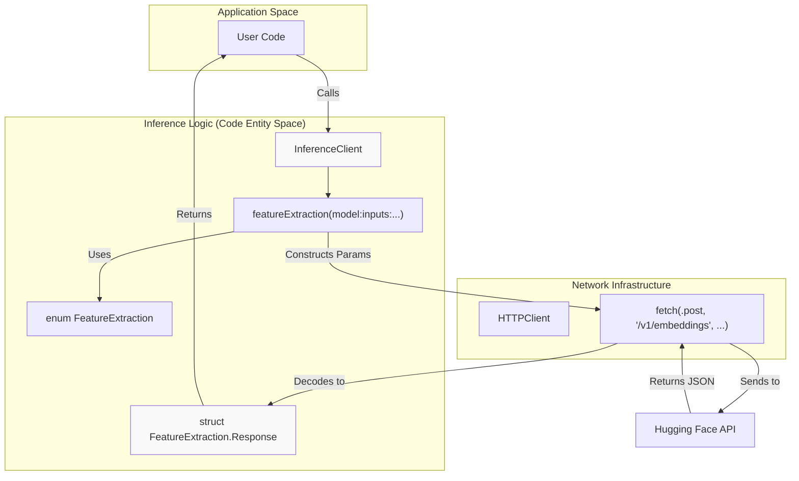
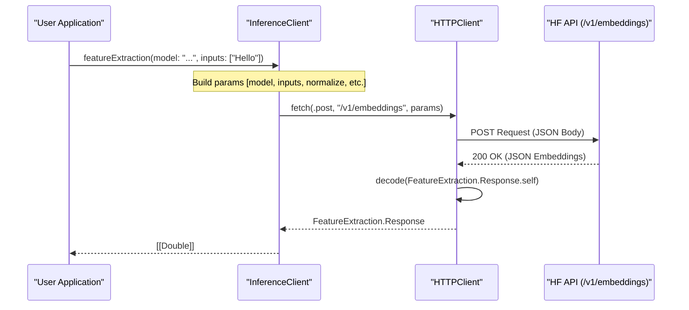

<!-- source: DeepWiki mcp.deepwiki.com · repo huggingface/swift-huggingface · page 4.2 Feature Extraction (Embeddings) · fetched 2026-10-26 -->

# Feature Extraction (Embeddings)

<details>
<summary>Relevant source files</summary>

The following files were used as context for generating this wiki page:

- [Sources/HuggingFace/InferenceProviders/ChatCompletion.swift](Sources/HuggingFace/InferenceProviders/ChatCompletion.swift)
- [Sources/HuggingFace/InferenceProviders/FeatureExtraction.swift](Sources/HuggingFace/InferenceProviders/FeatureExtraction.swift)
- [Tests/HuggingFaceTests/HubTests/CollectionTests.swift](Tests/HuggingFaceTests/HubTests/CollectionTests.swift)
- [Tests/HuggingFaceTests/HubTests/OrganizationTests.swift](Tests/HuggingFaceTests/HubTests/OrganizationTests.swift)
- [Tests/HuggingFaceTests/HubTests/PaperTests.swift](Tests/HuggingFaceTests/HubTests/PaperTests.swift)
- [Tests/HuggingFaceTests/HubTests/UserTests.swift](Tests/HuggingFaceTests/HubTests/UserTests.swift)
- [Tests/HuggingFaceTests/InferenceProvidersTests/ChatCompletionTests.swift](Tests/HuggingFaceTests/InferenceProvidersTests/ChatCompletionTests.swift)
- [Tests/HuggingFaceTests/InferenceProvidersTests/FeatureExtractionTests.swift](Tests/HuggingFaceTests/InferenceProvidersTests/FeatureExtractionTests.swift)

</details>


## Purpose and Scope

This document describes the feature extraction (embeddings) capability provided by the `InferenceClient`. Feature extraction converts text into numerical vector representations (embeddings) that capture semantic meaning, enabling applications such as semantic search, similarity matching, and retrieval-augmented generation (RAG) systems.

The implementation is located in `Sources/HuggingFace/InferenceProviders/FeatureExtraction.swift` and allows for both single-string and batch processing of text inputs.

---

## Overview

Feature extraction generates dense vector representations of text inputs. These embeddings map semantically similar text to nearby points in a high-dimensional vector space. The SDK provides a structured way to interface with the Hugging Face Inference Providers API to retrieve these vectors.

Key features include:
- **Batch Processing**: Support for multiple input strings in a single request [Sources/HuggingFace/InferenceProviders/FeatureExtraction.swift:33-40]().
- **Normalization**: Optional L2 normalization for cosine similarity compatibility [Sources/HuggingFace/InferenceProviders/FeatureExtraction.swift:49-51]().
- **Truncation**: Control over how long inputs are handled by the model [Sources/HuggingFace/InferenceProviders/FeatureExtraction.swift:52-54]().
- **Metadata**: Access to model-specific information returned by the provider [Sources/HuggingFace/InferenceProviders/FeatureExtraction.swift:15]().

---

## System Architecture

The following diagram illustrates the flow from the high-level `InferenceClient` call down to the network request and back.

### Code Entity Space Mapping

**Sources**: [Sources/HuggingFace/InferenceProviders/FeatureExtraction.swift:4-17](), [Sources/HuggingFace/InferenceProviders/FeatureExtraction.swift:33-60]()

---

## Data Structures

The feature extraction task uses a dedicated namespace and response structure to handle the vector data.

### FeatureExtraction.Response
This structure encapsulates the result of an embedding request.

| Property | Type | Description |
| :--- | :--- | :--- |
| `embeddings` | `[[Double]]` | An array of vectors. Each inner array is the embedding for one input string [Sources/HuggingFace/InferenceProviders/FeatureExtraction.swift:12](). |
| `metadata` | `[String: Value]?` | Additional information such as model name or dimensions [Sources/HuggingFace/InferenceProviders/FeatureExtraction.swift:15](). |

**Sources**: [Sources/HuggingFace/InferenceProviders/FeatureExtraction.swift:10-16]()

---

## Implementation Details

### Request Flow
When `featureExtraction` is called, the `InferenceClient` performs the following steps:

1.  **Parameter Mapping**: It bundles the `model` and `inputs` into a dictionary of `[String: Value]` [Sources/HuggingFace/InferenceProviders/FeatureExtraction.swift:41-44]().
2.  **Option Injection**: If provided, `normalize`, `truncate`, and `provider` identifiers are added to the parameters [Sources/HuggingFace/InferenceProviders/FeatureExtraction.swift:46-57]().
3.  **HTTP Execution**: The client calls `httpClient.fetch` using the `POST` method on the `/v1/embeddings` endpoint [Sources/HuggingFace/InferenceProviders/FeatureExtraction.swift:59]().

### Sequence Diagram: Text to Embedding

**Sources**: [Sources/HuggingFace/InferenceProviders/FeatureExtraction.swift:33-60](), [Tests/HuggingFaceTests/InferenceProvidersTests/FeatureExtractionTests.swift:32-68]()

---

## Usage Examples

### Single Text Extraction
A convenience method exists for cases where only one string needs to be embedded. It internally wraps the string in an array and calls the primary batch method [Sources/HuggingFace/InferenceProviders/FeatureExtraction.swift:73-89]().

```swift
let result = try await client.featureExtraction(
    model: "sentence-transformers/all-MiniLM-L6-v2",
    input: "Hello, world!"
)
// result.embeddings[0] contains the vector
```

### Batch Extraction
Processing multiple strings in one request is more efficient for large datasets.

```swift
let result = try await client.featureExtraction(
    model: "sentence-transformers/all-MiniLM-L6-v2",
    inputs: ["First text", "Second text", "Third text"],
    normalize: true
)
// result.embeddings.count == 3
```
**Sources**: [Sources/HuggingFace/InferenceProviders/FeatureExtraction.swift:33-40](), [Tests/HuggingFaceTests/InferenceProvidersTests/FeatureExtractionTests.swift:99-109]()

---

## Advanced Parameters

The API supports several optional parameters to fine-tune the extraction process:

| Parameter | Type | Description |
| :--- | :--- | :--- |
| `normalize` | `Bool?` | If `true`, the returned embeddings will have a L2 norm of 1.0 [Sources/HuggingFace/InferenceProviders/FeatureExtraction.swift:49](). |
| `truncate` | `Bool?` | If `true`, inputs exceeding the model's maximum context length will be truncated [Sources/HuggingFace/InferenceProviders/FeatureExtraction.swift:52](). |
| `parameters` | `[String: Value]?` | A dictionary for provider-specific options (e.g., `max_length`) [Sources/HuggingFace/InferenceProviders/FeatureExtraction.swift:55](). |
| `provider` | `Provider?` | Specifies which backend provider should handle the request [Sources/HuggingFace/InferenceProviders/FeatureExtraction.swift:46](). |

**Sources**: [Sources/HuggingFace/InferenceProviders/FeatureExtraction.swift:33-40](), [Tests/HuggingFaceTests/InferenceProvidersTests/FeatureExtractionTests.swift:138-147]()

---

## Testing and Validation

The feature extraction implementation is verified using `FeatureExtractionTests`. These tests mock the network layer using `MockURLProtocol` to ensure correct request formation and response decoding.

Key test cases include:
- **Basic Extraction**: Verifying single input vectors [Tests/HuggingFaceTests/InferenceProvidersTests/FeatureExtractionTests.swift:31-68]().
- **Multiple Inputs**: Ensuring the order and count of embeddings match the input array [Tests/HuggingFaceTests/InferenceProvidersTests/FeatureExtractionTests.swift:70-109]().
- **Large Dimensions**: Handling high-dimensional vectors (e.g., 1536 dimensions) typical of models like `text-embedding-ada-002` [Tests/HuggingFaceTests/InferenceProvidersTests/FeatureExtractionTests.swift:154-190]().

**Sources**: [Tests/HuggingFaceTests/InferenceProvidersTests/FeatureExtractionTests.swift:18-29]()

---

