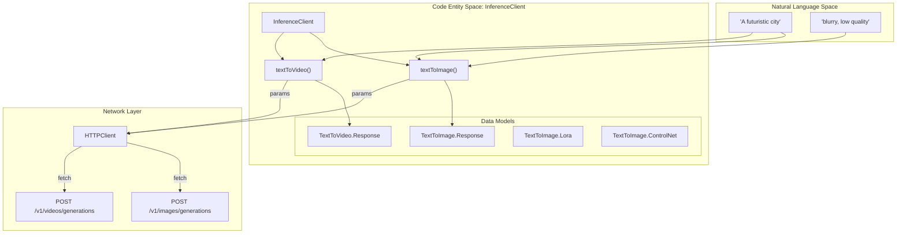
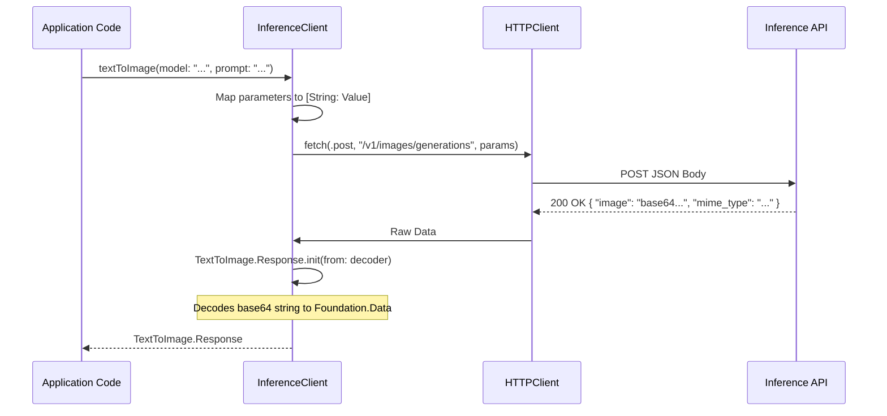

<!-- source: DeepWiki mcp.deepwiki.com · repo huggingface/swift-huggingface · page 4.3 Image and Video Generation · fetched 2026-10-26 -->

# Image and Video Generation

Relevant source files

The following files were used as context for generating this wiki page:

- [Sources/HuggingFace/InferenceProviders/TextToImage.swift](Sources/HuggingFace/InferenceProviders/TextToImage.swift)
- [Sources/HuggingFace/InferenceProviders/TextToVideo.swift](Sources/HuggingFace/InferenceProviders/TextToVideo.swift)
- [Tests/HuggingFaceTests/InferenceProvidersTests/TextToImageTests.swift](Tests/HuggingFaceTests/InferenceProvidersTests/TextToImageTests.swift)
- [Tests/HuggingFaceTests/InferenceProvidersTests/TextToVideoTests.swift](Tests/HuggingFaceTests/InferenceProvidersTests/TextToVideoTests.swift)

## Purpose and Scope

This document covers the image and video generation capabilities of the `InferenceClient`, enabling text-to-image and text-to-video synthesis using diffusion models. These generative AI tasks allow the creation of visual content from natural language descriptions via the Inference Providers API.

For chat-based interactions with vision models, see [Chat Completion](4.1). For selecting inference providers, see [Inference Providers](4.5).

---

## Overview of Generation Tasks

The `InferenceClient` provides two primary generation methods: `textToImage()` for creating still images and `textToVideo()` for synthesizing video sequences. Both methods follow a consistent parameter-driven design pattern and return binary data decoded from base64 responses.

### Code Entity Mapping

The following diagram bridges the natural language concepts to the specific code entities used in the SDK.

**Sources:** [Sources/HuggingFace/InferenceProviders/TextToImage.swift:68-113](), [Sources/HuggingFace/InferenceProviders/TextToVideo.swift:24-63]()

---

## Text-to-Image Generation

### Implementation Details

The `textToImage` function [Sources/HuggingFace/InferenceProviders/TextToImage.swift:93-113]() constructs a parameter dictionary using the `Value` enum and performs a POST request to `/v1/images/generations` [Sources/HuggingFace/InferenceProviders/TextToImage.swift:171]().

The response is handled by `TextToImage.Response`, which automatically decodes a base64-encoded string from the JSON `image` field into Foundation `Data` [Sources/HuggingFace/InferenceProviders/TextToImage.swift:184-197]().

### Parameters

| Parameter | Type | Description |
|-----------|------|-------------|
| `model` | `String` | Hub model identifier. |
| `prompt` | `String` | Textual description of the image. |
| `negativePrompt`| `String?` | Elements to exclude from generation. |
| `width` / `height`| `Int?` | Dimensions of the generated image. |
| `numImages` | `Int?` | Number of images to generate. |
| `guidanceScale` | `Double?` | Adherence to prompt strength. |
| `numInferenceSteps`| `Int?` | Number of denoising steps. |
| `seed` | `Int?` | Random seed for reproducibility. |
| `loras` | `[TextToImage.Lora]?` | Array of LoRA configurations [Sources/HuggingFace/InferenceProviders/TextToImage.swift:23-39](). |
| `controlnet` | `TextToImage.ControlNet`? | ControlNet configuration [Sources/HuggingFace/InferenceProviders/TextToImage.swift:42-63](). |

### Advanced Features: LoRA and ControlNet

The SDK supports fine-grained control via LoRA (Low-Rank Adaptation) and ControlNet:

*   **LoRA**: Specify a `name` and `strength` (0.0 to 1.0) to apply specific styles or characters [Sources/HuggingFace/InferenceProviders/TextToImage.swift:23-39]().
*   **ControlNet**: Provide a `name`, `strength`, and optional `controlImage` data to guide the structure of the generation [Sources/HuggingFace/InferenceProviders/TextToImage.swift:42-63]().

**Sources:** [Sources/HuggingFace/InferenceProviders/TextToImage.swift:4-64](), [Tests/HuggingFaceTests/InferenceProvidersTests/TextToImageTests.swift:151-167]()

---

## Text-to-Video Generation

### Implementation Details

The `textToVideo` function [Sources/HuggingFace/InferenceProviders/TextToVideo.swift:46-63]() targets the `/v1/videos/generations` endpoint [Sources/HuggingFace/InferenceProviders/TextToVideo.swift:112](). Similar to image generation, it decodes the base64 `video` field into `Data` [Sources/HuggingFace/InferenceProviders/TextToVideo.swift:128-138]().

### Video-Specific Parameters

| Parameter | Type | Description |
|-----------|------|-------------|
| `numFrames` | `Int?` | Total frames in the sequence. |
| `frameRate` | `Int?` | Playback speed (FPS). |
| `duration` | `Double?` | Target video length in seconds. |
| `motionStrength`| `Double?` | Amount of motion in the generation [Sources/HuggingFace/InferenceProviders/TextToVideo.swift:62](). |

**Sources:** [Sources/HuggingFace/InferenceProviders/TextToVideo.swift:46-63](), [Tests/HuggingFaceTests/InferenceProvidersTests/TextToVideoTests.swift:80-140]()

---

## Data Flow and Decoding

The generation flow involves converting high-level Swift types into a JSON payload, then decoding the resulting base64 string back into binary `Data`.

**Sources:** [Sources/HuggingFace/InferenceProviders/TextToImage.swift:184-197](), [Sources/HuggingFace/InferenceProviders/TextToVideo.swift:125-141]()

---

## Error Handling

The generation methods are designed to handle API failures gracefully by throwing `HTTPClientError`.

1.  **Validation Errors**: If the API returns a non-200 status code (e.g., 400 for invalid parameters or 503 for model unavailability), the `HTTPClient` throws an error [Tests/HuggingFaceTests/InferenceProvidersTests/TextToVideoTests.swift:172-177]().
2.  **Decoding Errors**: If the response contains an invalid base64 string, the `init(from:)` decoder throws a `DecodingError.dataCorruptedError` [Sources/HuggingFace/InferenceProviders/TextToImage.swift:189-194]().

**Sources:** [Sources/HuggingFace/InferenceProviders/TextToImage.swift:189-194](), [Tests/HuggingFaceTests/InferenceProvidersTests/TextToVideoTests.swift:151-178]()

---

