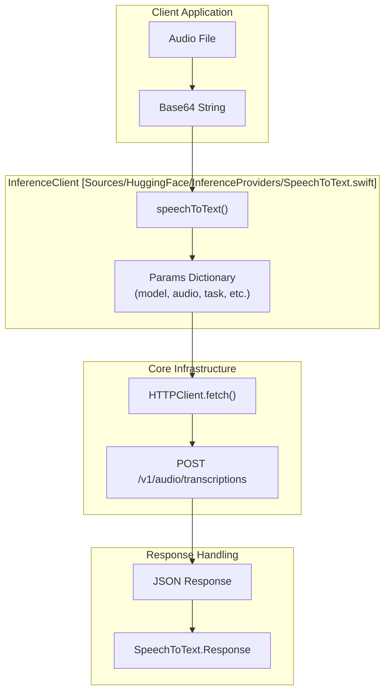
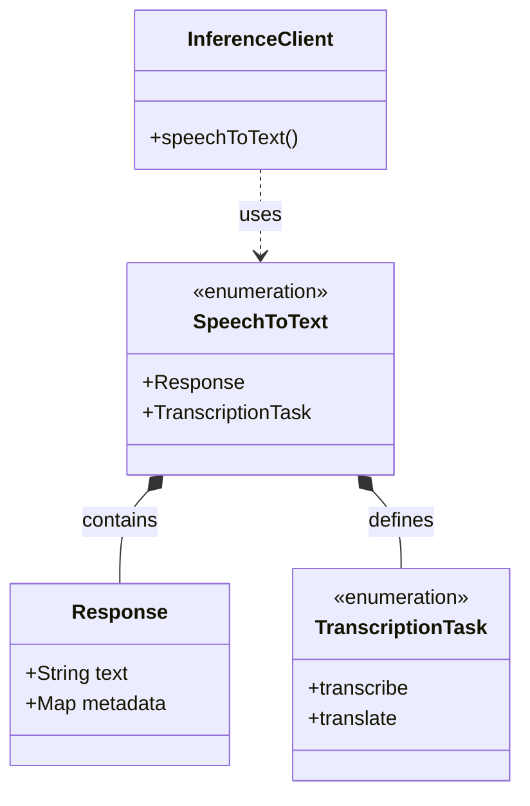

<!-- source: DeepWiki mcp.deepwiki.com · repo huggingface/swift-huggingface · page 4.4 Speech-to-Text · fetched 2026-10-26 -->

# Speech-to-Text

<details>
<summary>Relevant source files</summary>

The following files were used as context for generating this wiki page:

- [Sources/HuggingFace/InferenceProviders/SpeechToText.swift](Sources/HuggingFace/InferenceProviders/SpeechToText.swift)
- [Tests/HuggingFaceTests/InferenceProvidersTests/SpeechToTextTests.swift](Tests/HuggingFaceTests/InferenceProvidersTests/SpeechToTextTests.swift)

</details>


## Purpose and Scope

This document describes the speech-to-text functionality provided by the `InferenceClient`, which enables audio transcription and translation using automatic speech recognition (ASR) models. The system converts audio data into text transcriptions or translates spoken content from one language to English.

For other `InferenceClient` tasks, see [Chat Completion](#4.1), [Feature Extraction (Embeddings)](#4.2), and [Image and Video Generation](#4.3). For general inference provider configuration, see [Inference Providers](#4.5).

---

## Overview

The speech-to-text functionality is accessed through the `speechToText()` method on `InferenceClient` [Sources/HuggingFace/InferenceProviders/SpeechToText.swift:45-55](). This method accepts base64-encoded audio data and returns a text transcription or translation wrapped in a `SpeechToText.Response` [Sources/HuggingFace/InferenceProviders/SpeechToText.swift:10-16]().

Key capabilities include:
- **Transcription**: Converting spoken audio to text in the same language using `SpeechToText.TranscriptionTask.transcribe` [Sources/HuggingFace/InferenceProviders/SpeechToText.swift:21]().
- **Translation**: Converting spoken audio in any language to English text using `SpeechToText.TranscriptionTask.translate` [Sources/HuggingFace/InferenceProviders/SpeechToText.swift:24]().
- **Granular Control**: Support for timestamps, chunk length, and stride length for processing long audio [Sources/HuggingFace/InferenceProviders/SpeechToText.swift:51-53]().

**Sources**: [Sources/HuggingFace/InferenceProviders/SpeechToText.swift:4-26](), [Sources/HuggingFace/InferenceProviders/SpeechToText.swift:45-85]()

---

## Request Flow Architecture

The following diagram illustrates the data flow from raw audio to the final transcription response.

### Logic Flow: Audio to Text


**Sources**: [Sources/HuggingFace/InferenceProviders/SpeechToText.swift:45-85]()

---

## Method Signature and Parameters

### `speechToText()` Method

The primary entry point is the `speechToText` extension on `InferenceClient` [Sources/HuggingFace/InferenceProviders/SpeechToText.swift:45-55]().

| Parameter | Type | Description |
|-----------|------|-------------|
| `model` | `String` | The model identifier (e.g., "openai/whisper-large-v3"). |
| `audio` | `String` | The audio data as a **base64-encoded** string. |
| `provider` | `Provider?` | Optional inference provider override. |
| `language` | `String?` | ISO 639-1 code of the audio language. |
| `task` | `TranscriptionTask?` | `.transcribe` or `.translate`. |
| `returnTimestamps`| `Bool?` | Whether to return timestamp metadata. |
| `chunkLength` | `Int?` | The chunk length for processing. |
| `strideLength` | `Int?` | The stride length for processing. |
| `parameters` | `[String: Value]?` | Dictionary for model-specific parameters. |

**Sources**: [Sources/HuggingFace/InferenceProviders/SpeechToText.swift:45-55]()

---

## Data Structures

### SpeechToText.Response
The response contains the final text and an optional metadata dictionary [Sources/HuggingFace/InferenceProviders/SpeechToText.swift:10-16]().

```swift
public struct Response: Codable, Sendable {
    public let text: String
    public let metadata: [String: Value]?
}
```

### TranscriptionTask
An enum defining the operation to perform [Sources/HuggingFace/InferenceProviders/SpeechToText.swift:19-25]().

- `.transcribe`: Standard speech recognition.
- `.translate`: Speech-to-text with translation to English.

**Sources**: [Sources/HuggingFace/InferenceProviders/SpeechToText.swift:10-25]()

---

## Implementation Details

The `speechToText` method constructs a parameter dictionary that is serialized into a JSON body for a `POST` request to `/v1/audio/transcriptions` [Sources/HuggingFace/InferenceProviders/SpeechToText.swift:56-83]().

### Mapping to Code Entities
The following diagram maps the API concepts to specific code entities in the SDK.



**Sources**: [Sources/HuggingFace/InferenceProviders/SpeechToText.swift:4-26](), [Sources/HuggingFace/InferenceProviders/SpeechToText.swift:45-55]()

---

## Usage Examples

### Basic Transcription
Transcribing an audio string using a specific model [Tests/HuggingFaceTests/InferenceProvidersTests/SpeechToTextTests.swift:52-55]().

```swift
let result = try await client.speechToText(
    model: "openai/whisper-large-v3",
    audio: "base64_audio_data"
)
print(result.text)
```

### Translation Task
Translating non-English audio directly to English text [Tests/HuggingFaceTests/InferenceProvidersTests/SpeechToTextTests.swift:132-136]().

```swift
let result = try await client.speechToText(
    model: "openai/whisper-large-v3",
    audio: "base64_audio_data",
    task: .translate
)
```

### Advanced Parameters
Using chunking and timestamps for long-form audio [Tests/HuggingFaceTests/InferenceProvidersTests/SpeechToTextTests.swift:90-99]().

```swift
let result = try await client.speechToText(
    model: "openai/whisper-large-v3",
    audio: "base64_audio_data",
    language: "fr",
    task: .transcribe,
    returnTimestamps: true,
    chunkLength: 30,
    strideLength: 5
)
```

**Sources**: [Tests/HuggingFaceTests/InferenceProvidersTests/SpeechToTextTests.swift:52-136]()

---

## Error Handling

The SDK validates the response status. If the server returns a non-success code (e.g., `400 Bad Request` for invalid audio formats), the `httpClient` throws an `HTTPClientError` [Tests/HuggingFaceTests/InferenceProvidersTests/SpeechToTextTests.swift:163-168]().

Common errors include:
- **Invalid Audio Format**: Occurs if the base64 string is not valid or the model cannot decode the audio [Tests/HuggingFaceTests/InferenceProvidersTests/SpeechToTextTests.swift:143-148]().
- **Model Loading**: The model may still be loading into the inference provider's memory.

**Sources**: [Tests/HuggingFaceTests/InferenceProvidersTests/SpeechToTextTests.swift:143-169](), [Sources/HuggingFace/InferenceProviders/SpeechToText.swift:83]()

---

