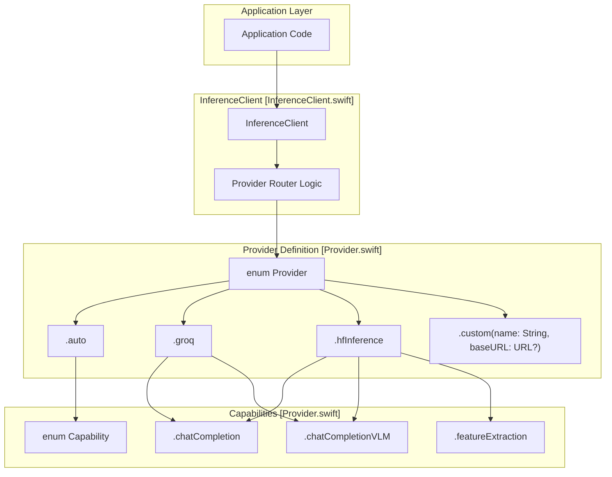
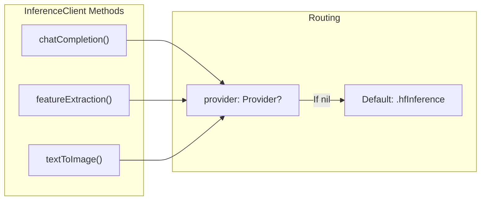

<!-- source: DeepWiki mcp.deepwiki.com · repo huggingface/swift-huggingface · page 4.5 Inference Providers · fetched 2026-10-26 -->

# Inference Providers

<details>
<summary>Relevant source files</summary>

The following files were used as context for generating this wiki page:

- [Sources/HuggingFace/InferenceProviders/Provider.swift](Sources/HuggingFace/InferenceProviders/Provider.swift)
- [Tests/HuggingFaceTests/HubTests/GitOperationsTests.swift](Tests/HuggingFaceTests/HubTests/GitOperationsTests.swift)
- [Tests/HuggingFaceTests/InferenceProvidersTests/InferenceClientTests.swift](Tests/HuggingFaceTests/InferenceProvidersTests/InferenceClientTests.swift)
- [Tests/HuggingFaceTests/InferenceProvidersTests/MessageCodableTests.swift](Tests/HuggingFaceTests/InferenceProvidersTests/MessageCodableTests.swift)
- [Tests/HuggingFaceTests/InferenceProvidersTests/ProviderTests.swift](Tests/HuggingFaceTests/InferenceProvidersTests/ProviderTests.swift)
- [Tests/HuggingFaceTests/OAuthTests/TokenStorageTests.swift](Tests/HuggingFaceTests/OAuthTests/TokenStorageTests.swift)
- [Tests/HuggingFaceTests/SharedTests/MultipartBuilderTests.swift](Tests/HuggingFaceTests/SharedTests/MultipartBuilderTests.swift)

</details>


## Purpose and Scope

This document describes the inference provider system used by `InferenceClient` to route AI task requests to different backend services. Inference providers allow applications to select from multiple inference backends (Groq, Hyperbolic, Replicate, or Hugging Face Inference) based on factors like availability, performance, cost, or model support.

For information about specific AI tasks (chat completion, embeddings, etc.), see [Chat Completion](#4.1), [Feature Extraction (Embeddings)](#4.2), [Image and Video Generation](#4.3), and [Speech-to-Text](#4.4). For general InferenceClient usage, see [InferenceClient - AI Tasks](#4).

---

## Overview

The inference provider system enables routing inference requests to different backend services without changing application code. Each provider offers access to specific models and may have different characteristics in terms of speed, cost, model availability, and feature support.

### System Architecture and Code Entities

The following diagram maps the high-level concepts to the specific `Provider` enum and `Capability` types defined in the codebase.



**Sources:** [Sources/HuggingFace/InferenceProviders/Provider.swift:10-207](), [Sources/HuggingFace/InferenceProviders/Provider.swift:212-226]()

---

## Available Providers

The SDK supports a wide range of built-in providers through the `Provider` enum [Sources/HuggingFace/InferenceProviders/Provider.swift:10-65]().

| Provider | Identifier | Display Name | Primary Capabilities |
|----------|------------|--------------|----------------------|
| **Auto** | `"auto"` | `"Auto"` | All Capabilities [Sources/HuggingFace/InferenceProviders/Provider.swift:167-168]() |
| **Groq** | `"groq"` | `"Groq"` | Chat, VLM [Sources/HuggingFace/InferenceProviders/Provider.swift:180-181]() |
| **HF Inference** | `"hf-inference"` | `"Hugging Face Inference"` | Chat, VLM, Feature Extraction, T2I, T2V [Sources/HuggingFace/InferenceProviders/Provider.swift:182-183]() |
| **Hyperbolic** | `"hyperbolic"` | `"Hyperbolic"` | Chat, VLM [Sources/HuggingFace/InferenceProviders/Provider.swift:184-185]() |
| **Replicate** | `"replicate"` | `"Replicate"` | Chat, VLM, Feature Extraction [Sources/HuggingFace/InferenceProviders/Provider.swift:194-195]() |
| **Fal AI** | `"fal-ai"` | `"Fal AI"` | Chat, VLM, Feature Extraction [Sources/HuggingFace/InferenceProviders/Provider.swift:174-175]() |
| **SambaNova** | `"sambanova"` | `"SambaNova"` | Chat, VLM [Sources/HuggingFace/InferenceProviders/Provider.swift:196-197]() |

### Provider Configuration and Serialization

The `Provider` enum supports `Codable` and handles both string identifiers and complex objects for custom providers [Tests/HuggingFaceTests/InferenceProvidersTests/ProviderTests.swift:42-86]().

- **Built-in Providers**: Encode/Decode as simple strings (e.g., `"hf-inference"`) [Tests/HuggingFaceTests/InferenceProvidersTests/ProviderTests.swift:44-46]().
- **Custom Providers**: Can be decoded from a string (becoming a name-only custom provider) or an object containing `name` and `baseURL` [Tests/HuggingFaceTests/InferenceProvidersTests/ProviderTests.swift:49-70]().

**Sources:** [Sources/HuggingFace/InferenceProviders/Provider.swift:77-118](), [Tests/HuggingFaceTests/InferenceProvidersTests/ProviderTests.swift:9-40]()

---

## Specifying Providers

Providers are specified via the `provider` parameter in `InferenceClient` methods.

### Provider Selection Logic



### Code Example: Provider Initialization

```swift
// Explicit provider selection
let response = try await client.chatCompletion(
    model: "meta-llama/Llama-3.3-70B-Instruct",
    messages: messages,
    provider: .groq // Ultra-fast LPU inference
)

// Custom provider with specific endpoint
let customProvider = Provider.custom(
    name: "my-internal-proxy", 
    baseURL: URL(string: "https://proxy.example.com/v1")!
)
```

**Sources:** [Sources/HuggingFace/InferenceProviders/Provider.swift:69-74](), [Tests/HuggingFaceTests/InferenceProvidersTests/InferenceClientTests.swift:88-94]()

---

## Provider-Task Compatibility

Each provider declares its supported `Capability` set [Sources/HuggingFace/InferenceProviders/Provider.swift:165-206]().

| Capability (`Capability`) | Key Providers |
|---------------------------|---------------|
| `.chatCompletion` | All providers [Sources/HuggingFace/InferenceProviders/Provider.swift:166-205]() |
| `.chatCompletionVLM` | Groq, HF, Hyperbolic, Replicate, Fal AI, etc. [Sources/HuggingFace/InferenceProviders/Provider.swift:172-202]() |
| `.featureExtraction` | HF Inference, Replicate, Together, Fal AI, Nebius [Sources/HuggingFace/InferenceProviders/Provider.swift:182-200]() |
| `.textToImage` | HF Inference, Nebius [Sources/HuggingFace/InferenceProviders/Provider.swift:182-186]() |
| `.textToVideo` | HF Inference [Sources/HuggingFace/InferenceProviders/Provider.swift:182]() |

**Sources:** [Sources/HuggingFace/InferenceProviders/Provider.swift:212-226]()

---

## Technical Implementation

### URL Routing and Headers

The `InferenceClient` manages the base host and authentication headers. While most providers use standard Bearer tokens, the client handles the underlying `HTTPClient` interactions.

- **Host Configuration**: Initialized via `InferenceClient(host:...)`. Defaults to `https://router.huggingface.co` [Tests/HuggingFaceTests/InferenceProvidersTests/InferenceClientTests.swift:24-28]().
- **Authentication**: Uses `bearerToken` which is injected into the `Authorization` header as `Bearer <token>` [Tests/HuggingFaceTests/InferenceProvidersTests/InferenceClientTests.swift:65-75]().

### Error Handling

The client maps HTTP status codes to `HTTPClientError` [Tests/HuggingFaceTests/InferenceProvidersTests/InferenceClientTests.swift:118-124]().

- **401 Unauthorized**: Thrown when the token is invalid or missing [Tests/HuggingFaceTests/InferenceProvidersTests/InferenceClientTests.swift:97-113]().
- **404 Not Found**: Thrown when the model or provider endpoint does not exist [Tests/HuggingFaceTests/InferenceProvidersTests/InferenceClientTests.swift:127-143]().
- **500 Server Error**: Indicates provider-side failure [Tests/HuggingFaceTests/InferenceProvidersTests/InferenceClientTests.swift:156-173]().

**Sources:** [Tests/HuggingFaceTests/InferenceProvidersTests/InferenceClientTests.swift:32-47](), [Tests/HuggingFaceTests/InferenceProvidersTests/InferenceClientTests.swift:49-94]()

---

## Custom Provider Integration

The `.custom` case allows for flexibility beyond the hardcoded list.

```swift
/// A custom provider with a specific name and optional base URL.
case custom(name: String, baseURL: URL? = nil)
```

When using a custom provider:
1. The `identifier` returns the provided `name` [Sources/HuggingFace/InferenceProviders/Provider.swift:115-116]().
2. The `capabilities` default to the full set (assuming the custom gateway handles various tasks) [Sources/HuggingFace/InferenceProviders/Provider.swift:204]().
3. If a `baseURL` is provided, it can be used for direct routing (implementation dependent on the specific client task).

**Sources:** [Sources/HuggingFace/InferenceProviders/Provider.swift:69-74](), [Tests/HuggingFaceTests/InferenceProvidersTests/ProviderTests.swift:79-86]()

---

