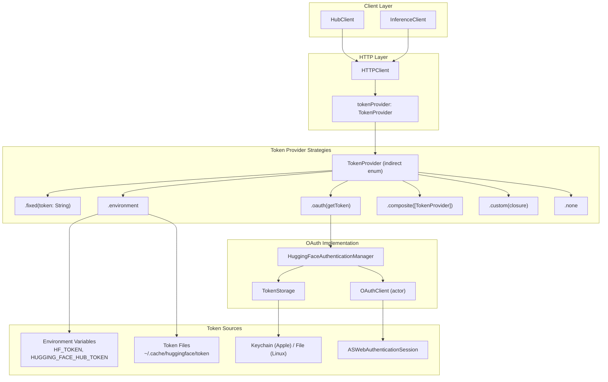
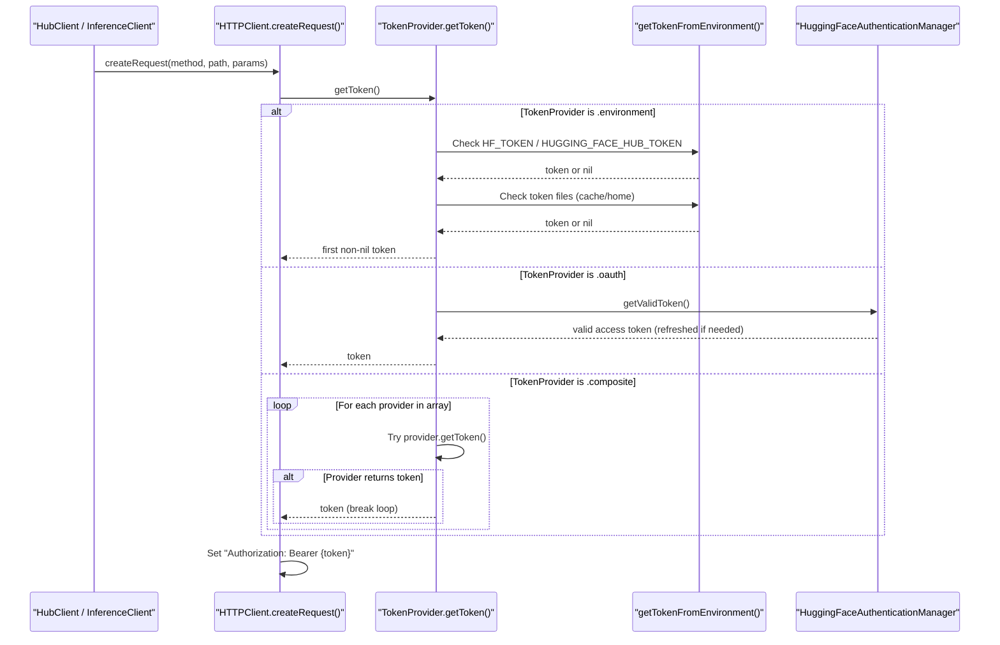

<!-- source: DeepWiki mcp.deepwiki.com · repo huggingface/swift-huggingface · page 5 Authentication System · fetched 2026-10-26 -->

# Authentication System

<details>
<summary>Relevant source files</summary>

The following files were used as context for generating this wiki page:

- [Sources/HuggingFace/OAuth/HuggingFaceAuthenticationManager.swift](Sources/HuggingFace/OAuth/HuggingFaceAuthenticationManager.swift)
- [Sources/HuggingFace/Shared/HTTPClient.swift](Sources/HuggingFace/Shared/HTTPClient.swift)
- [Sources/HuggingFace/Shared/TokenProvider.swift](Sources/HuggingFace/Shared/TokenProvider.swift)
- [Tests/HuggingFaceTests/OAuthTests/HuggingFaceAuthenticationManagerTests.swift](Tests/HuggingFaceTests/OAuthTests/HuggingFaceAuthenticationManagerTests.swift)
- [Tests/HuggingFaceTests/OAuthTests/OAuthClientTests.swift](Tests/HuggingFaceTests/OAuthTests/OAuthClientTests.swift)

</details>


## Purpose and Scope

The authentication system in `swift-huggingface` provides flexible, composable token management for API requests to Hugging Face services. It supports multiple authentication strategies including environment-based token detection, fixed tokens, OAuth 2.0 with PKCE, and custom implementations. All authentication is handled through the `TokenProvider` abstraction, which both `HubClient` and `InferenceClient` use to obtain bearer tokens for API requests. [Sources/HuggingFace/Shared/TokenProvider.swift:3-7]().

For detailed information about specific authentication strategies, see [TokenProvider Strategies](#5.1). For OAuth 2.0 implementation details, see [OAuth 2.0 with PKCE](#5.2). For token storage mechanisms and security considerations, see [Token Storage and Security](#5.3).

## Architecture Overview

The authentication system is built around the `TokenProvider` enum, which provides a unified interface for obtaining authentication tokens from various sources. Both `HubClient` and `InferenceClient` accept a `TokenProvider` during initialization and delegate all authentication concerns to it via the underlying `HTTPClient`. [Sources/HuggingFace/Shared/HTTPClient.swift:27-60]().

### Authentication System Map



**Sources:** [Sources/HuggingFace/Shared/TokenProvider.swift:92-165](), [Sources/HuggingFace/Shared/HTTPClient.swift:19-60](), [Sources/HuggingFace/OAuth/HuggingFaceAuthenticationManager.swift:13-39]()

## TokenProvider Enum

The `TokenProvider` is an indirect enum defined at [Sources/HuggingFace/Shared/TokenProvider.swift:92]() that provides six authentication strategies:

| Strategy | Description | Use Case |
|----------|-------------|----------|
| `.fixed(token: String)` | Static token [Sources/HuggingFace/Shared/TokenProvider.swift:107]() | Simple authentication, testing |
| `.environment` | Auto-detects from env vars and files [Sources/HuggingFace/Shared/TokenProvider.swift:121]() | CLI tools, CI/CD, local development |
| `.oauth(getToken)` | Dynamic token via async closure [Sources/HuggingFace/Shared/TokenProvider.swift:129]() | User-facing applications with OAuth |
| `.composite([TokenProvider])` | Tries multiple providers in order [Sources/HuggingFace/Shared/TokenProvider.swift:147]() | Graceful degradation across environments |
| `.custom(closure)` | User-defined retrieval logic [Sources/HuggingFace/Shared/TokenProvider.swift:156]() | Custom authentication flows |
| `.none` | No authentication [Sources/HuggingFace/Shared/TokenProvider.swift:165]() | Public endpoints |

The `getToken()` method at [Sources/HuggingFace/Shared/TokenProvider.swift:183-208]() returns an optional `String`, allowing providers to return `nil` when no token is available. This enables the `.composite` strategy to try fallback providers.

**Sources:** [Sources/HuggingFace/Shared/TokenProvider.swift:92-209]()

## Token Retrieval Flow

When a client needs to make an authenticated request, the `HTTPClient` calls `tokenProvider.getToken()` during request construction. [Sources/HuggingFace/Shared/HTTPClient.swift:355-358]().

### Token Resolution Sequence



**Sources:** [Sources/HuggingFace/Shared/HTTPClient.swift:355-358](), [Sources/HuggingFace/Shared/TokenProvider.swift:183-208](), [Sources/HuggingFace/OAuth/HuggingFaceAuthenticationManager.swift:141-163]()

## Environment Token Detection

The `.environment` strategy implements automatic token detection following Hugging Face conventions. The `getTokenFromEnvironment()` function checks sources in this priority order: [Sources/HuggingFace/Shared/TokenProvider.swift:303-331]().

1. `HF_TOKEN` environment variable.
2. `HUGGING_FACE_HUB_TOKEN` environment variable.
3. File at path specified by `HF_TOKEN_PATH` environment variable.
4. File at `$HF_HOME/token`.
5. File at `~/.cache/huggingface/token` (standard HF CLI location).
6. File at `~/.huggingface/token` (fallback location).

**Sources:** [Sources/HuggingFace/Shared/TokenProvider.swift:109-118](), [Sources/HuggingFace/Shared/TokenProvider.swift:303-331]()

## OAuth 2.0 Integration

The OAuth implementation uses the PKCE (Proof Key for Code Exchange) flow for enhanced security. The `HuggingFaceAuthenticationManager` manages the high-level state and is typically passed to the `TokenProvider` via the `.oauth` factory method. [Sources/HuggingFace/Shared/TokenProvider.swift:236-240]().

For details on the sign-in flow and `ASWebAuthenticationSession` integration, see [OAuth 2.0 with PKCE](#5.2).

**Sources:** [Sources/HuggingFace/OAuth/HuggingFaceAuthenticationManager.swift:81-122](), [Sources/HuggingFace/Shared/TokenProvider.swift:35-48]()

## Composite Authentication Strategy

The `.composite` case enables fallback chains. It implements `ExpressibleByArrayLiteral`, allowing array syntax during initialization. [Sources/HuggingFace/Shared/TokenProvider.swift:260-266]().

```swift
// Example of a fallback chain
let client = HubClient(tokenProvider: [
    .oauth(manager: authManager), // Try OAuth first
    .environment,                 // Fall back to environment variables
    "hf_fallback_token"           // Final hardcoded fallback
])
```

The composite strategy iterates through providers and returns the first non-`nil` token found. [Sources/HuggingFace/Shared/TokenProvider.swift:194-200]().

**Sources:** [Sources/HuggingFace/Shared/TokenProvider.swift:131-147](), [Sources/HuggingFace/Shared/TokenProvider.swift:194-200]()

## Platform Availability and Security

The authentication system adapts to platform capabilities:

*   **Apple Platforms**: Supports the full suite including OAuth via `AuthenticationServices` and secure storage via Keychain. [Sources/HuggingFace/OAuth/HuggingFaceAuthenticationManager.swift:3-13]().
*   **Linux**: Supports environment detection, fixed tokens, and composite providers. OAuth is currently unavailable on Linux due to the dependency on `AuthenticationServices`.

For details on how tokens are persisted across platforms, see [Token Storage and Security](#5.3).

**Sources:** [Sources/HuggingFace/OAuth/HuggingFaceAuthenticationManager.swift:3-13](), [Sources/HuggingFace/Shared/TokenProvider.swift:213-221]()

---

