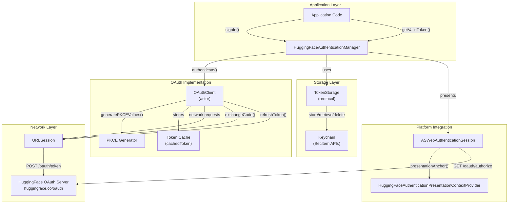
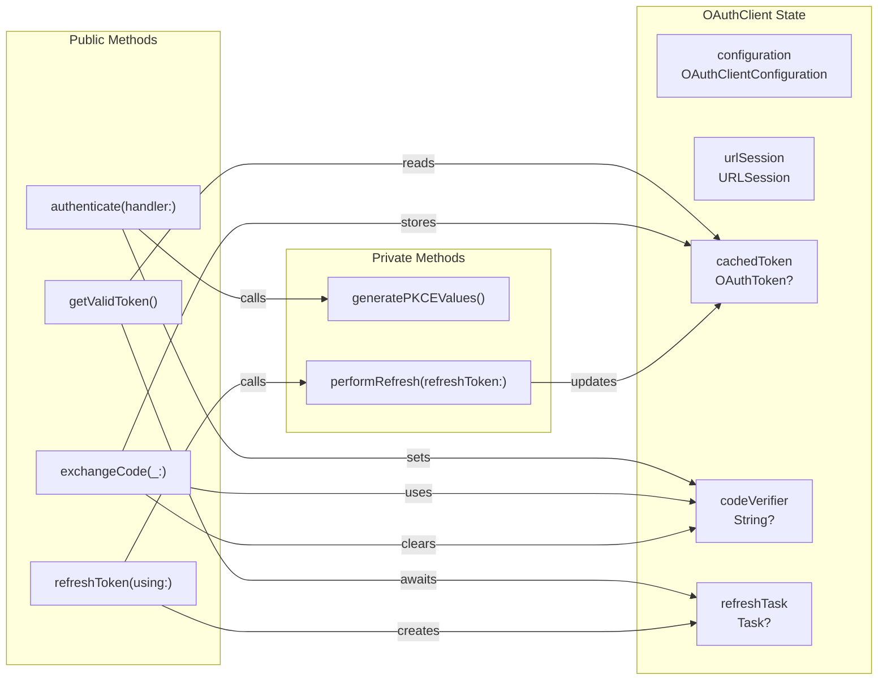
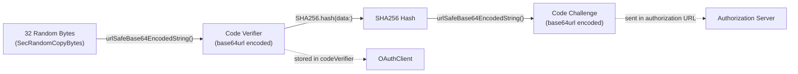
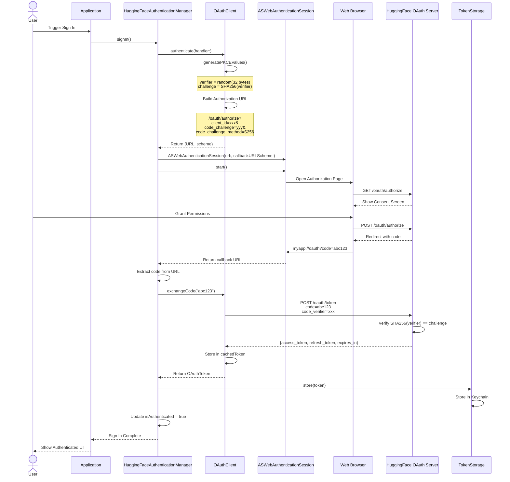
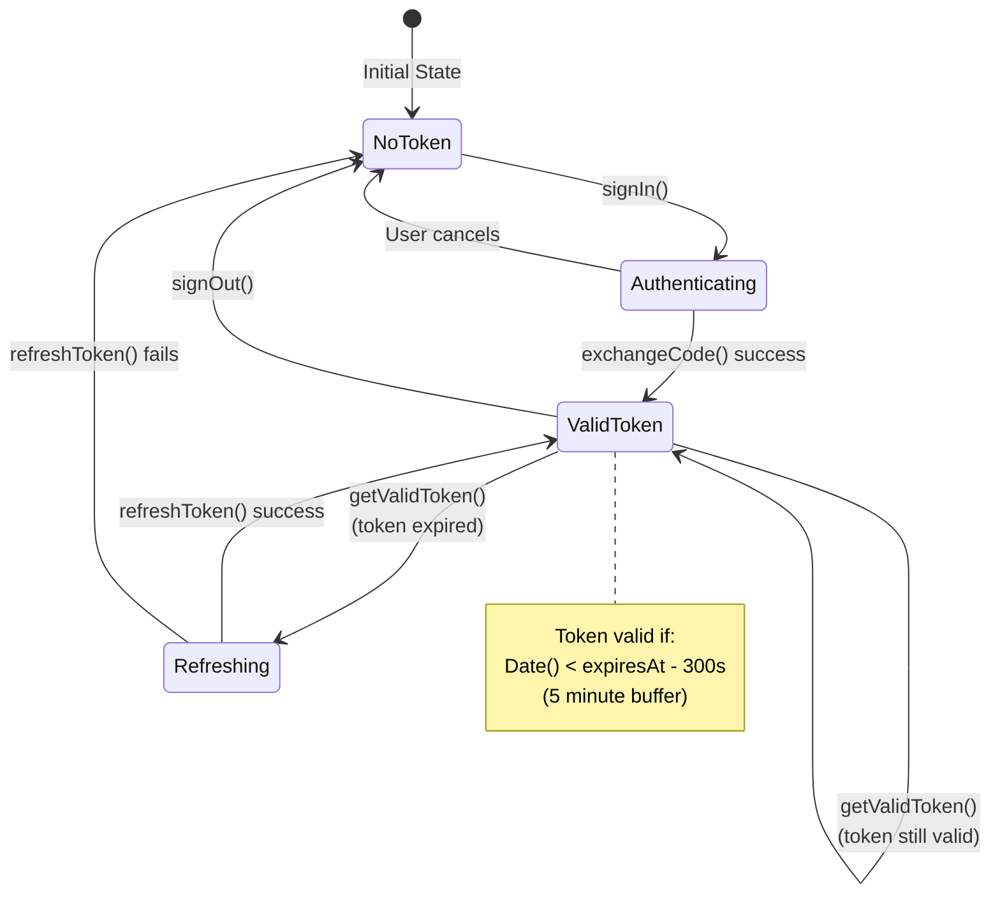
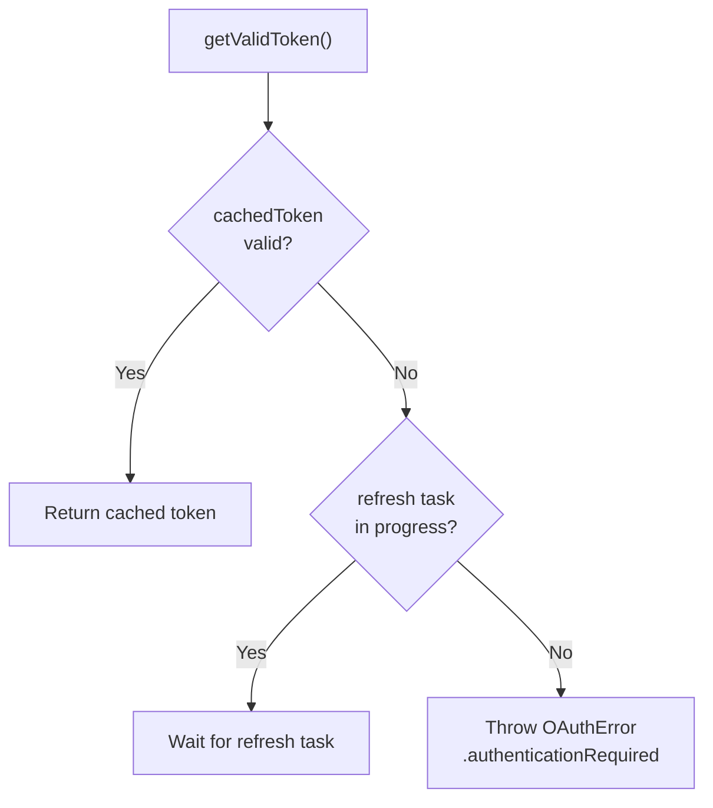
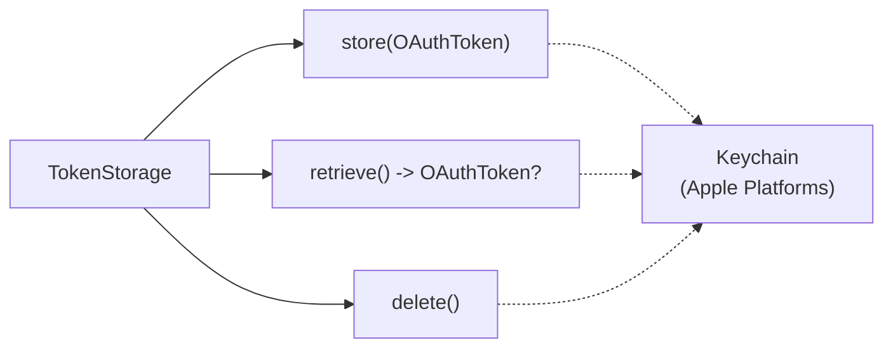

<!-- source: DeepWiki mcp.deepwiki.com · repo huggingface/swift-huggingface · page 5.2 OAuth 2.0 with PKCE · fetched 2026-10-26 -->

# OAuth 2.0 with PKCE

<details>
<summary>Relevant source files</summary>

The following files were used as context for generating this wiki page:

- [Sources/HuggingFace/Hub/OAuth.swift](Sources/HuggingFace/Hub/OAuth.swift)
- [Sources/HuggingFace/OAuth/HuggingFaceAuthenticationManager.swift](Sources/HuggingFace/OAuth/HuggingFaceAuthenticationManager.swift)
- [Sources/HuggingFace/OAuth/OAuthClient.swift](Sources/HuggingFace/OAuth/OAuthClient.swift)
- [Tests/HuggingFaceTests/Helpers/MockURLProtocol.swift](Tests/HuggingFaceTests/Helpers/MockURLProtocol.swift)
- [Tests/HuggingFaceTests/OAuthTests/HuggingFaceAuthenticationManagerTests.swift](Tests/HuggingFaceTests/OAuthTests/HuggingFaceAuthenticationManagerTests.swift)
- [Tests/HuggingFaceTests/OAuthTests/OAuthClientTests.swift](Tests/HuggingFaceTests/OAuthTests/OAuthClientTests.swift)

</details>


## Purpose and Scope

This document describes the OAuth 2.0 authentication implementation with PKCE (Proof Key for Code Exchange) in the swift-huggingface SDK. OAuth 2.0 with PKCE provides secure user authentication for user-facing applications, enabling them to access the Hugging Face API on behalf of authenticated users.

For information about other authentication methods (environment variables, fixed tokens, composite strategies), see [5.1 TokenProvider Strategies](). For details on how tokens are stored securely, see [5.3 Token Storage and Security]().

**Platform Availability**: OAuth authentication is primarily available on platforms that support `AuthenticationServices` (macOS 14.0+, iOS 17.0+, watchOS 10.0+, tvOS 17.0+, macCatalyst 17.0+) [Sources/HuggingFace/OAuth/HuggingFaceAuthenticationManager.swift:3-10]().

---

## OAuth 2.0 with PKCE Overview

The SDK implements the OAuth 2.0 Authorization Code flow with PKCE extension (RFC 7636) for enhanced security [Sources/HuggingFace/OAuth/OAuthClient.swift:8-11](). PKCE protects against authorization code interception attacks by requiring the client to prove possession of a secret generated at the start of the flow.

### Why PKCE?

PKCE eliminates the need for client secrets in native applications, where secrets cannot be safely stored. Instead, it uses dynamically generated cryptographic values:

1.  **Code Verifier**: A high-entropy cryptographic random string generated by the client [Sources/HuggingFace/OAuth/OAuthClient.swift:67-69]().
2.  **Code Challenge**: SHA256 hash of the code verifier, sent to the authorization server [Sources/HuggingFace/OAuth/OAuthClient.swift:79-80]().
3.  **Verification**: The authorization server validates that the code verifier matches the challenge when exchanging the authorization code [Sources/HuggingFace/OAuth/OAuthClient.swift:119]().

Sources: [Sources/HuggingFace/OAuth/OAuthClient.swift:8-142]()

---

## Architecture Overview



**Diagram: OAuth 2.0 with PKCE Architecture**

The architecture separates concerns into distinct layers: application-facing authentication manager, core OAuth client with PKCE implementation, platform-specific UI integration, and secure token storage.

Sources: [Sources/HuggingFace/OAuth/HuggingFaceAuthenticationManager.swift:13-187](), [Sources/HuggingFace/OAuth/OAuthClient.swift:11-206]()

---

## Core Components

### OAuthClient

The `OAuthClient` actor implements the OAuth 2.0 protocol with PKCE. It is defined as an actor to ensure thread-safe access to mutable state (token cache, refresh tasks, code verifier) [Sources/HuggingFace/OAuth/OAuthClient.swift:11-20]().

**Key Responsibilities**:
- Generate PKCE code verifier and challenge using SHA256 [Sources/HuggingFace/OAuth/OAuthClient.swift:67-69]().
- Construct authorization URLs with PKCE parameters [Sources/HuggingFace/OAuth/OAuthClient.swift:72-82]().
- Exchange authorization codes for access tokens [Sources/HuggingFace/OAuth/OAuthClient.swift:103-142]().
- Refresh expired tokens automatically [Sources/HuggingFace/OAuth/OAuthClient.swift:153-170]().
- Prevent concurrent token refresh requests [Sources/HuggingFace/OAuth/OAuthClient.swift:155-157]().

**File Location**: [Sources/HuggingFace/OAuth/OAuthClient.swift:11-206]()



**Diagram: OAuthClient State and Methods**

Sources: [Sources/HuggingFace/OAuth/OAuthClient.swift:11-206]()

### HuggingFaceAuthenticationManager

The `HuggingFaceAuthenticationManager` class provides a high-level, SwiftUI-compatible interface for OAuth authentication. It is marked `@Observable` for integration with SwiftUI's observation system [Sources/HuggingFace/OAuth/HuggingFaceAuthenticationManager.swift:11-13]().

**Key Responsibilities**:
- Present OAuth web authentication session using `ASWebAuthenticationSession` [Sources/HuggingFace/OAuth/HuggingFaceAuthenticationManager.swift:84-115]().
- Store and retrieve tokens using `TokenStorage` [Sources/HuggingFace/OAuth/HuggingFaceAuthenticationManager.swift:119-120]().
- Manage authentication state (`isAuthenticated`, `authToken`) [Sources/HuggingFace/OAuth/HuggingFaceAuthenticationManager.swift:18-21]().
- Handle sign-in and sign-out flows [Sources/HuggingFace/OAuth/HuggingFaceAuthenticationManager.swift:81-136]().
- Provide valid tokens with automatic refresh [Sources/HuggingFace/OAuth/HuggingFaceAuthenticationManager.swift:141-163]().

**File Location**: [Sources/HuggingFace/OAuth/HuggingFaceAuthenticationManager.swift:13-187]()

**Observable Properties**:
- `isAuthenticated: Bool` - Current authentication state [Sources/HuggingFace/OAuth/HuggingFaceAuthenticationManager.swift:18]().
- `authToken: OAuthToken?` - Current OAuth token [Sources/HuggingFace/OAuth/HuggingFaceAuthenticationManager.swift:21]().

Sources: [Sources/HuggingFace/OAuth/HuggingFaceAuthenticationManager.swift:11-136]()

### OAuthClientConfiguration

Immutable configuration structure containing OAuth endpoint URLs and client credentials.

**Properties**:
| Property | Type | Description |
|----------|------|-------------|
| `baseURL` | `URL` | Base URL for OAuth endpoints (default: `https://huggingface.co`) [Sources/HuggingFace/OAuth/OAuthClient.swift:239-240]() |
| `redirectURL` | `URL` | Redirect URL for OAuth callbacks [Sources/HuggingFace/OAuth/OAuthClient.swift:242-243]() |
| `clientID` | `String` | OAuth client ID assigned by Hugging Face [Sources/HuggingFace/OAuth/OAuthClient.swift:245-246]() |
| `scope` | `String` | Space-separated list of requested scopes [Sources/HuggingFace/OAuth/OAuthClient.swift:248-249]() |

Sources: [Sources/HuggingFace/OAuth/OAuthClient.swift:236-266]()

### OAuthToken

Token structure containing access credentials and expiration information.

**Properties**:
| Property | Type | Description |
|----------|------|-------------|
| `accessToken` | `String` | Bearer token for API requests [Sources/HuggingFace/OAuth/OAuthClient.swift:274-275]() |
| `refreshToken` | `String?` | Token for obtaining new access tokens [Sources/HuggingFace/OAuth/OAuthClient.swift:277-278]() |
| `expiresAt` | `Date` | Expiration timestamp [Sources/HuggingFace/OAuth/OAuthClient.swift:280-281]() |
| `isValid` | `Bool` | Computed property (valid if >5 minutes until expiration) [Sources/HuggingFace/OAuth/OAuthClient.swift:283-286]() |

Sources: [Sources/HuggingFace/OAuth/OAuthClient.swift:271-302]()

---

## PKCE Implementation Details

### PKCE Value Generation

The PKCE flow requires generating two related values:

1.  **Code Verifier**: A cryptographically random string (43-128 characters from unreserved characters: `A-Z`, `a-z`, `0-9`, `-`, `.`, `_`, `~`) [Sources/HuggingFace/OAuth/OAuthClient.swift:213-222]().
2.  **Code Challenge**: Base64url-encoded SHA256 hash of the code verifier [Sources/HuggingFace/OAuth/OAuthClient.swift:224-229]().



**Diagram: PKCE Value Generation Flow**

Sources: [Sources/HuggingFace/OAuth/OAuthClient.swift:208-230]()

### Platform-Specific Random Generation

The code verifier generation uses platform-specific secure random number generation:

**Apple Platforms** (macOS, iOS, watchOS, tvOS):
```swift
SecRandomCopyBytes(kSecRandomDefault, 32, &buffer)
```
[Sources/HuggingFace/OAuth/OAuthClient.swift:213-218]()

**Linux**:
```swift
SystemRandomNumberGenerator + UInt8.random(in: 0...255)
```
[Sources/HuggingFace/OAuth/OAuthClient.swift:213-218]()

Sources: [Sources/HuggingFace/OAuth/OAuthClient.swift:213-218]()

### URL-Safe Base64 Encoding

Standard Base64 encoding contains characters (`+`, `/`, `=`) that are not URL-safe. The implementation converts them:
- `+` → `-`
- `/` → `_`
- `=` (padding) → removed

Sources: [Sources/HuggingFace/OAuth/OAuthClient.swift:357-369]()

---

## OAuth Authentication Flow



**Diagram: Complete OAuth 2.0 with PKCE Authentication Flow**

Sources: [Sources/HuggingFace/OAuth/HuggingFaceAuthenticationManager.swift:81-122](), [Sources/HuggingFace/OAuth/OAuthClient.swift:54-91](), [Sources/HuggingFace/OAuth/OAuthClient.swift:103-142]()

### Authorization URL Construction

The authorization URL includes the following query parameters:

| Parameter | Value | Description |
|-----------|-------|-------------|
| `client_id` | Configuration value | OAuth client ID [Sources/HuggingFace/OAuth/OAuthClient.swift:75]() |
| `redirect_uri` | Configuration value | Callback URL [Sources/HuggingFace/OAuth/OAuthClient.swift:76]() |
| `response_type` | `code` | Authorization code flow [Sources/HuggingFace/OAuth/OAuthClient.swift:77]() |
| `scope` | Configuration value | Requested permissions [Sources/HuggingFace/OAuth/OAuthClient.swift:78]() |
| `code_challenge` | SHA256 hash | PKCE challenge [Sources/HuggingFace/OAuth/OAuthClient.swift:79]() |
| `code_challenge_method` | `S256` | SHA256 algorithm [Sources/HuggingFace/OAuth/OAuthClient.swift:80]() |
| `state` | Random UUID | CSRF protection [Sources/HuggingFace/OAuth/OAuthClient.swift:81]() |

Sources: [Sources/HuggingFace/OAuth/OAuthClient.swift:72-82]()

### Token Exchange Request

The token exchange POST request uses `application/x-www-form-urlencoded` content type with these parameters:

| Parameter | Value | Description |
|-----------|-------|-------------|
| `grant_type` | `authorization_code` | Flow type [Sources/HuggingFace/OAuth/OAuthClient.swift:115]() |
| `code` | Authorization code | Code from callback [Sources/HuggingFace/OAuth/OAuthClient.swift:116]() |
| `redirect_uri` | Configuration value | Must match authorization request [Sources/HuggingFace/OAuth/OAuthClient.swift:117]() |
| `client_id` | Configuration value | OAuth client ID [Sources/HuggingFace/OAuth/OAuthClient.swift:118]() |
| `code_verifier` | Original verifier | PKCE verifier for validation [Sources/HuggingFace/OAuth/OAuthClient.swift:119]() |

Sources: [Sources/HuggingFace/OAuth/OAuthClient.swift:103-142]()

---

## Token Management

### Token Lifecycle



**Diagram: OAuth Token Lifecycle**

Sources: [Sources/HuggingFace/OAuth/HuggingFaceAuthenticationManager.swift:125-163](), [Sources/HuggingFace/OAuth/OAuthClient.swift:271-286]()

### Automatic Token Refresh

The `OAuthClient` implements automatic token refresh with concurrency protection:

1.  **Single Refresh Task**: Only one refresh operation runs at a time. Concurrent requests wait for the active refresh to complete [Sources/HuggingFace/OAuth/OAuthClient.swift:155-157]().
2.  **Cached Tokens**: Valid tokens are returned immediately without network requests [Sources/HuggingFace/OAuth/OAuthClient.swift:40-43]().
3.  **Expiration Buffer**: Tokens are considered expired 5 minutes before actual expiration to prevent race conditions [Sources/HuggingFace/OAuth/OAuthClient.swift:283-286]().

**Refresh Flow**:


**Diagram: Token Retrieval with Caching**

Sources: [Sources/HuggingFace/OAuth/OAuthClient.swift:39-52](), [Sources/HuggingFace/OAuth/OAuthClient.swift:153-170]()

### Token Refresh Request

Token refresh uses the `refresh_token` grant type [Sources/HuggingFace/OAuth/OAuthClient.swift:186]():

| Parameter | Value | Description |
|-----------|-------|-------------|
| `grant_type` | `refresh_token` | Refresh flow [Sources/HuggingFace/OAuth/OAuthClient.swift:186]() |
| `refresh_token` | Current refresh token | Token to exchange [Sources/HuggingFace/OAuth/OAuthClient.swift:187]() |
| `client_id` | Configuration value | OAuth client ID [Sources/HuggingFace/OAuth/OAuthClient.swift:188]() |

If the response includes a new refresh token, it replaces the old one [Sources/HuggingFace/OAuth/OAuthClient.swift:198-200]().

Sources: [Sources/HuggingFace/OAuth/OAuthClient.swift:175-206]()

---

## OAuth Scopes

The `HuggingFaceAuthenticationManager.Scope` enum defines available permissions [Sources/HuggingFace/OAuth/HuggingFaceAuthenticationManager.swift:192-252]().

### Available Scopes

| Scope | Raw Value | Description |
|-------|-----------|-------------|
| `.openid` | `openid` | ID token in addition to access token [Sources/HuggingFace/OAuth/HuggingFaceAuthenticationManager.swift:194-196]() |
| `.profile` | `profile` | User profile information [Sources/HuggingFace/OAuth/HuggingFaceAuthenticationManager.swift:198-200]() |
| `.email` | `email` | User email address [Sources/HuggingFace/OAuth/HuggingFaceAuthenticationManager.swift:202-204]() |
| `.readBilling` | `read-billing` | Payment method status [Sources/HuggingFace/OAuth/HuggingFaceAuthenticationManager.swift:206-208]() |
| `.readRepos` | `read-repos` | Read access to personal repos [Sources/HuggingFace/OAuth/HuggingFaceAuthenticationManager.swift:210-212]() |
| `.writeRepos` | `write-repos` | Write access to personal repos [Sources/HuggingFace/OAuth/HuggingFaceAuthenticationManager.swift:214-216]() |
| `.manageRepos` | `manage-repos` | Full access including creation/deletion [Sources/HuggingFace/OAuth/HuggingFaceAuthenticationManager.swift:218-220]() |
| `.inferenceAPI` | `inference-api` | Inference API requests [Sources/HuggingFace/OAuth/HuggingFaceAuthenticationManager.swift:222-224]() |
| `.writeDiscussions` | `write-discussions` | Participate in discussions [Sources/HuggingFace/OAuth/HuggingFaceAuthenticationManager.swift:226-228]() |
| `.other(String)` | Custom value | Forward compatibility [Sources/HuggingFace/OAuth/HuggingFaceAuthenticationManager.swift:230-231]() |

Sources: [Sources/HuggingFace/OAuth/HuggingFaceAuthenticationManager.swift:192-252]()

### Predefined Scope Sets

Convenience sets for common use cases:

| Set | Scopes |
|-----|--------|
| `.basic` | `openid`, `profile`, `email` [Sources/HuggingFace/OAuth/HuggingFaceAuthenticationManager.swift:329]() |
| `.readAccess` | Basic + `readRepos` [Sources/HuggingFace/OAuth/HuggingFaceAuthenticationManager.swift:330]() |
| `.writeAccess` | Basic + `writeRepos` [Sources/HuggingFace/OAuth/HuggingFaceAuthenticationManager.swift:331]() |
| `.fullAccess` | Basic + `manageRepos`, `inferenceAPI` [Sources/HuggingFace/OAuth/HuggingFaceAuthenticationManager.swift:332-333]() |
| `.inferenceOnly` | `openid`, `inferenceAPI` [Sources/HuggingFace/OAuth/HuggingFaceAuthenticationManager.swift:334]() |
| `.discussions` | Basic + `writeDiscussions` [Sources/HuggingFace/OAuth/HuggingFaceAuthenticationManager.swift:335]() |

Sources: [Sources/HuggingFace/OAuth/HuggingFaceAuthenticationManager.swift:329-336]()

---

## Token Storage

### TokenStorage Protocol

The `TokenStorage` struct provides a flexible abstraction for token persistence:



**Diagram: TokenStorage Operations**

Sources: [Sources/HuggingFace/OAuth/HuggingFaceAuthenticationManager.swift:343-361]()

### Keychain Storage Implementation

The default implementation uses the iOS/macOS Keychain [Sources/HuggingFace/OAuth/HuggingFaceAuthenticationManager.swift:368-428]():

- **Storage**: Encodes `OAuthToken` to JSON and stores it with `kSecClassGenericPassword` [Sources/HuggingFace/OAuth/HuggingFaceAuthenticationManager.swift:369-390]().
- **Retrieval**: Queries keychain by service/account and decodes JSON [Sources/HuggingFace/OAuth/HuggingFaceAuthenticationManager.swift:392-416]().
- **Deletion**: Removes item from keychain [Sources/HuggingFace/OAuth/HuggingFaceAuthenticationManager.swift:418-427]().

Sources: [Sources/HuggingFace/OAuth/HuggingFaceAuthenticationManager.swift:368-428]()

---

## Web Authentication Session

### ASWebAuthenticationSession Integration

The SDK uses Apple's `ASWebAuthenticationSession` for the OAuth flow [Sources/HuggingFace/OAuth/HuggingFaceAuthenticationManager.swift:84-115]().

**Configuration**:
- `prefersEphemeralWebBrowserSession = false` - Allows cookie sharing for SSO [Sources/HuggingFace/OAuth/HuggingFaceAuthenticationManager.swift:107]().
- `presentationContextProvider` - Platform-specific anchor provider [Sources/HuggingFace/OAuth/HuggingFaceAuthenticationManager.swift:108-109]().

Sources: [Sources/HuggingFace/OAuth/HuggingFaceAuthenticationManager.swift:82-116](), [Sources/HuggingFace/OAuth/HuggingFaceAuthenticationManager.swift:435-487]()

### Callback URL Extraction

The callback URL is parsed to extract the authorization code from the `code` query parameter [Sources/HuggingFace/OAuth/HuggingFaceAuthenticationManager.swift:492-501]().

Sources: [Sources/HuggingFace/OAuth/HuggingFaceAuthenticationManager.swift:492-501]()

---

## Error Handling

### OAuthError Types

| Error | Scenario |
|-------|----------|
| `.authenticationRequired` | No valid token and no refresh in progress [Sources/HuggingFace/OAuth/OAuthClient.swift:310]() |
| `.invalidCallback` | Callback URL missing code [Sources/HuggingFace/OAuth/OAuthClient.swift:312]() |
| `.sessionFailedToStart` | Browser session failed [Sources/HuggingFace/OAuth/OAuthClient.swift:314]() |
| `.missingCodeVerifier` | Exchange called without verifier [Sources/HuggingFace/OAuth/OAuthClient.swift:316]() |
| `.tokenExchangeFailed` | HTTP error during exchange/refresh [Sources/HuggingFace/OAuth/OAuthClient.swift:318]() |
| `.tokenStorageError` | Keychain operation failed [Sources/HuggingFace/OAuth/OAuthClient.swift:320]() |
| `.invalidConfiguration` | Invalid initialization parameters [Sources/HuggingFace/OAuth/OAuthClient.swift:322]() |

Sources: [Sources/HuggingFace/OAuth/OAuthClient.swift:305-339]()

---

## Testing Support

The SDK includes comprehensive tests for the OAuth implementation:

- **OAuthClientTests**: Tests for URL generation, token exchange, and refresh using `MockURLProtocol` [Sources/Tests/HuggingFaceTests/OAuthTests/OAuthClientTests.swift:15-170]().
- **HuggingFaceAuthenticationManagerTests**: Tests for manager initialization, validation, and sign-out logic [Sources/Tests/HuggingFaceTests/OAuthTests/HuggingFaceAuthenticationManagerTests.swift:11-95]().
- **ScopeTests**: Validates scope raw values and convenience sets [Sources/Tests/HuggingFaceTests/OAuthTests/HuggingFaceAuthenticationManagerTests.swift:97-172]().

Sources: [Tests/HuggingFaceTests/OAuthTests/OAuthClientTests.swift:1-250](), [Tests/HuggingFaceTests/OAuthTests/HuggingFaceAuthenticationManagerTests.swift:1-192]()

---

