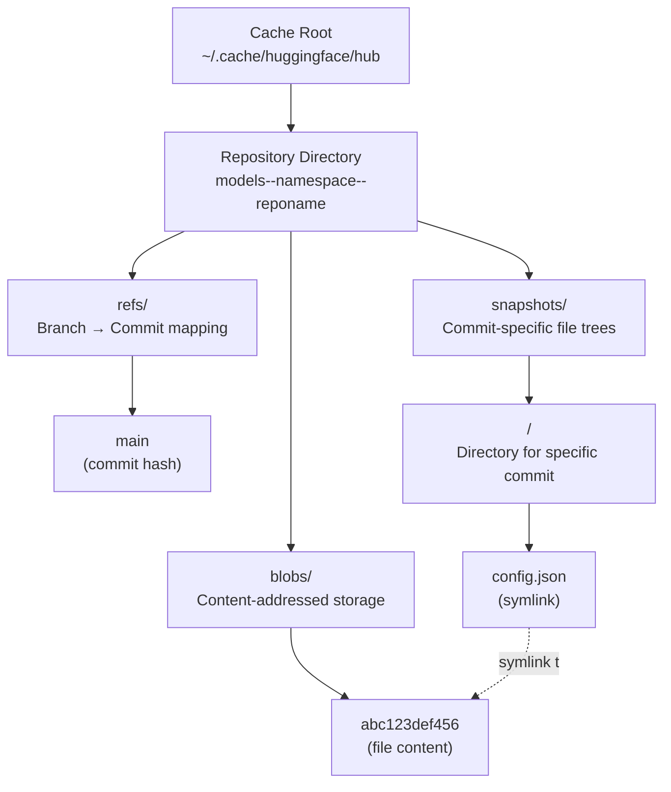
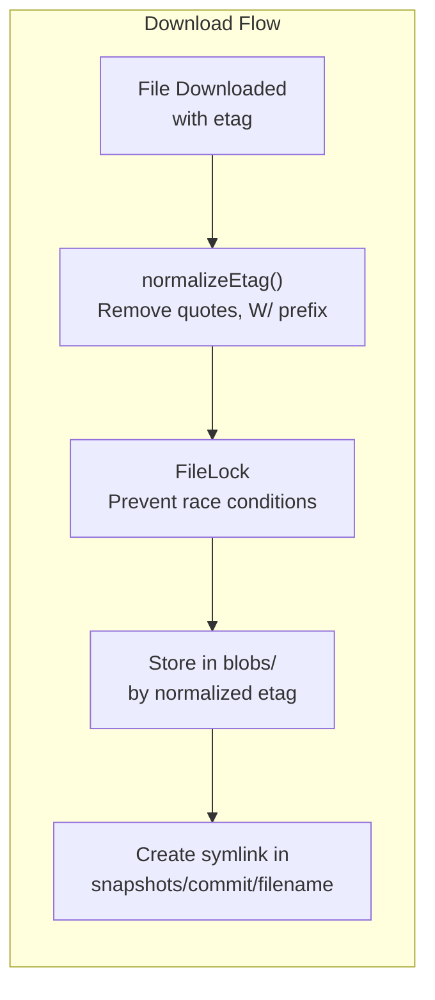
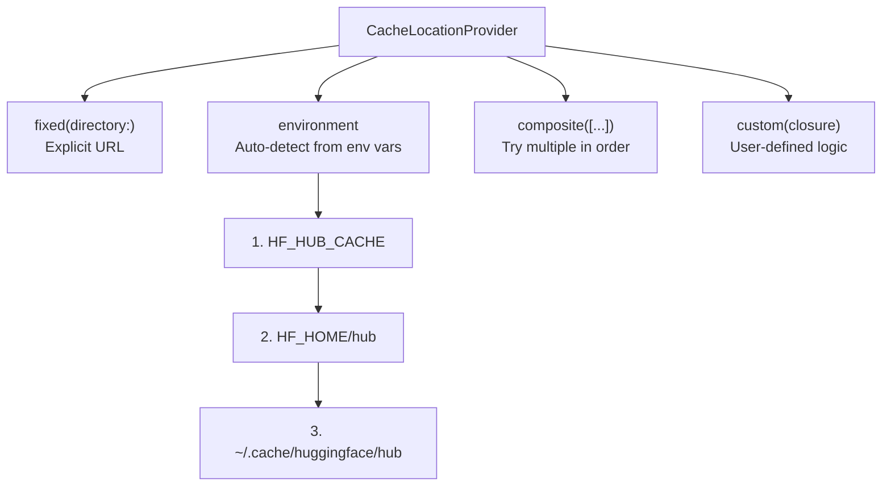

<!-- source: DeepWiki mcp.deepwiki.com · repo huggingface/swift-huggingface · page 6 Caching System · fetched 2026-10-26 -->

# Caching System

<details>
<summary>Relevant source files</summary>

The following files were used as context for generating this wiki page:

- [Sources/HuggingFace/Hub/HubCache.swift](Sources/HuggingFace/Hub/HubCache.swift)
- [Sources/HuggingFace/Shared/CacheLocationProvider.swift](Sources/HuggingFace/Shared/CacheLocationProvider.swift)
- [Sources/HuggingFace/Shared/Extensions/URL+Extensions.swift](Sources/HuggingFace/Shared/Extensions/URL+Extensions.swift)
- [Sources/HuggingFace/Shared/Extensions/URLSession+Linux.swift](Sources/HuggingFace/Shared/Extensions/URLSession+Linux.swift)

</details>


## Purpose and Scope

This document provides an overview of the local file caching system used by the swift-huggingface SDK. The cache stores downloaded files from the Hugging Face Hub in a Python-compatible directory structure, enabling efficient file reuse and seamless interoperability with Python-based Hugging Face clients.

For detailed information about the internal cache architecture (blobs, refs, snapshots), see [Cache Architecture](#6.1). For cache location configuration and environment variables, see [Cache Configuration](#6.2). For concurrency control and thread safety mechanisms, see [Concurrency and File Locking](#6.3).

## Overview

The caching system is implemented by the `HubCache` struct [Sources/HuggingFace/Hub/HubCache.swift:71](). It provides a content-addressed storage mechanism where files are stored once by their etag (a unique content identifier) and referenced via symlinks from multiple revisions. This design minimizes disk usage when the same file appears across different commits or branches [Sources/HuggingFace/Hub/HubCache.swift:9-12]().

The cache is automatically used by `HubClient` when downloading files. Files are stored in a structured directory hierarchy that mirrors the Python `huggingface_hub` library's cache layout, allowing both Swift and Python clients to share the same cache [Sources/HuggingFace/Hub/HubCache.swift:16-28]().

**Key Components:**

| Component | Purpose | Source File |
|-----------|---------|-------------|
| `HubCache` | Main cache manager, handles file storage and retrieval | [Sources/HuggingFace/Hub/HubCache.swift]() |
| `CacheLocationProvider` | Determines cache directory location from environment or custom logic | [Sources/HuggingFace/Shared/CacheLocationProvider.swift]() |

Sources: [Sources/HuggingFace/Hub/HubCache.swift:7-88](), [Sources/HuggingFace/Shared/CacheLocationProvider.swift:3-66]()

## Cache Architecture Overview

**Directory Structure**

The cache organizes files in a three-tier structure:

Title: HubCache Directory Structure


Sources: [Sources/HuggingFace/Hub/HubCache.swift:14-28](), [Sources/HuggingFace/Hub/HubCache.swift:105-135]()

The cache uses three subdirectories within each repository:

- **blobs/**: Stores actual file content, named by normalized etag. Each file is stored once regardless of how many commits reference it [Sources/HuggingFace/Hub/HubCache.swift:122-123]().
- **refs/**: Maps branch/tag names to commit hashes. Files contain a single commit hash string [Sources/HuggingFace/Hub/HubCache.swift:139-141]().
- **snapshots/**: Organizes files by commit hash. Contains symlinks (or copies on platforms without symlink support) pointing to blobs [Sources/HuggingFace/Hub/HubCache.swift:144-146]().

Sources: [Sources/HuggingFace/Hub/HubCache.swift:120-146]()

**Content Addressing and Deduplication**

Title: File Storage Flow


Sources: [Sources/HuggingFace/Hub/HubCache.swift:11-12](), [Sources/HuggingFace/Hub/HubCache.swift:409-421]()

When storing files, the cache:
1. Normalizes the etag by removing HTTP quotes and weak validator prefixes [Sources/HuggingFace/Hub/HubCache.swift:409-421]().
2. Validates path components to prevent path traversal attacks [Sources/HuggingFace/Hub/HubCache.swift:429-489]().
3. Acquires a file lock on the blob path [Sources/HuggingFace/Hub/HubCache.swift:153-166]().
4. Copies the file to `blobs/<normalized-etag>` (only if not already present).
5. Creates a symlink in `snapshots/<commit>/<filename>` pointing to the blob.

For details on the structural layout, see [Cache Architecture](#6.1).

## Cache Location Configuration

The cache directory is determined by `CacheLocationProvider`, which offers multiple strategies for locating the cache:

Title: CacheLocationProvider Strategies


Sources: [Sources/HuggingFace/Shared/CacheLocationProvider.swift:66-120]()

| Strategy | Purpose | Example |
|----------|---------|---------|
| `.fixed(directory:)` | Use a specific directory | `CacheLocationProvider.fixed(directory: customURL)` [Sources/HuggingFace/Shared/CacheLocationProvider.swift:76]() |
| `.environment` | Auto-detect from environment variables | `CacheLocationProvider.environment` [Sources/HuggingFace/Shared/CacheLocationProvider.swift:90]() |
| `.composite([...])` | Try multiple providers in order | `[.fixed(directory: preferred), .environment]` [Sources/HuggingFace/Shared/CacheLocationProvider.swift:106]() |
| `.custom(closure)` | Custom resolution logic | `CacheLocationProvider.custom { myLogic() }` [Sources/HuggingFace/Shared/CacheLocationProvider.swift:120]() |

The `.environment` provider checks locations in this order: `HF_HUB_CACHE`, then `HF_HOME/hub`, then platform-specific defaults [Sources/HuggingFace/Shared/CacheLocationProvider.swift:157-163]().

For detailed setup instructions, see [Cache Configuration](#6.2).

## Basic Usage

**Using the Default Cache**

The default `HubCache` instance uses environment-based location detection [Sources/HuggingFace/Hub/HubCache.swift:72-73]().

```swift
let cache = HubCache.default
```

**Custom Cache Location**

You can specify a custom cache directory using the initializer [Sources/HuggingFace/Hub/HubCache.swift:93-96]().

```swift
// Using a URL
let cache = HubCache(cacheDirectory: URL(fileURLWithPath: "/custom/path"))

// Using CacheLocationProvider
let cache = HubCache(location: .fixed(directory: customURL))
```

**Checking for Cached Files**

The `cachedFilePath` method allows checking if a specific revision and filename exist locally [Sources/HuggingFace/Hub/HubCache.swift:52-59]().

```swift
let cache = HubCache.default
if let cachedPath = cache.cachedFilePath(
    repo: "openai-community/gpt2",
    kind: .model,
    revision: "main",
    filename: "config.json"
) {
    let data = try Data(contentsOf: cachedPath)
}
```

## Python Compatibility

The cache structure is fully compatible with Python's `huggingface_hub` library, allowing cache sharing between Swift and Python applications on the same system [Sources/HuggingFace/Hub/HubCache.swift:9-10]().

**Compatibility Features:**

| Feature | Implementation | Benefit |
|---------|---------------|---------|
| Directory naming | `models--namespace--repo` format | Identical to Python client [Sources/HuggingFace/Hub/HubCache.swift:106-117]() |
| Content addressing | Normalized etags as blob names | Same deduplication strategy [Sources/HuggingFace/Hub/HubCache.swift:11-12]() |
| Symlink structure | `snapshots/<commit>/<file>` → `../../blobs/<etag>` | Identical file references [Sources/HuggingFace/Hub/HubCache.swift:25-27]() |
| Environment variables | `HF_HUB_CACHE`, `HF_HOME` | Same configuration options [Sources/HuggingFace/Shared/CacheLocationProvider.swift:83-86]() |

## Concurrency and File Locking

The SDK ensures thread safety and process safety through a file-locking mechanism. This prevents data corruption when multiple threads or even separate processes (like a Swift app and a Python script) attempt to write to the same cache entry simultaneously.

- **FileLock**: Used to coordinate access to blob files during the download and storage process [Sources/HuggingFace/Hub/HubCache.swift:153-166]().
- **Atomic Operations**: The system ensures that files are fully written to the `blobs` directory before symlinks are created in `snapshots`.

For details on how the locking mechanism works, see [Concurrency and File Locking](#6.3).

---

