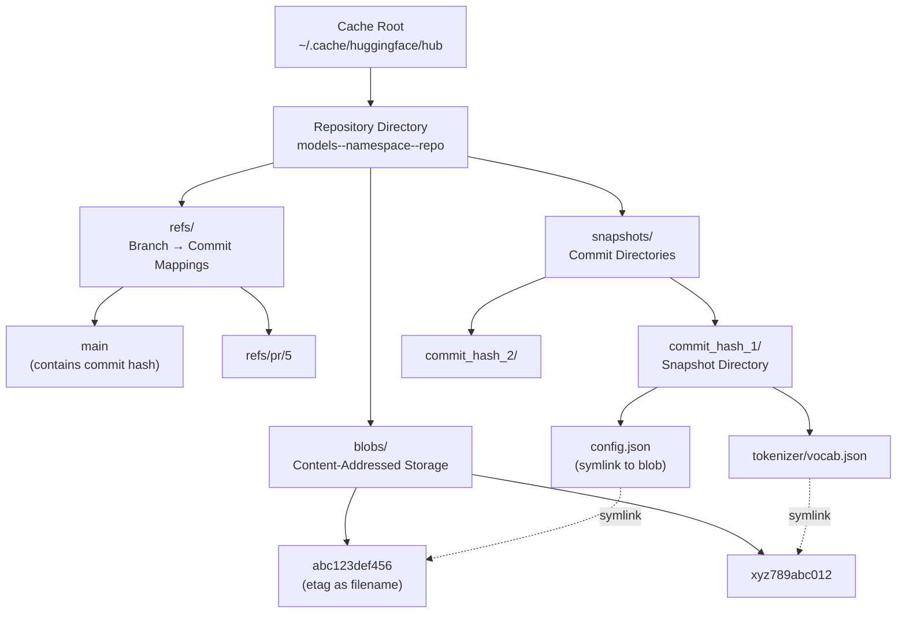
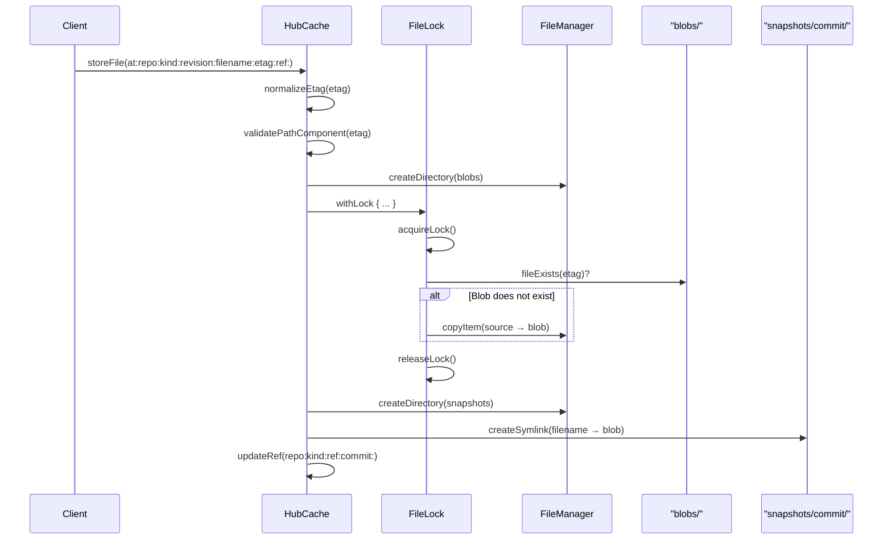
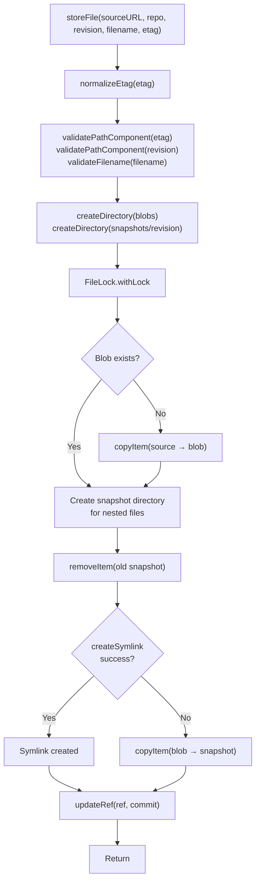
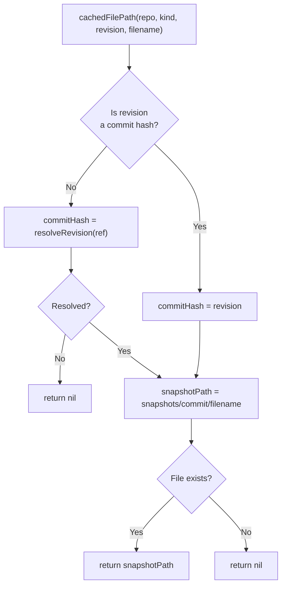
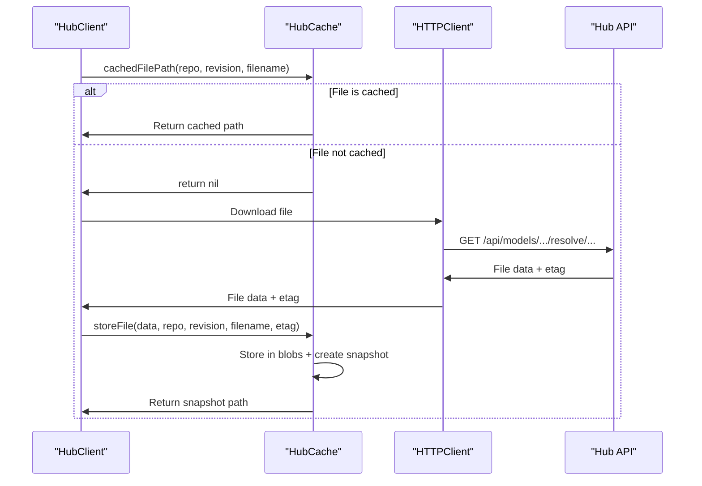

<!-- source: DeepWiki mcp.deepwiki.com · repo huggingface/swift-huggingface · page 6.1 Cache Architecture · fetched 2026-10-26 -->

# Cache Architecture

<details>
<summary>Relevant source files</summary>

The following files were used as context for generating this wiki page:

- [Sources/HuggingFace/Hub/HubCache.swift](Sources/HuggingFace/Hub/HubCache.swift)
- [Tests/HuggingFaceTests/HubTests/FileOperationsTests.swift](Tests/HuggingFaceTests/HubTests/FileOperationsTests.swift)
- [Tests/HuggingFaceTests/HubTests/HubCacheTests.swift](Tests/HuggingFaceTests/HubTests/HubCacheTests.swift)

</details>


This document provides a detailed explanation of the cache system's internal structure and storage mechanisms. It covers the three-directory layout (blobs, refs, snapshots), content-addressed storage, symlink-based deduplication, and file storage/retrieval operations.

For information about configuring cache location and environment variables, see **6.2 Cache Configuration**. For details on concurrency control and file locking mechanisms, see **6.3 Concurrency and File Locking**.

## Overview

The `HubCache` system implements Python-compatible content-addressed storage for Hugging Face Hub files. The cache uses a three-directory structure with symlinks to deduplicate identical files across repository revisions. This architecture enables efficient storage and seamless interoperability with the Python `huggingface_hub` library.

Sources: [Sources/HuggingFace/Hub/HubCache.swift:7-70]()

## Cache Directory Structure

The cache organizes files using a hierarchical directory structure that separates content storage (blobs) from revision metadata (refs and snapshots).

### Directory Hierarchy



Sources: [Sources/HuggingFace/Hub/HubCache.swift:14-28](), [Sources/HuggingFace/Hub/HubCache.swift:105-147]()

### Repository Directory Naming

Repository directories follow the Python naming convention: `<kind>--<namespace>--<repo>`, where slashes in the repository ID are replaced with double hyphens.

| Repository Type | Example Repo ID | Directory Name |
|----------------|-----------------|----------------|
| Model | `openai-community/gpt2` | `models--openai-community--gpt2` |
| Dataset | `squad_v2/squad_v2` | `datasets--squad_v2--squad_v2` |
| Space | `huggingface/gradio-demo` | `spaces--huggingface--gradio-demo` |

The `repoDirectory(repo:kind:)` method constructs these paths by pluralizing the `Repo.Kind` and replacing slashes in the `Repo.ID`.

Sources: [Sources/HuggingFace/Hub/HubCache.swift:114-119](), [Tests/HuggingFaceTests/HubTests/HubCacheTests.swift:25-54]()

## Content-Addressed Storage

The cache implements content-addressed storage where files are stored in the `blobs/` directory using their normalized etag as the filename. This enables deduplication: identical files across different revisions or repositories share a single blob.

### Blob Storage Process



**Diagram: File Storage Flow Through HubCache**

Sources: [Sources/HuggingFace/Hub/HubCache.swift:261-323]()

### Etag Normalization

HTTP etags often include quotes and weak validator prefixes (`W/`) that must be removed before using them as filenames. The `normalizeEtag(_:)` method handles this:

```
Input:  "W/\"abc123def456\""
Output: "abc123def456"
```

This normalization ensures Python-Swift cache compatibility and safe filesystem operations.

Sources: [Sources/HuggingFace/Hub/HubCache.swift:403-421](), [Tests/HuggingFaceTests/HubTests/HubCacheTests.swift:182-206]()

## Refs and Revision Resolution

The `refs/` directory maps symbolic references (branch names, tag names) to commit hashes. This enables users to specify `revision: "main"` instead of full commit hashes.

### Ref File Structure

Each ref is a text file containing a single commit hash. The `resolveRevision` method reads these files and trims whitespace.

```
refs/
├── main                    # contains: abc123def456789012345678901234567890abcd
└── refs/pr/5              # contains: xyz789abc012345678901234567890xyz789abc
```

Sources: [Sources/HuggingFace/Hub/HubCache.swift:179-185](), [Tests/HuggingFaceTests/HubTests/HubCacheTests.swift:110-152]()

### Revision Resolution Flow


**Diagram: Revision to Commit Hash Resolution**

The `resolveRevision(repo:kind:ref:)` method implements this logic. If the revision passed to `cachedFilePath` is not a 40-character hex string, the cache attempts to resolve it via the `refs/` directory.

Sources: [Sources/HuggingFace/Hub/HubCache.swift:179-185](), [Sources/HuggingFace/Hub/HubCache.swift:190-205]()

### Updating Refs

When files are downloaded, the cache can optionally update refs to point to the new commit using `updateRef(repo:kind:ref:commit:)`. Nested refs (e.g., `refs/pr/5`) are supported through automatic parent directory creation.

Sources: [Sources/HuggingFace/Hub/HubCache.swift:156-174](), [Tests/HuggingFaceTests/HubTests/HubCacheTests.swift:156-193]()

## Snapshots and Symlinks

The `snapshots/` directory organizes files by commit hash. Each commit has a subdirectory containing the repository's file structure, with files implemented as symlinks to blobs.

### Snapshot Structure

```
snapshots/
└── abc123def456789012345678901234567890abcd/
    ├── config.json                    → ../../blobs/etag1
    ├── tokenizer/
    │   ├── vocab.json                → ../../../blobs/etag2
    │   └── tokenizer_config.json     → ../../../blobs/etag3
    └── pytorch_model.bin              → ../../blobs/etag4
```

### Relative Symlink Path Calculation

Symlinks use relative paths to maintain portability when cache directories are moved. The `relativePathToBlob(from:blobName:)` method calculates these paths dynamically based on the depth of the file in the repository tree.

Sources: [Sources/HuggingFace/Hub/HubCache.swift:491-509]()

### Fallback for Non-Symlink Systems

On platforms that don't support symlinks (some Windows configurations), the cache falls back to copying files directly into the snapshots directory. The `createSymlink(at:pointingTo:)` method attempts symlink creation and returns `false` on failure, triggering the copy fallback in `storeFile`.

Sources: [Sources/HuggingFace/Hub/HubCache.swift:313-317](), [Sources/HuggingFace/Hub/HubCache.swift:511-528]()

## File Storage Operations

The cache provides two methods for storing files: `storeFile(at:...)` for files on disk and `storeData(_:...)` for in-memory data.

### storeFile Method Execution Flow



Sources: [Sources/HuggingFace/Hub/HubCache.swift:261-323]()

### storeData Method

The `storeData(_:...)` method follows a similar flow but writes data directly to the blob file instead of copying from a source URL.

Sources: [Sources/HuggingFace/Hub/HubCache.swift:338-399]()

## File Retrieval Operations

The cache provides lookup methods to check if files are cached before downloading.

### cachedFilePath Method



**Diagram: File Lookup Process in cachedFilePath**

Sources: [Sources/HuggingFace/Hub/HubCache.swift:190-217]()

### cachedBlobPath Method

For direct blob access when the etag is known, `cachedBlobPath(repo:kind:etag:)` provides the path to the underlying content-addressed file.

Sources: [Sources/HuggingFace/Hub/HubCache.swift:219-236](), [Tests/HuggingFaceTests/HubTests/HubCacheTests.swift:295-341]()

## Path Traversal Protection

The cache implements comprehensive validation to prevent path traversal attacks where malicious components could write files outside the cache directory.

### Validation Logic

The `validatePathComponent(_:)` and `validateFilename(_:)` methods enforce strict rules:
- No empty or whitespace-only strings.
- No null bytes (`\0`).
- No backslashes (`\`).
- Revisions and Etags cannot contain slashes (`/`) or `..`.
- Filenames cannot be absolute, contain `..` components, or resolve outside the base directory.

Sources: [Sources/HuggingFace/Hub/HubCache.swift:429-489](), [Tests/HuggingFaceTests/HubTests/HubCacheTests.swift:582-742]()

## Python Compatibility

The cache structure is fully compatible with Python's `huggingface_hub` library, enabling cache sharing between Swift and Python applications.

### Compatibility Features

| Feature | Python | Swift |
|---------|--------|-------|
| Cache location detection | `HF_HUB_CACHE`, `HF_HOME`, `~/.cache/huggingface/hub` | Identical via `CacheLocationProvider` |
| Repository naming | `models--namespace--repo` | Identical via `repoDirectory` |
| Blob naming | Normalized etag | Identical via `normalizeEtag` |
| Ref format | Plain text commit hash | Identical |
| Snapshot structure | Symlinks to blobs | Identical (with copy fallback) |

Sources: [Sources/HuggingFace/Hub/HubCache.swift:9-28](), [Sources/HuggingFace/Hub/HubCache.swift:32-37]()

## Integration with HubClient

`HubClient` uses the cache automatically for file download operations when a cache is configured.



**Diagram: HubClient Cache Integration**

Sources: [Tests/HuggingFaceTests/HubTests/FileOperationsTests.swift:170-185](), [Tests/HuggingFaceTests/HubTests/FileOperationsTests.swift:187-198]()

---

