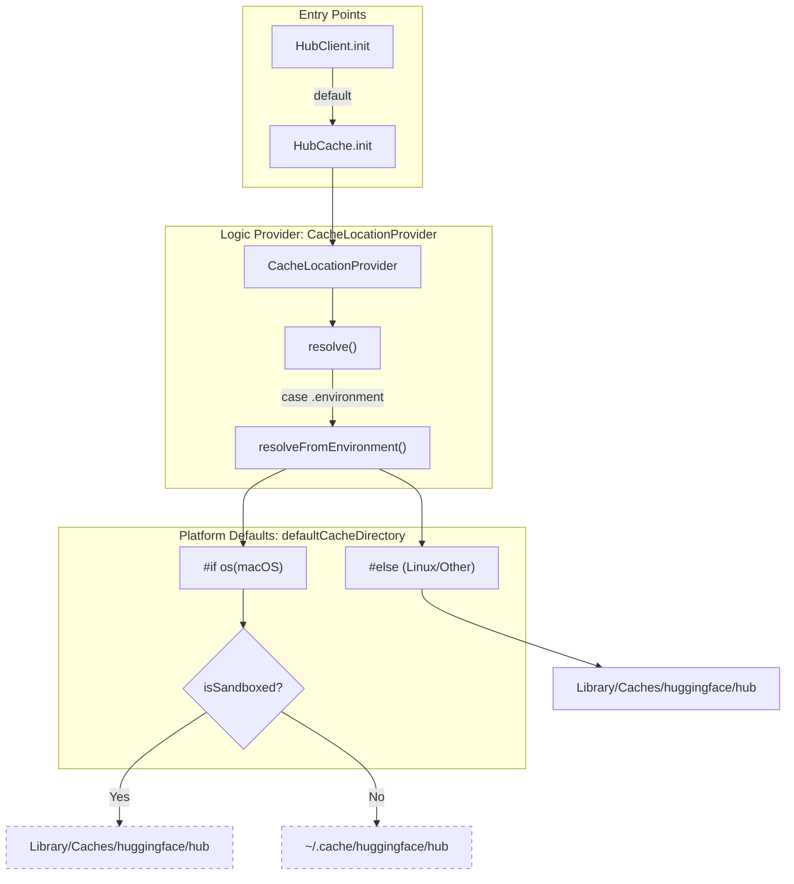
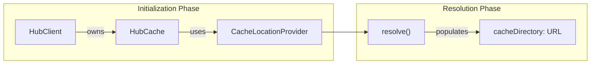

<!-- source: DeepWiki mcp.deepwiki.com · repo huggingface/swift-huggingface · page 6.2 Cache Configuration · fetched 2026-10-26 -->

# Cache Configuration

<details>
<summary>Relevant source files</summary>

The following files were used as context for generating this wiki page:

- [Sources/HuggingFace/Hub/HubClient.swift](Sources/HuggingFace/Hub/HubClient.swift)
- [Sources/HuggingFace/Shared/CacheLocationProvider.swift](Sources/HuggingFace/Shared/CacheLocationProvider.swift)
- [Sources/HuggingFace/Shared/Extensions/URL+Extensions.swift](Sources/HuggingFace/Shared/Extensions/URL+Extensions.swift)
- [Sources/HuggingFace/Shared/Extensions/URLSession+Linux.swift](Sources/HuggingFace/Shared/Extensions/URLSession+Linux.swift)
- [Tests/HuggingFaceTests/HubTests/CacheLocationProviderTests.swift](Tests/HuggingFaceTests/HubTests/CacheLocationProviderTests.swift)

</details>


This page explains how to configure the cache location for Hugging Face Hub files using the `CacheLocationProvider` system. It covers environment-based auto-detection, fixed paths, custom providers, and composite strategies. For details on the internal cache structure (blobs, refs, snapshots), see [6.1 Cache Architecture](). For information about thread-safe cache operations, see [6.3 Concurrency and File Locking]().

## Overview

Cache location configuration is managed by the `CacheLocationProvider` enum, which provides strategies for determining where cached files are stored. The system is designed to be Python-compatible, allowing seamless cache reuse between Swift and Python Hugging Face clients [Sources/HuggingFace/Hub/HubClient.swift:35-36]().

| Strategy | Use Case | Example |
|----------|----------|---------|
| `.environment` | Auto-detect from environment variables (default) | Standard deployment, Python compatibility |
| `.fixed(directory:)` | Specific cache directory | Testing, containerized environments |
| `.custom { }` | Dynamic logic | Per-user caching, custom conditions |
| `.composite([])` | Multiple strategies with fallback | Graceful degradation across environments |

**Sources:** [Sources/HuggingFace/Shared/CacheLocationProvider.swift:5-66](), [Sources/HuggingFace/Hub/HubClient.swift:72-76]()

## Cache Location Resolution Flow

The following diagram illustrates how `HubClient` interacts with `CacheLocationProvider` to resolve the final filesystem path for the cache.

### Resolution Logic to Code Entities

**Sources:** [Sources/HuggingFace/Shared/CacheLocationProvider.swift:134-153](), [Sources/HuggingFace/Shared/CacheLocationProvider.swift:164-190](), [Sources/HuggingFace/Shared/CacheLocationProvider.swift:196-210](), [Sources/HuggingFace/Hub/HubClient.swift:112-121]()

## Environment-Based Detection (Default)

The `.environment` provider implements the detection logic used by the Python `huggingface_hub` library [Sources/HuggingFace/Shared/CacheLocationProvider.swift:88-89]().

### Detection Priority Order
The `resolveFromEnvironment` function checks sources in the following order [Sources/HuggingFace/Shared/CacheLocationProvider.swift:164-184]():

1.  **`HF_HUB_CACHE`**: Direct path to the hub cache.
2.  **`HF_HOME`**: Appends `/hub` to the provided home path.
3.  **Default Location**: Platform-specific fallback.

### Platform-Specific Defaults
When no environment variables are set, the SDK selects a path based on the operating system and environment [Sources/HuggingFace/Shared/CacheLocationProvider.swift:196-215]():

*   **Non-Sandboxed macOS**: `~/.cache/huggingface/hub` [Sources/HuggingFace/Shared/CacheLocationProvider.swift:207-209]().
*   **Sandboxed macOS/iOS/Other**: `Library/Caches/huggingface/hub` [Sources/HuggingFace/Shared/CacheLocationProvider.swift:203-205](), [Sources/HuggingFace/Shared/CacheLocationProvider.swift:214-215]().

On Linux, the SDK provides a compatibility shim for `URL.cachesDirectory` to ensure consistent behavior [Sources/HuggingFace/Shared/Extensions/URL+Extensions.swift:12-14]().

**Sources:** [Sources/HuggingFace/Shared/CacheLocationProvider.swift:157-215](), [Sources/HuggingFace/Shared/Extensions/URL+Extensions.swift:3-16](), [Tests/HuggingFaceTests/HubTests/CacheLocationProviderTests.swift:82-136]()

## Configuration Strategies

### Fixed Cache Locations
Use `.fixed(directory:)` to specify an exact `URL`. This is common in CI/CD or containerized environments [Sources/HuggingFace/Shared/CacheLocationProvider.swift:67-76]().

```swift
let customURL = URL(fileURLWithPath: "/tmp/hf-cache")
let cache = HubCache(location: .fixed(directory: customURL))
```

### Custom Providers
The `.custom` case takes a `@Sendable` closure returning an optional `URL`. This allows for dynamic resolution, such as choosing a cache based on available disk space or user session [Sources/HuggingFace/Shared/CacheLocationProvider.swift:108-120]().

```swift
let provider = CacheLocationProvider.custom {
    return FileManager.default.temporaryDirectory.appendingPathComponent("hf-cache")
}
```

### Composite Providers
Composite providers allow chaining multiple strategies. The first provider in the array that successfully `resolve()`s to a non-nil `URL` is used [Sources/HuggingFace/Shared/CacheLocationProvider.swift:92-106](), [Sources/HuggingFace/Shared/CacheLocationProvider.swift:142-148]().

```swift
let provider: CacheLocationProvider = [
    .fixed(directory: URL(fileURLWithPath: "/preferred/path")),
    .environment
]
```

**Sources:** [Sources/HuggingFace/Shared/CacheLocationProvider.swift:66-153](), [Tests/HuggingFaceTests/HubTests/CacheLocationProviderTests.swift:14-55](), [Tests/HuggingFaceTests/HubTests/CacheLocationProviderTests.swift:140-208]()

## Integration with HubClient

The `HubClient` manages the `HubCache` instance. By default, it uses `HubCache.default`, which initializes with `.environment` [Sources/HuggingFace/Hub/HubClient.swift:112-121]().

### Disabling the Cache
Caching can be completely disabled by passing `nil` to the `HubClient` initializer [Sources/HuggingFace/Hub/HubClient.swift:47](), [Sources/HuggingFace/Hub/HubClient.swift:108]().

```swift
// Downloads will not be persisted to disk
let client = HubClient(cache: nil)
```

### System Component Interaction
The following diagram shows how the `HubClient` components coordinate to establish the cache path.



**Sources:** [Sources/HuggingFace/Hub/HubClient.swift:76](), [Sources/HuggingFace/Hub/HubClient.swift:157-180](), [Sources/HuggingFace/Shared/CacheLocationProvider.swift:134-153]()

## Implementation Details

### Path Normalization
The SDK performs tilde (`~`) expansion for paths provided via environment variables or path-based initializers using `NSString.expandingTildeInPath` [Sources/HuggingFace/Shared/CacheLocationProvider.swift:171-172](), [Sources/HuggingFace/Shared/CacheLocationProvider.swift:177-178]().

### Linux Compatibility
On Linux, where `FoundationNetworking` is used, the SDK implements async wrappers for `URLSession` to handle data and download tasks consistently with the Darwin implementation [Sources/HuggingFace/Shared/Extensions/URLSession+Linux.swift:10-34](). This ensures that cache downloads behave identically across platforms despite underlying library differences [Sources/HuggingFace/Shared/Extensions/URLSession+Linux.swift:92-133]().

**Sources:** [Sources/HuggingFace/Shared/CacheLocationProvider.swift:164-190](), [Sources/HuggingFace/Shared/Extensions/URLSession+Linux.swift:1-150]()

---

