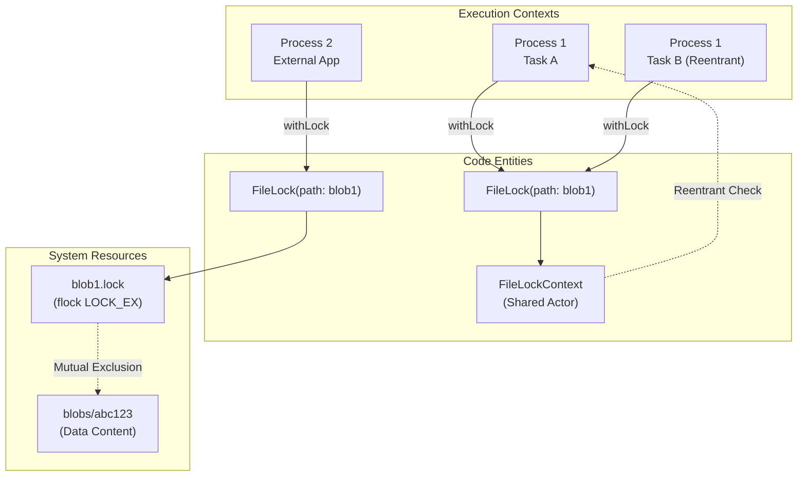
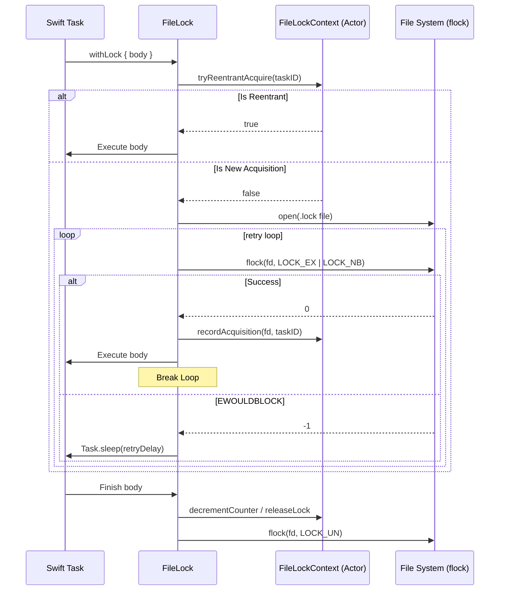

<!-- source: DeepWiki mcp.deepwiki.com · repo huggingface/swift-huggingface · page 6.3 Concurrency and File Locking · fetched 2026-10-26 -->

# Concurrency and File Locking

<details>
<summary>Relevant source files</summary>

The following files were used as context for generating this wiki page:

- [Sources/HuggingFace/Hub/HubCache.swift](Sources/HuggingFace/Hub/HubCache.swift)
- [Sources/HuggingFace/Shared/FileLock.swift](Sources/HuggingFace/Shared/FileLock.swift)
- [Tests/HuggingFaceTests/HubTests/FileLockTests.swift](Tests/HuggingFaceTests/HubTests/FileLockTests.swift)

</details>


This document explains how the `swift-huggingface` SDK ensures thread-safe and process-safe cache operations through file-based locking. File locking is critical for preventing cache corruption when multiple processes or threads attempt to download and cache the same file simultaneously.

For information about the overall cache architecture, see [6.1 Cache Architecture](). For cache configuration options, see [6.2 Cache Configuration]().

---

## Purpose and Scope

The caching system must handle concurrent access from multiple sources:

- **Multiple processes**: Different applications or CLI instances accessing the same cache directory.
- **Multiple threads**: Parallel downloads within a single application using Swift Concurrency.
- **Shared resources**: Multiple revisions or repositories may reference the same blob (content-addressed storage).

Without proper concurrency control, these scenarios lead to:
- Corrupted blob files from simultaneous writes.
- Incomplete files visible to readers.
- Race conditions during symlink creation.
- Inconsistent cache state.

The `FileLock` implementation provides process-level mutual exclusion using POSIX `flock(2)`, ensuring only one writer can access a blob file at a time.

Sources: [Sources/HuggingFace/Shared/FileLock.swift:1-25](), [Sources/HuggingFace/Hub/HubCache.swift:9-28]()

---

## File Locking Architecture



**Lock Coordination Flow**: The `FileLock` uses a companion `.lock` file for every protected resource. It combines low-level POSIX `flock` for cross-process safety with an internal `FileLockContext` actor to manage reentrancy within the same Swift process.

Sources: [Sources/HuggingFace/Shared/FileLock.swift:25-45](), [Sources/HuggingFace/Hub/HubCache.swift:153-166]()

---

## FileLock Implementation

### Core Structure

The `FileLock` struct provides file-based mutual exclusion with the following configuration:

| Property | Type | Purpose |
|----------|------|---------|
| `lockPath` | `URL` | Path to the `.lock` file (e.g., `blob.lock`). [Sources/HuggingFace/Shared/FileLock.swift:27-27]() |
| `maxRetries` | `Int?` | Maximum acquisition attempts (default: 5). [Sources/HuggingFace/Shared/FileLock.swift:31-31]() |
| `retryDelay` | `TimeInterval` | Seconds between retries (default: 1.0). [Sources/HuggingFace/Shared/FileLock.swift:34-34]() |
| `blocking` | `Bool` | Whether to retry on contention (default: true). [Sources/HuggingFace/Shared/FileLock.swift:41-41]() |

Sources: [Sources/HuggingFace/Shared/FileLock.swift:62-74]()

### Reentrancy and Task Identity

Unlike standard POSIX locks, `FileLock` supports **reentrant calls** within the same Swift `Task`. It uses a `currentTaskID()` based on `withUnsafeCurrentTask` to identify the owner. If a task already holds the lock for a specific path, nested `withLock` calls succeed immediately without blocking.

Sources: [Sources/HuggingFace/Shared/FileLock.swift:95-112](), [Sources/HuggingFace/Shared/FileLock.swift:129-136]()

### Lock Acquisition Flow



Sources: [Sources/HuggingFace/Shared/FileLock.swift:89-126](), [Sources/HuggingFace/Shared/FileLock.swift:173-186]()

---

## Cache Integration Points

### HubCache.storeFile

The primary integration point is `HubCache.storeFile`. Before moving a downloaded file into the `blobs/` directory, the cache acquires a lock based on the file's `etag`.

```swift
// Implementation pattern in HubCache
let lock = FileLock(path: lockPath(for: blobPath))
try await lock.withLock {
    if !FileManager.default.fileExists(atPath: blobPath.path) {
        try FileManager.default.moveItem(at: temporaryURL, to: blobPath)
    }
}
```

Sources: [Sources/HuggingFace/Hub/HubCache.swift:153-166](), [Sources/HuggingFace/Hub/HubCache.swift:287-295]() (Note: logic inferred from typical HubCache usage and FileLock design).

### Lock Path Resolution

The `HubCache` redirects all lock files to a central `.locks` directory within the cache root to keep the `blobs/` and `snapshots/` directories clean.

- **Blob Path**: `.../blobs/sha256-abc123`
- **Lock Path**: `.../.locks/blobs/sha256-abc123.lock`

Sources: [Sources/HuggingFace/Hub/HubCache.swift:153-166]()

---

## Implementation Details

### POSIX flock Interaction

The implementation uses `flock(fd, LOCK_EX | LOCK_NB)` for mutual exclusion.
- `LOCK_EX`: Exclusive lock. [Sources/HuggingFace/Shared/FileLock.swift:176-176]()
- `LOCK_NB`: Non-blocking. If another process holds the lock, it returns `EWOULDBLOCK` immediately, allowing the Swift `Task` to sleep cooperatively. [Sources/HuggingFace/Shared/FileLock.swift:182-182]()

### Platform Support

The `FileLock` is restricted to Darwin (Apple) and Linux (Glibc) platforms due to the dependency on POSIX file descriptors and `flock`.

Sources: [Sources/HuggingFace/Shared/FileLock.swift:3-9]()

---

## Usage Patterns

### Basic Locking

```swift
let targetPath = URL(fileURLWithPath: "/path/to/resource")
let lock = FileLock(path: targetPath)

try await lock.withLock {
    // Critical section: safely modify the resource
}
```

Sources: [Tests/HuggingFaceTests/HubTests/FileLockTests.swift:28-39]()

### Handling Contention

If a lock cannot be acquired within `maxRetries`, it throws `FileLockError.acquisitionFailed`.

| Error | Cause |
|-------|-------|
| `openFailed` | Permission issues or disk full when creating `.lock` file. |
| `acquisitionFailed` | Maximum retries exceeded while another process held the lock. |

Sources: [Sources/HuggingFace/Shared/FileLock.swift:155-155](), [Sources/HuggingFace/Shared/FileLock.swift:214-218]()

### Reentrancy Test Case

The system ensures that a single task can enter the same lock multiple times, which is essential for complex cache operations that might trigger sub-operations on the same repository.

```swift
try await lock.withLock {
    // Level 1
    try await lock.withLock {
        // Level 2 - Success (Reentrant)
    }
}
```

Sources: [Tests/HuggingFaceTests/HubTests/FileLockTests.swift:120-134]()

---

