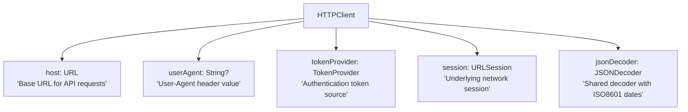
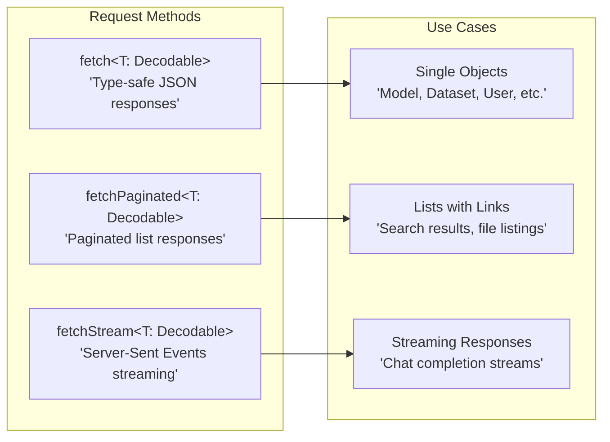
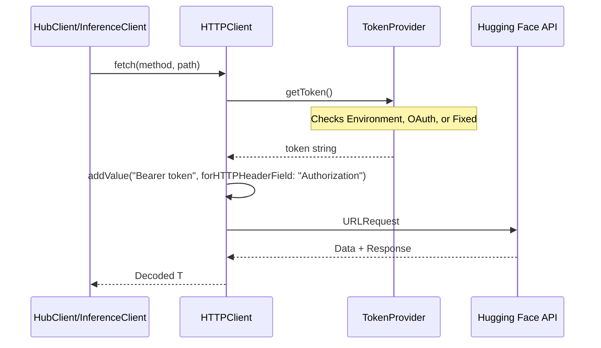
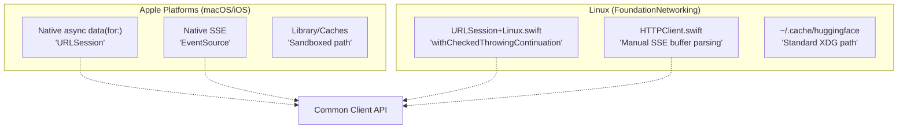
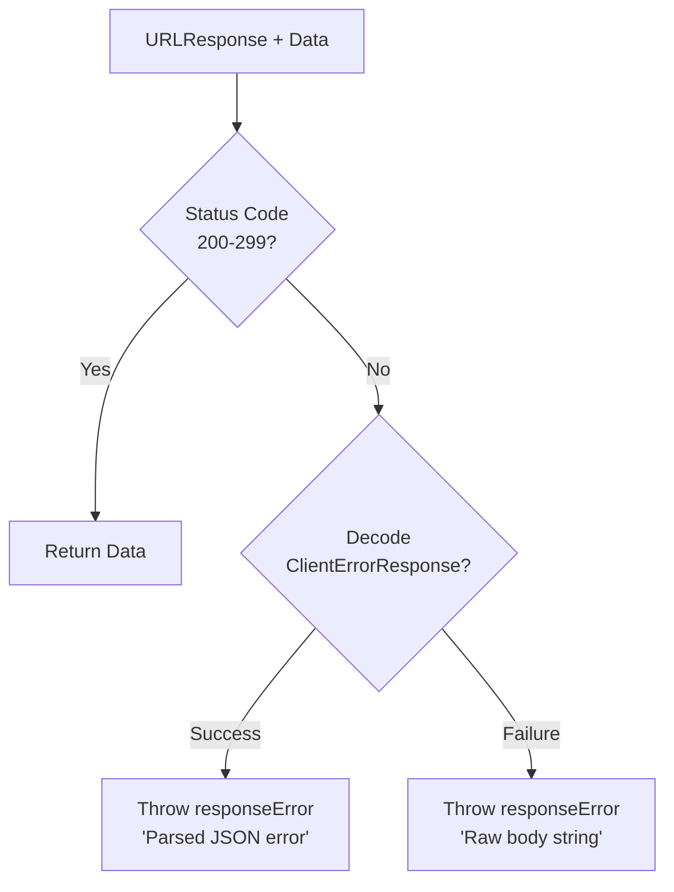

<!-- source: DeepWiki mcp.deepwiki.com · repo huggingface/swift-huggingface · page 7 Core Infrastructure · fetched 2026-10-26 -->

# Core Infrastructure

Relevant source files

The following files were used as context for generating this wiki page:

- [Sources/HuggingFace/Shared/CacheLocationProvider.swift](Sources/HuggingFace/Shared/CacheLocationProvider.swift)
- [Sources/HuggingFace/Shared/Extensions/URL+Extensions.swift](Sources/HuggingFace/Shared/Extensions/URL+Extensions.swift)
- [Sources/HuggingFace/Shared/Extensions/URLSession+Linux.swift](Sources/HuggingFace/Shared/Extensions/URLSession+Linux.swift)
- [Sources/HuggingFace/Shared/HTTPClient.swift](Sources/HuggingFace/Shared/HTTPClient.swift)
- [Sources/HuggingFace/Shared/TokenProvider.swift](Sources/HuggingFace/Shared/TokenProvider.swift)

This document describes the foundational systems that power the swift-huggingface SDK. These components provide network communication, authentication integration, error handling, and platform abstraction for both `HubClient` and `InferenceClient`.

For authentication mechanisms and token management, see [Authentication System](#5). For caching and local storage, see [Caching System](#6). For HTTP-specific error handling patterns, see [Error Handling](#7.2).

## Overview

The core infrastructure consists of three primary components that manage the lifecycle of an API request from construction to response parsing.

| Component | Purpose | Primary File |
|-----------|---------|--------------|
| `HTTPClient` | Handles all HTTP communication with Hugging Face APIs | [Sources/HuggingFace/Shared/HTTPClient.swift:19-60]() |
| `TokenProvider` | Provides authentication tokens to HTTP requests | [Sources/HuggingFace/Shared/TokenProvider.swift:92-165]() |
| `CacheLocationProvider` | Determines where local data is stored across platforms | [Sources/HuggingFace/Shared/CacheLocationProvider.swift:66-120]() |

These components are shared by all client implementations and provide consistent behavior across the SDK.

**Sources:** [Sources/HuggingFace/Shared/HTTPClient.swift:1-424](), [Sources/HuggingFace/Shared/TokenProvider.swift:1-332](), [Sources/HuggingFace/Shared/CacheLocationProvider.swift:1-210]()

## HTTPClient Class Structure

The `HTTPClient` class is the central networking component. It is implemented as an `@unchecked Sendable` class [Sources/HuggingFace/Shared/HTTPClient.swift:19]() to support concurrent usage patterns while managing a `URLSession` and `JSONDecoder`.

### Core Properties

The `HTTPClient` is initialized with a base `host` URL that is normalized to ensure it ends with a trailing slash [Sources/HuggingFace/Shared/HTTPClient.swift:51-54](). The internal `jsonDecoder` is configured specifically for Hugging Face API timestamps using `.iso8601WithFractionalSeconds` [Sources/HuggingFace/Shared/HTTPClient.swift:33-37]().

**Sources:** [Sources/HuggingFace/Shared/HTTPClient.swift:19-60]()

## HTTP Methods and Request Types

The `HTTPClient` provides specialized methods for different request patterns, including standard fetches, paginated results, and Server-Sent Events (SSE) streaming.

### Request Method Mapping

| Method | Return Type | Primary Use Case |
|--------|-------------|------------------|
| `fetch` | `T: Decodable` | Single objects (model info, user details) [Sources/HuggingFace/Shared/HTTPClient.swift:68-77]() |
| `fetchPaginated` | `PaginatedResponse<T>` | Lists with Link header navigation [Sources/HuggingFace/Shared/HTTPClient.swift:110-122]() |
| `fetchStream` | `AsyncThrowingStream<T, Error>` | Real-time event streams (chat) [Sources/HuggingFace/Shared/HTTPClient.swift:146-158]() |

For details on how requests are built and sent, see [HTTPClient and Network Communication](#7.1).

**Sources:** [Sources/HuggingFace/Shared/HTTPClient.swift:68-172]()

## Authentication Integration

Authentication is integrated into the request pipeline via the `TokenProvider` enum [Sources/HuggingFace/Shared/TokenProvider.swift:92]().

### Authentication Flow

The `HTTPClient` calls `tokenProvider.getToken()` [Sources/HuggingFace/Shared/HTTPClient.swift:355]() during request construction. This allows the SDK to support multiple strategies like `.environment` (detecting `HF_TOKEN`) [Sources/HuggingFace/Shared/TokenProvider.swift:109-121]() or `.oauth` [Sources/HuggingFace/Shared/TokenProvider.swift:123-129]().

**Sources:** [Sources/HuggingFace/Shared/HTTPClient.swift:355-358](), [Sources/HuggingFace/Shared/TokenProvider.swift:92-197]()

## Platform Differences (Apple vs Linux)

The SDK maintains a unified API while handling significant platform-specific differences in `URLSession` and file system behavior.

### Platform Abstraction Architecture

### Key Differences
- **Async/Await**: Linux requires compatibility shims for `URLSession.data(for:)` and `URLSession.upload(for:)` [Sources/HuggingFace/Shared/Extensions/URLSession+Linux.swift:17-42]().
- **Streaming**: On Apple, the SDK uses native `AsyncBytes`. On Linux, it buffers the response and parses SSE events manually [Sources/HuggingFace/Shared/HTTPClient.swift:183-210]().
- **Caching**: `CacheLocationProvider` resolves different default paths based on whether the app is sandboxed (Apple) or running in a standard Linux environment [Sources/HuggingFace/Shared/CacheLocationProvider.swift:196-210]().

For details, see [Platform Differences (Apple vs Linux)](#7.3).

**Sources:** [Sources/HuggingFace/Shared/Extensions/URLSession+Linux.swift:1-150](), [Sources/HuggingFace/Shared/HTTPClient.swift:183-248](), [Sources/HuggingFace/Shared/CacheLocationProvider.swift:164-210]()

## Error Handling and Validation

The infrastructure uses `HTTPClientError` to provide structured feedback on network and decoding failures.

### Error Resolution Flow

The `validateResponse` method [Sources/HuggingFace/Shared/HTTPClient.swift:375-394]() ensures that HTTP errors (4xx/5xx) are converted into `HTTPClientError.responseError` cases with descriptive details extracted from the response body.

For details, see [Error Handling](#7.2).

**Sources:** [Sources/HuggingFace/Shared/HTTPClient.swift:375-423]()

---

