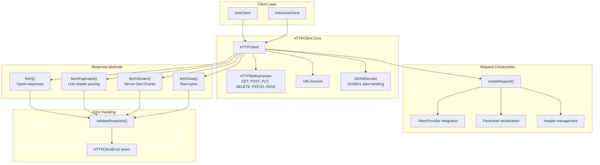
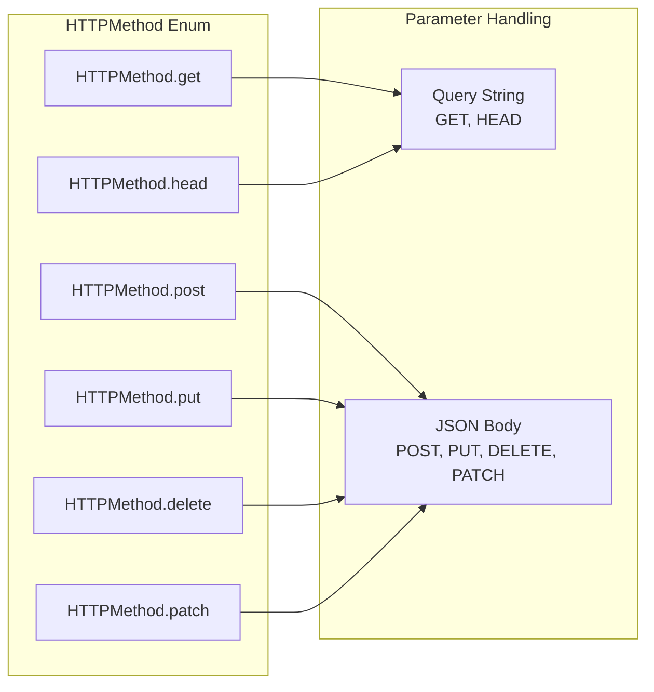
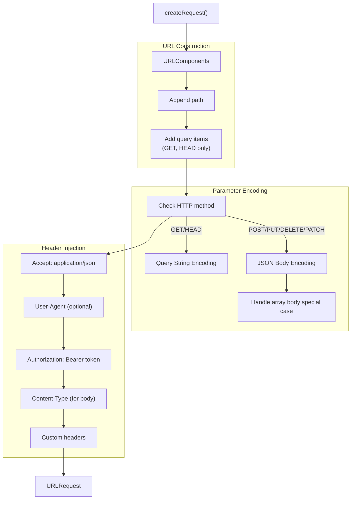
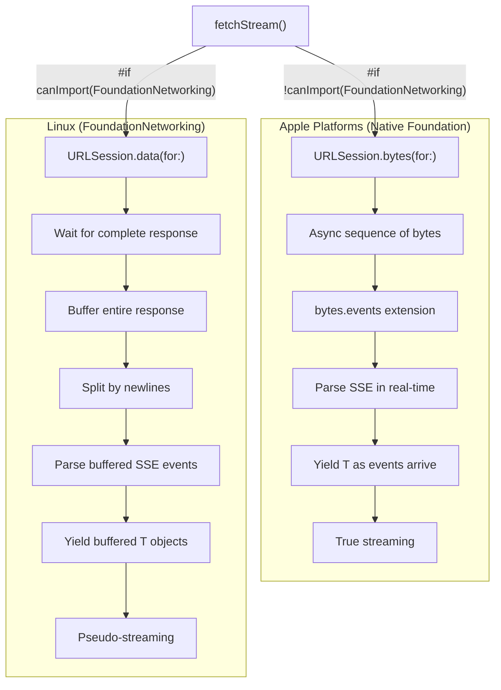
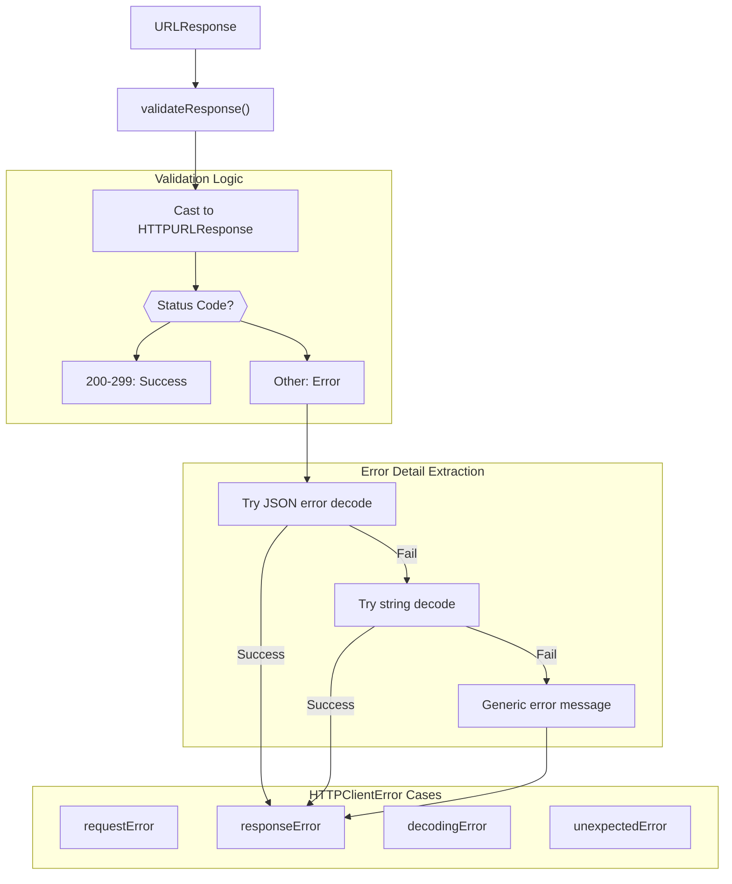

<!-- source: DeepWiki mcp.deepwiki.com · repo huggingface/swift-huggingface · page 7.1 HTTPClient and Network Communication · fetched 2026-10-26 -->

# HTTPClient and Network Communication

<details>
<summary>Relevant source files</summary>

The following files were used as context for generating this wiki page:

- [Sources/HuggingFace/Hub/HubClient+Pagination.swift](Sources/HuggingFace/Hub/HubClient+Pagination.swift)
- [Sources/HuggingFace/Hub/Pagination.swift](Sources/HuggingFace/Hub/Pagination.swift)
- [Sources/HuggingFace/Shared/HTTPClient.swift](Sources/HuggingFace/Shared/HTTPClient.swift)
- [Sources/HuggingFace/Shared/TokenProvider.swift](Sources/HuggingFace/Shared/TokenProvider.swift)
- [Tests/HuggingFaceTests/HubTests/PaginationTests.swift](Tests/HuggingFaceTests/HubTests/PaginationTests.swift)

</details>


## Purpose and Scope

This document describes the `HTTPClient` class and the network communication layer that underpins all API interactions in the `swift-huggingface` SDK. The `HTTPClient` provides a unified interface for making HTTP requests to Hugging Face APIs, handling authentication, parameter serialization, response parsing, and error handling.

For information about authentication and token management, see [5.1. TokenProvider Strategies](). For details on error handling patterns and debugging, see [7.2. Error Handling](). For platform-specific behaviors and async/await polyfills, see [7.3. Platform Differences (Apple vs Linux)]().

---

## HTTPClient Architecture

The `HTTPClient` class serves as the foundation for all network operations in the SDK. Both `HubClient` and `InferenceClient` depend on `HTTPClient` to communicate with Hugging Face services.

Title: HTTPClient Integration in the SDK Architecture


Sources: [Sources/HuggingFace/Shared/HTTPClient.swift:8-16](), [Sources/HuggingFace/Shared/HTTPClient.swift:19-60](), [Sources/HuggingFace/Shared/HTTPClient.swift:68-151]()

---

## HTTPClient Class Structure

The `HTTPClient` class is defined as `final` and `@unchecked Sendable`, making it thread-safe for concurrent operations across the SDK.

### Core Properties

| Property | Type | Purpose |
|----------|------|---------|
| `host` | `URL` | Base URL for all API requests (e.g., `https://huggingface.co/`) |
| `userAgent` | `String?` | Optional User-Agent header value for request identification |
| `tokenProvider` | `TokenProvider` | Authentication token provider (see [5.1. TokenProvider Strategies]()) |
| `session` | `URLSession` | Underlying URLSession for network operations |
| `jsonDecoder` | `JSONDecoder` | Shared JSON decoder with ISO8601 date parsing |

### Initialization

The initializer [Sources/HuggingFace/Shared/HTTPClient.swift:45-60]() ensures the `host` URL ends with a trailing slash for consistent path construction. By default, it uses the `.environment` token provider for automatic authentication detection [Sources/HuggingFace/Shared/HTTPClient.swift:48-49]().

Sources: [Sources/HuggingFace/Shared/HTTPClient.swift:19-60](), [Sources/HuggingFace/Shared/TokenProvider.swift:109-121]()

---

## HTTP Methods

The SDK supports six standard HTTP methods through the `HTTPMethod` enum [Sources/HuggingFace/Shared/HTTPClient.swift:8-16]():

Title: HTTP Method Routing and Parameter Serialization


The method determines how parameters are serialized: `GET` and `HEAD` use query strings, while `POST`, `PUT`, `DELETE`, and `PATCH` use JSON request bodies [Sources/HuggingFace/Shared/HTTPClient.swift:319-340]().

Sources: [Sources/HuggingFace/Shared/HTTPClient.swift:8-16](), [Sources/HuggingFace/Shared/HTTPClient.swift:319-340]()

---

## Request Construction

Request construction is handled by the `createRequest()` method [Sources/HuggingFace/Shared/HTTPClient.swift:287-373](), which builds `URLRequest` objects with proper authentication, headers, and parameter encoding.

Title: Request Construction Pipeline


### Parameter Serialization

Parameters are passed as `[String: Value]` dictionaries, where `Value` is an internal enum supporting strings, booleans, numbers, objects, and arrays.

**Query String Parameters (GET, HEAD)**:
Used for operations like listing models [Sources/HuggingFace/Hub/HubClient+Pagination.swift:47-56]().

**JSON Body Parameters (POST, PUT, DELETE, PATCH)**:
Used for chat completions or repository operations [Sources/HuggingFace/Shared/HTTPClient.swift:333-339]().

**Special Case - Top-Level Arrays**: When a single empty-string key is provided, the SDK sends a top-level JSON array instead of an object [Sources/HuggingFace/Shared/HTTPClient.swift:335-337]().

### Authentication Integration

The `createRequest()` method integrates with `TokenProvider` to inject authentication headers [Sources/HuggingFace/Shared/HTTPClient.swift:363-365]():

```swift
if let token = try await tokenProvider.getToken() {
    request.addValue("Bearer \(token)", forHTTPHeaderField: "Authorization")
}
```

Sources: [Sources/HuggingFace/Shared/HTTPClient.swift:287-373](), [Sources/HuggingFace/Shared/TokenProvider.swift:183-198]()

---

## Response Handling Methods

### fetch() - Standard Typed Responses

The primary method for retrieving typed data from APIs [Sources/HuggingFace/Shared/HTTPClient.swift:68-87]().

**Special Handling**: When `T` is `Bool`, the method returns `true` for successful responses without attempting to decode the body [Sources/HuggingFace/Shared/HTTPClient.swift:93-95](). This is used for endpoints that return empty success responses.

### fetchPaginated() - Link Header Support

Handles paginated responses that include `Link` headers following RFC 8288 [Sources/HuggingFace/Shared/HTTPClient.swift:110-144]().

The internal helper `parseNextPageURL(from:)` [Sources/HuggingFace/Hub/Pagination.swift:111-116]() parses the `Link` header to extract the next page URL.

Returns a `PaginatedResponse<T>` containing decoded items and the `nextURL` [Sources/HuggingFace/Hub/Pagination.swift:16-28]().

### fetchStream() - Server-Sent Events

Provides streaming responses for real-time data like chat completions [Sources/HuggingFace/Shared/HTTPClient.swift:146-172](). It returns an `AsyncThrowingStream` that yields decoded objects as they arrive.

Title: Platform-Specific Streaming Strategies


**Linux Implementation**: On Linux, `FoundationNetworking` lacks async streaming APIs, requiring a buffered approach where the response is parsed after completion [Sources/HuggingFace/Shared/HTTPClient.swift:183-205]().

Sources: [Sources/HuggingFace/Shared/HTTPClient.swift:146-205](), [Sources/HuggingFace/Hub/Pagination.swift:111-147]()

---

## Pagination and Lazy Sequences

The SDK provides a high-level `Pages<T>` async sequence [Sources/HuggingFace/Hub/Pagination.swift:50-101]() that fetches subsequent pages lazily.

### Next Page Resolution

Some endpoints return `next` URLs that omit original query filters. The `resolveNextPageURL(_:requestURL:)` function [Sources/HuggingFace/Hub/Pagination.swift:159-186]() resolves relative URLs and preserves missing query parameters from the current request URL.

The `HubClient` extension [Sources/HuggingFace/Hub/HubClient+Pagination.swift:9-15]() uses this to provide a `nextPage(after:)` method.

### Convenience Methods

`HubClient` provides convenience methods that return `Pages<T>` sequences for various resources:
- `listAllModels()` [Sources/HuggingFace/Hub/HubClient+Pagination.swift:37-60]()
- `listAllDatasets()` [Sources/HuggingFace/Hub/HubClient+Pagination.swift:78-101]()
- `listAllOrganizations()` [Sources/HuggingFace/Hub/HubClient+Pagination.swift:152-165]()

Sources: [Sources/HuggingFace/Hub/Pagination.swift:50-101](), [Sources/HuggingFace/Hub/Pagination.swift:159-186](), [Sources/HuggingFace/Hub/HubClient+Pagination.swift:9-165]()

---

## Response Validation and Error Handling

All response methods use `validateResponse()` [Sources/HuggingFace/Shared/HTTPClient.swift:375-424]() to check HTTP status codes and extract error details.

Title: Response Validation and Error Extraction Pipeline


The method attempts to decode a `ClientErrorResponse` [Sources/HuggingFace/Shared/HTTPClient.swift:62-64]() to provide specific error details in the `HTTPClientError.responseError` case [Sources/HuggingFace/Shared/HTTPClient.swift:401-404]().

Sources: [Sources/HuggingFace/Shared/HTTPClient.swift:62-64](), [Sources/HuggingFace/Shared/HTTPClient.swift:375-424]()

---

