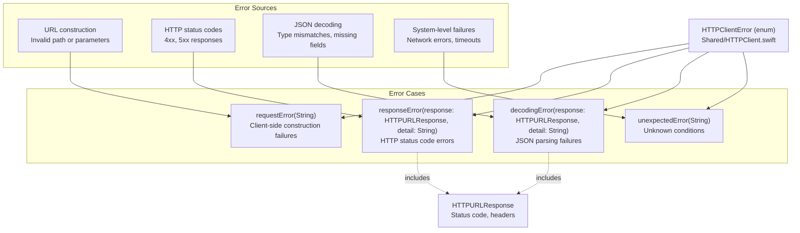
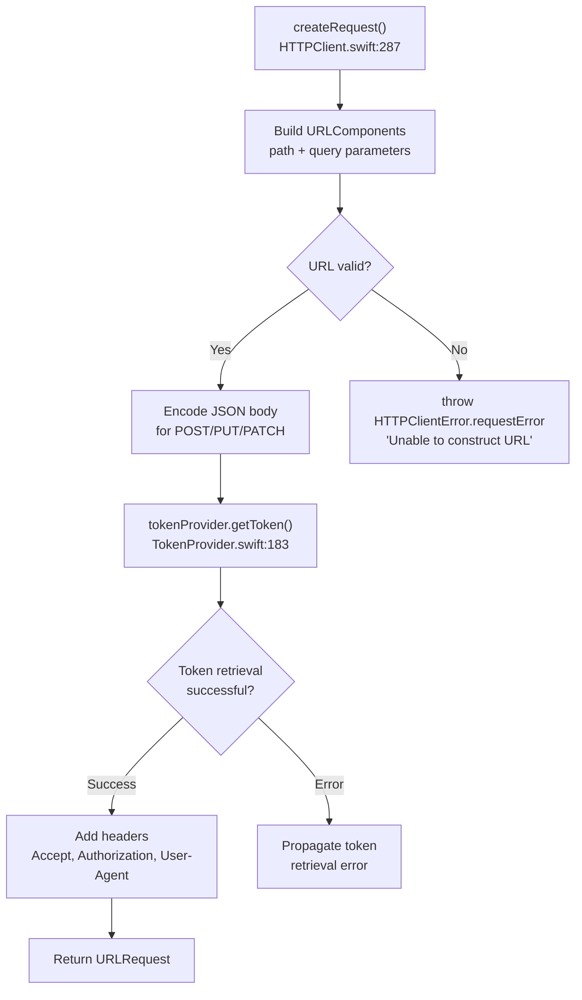
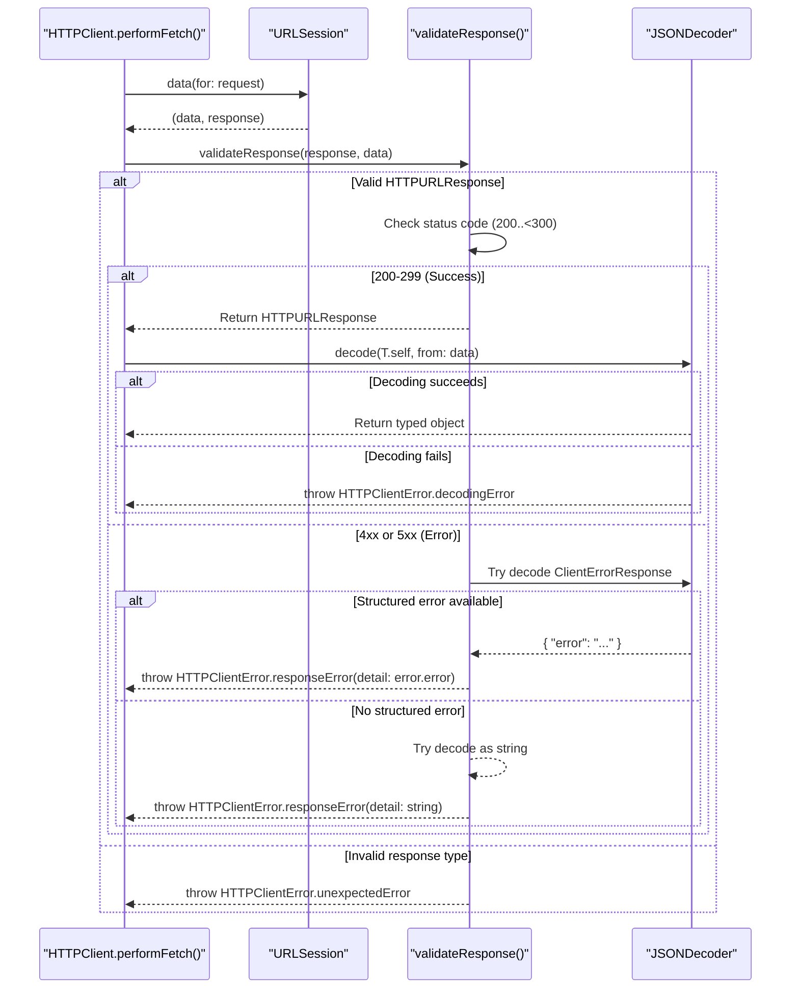

<!-- source: DeepWiki mcp.deepwiki.com · repo huggingface/swift-huggingface · page 7.2 Error Handling · fetched 2026-10-26 -->

# Error Handling

<details>
<summary>Relevant source files</summary>

The following files were used as context for generating this wiki page:

- [.gitignore](.gitignore)
- [.swift-format](.swift-format)
- [Sources/HuggingFace/Hub/File.swift](Sources/HuggingFace/Hub/File.swift)
- [Sources/HuggingFace/Shared/HTTPClient.swift](Sources/HuggingFace/Shared/HTTPClient.swift)
- [Sources/HuggingFace/Shared/MultipartBuilder.swift](Sources/HuggingFace/Shared/MultipartBuilder.swift)
- [Sources/HuggingFace/Shared/TokenProvider.swift](Sources/HuggingFace/Shared/TokenProvider.swift)
- [Tests/HuggingFaceTests/HubTests/HubClientTests.swift](Tests/HuggingFaceTests/HubTests/HubClientTests.swift)

</details>


This document describes the error handling architecture in the swift-huggingface SDK, including error types, error sources, response validation, and strategies for handling failures in API operations. For information about network communication mechanics, see [7.1 HTTPClient and Network Communication](). For authentication-specific errors, see [5.1 TokenProvider Strategies]().

## Overview

The SDK uses structured error types to provide detailed context when operations fail. All HTTP-based operations can throw `HTTPClientError`, which categorizes failures into four distinct types: request construction errors, HTTP response errors, JSON decoding errors, and unexpected errors. Error handling occurs at multiple layers: during request construction, response validation, and data decoding. The SDK also implements platform-specific error handling for streaming operations and provides graceful degradation where appropriate.

---

## Error Type Hierarchy

The SDK defines a comprehensive error enum that captures all failure scenarios in API communication.

**Natural Language to Code Entity Mapping: Error Types**



**Sources:** [Sources/HuggingFace/Shared/HTTPClient.swift:398-423]()

---

## HTTPClientError Definition

The `HTTPClientError` enum provides structured error information with associated data for debugging.

| Error Case | Associated Data | Description | Common Causes |
|------------|----------------|-------------|---------------|
| `requestError(String)` | Error message | Failure during request construction | Invalid URL components, malformed parameters |
| `responseError(response:detail:)` | `HTTPURLResponse`, error detail | HTTP error response from server | 401 Unauthorized, 404 Not Found, 429 Rate Limited, 500 Server Error |
| `decodingError(response:detail:)` | `HTTPURLResponse`, error detail | Failed to decode response JSON | Schema changes, unexpected null values, type mismatches |
| `unexpectedError(String)` | Error message | Unanticipated failure condition | Invalid URLResponse type, unknown system errors |

Each error case implements `CustomStringConvertible` to provide human-readable descriptions [Sources/HuggingFace/Shared/HTTPClient.swift:411-422]().

**Sources:** [Sources/HuggingFace/Shared/HTTPClient.swift:398-423]()

---

## Request Construction Errors

Errors can occur before any network communication happens, during the request building phase.

**Natural Language to Code Entity Mapping: Request Flow**



Common request construction failures include:

- **Invalid URL components**: Occurs when path contains invalid characters or URL assembly fails [Sources/HuggingFace/Shared/HTTPClient.swift:342-346]().
- **Token provider failures**: Authentication errors propagate from `TokenProvider.getToken()` [Sources/HuggingFace/Shared/HTTPClient.swift:356-358]().
- **JSON encoding failures**: Occurs if parameter dictionaries cannot be serialized into the request body [Sources/HuggingFace/Shared/HTTPClient.swift:330-338]().

**Sources:** [Sources/HuggingFace/Shared/HTTPClient.swift:287-373](), [Sources/HuggingFace/Shared/TokenProvider.swift:183-201]()

---

## Response Validation Flow

All HTTP responses pass through `validateResponse()` which inspects status codes and extracts error details.



The validation process extracts structured error messages using the internal `ClientErrorResponse` struct when available [Sources/HuggingFace/Shared/HTTPClient.swift:62-64]().

**Sources:** [Sources/HuggingFace/Shared/HTTPClient.swift:375-394](), [Sources/HuggingFace/Shared/HTTPClient.swift:62-64](), [Sources/HuggingFace/Shared/HTTPClient.swift:89-108]()

---

## Error Handling in Different Fetch Methods

The SDK provides multiple fetch methods with consistent error handling patterns.

### Standard Fetch Operations

In `performFetch`, if the expected type `T` is `Bool`, the client returns `true` upon a successful HTTP status validation [Sources/HuggingFace/Shared/HTTPClient.swift:93-95](). If the body is empty for other types, it throws a `responseError` [Sources/HuggingFace/Shared/HTTPClient.swift:96-97]().

### Paginated Fetch Operations

`fetchPaginated` follows the same validation pattern but specifically decodes arrays and parses the `Link` header for the next page URL [Sources/HuggingFace/Shared/HTTPClient.swift:134-137]().

### Streaming Error Handling

Streaming operations in `performFetchStream` handle errors differently based on the platform:

1. **Validation errors terminate the stream**: HTTP errors from `validateResponse()` prevent the stream from starting or finish it with an error [Sources/HuggingFace/Shared/HTTPClient.swift:214-223]().
2. **Chunk decoding errors are non-fatal**: Individual SSE events that fail to decode print warnings but allow the stream to continue [Sources/HuggingFace/Shared/HTTPClient.swift:240-244](), [Sources/HuggingFace/Shared/HTTPClient.swift:202-207]().
3. **Linux Implementation**: Since true streaming isn't available via `FoundationNetworking`, the client buffers the entire response first, validates it, and then parses events from the buffer [Sources/HuggingFace/Shared/HTTPClient.swift:184-191]().

**Sources:** [Sources/HuggingFace/Shared/HTTPClient.swift:110-144](), [Sources/HuggingFace/Shared/HTTPClient.swift:174-258]()

---

## Common Error Scenarios and HTTP Status Codes

The SDK encounters various HTTP status codes that map to specific error conditions.

| Status Code | Error Type | Common Scenarios | Recommended Handling |
|-------------|-----------|------------------|---------------------|
| 401 Unauthorized | `responseError` | Missing or invalid authentication token | Check `TokenProvider` configuration |
| 403 Forbidden | `responseError` | Insufficient permissions, gated resource | Request access via Hub UI |
| 404 Not Found | `responseError` | Repository or file does not exist | Verify `Repo.ID` and file paths |
| 429 Too Many Requests | `responseError` | Rate limit exceeded | Implement backoff/retry |
| 500+ Server Error | `responseError` | Server-side failures | Retry after delay |

**Sources:** [Sources/HuggingFace/Shared/HTTPClient.swift:380-391]()

---

## Error Handling Patterns

### Basic Error Catching

The simplest pattern catches and handles all errors:

```swift
do {
    let response = try await client.chatCompletion(...)
} catch {
    print("Error: \(error)")
}
```

### Structured Error Handling

Match on specific error cases to handle different failures:

```swift
do {
    let files = try await hubClient.listFiles(repo: repoID)
} catch HTTPClientError.responseError(let response, let detail) {
    if response.statusCode == 429 {
        // Handle rate limiting
    }
} catch HTTPClientError.decodingError(_, let detail) {
    // Handle JSON parsing errors
}
```

### Graceful Degradation with Composite Token Providers

The `TokenProvider.composite` strategy handles errors by trying multiple providers in order until one succeeds [Sources/HuggingFace/Shared/TokenProvider.swift:194-200]().

**Sources:** [Sources/HuggingFace/Shared/TokenProvider.swift:194-200]()

---

## Platform-Specific Error Considerations

### URLResponse Type Validation

The `validateResponse()` method checks that the response is an `HTTPURLResponse`. If not, it throws an `unexpectedError` [Sources/HuggingFace/Shared/HTTPClient.swift:376-378]().

### Multipart Upload Errors

When using `MultipartBuilder` for file uploads, specific errors like `createTempFileFailed` or `readInputStreamFailed` can occur during the construction of the request body [Sources/HuggingFace/Shared/MultipartBuilder.swift:193-210]().

**Sources:** [Sources/HuggingFace/Shared/HTTPClient.swift:376-378](), [Sources/HuggingFace/Shared/MultipartBuilder.swift:193-210]()

---

