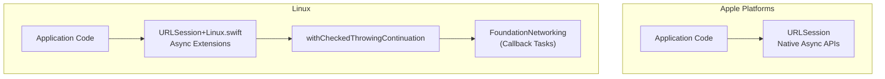
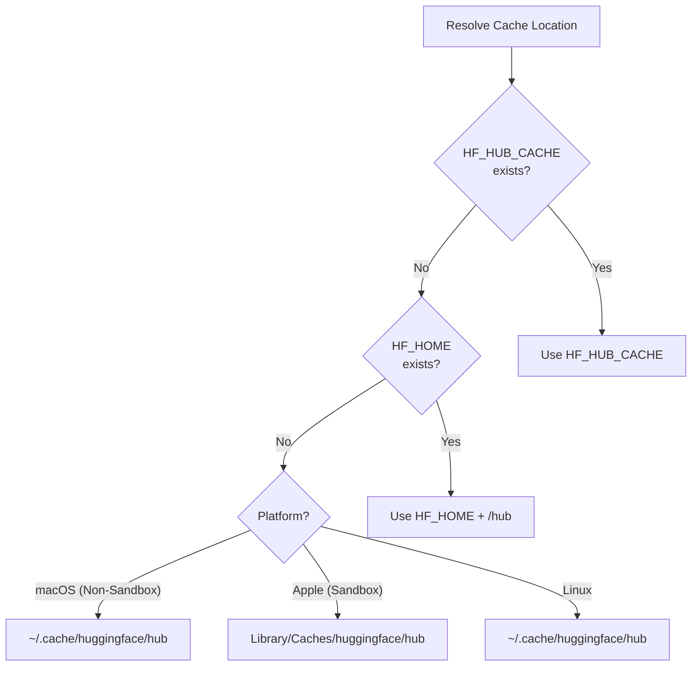

<!-- source: DeepWiki mcp.deepwiki.com · repo huggingface/swift-huggingface · page 7.3 Platform Differences (Apple vs Linux) · fetched 2026-10-26 -->

# Platform Differences (Apple vs Linux)

<details>
<summary>Relevant source files</summary>

The following files were used as context for generating this wiki page:

- [Sources/HuggingFace/Shared/CacheLocationProvider.swift](Sources/HuggingFace/Shared/CacheLocationProvider.swift)
- [Sources/HuggingFace/Shared/Extensions/Data+Extensions.swift](Sources/HuggingFace/Shared/Extensions/Data+Extensions.swift)
- [Sources/HuggingFace/Shared/Extensions/JSONDecoder+Extensions.swift](Sources/HuggingFace/Shared/Extensions/JSONDecoder+Extensions.swift)
- [Sources/HuggingFace/Shared/Extensions/URL+Extensions.swift](Sources/HuggingFace/Shared/Extensions/URL+Extensions.swift)
- [Sources/HuggingFace/Shared/Extensions/URLSession+Linux.swift](Sources/HuggingFace/Shared/Extensions/URLSession+Linux.swift)

</details>


This document describes how the `swift-huggingface` SDK handles platform-specific behavior between Apple platforms (macOS, iOS, tvOS, watchOS, visionOS) and Linux. The SDK uses conditional compilation to provide a consistent API while adapting to platform capabilities, specifically addressing the differences in `Foundation` and `FoundationNetworking`.

**Scope**: This page covers network communication differences, URLSession async polyfills, file system conventions, and implementation strategies for cross-platform compatibility.

---

## Conditional Compilation Strategy

The SDK uses Swift's conditional compilation directives to detect and adapt to platform capabilities. The presence of `FoundationNetworking` typically indicates a Linux environment, as this module provides networking APIs on non-Apple platforms.

```swift
#if canImport(FoundationNetworking)
    import FoundationNetworking
    // Linux-specific code path
#endif
```

Sources: [Sources/HuggingFace/Shared/URLSession+Linux.swift:3-4]()

---

## Network Communication Differences

### URLSession Async/Await Support

**Apple Platforms**: Native async/await APIs are available directly on `URLSession` (e.g., `data(for:)`, `upload(for:from:)`).

**Linux**: These async APIs are missing in `FoundationNetworking`. The SDK provides a compatibility shim in `URLSession+Linux.swift` that bridges callback-based APIs to Swift's concurrency model using `withCheckedThrowingContinuation`.

| Method | Apple Implementation | Linux Implementation (Polyfill) |
|--------|---------------------|-------------------------------|
| `data(for:)` | Native async API | Wrapped `dataTask(with:completionHandler:)` [Sources/HuggingFace/Shared/URLSession+Linux.swift:17-34]() |
| `upload(for:from:)` | Native async API | Wrapped `uploadTask(with:from:completionHandler:)` [Sources/HuggingFace/Shared/URLSession+Linux.swift:42-59]() |
| `upload(for:fromFile:)` | Native async API | Wrapped `uploadTask(with:fromFile:completionHandler:)` [Sources/HuggingFace/Shared/URLSession+Linux.swift:67-84]() |
| `asyncDownload(for:progress:)` | Native/Wrapper | Custom `LinuxDownloadDelegate` for progress [Sources/HuggingFace/Shared/URLSession+Linux.swift:92-133]() |
| `asyncBytes(for:)` | Native `bytes(for:)` | `LinuxAsyncBytes` (Buffered implementation) [Sources/HuggingFace/Shared/URLSession+Linux.swift:146-149]() |


**Diagram: URLSession API Abstraction Layers**

Sources: [Sources/HuggingFace/Shared/URLSession+Linux.swift:10-150]()

### Streaming Implementation (Linux Limitations)

On Linux, `URLSession` does not support true byte-streaming via `bytes(for:)`. The SDK provides `asyncBytes(for:)` as a shim, but with a critical technical limitation:

> "This implementation **buffers the entire response in memory** before streaming bytes. It is **not** true streaming and is **not suitable for large responses or long‑lived streams**." [Sources/HuggingFace/Shared/URLSession+Linux.swift:139-142]()

This means that for tasks like Chat Completion streaming, a Linux client will wait for the entire response to be received before the `LinuxAsyncBytes` wrapper begins yielding data.

---

## File System and Cache Conventions

### Cache Directory Resolution

The `CacheLocationProvider` handles platform-specific defaults to ensure compatibility with the Python `huggingface_hub` library.


**Diagram: Cache Resolution Logic (CacheLocationProvider.resolveFromEnvironment)**

Sources: [Sources/HuggingFace/Shared/CacheLocationProvider.swift:164-190](), [Sources/HuggingFace/Shared/CacheLocationProvider.swift:196-206]()

### Linux Compatibility Shims

Linux lacks some standard `Foundation` properties like `URL.cachesDirectory`. The SDK provides a compatibility extension for Linux that maps this to the user's standard cache directory using `FileManager`.

```swift
#if os(Linux)
    extension URL {
        static var cachesDirectory: URL {
            FileManager.default.urls(for: .cachesDirectory, in: .userDomainMask).first!
        }
    }
#endif
```
Sources: [Sources/HuggingFace/Shared/Extensions/URL+Extensions.swift:3-16]()

---

## Data Handling and Formatting

### Date Decoding
The SDK uses a custom `iso8601WithFractionalSeconds` strategy for `JSONDecoder`. This is important for cross-platform consistency because different backend services (or Python vs Swift implementations) might include or omit fractional seconds in timestamps.

1. Attempt ISO8601 with fractional seconds.
2. Fallback to ISO8601 without fractional seconds.
3. Throw `dataCorruptedError` if both fail.

Sources: [Sources/HuggingFace/Shared/Extensions/JSONDecoder+Extensions.swift:13-38]()

### Data URL Parsing
The SDK provides a robust `Data` extension using `RegexBuilder` to parse and encode RFC 2397 Data URLs. This utility is platform-agnostic but critical for handling vision model inputs (images as base64 strings) across both Apple and Linux environments.

- `isDataURL(string:)`: Validates the schema. [Sources/HuggingFace/Shared/Extensions/Data+Extensions.swift:33-35]()
- `parseDataURL(_:)`: Extracts MIME type and decodes Base64 or percent-encoded data. [Sources/HuggingFace/Shared/Extensions/Data+Extensions.swift:42-73]()
- `dataURLEncoded(mimeType:)`: Converts raw `Data` into a string suitable for API requests. [Sources/HuggingFace/Shared/Extensions/Data+Extensions.swift:80-83]()

---

## Summary of Platform Behavior

| Feature | Apple Platforms | Linux |
| :--- | :--- | :--- |
| **Networking** | Native `URLSession` async APIs | Polyfills via `withCheckedThrowingContinuation` |
| **Streaming** | True byte-streaming (low memory) | **Buffered** (entire response in memory) |
| **Cache Root** | `Library/Caches` (Sandbox) or `~/.cache` | `~/.cache` (XDG standard) |
| **OAuth Support** | Available via `AuthenticationServices` | **Unavailable** (requires alternative tokens) |
| **URL Extensions** | Native `URL.cachesDirectory` | Extension via `FileManager.urls` |

Sources: [Sources/HuggingFace/Shared/URLSession+Linux.swift:1-150](), [Sources/HuggingFace/Shared/CacheLocationProvider.swift:196-206](), [Sources/HuggingFace/Shared/Extensions/URL+Extensions.swift:1-16]()

---

