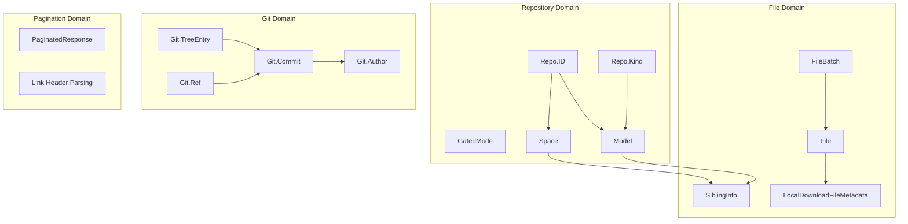
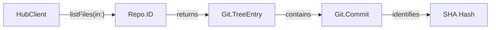
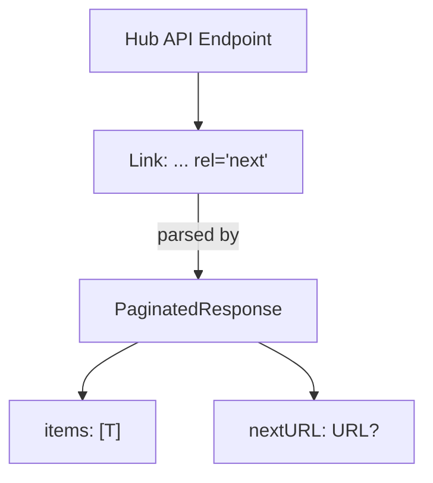

<!-- source: DeepWiki mcp.deepwiki.com · repo huggingface/swift-huggingface · page 8 Data Structures and Types · fetched 2026-10-26 -->

# Data Structures and Types

Relevant source files

The following files were used as context for generating this wiki page:

- [Sources/HuggingFace/Hub/Model.swift](Sources/HuggingFace/Hub/Model.swift)
- [Sources/HuggingFace/Hub/Repo.swift](Sources/HuggingFace/Hub/Repo.swift)
- [Sources/HuggingFace/Hub/Space.swift](Sources/HuggingFace/Hub/Space.swift)

This page documents the key data structures and types used throughout the swift-huggingface SDK. These types represent API responses, request payloads, and domain entities for repository management, file operations, Git operations, and inference tasks.

For details on specific domains, see the following child pages:
- [Repository Types (Repo.ID, Repo.Kind)](#8.1) — Understanding repository identifiers and types.
- [File Structures (File, FileBatch, LocalDownloadFileMetadata)](#8.2) — File-related data structures for metadata, batch operations, and local storage.
- [Git Structures (TreeEntry, Ref, Commit)](#8.3) — Git-related data structures for repository navigation and history.
- [Chat Completion Types (Message, Response, ToolCall)](#8.4) — Data structures for chat completion requests and responses.
- [Pagination and Common Patterns](#8.5) — PaginatedResponse, Link header parsing, and common API patterns.

---

## Overview of Type System

The SDK uses strongly-typed Swift structures to provide compile-time safety and clear API contracts. All public types conform to `Codable` for JSON serialization and `Sendable` for safe concurrency across async boundaries.

### Type Organization by Domain

Sources: [Sources/HuggingFace/Hub/Repo.swift:4-189](), [Sources/HuggingFace/Hub/Model.swift:4-121](), [Sources/HuggingFace/Hub/Space.swift:4-206](), [Sources/HuggingFace/Hub/File.swift:1-163]()

---

## Repository and Metadata Structures

The SDK defines structures for the primary entities on the Hugging Face Hub: Models, Datasets, and Spaces. These structures encapsulate metadata such as identifiers, visibility, and resource usage.

### Repository Identity (Repo.ID)
Repositories are identified by a `Repo.ID`, which consists of a `namespace` (user or organization) and a `name` [Sources/HuggingFace/Hub/Repo.swift:8-24](). It supports a raw string representation in the format `"namespace/name"` [Sources/HuggingFace/Hub/Repo.swift:193-213]().

### Core Entities
- **Model**: Contains information about library types (e.g., "transformers"), pipeline tags, download counts, and `SiblingInfo` for files within the repo [Sources/HuggingFace/Hub/Model.swift:4-121]().
- **Space**: Includes runtime information (stage, hardware tier), SDK types (Gradio, Streamlit), and streaming log/metric structures [Sources/HuggingFace/Hub/Space.swift:4-206]().
- **GatedMode**: An enum representing access control status: `.notGated`, `.auto`, or `.manual` [Sources/HuggingFace/Hub/Model.swift:126-135]().

For details, see [Repository Types (Repo.ID, Repo.Kind)](#8.1).

---

## File and Git Structures

File management and version control data structures bridge the gap between high-level Hub entities and the underlying Git-based storage.

### File Metadata and Batches
The SDK tracks file existence, size, and LFS status via the `File` struct [Sources/HuggingFace/Hub/File.swift:3-33](). For bulk operations, `FileBatch` allows grouping multiple file uploads [Sources/HuggingFace/Hub/File.swift:60-162]().

### Git Navigation
Repository contents are navigated using `Git.TreeEntry`, while versioning is handled through `Git.Ref` (branches/tags) and `Git.Commit` objects [Sources/HuggingFace/Hub/Repo.swift:1-190]().

For details, see [File Structures (File, FileBatch, LocalDownloadFileMetadata)](#8.2) and [Git Structures (TreeEntry, Ref, Commit)](#8.3).

---

## Inference and Chat Types

Data structures for the `InferenceClient` are designed to handle complex AI tasks, particularly LLM interactions.

- **Message**: Represents a single turn in a conversation with a specific `role` (user, assistant, system).
- **ToolCall**: Encapsulates model-generated requests to execute external functions.
- **Response**: The structured output from an inference task, supporting both standard and streaming formats.

For details, see [Chat Completion Types (Message, Response, ToolCall)](#8.4).

---

## Pagination and Common Patterns

Many Hub API endpoints return paginated data. The SDK standardizes this through `PaginatedResponse<T>`, which pairs a collection of items with a `nextURL` derived from RFC 8288 Link headers.

For details, see [Pagination and Common Patterns](#8.5).

Sources: [Sources/HuggingFace/Hub/Repo.swift:1-213](), [Sources/HuggingFace/Hub/Model.swift:4-176](), [Sources/HuggingFace/Hub/Space.swift:4-206](), [Sources/HuggingFace/Hub/File.swift:1-163]()

---

