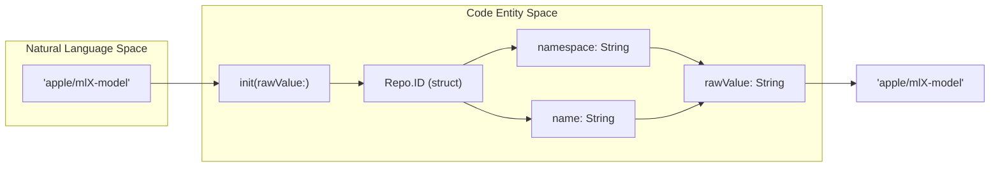
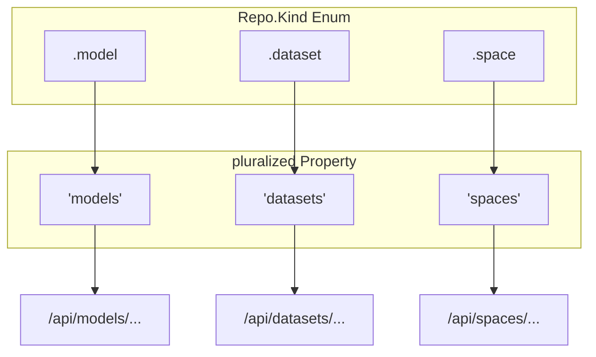

<!-- source: DeepWiki mcp.deepwiki.com · repo huggingface/swift-huggingface · page 8.1 Repository Types (Repo.ID, Repo.Kind) · fetched 2026-10-26 -->

# Repository Types (Repo.ID, Repo.Kind)

<details>
<summary>Relevant source files</summary>

The following files were used as context for generating this wiki page:

- [Sources/HuggingFace/Hub/Repo.swift](Sources/HuggingFace/Hub/Repo.swift)
- [Sources/HuggingFace/Hub/Space.swift](Sources/HuggingFace/Hub/Space.swift)
- [Tests/HuggingFaceTests/HubTests/RepoIDTests.swift](Tests/HuggingFaceTests/HubTests/RepoIDTests.swift)
- [Tests/HuggingFaceTests/HubTests/RepoTests.swift](Tests/HuggingFaceTests/HubTests/RepoTests.swift)

</details>


## Purpose and Scope

This document describes the core data structures used to identify and categorize repositories on the Hugging Face Hub: `Repo.ID` and `Repo.Kind`. These types provide type-safe representations of repository identifiers and enable the SDK to construct appropriate API endpoints for different resource types. 

For information about repository operations (listing, creating, downloading), see [Models, Datasets, and Spaces](). For file operations within repositories, see [File Operations](). For Git-related structures like refs and commits, see [Git Structures]().

---

## Repo.ID: Repository Identifiers

The `Repo.ID` type represents a unique identifier for a repository on the Hugging Face Hub. It encapsulates the repository's namespace (owner) and name, providing a consistent interface for referencing repositories across all API operations [Sources/HuggingFace/Hub/Repo.swift:8-24]().

### Implementation and Data Flow

`Repo.ID` is implemented as a struct containing `namespace` and `name` strings. It conforms to `RawRepresentable`, where the raw value is the string concatenation of the two components separated by a forward slash [Sources/HuggingFace/Hub/Repo.swift:193-213]().



**Sources:** [Sources/HuggingFace/Hub/Repo.swift:8-24](), [Sources/HuggingFace/Hub/Repo.swift:193-213]()

### String Literal Initialization

`Repo.ID` conforms to `ExpressibleByStringLiteral`, allowing direct initialization from string literals [Sources/HuggingFace/Hub/Repo.swift:226-241](). This is frequently used in tests and client code to simplify repository referencing [Tests/HuggingFaceTests/HubTests/RepoIDTests.swift:21-25]().

```swift
// Example of string literal initialization
let repoID: Repo.ID = "huggingface/transformers"
```

### Usage in API Calls

Repository IDs are used throughout the SDK as parameters to methods that operate on specific repositories. The client uses the `namespace` and `name` properties to build URL paths.

| Method Context | Example Usage | API Endpoint Pattern |
|---------------|---------------|---------------------|
| Repository Creation | `client.createRepo(kind: .model, name: "my-model")` | `/api/repos/create` |
| Settings Update | `client.updateRepoSettings(kind: .model, repoID, settings: ...)` | `/api/models/{namespace}/{name}/settings` |
| Space Metadata | `Space(id: "user/space-name", ...)` | N/A (Model property) |

**Sources:** [Sources/HuggingFace/Hub/Repo.swift:8-13](), [Tests/HuggingFaceTests/HubTests/RepoTests.swift:169-175](), [Sources/HuggingFace/Hub/Space.swift:4-6]()

---

## Repo.Kind: Repository Categories

The `Repo.Kind` enumeration categorizes repositories into three distinct types supported by the Hugging Face Hub: `model`, `dataset`, and `space` [Sources/HuggingFace/Hub/Repo.swift:27-35]().

### API Path Mapping

The `Repo.Kind` type includes a `pluralized` property used to construct standard API paths [Sources/HuggingFace/Hub/Repo.swift:38-47]().



**Sources:** [Sources/HuggingFace/Hub/Repo.swift:27-47]()

---

## Repository Settings and Configuration

### Repo.Settings

The `Repo.Settings` struct manages the configuration of a repository, including visibility and access control [Sources/HuggingFace/Hub/Repo.swift:87-131]().

*   **Visibility**: Managed via `Repo.Visibility`, which handles the mapping between Hub's boolean `private` field and a type-safe enum [Sources/HuggingFace/Hub/Repo.swift:55-84]().
*   **Gating**: Supports `GatedMode` for models requiring user agreement [Sources/HuggingFace/Hub/Repo.swift:97-98]().
*   **XET Storage**: A boolean flag for enabling XET storage [Sources/HuggingFace/Hub/Repo.swift:91-92]().

### SpaceConfiguration

For `.space` repositories, the SDK provides `Repo.SpaceConfiguration` to define the runtime environment [Sources/HuggingFace/Hub/Repo.swift:134-188]().

| Property | Type | Description |
|----------|------|-------------|
| `sdk` | `String` | The SDK used (e.g., "gradio", "streamlit", "docker") |
| `hardware` | `String?` | The requested hardware tier (e.g., "cpu-basic") |
| `secrets` | `[Entry]?` | Environment secrets for the Space |
| `sleepTime` | `Int?` | Timeout in seconds before the Space goes to sleep |

**Sources:** [Sources/HuggingFace/Hub/Repo.swift:134-188](), [Sources/HuggingFace/Hub/Space.swift:158-182]()

---

## Integration with Domain Models

Repository types are embedded in the high-level domain objects returned by the Hub API.

### The Space Model

The `Space` struct uses `Repo.ID` as its primary identifier and references `Repo.Visibility` for its access level [Sources/HuggingFace/Hub/Space.swift:4-18](). It also includes detailed runtime information such as CPU/GPU usage and hardware tiers [Sources/HuggingFace/Hub/Space.swift:95-130]().

### Repository Creation Flow

When creating a repository, the `HubClient` accepts a `Repo.Kind` and name, optionally accepting an organization namespace [Tests/HuggingFaceTests/HubTests/RepoTests.swift:134-138]().

```swift
// Creating a model under an organization
let result = try await client.createRepo(
    kind: .model,
    name: "org-model",
    organization: "myorg"
)
```

**Sources:** [Tests/HuggingFaceTests/HubTests/RepoTests.swift:134-138](), [Sources/HuggingFace/Hub/Space.swift:4-18]()

---

## Summary of Type Relationships

| Code Entity | Purpose | Key File |
|-------------|---------|----------|
| `Repo.ID` | Unique identifier (namespace/name) | [Sources/HuggingFace/Hub/Repo.swift]() |
| `Repo.Kind` | Categorization (model, dataset, space) | [Sources/HuggingFace/Hub/Repo.swift]() |
| `Repo.Visibility` | Public vs Private access control | [Sources/HuggingFace/Hub/Repo.swift]() |
| `Repo.Settings` | Repository configuration parameters | [Sources/HuggingFace/Hub/Repo.swift]() |
| `Space` | Metadata for a Space repository | [Sources/HuggingFace/Hub/Space.swift]() |

**Sources:** [Sources/HuggingFace/Hub/Repo.swift:4-189](), [Sources/HuggingFace/Hub/Space.swift:4-206]()

---

