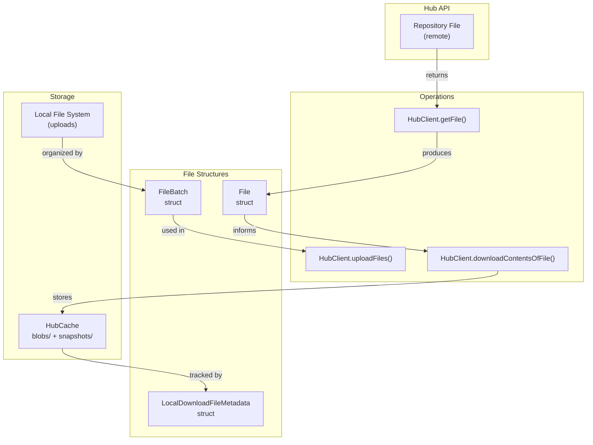
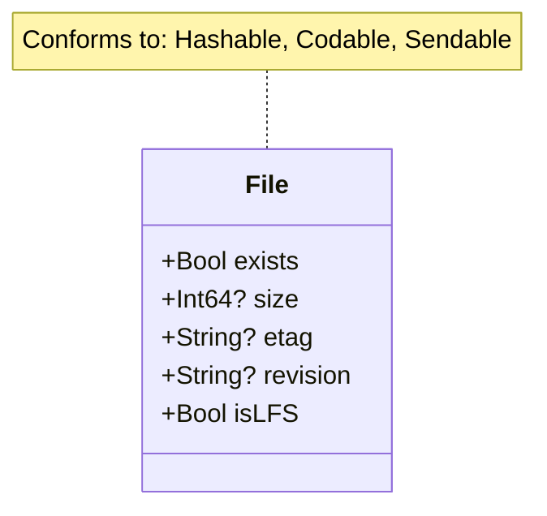
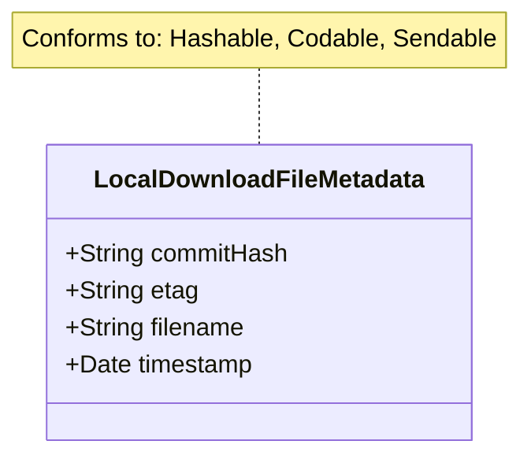
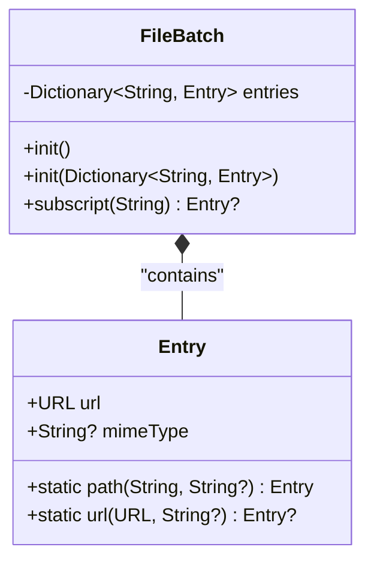
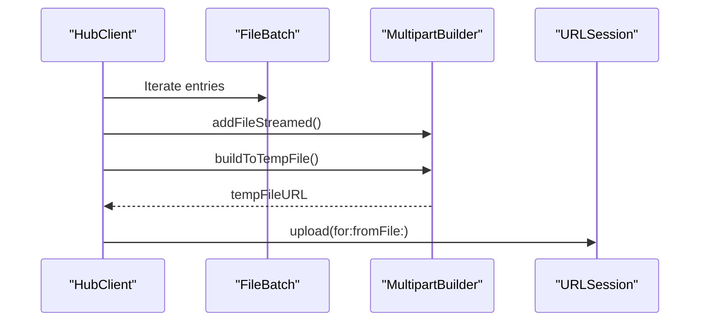

<!-- source: DeepWiki mcp.deepwiki.com · repo huggingface/swift-huggingface · page 8.2 File Structures (File, FileBatch, LocalDownloadFileMetadata) · fetched 2026-10-26 -->

# File Structures (File, FileBatch, LocalDownloadFileMetadata)

Relevant source files

The following files were used as context for generating this wiki page:

- [.gitignore](.gitignore)
- [.swift-format](.swift-format)
- [Sources/HuggingFace/Hub/File.swift](Sources/HuggingFace/Hub/File.swift)
- [Sources/HuggingFace/Hub/HubClient+Files.swift](Sources/HuggingFace/Hub/HubClient+Files.swift)
- [Sources/HuggingFace/Shared/MultipartBuilder.swift](Sources/HuggingFace/Shared/MultipartBuilder.swift)
- [Tests/HuggingFaceTests/HubTests/HubClientTests.swift](Tests/HuggingFaceTests/HubTests/HubClientTests.swift)

This document describes the core data structures used for representing and managing files in the swift-huggingface SDK. These structures serve three distinct purposes: retrieving file metadata from repositories (`File`), tracking locally cached files (`LocalDownloadFileMetadata`), and preparing batch file uploads (`FileBatch`).

---

## Overview of File Structures

The SDK defines three primary file-related structures, each serving a specific role in the file management lifecycle:

| Structure | Purpose | Primary Use Case |
|-----------|---------|------------------|
| `File` | Repository file metadata | Querying file information from Hub API |
| `LocalDownloadFileMetadata` | Local cache metadata | Tracking cached files and staleness detection |
| `FileBatch` | Upload batch preparation | Organizing multiple files for batch upload |

**Diagram: File Structure Relationships**

Title: File Structure Data Flow

Sources: [Sources/HuggingFace/Hub/File.swift:1-163](), [Sources/HuggingFace/Hub/HubClient+Files.swift:90-206]()

---

## File: Repository File Metadata

The `File` struct represents metadata about a file in a Hugging Face repository. It is returned by file information queries and contains data retrieved from Hub API responses.

### Structure Definition

Title: File Metadata Entity

**Field Descriptions**

| Field | Type | Description |
|-------|------|-------------|
| `exists` | `Bool` | Whether the file exists in the repository [Sources/HuggingFace/Hub/File.swift:6-6]() |
| `size` | `Int64?` | File size in bytes [Sources/HuggingFace/Hub/File.swift:9-9]() |
| `etag` | `String?` | Entity tag for caching and change detection [Sources/HuggingFace/Hub/File.swift:12-12]() |
| `revision` | `String?` | Git commit SHA at which metadata was retrieved [Sources/HuggingFace/Hub/File.swift:15-15]() |
| `isLFS` | `Bool` | Whether file is stored using Git Large File Storage [Sources/HuggingFace/Hub/File.swift:18-18]() |

Sources: [Sources/HuggingFace/Hub/File.swift:4-33]()

---

## LocalDownloadFileMetadata: Cache Tracking

The `LocalDownloadFileMetadata` struct tracks metadata for files stored in the local cache. It enables staleness detection and cache invalidation by comparing local metadata against remote file information.

### Structure Definition

Title: Local Metadata Entity

**Field Descriptions**

| Field | Type | Description |
|-------|------|-------------|
| `commitHash` | `String` | Commit hash of the file in the repository [Sources/HuggingFace/Hub/File.swift:40-40]() |
| `etag` | `String` | ETag for change detection (sha256 for LFS, git hash for regular files) [Sources/HuggingFace/Hub/File.swift:44-44]() |
| `filename` | `String` | Path of the file in the repository [Sources/HuggingFace/Hub/File.swift:47-47]() |
| `timestamp` | `Date` | When the metadata was saved (when download completed) [Sources/HuggingFace/Hub/File.swift:50-50]() |

Sources: [Sources/HuggingFace/Hub/File.swift:38-58]()

---

## FileBatch: Batch Upload Operations

The `FileBatch` struct organizes multiple files for batch upload operations. It provides a convenient API for preparing upload payloads with dictionary-like syntax.

### Structure Definition

Title: FileBatch and Entry Relationship

Sources: [Sources/HuggingFace/Hub/File.swift:77-139]()

### Entry Construction Methods

The `FileBatch.Entry` type provides two static factory methods:

| Method | Parameters | Returns | Description |
|--------|------------|---------|-------------|
| `.path()` | `path: String, mimeType: String?` | `Entry` | Creates entry from file system path [Sources/HuggingFace/Hub/File.swift:96-98]() |
| `.url()` | `url: URL, mimeType: String?` | `Entry?` | Creates entry from file URL (returns nil for non-file URLs) [Sources/HuggingFace/Hub/File.swift:107-112]() |

**URL Validation**: The `.url()` method only accepts file URLs (`file://...`) because upload operations require local file access. Remote URLs (http, https) are rejected by returning `nil` [Sources/HuggingFace/Hub/File.swift:108-110]().

### Integration with Upload Operations

The `HubClient` uses `MultipartBuilder` to process `FileBatch` entries. For large files (>= 10MB), it uses `MultipartBuilder.buildToTempFile()` to stream content from disk to avoid memory pressure [Sources/HuggingFace/Hub/HubClient+Files.swift:146-158]().

Title: Batch Upload Execution Flow

Sources: [Sources/HuggingFace/Hub/HubClient+Files.swift:151-161](), [Sources/HuggingFace/Shared/MultipartBuilder.swift:73-116]()

---

## Type Conformances

All file structures are designed for thread-safety and persistence:

- **Hashable**: Enables use as dictionary keys and in sets [Sources/HuggingFace/Hub/File.swift:4,38,77]().
- **Codable**: Supports JSON serialization for API communication and persistence [Sources/HuggingFace/Hub/File.swift:4,38,77]().
- **Sendable**: Guarantees thread-safe concurrent access across actor boundaries [Sources/HuggingFace/Hub/File.swift:4,38,77]().
- **Collection**: `FileBatch` conforms to `Swift.Collection` for easy iteration [Sources/HuggingFace/Hub/File.swift:143-154]().
- **ExpressibleByDictionaryLiteral**: `FileBatch` allows initialization using dictionary syntax [Sources/HuggingFace/Hub/File.swift:158-162]().

Sources: [Sources/HuggingFace/Hub/File.swift:4-162]()

---

