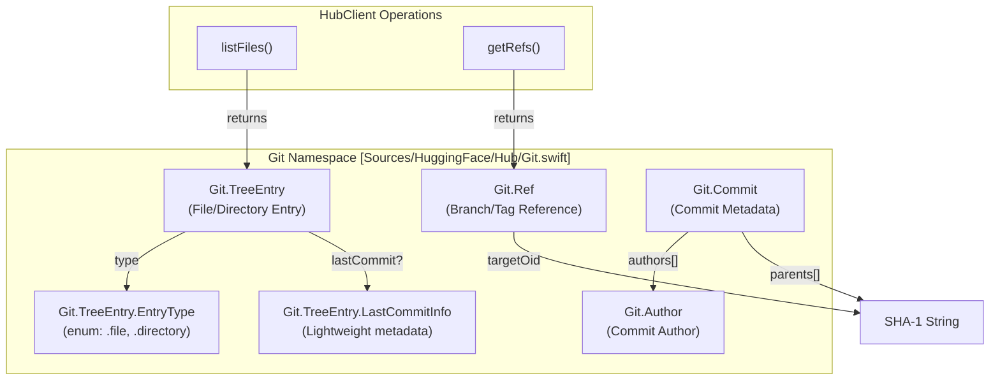
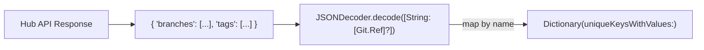

<!-- source: DeepWiki mcp.deepwiki.com · repo huggingface/swift-huggingface · page 8.3 Git Structures (TreeEntry, Ref, Commit) · fetched 2026-10-26 -->

# Git Structures (TreeEntry, Ref, Commit)

Relevant source files

The following files were used as context for generating this wiki page:

- [Sources/HuggingFace/Hub/Git.swift](Sources/HuggingFace/Hub/Git.swift)
- [Tests/HuggingFaceTests/HubTests/GatedModeTests.swift](Tests/HuggingFaceTests/HubTests/GatedModeTests.swift)
- [Tests/HuggingFaceTests/HubTests/GitTests.swift](Tests/HuggingFaceTests/HubTests/GitTests.swift)

## Purpose and Scope

This document describes the Git-related data structures used in the `swift-huggingface` SDK for representing repository metadata. These structures model Git concepts such as file trees, references (branches and tags), commits, and authors as returned by the Hugging Face Hub API.

For information about repository identifiers and types, see [Repository Types (Repo.ID, Repo.Kind)](#8.1). For file-related structures focused on downloads and uploads, see [File Structures (File, FileBatch, LocalDownloadFileMetadata)](#8.2).

## Overview

The Git structures are defined within the `Git` enum namespace [Sources/HuggingFace/Hub/Git.swift:4-4]() and represent the version control metadata associated with Hugging Face Hub repositories. These structures are primarily used when listing repository contents, viewing commit history, or navigating branches and tags.

### Code Entity Relationship Diagram

This diagram maps the natural language concepts of Git objects to their specific Swift implementations in the SDK.

**Relationships**: `Git.TreeEntry` represents individual files and directories in a repository tree [Sources/HuggingFace/Hub/Git.swift:6-46](). Each entry can optionally reference a `LastCommitInfo` object [Sources/HuggingFace/Hub/Git.swift:20-20](), indicating the most recent commit that modified that path. `Git.Ref` structures point to commits via `targetOid` [Sources/HuggingFace/Hub/Git.swift:57-57](), enabling branch and tag resolution. `Git.Commit` contains an array of `Git.Author` objects [Sources/HuggingFace/Hub/Git.swift:81-81]() and references to parent commits [Sources/HuggingFace/Hub/Git.swift:84-84]().

Sources: [Sources/HuggingFace/Hub/Git.swift:1-104](), [Tests/HuggingFaceTests/HubTests/GitTests.swift:1-189]()

## Git.TreeEntry

`Git.TreeEntry` represents an entry in a repository's file tree [Sources/HuggingFace/Hub/Git.swift:6-6]().

### Structure

| Property | Type | Description |
|----------|------|-------------|
| `path` | `String` | Relative path of the entry within the repository [Sources/HuggingFace/Hub/Git.swift:8-8]() |
| `type` | `EntryType` | Entry type: `.file` or `.directory` [Sources/HuggingFace/Hub/Git.swift:11-11]() |
| `oid` | `String?` | Object ID (hash) of the file content; `nil` for directories [Sources/HuggingFace/Hub/Git.swift:14-14]() |
| `size` | `Int?` | File size in bytes; `nil` for directories [Sources/HuggingFace/Hub/Git.swift:17-17]() |
| `lastCommit` | `LastCommitInfo?` | Reference to the last commit that modified this entry [Sources/HuggingFace/Hub/Git.swift:20-20]() |

### EntryType Enum

The `type` property uses the `Git.TreeEntry.EntryType` enumeration to distinguish between files and directories [Sources/HuggingFace/Hub/Git.swift:23-33](). Files have an `oid` (content hash) and `size`, while directories typically have these properties set to `nil` in the API response [Tests/HuggingFaceTests/HubTests/GitTests.swift:42-63]().

### LastCommitInfo

A specialized structure containing minimal metadata about the most recent change to a tree entry [Sources/HuggingFace/Hub/Git.swift:36-45]():
- `id`: The commit SHA [Sources/HuggingFace/Hub/Git.swift:38-38]()
- `title`: The first line of the commit message [Sources/HuggingFace/Hub/Git.swift:41-41]()
- `date`: The timestamp of the change [Sources/HuggingFace/Hub/Git.swift:44-44]()

Sources: [Sources/HuggingFace/Hub/Git.swift:6-46](), [Tests/HuggingFaceTests/HubTests/GitTests.swift:11-63]()

## Git.Ref

`Git.Ref` represents a Git reference, such as a branch or tag, pointing to a specific commit [Sources/HuggingFace/Hub/Git.swift:49-49]().

### Structure

| Property | Type | Description |
|----------|------|-------------|
| `name` | `String` | Short name of the reference (e.g., "main", "v1.0.0") [Sources/HuggingFace/Hub/Git.swift:51-51]() |
| `ref` | `String` | Full reference path (e.g., "refs/heads/main") [Sources/HuggingFace/Hub/Git.swift:54-54]() |
| `targetOid` | `String?` | Object ID of the commit this reference points to [Sources/HuggingFace/Hub/Git.swift:57-57]() |

### Data Flow: API to Ref Dictionary

Refs are typically returned as grouped arrays (branches and tags) from the Hub API. The SDK decodes these into a dictionary for efficient lookup [Tests/HuggingFaceTests/HubTests/GitTests.swift:83-125]().

Sources: [Sources/HuggingFace/Hub/Git.swift:49-64](), [Tests/HuggingFaceTests/HubTests/GitTests.swift:65-125]()

## Git.Commit and Git.Author

`Git.Commit` represents a full commit in a repository's history [Sources/HuggingFace/Hub/Git.swift:67-67](), while `Git.Author` represents the contributor [Sources/HuggingFace/Hub/Git.swift:88-88]().

### Git.Commit Structure

| Property | Type | Description |
|----------|------|-------------|
| `id` | `String` | Commit hash (SHA) [Sources/HuggingFace/Hub/Git.swift:69-69]() |
| `title` | `String` | First line of the commit message [Sources/HuggingFace/Hub/Git.swift:72-72]() |
| `message` | `String?` | Full commit message including title and body [Sources/HuggingFace/Hub/Git.swift:75-75]() |
| `date` | `Date` | Commit timestamp [Sources/HuggingFace/Hub/Git.swift:78-78]() |
| `authors` | `[Author]` | Array of commit authors [Sources/HuggingFace/Hub/Git.swift:81-81]() |
| `parents` | `[String]?` | Optional array of parent commit hashes [Sources/HuggingFace/Hub/Git.swift:84-84]() |

### Git.Author Structure

| Property | Type | Description |
|----------|------|-------------|
| `name` | `String` | Author's display name [Sources/HuggingFace/Hub/Git.swift:90-90]() |
| `email` | `String?` | Author's email address [Sources/HuggingFace/Hub/Git.swift:93-93]() |
| `time` | `Date?` | Authoring timestamp [Sources/HuggingFace/Hub/Git.swift:96-96]() |
| `user` | `String?` | Hugging Face username [Sources/HuggingFace/Hub/Git.swift:99-99]() |
| `avatarURL` | `String?` | URL to author's avatar image [Sources/HuggingFace/Hub/Git.swift:102-102]() |

### Commit Decoding and Dates

The SDK requires `JSONDecoder` to be configured with the `.iso8601WithFractionalSeconds` strategy to correctly parse the timestamps returned by the Hub API [Tests/HuggingFaceTests/HubTests/GitTests.swift:148-149]().

Sources: [Sources/HuggingFace/Hub/Git.swift:67-103](), [Tests/HuggingFaceTests/HubTests/GitTests.swift:127-188]()

## Gated Mode Metadata

While not strictly a Git object, the `GatedMode` enum is frequently encountered when interacting with repository metadata. It handles the different ways a repository can be protected [Tests/HuggingFaceTests/HubTests/GatedModeTests.swift:11-11]().

| Case | JSON Value | Description |
|------|------------|-------------|
| `.notGated` | `false` | Publicly accessible repository [Tests/HuggingFaceTests/HubTests/GatedModeTests.swift:16-19]() |
| `.auto` | `"auto"` or `true` | Access granted automatically upon request [Tests/HuggingFaceTests/HubTests/GatedModeTests.swift:21-24](), [Tests/HuggingFaceTests/HubTests/GatedModeTests.swift:41-42]() |
| `.manual` | `"manual"` | Access requires manual approval from owners [Tests/HuggingFaceTests/HubTests/GatedModeTests.swift:26-29]() |

Sources: [Tests/HuggingFaceTests/HubTests/GatedModeTests.swift:11-57]()

## Summary of API Mappings

| Structure | Common API Use Case | Nullable Fields |
|----------|---------------------|-----------------|
| `Git.TreeEntry` | Listing files in a branch/tag | `oid`, `size`, `lastCommit` (null for directories) |
| `Git.Ref` | Resolving `main` to a hash | `targetOid` (can be null if ref is invalid) |
| `Git.Commit` | Viewing history or super-squashing | `message`, `parents` (null for initial commit) |
| `Git.Author` | Identifying contributors | `email`, `user`, `avatarURL` |

Sources: [Sources/HuggingFace/Hub/Git.swift:1-104](), [Tests/HuggingFaceTests/HubTests/GitTests.swift:1-189]()

---

