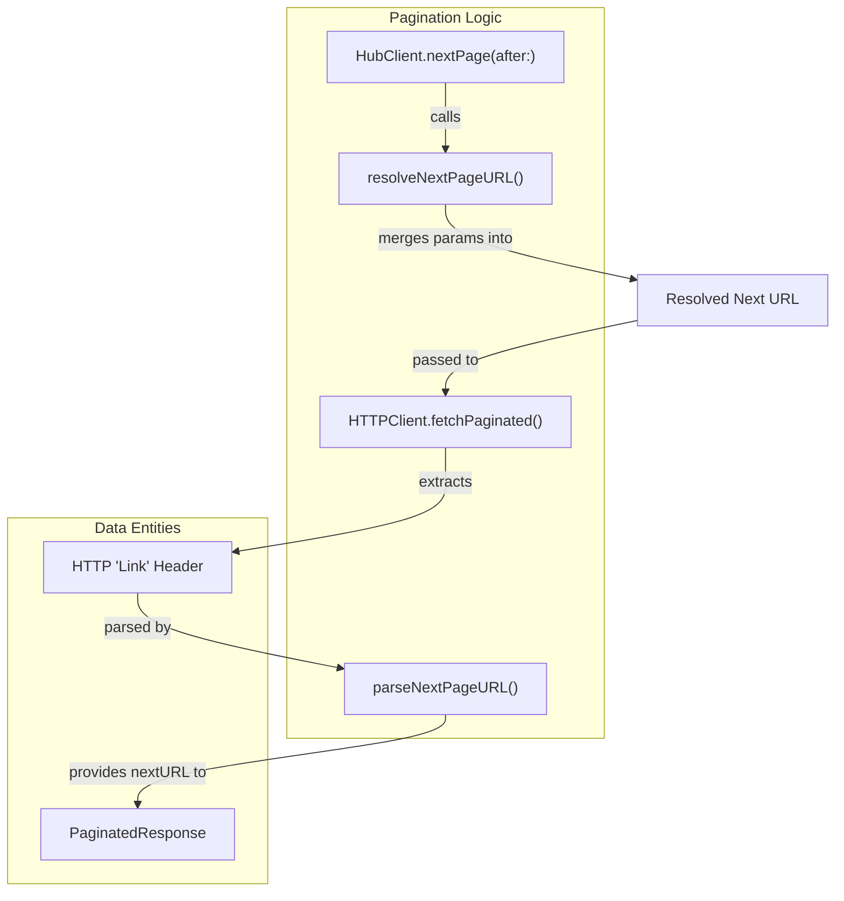
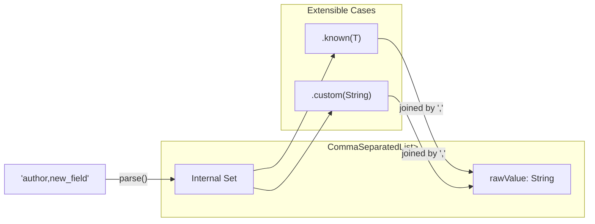

<!-- source: DeepWiki mcp.deepwiki.com · repo huggingface/swift-huggingface · page 8.5 Pagination and Common Patterns · fetched 2026-10-26 -->

# Pagination and Common Patterns

<details>
<summary>Relevant source files</summary>

The following files were used as context for generating this wiki page:

- [Sources/HuggingFace/Hub/CommaSeparatedList.swift](Sources/HuggingFace/Hub/CommaSeparatedList.swift)
- [Sources/HuggingFace/Hub/HubClient+Pagination.swift](Sources/HuggingFace/Hub/HubClient+Pagination.swift)
- [Sources/HuggingFace/Hub/Pagination.swift](Sources/HuggingFace/Hub/Pagination.swift)
- [Sources/HuggingFace/Shared/Value.swift](Sources/HuggingFace/Shared/Value.swift)
- [Tests/HuggingFaceTests/HubTests/CommaSeparatedListTests.swift](Tests/HuggingFaceTests/HubTests/CommaSeparatedListTests.swift)
- [Tests/HuggingFaceTests/HubTests/PaginationTests.swift](Tests/HuggingFaceTests/HubTests/PaginationTests.swift)

</details>


## Purpose and Scope

This page documents the pagination infrastructure and common patterns used throughout the `swift-huggingface` SDK. It covers the `PaginatedResponse` type for handling multi-page API results, the `Pages` async sequence for lazy iteration, and specialized collection types like `CommaSeparatedList`. These patterns ensure consistent behavior across the `HubClient` and `InferenceClient` when dealing with large datasets or complex query parameters.

## PaginatedResponse Structure

The `PaginatedResponse<T>` type encapsulates paginated API results with metadata for navigating to subsequent pages. [Sources/HuggingFace/Hub/Pagination.swift:16-40]().

| Property | Type | Description |
|----------|------|-------------|
| `items` | `[T]` | The array of items returned in the current page. [Sources/HuggingFace/Hub/Pagination.swift:18](). |
| `nextURL` | `URL?` | The URL for fetching the next page, parsed from the `Link` header. [Sources/HuggingFace/Hub/Pagination.swift:21](). |
| `requestURL` | `URL?` | The original request URL, used to resolve relative links and preserve query parameters. [Sources/HuggingFace/Hub/Pagination.swift:27](). |


**Sources:** [Sources/HuggingFace/Hub/Pagination.swift:16-40](), [Sources/HuggingFace/Hub/HubClient+Pagination.swift:9-15](), [Sources/HuggingFace/Hub/Pagination.swift:159-186]()

## Link Header Parsing and Resolution

The SDK implements RFC 8288 Link header parsing to extract navigation URLs. The `parseNextPageURL` function identifies segments where `rel="next"` or `rel='next'` is present. [Sources/HuggingFace/Hub/Pagination.swift:122-147]().

### URL Resolution Pattern
Some Hugging Face API endpoints return `next` URLs that are relative or omit original query filters. The `resolveNextPageURL` function performs two critical tasks:
1.  **Relative Resolution**: Converts relative paths into absolute URLs using the `requestURL` as a base. [Sources/HuggingFace/Hub/Pagination.swift:162-168]().
2.  **Parameter Preservation**: Merges query parameters from the original request into the next URL if they are missing (e.g., search filters, sort directions). [Sources/HuggingFace/Hub/Pagination.swift:177-185]().

**Sources:** [Sources/HuggingFace/Hub/Pagination.swift:105-186](), [Tests/HuggingFaceTests/HubTests/PaginationTests.swift:34-186]()

## Async Sequence Pattern: Pages

For high-level consumption, the SDK provides `Pages<T>`, an `AsyncSequence` that yields one `PaginatedResponse` at a time. [Sources/HuggingFace/Hub/Pagination.swift:50-101]().

### Lazy Iteration
The `Pages` iterator only requests the next page when the consumer advances the iteration (e.g., in a `for try await` loop). [Sources/HuggingFace/Hub/Pagination.swift:87-99](). This prevents unnecessary network traffic if only the first few items are needed.

```swift
// Example: Consuming models page by page
let modelPages = try await hubClient.listAllModels(search: "bert")
for try await page in modelPages {
    print("Fetched \(page.items.count) models")
    if someCondition { break } // Remaining pages are never requested
}
```
**Sources:** [Sources/HuggingFace/Hub/Pagination.swift:50-101](), [Sources/HuggingFace/Hub/HubClient+Pagination.swift:37-60]()

## CommaSeparatedList and Extensible Enums

The SDK uses a specialized `CommaSeparatedList<Value>` structure to handle API parameters that accept multiple values joined by commas (e.g., `expand` fields or `tags`). [Sources/HuggingFace/Hub/CommaSeparatedList.swift:44-70]().

### Extensible Enums
To maintain forward compatibility with the Hugging Face Hub API, the SDK uses the `Extensible<Value>` enum. [Sources/HuggingFace/Hub/CommaSeparatedList.swift:4-10](). This allows the SDK to represent:
*   **Known Values**: Standard enum cases defined in the SDK.
*   **Custom Values**: New API features or experimental fields that are not yet explicitly typed in the SDK.



### SetAlgebra Support
`CommaSeparatedList` conforms to `SetAlgebra`, allowing developers to use standard set operations like `union`, `intersection`, and `insert` to manipulate query parameters. [Sources/HuggingFace/Hub/CommaSeparatedList.swift:74-117]().

**Sources:** [Sources/HuggingFace/Hub/CommaSeparatedList.swift:37-193](), [Tests/HuggingFaceTests/HubTests/CommaSeparatedListTests.swift:8-93]()

## Common API Parameter Patterns

### Sort Direction
Sorting is standardized using the `SortDirection` enum, which maps to integer values required by the Hub API:
*   `.ascending`: `1`
*   `.descending`: `-1`

**Sources:** [Sources/HuggingFace/Hub/Pagination.swift:7-13]()

### Value Enum for Polymorphic Parameters
The `Value` enum provides a type-safe way to encode various JSON types (String, Int, Bool, Array, Object) into request parameters or bodies. [Sources/HuggingFace/Shared/Value.swift:6-14](). It includes convenience initializers for `Codable` types and literal support. [Sources/HuggingFace/Shared/Value.swift:16-26](), [Sources/HuggingFace/Shared/Value.swift:172-228]().

**Sources:** [Sources/HuggingFace/Shared/Value.swift:6-235]()

---

