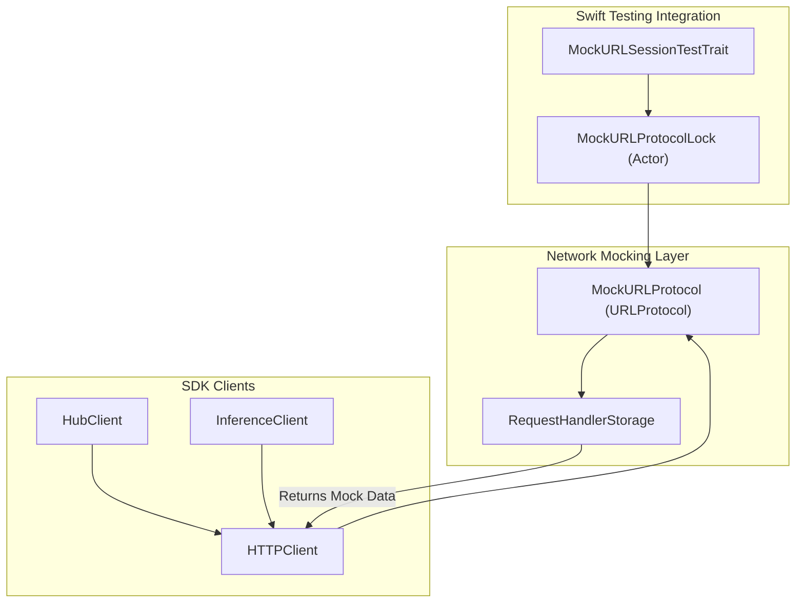
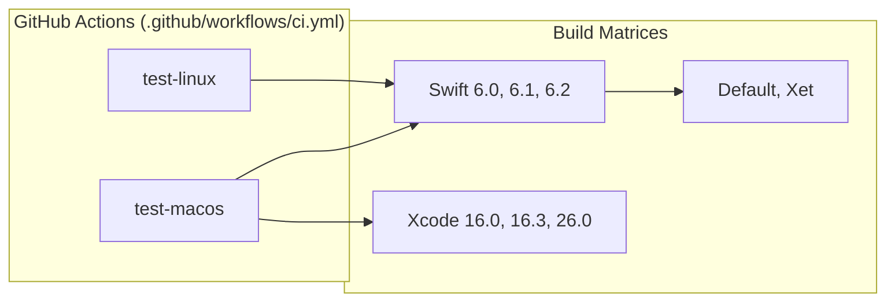

<!-- source: DeepWiki mcp.deepwiki.com · repo huggingface/swift-huggingface · page 9 Testing and Development · fetched 2026-10-26 -->

# Testing and Development

Relevant source files

The following files were used as context for generating this wiki page:

- [.github/workflows/ci.yml](.github/workflows/ci.yml)
- [Sources/HuggingFace/OAuth/OAuthClient.swift](Sources/HuggingFace/OAuth/OAuthClient.swift)
- [Tests/HuggingFaceTests/Helpers/MockURLProtocol.swift](Tests/HuggingFaceTests/Helpers/MockURLProtocol.swift)

This page provides a high-level guide to the testing infrastructure and development workflow of the `swift-huggingface` SDK. It covers the test framework, mock utilities, patterns for writing tests, and the CI/CD pipeline.

For detailed information on specific testing components, see:
- [Test Infrastructure](#9.1) — Deep dive into `MockURLProtocol` implementation, thread-safe handler storage, and custom test traits.
- [CI/CD Pipeline](#9.2) — Understanding the GitHub Actions workflow, test matrices for macOS/Linux, and build configurations.
- [Contributing Guidelines](#9.3) — How to contribute to the SDK, code style, and development workflow.

---

## Test Framework

The `swift-huggingface` SDK utilizes the **Swift Testing** framework (not XCTest) for its test suites. This framework provides native async/await support and uses `TestTrait` to manage test environments.

**Key Framework Features:**
- `@Test` attribute for defining test cases [Tests/HuggingFaceTests/Helpers/MockURLProtocol.swift:173-174]().
- `@Suite` attribute for grouping related tests [Tests/HuggingFaceTests/OAuthTests/OAuthClientTests.swift:14]().
- **Custom Traits**: Use of `.mockURLSession` to automate setup and cleanup of network mocks [Tests/HuggingFaceTests/Helpers/MockURLProtocol.swift:197-199]().
- **Concurrency**: Native support for `actor` and `Sendable` types in tests [Tests/HuggingFaceTests/Helpers/MockURLProtocol.swift:13-15]().

**Sources:** [Tests/HuggingFaceTests/Helpers/MockURLProtocol.swift:1-201](), [Tests/HuggingFaceTests/OAuthTests/OAuthClientTests.swift:1-14]()

---

## Test Infrastructure Architecture

The testing system is designed to intercept network traffic at the `URLProtocol` level, allowing for deterministic testing of `HubClient` and `InferenceClient` without hitting live Hugging Face endpoints.

### Code Entity Mapping

**Sources:** [Tests/HuggingFaceTests/Helpers/MockURLProtocol.swift:13-195](), [Sources/HuggingFace/OAuth/OAuthClient.swift:15-29]()

---

## MockURLProtocol System

`MockURLProtocol` is the core utility for network testing. It provides a thread-safe way to register handlers that return `HTTPURLResponse` and `Data` for specific `URLRequest` objects.

### Core Components

| Component | Role | File Reference |
|-----------|------|----------------|
| `RequestHandlerStorage` | Thread-safe storage for closures using `NSLock`. | [Tests/HuggingFaceTests/Helpers/MockURLProtocol.swift:13-58]() |
| `MockURLProtocol` | `URLProtocol` subclass that executes stored handlers. | [Tests/HuggingFaceTests/Helpers/MockURLProtocol.swift:63-123]() |
| `MockURLProtocolLock` | An `actor` that serializes test execution to prevent race conditions. | [Tests/HuggingFaceTests/Helpers/MockURLProtocol.swift:132-170]() |
| `MockURLSessionTestTrait` | A `TestTrait` that manages the lock and clears handlers. | [Tests/HuggingFaceTests/Helpers/MockURLProtocol.swift:173-195]() |

**Sources:** [Tests/HuggingFaceTests/Helpers/MockURLProtocol.swift:13-201]()

---

## CI/CD Pipeline Overview

The project uses GitHub Actions to ensure code quality across multiple environments. The CI pipeline validates builds and runs tests on both macOS and Linux.

### CI/CD Workflow Entity Mapping

### Build Configurations
- **Swift Versions**: Coverage includes Swift 6.0 through 6.2 [ .github/workflows/ci.yml:19-35]().
- **Platforms**: Tests run on `macos-15`, `macos-26`, and `ubuntu-latest` (via Swift Docker containers) [.github/workflows/ci.yml:12-61]().
- **Traits**: The pipeline tests with and without the `Xet` trait [.github/workflows/ci.yml:30-75]().

**Sources:** [.github/workflows/ci.yml:1-86]()

---

## Development Workflow

Contributors should follow these high-level steps when extending the SDK:

1.  **Dependency Injection**: When creating new clients or managers, allow passing a custom `URLSession` to facilitate mocking [Sources/HuggingFace/OAuth/OAuthClient.swift:26-29]().
2.  **PKCE and Security**: Use the internal crypto utilities for authentication flows [Sources/HuggingFace/OAuth/OAuthClient.swift:67-82]().
3.  **Cross-Platform Support**: Ensure code remains compatible with `FoundationNetworking` for Linux support [.github/workflows/ci.yml:58-61]().

For detailed contribution steps, including code style and PR processes, see [Contributing Guidelines](#9.3).

**Sources:** [Sources/HuggingFace/OAuth/OAuthClient.swift:1-142](), [.github/workflows/ci.yml:1-86]()

---

