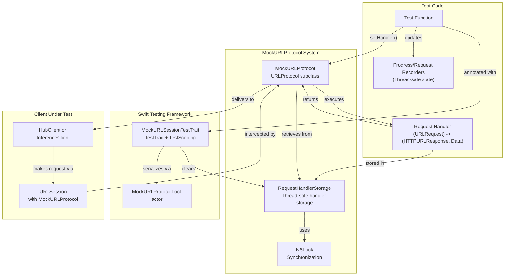
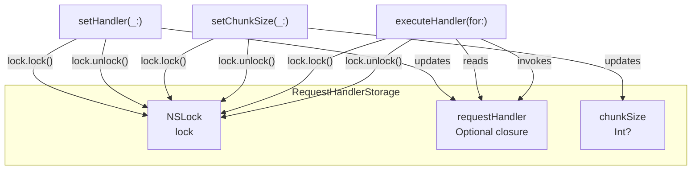
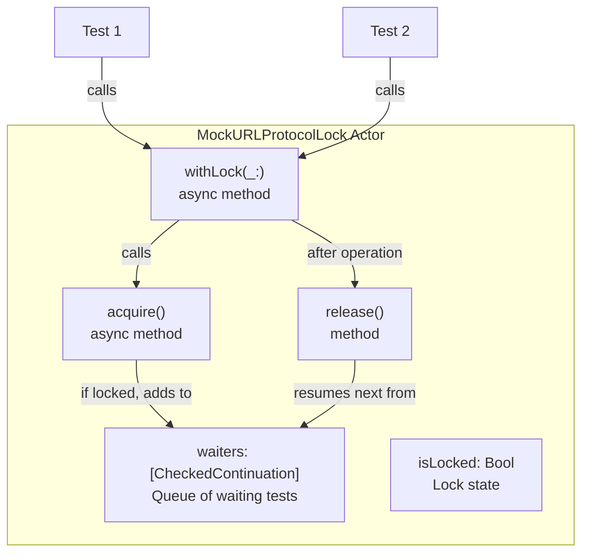
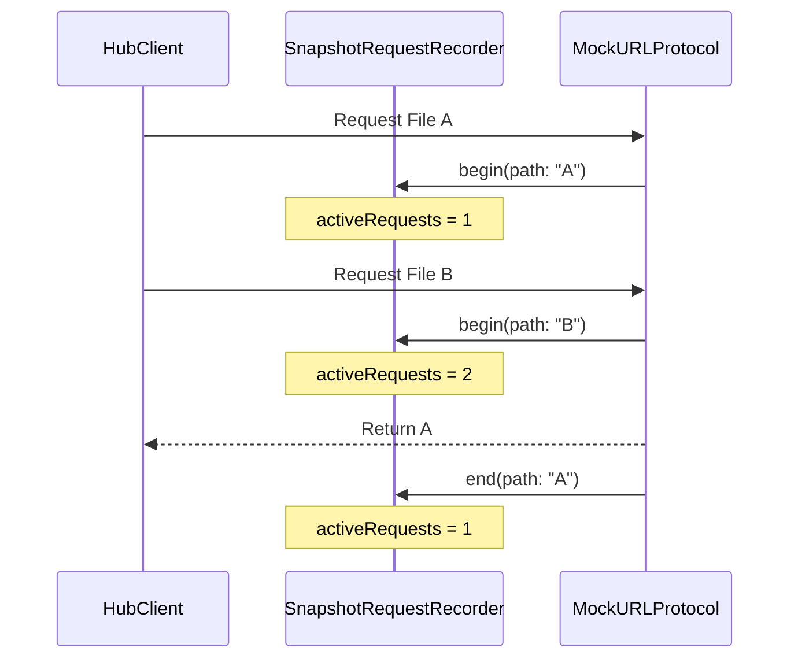

<!-- source: DeepWiki mcp.deepwiki.com · repo huggingface/swift-huggingface · page 9.1 Test Infrastructure · fetched 2026-10-26 -->

# Test Infrastructure

<details>
<summary>Relevant source files</summary>

The following files were used as context for generating this wiki page:

- [.gitignore](.gitignore)
- [.swift-format](.swift-format)
- [Sources/HuggingFace/Hub/File.swift](Sources/HuggingFace/Hub/File.swift)
- [Sources/HuggingFace/OAuth/OAuthClient.swift](Sources/HuggingFace/OAuth/OAuthClient.swift)
- [Sources/HuggingFace/Shared/MultipartBuilder.swift](Sources/HuggingFace/Shared/MultipartBuilder.swift)
- [Tests/HuggingFaceTests/Helpers/MockURLProtocol.swift](Tests/HuggingFaceTests/Helpers/MockURLProtocol.swift)
- [Tests/HuggingFaceTests/HubTests/FileOperationsTests.swift](Tests/HuggingFaceTests/HubTests/FileOperationsTests.swift)
- [Tests/HuggingFaceTests/HubTests/HubClientTests.swift](Tests/HuggingFaceTests/HubTests/HubClientTests.swift)

</details>


## Purpose and Scope

This document describes the test infrastructure used in the `swift-huggingface` codebase for testing network interactions and file operations. The infrastructure centers on `MockURLProtocol`, a custom `URLProtocol` subclass that intercepts HTTP requests during tests and returns predefined responses. This allows tests to verify client behavior, progress tracking, and concurrency without making actual network calls.

**Sources:** [Tests/HuggingFaceTests/Helpers/MockURLProtocol.swift:1-123](), [Tests/HuggingFaceTests/HubTests/FileOperationsTests.swift:156-168]()

---

## Architecture Overview

The test infrastructure consists of four main components: `MockURLProtocol` for intercepting requests, `RequestHandlerStorage` for thread-safe handler management, `MockURLSessionTestTrait` for test serialization, and various **Recorders** for verifying asynchronous side effects like progress updates.

### Test Infrastructure Component Architecture



**Sources:** [Tests/HuggingFaceTests/Helpers/MockURLProtocol.swift:13-195](), [Tests/HuggingFaceTests/HubTests/FileOperationsTests.swift:11-154]()

---

## MockURLProtocol

`MockURLProtocol` is the core testing utility that intercepts all HTTP requests made by clients during tests. It inherits from `URLProtocol` and implements the required protocol methods to handle request interception.

### Core Components

| Component | Type | Purpose |
|-----------|------|---------|
| `MockURLProtocol` | `URLProtocol` subclass | Intercepts and handles network requests |
| `RequestHandlerStorage` | `@unchecked Sendable` class | Thread-safe storage for request handlers and chunk settings |
| `setHandler(_:)` | Static method | Registers a handler for processing mock requests |
| `setChunkSize(_:)` | Static method | Configures simulated chunked delivery for progress testing |

**Sources:** [Tests/HuggingFaceTests/Helpers/MockURLProtocol.swift:63-77]()

### RequestHandlerStorage Implementation

The `RequestHandlerStorage` class provides thread-safe access to request handlers and simulation parameters using an `NSLock`.



**Sources:** [Tests/HuggingFaceTests/Helpers/MockURLProtocol.swift:13-58]()

---

## Test Recorders

To verify complex asynchronous behaviors like download progress or concurrent requests, the test suite utilizes specialized recorder classes. These are `@unchecked Sendable` and use `NSLock` to allow safe mutation across threads.

| Recorder | Purpose | Key Metric |
|----------|---------|------------|
| `ProgressCallCounter` | Counts how many times a progress closure is invoked | `count` |
| `ProgressValueRecorder` | Records the sequence of double values (0.0 to 1.0) received | `values` |
| `RequestRecorder` | Tracks GET requests and specific headers (e.g., Range) | `rangeHeaders` |
| `SnapshotRequestRecorder` | Tracks concurrent path downloads and progress timing | `maxConcurrentRequests` |
| `ProgressUnitRecorder` | Records `Progress` object state (completed/total units) | `lastCompleted` |

**Sources:** [Tests/HuggingFaceTests/HubTests/FileOperationsTests.swift:11-154]()

---

## Test Traits and Serialization

Swift 6.1+ introduces the `MockURLSessionTestTrait` which provides automatic setup and cleanup of mock handlers and serializes test execution.

### MockURLProtocolLock Actor

The `MockURLProtocolLock` actor provides mutual exclusion. This is necessary because `MockURLProtocol` uses a single global `RequestHandlerStorage` instance.



**Sources:** [Tests/HuggingFaceTests/Helpers/MockURLProtocol.swift:132-170]()

### MockURLSessionTestTrait Implementation

The `MockURLSessionTestTrait` struct implements `TestTrait` and `TestScoping` to manage the lifecycle:

| Phase | Action |
|-------|--------|
| **Before test** | Acquire `MockURLProtocolLock`, clear existing handlers, reset chunk size |
| **During test** | Execute the test function with exclusive access to the mock system |
| **After test** | Clear handlers and chunk size, release the lock |

**Sources:** [Tests/HuggingFaceTests/Helpers/MockURLProtocol.swift:173-195]()

---

## Writing Tests with MockURLProtocol

### Creating a Mock Client

Tests typically use helper functions to instantiate clients configured with `MockURLProtocol`.

```swift
func createMockClient(bearerToken: String? = "test_token") -> HubClient {
    let configuration = URLSessionConfiguration.ephemeral
    configuration.protocolClasses = [MockURLProtocol.self]
    let session = URLSession(configuration: configuration)
    return HubClient(
        session: session,
        host: URL(string: "https://huggingface.co")!,
        userAgent: "TestClient/1.0",
        bearerToken: bearerToken
    )
}
```

**Sources:** [Tests/HuggingFaceTests/HubTests/FileOperationsTests.swift:158-168]()

### Simulated Chunked Delivery

To test progress reporting, `MockURLProtocol` can simulate data being delivered in chunks. This is used to verify that the client correctly updates `Progress` objects or invokes progress closures multiple times.

```swift
// Configure the mock protocol to deliver data in 1KB chunks
MockURLProtocol.setChunkSize(1024)

await MockURLProtocol.setHandler { request in
    let data = Data(repeating: 0, count: 5000) // 5KB of data
    let response = HTTPURLResponse(url: request.url!, statusCode: 200, httpVersion: nil, headerFields: nil)!
    return (response, data)
}
```

On non-Linux platforms, `MockURLProtocol` will iterate through the data and call `urlProtocol(_:didLoad:)` for each chunk.

**Sources:** [Tests/HuggingFaceTests/Helpers/MockURLProtocol.swift:98-113]()

### Testing Concurrent Operations

The `SnapshotRequestRecorder` is used to verify that batch operations (like downloading a repository snapshot) respect concurrency limits.



**Sources:** [Tests/HuggingFaceTests/HubTests/FileOperationsTests.swift:71-121]()

---

## Platform Differences

The test infrastructure accounts for platform-specific behavior in `Foundation`:

| Feature | Apple Platforms | Linux (FoundationNetworking) |
|---------|-----------------|-----------------------------|
| **Chunked Delivery** | Supported via manual `didLoad` loop | Disabled (client is not stable with chunked delivery) |
| **Import** | `import Foundation` | `import FoundationNetworking` |
| **Concurrency** | Full `async/await` support | Uses `FoundationNetworking` compatibility layer |

**Sources:** [Tests/HuggingFaceTests/Helpers/MockURLProtocol.swift:4-6](), [Tests/HuggingFaceTests/Helpers/MockURLProtocol.swift:95-98]()

---

