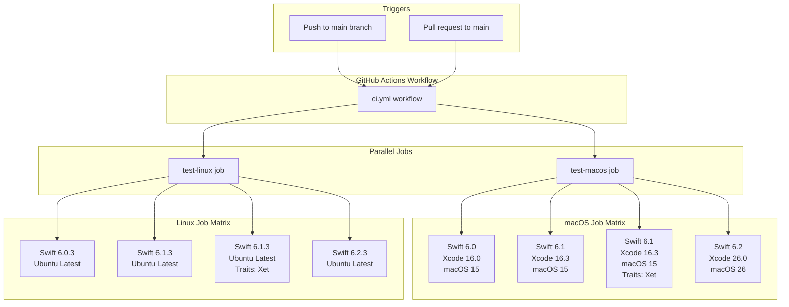
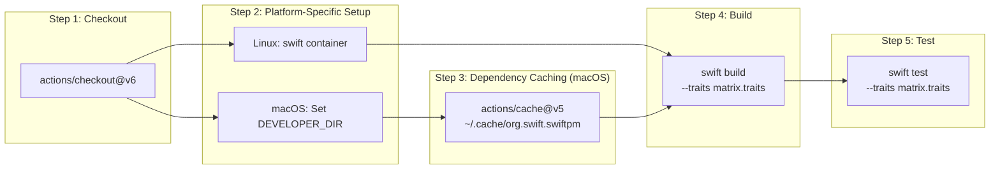
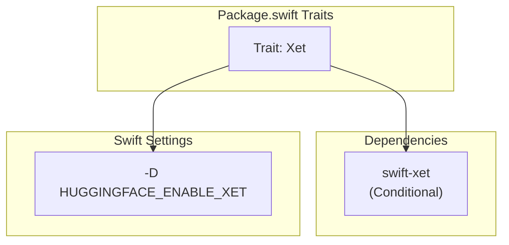

<!-- source: DeepWiki mcp.deepwiki.com · repo huggingface/swift-huggingface · page 9.2 CI/CD Pipeline · fetched 2026-10-26 -->

# CI/CD Pipeline

<details>
<summary>Relevant source files</summary>

The following files were used as context for generating this wiki page:

- [.github/workflows/ci.yml](.github/workflows/ci.yml)
- [Package.swift](Package.swift)
- [Tests/HubBenchmarks/DownloadSnapshotBenchmarks.swift](Tests/HubBenchmarks/DownloadSnapshotBenchmarks.swift)

</details>


## Purpose and Scope

This document describes the continuous integration and continuous deployment (CI/CD) infrastructure for the swift-huggingface SDK. It covers the GitHub Actions workflow configuration, test matrix strategy, build processes, and platform-specific testing approaches. For information about writing tests and test infrastructure, see [Test Infrastructure](#9.1). For contributing code and development practices, see [Contributing Guidelines](#9.3).

## Overall CI/CD Architecture

The CI/CD pipeline is implemented using GitHub Actions and configured in [.github/workflows/ci.yml](). The workflow runs automatically on every push to the `main` branch and on all pull requests targeting `main`.



**Sources:** [.github/workflows/ci.yml:1-86]()

## Job Configuration

### macOS Testing Job

The `test-macos` job runs on multiple macOS and Xcode versions to ensure compatibility across Apple platforms. It specifically tests both standard builds and builds with the `Xet` trait enabled [.github/workflows/ci.yml:27-30]().

**Job Definition:**

```yaml
name: Swift ${{ matrix.swift }} on macOS ${{ matrix.macos }} with Xcode ${{ matrix.xcode }}${{ matrix.traits != '' && format(' and --traits {0}', matrix.traits) || '' }}
runs-on: macos-${{ matrix.macos }}
env:
  DEVELOPER_DIR: "/Applications/Xcode_${{ matrix.xcode }}.app/Contents/Developer"
timeout-minutes: 10
```

| Swift Version | Xcode Version | macOS Version | Traits |
|--------------|---------------|---------------|--------|
| 6.0 | 16.0 | 15 | (None) |
| 6.1 | 16.3 | 15 | (None) |
| 6.1 | 16.3 | 15 | `Xet` |
| 6.2 | 26.0 | 26 | (None) |
| 6.2 | 26.0 | 26 | `Xet` |

The `DEVELOPER_DIR` environment variable [.github/workflows/ci.yml:14]() ensures the correct Xcode version is used for each build. The `timeout-minutes: 10` [.github/workflows/ci.yml:39]() setting prevents jobs from hanging indefinitely.

**Sources:** [.github/workflows/ci.yml:10-39]()

### Linux Testing Job

The `test-linux` job runs on Ubuntu using official Swift Docker containers [.github/workflows/ci.yml:61]().

**Job Definition:**

```yaml
name: Swift ${{ matrix.swift }} on Linux${{ matrix.traits != '' && format(' and --traits {0}', matrix.traits) || '' }}
runs-on: ubuntu-latest
container: "swift:${{ matrix.swift }}"
```

| Swift Version | Platform | Traits |
|--------------|----------|--------|
| 6.0.3 | Ubuntu Latest | (None) |
| 6.1.3 | Ubuntu Latest | (None) |
| 6.1.3 | Ubuntu Latest | `Xet` |
| 6.2.3 | Ubuntu Latest | (None) |
| 6.2.3 | Ubuntu Latest | `Xet` |

**Sources:** [.github/workflows/ci.yml:58-76]()

## Build and Test Execution Pipeline



### Step-by-Step Execution

**1. Code Checkout**
```yaml
- name: Checkout code
  uses: actions/checkout@v6
```
Uses the official GitHub checkout action to clone the repository [.github/workflows/ci.yml:42]().

**2. Environment Setup**
- **macOS:** The `DEVELOPER_DIR` environment variable is set at the job level [.github/workflows/ci.yml:14]().
- **Linux:** The `container` property specifies the Swift Docker image [.github/workflows/ci.yml:61]().

**3. Dependency Caching (macOS only)**
The cache key [.github/workflows/ci.yml:48]() includes the OS, Xcode version, Swift version, trait status (`xet-on` or `xet-off`), and hashes of `Package.swift` and `Package.resolved`.

**4. Build and Test Execution**
Build and test commands dynamically include the `--traits` flag if specified in the matrix [.github/workflows/ci.yml:53, 56, 82, 85]().

**Sources:** [.github/workflows/ci.yml:40-86]()

## Traits and Conditional Compilation

The CI pipeline explicitly tests the Swift 6.1+ `traits` feature. The `Xet` trait enables the `swift-xet` dependency and sets the `HUGGINGFACE_ENABLE_XET` compiler flag.



- **Xet Trait:** Declared in [Package.swift:23-27]().
- **Conditional Dependency:** `swift-xet` is included only when the `Xet` trait is active [Package.swift:39]().
- **Compiler Flag:** `HUGGINGFACE_ENABLE_XET` is defined for both `HuggingFace` and `HuggingFaceTests` targets when the trait is enabled [Package.swift:42-44, 49-51]().

**Sources:** [Package.swift:22-51]()

## Platform-Specific Build Considerations

The package supports multiple Apple platforms and Linux, each with specific requirements defined in [Package.swift:8-15]().

### Platform Support Matrix

| Platform | Minimum Version | CI Testing |
|----------|----------------|------------|
| macOS | 13.0 | ✓ (15, 26) |
| Mac Catalyst | 16.0 | ✓ (via macOS) |
| iOS | 16.0 | ✓ (via macOS) |
| watchOS | 9.0 | ✓ (via macOS) |
| tvOS | 16.0 | ✓ (via macOS) |
| visionOS | 1.0 | ✓ (via macOS) |
| Linux | Swift 6.0+ | ✓ (Ubuntu) |

**Sources:** [Package.swift:8-15](), [.github/workflows/ci.yml:10-86]()

## Benchmarks in CI

The codebase includes a `HubBenchmarks` test target [Package.swift:53-59]() used for performance testing.

### Benchmark Execution Logic

Benchmarks, such as those in `DownloadSnapshotBenchmarks`, are conditionally enabled based on the presence of the `HF_TOKEN` environment variable.

```swift
let benchmarksEnabled = ProcessInfo.processInfo.environment["HF_TOKEN"]?.isEmpty == false

@Suite("Hub Benchmarks", .serialized, .enabled(if: benchmarksEnabled))
struct DownloadSnapshotBenchmarks { ... }
```

In the standard CI pipeline, these benchmarks are typically disabled to ensure fast, deterministic runs and to avoid requiring secret tokens for every PR. They are intended for local performance validation and specialized CI runs where `HF_TOKEN` is provided.

**Sources:** [Tests/HubBenchmarks/DownloadSnapshotBenchmarks.swift:8-11](), [Package.swift:53-60]()

## Target Architecture

The package defines three primary targets, all of which are processed by the CI pipeline:

1.  **HuggingFace:** The core library target [Package.swift:34-45]().
2.  **HuggingFaceTests:** The primary unit and integration test suite [Package.swift:46-52]().
3.  **HubBenchmarks:** A performance-focused test target [Package.swift:53-60]().

All targets respect the `Xet` trait configuration to ensure that trait-specific code paths (like Xet transport support) are compiled and tested correctly.

**Sources:** [Package.swift:33-60]()

---

