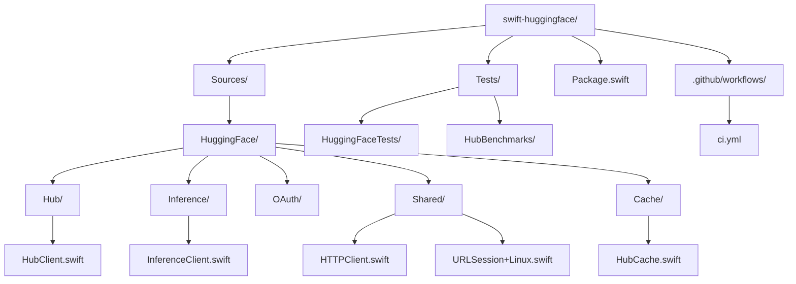
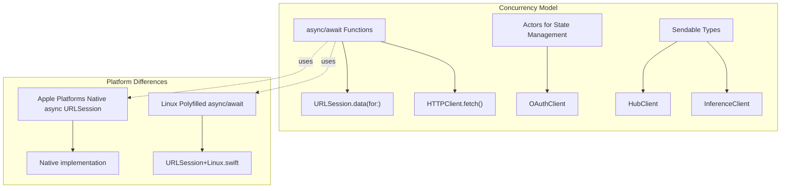
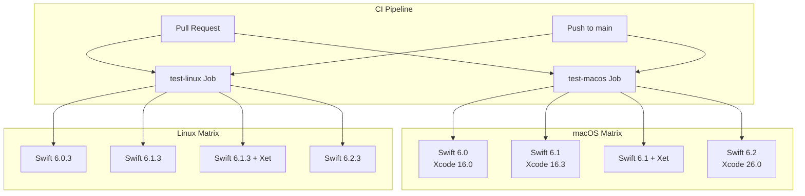

<!-- source: DeepWiki mcp.deepwiki.com · repo huggingface/swift-huggingface · page 9.3 Contributing Guidelines · fetched 2026-10-26 -->

# Contributing Guidelines

<details>
<summary>Relevant source files</summary>

The following files were used as context for generating this wiki page:

- [.github/workflows/ci.yml](.github/workflows/ci.yml)
- [LICENSE](LICENSE)
- [Package.swift](Package.swift)
- [Tests/HubBenchmarks/DownloadSnapshotBenchmarks.swift](Tests/HubBenchmarks/DownloadSnapshotBenchmarks.swift)

</details>


This page provides technical guidance for contributing code to the swift-huggingface SDK. It covers development setup, coding standards, testing requirements, CI/CD processes, and pull request workflows.

For information about testing infrastructure and mock patterns, see [9.1 Test Infrastructure](). For CI/CD pipeline details, see [9.2 CI/CD Pipeline]().

---

## Development Setup

### Prerequisites

The swift-huggingface SDK requires Swift 6.0 or later and supports multiple platforms. Development can be performed on macOS or Linux.

**Platform Requirements:**

| Platform | Minimum Version | Swift Version |
|----------|----------------|---------------|
| macOS | 13.0 | 6.0+ |
| iOS | 16.0 | 6.0+ |
| watchOS | 9.0 | 6.0+ |
| tvOS | 16.0 | 6.0+ |
| visionOS | 1.0 | 6.0+ |
| Linux | Ubuntu 20.04+ | 6.0+ |

**Sources:** [Package.swift:8-15]()

### Cloning and Building

```bash
# Clone the repository
git clone https://github.com/huggingface/swift-huggingface.git
cd swift-huggingface

# Build the package
swift build

# Run tests
swift test
```

The package uses Swift Package Manager with the following dependencies and traits:
- **EventSource** (1.0.0+): For Server-Sent Events streaming support.
- **swift-crypto** (1.0.0 to 5.0.0): For cryptographic operations.
- **Xet Trait**: An optional trait to enable `swift-xet` transport support for large file operations.

**Sources:** [Package.swift:22-32](), [Package.swift:34-45]()

---

## Project Structure

### Directory Layout



**Sources:** [Package.swift:33-60]()

### Module Organization

The codebase is organized into logical subsystems:

- **Hub/** - Repository management (`HubClient`, models, datasets, spaces, files).
- **Inference/** - AI task execution (`InferenceClient`, chat, embeddings, generation).
- **OAuth/** - Authentication system (OAuth 2.0, PKCE, token management).
- **Cache/** - Local storage system (content-addressed cache, file locking).
- **Shared/** - Common infrastructure (`HTTPClient`, platform polyfills).

**Sources:** [Package.swift:41-45]()

---

## Code Standards

### Swift Language Version

The project uses **Swift 6.1** as the baseline tools version. All code must be compatible with Swift's structured concurrency model.

**Sources:** [Package.swift:1]()

### Concurrency Patterns



**Sources:** [Sources/HuggingFace/Shared/URLSession+Linux.swift:8-149]()

### Platform Compatibility

Code must support both Apple platforms and Linux. Use conditional compilation when necessary:

```swift
#if canImport(FoundationNetworking)
    import FoundationNetworking
#endif

#if os(macOS) || os(iOS) || os(tvOS) || os(watchOS) || os(visionOS)
    // Apple-specific code
#else
    // Linux implementation
#endif
```

**Critical areas requiring platform-specific code:**
- **URLSession APIs** - Linux requires async polyfills defined in `URLSession+Linux.swift`.
- **Benchmarks** - Benchmark suites may use `CFAbsoluteTimeGetCurrent()` which is restricted to `canImport(Darwin)`.

**Sources:** [Sources/HuggingFace/Shared/URLSession+Linux.swift:3-11](), [Tests/HubBenchmarks/DownloadSnapshotBenchmarks.swift:1-10]()

---

## Testing Requirements

### Test Framework

The project uses the **Swift Testing** framework with `@Suite` and `@Test` attributes.

**Sources:** [Tests/HubBenchmarks/DownloadSnapshotBenchmarks.swift:4-12]()

### Writing Tests

Contributors should write tests that cover both fresh downloads and cached retrieval. For Hub operations, verify checksums to ensure data integrity.

```swift
@Test("Cached snapshot retrieval")
func cachedSnapshot() async throws {
    // Implementation
}
```

**Sources:** [Tests/HubBenchmarks/DownloadSnapshotBenchmarks.swift:30-93]()

### Benchmarks

The project includes a `HubBenchmarks` target to measure performance of snapshot downloads and Xet transport. These benchmarks are only enabled if the `HF_TOKEN` environment variable is present.

**Sources:** [Tests/HubBenchmarks/DownloadSnapshotBenchmarks.swift:8-12](), [Package.swift:53-60]()

---

## CI/CD Pipeline

### Test Matrix

The CI pipeline tests against multiple Swift versions and platforms:



**Sources:** [.github/workflows/ci.yml:10-75]()

### CI Configuration Details

**Traits:**
The CI matrix explicitly tests configurations with and without the `Xet` trait to ensure transport layer compatibility.

**Caching:**
On macOS, SPM dependencies are cached using `actions/cache` with a key based on the Xcode version, Swift version, trait status, and `Package.swift` hash.

**Sources:** [.github/workflows/ci.yml:44-51](), [.github/workflows/ci.yml:53-56]()

---

## Pull Request Process

### Before Submitting

1. **Ensure all tests pass locally:**
   ```bash
   swift test
   swift test --traits Xet
   ```

2. **Verify platform compatibility:**
   - Test on macOS and Linux if possible.
   - Check that `HUGGINGFACE_ENABLE_XET` defines are handled correctly.

3. **Check Code Style:**
   - Use descriptive names for clients and tasks.
   - Ensure `Sendable` conformance for public data structures.

**Sources:** [Package.swift:42-44](), [Package.swift:49-51]()

### PR Requirements

- ✅ All CI checks must pass (macOS and Linux).
- ✅ New features must include unit tests.
- ✅ Performance-critical changes should be verified with `HubBenchmarks`.

---

## Platform-Specific Considerations

### Linux Development

The SDK provides async wrappers for `URLSession` on Linux where native async support is missing in some toolchain versions:

| Method | Purpose |
|--------|---------|
| `data(for:)` | Async HTTP request |
| `upload(for:from:)` | Upload data |
| `asyncDownload(for:progress:)` | Download with progress tracking |

**Sources:** [Sources/HuggingFace/Shared/URLSession+Linux.swift:17-133]()

### Benchmarking Limitations

Benchmarks in `HubBenchmarks` use `CFAbsoluteTimeGetCurrent()`, which is available on Darwin platforms. When contributing benchmarks, ensure they are wrapped in appropriate platform checks.

**Sources:** [Tests/HubBenchmarks/DownloadSnapshotBenchmarks.swift:1-4](), [Tests/HubBenchmarks/DownloadSnapshotBenchmarks.swift:61-67]()

---

## Questions and Support

For questions about contributing:
- **Issues:** Open an issue on GitHub for bugs or feature requests.
- **Discussions:** Use GitHub Discussions for general questions.
- **Documentation:** Refer to the [10. Glossary]() for codebase-specific terms.

**Sources:** [LICENSE:48-60]()

---

