# Page: Overview

# Overview

<details>
<summary>Relevant source files</summary>

The following files were used as context for generating this wiki page:

- [Package.swift](Package.swift)
- [README.md](README.md)
- [Tests/HubBenchmarks/DownloadSnapshotBenchmarks.swift](Tests/HubBenchmarks/DownloadSnapshotBenchmarks.swift)

</details>


## Purpose and Scope

This document provides a high-level introduction to the `swift-huggingface` SDK, a Swift client library for interacting with Hugging Face services. The SDK provides two primary interfaces: `HubClient` for managing repository resources (models, datasets, spaces, and files), and `InferenceClient` for executing AI inference tasks (chat completion, embeddings, image generation, and more).

The SDK is designed for Swift 6.0+ and supports a wide range of platforms including macOS, iOS, watchOS, tvOS, visionOS, and Linux [README.md:9-12](). It features a Python-compatible caching system and robust authentication strategies suitable for both CLI tools and user-facing applications [README.md:53-66]().

**Sources:** [README.md:1-27](), [Package.swift:8-15]()

---

## System Architecture

The `swift-huggingface` SDK is organized around two main client classes that share common infrastructure for authentication, HTTP communication, and local caching.

### Architecture Overview
Title: High-Level System Architecture
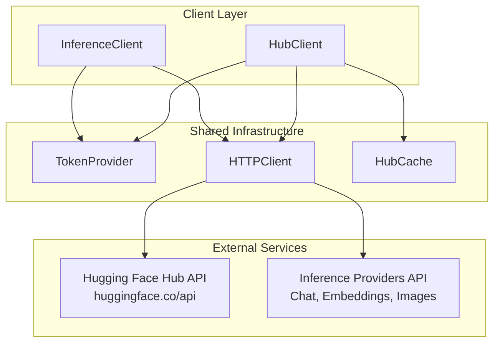

**Sources:** [README.md:1-7](), [README.md:104-132](), [README.md:845-850]()

---

## Main Client Interfaces

### HubClient - Repository Management

The `HubClient` class provides comprehensive management of Hugging Face Hub resources. It handles three primary repository types: models, datasets, and spaces [README.md:98-204](). The client supports operations including listing and searching repositories, managing files (upload, download, delete), and repository-level settings.

Title: HubClient Interface Space
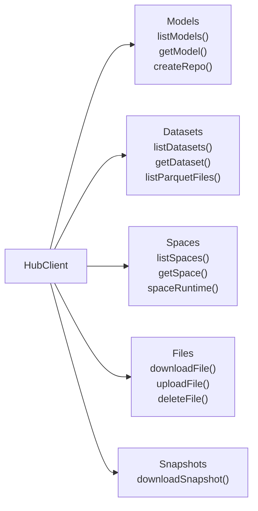

Key capabilities include:
- **Repository Operations**: Create, update, and move repositories [README.md:205-235]().
- **File Management**: Download individual files or entire repository snapshots with glob pattern filtering [README.md:281-306]().
- **Caching**: Automatic caching of downloaded files in a structure compatible with the `huggingface_hub` Python library [README.md:107-116]().
- **User Information**: Accessing profile and organization details via `whoami()` [README.md:237-252]().

**Sources:** [README.md:71-306](), [Tests/HubBenchmarks/DownloadSnapshotBenchmarks.swift:43-47]()

### InferenceClient - AI Task Execution

The `InferenceClient` class provides a task-oriented API for running AI inference operations. It abstracts away provider-specific details and supports multiple inference backends [README.md:845-850]().

Title: InferenceClient Task Mapping
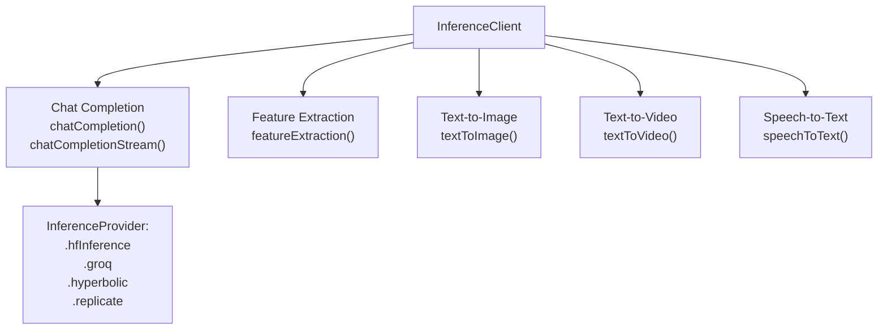

Supported tasks include:
- **Chat Completion**: Conversational AI with streaming support and tool calling [README.md:852-895]().
- **Feature Extraction**: Generating embeddings for text [README.md:905-915]().
- **Image/Video Generation**: Creating visual media from text prompts [README.md:921-945]().
- **Speech-to-Text**: Audio transcription [README.md:951-965]().

**Sources:** [README.md:845-965]()

---

## Core Infrastructure Components

### Authentication Layer

The SDK implements a flexible authentication system through `TokenProvider` strategies. For development, tokens are automatically detected from environment variables (e.g., `HF_TOKEN`) or local cache files [README.md:53-66]().

For user-facing applications, `HuggingFaceAuthenticationManager` provides OAuth 2.0 support with PKCE, allowing users to sign in and authorize the app securely [README.md:75-94]().

**Sources:** [README.md:53-94]()

### Caching System

The `HubCache` class implements content-addressed storage. It uses a hierarchy of `blobs`, `refs`, and `snapshots` to store repository files efficiently [README.md:107-116]().

Title: HubCache Data Flow
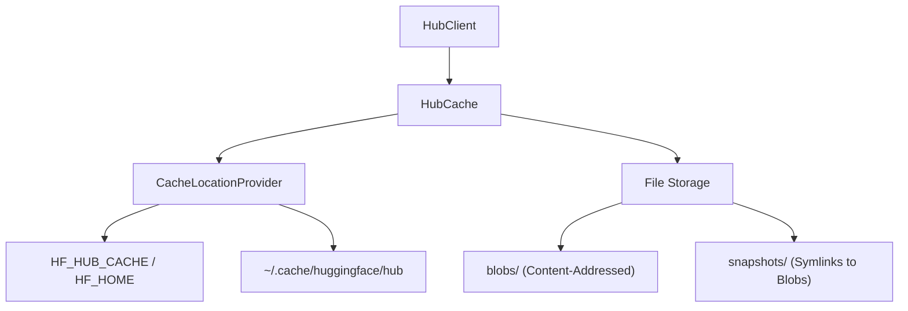

The cache is shared with the Python `huggingface_hub` library when possible, enabling seamless interoperability between Swift and Python tools on the same machine [README.md:109-115]().

**Sources:** [README.md:107-132](), [Tests/HubBenchmarks/DownloadSnapshotBenchmarks.swift:13-28]()

---

## Platform and Installation

### Requirements
- **Swift**: 6.0+ [README.md:11]()
- **Platforms**: macOS 13+, iOS 16+, watchOS 9+, tvOS 16+, visionOS 1+, and Linux [Package.swift:8-15]()

### Installation
The SDK is distributed via Swift Package Manager. It includes an optional `Xet` trait for enhanced transport support [README.md:26-49]().

```swift
dependencies: [
    .package(url: "https://github.com/huggingface/swift-huggingface.git", from: "0.9.0")
]
```

**Sources:** [Package.swift:1-32](), [README.md:14-24]()

---

## Quick Start Summary

```swift
import HuggingFace

// Hub Operations (Auto-detects HF_TOKEN)
let hub = HubClient.default
let modelInfo = try await hub.getModel("gpt2")

// Inference Operations
let inference = InferenceClient.default
let output = try await inference.chatCompletion(
    model: "meta-llama/Llama-3.1-8B-Instruct",
    messages: [.user("What is Swift?")]
)
```

**Sources:** [README.md:71-72](), [README.md:104-105](), [README.md:852-858]()

---

# Page: Getting Started

# Getting Started

<details>
<summary>Relevant source files</summary>

The following files were used as context for generating this wiki page:

- [Package.swift](Package.swift)
- [Package@swift-6.0.swift](Package@swift-6.0.swift)
- [README.md](README.md)
- [Tests/HubBenchmarks/DownloadSnapshotBenchmarks.swift](Tests/HubBenchmarks/DownloadSnapshotBenchmarks.swift)

</details>


This document provides a practical guide for new users to begin using the swift-huggingface SDK. It covers system requirements, installation procedures, authentication configuration, and the two primary client interfaces that form the SDK's public API.

For detailed installation instructions, see [Installation](#2.1). For authentication configuration options, see [Authentication Setup](#2.2). For working code examples, see [Quick Start Examples](#2.3).

## Overview

The swift-huggingface SDK provides two primary client interfaces for interacting with Hugging Face services:

| Client | Purpose | Primary Use Cases |
|--------|---------|-------------------|
| `HubClient` | Repository and file management | Listing/searching models, downloading files, uploading content, managing repositories |
| `InferenceClient` | AI task execution | Chat completion, embeddings, text-to-image, speech-to-text |

Both clients share common infrastructure for authentication, HTTP communication, and error handling, but expose different APIs optimized for their respective domains.

## System Requirements

The SDK supports multiple Apple platforms and Linux:

| Platform | Minimum Version | Notes |
|----------|----------------|-------|
| macOS | 13.0+ | Full feature support including OAuth |
| iOS | 16.0+ | Full feature support including OAuth |
| tvOS | 16.0+ | Full feature support |
| watchOS | 9.0+ | Full feature support |
| visionOS | 1.0+ | Full feature support |
| macCatalyst | 16.0+ | Full feature support |
| Linux | Any | Limited OAuth support (file-based token storage) |

**Swift Version**: 6.0 or higher is required.

Sources: [Package.swift:8-15](), [Package@swift-6.0.swift:8-15](), [README.md:11-12]()

## Architecture Overview

The following diagram illustrates how the main components connect when getting started with the SDK:

```mermaid
graph TB
    subgraph "UserCode"
        ["App"]
    end
    
    subgraph "SDKEntryPoints"
        ["HubClient.default"]
        ["InferenceClient.default"]
        ["HubClient(tokenProvider:)"]
        ["InferenceClient(tokenProvider:)"]
    end
    
    subgraph "TokenProviderOptions"
        ["TPEnv"] -- ".environment<br/>Auto-detect from env/files" --> TPEnvNode
        ["TPFixed"] -- ".fixed(String)<br/>Hardcoded token" --> TPFixedNode
        ["TPOAuth"] -- ".oauth(manager:)<br/>OAuth 2.0 flow" --> TPOAuthNode
        ["TPComposite"] -- ".composite<br/>Fallback chain" --> TPCompositeNode
    end
    
    subgraph "AuthenticationSources"
        ["EnvVar"] -- "Environment Variables<br/>HF_TOKEN, HUGGING_FACE_HUB_TOKEN" --> EnvVarNode
        ["EnvPath"] -- "HF_TOKEN_PATH" --> EnvPathNode
        ["FileCache"] -- "~/.cache/huggingface/token" --> FileCacheNode
        ["FileHF"] -- "~/.huggingface/token" --> FileHFNode
        ["OAuthMgr"] -- "HuggingFaceAuthenticationManager" --> OAuthMgrNode
    end
    
    ["App"] --> ["HubClient.default"]
    ["App"] --> ["InferenceClient.default"]
    ["App"] --> ["HubClient(tokenProvider:)"]
    ["App"] --> ["InferenceClient(tokenProvider:)"]
    
    ["HubClient.default"] -.uses.-> ["TPEnv"]
    ["InferenceClient.default"] -.uses.-> ["TPEnv"]
    
    ["HubClient(tokenProvider:)"] --> ["TPEnv"]
    ["HubClient(tokenProvider:)"] --> ["TPFixed"]
    ["HubClient(tokenProvider:)"] --> ["TPOAuth"]
    ["HubClient(tokenProvider:)"] --> ["TPComposite"]
    
    ["InferenceClient(tokenProvider:)"] --> ["TPEnv"]
    ["InferenceClient(tokenProvider:)"] --> ["TPFixed"]
    ["InferenceClient(tokenProvider:)"] --> ["TPOAuth"]
    ["InferenceClient(tokenProvider:)"] --> ["TPComposite"]
    
    ["TPEnv"] -.checks.-> ["EnvVar"]
    ["TPEnv"] -.checks.-> ["EnvPath"]
    ["TPEnv"] -.checks.-> ["FileCache"]
    ["TPEnv"] -.checks.-> ["FileHF"]
    
    ["TPOAuth"] --> ["OAuthMgr"]
```

Sources: [README.md:53-94]()

## Client Initialization Patterns

The SDK provides multiple initialization patterns depending on your deployment scenario:

### Default Clients with Auto-Detected Authentication

The simplest approach uses the `.default` static property, which automatically detects authentication tokens from standard locations:

```swift
let hubClient = HubClient.default
let inferenceClient = InferenceClient.default
```

This pattern checks the following locations in order:
1. `HF_TOKEN` environment variable
2. `HUGGING_FACE_HUB_TOKEN` environment variable
3. Path specified in `HF_TOKEN_PATH` environment variable
4. `$HF_HOME/token` file
5. `~/.cache/huggingface/token` (standard HF CLI location)
6. `~/.huggingface/token` (legacy fallback)

Sources: [README.md:57-71]()

### Explicit TokenProvider Configuration

For more control over authentication, construct clients with explicit `TokenProvider` instances:

| TokenProvider | Use Case | Example |
|--------------|----------|---------|
| `.environment` | Auto-detect from standard locations | `HubClient(tokenProvider: .environment)` |
| `.fixed("token")` | Hardcoded token (testing/CI) | `HubClient(tokenProvider: .fixed("hf_..."))` |
| `.oauth(manager:)` | User-facing OAuth flow | `InferenceClient(tokenProvider: .oauth(manager: authManager))` |
| `.composite([...])` | Fallback chain | `HubClient(tokenProvider: .composite([.oauth(...), .environment]))` |

The `.composite` provider tries each strategy in order until one succeeds, enabling graceful degradation across environments.

Sources: [README.md:75-94]()

## Code Entity Reference

The following diagram maps natural language concepts to actual code entities in the SDK:

```mermaid
graph LR
    subgraph "PublicAPIClasses"
        ["HubClient"]
        ["InferenceClient"]
        ["TokenProvider"]
        ["HuggingFaceAuthenticationManager"]
    end
    
    subgraph "CoreTypes"
        ["RepoID"] -- "Repo.ID<br/>Repository identifier" --> RepoIDNode
        ["RepoKind"] -- "Repo.Kind<br/>.model / .dataset / .space" --> RepoKindNode
        ["ChatMessage"] -- "ChatCompletion.Message<br/>Chat message structure" --> ChatMessageNode
        ["FileStruct"] -- "File<br/>File metadata" --> FileStructNode
    end
    
    subgraph "Infrastructure"
        ["HTTPClient"]
        ["HubCache"]
        ["FileLock"]
    end
    
    ["HubClient"] --> ["TokenProvider"]
    ["HubClient"] --> ["HTTPClient"]
    ["HubClient"] -.optional.-> ["HubCache"]
    
    ["InferenceClient"] --> ["TokenProvider"]
    ["InferenceClient"] --> ["HTTPClient"]
    
    ["TokenProvider"] -.delegates.-> ["HuggingFaceAuthenticationManager"]
    
    ["HubClient"] --> ["RepoID"]
    ["HubClient"] --> ["RepoKind"]
    ["HubClient"] --> ["FileStruct"]
    
    ["InferenceClient"] --> ["ChatMessage"]
    
    ["HubCache"] --> ["FileLock"]
```

Sources: [README.md:1-285](), [Package.swift:1-61]()

## Typical Getting Started Workflow

The standard workflow for new SDK users follows this sequence:

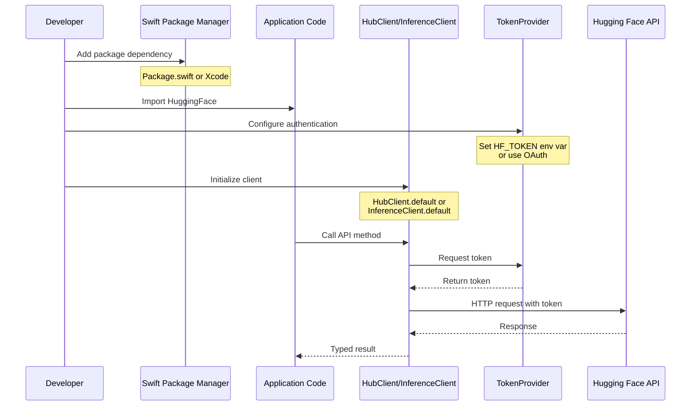

Sources: [README.md:14-94]()

## Installation Overview

The SDK is distributed via Swift Package Manager. Add the dependency to your `Package.swift`:

```swift
dependencies: [
    .package(url: "https://github.com/huggingface/swift-huggingface.git", from: "0.9.0")
]
```

The package declares external dependencies that are automatically resolved:
- `EventSource` (1.0.0+): Server-Sent Events parsing for streaming responses [Package.swift:29]()
- `swift-crypto` (1.0.0 - 5.0.0): Cryptographic operations [Package.swift:30]()
- `swift-xet` (0.2.0+): Optional Xet transport support [Package.swift:31]()

For detailed installation instructions including the optional `Xet` trait, see [Installation](#2.1).

Sources: [README.md:16-49](), [Package.swift:22-32]()

## Authentication Configuration Overview

Authentication is required for most API operations. The SDK supports three primary strategies:

### 1. Environment-Based (Recommended for Development)

Set one of the following environment variables:
- `HF_TOKEN`: Primary token location [README.md:60]()
- `HUGGING_FACE_HUB_TOKEN`: Alternative name [README.md:61]()
- `HF_TOKEN_PATH`: Path to file containing token [README.md:62]()

### 2. OAuth 2.0 with PKCE (Recommended for User-Facing Apps)

For applications that need to authenticate end users:

```swift
let authManager = try HuggingFaceAuthenticationManager(
    clientID: "your_client_id",
    redirectURL: URL(string: "yourapp://oauth/callback")!,
    scope: [.openid, .profile, .email],
    keychainService: "com.yourapp.huggingface",
    keychainAccount: "user_token"
)

try await authManager.signIn()
let client = InferenceClient(tokenProvider: .oauth(manager: authManager))
```

### 3. Fixed Token (Testing/CI)

For testing or CI environments where tokens are managed externally:

```swift
let client = HubClient(tokenProvider: .fixed("hf_your_token_here"))
```

For comprehensive authentication setup information, see [Authentication Setup](#2.2).

Sources: [README.md:75-94]()

## Client Capabilities Summary

### HubClient Capabilities

`HubClient` provides repository and file management operations:

| Operation Category | Examples |
|-------------------|----------|
| Repository listing | `listModels()`, `listDatasets()`, `listSpaces()` |
| Repository details | `getModel()`, `getDataset()`, `getSpace()` |
| File operations | `downloadFile()`, `uploadFile()`, `deleteFile()` |
| Snapshots | `downloadSnapshot()` with glob pattern filtering |
| Repository management | `createRepo()`, `moveRepo()`, `updateRepoSettings()` |

For detailed usage, see [HubClient - Repository Management](#3).

### InferenceClient Capabilities

`InferenceClient` provides AI task execution:

| Task | Method | Streaming Support |
|------|--------|------------------|
| Chat completion | `chatCompletion()` | Yes |
| Embeddings | `featureExtraction()` | No |
| Text-to-image | `textToImage()` | No |

For detailed usage, see [InferenceClient - AI Tasks](#4).

Sources: [README.md:98-285]()

## Next Steps

After completing the installation and authentication setup:

1. **Review Quick Start Examples**: See [Quick Start Examples](#2.3) for common tasks.
2. **Explore HubClient**: See [HubClient - Repository Management](#3) for file and repository operations.
3. **Explore InferenceClient**: See [InferenceClient - AI Tasks](#4) for AI inference tasks.
4. **Configure Caching**: See [Caching System](#6) to optimize file downloads.
5. **Understand Error Handling**: See [Error Handling](#7.2) for robust error management.

Sources: [README.md:107-132]()

---

# Page: Installation

# Installation

<details>
<summary>Relevant source files</summary>

The following files were used as context for generating this wiki page:

- [Package.resolved](Package.resolved)
- [Package.swift](Package.swift)
- [Package@swift-6.0.swift](Package@swift-6.0.swift)
- [Tests/HubBenchmarks/DownloadSnapshotBenchmarks.swift](Tests/HubBenchmarks/DownloadSnapshotBenchmarks.swift)

</details>


This page covers adding the swift-huggingface SDK to your Swift project using Swift Package Manager, including platform requirements and the optional Xet trait for optimized large file transfers.

## Overview

The swift-huggingface SDK is distributed as a Swift Package and can be integrated into projects using Swift Package Manager (SPM). The package provides the `HuggingFace` library, which includes both `HubClient` for repository management and `InferenceClient` for AI inference tasks.

## System Requirements

The SDK has specific platform and Swift version requirements defined in the package manifest:

| Component | Minimum Version | Notes |
|-----------|----------------|-------|
| **Swift** | 6.0+ | Swift 6.1+ recommended for latest toolchain features [Package.swift:1-2]() |
| **macOS** | 13.0 | Full feature support [Package.swift:9]() |
| **iOS** | 16.0 | Full feature support [Package.swift:11]() |
| **Mac Catalyst** | 16.0 | Full feature support [Package.swift:10]() |
| **watchOS** | 9.0 | Full feature support [Package.swift:12]() |
| **tvOS** | 16.0 | Full feature support [Package.swift:13]() |
| **visionOS** | 1.0 | Full feature support [Package.swift:14]() |
| **Linux** | Supported | Core Hub and Inference functionality |

Sources: [Package.swift:1-15]()

## Package Dependencies and Traits

The SDK relies on several key dependencies for networking, security, and optimized data transfer.

### External Dependencies
- **EventSource**: Handles Server-Sent Events (SSE) for streaming chat completion [Package.swift:29]().
- **Swift Crypto**: Provides cryptographic primitives for secure operations [Package.swift:30]().
- **Swift Xet**: Optional dependency for high-performance large file transfers [Package.swift:31]().

### The Xet Trait
Starting with Swift 6.1, the package introduces **Traits** to manage optional functionality. The `Xet` trait enables support for the Xet transport protocol, which is optimized for deduplication and efficient transfer of large model weights.

| Trait Name | Description | Condition |
|------------|-------------|-----------|
| `Xet` | Enables Xet transport support and adds `swift-xet` dependency. | Defined in [Package.swift:22-27]() |

**Data Flow with Xet Enabled:**

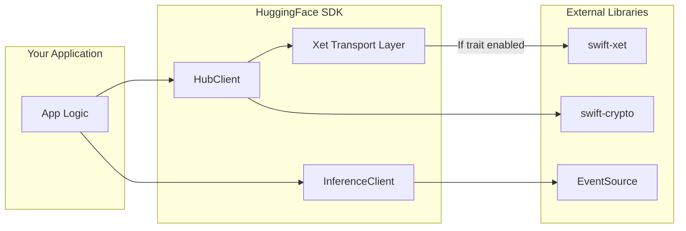

Sources: [Package.swift:22-45](), [Package.resolved:14-21](), [Package.resolved:86-93](), [Package.resolved:212-219]()

## Installation Methods

### Method 1: Package.swift (Recommended)

Add the dependency to your `Package.swift` file. To enable the optional Xet support, include the `Xet` trait in your target dependencies.

```swift
// Package.swift
let package = Package(
    name: "MyAIProject",
    dependencies: [
        .package(url: "https://github.com/huggingface/swift-huggingface.git", from: "0.1.0")
    ],
    targets: [
        .target(
            name: "MyTarget",
            dependencies: [
                .product(
                    name: "HuggingFace", 
                    package: "swift-huggingface",
                    condition: .when(traits: ["Xet"]) // Optional: Enable Xet support
                )
            ]
        )
    ]
)
```

Sources: [Package.swift:16-45]()

### Method 2: Xcode Integration

1. In Xcode, select **File** > **Add Package Dependencies...**
2. Enter the repository URL: `https://github.com/huggingface/swift-huggingface.git`
3. Select the versioning rule (e.g., Up to Next Major Version).
4. **Traits Selection**: If using Xcode 16+ (Swift 6.1+), you can toggle the `Xet` trait in the package configuration screen to enable optimized large file downloads.

## Verifying Installation

To verify the installation, you can instantiate a `HubClient` and check its configuration.

### Natural Language to Code Entity Mapping

The following diagram bridges the conceptual requirements of the SDK with the actual code entities used for initialization and verification.

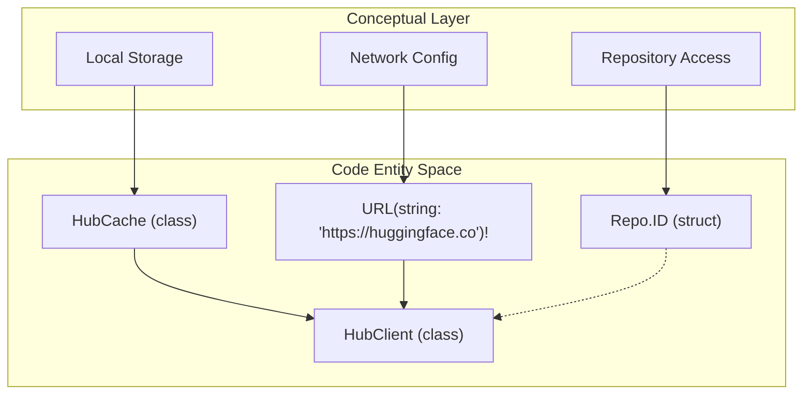

### Verification Snippet
You can run a simple test to ensure the clients are available:

```swift
import HuggingFace
import Foundation

// Verify HubClient initialization
let cache = HubCache() // Default cache location
let client = HubClient(cache: cache)

// Verify Repo ID parsing
let repo: Repo.ID = "mlx-community/Qwen3-0.6B-Base-DQ5"
print("Successfully initialized client for \(repo)")
```

Sources: [Tests/HubBenchmarks/DownloadSnapshotBenchmarks.swift:22-28](), [Tests/HubBenchmarks/DownloadSnapshotBenchmarks.swift:32]()

## Troubleshooting

### Build Failures with Xet
If you encounter build errors related to `Xet`, ensure you are using Swift 6.1 or later if you have enabled the `Xet` trait. The `Package.swift` uses conditional defines `HUGGINGFACE_ENABLE_XET` to manage this feature [Package.swift:43]().

### Cache Directory Permissions
The `HubCache` defaults to system cache directories. On Darwin platforms, this is typically in the user's `Library/Caches` folder [Tests/HubBenchmarks/DownloadSnapshotBenchmarks.swift:13-16](). Ensure your application has write permissions to the designated cache path.

Sources: [Package.swift:1](), [Package.swift:42-45](), [Tests/HubBenchmarks/DownloadSnapshotBenchmarks.swift:13-20]()

---

# Page: Authentication Setup

# Authentication Setup

<details>
<summary>Relevant source files</summary>

The following files were used as context for generating this wiki page:

- [Sources/HuggingFace/Hub/HubClient.swift](Sources/HuggingFace/Hub/HubClient.swift)
- [Sources/HuggingFace/Shared/HTTPClient.swift](Sources/HuggingFace/Shared/HTTPClient.swift)
- [Sources/HuggingFace/Shared/TokenProvider.swift](Sources/HuggingFace/Shared/TokenProvider.swift)
- [Tests/HuggingFaceTests/HubTests/CacheLocationProviderTests.swift](Tests/HuggingFaceTests/HubTests/CacheLocationProviderTests.swift)

</details>


This page provides a practical guide to configuring authentication for the `swift-huggingface` SDK in different deployment scenarios. Authentication is handled through the `TokenProvider` abstraction, which supports multiple strategies including environment variables, token files, OAuth flows, and custom implementations.

For detailed information about the authentication system architecture and implementation details, see [Authentication System](). For OAuth-specific implementation details, see [OAuth 2.0 with PKCE]().

---

## Overview of Authentication Methods

The SDK supports multiple authentication strategies through the `TokenProvider` enum, allowing you to choose the method that best fits your deployment scenario.

| Strategy | Use Case | Platform Support |
|----------|----------|------------------|
| `.environment` | Development, CI/CD, server deployments | All platforms |
| `.fixed(token:)` | Testing, single-user applications | All platforms |
| `.oauth(getToken:)` | User-facing applications requiring sign-in | macOS 14+, iOS 17+ |
| `.composite([...])` | Multi-environment with fallbacks | All platforms |
| `.custom(...)` | Custom authentication logic | All platforms |
| `.none` | Public API access without authentication | All platforms |

Sources: [Sources/HuggingFace/Shared/TokenProvider.swift:92-165]()

---

## Authentication Flow

### Natural Language to Code Entity Space: Token Resolution

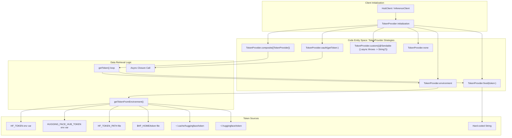

**Authentication Flow Overview**: This diagram maps the `TokenProvider` enum cases to the internal logic used to resolve strings from various system sources.

Sources: [Sources/HuggingFace/Shared/TokenProvider.swift:183-209](), [Sources/HuggingFace/Shared/HTTPClient.swift:45-60]()

---

## Environment-Based Authentication (Recommended)

Environment-based authentication is the default and most flexible approach for development, CI/CD, and server deployments. It automatically detects tokens from multiple standard locations.

### Token Detection Order

The `getTokenFromEnvironment()` function checks sources in the following priority order:

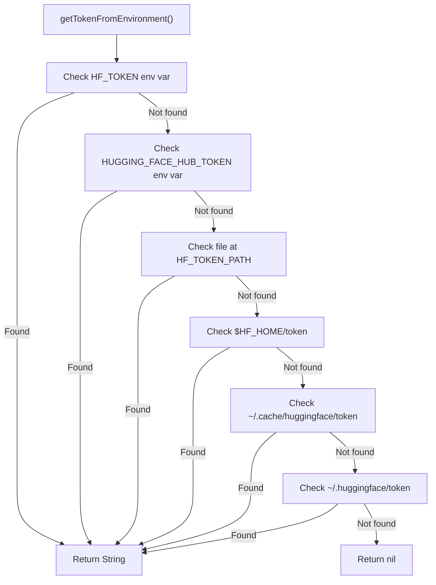

**Token Detection Priority**: The implementation iterates through these sources, returning the first valid token found.

Sources: [Sources/HuggingFace/Shared/TokenProvider.swift:109-121](), [Sources/HuggingFace/Hub/HubClient.swift:21-29]()

### Setup Instructions

**Option 1: Environment Variable (Recommended for CI/CD)**

Set either `HF_TOKEN` or `HUGGING_FACE_HUB_TOKEN`:

```bash
export HF_TOKEN="hf_..."
```

**Option 2: Token File (Recommended for Local Development)**

Store your token in the standard Hugging Face CLI location:

```bash
echo "hf_..." > ~/.cache/huggingface/token
```

### Usage

```swift
import HuggingFace

// HubClient.init defaults to .environment
let client = HubClient() 

// Verify authentication via the computed property
if let token = await client.bearerToken {
    print("Authenticated with token: \(token)")
}
```

Sources: [Sources/HuggingFace/Hub/HubClient.swift:109-121](), [Sources/HuggingFace/Hub/HubClient.swift:94-98]()

---

## Fixed Token Authentication

Fixed token authentication is useful for testing or when you need to explicitly control the token source.

### Setup

```swift
import HuggingFace

// HubClient supports string literals for tokenProvider
let client = HubClient(host: HubClient.defaultHost, bearerToken: "hf_abc123")

// Or via explicit TokenProvider
let explicitClient = HubClient(
    host: HubClient.defaultHost, 
    tokenProvider: .fixed(token: "hf_abc123")
)
```

Sources: [Sources/HuggingFace/Hub/HubClient.swift:132-146](), [Sources/HuggingFace/Shared/TokenProvider.swift:107]()

---

## OAuth Authentication

OAuth authentication is designed for user-facing applications that need to authenticate individual users through Hugging Face's OAuth 2.0 flow.

### OAuth Token Retrieval Flow

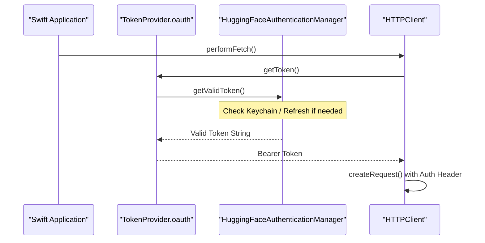

**OAuth Integration**: The `TokenProvider.oauth` case wraps an asynchronous closure, typically provided by the `HuggingFaceAuthenticationManager`.

Sources: [Sources/HuggingFace/Shared/TokenProvider.swift:37-48](), [Sources/HuggingFace/Shared/TokenProvider.swift:191-192]()

### Setup Instructions

```swift
import HuggingFace

// 1. Initialize the manager (requires Client ID from HF Settings)
let authManager = try HuggingFaceAuthenticationManager(
    clientID: "your-client-id",
    redirectURL: URL(string: "myapp://oauth")!,
    scope: .basic
)

// 2. Create client using the oauth factory
let client = HubClient(
    host: HubClient.defaultHost,
    tokenProvider: .oauth(manager: authManager)
)
```

Sources: [Sources/HuggingFace/Shared/TokenProvider.swift:40-47]()

---

## Composite Authentication Strategies

Composite strategies allow you to combine multiple authentication methods with automatic fallback. The provider tries each strategy in order until one returns a non-nil token.

### Composite Usage Patterns

```swift
// Try OAuth first, fall back to environment variables, then a fixed token
let client = HubClient(
    host: HubClient.defaultHost,
    tokenProvider: [
        .oauth(manager: authManager), 
        .environment,                 
        .fixed(token: "hf_fallback")
    ]
)
```

Sources: [Sources/HuggingFace/Shared/TokenProvider.swift:55-61](), [Sources/HuggingFace/Shared/TokenProvider.swift:194-200]()

---

## Platform-Specific Cache & Token Storage

The SDK automatically detects the appropriate storage locations based on the platform and sandbox status.

| Platform | Variable | Default Path Logic |
|----------|----------|--------------------|
| **macOS (Non-Sandboxed)** | `HF_HOME` | `~/.cache/huggingface/hub` |
| **Apple (Sandboxed)** | `HF_HOME` | `Library/Caches/huggingface/hub` |
| **Linux** | `HF_HOME` | `~/.cache/huggingface/hub` |

Sources: [Sources/HuggingFace/Hub/HubClient.swift:33-45](), [Tests/HuggingFaceTests/HubTests/CacheLocationProviderTests.swift:103-136]()

### Implementation Detail: Cache Location Resolution

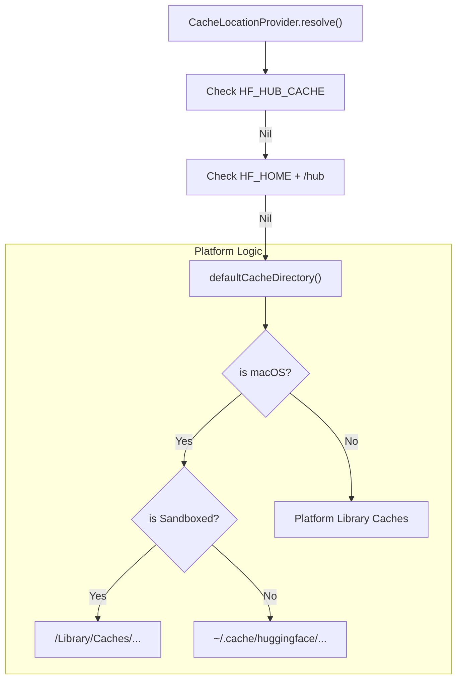

Sources: [Tests/HuggingFaceTests/HubTests/CacheLocationProviderTests.swift:82-136](), [Sources/HuggingFace/Hub/HubClient.swift:37-45]()

---

# Page: Quick Start Examples

# Quick Start Examples

<details>
<summary>Relevant source files</summary>

The following files were used as context for generating this wiki page:

- [README.md](README.md)
- [Sources/HuggingFace/Hub/HubClient+Models.swift](Sources/HuggingFace/Hub/HubClient+Models.swift)
- [Sources/HuggingFace/InferenceProviders/InferenceClient.swift](Sources/HuggingFace/InferenceProviders/InferenceClient.swift)

</details>


This page provides practical code examples for common tasks to help you start using the swift-huggingface SDK immediately. It demonstrates basic usage patterns for both repository management (`HubClient`) and AI inference (`InferenceClient`).

For installation instructions, see [Installation](#2.1). For detailed authentication configuration, see [Authentication Setup](#2.2). For comprehensive HubClient operations, see [HubClient - Repository Management](#3). For detailed inference capabilities, see [InferenceClient - AI Tasks](#4).

## Overview of Basic Usage Patterns

The SDK provides two primary client interfaces that follow consistent initialization and usage patterns:

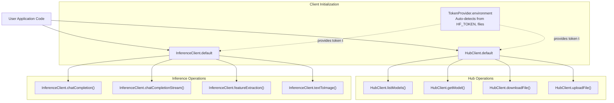

Sources: [README.md:67-105](), [README.md:845-858](), [Sources/HuggingFace/InferenceProviders/InferenceClient.swift:24-33]()

## Creating Clients

Both `HubClient` and `InferenceClient` provide a `.default` singleton for convenience. These instances automatically detect authentication tokens from environment variables and standard file locations.

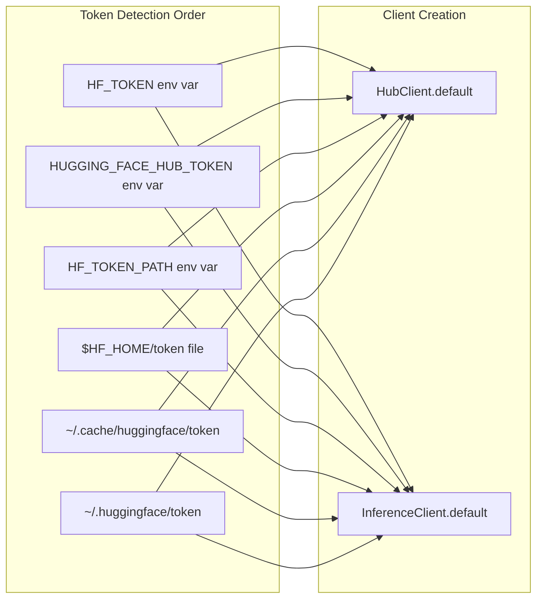

### Basic Client Initialization

The simplest way to create clients uses automatic authentication:

| Client Type | Code | Authentication |
|-------------|------|----------------|
| Hub Client | `HubClient.default` | Auto-detected from environment [README.md:70-71]() |
| Inference Client | `InferenceClient.default` | Auto-detected from environment [Sources/HuggingFace/InferenceProviders/InferenceClient.swift:33-33]() |

For custom configuration (custom host, explicit token, user agent), clients can be initialized with specific parameters:

| Parameter | Type | Purpose |
|-----------|------|---------|
| `host` | `URL` | Custom API endpoint [Sources/HuggingFace/InferenceProviders/InferenceClient.swift:89-89]() |
| `userAgent` | `String?` | Custom user agent for requests [Sources/HuggingFace/InferenceProviders/InferenceClient.swift:90-90]() |
| `bearerToken` | `String?` | Explicit authentication token [Sources/HuggingFace/InferenceProviders/InferenceClient.swift:91-91]() |
| `tokenProvider` | `TokenProvider` | Advanced authentication strategy [Sources/HuggingFace/InferenceProviders/InferenceClient.swift:112-112]() |

Sources: [README.md:53-73](), [Sources/HuggingFace/InferenceProviders/InferenceClient.swift:13-33](), [Sources/HuggingFace/InferenceProviders/InferenceClient.swift:68-120]()

## HubClient Examples

### Listing Models

The `listModels()` method searches and filters models on the Hugging Face Hub. It returns a `PaginatedResponse<Model>` containing metadata-rich model objects.


Key parameters for filtering model lists:

| Parameter | Type | Description |
|-----------|------|-------------|
| `search` | `String?` | Filter based on substrings for repos [Sources/HuggingFace/Hub/HubClient+Models.swift:70-70]() |
| `author` | `String?` | Filter models by an author or organization [Sources/HuggingFace/Hub/HubClient+Models.swift:71-71]() |
| `filter` | `String?` | Filter based on tags (e.g., "text-classification") [Sources/HuggingFace/Hub/HubClient+Models.swift:72-72]() |
| `sort` | `String?` | Property to use when sorting (e.g., "downloads") [Sources/HuggingFace/Hub/HubClient+Models.swift:73-73]() |
| `limit` | `Int?` | Limit the number of models fetched [Sources/HuggingFace/Hub/HubClient+Models.swift:75-75]() |

Sources: [README.md:137-146](), [Sources/HuggingFace/Hub/HubClient+Models.swift:69-111]()

### Getting Model Information

The `getModel()` method retrieves detailed metadata for a specific model by its repository ID (format: `"namespace/repo-name"`):

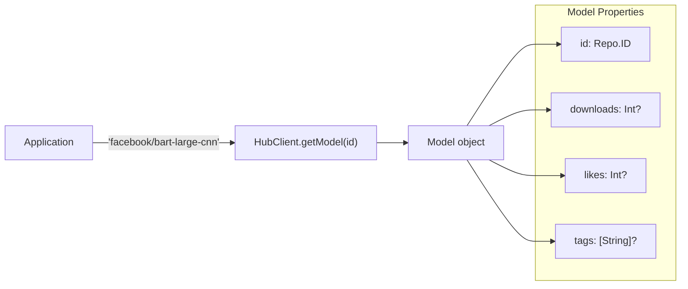

Sources: [README.md:148-152](), [Sources/HuggingFace/Hub/HubClient+Models.swift:126-157]()

### Downloading Files

The SDK provides multiple methods for downloading files from repositories, integrated with the `HubCache` system.

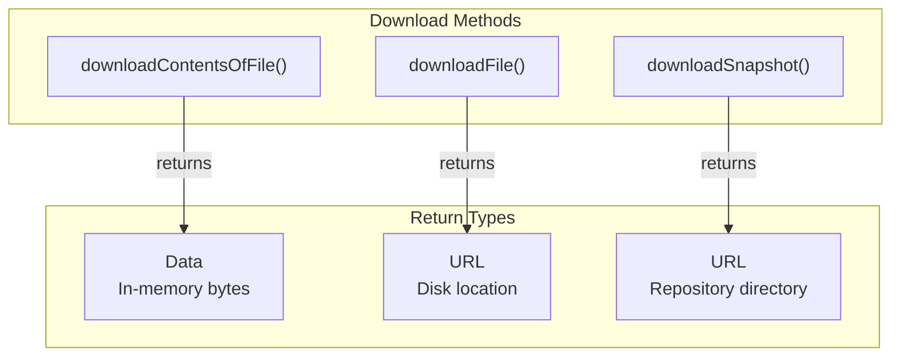

#### Download File Contents to Memory

For small files (configuration, metadata), download directly to `Data`:

| Use Case | Method | Returns |
|----------|--------|---------|
| Configuration files | `downloadContentsOfFile(at:from:)` | `Data` |
| Small text/JSON files | `downloadContentsOfFile(at:from:kind:revision:)` | `Data` |

#### Download File to Disk

For large files (models, datasets), download directly to disk with optional progress tracking. The client handles local caching automatically in a Python-compatible directory structure.

| Feature | Parameter | Type |
|---------|-----------|------|
| Source path | `at` | `String` |
| Repository | `from` | `Repo.ID` |
| Progress tracking | `progress` | `Progress?` |

Sources: [README.md:107-132](), [README.md:412-528]()

## InferenceClient Examples

### Chat Completion

The `chatCompletion()` method generates conversational responses using language models. Messages use the `ChatCompletion.Message` type with role-based constructors.

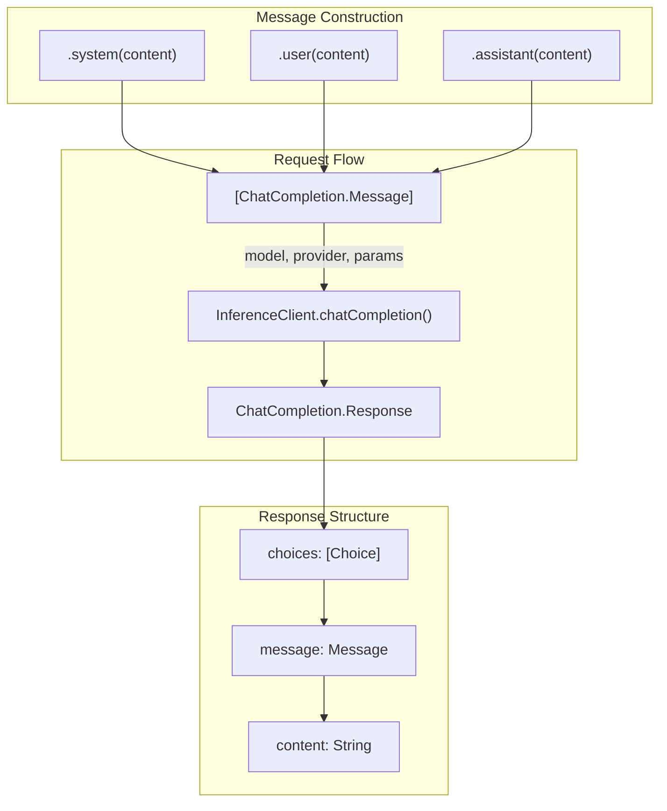

Key parameters for chat completion:

| Parameter | Type | Description |
|-----------|------|-------------|
| `model` | `String` | Model ID (e.g., `"meta-llama/Llama-3.3-70B-Instruct"`) |
| `messages` | `[ChatCompletion.Message]` | Conversation history |
| `provider` | `InferenceProvider?` | Backend (e.g., `.groq`, `.hfInference`) |
| `temperature` | `Double?` | Randomness (0.0-1.0) |

Sources: [README.md:859-906]()

### Feature Extraction (Embeddings)

The `featureExtraction()` method generates dense vector embeddings for semantic similarity:

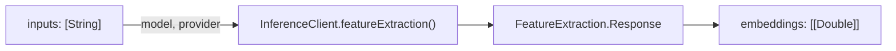

Sources: [README.md:908-926]()

### Text-to-Image Generation

The `textToImage()` method generates images from text prompts with configurable parameters:

```mermaid
graph TB
    subgraph "Input Parameters"
        Prompt["prompt: String"]
        NegPrompt["negativePrompt: String?"]
        Width["width: Int?"]
        Height["height: Int?"]
    end
    
    subgraph "Generation"
        T2IMethod["InferenceClient.textToImage()"]
        Provider["provider: InferenceProvider?"]
    end
    
    subgraph "Response"
        Response["TextToImage.Response"]
        Image["image: Data"]
    end
    
    Prompt --> T2IMethod
    NegPrompt --> T2IMethod
    Width --> T2IMethod
    Height --> T2IMethod
    Provider --> T2IMethod
    
    T2IMethod --> Response
    Response --> Image
```

Sources: [README.md:928-961]()

## Complete Example Workflows

### Workflow 1: Search, Download, and Use a Model

```mermaid
sequenceDiagram
    participant App as Application
    participant Hub as HubClient.default
    participant Inf as InferenceClient.default
    
    App->>Hub: listModels(search: "bert")
    Hub-->>App: PaginatedResponse<Model>
    
    App->>Hub: getModel("bert-base-uncased")
    Hub-->>App: Model metadata
    
    App->>Hub: downloadFile(at: "config.json", from: "bert-base-uncased")
    Hub-->>App: local File URL
    
    App->>Inf: featureExtraction(model: "bert-base-uncased", inputs: [...])
    Inf-->>App: Response with embeddings
```

Sources: [README.md:84-104](), [README.md:412-428](), [README.md:908-926]()

## Error Handling Pattern

All SDK methods throw errors conforming to `HTTPClientError`.

| Error Case | When Thrown |
|------------|-------------|
| `.requestError(detail)` | Request construction fails |
| `.responseError(response, detail)` | HTTP status indicates failure |
| `.decodingError(response, detail)` | JSON parsing fails |
| `.unexpectedError(detail)` | Unexpected condition |

Sources: [README.md:614-629]()

## Next Steps

- **Repository Operations**: See [Models, Datasets, and Spaces](#3.1)
- **File Management**: See [File Operations](#3.2)
- **Advanced Chat**: See [Chat Completion](#4.1)
- **Authentication**: See [TokenProvider Strategies](#5.1)
- **Caching**: See [Cache Architecture](#6.1)

Sources: [README.md:1-1020]()

---

# Page: HubClient - Repository Management

# HubClient - Repository Management

<details>
<summary>Relevant source files</summary>

The following files were used as context for generating this wiki page:

- [README.md](README.md)
- [Sources/HuggingFace/Hub/HubClient.swift](Sources/HuggingFace/Hub/HubClient.swift)
- [Tests/HuggingFaceTests/HubTests/CacheLocationProviderTests.swift](Tests/HuggingFaceTests/HubTests/CacheLocationProviderTests.swift)

</details>


## Purpose and Scope

This document provides a comprehensive overview of the `HubClient` class, the primary interface for managing Hugging Face Hub resources including models, datasets, spaces, and their associated files. `HubClient` handles repository discovery, metadata retrieval, file operations, and community interactions.

For AI inference tasks (chat completion, embeddings, image generation), see [InferenceClient - AI Tasks](#4). For in-depth authentication configuration, see [Authentication System](#5). For cache architecture details, see [Caching System](#6).

Sources: [Sources/HuggingFace/Hub/HubClient.swift:7-180](), [README.md:98-815]()

## Overview

`HubClient` is a `Sendable` client class that provides methods for interacting with the Hugging Face Hub API at `https://huggingface.co` (or a custom endpoint). It supports three types of repositories—models, datasets, and spaces—with consistent APIs across all types. The client integrates with `TokenProvider` for authentication, `HTTPClient` for network communication, and optionally `HubCache` for Python-compatible local caching.

Sources: [Sources/HuggingFace/Hub/HubClient.swift:7-51]()

### Component Architecture

```mermaid
graph TB
    subgraph "Client Layer"
        HubClient["HubClient<br/>(Repository Manager)"]
        Default["HubClient.default<br/>(Singleton Instance)"]
    end
    
    subgraph "Configuration"
        Host["host: URL<br/>(API Endpoint)"]
        UserAgent["userAgent: String?<br/>(Request Header)"]
        Token["bearerToken: String?<br/>(Auth Token)"]
    end
    
    subgraph "Dependencies"
        HTTPClient["HTTPClient<br/>(Network Layer)"]
        TokenProvider["TokenProvider<br/>(Auth Strategy)"]
        HubCache["HubCache?<br/>(Optional File Cache)"]
        Session["URLSession<br/>(Network Session)"]
    end
    
    subgraph "Environment Detection"
        EnvHost["HF_ENDPOINT"]
        EnvToken["HF_TOKEN"]
        EnvCache["HF_HUB_CACHE"]
    end
    
    HubClient --> HTTPClient
    HubClient --> HubCache
    Default --> HubClient
    
    HTTPClient --> TokenProvider
    HTTPClient --> Session
    HTTPClient --> Host
    HTTPClient --> UserAgent
    
    TokenProvider --> Token
    
    EnvHost -.auto-detect.-> Host
    EnvToken -.auto-detect.-> TokenProvider
    EnvCache -.auto-detect.-> HubCache
```

**Component Architecture**: The `HubClient` wraps an `HTTPClient` for network operations and optionally integrates with `HubCache` for file storage. The `HubClient.default` singleton uses environment-based auto-detection for configuration.

Sources: [Sources/HuggingFace/Hub/HubClient.swift:51-180]()

## Initialization and Configuration

### Default Client

The simplest initialization uses environment-based auto-detection:

```swift
let client = HubClient.default
```

This singleton instance automatically detects:
- **Host**: From `HF_ENDPOINT` environment variable (defaults to `https://huggingface.co`) [Sources/HuggingFace/Hub/HubClient.swift:52-53]()
- **Authentication**: Via `TokenProvider.environment` [Sources/HuggingFace/Hub/HubClient.swift:118]()
- **Cache**: Via `HubCache.default` [Sources/HuggingFace/Hub/HubClient.swift:112]()

Sources: [Sources/HuggingFace/Hub/HubClient.swift:51-60](), [Sources/HuggingFace/Hub/HubClient.swift:109-121]()

### Custom Configuration

For explicit configuration control:

```swift
// With explicit host and token
let client = HubClient(
    host: URL(string: "https://huggingface.co")!,
    bearerToken: "hf_..."
)

// With custom session and cache
let client = HubClient(
    session: URLSession(configuration: .ephemeral),
    host: URL(string: "https://huggingface.co")!,
    userAgent: "MyApp/1.0",
    tokenProvider: .fixed(token: "hf_..."),
    cache: HubCache(location: .fixed(directory: customCacheURL))
)

// With caching disabled
let client = HubClient(
    host: URL(string: "https://huggingface.co")!,
    cache: nil
)
```

Sources: [Sources/HuggingFace/Hub/HubClient.swift:132-180]()

### Configuration Properties

| Property | Type | Description |
|----------|------|-------------|
| `host` | `URL` | API endpoint (default: `https://huggingface.co`) |
| `userAgent` | `String?` | User-Agent header value |
| `bearerToken` | `String?` | Authentication token (async computed) |
| `cache` | `HubCache?` | File cache instance (nil disables caching) |
| `session` | `URLSession` | Underlying network session |

Sources: [Sources/HuggingFace/Hub/HubClient.swift:79-98]()

## Repository Types and Identifiers

### Repository Kinds

HubClient supports three repository types via `Repo.Kind`:

```mermaid
graph LR
    RepoKind["Repo.Kind"]
    
    Model[".model<br/>Models"]
    Dataset[".dataset<br/>Datasets"]
    Space[".space<br/>Spaces"]
    
    RepoKind --> Model
    RepoKind --> Dataset
    RepoKind --> Space
```

**Repository Kinds**: Each kind corresponds to a different API namespace and has distinct capabilities.

Sources: [README.md:209-214]()

### Repository Identifiers

Repositories are identified using `Repo.ID`, which follows the format `namespace/repo-name`:

| Format | Example | Description |
|--------|---------|-------------|
| `owner/name` | `openai-community/gpt2` | User or organization repository |
| `datasets/name` | `datasets/squad` | Dataset with explicit prefix |
| `spaces/name` | `spaces/stabilityai/stable-diffusion` | Space with explicit prefix |

Sources: [README.md:149-193]()

## Core Operation Categories

HubClient provides seven major categories of functionality, each detailed in its own subsection:

### Models, Datasets, and Spaces
Basic repository management: listing, searching, creating, updating, moving, and configuring repositories.
**Key Methods**: `listModels()`, `listDatasets()`, `listSpaces()`, `getModel()`, `getDataset()`, `getSpace()`, `createRepo()`, `updateRepoSettings()`, `moveRepo()`
For details, see [Models, Datasets, and Spaces](#3.1).
Sources: [README.md:134-235]()

### File Operations
Upload, download, delete, and list files within repositories. Supports LFS files, batch operations, progress tracking, and resumable downloads.
**Key Methods**: `listFiles()`, `getFile()`, `downloadFile()`, `uploadFile()`, `uploadFiles()`, `deleteFile()`
For details, see [File Operations](#3.2).
Sources: [README.md:381-529]()

### Repository Snapshots
Download complete repository contents or filtered subsets using glob patterns. Integrates with HubCache for efficient storage and uses the commit fast path optimization.
**Key Methods**: `downloadSnapshot()`
For details, see [Repository Snapshots](#3.3).
Sources: [README.md:495-528]()

### Discussions and Community Features
Manage discussions, comments, collections, and papers. Supports pull requests, issue tracking, and content organization.
**Key Methods**: `listDiscussions()`, `getDiscussion()`, `addCommentToDiscussion()`, `listCollections()`, `getCollection()`, `listPapers()`, `getPaper()`
For details, see [Discussions and Community Features](#3.4).
Sources: [README.md:202-288](), [README.md:339-379]()

### Organizations
Query organization information, list members, manage billing, and create resource groups.
**Key Methods**: `listOrganizations()`, `getOrganization()`, `listOrganizationMembers()`, `getOrganizationBillingUsage()`, `createOrganizationResourceGroup()`
For details, see [Organizations](#3.5).
Sources: [README.md:290-337]()

### Access Control and Gated Resources
Request and grant access to gated repositories. Manage access requests and generate access reports.
**Key Methods**: `requestModelAccess()`, `requestDatasetAccess()`, `listModelAccessRequests()`, `grantModelAccess()`, `handleModelAccessRequest()`, `getModelUserAccessReport()`
For details, see [Access Control and Gated Resources](#3.6).
Sources: [README.md:531-561]()

### Advanced Repository Operations
Git-like operations (tags, commits, tree traversal), security scanning, and repository maintenance.
**Key Methods**: `createModelTag()`, `superSquashModel()`, `scanModel()`, `setModelResourceGroup()`, `compareModelRevisions()`, `modelCommits()`, `modelRefs()`, `modelTree()`
For details, see [Advanced Repository Operations](#3.7).
Sources: [README.md:675-815]()

## Request Flow Architecture

```mermaid
sequenceDiagram
    participant App as "Application Code"
    participant Client as "HubClient"
    participant HTTP as "HTTPClient"
    participant Token as "TokenProvider"
    participant Cache as "HubCache"
    participant API as "Hub API"
    
    App->>Client: downloadFile(at:from:to:)
    
    Client->>Cache: cachedFilePath(repo:kind:revision:filename:)
    alt File cached
        Cache-->>Client: URL
        Client-->>App: Return cached file
    else Not cached
        Cache-->>Client: nil
        Client->>Token: getToken()
        Token-->>Client: "hf_..."
        
        Client->>HTTP: fetchData(method:path:headers:)
        HTTP->>API: GET /repo/resolve/main/file
        API-->>HTTP: 200 OK + Data + ETag
        
        HTTP-->>Client: (Data, HTTPURLResponse)
        
        Client->>Cache: storeFile(at:repo:kind:revision:filename:etag:)
        Cache-->>Client: Success
        
        Client-->>App: URL (cached path)
    end
```

**Request Flow**: File downloads first check the cache. On cache miss, `HTTPClient` authenticates via `TokenProvider`, fetches from the API, and stores results in `HubCache` using content-addressed storage.

Sources: [Sources/HuggingFace/Hub/HubClient.swift:164-180](), [README.md:109-126]()

## Error Handling

HubClient methods throw `HTTPClientError` for network and API errors. These errors categorize failures into request construction issues, HTTP response errors (like 404 or 403), decoding failures, and unexpected system errors.

For cache-related errors, `HubCache` operations may throw errors when path components contain unsafe characters (e.g., "..", null bytes).

See [Error Handling](#7.2) for comprehensive error handling patterns.

Sources: [README.md:613-629]()

## Cache Integration

When `cache` is non-nil, HubClient automatically stores downloaded files in a Python-compatible cache structure. The cache location is auto-detected from environment variables like `HF_HUB_CACHE` or `HF_HOME`.

**Detection Order:**
1. `HF_HUB_CACHE`
2. `HF_HOME/hub`
3. Platform default (`~/.cache/huggingface/hub` or app-scoped `Library/Caches`)

For detailed cache architecture, see [Cache Architecture](#6.1).

Sources: [Sources/HuggingFace/Hub/HubClient.swift:33-47](), [Tests/HuggingFaceTests/HubTests/CacheLocationProviderTests.swift:82-101]()

## Next Steps

This overview introduced HubClient's architecture and capabilities. For detailed guidance on specific operations:

- **[Models, Datasets, and Spaces](#3.1)**: Repository listing, searching, and management
- **[File Operations](#3.2)**: Upload, download, and file manipulation
- **[Repository Snapshots](#3.3)**: Bulk repository downloads
- **[Discussions and Community Features](#3.4)**: Community interaction APIs
- **[Organizations](#3.5)**: Organization and team management
- **[Access Control and Gated Resources](#3.6)**: Permission management
- **[Advanced Repository Operations](#3.7)**: Git operations and maintenance

For authentication configuration, see [Authentication System](#5). For cache management, see [Caching System](#6).

---

# Page: Models, Datasets, and Spaces

# Models, Datasets, and Spaces

<details>
<summary>Relevant source files</summary>

The following files were used as context for generating this wiki page:

- [Sources/HuggingFace/Hub/Dataset.swift](Sources/HuggingFace/Hub/Dataset.swift)
- [Sources/HuggingFace/Hub/HubClient+Datasets.swift](Sources/HuggingFace/Hub/HubClient+Datasets.swift)
- [Sources/HuggingFace/Hub/HubClient+Models.swift](Sources/HuggingFace/Hub/HubClient+Models.swift)
- [Sources/HuggingFace/Hub/HubClient+Spaces.swift](Sources/HuggingFace/Hub/HubClient+Spaces.swift)
- [Sources/HuggingFace/Hub/Model.swift](Sources/HuggingFace/Hub/Model.swift)
- [Sources/HuggingFace/Hub/Repo.swift](Sources/HuggingFace/Hub/Repo.swift)
- [Sources/HuggingFace/Hub/Space.swift](Sources/HuggingFace/Hub/Space.swift)
- [Tests/HuggingFaceTests/HubTests/DatasetTests.swift](Tests/HuggingFaceTests/HubTests/DatasetTests.swift)
- [Tests/HuggingFaceTests/HubTests/ModelTests.swift](Tests/HuggingFaceTests/HubTests/ModelTests.swift)
- [Tests/HuggingFaceTests/HubTests/SpaceTests.swift](Tests/HuggingFaceTests/HubTests/SpaceTests.swift)

</details>


## Purpose and Scope

This page covers the three primary repository types in the Hugging Face Hub—**models**, **datasets**, and **spaces**—and the operations for listing, searching, retrieving details, and managing these repositories through `HubClient`. These operations form the foundation for working with Hub resources.

For file operations within repositories (uploading, downloading, deleting files), see **3.2 File Operations**. For access control and gated resources, see **3.6 Access Control and Gated Resources**. For advanced repository operations like tagging and commit squashing, see **3.7 Advanced Repository Operations**.

## Repository Types

The Hub organizes content into three distinct repository types, each serving a different purpose, represented by the `Repo.Kind` enum [Sources/HuggingFace/Hub/Repo.swift:27-52]().

| Repository Type | `Repo.Kind` | Primary Use Case | Example ID |
|----------------|-------------|------------------|------------|
| **Models** | `.model` | Pre-trained models, weights, and configurations | `"facebook/bart-large-cnn"` |
| **Datasets** | `.dataset` | Training data, evaluation sets, Parquet files | `"datasets/squad"` |
| **Spaces** | `.space` | Interactive demos, Gradio/Streamlit apps | `"stabilityai/stable-diffusion"` |

All repositories are identified using `Repo.ID`, a struct consisting of a `namespace` and `name` [Sources/HuggingFace/Hub/Repo.swift:8-24](). It conforms to `ExpressibleByStringLiteral`, allowing initialization from strings like `"user/repo"` [Sources/HuggingFace/Hub/Repo.swift:226-228]().

**Diagram: Repository Type System and HubClient Interface**

```mermaid
graph TB
    subgraph "Repository Identification [Repo.swift]"
        RepoID["Repo.ID<br/>(namespace/name)"]
        RepoKind["Repo.Kind<br/>(.model, .dataset, .space)"]
        RepoVisibility["Repo.Visibility<br/>(.public, .private)"]
    end
    
    subgraph "Model Operations [HubClient+Models.swift]"
        ListModels["listModels()"]
        GetModel["getModel()"]
        GetModelTags["getModelTags()"]
    end
    
    subgraph "Dataset Operations [HubClient+Datasets.swift]"
        ListDatasets["listDatasets()"]
        GetDataset["getDataset()"]
        GetDatasetTags["getDatasetTags()"]
        ListParquet["listParquetFiles()"]
    end
    
    subgraph "Space Operations [HubClient+Spaces.swift]"
        ListSpaces["listSpaces()"]
        GetSpace["getSpace()"]
        SpaceRuntime["spaceRuntime()"]
        SpaceLogs["streamSpaceLogs()"]
    end
    
    RepoID --> ListModels
    RepoID --> ListDatasets
    RepoID --> ListSpaces
    
    RepoKind --> ListModels
    RepoKind --> ListDatasets
    
    ListModels --> GetModel
    GetModel --> GetModelTags
    
    ListDatasets --> GetDataset
    GetDataset --> GetDatasetTags
    GetDataset --> ListParquet
    
    ListSpaces --> GetSpace
    GetSpace --> SpaceRuntime
    GetSpace --> SpaceLogs
```

Sources: [Sources/HuggingFace/Hub/Repo.swift:4-189](), [Sources/HuggingFace/Hub/HubClient+Models.swift:5-165](), [Sources/HuggingFace/Hub/HubClient+Datasets.swift:5-165](), [Sources/HuggingFace/Hub/HubClient+Spaces.swift:5-185]()

## Listing and Searching Repositories

Each repository type supports listing with filtering, searching, and sorting capabilities. These methods return a `PaginatedResponse<T>` [Sources/HuggingFace/Hub/HubClient+Models.swift:110]().

### Models

The `listModels()` method [Sources/HuggingFace/Hub/HubClient+Models.swift:69-111]() allows for granular filtering:

*   **Search**: Filter by substrings in repository names or usernames.
*   **Pipeline Tag**: Filter by task (e.g., `"text-classification"`, `"text-generation"`).
*   **Inference**: Filter by inference availability (e.g., `warm`) [Sources/HuggingFace/Hub/HubClient+Models.swift:7-9]().
*   **Expandable Fields**: Use `ModelExpandField` to include additional metadata like `siblings`, `spaces`, or `safetensors` in the response [Sources/HuggingFace/Hub/HubClient+Models.swift:12-44]().

### Datasets

The `listDatasets()` method [Sources/HuggingFace/Hub/HubClient+Datasets.swift:52-94]() provides dataset-specific filters:

*   **Size Categories**: Filter by dataset size (e.g., `"10K<n<100K"`) [Tests/HuggingFaceTests/HubTests/DatasetTests.swift:137]().
*   **Language**: Filter by specific languages or language creators.
*   **Expandable Fields**: Use `DatasetExpandField` to include `citation`, `usedStorage`, or `siblings` [Sources/HuggingFace/Hub/HubClient+Datasets.swift:7-27]().

### Spaces

The `listSpaces()` method [Sources/HuggingFace/Hub/HubClient+Spaces.swift:44-72]() includes:

*   **Linked Repos**: Filter by spaces linked to specific models or datasets.
*   **Expandable Fields**: Use `SpaceExpandField` to include `runtime`, `sdk`, or `subdomain` [Sources/HuggingFace/Hub/HubClient+Spaces.swift:7-26]().

**Diagram: Listing Request Flow**

```mermaid
graph LR
    subgraph "HubClient Methods"
        LM["listModels()"]
        LD["listDatasets()"]
        LS["listSpaces()"]
    end
    
    subgraph "Network Layer [HTTPClient.swift]"
        FetchPaginated["fetchPaginated()"]
    end
    
    subgraph "Hub API Endpoints"
        ModelsAPI["/api/models"]
        DatasetsAPI["/api/datasets"]
        SpacesAPI["/api/spaces"]
    end
    
    LM --> FetchPaginated
    LD --> FetchPaginated
    LS --> FetchPaginated
    
    FetchPaginated --> ModelsAPI
    FetchPaginated --> DatasetsAPI
    FetchPaginated --> SpacesAPI
```

Sources: [Sources/HuggingFace/Hub/HubClient+Models.swift:110](), [Sources/HuggingFace/Hub/HubClient+Datasets.swift:93](), [Sources/HuggingFace/Hub/HubClient+Spaces.swift:71]()

## Retrieving Repository Details

To fetch the full metadata for a specific repository, `HubClient` provides `getModel`, `getDataset`, and `getSpace`.

### Detailed Metadata Structures

| Type | Struct | Key Fields |
|------|--------|------------|
| **Model** | `Model` | `pipelineTag`, `library`, `config`, `safetensors` [Sources/HuggingFace/Hub/Model.swift:4-121]() |
| **Dataset** | `Dataset` | `description`, `citation`, `paperswithcodeID`, `siblings` [Sources/HuggingFace/Hub/Dataset.swift:4-101]() |
| **Space** | `Space` | `sdk`, `runtime`, `subdomain`, `datasets`, `models` [Sources/HuggingFace/Hub/Space.swift:4-206]() |

### Revision Support
All "get" methods support a `revision` parameter [Sources/HuggingFace/Hub/HubClient+Models.swift:127](). This allows retrieving metadata from a specific branch, tag, or commit hash. If `nil`, the API defaults to the `main` branch.

### Space Runtime and Lifecycle
Spaces have unique operational methods:
*   **`spaceRuntime(_:)`**: Retrieves current execution state (e.g., `RUNNING`, `BUILDING`) and hardware info [Sources/HuggingFace/Hub/HubClient+Spaces.swift:116-124]().
*   **`sleepSpace(_:)`**: Puts a space into sleep mode [Sources/HuggingFace/Hub/HubClient+Spaces.swift:131-139]().
*   **`restartSpace(_:factory:)`**: Restarts the space, optionally rebuilding from scratch [Sources/HuggingFace/Hub/HubClient+Spaces.swift:148-160]().
*   **`streamSpaceLogs(_:logType:)`**: Returns an `AsyncThrowingStream` of `Space.LogEntry` [Sources/HuggingFace/Hub/HubClient+Spaces.swift:170-182]().

Sources: [Sources/HuggingFace/Hub/HubClient+Spaces.swift:111-182](), [Sources/HuggingFace/Hub/Space.swift:159-182]()

## Parquet Files (Datasets Only)

The SDK provides a specialized method `listParquetFiles(_:subset:split:)` to locate Parquet data files hosted on the Hub [Sources/HuggingFace/Hub/HubClient+Datasets.swift:149-164]().

The `ParquetFileInfo` struct handles decoding the complex URL patterns used by the Hub API [Sources/HuggingFace/Hub/Dataset.swift:106-191](). It can extract the `dataset`, `config`, and `split` directly from the URL path if the JSON response provides a single string [Sources/HuggingFace/Hub/Dataset.swift:134-181]().

Sources: [Sources/HuggingFace/Hub/HubClient+Datasets.swift:149-164](), [Sources/HuggingFace/Hub/Dataset.swift:106-191]()

## Tags and Metadata

Repository categorization is handled through a system of tags.

*   **`getModelTags()`**: Fetches available model tags organized by type (e.g., task, library) [Sources/HuggingFace/Hub/HubClient+Models.swift:163-165]().
*   **`getDatasetTags()`**: Fetches available dataset tags (e.g., language, size) [Sources/HuggingFace/Hub/HubClient+Datasets.swift:137-139]().

These return a `Tags` object, which maps category names to lists of tag definitions.

Sources: [Sources/HuggingFace/Hub/HubClient+Models.swift:163-165](), [Sources/HuggingFace/Hub/HubClient+Datasets.swift:137-139]()

## Repository Management

The SDK supports creating and configuring repositories.

### Creating Repositories
The unified `createRepo` method (available via `HubClient`) creates a new repository on the Hub. For Spaces, a `Repo.SpaceConfiguration` can be provided to specify the SDK (Gradio, Streamlit, etc.), hardware tier, and environment variables/secrets [Sources/HuggingFace/Hub/Repo.swift:134-188]().

### Repository Settings
The `Repo.Settings` struct allows modifying repository attributes [Sources/HuggingFace/Hub/Repo.swift:87-131]():
*   **Visibility**: Toggle between `.public` and `.private` [Sources/HuggingFace/Hub/Repo.swift:55-84]().
*   **Gating**: Configure access request requirements (`.manual`, `.auto`, or `.notGated`) [Sources/HuggingFace/Hub/Model.swift:126-135]().
*   **XET Storage**: Enable or disable Xet-based storage [Sources/HuggingFace/Hub/Repo.swift:92]().

Sources: [Sources/HuggingFace/Hub/Repo.swift:54-188](), [Sources/HuggingFace/Hub/Model.swift:125-176]()

---

# Page: File Operations

# File Operations

<details>
<summary>Relevant source files</summary>

The following files were used as context for generating this wiki page:

- [.gitignore](.gitignore)
- [.swift-format](.swift-format)
- [Sources/HuggingFace/Hub/File.swift](Sources/HuggingFace/Hub/File.swift)
- [Sources/HuggingFace/Hub/HubClient+Files.swift](Sources/HuggingFace/Hub/HubClient+Files.swift)
- [Sources/HuggingFace/Shared/MultipartBuilder.swift](Sources/HuggingFace/Shared/MultipartBuilder.swift)
- [Tests/HuggingFaceTests/HubTests/FileOperationsTests.swift](Tests/HuggingFaceTests/HubTests/FileOperationsTests.swift)
- [Tests/HuggingFaceTests/HubTests/HubClientTests.swift](Tests/HuggingFaceTests/HubTests/HubClientTests.swift)

</details>


This document covers file management operations in `HubClient` for interacting with repository files on the Hugging Face Hub. File operations include uploading, downloading, deleting, and querying files in model, dataset, and space repositories.

**Sources:** [Sources/HuggingFace/Hub/HubClient+Files.swift:1-1045]()

## Overview

`HubClient` provides comprehensive file operations organized into four categories:

| Operation Category | Key Methods | Description |
|-------------------|-------------|-------------|
| **Upload** | `uploadFile()`, `uploadFiles()` | Upload single or multiple files to repositories |
| **Download** | `downloadContentsOfFile()`, `downloadFile()` | Download file contents as data or save to local path |
| **Delete** | `deleteFile()`, `deleteFiles()` | Remove files from repositories |
| **Query** | `listFiles()`, `getFile()`, `fileExists()` | List and retrieve file metadata |

All file operations support:
- Multiple repository types (models, datasets, spaces) [Sources/HuggingFace/Hub/HubClient+Files.swift:103-104]()
- Git revisions (branches, tags, commit hashes) [Sources/HuggingFace/Hub/HubClient+Files.swift:105]()
- Automatic authentication via `TokenProvider` [Sources/HuggingFace/Hub/HubClient+Files.swift:136]()
- Integration with the Python-compatible cache system [Sources/HuggingFace/Hub/HubClient+Files.swift:297-310]()
- Git Large File Storage (LFS) detection and handling [Sources/HuggingFace/Hub/File.swift:17-18]()

**Sources:** [Sources/HuggingFace/Hub/HubClient+Files.swift:90-750](), [Sources/HuggingFace/Hub/File.swift:1-163]()

## File Operations Architecture

The following diagram maps high-level operations to the internal classes and endpoints used within the SDK.

```mermaid
graph TB
    subgraph "Public API [HubClient+Files.swift]"
        uploadFile["uploadFile()"]
        uploadFiles["uploadFiles()"]
        downloadContentsOfFile["downloadContentsOfFile()"]
        downloadFile["downloadFile()"]
        resumeDownloadFile["resumeDownloadFile()"]
        deleteFile["deleteFile()"]
        deleteFiles["deleteFiles()"]
        listFiles["listFiles()"]
        getFile["getFile()"]
        fileExists["fileExists()"]
    end
    
    subgraph "Data Structures [File.swift]"
        FileBatch["FileBatch"]
        FileBatchEntry["FileBatch.Entry"]
        File["File (metadata struct)"]
        LocalDownloadFileMetadata["LocalDownloadFileMetadata"]
    end
    
    subgraph "Internal Components"
        MultipartBuilder["MultipartBuilder [MultipartBuilder.swift]"]
        URLSession["URLSession (Foundation)"]
        HubCache["HubCache [HubCache.swift]"]
    end
    
    subgraph "HTTP Endpoints"
        UploadEndpoint["/api/{kind}/{repo}/upload/{branch}"]
        ResolveEndpoint["/{repo}/resolve/{revision}/{path}"]
        RawEndpoint["/{repo}/raw/{revision}/{path}"]
        TreeEndpoint["/api/{kind}/{repo}/tree/{revision}"]
        CommitEndpoint["/api/{kind}/{repo}/commit/{branch}"]
    end
    
    uploadFile --> MultipartBuilder
    uploadFiles --> FileBatch
    FileBatch --> FileBatchEntry
    uploadFile --> UploadEndpoint
    uploadFiles --> UploadEndpoint
    
    MultipartBuilder --> URLSession
    
    downloadContentsOfFile --> ResolveEndpoint
    downloadContentsOfFile --> RawEndpoint
    downloadFile --> ResolveEndpoint
    downloadFile --> RawEndpoint
    resumeDownloadFile --> URLSession
    
    downloadContentsOfFile --> HubCache
    downloadFile --> HubCache
    
    deleteFile --> deleteFiles
    deleteFiles --> CommitEndpoint
    
    listFiles --> TreeEndpoint
    getFile --> ResolveEndpoint
    getFile --> File
    fileExists --> getFile
```

**Sources:** [Sources/HuggingFace/Hub/HubClient+Files.swift:90-650](), [Sources/HuggingFace/Hub/File.swift:1-163](), [Sources/HuggingFace/Shared/MultipartBuilder.swift:8-50]()

## Upload Operations

### Single File Upload

The `uploadFile()` method uploads a single file to a repository using `multipart/form-data`. The method automatically detects file size and uses streaming for files larger than 10MB to avoid memory pressure.

```mermaid
graph LR
    Start["uploadFile()"] --> CheckSize{"File size >= 10MB?"}
    CheckSize -->|Yes| StreamPath["Stream via buildToTempFile()"]
    CheckSize -->|No| MemoryPath["Load via buildInMemory()"]
    
    StreamPath --> TempFile["Create temp file with multipart data"]
    TempFile --> Upload1["URLSession.upload(fromFile:)"]
    
    MemoryPath --> InMemory["Build Data in memory"]
    InMemory --> Upload2["URLSession.upload(for:from:)"]
    
    Upload1 --> Validate["validateResponse()"]
    Upload2 --> Validate
    Validate --> Return["Return (path, commit)"]
```

**Implementation details:**
- **File size threshold:** 10MB (10 * 1024 * 1024 bytes) determines the streaming strategy [Sources/HuggingFace/Hub/HubClient+Files.swift:146-147]().
- **Streaming strategy:** Uses `MultipartBuilder.buildToTempFile()` for large files [Sources/HuggingFace/Hub/HubClient+Files.swift:154-158]().
- **MIME type detection:** Automatically inferred from file extension [Sources/HuggingFace/Hub/HubClient+Files.swift:149](), [Sources/HuggingFace/Hub/HubClient+Files.swift:851-951]().
- **Expect header:** Set to `100-continue` for large uploads to check server readiness [Sources/HuggingFace/Hub/HubClient+Files.swift:153]().

**Sources:** [Sources/HuggingFace/Hub/HubClient+Files.swift:121-188](), [Sources/HuggingFace/Shared/MultipartBuilder.swift:73-116]()

### Batch File Upload

The `uploadFiles()` method uploads multiple files concurrently using `FileBatch`. Concurrency is controlled via the `maxConcurrent` parameter.

- **Default concurrency:** 3 concurrent uploads [Sources/HuggingFace/Hub/HubClient+Files.swift:205]().
- **Mechanism:** Uses a `TaskGroup` to manage concurrent `uploadFile` calls [Sources/HuggingFace/Hub/HubClient+Files.swift:233-270]().
- **Result preservation:** Results are collected and returned as an array of path/commit tuples [Sources/HuggingFace/Hub/HubClient+Files.swift:271]().

**Sources:** [Sources/HuggingFace/Hub/HubClient+Files.swift:199-273](), [Sources/HuggingFace/Hub/File.swift:77-139]()

## Download Operations

### Download to Data

The `downloadContentsOfFile()` method downloads file contents into memory as `Data`. This method integrates with the cache system, checking for cached files before making network requests.

- **Cache lookup:** Checks `hubCache.cachedFilePath` before initiating a network request [Sources/HuggingFace/Hub/HubClient+Files.swift:297-306]().
- **Endpoint selection:** Can use either the `resolve` or `raw` endpoint [Sources/HuggingFace/Hub/HubClient+Files.swift:308-314]().
- **Cache storage:** If a download occurs and an ETag is present, the result is stored in the cache [Sources/HuggingFace/Hub/HubClient+Files.swift:322-336]().

**Sources:** [Sources/HuggingFace/Hub/HubClient+Files.swift:288-339]()

### Download to File with Progress

The `downloadFile()` method downloads a file to a specified local path using `URLSession.downloadTask`.

| Feature | Implementation | Details |
|---------|---------------|---------|
| **Progress tracking** | `Progress` object | Updates via `DownloadProgressDelegate` [Sources/HuggingFace/Hub/HubClient+Files.swift:401-426](). |
| **Cache integration** | Pre-download check | Copies from cache if available [Sources/HuggingFace/Hub/HubClient+Files.swift:363-382](). |
| **Xet Support** | `FileDownloadTransport` | Can automatically select Xet for large files (>= 16MiB) [Sources/HuggingFace/Hub/HubClient+Files.swift:16-68](). |

**Sources:** [Sources/HuggingFace/Hub/HubClient+Files.swift:352-433](), [Sources/HuggingFace/Hub/HubClient+Files.swift:499-525]()

### Resume Capability (Apple Platforms Only)

The `resumeDownloadFile()` method allows resuming interrupted downloads using resume data. This feature is restricted to platforms where `FoundationNetworking` is not used (non-Linux) [Sources/HuggingFace/Hub/HubClient+Files.swift:434-435]().

**Sources:** [Sources/HuggingFace/Hub/HubClient+Files.swift:434-462]()

## Delete Operations

File deletion uses the Hub's commit API, which allows batching multiple delete operations into a single atomic commit.

- **Single file:** `deleteFile()` wraps the path into a single-item array [Sources/HuggingFace/Hub/HubClient+Files.swift:537-548]().
- **Multiple files:** `deleteFiles()` constructs a JSON payload with `op: "delete"` for each path [Sources/HuggingFace/Hub/HubClient+Files.swift:565-578]().

**Sources:** [Sources/HuggingFace/Hub/HubClient+Files.swift:537-583]()

## Query Operations

### List Files and Tree Traversal

The `listFiles()` method retrieves the file tree for a repository at a specific revision.

- **Endpoint:** `/api/{kind}/{repo}/tree/{revision}` [Sources/HuggingFace/Hub/HubClient+Files.swift:616-621]().
- **Recursion:** Supports the `recursive` parameter to fetch nested directory contents [Sources/HuggingFace/Hub/HubClient+Files.swift:611]().
- **Return Type:** Array of `Git.TreeEntry` [Sources/HuggingFace/Hub/HubClient+Files.swift:613]().

**Sources:** [Sources/HuggingFace/Hub/HubClient+Files.swift:611-627]()

### Get File Metadata

The `getFile()` method retrieves metadata (size, ETag, LFS status) using a HEAD request with a byte-range of `0-0` to minimize bandwidth.

```mermaid
graph TD
    Start["getFile()"] --> Request["HEAD request with Range: bytes=0-0"]
    Request --> Headers["Extract Response Headers"]
    Headers --> Size["Content-Length / X-Linked-Size"]
    Headers --> ETag["ETag"]
    Headers --> Commit["X-Repo-Commit"]
    Headers --> LFS["Check Link header for LFS"]
    LFS --> Result["Return File struct"]
```

**Key Headers:**
- `X-Linked-Size`: Used to determine the actual size of LFS files [Sources/HuggingFace/Hub/HubClient+Files.swift:662-664]().
- `Link`: Parsed to detect LFS pointers [Sources/HuggingFace/Hub/HubClient+Files.swift:664]().

**Sources:** [Sources/HuggingFace/Hub/HubClient+Files.swift:636-677]()

## MultipartBuilder Implementation

The `MultipartBuilder` is an internal utility for constructing `multipart/form-data` bodies. It is critical for the `uploadFile` operation.

- **In-Memory:** `buildInMemory()` concatenates `Data` chunks [Sources/HuggingFace/Shared/MultipartBuilder.swift:54-68]().
- **Streaming:** `buildToTempFile()` writes to a `FileHandle` and uses an `InputStream` to stream file contents in 64KB chunks [Sources/HuggingFace/Shared/MultipartBuilder.swift:73-116](), [Sources/HuggingFace/Shared/MultipartBuilder.swift:175-176]().

**Sources:** [Sources/HuggingFace/Shared/MultipartBuilder.swift:8-188]()

---

# Page: Repository Snapshots

# Repository Snapshots

<details>
<summary>Relevant source files</summary>

The following files were used as context for generating this wiki page:

- [Package.swift](Package.swift)
- [Sources/HuggingFace/Hub/HubClient+Files.swift](Sources/HuggingFace/Hub/HubClient+Files.swift)
- [Tests/HubBenchmarks/DownloadSnapshotBenchmarks.swift](Tests/HubBenchmarks/DownloadSnapshotBenchmarks.swift)
- [Tests/HuggingFaceTests/HubTests/FileOperationsTests.swift](Tests/HuggingFaceTests/HubTests/FileOperationsTests.swift)

</details>


## Purpose and Scope

Repository snapshots provide functionality for downloading entire Hugging Face repositories or filtered subsets of repository files to a local directory. This feature enables bulk download operations with progress tracking, glob pattern filtering, and a specialized "commit fast path" optimization for cached data.

For information about downloading individual files, see [File Operations](3.2). For cache architecture details, see [Cache Architecture](6.1).

Sources: [Sources/HuggingFace/Hub/HubClient+Files.swift:578-638]()

## Overview

The snapshot download system retrieves files from a repository at a specific revision and stores them in a local directory structure. The system leverages the Python-compatible cache to avoid redundant downloads and enable cross-client cache sharing.

### Snapshot Download Architecture

```mermaid
graph TB
    subgraph "HubClient Entity Space"
        Client["HubClient"]
        DownloadSnapshot["downloadSnapshot()"]
        CommitFastPath["Commit Fast Path Check"]
        ListFiles["listFiles()"]
        FilterGlobs["Filter by Glob Patterns"]
        DownloadLoop["Download Work Loop"]
        DownloadFile["downloadFile()"]
    end

    subgraph "Storage & Network"
        Cache["HubCache (Local Storage)"]
        API["HF Hub API (Remote)"]
    end
    
    Client --> DownloadSnapshot
    DownloadSnapshot --> CommitFastPath
    CommitFastPath -- "Cache Miss" --> ListFiles
    ListFiles --> API
    ListFiles --> FilterGlobs
    FilterGlobs --> DownloadLoop
    DownloadLoop --> DownloadFile
    DownloadFile --> Cache
    DownloadFile --> API
    
    CommitFastPath -- "Cache Hit (Revision is Hash)" --> Cache
```

**Snapshot Download Flow**: The operation first attempts a fast path if a commit hash is provided. If not cached, it lists files, filters them via glob patterns, and processes downloads.

Sources: [Sources/HuggingFace/Hub/HubClient+Files.swift:594-638](), [Tests/HubBenchmarks/DownloadSnapshotBenchmarks.swift:31-93]()

## Function Signature

The `downloadSnapshot` method is defined in the `HubClient+Files.swift` extension:

```swift
func downloadSnapshot(
    of repo: Repo.ID,
    kind: Repo.Kind = .model,
    to destination: URL? = nil,
    revision: String = "main",
    matching globs: [String] = [],
    progressHandler: ((Progress) -> Void)? = nil
) async throws -> URL
```

Sources: [Sources/HuggingFace/Hub/HubClient+Files.swift:594-601]()

### Parameters

| Parameter | Type | Default | Description |
|-----------|------|---------|-------------|
| `repo` | `Repo.ID` | Required | Repository identifier (namespace/name) |
| `kind` | `Repo.Kind` | `.model` | Repository type: `.model`, `.dataset`, or `.space` |
| `destination` | `URL?` | `nil` | Local directory path. If `nil`, returns the cache path. |
| `revision` | `String` | `"main"` | Git revision (branch name, tag, or commit hash) |
| `globs` | `[String]` | `[]` | Glob patterns to filter files (empty array downloads all) |
| `progressHandler` | `((Progress) -> Void)?` | `nil` | Optional closure receiving progress updates |

Sources: [Sources/HuggingFace/Hub/HubClient+Files.swift:587-592]()

## Implementation Details

### Commit Fast Path Optimization

If the `revision` provided is a full commit hash (40 hex characters) and a `HubCache` is present, the system checks if the snapshot directory for that specific commit already exists locally. If it does, and no specific `destination` URL was requested, the system returns the cached path immediately, bypassing the network call to list files.

Sources: [Sources/HuggingFace/Hub/HubClient+Files.swift:602-613](), [Tests/HubBenchmarks/DownloadSnapshotBenchmarks.swift:31-47]()

### File Listing and Glob Filtering

If the fast path is not applicable, the system:
1. Calls `listFiles(in:kind:revision:recursive:)` to get the tree.
2. Filters the `Git.TreeEntry` array using POSIX `fnmatch`.

```swift
.filter { entry in
    guard !globs.isEmpty else { return true }
    return globs.contains { glob in
        fnmatch(glob, entry.path, 0) == 0
    }
}
```

Sources: [Sources/HuggingFace/Hub/HubClient+Files.swift:615-620]()

### Download Transport Selection

The system supports multiple transport mechanisms via the `FileDownloadTransport` enum. This is particularly relevant for large files.

| Transport | Behavior |
|-----------|----------|
| `.automatic` | Selects Xet for files ≥ 16MiB, LFS otherwise. |
| `.lfs` | Forces classic LFS download. |
| `.xet` | Forces Xet download (requires `HUGGINGFACE_ENABLE_XET`). |

Sources: [Sources/HuggingFace/Hub/HubClient+Files.swift:36-68](), [Package.swift:22-27]()

### Progress Tracking

Progress is managed via a parent `Progress` object where the `totalUnitCount` is derived from the number of files.

```mermaid
sequenceDiagram
    participant App as Application
    participant Hub as HubClient
    participant P as Progress Object
    
    App->>Hub: downloadSnapshot(...)
    Hub->>P: init(totalUnitCount: fileCount)
    Hub->>App: progressHandler(P)
    loop For each file
        Hub->>P: Create child Progress(1 unit)
        Hub->>Hub: downloadFile(...)
        Note over Hub: File downloaded/cached
        Hub->>P: completedUnitCount += 1
    end
    Hub->>App: return URL
```

Sources: [Sources/HuggingFace/Hub/HubClient+Files.swift:632-658](), [Tests/HuggingFaceTests/HubTests/FileOperationsTests.swift:123-154]()

## Cache Integration

### Storage Strategy
The `HubCache` organizes snapshots by commit hash. Even if a user requests a branch (e.g., `main`), the SDK resolves this to a commit hash during the first file download and populates the `snapshots/<hash>/` directory.

1. **Blobs**: Content-addressed storage based on ETags.
2. **Refs**: Mapping of branch names to commit hashes.
3. **Snapshots**: Symlinks from human-readable paths to the blob storage.

Sources: [Sources/HuggingFace/Hub/HubClient+Files.swift:260-280](), [Sources/HuggingFace/Hub/HubClient+Files.swift:302-317]()

## Usage Examples

### Download with Glob Filtering
To download only configuration and model weights, excluding large optimizer states or documentation:

```swift
let url = try await client.downloadSnapshot(
    of: "openai-community/gpt2",
    matching: ["config.json", "*.safetensors"]
)
```

Sources: [Tests/HubBenchmarks/DownloadSnapshotBenchmarks.swift:96-100]()

### Handling Xet for Large Files
If the `Xet` trait is enabled in `Package.swift`, the SDK can use Xet for efficient block-level transfers of large files.

```swift
// Requires 'Xet' trait enabled in SPM
let url = try await client.downloadSnapshot(
    of: "some-org/massive-repo",
    matching: ["model.safetensors"]
)
```

Sources: [Package.swift:33-45](), [Tests/HubBenchmarks/DownloadSnapshotBenchmarks.swift:164-189]()

## Practical Considerations

### Cancellation
The loop checks `Task.isCancelled` before starting each file download. If cancelled, the function returns the `destination` URL containing whatever files were completed up to that point.

Sources: [Sources/HuggingFace/Hub/HubClient+Files.swift:653-655]()

### Concurrency
While individual file downloads may use internal concurrency (especially via Xet), the `downloadSnapshot` loop processes the file list sequentially to ensure predictable progress reporting and avoid resource exhaustion on the local file system.

Sources: [Sources/HuggingFace/Hub/HubClient+Files.swift:646-658](), [Tests/HuggingFaceTests/HubTests/FileOperationsTests.swift:71-121]()

---

# Page: Discussions and Community Features

# Discussions and Community Features

<details>
<summary>Relevant source files</summary>

The following files were used as context for generating this wiki page:

- [Sources/HuggingFace/Hub/Collection.swift](Sources/HuggingFace/Hub/Collection.swift)
- [Sources/HuggingFace/Hub/Discussion.swift](Sources/HuggingFace/Hub/Discussion.swift)
- [Sources/HuggingFace/Hub/HubClient+Collections.swift](Sources/HuggingFace/Hub/HubClient+Collections.swift)
- [Sources/HuggingFace/Hub/HubClient+Discussions.swift](Sources/HuggingFace/Hub/HubClient+Discussions.swift)
- [Sources/HuggingFace/Hub/HubClient+Git.swift](Sources/HuggingFace/Hub/HubClient+Git.swift)
- [Sources/HuggingFace/Hub/HubClient+OAuth.swift](Sources/HuggingFace/Hub/HubClient+OAuth.swift)
- [Sources/HuggingFace/Hub/HubClient+Papers.swift](Sources/HuggingFace/Hub/HubClient+Papers.swift)
- [Sources/HuggingFace/Hub/HubClient+User.swift](Sources/HuggingFace/Hub/HubClient+User.swift)
- [Sources/HuggingFace/Hub/Paper.swift](Sources/HuggingFace/Hub/Paper.swift)
- [Tests/HuggingFaceTests/HubTests/DiscussionTests.swift](Tests/HuggingFaceTests/HubTests/DiscussionTests.swift)

</details>


## Purpose and Scope

This document covers the `HubClient` APIs for interacting with community features on the Hugging Face Hub: discussions, collections, and papers. These features enable collaboration, content curation, and research discovery across models, datasets, and spaces.

For repository management operations, see [Models, Datasets, and Spaces](#3.1). For organization-level features, see [Organizations](#3.5).

## Overview of Community Features

The `HubClient` provides three main categories of community interaction APIs:

| Feature | Purpose | Primary Use Cases |
|---------|---------|-------------------|
| **Discussions** | Issue tracking and pull requests | Bug reports, feature requests, model contributions, community feedback |
| **Collections** | Content curation | Organizing related models/datasets, creating themed lists, showcasing projects |
| **Papers** | Research paper tracking | Discovering papers, tracking citations, linking models to research |

All community features support authentication via the standard `TokenProvider` system and work uniformly across repository types (`models`, `datasets`, `spaces`).

Sources: [Sources/HuggingFace/Hub/HubClient+Discussions.swift:5-20](), [Sources/HuggingFace/Hub/HubClient+Collections.swift:3-5](), [Sources/HuggingFace/Hub/HubClient+Papers.swift:3-5]()

## Discussions System Architecture

### Discussion Data Model

The `Discussion` struct represents both issues and pull requests on the Hub.

Title: "Discussion Data Model Mapping"
```mermaid
graph TB
    subgraph "Discussion Entities [Discussion.swift]"
        Discussion["Discussion<br/>(title, number: num, status)"]
        Comment["Discussion.Comment<br/>(id, content, author)"]
        Author["Discussion.Author<br/>(name, avatarURL)"]
        Status["Discussion.Status<br/>(open, closed)"]
        Preview["Discussion.Preview<br/>(Used in list responses)"]
    end
    
    subgraph "Repository Context [Repo.swift]"
        RepoID["Repo.ID<br/>(namespace/name)"]
        RepoKind["Repo.Kind<br/>(model, dataset, space)"]
    end
    
    Discussion --> Comment
    Discussion --> Author
    Discussion --> Status
    Discussion --> RepoID
    Discussion --> RepoKind
    Preview --> Author
```

The `Discussion` type represents both issues and pull requests, distinguished by the `isPullRequest` field [Sources/HuggingFace/Hub/Discussion.swift:107-108](). Each discussion contains metadata and an optional array of `Comment` objects [Sources/HuggingFace/Hub/Discussion.swift:147-148]().

Sources: [Sources/HuggingFace/Hub/Discussion.swift:4-172]()

### Core Discussion Operations

Title: "Discussion API Flow"
```mermaid
graph LR
    HubClient["HubClient [HubClient+Discussions.swift]"]
    HTTPClient["HTTPClient [HTTPClient.swift]"]
    
    subgraph "List Operations"
        listDiscussions["listDiscussions()"]
    end
    
    subgraph "Read Operations"
        getDiscussion["getDiscussion()"]
    end
    
    subgraph "Write Operations"
        addCommentToDiscussion["addCommentToDiscussion()"]
        updateDiscussionStatus["updateDiscussionStatus()"]
        updateDiscussionTitle["updateDiscussionTitle()"]
    end
    
    subgraph "Management Operations"
        pinDiscussion["pinDiscussion()"]
        mergeDiscussion["mergeDiscussion()"]
        markDiscussionsAsRead["markDiscussionsAsRead()"]
    end
    
    HubClient --> listDiscussions
    HubClient --> getDiscussion
    HubClient --> addCommentToDiscussion
    HubClient --> updateDiscussionStatus
    HubClient --> pinDiscussion
    HubClient --> mergeDiscussion
    
    listDiscussions --> HTTPClient
    addCommentToDiscussion --> HTTPClient
```

Sources: [Sources/HuggingFace/Hub/HubClient+Discussions.swift:21-204]()

### Listing and Filtering Discussions

The `listDiscussions` method returns paginated results with filtering support [Sources/HuggingFace/Hub/HubClient+Discussions.swift:21-30]().

**Parameters:**

| Parameter | Type | Purpose |
|-----------|------|---------|
| `kind` | `Repo.Kind` | Repository type (`.model`, `.dataset`, `.space`) |
| `id` | `Repo.ID` | Repository identifier |
| `page` | `Int?` | Page number for pagination |
| `type` | `String?` | Filter by type ("all", "discussion", "pull_request") |
| `status` | `String?` | Filter by status ("all", "open", "closed") |
| `author` | `String?` | Filter by author username |
| `search` | `String?` | Search term to filter discussions |
| `sort` | `String?` | Sort order ("recently-created", "trending", "reactions") |

**Return Value:**
- A tuple containing: `(discussions: [Discussion.Preview], count: Int, start: Int, numberOfClosedDiscussions: Int?)` [Sources/HuggingFace/Hub/HubClient+Discussions.swift:30]().

Sources: [Sources/HuggingFace/Hub/HubClient+Discussions.swift:21-51](), [Tests/HuggingFaceTests/HubTests/DiscussionTests.swift:31-108]()

### Retrieving Discussion Details

The `getDiscussion` method fetches complete information including the comment thread [Sources/HuggingFace/Hub/HubClient+Discussions.swift:63-71]().

```swift
public func getDiscussion(
    kind: Repo.Kind,
    _ id: Repo.ID,
    number: Int
) async throws -> Discussion
```

The returned `Discussion` object contains full metadata, including `comments` [Sources/HuggingFace/Hub/Discussion.swift:147](), `status` [Sources/HuggingFace/Hub/Discussion.swift:129](), and `isPullRequest` [Sources/HuggingFace/Hub/Discussion.swift:138]().

Sources: [Sources/HuggingFace/Hub/HubClient+Discussions.swift:63-71](), [Sources/HuggingFace/Hub/Discussion.swift:122-172]()

### Adding Comments and Management

*   **Add Comment**: `addCommentToDiscussion` sends a POST request with a `comment` string [Sources/HuggingFace/Hub/HubClient+Discussions.swift:84-96]().
*   **Update Status**: `updateDiscussionStatus` changes the state using a PATCH request [Sources/HuggingFace/Hub/HubClient+Discussions.swift:151-163]().
*   **Update Title**: `updateDiscussionTitle` renames the discussion [Sources/HuggingFace/Hub/HubClient+Discussions.swift:176-188]().
*   **Pin/Merge**: `pinDiscussion` and `mergeDiscussion` perform administrative actions on specific discussion numbers [Sources/HuggingFace/Hub/HubClient+Discussions.swift:108-138]().

Sources: [Sources/HuggingFace/Hub/HubClient+Discussions.swift:73-188]()

## Collections System

Collections organize related repositories (models, datasets, spaces) and papers into curated lists.

Title: "Collections Entity Mapping"
```mermaid
graph TB
    subgraph "Collection Entities [Collection.swift]"
        Collection["Collection<br/>(id, slug, title)"]
        CollectionItem["Collection.Item<br/>(type, id, note)"]
        BatchAction["Collection.BatchAction<br/>(update)"]
    end
    
    subgraph "Collection APIs [HubClient+Collections.swift]"
        listCollections["listCollections()"]
        getCollection["getCollection()"]
        addCollectionItem["addCollectionItem()"]
        batchUpdateCollectionItems["batchUpdateCollectionItems()"]
    end
    
    listCollections --> Collection
    getCollection --> Collection
    Collection --> CollectionItem
    batchUpdateCollectionItems --> BatchAction
```

### Listing and Retrieving Collections

*   **List Collections**: `listCollections` supports filtering by `owner`, `search` term, and `sort` order [Sources/HuggingFace/Hub/HubClient+Collections.swift:15-29](). It returns a `PaginatedResponse<Collection>`.
*   **Get Collection**: `getCollection` retrieves a specific collection using its slug [Sources/HuggingFace/Hub/HubClient+Collections.swift:36-38]().

Sources: [Sources/HuggingFace/Hub/HubClient+Collections.swift:6-38]()

### Managing Collection Items

*   **Add Item**: `addCollectionItem` adds a `Collection.Item` (specifying `type` and `id`) to a collection [Sources/HuggingFace/Hub/HubClient+Collections.swift:52-70]().
*   **Batch Update**: `batchUpdateCollectionItems` allows updating notes or positions for multiple items using `Collection.BatchAction` [Sources/HuggingFace/Hub/HubClient+Collections.swift:81-99]().
*   **Delete Item**: `deleteCollectionItem` removes an item by its specific `itemId` [Sources/HuggingFace/Hub/HubClient+Collections.swift:110-119]().

Sources: [Sources/HuggingFace/Hub/HubClient+Collections.swift:42-119](), [Sources/HuggingFace/Hub/Collection.swift:39-108]()

## Papers System

The Papers API enables discovery and tracking of research papers on the Hub.

### Paper Data Model

The `Paper` struct contains research metadata including `arXivID`, `summary`, and associated Hub resources (`models`, `datasets`, `spaces`) [Sources/HuggingFace/Hub/Paper.swift:4-59]().

### Paper Operations

*   **List Papers**: `listPapers` provides a paginated search for papers [Sources/HuggingFace/Hub/HubClient+Papers.swift:14-26]().
*   **Get Paper**: `getPaper` retrieves detailed information for a paper by ID (e.g., arXiv ID) [Sources/HuggingFace/Hub/HubClient+Papers.swift:33-35]().
*   **Daily Papers**: `listDailyPapers` returns a list of `DailyPaper` objects, which include the paper metadata plus submission details like `submittedBy` and `numberOfComments` [Sources/HuggingFace/Hub/HubClient+Papers.swift:49-69](), [Sources/HuggingFace/Hub/Paper.swift:64-91]().

Sources: [Sources/HuggingFace/Hub/HubClient+Papers.swift:6-69](), [Sources/HuggingFace/Hub/Paper.swift:4-91]()

## API Endpoint Mapping

| Method | HTTP Method | Endpoint Pattern |
|--------|-------------|------------------|
| `listDiscussions` | GET | `/api/{kind.pluralized}/{id}/discussions` |
| `getDiscussion` | GET | `/api/{kind.pluralized}/{id}/discussions/{number}` |
| `addCommentToDiscussion` | POST | `/api/{kind.pluralized}/{id}/discussions/{number}/comment` |
| `updateDiscussionStatus` | PATCH | `/api/{kind.pluralized}/{id}/discussions/{number}/status` |
| `listCollections` | GET | `/api/collections` |
| `getCollection` | GET | `/api/collections/{slug}` |
| `listPapers` | GET | `/api/papers` |
| `listDailyPapers` | GET | `/api/daily_papers` |

Sources: [Sources/HuggingFace/Hub/HubClient+Discussions.swift:32,69,91,158](), [Sources/HuggingFace/Hub/HubClient+Collections.swift:28,37](), [Sources/HuggingFace/Hub/HubClient+Papers.swift:25,68]()

---

# Page: Organizations

# Organizations

<details>
<summary>Relevant source files</summary>

The following files were used as context for generating this wiki page:

- [Sources/HuggingFace/Hub/AccessRequest.swift](Sources/HuggingFace/Hub/AccessRequest.swift)
- [Sources/HuggingFace/Hub/Billing.swift](Sources/HuggingFace/Hub/Billing.swift)
- [Sources/HuggingFace/Hub/HubClient+Organizations.swift](Sources/HuggingFace/Hub/HubClient+Organizations.swift)
- [Sources/HuggingFace/Hub/Organization.swift](Sources/HuggingFace/Hub/Organization.swift)
- [Sources/HuggingFace/Hub/ResourceGroup.swift](Sources/HuggingFace/Hub/ResourceGroup.swift)
- [Tests/HuggingFaceTests/HubTests/CollectionTests.swift](Tests/HuggingFaceTests/HubTests/CollectionTests.swift)
- [Tests/HuggingFaceTests/HubTests/OrganizationTests.swift](Tests/HuggingFaceTests/HubTests/OrganizationTests.swift)
- [Tests/HuggingFaceTests/HubTests/PaperTests.swift](Tests/HuggingFaceTests/HubTests/PaperTests.swift)
- [Tests/HuggingFaceTests/HubTests/UserTests.swift](Tests/HuggingFaceTests/HubTests/UserTests.swift)
- [Tests/HuggingFaceTests/InferenceProvidersTests/ChatCompletionTests.swift](Tests/HuggingFaceTests/InferenceProvidersTests/ChatCompletionTests.swift)
- [Tests/HuggingFaceTests/InferenceProvidersTests/FeatureExtractionTests.swift](Tests/HuggingFaceTests/InferenceProvidersTests/FeatureExtractionTests.swift)

</details>


Organizations on the Hugging Face Hub are collaborative entities that own repositories (models, datasets, spaces) and manage team members with varying access levels. The `swift-huggingface` SDK provides a dedicated API via `HubClient` to list organizations, retrieve metadata, manage memberships, monitor billing usage, and configure resource groups for fine-grained access control.

## Organization Management Overview

The organization API is implemented as an extension to `HubClient`. It interfaces with the Hub's REST API to provide both public data discovery and privileged management operations.

| Operation Category | Methods | Auth Required | File Reference |
|-------------------|---------|---------------|----------------|
| **Discovery** | `listOrganizations`, `getOrganization` | No | [Sources/HuggingFace/Hub/HubClient+Organizations.swift:14-35]() |
| **Membership** | `listOrganizationMembers` | Yes | [Sources/HuggingFace/Hub/HubClient+Organizations.swift:44-46]() |
| **Billing** | `getOrganizationBillingUsage`, `getOrganizationBillingUsageLive` | Yes | [Sources/HuggingFace/Hub/HubClient+Organizations.swift:59-78]() |
| **Resource Groups** | `createOrganizationResourceGroup` | Yes | [Sources/HuggingFace/Hub/HubClient+Organizations.swift:95-137]() |

**Sources:** [Sources/HuggingFace/Hub/HubClient+Organizations.swift:1-139]()

## Data Entities

The SDK defines several structures to represent organization-related data, ensuring type safety when interacting with the Hub API.

### The Organization Model
The `Organization` struct contains metadata about the entity, including its type (Enterprise or Community) and resource counts.

```swift
public struct Organization: Codable, Sendable {
    public let name: String
    public let fullName: String?
    public let avatarURL: String?
    public let isEnterprise: Bool?
    public let createdAt: Date?
    public let numberOfMembers: Int?
    public let numberOfModels: Int?
    public let numberOfDatasets: Int?
    public let numberOfSpaces: Int?
}
```
**Sources:** [Sources/HuggingFace/Hub/Organization.swift:4-51]()

### Member and Role Models
Members are represented by the `Organization.Member` nested struct, which includes their Hub username and their specific role within the organization (e.g., "admin", "read").

**Sources:** [Sources/HuggingFace/Hub/Organization.swift:55-77]()

## Organization Discovery

The discovery API allows users to search for organizations and retrieve detailed profiles.

### Listing and Searching
The `listOrganizations` method supports filtering and sorting. It returns a `PaginatedResponse`, which encapsulates the list of items and logic for fetching subsequent pages.

**Entity Mapping: Discovery Flow**
```mermaid
graph TB
    subgraph "Swift Code Space"
        Client["HubClient"]
        ListFn["listOrganizations(search:sort:limit:)"]
        GetFn["getOrganization(_ id:)"]
        OrgStruct["struct Organization"]
    end

    subgraph "Network / API Space"
        ListRoute["GET /api/organizations"]
        GetRoute["GET /api/organizations/{id}"]
        JSON["JSON Response"]
    end

    Client --> ListFn
    Client --> GetFn
    ListFn --> ListRoute
    GetFn --> GetRoute
    ListRoute --> JSON
    GetRoute --> JSON
    JSON --> OrgStruct
```
**Sources:** [Sources/HuggingFace/Hub/HubClient+Organizations.swift:14-35](), [Tests/HuggingFaceTests/HubTests/OrganizationTests.swift:27-153]()

## Billing and Usage

The SDK provides deep integration with the Hub's billing system, allowing organizations to programmatically monitor costs and resource consumption.

### Billing Usage Structures
Billing data is hierarchical, organized into `Billing.Usage`, which contains `LineItem` entries and `Period` metadata.

*   **LineItem**: Represents a specific cost driver (e.g., a specific Inference Endpoint or Space hardware). It includes `totalCostMicroUSD` and `quantity`. [Sources/HuggingFace/Hub/Billing.swift:7-58]()
*   **Period**: Defines the date range for the billing cycle and associated `Invoice` or `Charge` objects. [Sources/HuggingFace/Hub/Billing.swift:68-136]()

### Fetching Usage
1.  **Historical**: `getOrganizationBillingUsage(name:periodId:)` fetches usage for a closed billing cycle. [Sources/HuggingFace/Hub/HubClient+Organizations.swift:59-67]()
2.  **Live**: `getOrganizationBillingUsageLive(name:)` fetches real-time usage for the current, ongoing period. [Sources/HuggingFace/Hub/HubClient+Organizations.swift:76-78]()

**Sources:** [Sources/HuggingFace/Hub/Billing.swift:3-199](), [Sources/HuggingFace/Hub/HubClient+Organizations.swift:48-79]()

## Resource Groups

Resource groups are a powerful feature for managing access to subsets of repositories within an organization. They allow administrators to group specific users and repositories together.

### Creating a Resource Group
The `createOrganizationResourceGroup` method is one of the most complex POST operations in the Hub API, requiring the construction of nested arrays for users and repositories.

**Implementation Logic:**
1.  **URL Building**: The client appends `resource-groups` to the organization's API path. [Sources/HuggingFace/Hub/HubClient+Organizations.swift:103-107]()
2.  **Parameter Mapping**: 
    *   `users` dictionary is mapped to an array of objects containing `user` and `role`. [Sources/HuggingFace/Hub/HubClient+Organizations.swift:110-119]()
    *   `repos` dictionary is mapped to an array of objects containing `type` and `name`. [Sources/HuggingFace/Hub/HubClient+Organizations.swift:120-129]()
3.  **AutoJoin**: Configures whether new organization members are automatically added to this group. [Sources/HuggingFace/Hub/HubClient+Organizations.swift:130-134]()

**Entity Mapping: Resource Group Configuration**
```mermaid
graph LR
    subgraph "Input Data"
        UsersDict["[String: ResourceGroup.Role]"]
        ReposDict["[String: String]"]
        AJConfig["ResourceGroup.AutoJoin"]
    end

    subgraph "HubClient Transformation"
        MapUsers["map { .object(['user':..., 'role':...]) }"]
        MapRepos["map { .object(['type':..., 'name':...]) }"]
        MapAJ["construct autoJoin object"]
    end

    subgraph "Request Payload"
        Payload["POST /api/organizations/{name}/resource-groups"]
    end

    UsersDict --> MapUsers
    ReposDict --> MapRepos
    AJConfig --> MapAJ
    MapUsers --> Payload
    MapRepos --> Payload
    MapAJ --> Payload
```
**Sources:** [Sources/HuggingFace/Hub/HubClient+Organizations.swift:95-137](), [Sources/HuggingFace/Hub/ResourceGroup.swift:4-45]()

## Authentication and Permissions

Most organization operations require a valid `bearerToken` with specific scopes.

*   **Public Access**: Listing organizations and getting basic metadata. [Tests/HuggingFaceTests/HubTests/OrganizationTests.swift:68-76]()
*   **Member Access**: Listing members of an organization requires the caller to be part of that organization. [Sources/HuggingFace/Hub/HubClient+Organizations.swift:39-46]()
*   **Admin Access**: Creating resource groups and viewing billing usage requires administrative or billing-specific permissions. [Sources/HuggingFace/Hub/HubClient+Organizations.swift:52, 84]()

The `whoami()` method can be used to verify the current user's organization memberships and roles. [Tests/HuggingFaceTests/HubTests/UserTests.swift:31-73]()

**Sources:** [Sources/HuggingFace/Hub/HubClient+Organizations.swift:1-139](), [Tests/HuggingFaceTests/HubTests/UserTests.swift:31-132]()

---

# Page: Access Control and Gated Resources

# Access Control and Gated Resources

<details>
<summary>Relevant source files</summary>

The following files were used as context for generating this wiki page:

- [Sources/HuggingFace/Hub/AccessRequest.swift](Sources/HuggingFace/Hub/AccessRequest.swift)
- [Sources/HuggingFace/Hub/Billing.swift](Sources/HuggingFace/Hub/Billing.swift)
- [Tests/HuggingFaceTests/HubTests/GatedModeTests.swift](Tests/HuggingFaceTests/HubTests/GatedModeTests.swift)
- [Tests/HuggingFaceTests/HubTests/GitTests.swift](Tests/HuggingFaceTests/HubTests/GitTests.swift)

</details>


This page documents the access control system for gated repositories on Hugging Face Hub. Gated resources are models or datasets that require explicit permission before users can download or use them. This system enables repository owners to control who can access their resources, optionally collect information from requesters, and maintain compliance with licensing requirements.

---

## Overview of Gated Resources

Gated repositories restrict access to authorized users only. When a repository is gated, users must submit an access request before they can download files or use the resource. Repository owners can configure gating to be either automatic (instantly approved) or manual (requires owner review).

### Gating Modes

The `GatedMode` enum defines how a repository handles access requests. It supports decoding from both boolean values and strings to maintain compatibility with different Hub API response formats [Tests/HuggingFaceTests/HubTests/GatedModeTests.swift:12-56]().

| Mode | Hub API Value | Behavior |
|------|----------|----------|
| `.notGated` | `false` | No gating; public access [Tests/HuggingFaceTests/HubTests/GatedModeTests.swift:16-19]() |
| `.auto` | `"auto"` or `true` | Access granted immediately upon request [Tests/HuggingFaceTests/HubTests/GatedModeTests.swift:21-24, 40-43]() |
| `.manual` | `"manual"` | Access requires owner approval [Tests/HuggingFaceTests/HubTests/GatedModeTests.swift:26-29, 53-56]() |

---

## Access Request Workflow

The following diagram illustrates the interaction between users, repository owners, and the Hub's internal access control structures.

### Logic Flow and Code Entities
```mermaid
graph TB
    subgraph "User Space"
        User["User"]
        RequestAccess["requestModelAccess()
        requestDatasetAccess()"]
        CancelRequest["cancelModelAccessRequest()
        cancelDatasetAccessRequest()"]
    end
    
    subgraph "Owner Space"
        Owner["Repository Owner"]
        ListRequests["listModelAccessRequests()
        listDatasetAccessRequests()"]
        GrantAccess["grantModelAccess()
        grantDatasetAccess()"]
        HandleRequest["handleModelAccessRequest()
        handleDatasetAccessRequest()"]
        GetReport["getModelUserAccessReport()
        getDatasetUserAccessReport()"]
    end
    
    subgraph "Data Entities (AccessRequest.swift)"
        AR["AccessRequest Struct"]
        AR_User["AccessRequest.User"]
        AR_Org["AccessRequest.Organization"]
        AR_Status["AccessRequest.Status"]
    end
    
    User --> RequestAccess
    RequestAccess -->|"Submits"| AR
    
    Owner --> ListRequests
    ListRequests -->|"Returns Array"| AR
    
    AR --> AR_User
    AR_User --> AR_Org
    AR --> AR_Status
    
    Owner --> GrantAccess
    GrantAccess -->|"Updates Status to"| AR_Status
```
**Sources:** [Sources/HuggingFace/Hub/AccessRequest.swift:4-127]().

---

## Data Structures

### AccessRequest

The `AccessRequest` structure represents a user's request for access to a gated repository [Sources/HuggingFace/Hub/AccessRequest.swift:4-26]().

| Property | Type | Description |
|:---|:---|:---|
| `user` | `User` | The user who made the request [Sources/HuggingFace/Hub/AccessRequest.swift:6](). |
| `grantedBy` | `User?` | The user who granted the request, if applicable [Sources/HuggingFace/Hub/AccessRequest.swift:9](). |
| `status` | `Status` | Current state: `.accepted`, `.rejected`, or `.pending` [Sources/HuggingFace/Hub/AccessRequest.swift:12-19](). |
| `fields` | `[String: String]?` | Additional form data (e.g., "reason", "org") [Sources/HuggingFace/Hub/AccessRequest.swift:22](). |
| `timestamp` | `Date` | When the request was created [Sources/HuggingFace/Hub/AccessRequest.swift:25](). |

### AccessRequest.User

This nested structure contains detailed metadata about the requester, including their activity metrics on the Hub [Sources/HuggingFace/Hub/AccessRequest.swift:28-111]().

*   **Identity:** `id`, `user` (username), `fullName`, `email`, `avatarURL` [Sources/HuggingFace/Hub/AccessRequest.swift:30-48]().
*   **Stats:** `numberOfModels`, `numberOfDatasets`, `numberOfFollowers`, etc [Sources/HuggingFace/Hub/AccessRequest.swift:51-75]().
*   **Affiliations:** `organizations` (Array of `AccessRequest.Organization`) [Sources/HuggingFace/Hub/AccessRequest.swift:87]().

---

## Repository Access Management

### Requesting Access
Users submit access requests to obtain permission. The request may include additional information such as the reason for access or institutional affiliation via the `fields` dictionary in `AccessRequest` [Sources/HuggingFace/Hub/AccessRequest.swift:22]().

### Listing and Filtering Requests
Repository owners can retrieve requests filtered by their `AccessRequest.Status` [Sources/HuggingFace/Hub/AccessRequest.swift:12-16](). This allows for building dashboards to process `.pending` requests.

### Access Reports
Owners can retrieve comprehensive access reports. While the SDK provides the raw data for these reports, they contain sensitive user information and require high-level administrative tokens.

---

## API Mapping and Entity Association

The following diagram maps high-level Hub concepts to the specific Swift types and properties used for access control.

### Entity Mapping: Hub to Code
```mermaid
graph LR
    subgraph "Hub API Concepts"
        Gating["Gating Config"]
        Req["Access Request"]
        Requester["User Profile"]
        Teams["Org Membership"]
    end

    subgraph "Swift Code Entities"
        GM["GatedMode (Enum)"]
        AR["AccessRequest (Struct)"]
        AU["AccessRequest.User (Struct)"]
        AO["AccessRequest.Organization (Struct)"]
    end

    Gating --- GM
    Req --- AR
    Requester --- AU
    Teams --- AO

    AU -- "id maps to" --> AU_ID["_id (JSON)"]
    AO -- "id maps to" --> AO_ID["id (JSON)"]
    AR -- "status maps to" --> AR_ST["status (String)"]
```
**Sources:** [Sources/HuggingFace/Hub/AccessRequest.swift:90-127](), [Tests/HuggingFaceTests/HubTests/GatedModeTests.swift:10-57]().

---

## Related Billing Entities

Access to certain resources or organizations may be tied to billing status. The `Billing` namespace provides structures for tracking usage and entities associated with paid tiers [Sources/HuggingFace/Hub/Billing.swift:3-199]().

*   **Billing.Usage:** Tracks `LineItem` costs in micro USD [Sources/HuggingFace/Hub/Billing.swift:5-65]().
*   **Billing.Period:** Defines the timeframe for usage, associated with either a `user` or `org` [Sources/HuggingFace/Hub/Billing.swift:68-136]().
*   **Billing.Entity.Kind:** Distinguishes between individual `user` billing and `organization` (org) billing [Sources/HuggingFace/Hub/Billing.swift:86-89]().

**Sources:** [Sources/HuggingFace/Hub/Billing.swift:3-199](), [Sources/HuggingFace/Hub/AccessRequest.swift:4-127](), [Tests/HuggingFaceTests/HubTests/GatedModeTests.swift:1-58]().

---

# Page: Advanced Repository Operations

# Advanced Repository Operations

<details>
<summary>Relevant source files</summary>

The following files were used as context for generating this wiki page:

- [Sources/HuggingFace/Hub/Git.swift](Sources/HuggingFace/Hub/Git.swift)
- [Sources/HuggingFace/Hub/HubClient+Repos.swift](Sources/HuggingFace/Hub/HubClient+Repos.swift)
- [Tests/HuggingFaceTests/HubTests/GatedModeTests.swift](Tests/HuggingFaceTests/HubTests/GatedModeTests.swift)
- [Tests/HuggingFaceTests/HubTests/GitTests.swift](Tests/HuggingFaceTests/HubTests/GitTests.swift)
- [Tests/HuggingFaceTests/HubTests/RepoIDTests.swift](Tests/HuggingFaceTests/HubTests/RepoIDTests.swift)
- [Tests/HuggingFaceTests/HubTests/RepoTests.swift](Tests/HuggingFaceTests/HubTests/RepoTests.swift)

</details>


This document covers advanced Git-like operations and administrative features for repositories on the Hugging Face Hub using the `HubClient`. These operations include creating tags for versioning, optimizing commit history with super-squash, traversing repository trees, and managing repository settings.

---

## Overview of Advanced Operations

The `HubClient` provides administrative and maintenance operations that mirror Git version control workflows but are tailored for machine learning repositories. These operations apply consistently across repository types: models, datasets, and spaces.

### Operation Categories

| Operation Category | Purpose | Key Entities |
|-------------------|---------|--------------|
| **Tag Creation** | Create immutable references to specific commits for versioning | `Git.Ref`, `Git.Commit` |
| **Super-Squash** | Compress commit history into a single commit for cleanup | `Git.Commit` |
| **Tree Traversal**| Navigate repository file structures and commit history | `Git.TreeEntry`, `Git.Author` |
| **Repo Management**| Create, move, and update repository-wide settings | `Repo.ID`, `Repo.Settings` |

Sources: [Sources/HuggingFace/Hub/HubClient+Repos.swift:5-128](), [Sources/HuggingFace/Hub/Git.swift:4-104]()

---

## Repository Life Cycle and Settings

The `HubClient` provides methods to manage the lifecycle of a repository, from creation to moving and updating metadata.

### Data Flow: Repository Creation and Configuration

```mermaid
graph TD
    subgraph "HubClient Methods"
        Create["createRepo(kind, name, organization, visibility, ...)"]
        Update["updateRepoSettings(kind, id, settings)"]
        Move["moveRepo(kind, from, to)"]
    end

    subgraph "Data Structures"
        RepoKind["Repo.Kind<br/>(model, dataset, space)"]
        RepoID["Repo.ID<br/>(namespace/name)"]
        Settings["Repo.Settings<br/>(visibility, discussionsDisabled)"]
        SpaceConfig["Repo.SpaceConfiguration<br/>(sdk, hardware, storage)"]
    end

    subgraph "Network API"
        PostCreate["POST /api/repos/create"]
        PutSettings["PUT /api/{kindPlural}/{id}/settings"]
        PostMove["POST /api/repos/move"]
    end

    Create --> RepoKind
    Create --> SpaceConfig
    Create --> PostCreate
    
    Update --> RepoID
    Update --> Settings
    Update --> PutSettings

    Move --> PostMove
```

Sources: [Sources/HuggingFace/Hub/HubClient+Repos.swift:20-28](), [Sources/HuggingFace/Hub/HubClient+Repos.swift:88-92](), [Sources/HuggingFace/Hub/HubClient+Repos.swift:115-119]()

### Implementation Details

*   **Creation**: The `createRepo` function handles complex logic for Space repositories, requiring a `Repo.SpaceConfiguration` [Sources/HuggingFace/Hub/HubClient+Repos.swift:29-31](). It maps Swift enums to the Hub's internal API parameters like `private` for visibility [Sources/HuggingFace/Hub/HubClient+Repos.swift:33-37]().
*   **Settings**: `updateRepoSettings` uses a `JSONEncoder` to transform a `Repo.Settings` object into a dictionary of parameters for a `PUT` request [Sources/HuggingFace/Hub/HubClient+Repos.swift:100-104]().
*   **Moving**: `moveRepo` allows renaming or transferring ownership by specifying `from` and `to` `Repo.ID` values [Sources/HuggingFace/Hub/HubClient+Repos.swift:115-127]().

---

## Git-Like Tree Traversal

The SDK provides structures to navigate the internal Git state of a repository without requiring a local clone. This is powered by the `Git` namespace.

### Code Entity Space: Git Structures

```mermaid
classDiagram
    class TreeEntry {
        +String path
        +EntryType type
        +String oid
        +Int size
        +LastCommitInfo lastCommit
    }
    class EntryType {
        <<enumeration>>
        file
        directory
    }
    class Ref {
        +String name
        +String ref
        +String targetOid
    }
    class Commit {
        +String id
        +String title
        +String message
        +Date date
        +Author[] authors
    }
    class Author {
        +String name
        +String email
        +String user
    }

    TreeEntry --> EntryType
    TreeEntry --> LastCommitInfo
    Commit --> Author
```

Sources: [Sources/HuggingFace/Hub/Git.swift:6-103]()

### Tree and Ref Decoding
The SDK handles complex JSON responses from the Hub's Git API, including:
*   **Tree Entries**: Decoding both files (with OIDs and sizes) and directories (where OIDs may be null) [Tests/HuggingFaceTests/HubTests/GitTests.swift:11-63]().
*   **References**: Parsing lists of branches and tags into `Git.Ref` objects [Tests/HuggingFaceTests/HubTests/GitTests.swift:83-125]().
*   **Commits**: Extracting metadata including the title (first line), full message, and parent commit IDs [Sources/HuggingFace/Hub/Git.swift:67-85]().

---

## Creating Tags

Tags provide immutable references to specific commits in a repository's history. They are commonly used for versioning releases (e.g., `v1.0`).

### Tag Creation Logic

Each repository type (Model, Dataset, Space) has a dedicated method for creating tags (e.g., `createModelTag`). These methods construct a URL following the pattern:
`POST /api/{repoType}/{namespace}/{repo}/tag/{revision}`

The request includes:
1.  **Revision**: The commit hash or branch to tag.
2.  **Tag Name**: The string identifier for the tag.
3.  **Message**: An optional description for the tag.

Sources: [Sources/HuggingFace/Hub/HubClient+Models.swift:229-259](), [Sources/HuggingFace/Hub/HubClient+Datasets.swift:259-290]()

---

## Super-Squash Commits

Super-squash is a history optimization operation that compresses all commits in a branch into a single commit. This is useful for cleaning up repositories with extensive histories or removing sensitive data from the commit log.

### Operation Behavior

The super-squash operation:
1.  Takes all commits in the specified revision's history.
2.  Combines them into a single new commit with a provided message.
3.  Returns the new commit hash.

### Implementation Structure

The methods (e.g., `superSquashModel` at [Sources/HuggingFace/Hub/HubClient+Models.swift:261-289]()) follow this pattern:

```swift
// Build URL: /api/{type}/{ns}/{repo}/super-squash/{rev}
let url = httpClient.host
    .appending(path: "api")
    .appending(path: kind.pluralized)
    .appending(path: id.namespace)
    .appending(path: id.name)
    .appending(path: "super-squash")
    .appending(component: revision)

// Execute POST with the squash message
struct Response: Decodable { let commitID: String }
let resp: Response = try await httpClient.fetch(.post, url: url, params: ["message": .string(message)])
return resp.commitID
```

Sources: [Sources/HuggingFace/Hub/HubClient+Models.swift:261-289](), [Sources/HuggingFace/Hub/HubClient+Datasets.swift:291-320]()

---

## Security Scanning

The scan operation initiates an asynchronous security and malware scan on a repository. This checks for potentially malicious files (like pickled models) and security vulnerabilities.

### Implementation Details

Methods like `scanModel(_:)` [Sources/HuggingFace/Hub/HubClient+Models.swift:213-227]() and `scanDataset(_:)` [Sources/HuggingFace/Hub/HubClient+Datasets.swift:243-257]() send a `POST` request to the `/scan` endpoint.
*   **Return Value**: A `Bool` indicating if the scan was successfully initiated.
*   **Asynchronous Nature**: The actual scanning happens on Hugging Face infrastructure; results are typically viewed via the Hub web interface.

---

## Resource Groups

Resource groups allow organizations to manage repository access and billing at a team level.

### Assignment Logic

Repositories can be assigned to a group during creation [Sources/HuggingFace/Hub/HubClient+Repos.swift:42-44]() or updated later using methods like `setModelResourceGroup` [Sources/HuggingFace/Hub/HubClient+Models.swift:187-211]().

*   **URL**: `POST /api/{repoType}/{id}/resource-group`
*   **Parameters**: A `resourceGroupId` string, or `null` to unassign the repository [Sources/HuggingFace/Hub/HubClient+Models.swift:207-209]().

Sources: [Sources/HuggingFace/Hub/HubClient+Repos.swift:15-27](), [Sources/HuggingFace/Hub/HubClient+Models.swift:187-211]()

---

# Page: InferenceClient - AI Tasks

# InferenceClient - AI Tasks

<details>
<summary>Relevant source files</summary>

The following files were used as context for generating this wiki page:

- [README.md](README.md)
- [Sources/HuggingFace/InferenceProviders/InferenceClient.swift](Sources/HuggingFace/InferenceProviders/InferenceClient.swift)

</details>


## Purpose and Scope

This page provides an overview of the `InferenceClient` component and its role in executing AI inference tasks. The `InferenceClient` provides a unified Swift interface for running various AI operations including chat completion, embeddings generation, image/video synthesis, and speech transcription across multiple inference providers.

For detailed information about specific capabilities:
- Chat completion and streaming: see [Chat Completion](#4.1)
- Text embeddings: see [Feature Extraction (Embeddings)](#4.2)
- Image and video synthesis: see [Image and Video Generation](#4.3)
- Audio transcription: see [Speech-to-Text](#4.4)
- Provider configuration: see [Inference Providers](#4.5)

For repository management and file operations, see [HubClient - Repository Management](#3).
For authentication setup, see [Authentication System](#5).

## InferenceClient Architecture

The `InferenceClient` is one of two primary client interfaces in the swift-huggingface SDK, specializing in AI task execution. It orchestrates communication with various inference provider APIs while handling authentication, request serialization, and response parsing.

Title: InferenceClient Architecture
```mermaid
graph TB
    App["Application Code"]
    
    IC["InferenceClient"]
    
    subgraph "Task Methods"
        ChatMethod["chatCompletion()"]
        ChatStreamMethod["chatCompletionStream()"]
        EmbedMethod["featureExtraction()"]
        T2IMethod["textToImage()"]
        T2VMethod["textToVideo()"]
        S2TMethod["speechToText()"]
    end
    
    subgraph "Infrastructure"
        HTTPClient["HTTPClient"]
        TokenProvider["TokenProvider"]
    end
    
    subgraph "Provider Routing"
        HFInf["HF Inference API"]
        Groq["Groq API"]
        Hyperbolic["Hyperbolic API"]
        Replicate["Replicate API"]
    end
    
    App --> IC
    
    IC --> ChatMethod
    IC --> ChatStreamMethod
    IC --> EmbedMethod
    IC --> T2IMethod
    IC --> T2VMethod
    IC --> S2TMethod
    
    ChatMethod --> HTTPClient
    ChatStreamMethod --> HTTPClient
    EmbedMethod --> HTTPClient
    T2IMethod --> HTTPClient
    T2VMethod --> HTTPClient
    S2TMethod --> HTTPClient
    
    HTTPClient --> TokenProvider
    
    HTTPClient --> HFInf
    HTTPClient --> Groq
    HTTPClient --> Hyperbolic
    HTTPClient --> Replicate
```

**InferenceClient Architecture**: The client provides task-specific methods that route through `HTTPClient` for network communication and `TokenProvider` for authentication.

Sources: [Sources/HuggingFace/InferenceProviders/InferenceClient.swift:7-24](), [Sources/HuggingFace/InferenceProviders/InferenceClient.swift:114-120]()

## Creating an InferenceClient

### Default Client

The simplest way to create an `InferenceClient` is using the `default` static property, which automatically detects authentication credentials from environment variables or token files and uses the default router host [Sources/HuggingFace/InferenceProviders/InferenceClient.swift:25-33]().

```swift
let client = InferenceClient.default
```

The default client looks for credentials in standard locations such as `HF_TOKEN` or `~/.cache/huggingface/token` [Sources/HuggingFace/InferenceProviders/InferenceClient.swift:13-19]().

### Custom Configuration

For advanced scenarios requiring custom session configuration, base URLs, or authentication strategies:

```swift
// Custom session configuration
let configuration = URLSessionConfiguration.default
configuration.timeoutIntervalForRequest = 30
let session = URLSession(configuration: configuration)

let client = InferenceClient(
    session: session,
    host: URL(string: "https://router.huggingface.co")!,
    userAgent: "MyApp/1.0"
)
```

Sources: [Sources/HuggingFace/InferenceProviders/InferenceClient.swift:80-99]()

### Authentication Strategies

The `InferenceClient` supports multiple authentication approaches through the `TokenProvider` abstraction [Sources/HuggingFace/InferenceProviders/InferenceClient.swift:108-112]():

| Strategy | Usage | Typical Scenario |
|----------|-------|------------------|
| `.environment` | Auto-detected from env vars/files | Development, CI/CD |
| `.fixed(token:)` | Static token string | Server applications |
| `.oauth(manager:)` | Dynamic OAuth tokens | User-facing apps |
| `.none` | No authentication | Public models/endpoints |

```swift
// Fixed token
let client = InferenceClient(host: myHost, bearerToken: "hf_...")

// OAuth-based
let authManager = try HuggingFaceAuthenticationManager(...)
let client = InferenceClient(host: myHost, tokenProvider: .oauth(manager: authManager))
```

Sources: [Sources/HuggingFace/InferenceProviders/InferenceClient.swift:87-112](), [README.md:81-94]()

## Task Type Taxonomy

The `InferenceClient` organizes AI capabilities into distinct task categories, each with dedicated methods and data structures:

Title: Task Method Mapping
```mermaid
graph TB
    IC["InferenceClient"]
    
    subgraph "Language Tasks"
        Chat["Chat Completion<br/>chatCompletion()<br/>chatCompletionStream()"]
        Embed["Feature Extraction<br/>featureExtraction()"]
    end
    
    subgraph "Generation Tasks"
        T2I["Text-to-Image<br/>textToImage()"]
        T2V["Text-to-Video<br/>textToVideo()"]
    end
    
    subgraph "Audio Tasks"
        S2T["Speech-to-Text<br/>speechToText()"]
    end
    
    subgraph "Request Types"
        ChatReq["ChatCompletion.Message[]"]
        EmbedReq["String[]"]
        ImageReq["prompt: String"]
        VideoReq["prompt: String"]
        AudioReq["audio: String (base64)"]
    end
    
    subgraph "Response Types"
        ChatResp["ChatCompletion.Response"]
        EmbedResp["FeatureExtraction.Response"]
        ImageResp["TextToImage.Response"]
        VideoResp["TextToVideo.Response"]
        AudioResp["SpeechToText.Response"]
    end
    
    IC --> Chat
    IC --> Embed
    IC --> T2I
    IC --> T2V
    IC --> S2T
    
    Chat --> ChatReq
    Embed --> EmbedReq
    T2I --> ImageReq
    T2V --> VideoReq
    S2T --> AudioReq
    
    Chat --> ChatResp
    Embed --> EmbedResp
    T2I --> ImageResp
    T2V --> VideoResp
    S2T --> AudioResp
```

### Language Tasks

**Chat Completion** provides conversational AI capabilities with support for multi-turn dialogues, system prompts, tool calling, and vision-language models. For details, see [Chat Completion](#4.1).

**Feature Extraction** generates text embeddings (vector representations) for semantic search and similarity comparison. For details, see [Feature Extraction (Embeddings)](#4.2).

### Generation Tasks

**Text-to-Image** synthesizes images from text prompts with control over dimensions and guidance. For details, see [Image and Video Generation](#4.3).

**Text-to-Video** generates video sequences from textual descriptions. For details, see [Image and Video Generation](#4.3).

### Audio Tasks

**Speech-to-Text** transcribes audio files to text with optional language specification. For details, see [Speech-to-Text](#4.4).

## Provider Selection Architecture

The `InferenceClient` uses dynamic provider routing, allowing the same task to execute on different inference backends.

Title: Provider Routing Flow
```mermaid
graph LR
    subgraph "Application Layer"
        ChatCall["client.chatCompletion()"]
    end
    
    subgraph "Provider Parameter"
        ProviderEnum["InferenceProvider enum"]
        HFOption[".hfInference"]
        GroqOption[".groq"]
        HyperbolicOption[".hyperbolic"]
        ReplicateOption[".replicate"]
    end
    
    subgraph "Routing Logic"
        URLBuilder["URL Construction"]
        HeaderBuilder["Header Construction"]
    end
    
    subgraph "Provider Endpoints"
        HFURL["api-inference.huggingface.co"]
        GroqURL["api.groq.com"]
        HyperbolicURL["api.hyperbolic.xyz"]
        ReplicateURL["api.replicate.com"]
    end
    
    ChatCall --> ProviderEnum
    ProviderEnum --> HFOption
    ProviderEnum --> GroqOption
    ProviderEnum --> HyperbolicOption
    ProviderEnum --> ReplicateOption
    
    HFOption --> URLBuilder
    GroqOption --> URLBuilder
    HyperbolicOption --> URLBuilder
    ReplicateOption --> URLBuilder
    
    URLBuilder --> HeaderBuilder
    
    HeaderBuilder --> HFURL
    HeaderBuilder --> GroqURL
    HeaderBuilder --> HyperbolicURL
    HeaderBuilder --> ReplicateURL
```

### Provider Compatibility

Different tasks support different provider combinations. For a detailed compatibility matrix and configuration guide, see [Inference Providers](#4.5).

## Request/Response Flow

The typical lifecycle of an inference request follows this sequence:

Title: Standard Request Flow
```mermaid
sequenceDiagram
    participant App as "Application"
    participant IC as "InferenceClient"
    participant HTTP as "HTTPClient"
    participant TP as "TokenProvider"
    participant API as "Provider API"
    
    App->>IC: chatCompletion(model, messages, provider)
    IC->>IC: Build request URL for provider
    
    IC->>HTTP: fetch(url, method, body, headers)
    HTTP->>TP: getToken()
    TP-->>HTTP: "hf_..."
    HTTP->>HTTP: Add Authorization header
    
    HTTP->>API: POST /v1/chat/completions
    API-->>HTTP: HTTP 200 + JSON response
    
    HTTP->>HTTP: Decode JSON to Response Type
    HTTP-->>IC: Response object
    IC-->>App: Response
```

Sources: [Sources/HuggingFace/InferenceProviders/InferenceClient.swift:114-120]()

## Next Steps

- **[Chat Completion](#4.1)**: Multi-turn conversations, streaming, vision models, tool calling.
- **[Feature Extraction (Embeddings)](#4.2)**: Text embeddings for semantic search.
- **[Image and Video Generation](#4.3)**: Text-to-image/video synthesis parameters.
- **[Speech-to-Text](#4.4)**: Audio transcription and translation.
- **[Inference Providers](#4.5)**: Provider selection, configuration, and compatibility.

---

# Page: Chat Completion

# Chat Completion

<details>
<summary>Relevant source files</summary>

The following files were used as context for generating this wiki page:

- [Sources/HuggingFace/InferenceProviders/ChatCompletion.swift](Sources/HuggingFace/InferenceProviders/ChatCompletion.swift)
- [Sources/HuggingFace/InferenceProviders/FeatureExtraction.swift](Sources/HuggingFace/InferenceProviders/FeatureExtraction.swift)
- [Sources/HuggingFace/InferenceProviders/Message.swift](Sources/HuggingFace/InferenceProviders/Message.swift)
- [Tests/HuggingFaceTests/HubTests/CollectionTests.swift](Tests/HuggingFaceTests/HubTests/CollectionTests.swift)
- [Tests/HuggingFaceTests/HubTests/GitOperationsTests.swift](Tests/HuggingFaceTests/HubTests/GitOperationsTests.swift)
- [Tests/HuggingFaceTests/HubTests/OrganizationTests.swift](Tests/HuggingFaceTests/HubTests/OrganizationTests.swift)
- [Tests/HuggingFaceTests/HubTests/PaperTests.swift](Tests/HuggingFaceTests/HubTests/PaperTests.swift)
- [Tests/HuggingFaceTests/HubTests/UserTests.swift](Tests/HuggingFaceTests/HubTests/UserTests.swift)
- [Tests/HuggingFaceTests/InferenceProvidersTests/ChatCompletionTests.swift](Tests/HuggingFaceTests/InferenceProvidersTests/ChatCompletionTests.swift)
- [Tests/HuggingFaceTests/InferenceProvidersTests/FeatureExtractionTests.swift](Tests/HuggingFaceTests/InferenceProvidersTests/FeatureExtractionTests.swift)
- [Tests/HuggingFaceTests/InferenceProvidersTests/MessageCodableTests.swift](Tests/HuggingFaceTests/InferenceProvidersTests/MessageCodableTests.swift)
- [Tests/HuggingFaceTests/InferenceProvidersTests/ProviderTests.swift](Tests/HuggingFaceTests/InferenceProvidersTests/ProviderTests.swift)
- [Tests/HuggingFaceTests/OAuthTests/TokenStorageTests.swift](Tests/HuggingFaceTests/OAuthTests/TokenStorageTests.swift)
- [Tests/HuggingFaceTests/SharedTests/MultipartBuilderTests.swift](Tests/HuggingFaceTests/SharedTests/MultipartBuilderTests.swift)

</details>


Chat completion provides conversational AI capabilities through the `InferenceClient` [Sources/HuggingFace/InferenceProviders/ChatCompletion.swift:21-21](). This system enables applications to send messages to language models and receive contextual responses, supporting text-only conversations, vision-language interactions, function/tool calling, and streaming responses.

For inference provider configuration and selection, see **Inference Providers (4.5)**. For authentication setup, see **Authentication Setup (2.2)**. For other inference tasks like embeddings or image generation, see **Feature Extraction (4.2)** and **Image and Video Generation (4.3)**.

## Overview

Chat completion requests are made through the `InferenceClient`'s `chatCompletion()` [Sources/HuggingFace/InferenceProviders/ChatCompletion.swift:33-56]() and `chatCompletionStream()` [Sources/HuggingFace/InferenceProviders/ChatCompletion.swift:101-120]() methods. The system follows the OpenAI-compatible chat completion API format, allowing messages with different roles, multimodal content (text and images), tool/function calling, and structured output formats.

### Chat Completion Data Flow
The following diagram maps the relationship between the natural language intent and the code entities used to fulfill the request.

```mermaid
graph TB
    subgraph "Natural Language Space"
        UserIntent["User: 'What is in this image?'"]
        SystemPrompt["System: 'You are a helpful assistant.'"]
    end

    subgraph "Code Entity Space (InferenceProviders/)"
        Message["Message(role: .user, content: .mixed([...]))"]
        SystemMessage["Message(role: .system, content: .text(...))"]
        Client["InferenceClient"]
        Provider["Provider (e.g. .hfInference, .groq)"]
        
        subgraph "Request Methods"
            ChatMethod["chatCompletion()"]
            StreamMethod["chatCompletionStream()"]
        end
        
        subgraph "Data Structures"
            Response["ChatCompletion.Response"]
            Choice["ChatCompletion.Choice"]
            Usage["ChatCompletion.Usage"]
        end
    end

    UserIntent --> Message
    SystemPrompt --> SystemMessage
    
    Message --> ChatMethod
    SystemMessage --> ChatMethod
    
    ChatMethod --> Client
    Provider --> Client
    
    Client --> Response
    Response --> Choice
    Response --> Usage
```
Sources: [Sources/HuggingFace/InferenceProviders/ChatCompletion.swift:33-120](), [Sources/HuggingFace/InferenceProviders/Message.swift:4-15](), [Tests/HuggingFaceTests/InferenceProvidersTests/ChatCompletionTests.swift:69-76]()

## Message Structure

Messages are the fundamental building blocks of chat completion requests. Each message has a role (`system`, `user`, `assistant`, or `tool`) and content that can be simple text or mixed multimodal content [Sources/HuggingFace/InferenceProviders/Message.swift:19-35]().

### Message Roles

The `Message.Role` type represents individual roles in a conversation:

| Role | Purpose | Code Symbol |
|------|---------|-------------|
| `system` | Set behavior and context for the model | `.system` |
| `user` | Input from the end user | `.user` |
| `assistant` | Previous responses from the model | `.assistant` |
| `tool` | Results from tool/function execution | `.tool` |

Sources: [Sources/HuggingFace/InferenceProviders/Message.swift:19-35](), [Tests/HuggingFaceTests/InferenceProvidersTests/MessageCodableTests.swift:11-20]()

### Multimodal Content

For vision-language models, messages can contain mixed content combining text and images using the `.mixed` enum case [Sources/HuggingFace/InferenceProviders/Message.swift:51-54]():

```swift
let message = Message(
    role: .user,
    content: .mixed([
        .text("What is in this image?"),
        .image(url: "https://example.com/image.jpg", detail: .high)
    ])
)
```

The `ImageDetail` parameter controls image processing resolution [Sources/HuggingFace/InferenceProviders/Message.swift:80-87]():
- `.auto`: Model chooses optimal resolution (default) [Tests/HuggingFaceTests/InferenceProvidersTests/MessageCodableTests.swift:58-60]().
- `.high`: High-resolution processing for detailed analysis.
- `.low`: Lower resolution for faster processing.

Sources: [Sources/HuggingFace/InferenceProviders/Message.swift:51-87](), [Tests/HuggingFaceTests/InferenceProvidersTests/MessageCodableTests.swift:24-61]()

## Making Requests

### Basic Chat Completion

The `chatCompletion()` method sends a synchronous request and returns a complete `ChatCompletion.Response` [Sources/HuggingFace/InferenceProviders/ChatCompletion.swift:33-56]():

```swift
let result = try await client.chatCompletion(
    model: "gpt-3.5-turbo",
    messages: [Message(role: .user, content: .text("Hello!"))]
)
```

### Request Parameters

| Parameter | Type | Description |
|-----------|------|-------------|
| `model` | `String` | Model identifier [Sources/HuggingFace/InferenceProviders/ChatCompletion.swift:34-34]() |
| `messages` | `[Message]` | Conversation history [Sources/HuggingFace/InferenceProviders/ChatCompletion.swift:35-35]() |
| `provider` | `Provider?` | Inference backend selection [Sources/HuggingFace/InferenceProviders/ChatCompletion.swift:36-36]() |
| `temperature` | `Double?` | Sampling temperature (0.0-2.0) [Sources/HuggingFace/InferenceProviders/ChatCompletion.swift:37-37]() |
| `maxTokens` | `Int?` | Maximum tokens in response [Sources/HuggingFace/InferenceProviders/ChatCompletion.swift:39-39]() |
| `tools` | `[ChatCompletion.Tool]?` | Available functions/tools [Sources/HuggingFace/InferenceProviders/ChatCompletion.swift:45-45]() |
| `responseFormat` | `ChatCompletion.ResponseFormat?` | Output format (text or jsonObject) [Sources/HuggingFace/InferenceProviders/ChatCompletion.swift:47-47]() |

Sources: [Sources/HuggingFace/InferenceProviders/ChatCompletion.swift:33-56](), [Tests/HuggingFaceTests/InferenceProvidersTests/ChatCompletionTests.swift:166-181]()

### Streaming Chat Completion

The `chatCompletionStream()` method returns an `AsyncThrowingStream` that yields `ChatCompletion.Response` chunks [Sources/HuggingFace/InferenceProviders/ChatCompletion.swift:101-120]():

```swift
let stream = try client.chatCompletionStream(
    model: "gpt-3.5-turbo",
    messages: messages
)

for try await chunk in stream {
    if let content = chunk.choices.first?.delta?.content {
        print(content)
    }
}
```

Sources: [Sources/HuggingFace/InferenceProviders/ChatCompletion.swift:101-120](), [Tests/HuggingFaceTests/InferenceProvidersTests/ChatCompletionTests.swift:360-414]()

## Tool Calling

Tool calling enables models to invoke external functions. The model provides structured arguments that the client can then execute [Tests/HuggingFaceTests/InferenceProvidersTests/ChatCompletionTests.swift:245-306]().

### Tool Definition Logic

```mermaid
graph LR
    subgraph "Code: ChatCompletion.swift"
        Tool["Tool"]
        FuncDef["FunctionDefinition"]
        ToolChoice["ToolChoice (.auto, .required, .none)"]
    end

    subgraph "API Interaction"
        Request["POST /v1/chat/completions"]
        Response["Response Choice"]
        FinishReason["FinishReason.toolCalls"]
    end

    Tool --> FuncDef
    FuncDef --> Request
    ToolChoice --> Request
    Request --> Response
    Response --> FinishReason
```
Sources: [Sources/HuggingFace/InferenceProviders/ChatCompletion.swift:125-170](), [Tests/HuggingFaceTests/InferenceProvidersTests/ChatCompletionTests.swift:151-165]()

## Response Structure

The `ChatCompletion.Response` object contains metadata and an array of `Choice` objects [Sources/HuggingFace/InferenceProviders/ChatCompletion.swift:210-234]().

### Key Components

- **`id`**: Unique identifier for the completion [Sources/HuggingFace/InferenceProviders/ChatCompletion.swift:212-212]().
- **`choices`**: Array of response alternatives [Sources/HuggingFace/InferenceProviders/ChatCompletion.swift:222-222]().
- **`usage`**: Token consumption statistics (`promptTokens`, `completionTokens`, `totalTokens`) [Sources/HuggingFace/InferenceProviders/ChatCompletion.swift:225-225](), [Sources/HuggingFace/InferenceProviders/ChatCompletion.swift:283-290]().
- **`finishReason`**: Why the model stopped generating (e.g., `.stop`, `.length`, `.toolCalls`) [Sources/HuggingFace/InferenceProviders/ChatCompletion.swift:250-250](), [Sources/HuggingFace/InferenceProviders/ChatCompletion.swift:269-277]().

Sources: [Sources/HuggingFace/InferenceProviders/ChatCompletion.swift:210-290](), [Tests/HuggingFaceTests/InferenceProvidersTests/ChatCompletionTests.swift:78-87]()

## Feature Extraction (Embeddings)

While related to chat, feature extraction is a distinct task in the `InferenceClient` [Sources/HuggingFace/InferenceProviders/FeatureExtraction.swift:21-21](). It transforms text into numerical vectors (embeddings).

```swift
let result = try await client.featureExtraction(
    model: "sentence-transformers/all-MiniLM-L6-v2",
    input: "Hello, world!"
)
let vector = result.embeddings.first // [Double]
```

Sources: [Sources/HuggingFace/InferenceProviders/FeatureExtraction.swift:33-90](), [Tests/HuggingFaceTests/InferenceProvidersTests/FeatureExtractionTests.swift:57-68]()

---

# Page: Feature Extraction (Embeddings)

# Feature Extraction (Embeddings)

<details>
<summary>Relevant source files</summary>

The following files were used as context for generating this wiki page:

- [Sources/HuggingFace/InferenceProviders/ChatCompletion.swift](Sources/HuggingFace/InferenceProviders/ChatCompletion.swift)
- [Sources/HuggingFace/InferenceProviders/FeatureExtraction.swift](Sources/HuggingFace/InferenceProviders/FeatureExtraction.swift)
- [Tests/HuggingFaceTests/HubTests/CollectionTests.swift](Tests/HuggingFaceTests/HubTests/CollectionTests.swift)
- [Tests/HuggingFaceTests/HubTests/OrganizationTests.swift](Tests/HuggingFaceTests/HubTests/OrganizationTests.swift)
- [Tests/HuggingFaceTests/HubTests/PaperTests.swift](Tests/HuggingFaceTests/HubTests/PaperTests.swift)
- [Tests/HuggingFaceTests/HubTests/UserTests.swift](Tests/HuggingFaceTests/HubTests/UserTests.swift)
- [Tests/HuggingFaceTests/InferenceProvidersTests/ChatCompletionTests.swift](Tests/HuggingFaceTests/InferenceProvidersTests/ChatCompletionTests.swift)
- [Tests/HuggingFaceTests/InferenceProvidersTests/FeatureExtractionTests.swift](Tests/HuggingFaceTests/InferenceProvidersTests/FeatureExtractionTests.swift)

</details>


## Purpose and Scope

This document describes the feature extraction (embeddings) capability provided by the `InferenceClient`. Feature extraction converts text into numerical vector representations (embeddings) that capture semantic meaning, enabling applications such as semantic search, similarity matching, and retrieval-augmented generation (RAG) systems.

The implementation is located in `Sources/HuggingFace/InferenceProviders/FeatureExtraction.swift` and allows for both single-string and batch processing of text inputs.

---

## Overview

Feature extraction generates dense vector representations of text inputs. These embeddings map semantically similar text to nearby points in a high-dimensional vector space. The SDK provides a structured way to interface with the Hugging Face Inference Providers API to retrieve these vectors.

Key features include:
- **Batch Processing**: Support for multiple input strings in a single request [Sources/HuggingFace/InferenceProviders/FeatureExtraction.swift:33-40]().
- **Normalization**: Optional L2 normalization for cosine similarity compatibility [Sources/HuggingFace/InferenceProviders/FeatureExtraction.swift:49-51]().
- **Truncation**: Control over how long inputs are handled by the model [Sources/HuggingFace/InferenceProviders/FeatureExtraction.swift:52-54]().
- **Metadata**: Access to model-specific information returned by the provider [Sources/HuggingFace/InferenceProviders/FeatureExtraction.swift:15]().

---

## System Architecture

The following diagram illustrates the flow from the high-level `InferenceClient` call down to the network request and back.

### Code Entity Space Mapping
```mermaid
graph TB
    subgraph "Application Space"
        UserCode["User Code"]
    end

    subgraph "Inference Logic (Code Entity Space)"
        IC["InferenceClient"]
        FE_Method["featureExtraction(model:inputs:...)"]
        FE_Namespace["enum FeatureExtraction"]
        FE_Resp["struct FeatureExtraction.Response"]
    end
    
    subgraph "Network Infrastructure"
        HTTP["HTTPClient"]
        Post["fetch(.post, '/v1/embeddings', ...)"]
    end

    UserCode -->|Calls| IC
    IC --> FE_Method
    FE_Method -->|Uses| FE_Namespace
    FE_Method -->|Constructs Params| Post
    Post -->|Sends to| HF_API["Hugging Face API"]
    HF_API -->|Returns JSON| Post
    Post -->|Decodes to| FE_Resp
    FE_Resp -->|Returns| UserCode

    style IC fill:#f9f9f9
    style FE_Resp fill:#f9f9f9
```
**Sources**: [Sources/HuggingFace/InferenceProviders/FeatureExtraction.swift:4-17](), [Sources/HuggingFace/InferenceProviders/FeatureExtraction.swift:33-60]()

---

## Data Structures

The feature extraction task uses a dedicated namespace and response structure to handle the vector data.

### FeatureExtraction.Response
This structure encapsulates the result of an embedding request.

| Property | Type | Description |
| :--- | :--- | :--- |
| `embeddings` | `[[Double]]` | An array of vectors. Each inner array is the embedding for one input string [Sources/HuggingFace/InferenceProviders/FeatureExtraction.swift:12](). |
| `metadata` | `[String: Value]?` | Additional information such as model name or dimensions [Sources/HuggingFace/InferenceProviders/FeatureExtraction.swift:15](). |

**Sources**: [Sources/HuggingFace/InferenceProviders/FeatureExtraction.swift:10-16]()

---

## Implementation Details

### Request Flow
When `featureExtraction` is called, the `InferenceClient` performs the following steps:

1.  **Parameter Mapping**: It bundles the `model` and `inputs` into a dictionary of `[String: Value]` [Sources/HuggingFace/InferenceProviders/FeatureExtraction.swift:41-44]().
2.  **Option Injection**: If provided, `normalize`, `truncate`, and `provider` identifiers are added to the parameters [Sources/HuggingFace/InferenceProviders/FeatureExtraction.swift:46-57]().
3.  **HTTP Execution**: The client calls `httpClient.fetch` using the `POST` method on the `/v1/embeddings` endpoint [Sources/HuggingFace/InferenceProviders/FeatureExtraction.swift:59]().

### Sequence Diagram: Text to Embedding
```mermaid
sequenceDiagram
    participant App as "User Application"
    participant IC as "InferenceClient"
    participant HC as "HTTPClient"
    participant API as "HF API (/v1/embeddings)"

    App->>IC: featureExtraction(model: "...", inputs: ["Hello"])
    Note over IC: Build params [model, inputs, normalize, etc.]
    IC->>HC: fetch(.post, "/v1/embeddings", params)
    HC->>API: POST Request (JSON Body)
    API-->>HC: 200 OK (JSON Embeddings)
    HC->>HC: decode(FeatureExtraction.Response.self)
    HC-->>IC: FeatureExtraction.Response
    IC-->>App: [[Double]]
```
**Sources**: [Sources/HuggingFace/InferenceProviders/FeatureExtraction.swift:33-60](), [Tests/HuggingFaceTests/InferenceProvidersTests/FeatureExtractionTests.swift:32-68]()

---

## Usage Examples

### Single Text Extraction
A convenience method exists for cases where only one string needs to be embedded. It internally wraps the string in an array and calls the primary batch method [Sources/HuggingFace/InferenceProviders/FeatureExtraction.swift:73-89]().

```swift
let result = try await client.featureExtraction(
    model: "sentence-transformers/all-MiniLM-L6-v2",
    input: "Hello, world!"
)
// result.embeddings[0] contains the vector
```

### Batch Extraction
Processing multiple strings in one request is more efficient for large datasets.

```swift
let result = try await client.featureExtraction(
    model: "sentence-transformers/all-MiniLM-L6-v2",
    inputs: ["First text", "Second text", "Third text"],
    normalize: true
)
// result.embeddings.count == 3
```
**Sources**: [Sources/HuggingFace/InferenceProviders/FeatureExtraction.swift:33-40](), [Tests/HuggingFaceTests/InferenceProvidersTests/FeatureExtractionTests.swift:99-109]()

---

## Advanced Parameters

The API supports several optional parameters to fine-tune the extraction process:

| Parameter | Type | Description |
| :--- | :--- | :--- |
| `normalize` | `Bool?` | If `true`, the returned embeddings will have a L2 norm of 1.0 [Sources/HuggingFace/InferenceProviders/FeatureExtraction.swift:49](). |
| `truncate` | `Bool?` | If `true`, inputs exceeding the model's maximum context length will be truncated [Sources/HuggingFace/InferenceProviders/FeatureExtraction.swift:52](). |
| `parameters` | `[String: Value]?` | A dictionary for provider-specific options (e.g., `max_length`) [Sources/HuggingFace/InferenceProviders/FeatureExtraction.swift:55](). |
| `provider` | `Provider?` | Specifies which backend provider should handle the request [Sources/HuggingFace/InferenceProviders/FeatureExtraction.swift:46](). |

**Sources**: [Sources/HuggingFace/InferenceProviders/FeatureExtraction.swift:33-40](), [Tests/HuggingFaceTests/InferenceProvidersTests/FeatureExtractionTests.swift:138-147]()

---

## Testing and Validation

The feature extraction implementation is verified using `FeatureExtractionTests`. These tests mock the network layer using `MockURLProtocol` to ensure correct request formation and response decoding.

Key test cases include:
- **Basic Extraction**: Verifying single input vectors [Tests/HuggingFaceTests/InferenceProvidersTests/FeatureExtractionTests.swift:31-68]().
- **Multiple Inputs**: Ensuring the order and count of embeddings match the input array [Tests/HuggingFaceTests/InferenceProvidersTests/FeatureExtractionTests.swift:70-109]().
- **Large Dimensions**: Handling high-dimensional vectors (e.g., 1536 dimensions) typical of models like `text-embedding-ada-002` [Tests/HuggingFaceTests/InferenceProvidersTests/FeatureExtractionTests.swift:154-190]().

**Sources**: [Tests/HuggingFaceTests/InferenceProvidersTests/FeatureExtractionTests.swift:18-29]()

---

# Page: Image and Video Generation

# Image and Video Generation

<details>
<summary>Relevant source files</summary>

The following files were used as context for generating this wiki page:

- [Sources/HuggingFace/InferenceProviders/TextToImage.swift](Sources/HuggingFace/InferenceProviders/TextToImage.swift)
- [Sources/HuggingFace/InferenceProviders/TextToVideo.swift](Sources/HuggingFace/InferenceProviders/TextToVideo.swift)
- [Tests/HuggingFaceTests/InferenceProvidersTests/TextToImageTests.swift](Tests/HuggingFaceTests/InferenceProvidersTests/TextToImageTests.swift)
- [Tests/HuggingFaceTests/InferenceProvidersTests/TextToVideoTests.swift](Tests/HuggingFaceTests/InferenceProvidersTests/TextToVideoTests.swift)

</details>


## Purpose and Scope

This document covers the image and video generation capabilities of the `InferenceClient`, enabling text-to-image and text-to-video synthesis using diffusion models. These generative AI tasks allow the creation of visual content from natural language descriptions via the Inference Providers API.

For chat-based interactions with vision models, see [Chat Completion](4.1). For selecting inference providers, see [Inference Providers](4.5).

---

## Overview of Generation Tasks

The `InferenceClient` provides two primary generation methods: `textToImage()` for creating still images and `textToVideo()` for synthesizing video sequences. Both methods follow a consistent parameter-driven design pattern and return binary data decoded from base64 responses.

### Code Entity Mapping

The following diagram bridges the natural language concepts to the specific code entities used in the SDK.

```mermaid
graph TB
    subgraph "Natural Language Space"
        PROMPT_TEXT["'A futuristic city'"]
        NEG_PROMPT_TEXT["'blurry, low quality'"]
    end

    subgraph "Code Entity Space: InferenceClient"
        direction LR
        IC["InferenceClient"]
        T2I["textToImage()"]
        T2V["textToVideo()"]
        
        subgraph "Data Models"
            T2IR["TextToImage.Response"]
            T2VR["TextToVideo.Response"]
            LORA["TextToImage.Lora"]
            CNET["TextToImage.ControlNet"]
        end
    end

    subgraph "Network Layer"
        HC["HTTPClient"]
        POST["POST /v1/images/generations"]
        POSTV["POST /v1/videos/generations"]
    end

    PROMPT_TEXT --> T2I
    PROMPT_TEXT --> T2V
    NEG_PROMPT_TEXT --> T2I
    
    IC --> T2I
    IC --> T2V
    
    T2I --> T2IR
    T2V --> T2VR
    
    T2I -- "params" --> HC
    HC -- "fetch" --> POST
    T2V -- "params" --> HC
    HC -- "fetch" --> POSTV
```

**Sources:** [Sources/HuggingFace/InferenceProviders/TextToImage.swift:68-113](), [Sources/HuggingFace/InferenceProviders/TextToVideo.swift:24-63]()

---

## Text-to-Image Generation

### Implementation Details

The `textToImage` function [Sources/HuggingFace/InferenceProviders/TextToImage.swift:93-113]() constructs a parameter dictionary using the `Value` enum and performs a POST request to `/v1/images/generations` [Sources/HuggingFace/InferenceProviders/TextToImage.swift:171]().

The response is handled by `TextToImage.Response`, which automatically decodes a base64-encoded string from the JSON `image` field into Foundation `Data` [Sources/HuggingFace/InferenceProviders/TextToImage.swift:184-197]().

### Parameters

| Parameter | Type | Description |
|-----------|------|-------------|
| `model` | `String` | Hub model identifier. |
| `prompt` | `String` | Textual description of the image. |
| `negativePrompt`| `String?` | Elements to exclude from generation. |
| `width` / `height`| `Int?` | Dimensions of the generated image. |
| `numImages` | `Int?` | Number of images to generate. |
| `guidanceScale` | `Double?` | Adherence to prompt strength. |
| `numInferenceSteps`| `Int?` | Number of denoising steps. |
| `seed` | `Int?` | Random seed for reproducibility. |
| `loras` | `[TextToImage.Lora]?` | Array of LoRA configurations [Sources/HuggingFace/InferenceProviders/TextToImage.swift:23-39](). |
| `controlnet` | `TextToImage.ControlNet`? | ControlNet configuration [Sources/HuggingFace/InferenceProviders/TextToImage.swift:42-63](). |

### Advanced Features: LoRA and ControlNet

The SDK supports fine-grained control via LoRA (Low-Rank Adaptation) and ControlNet:

*   **LoRA**: Specify a `name` and `strength` (0.0 to 1.0) to apply specific styles or characters [Sources/HuggingFace/InferenceProviders/TextToImage.swift:23-39]().
*   **ControlNet**: Provide a `name`, `strength`, and optional `controlImage` data to guide the structure of the generation [Sources/HuggingFace/InferenceProviders/TextToImage.swift:42-63]().

**Sources:** [Sources/HuggingFace/InferenceProviders/TextToImage.swift:4-64](), [Tests/HuggingFaceTests/InferenceProvidersTests/TextToImageTests.swift:151-167]()

---

## Text-to-Video Generation

### Implementation Details

The `textToVideo` function [Sources/HuggingFace/InferenceProviders/TextToVideo.swift:46-63]() targets the `/v1/videos/generations` endpoint [Sources/HuggingFace/InferenceProviders/TextToVideo.swift:112](). Similar to image generation, it decodes the base64 `video` field into `Data` [Sources/HuggingFace/InferenceProviders/TextToVideo.swift:128-138]().

### Video-Specific Parameters

| Parameter | Type | Description |
|-----------|------|-------------|
| `numFrames` | `Int?` | Total frames in the sequence. |
| `frameRate` | `Int?` | Playback speed (FPS). |
| `duration` | `Double?` | Target video length in seconds. |
| `motionStrength`| `Double?` | Amount of motion in the generation [Sources/HuggingFace/InferenceProviders/TextToVideo.swift:62](). |

**Sources:** [Sources/HuggingFace/InferenceProviders/TextToVideo.swift:46-63](), [Tests/HuggingFaceTests/InferenceProvidersTests/TextToVideoTests.swift:80-140]()

---

## Data Flow and Decoding

The generation flow involves converting high-level Swift types into a JSON payload, then decoding the resulting base64 string back into binary `Data`.

```mermaid
sequenceDiagram
    participant App as Application Code
    participant IC as InferenceClient
    participant HC as HTTPClient
    participant API as Inference API
    
    App->>IC: textToImage(model: "...", prompt: "...")
    IC->>IC: Map parameters to [String: Value]
    IC->>HC: fetch(.post, "/v1/images/generations", params)
    HC->>API: POST JSON Body
    API-->>HC: 200 OK { "image": "base64...", "mime_type": "..." }
    HC->>IC: Raw Data
    IC->>IC: TextToImage.Response.init(from: decoder)
    Note over IC: Decodes base64 string to Foundation.Data
    IC-->>App: TextToImage.Response
```

**Sources:** [Sources/HuggingFace/InferenceProviders/TextToImage.swift:184-197](), [Sources/HuggingFace/InferenceProviders/TextToVideo.swift:125-141]()

---

## Error Handling

The generation methods are designed to handle API failures gracefully by throwing `HTTPClientError`.

1.  **Validation Errors**: If the API returns a non-200 status code (e.g., 400 for invalid parameters or 503 for model unavailability), the `HTTPClient` throws an error [Tests/HuggingFaceTests/InferenceProvidersTests/TextToVideoTests.swift:172-177]().
2.  **Decoding Errors**: If the response contains an invalid base64 string, the `init(from:)` decoder throws a `DecodingError.dataCorruptedError` [Sources/HuggingFace/InferenceProviders/TextToImage.swift:189-194]().

**Sources:** [Sources/HuggingFace/InferenceProviders/TextToImage.swift:189-194](), [Tests/HuggingFaceTests/InferenceProvidersTests/TextToVideoTests.swift:151-178]()

---

# Page: Speech-to-Text

# Speech-to-Text

<details>
<summary>Relevant source files</summary>

The following files were used as context for generating this wiki page:

- [Sources/HuggingFace/InferenceProviders/SpeechToText.swift](Sources/HuggingFace/InferenceProviders/SpeechToText.swift)
- [Tests/HuggingFaceTests/InferenceProvidersTests/SpeechToTextTests.swift](Tests/HuggingFaceTests/InferenceProvidersTests/SpeechToTextTests.swift)

</details>


## Purpose and Scope

This document describes the speech-to-text functionality provided by the `InferenceClient`, which enables audio transcription and translation using automatic speech recognition (ASR) models. The system converts audio data into text transcriptions or translates spoken content from one language to English.

For other `InferenceClient` tasks, see [Chat Completion](#4.1), [Feature Extraction (Embeddings)](#4.2), and [Image and Video Generation](#4.3). For general inference provider configuration, see [Inference Providers](#4.5).

---

## Overview

The speech-to-text functionality is accessed through the `speechToText()` method on `InferenceClient` [Sources/HuggingFace/InferenceProviders/SpeechToText.swift:45-55](). This method accepts base64-encoded audio data and returns a text transcription or translation wrapped in a `SpeechToText.Response` [Sources/HuggingFace/InferenceProviders/SpeechToText.swift:10-16]().

Key capabilities include:
- **Transcription**: Converting spoken audio to text in the same language using `SpeechToText.TranscriptionTask.transcribe` [Sources/HuggingFace/InferenceProviders/SpeechToText.swift:21]().
- **Translation**: Converting spoken audio in any language to English text using `SpeechToText.TranscriptionTask.translate` [Sources/HuggingFace/InferenceProviders/SpeechToText.swift:24]().
- **Granular Control**: Support for timestamps, chunk length, and stride length for processing long audio [Sources/HuggingFace/InferenceProviders/SpeechToText.swift:51-53]().

**Sources**: [Sources/HuggingFace/InferenceProviders/SpeechToText.swift:4-26](), [Sources/HuggingFace/InferenceProviders/SpeechToText.swift:45-85]()

---

## Request Flow Architecture

The following diagram illustrates the data flow from raw audio to the final transcription response.

### Logic Flow: Audio to Text
```mermaid
graph TB
    subgraph "Client Application"
        AudioFile["Audio File"]
        Base64["Base64 String"]
    end
    
    subgraph "InferenceClient [Sources/HuggingFace/InferenceProviders/SpeechToText.swift]"
        STTMethod["speechToText()"]
        Params["Params Dictionary<br/>(model, audio, task, etc.)"]
    end
    
    subgraph "Core Infrastructure"
        HTTP["HTTPClient.fetch()"]
        Route["POST /v1/audio/transcriptions"]
    end
    
    subgraph "Response Handling"
        JSON["JSON Response"]
        STTResponse["SpeechToText.Response"]
    end
    
    AudioFile --> Base64
    Base64 --> STTMethod
    STTMethod --> Params
    Params --> HTTP
    HTTP --> Route
    Route --> JSON
    JSON --> STTResponse
```

**Sources**: [Sources/HuggingFace/InferenceProviders/SpeechToText.swift:45-85]()

---

## Method Signature and Parameters

### `speechToText()` Method

The primary entry point is the `speechToText` extension on `InferenceClient` [Sources/HuggingFace/InferenceProviders/SpeechToText.swift:45-55]().

| Parameter | Type | Description |
|-----------|------|-------------|
| `model` | `String` | The model identifier (e.g., "openai/whisper-large-v3"). |
| `audio` | `String` | The audio data as a **base64-encoded** string. |
| `provider` | `Provider?` | Optional inference provider override. |
| `language` | `String?` | ISO 639-1 code of the audio language. |
| `task` | `TranscriptionTask?` | `.transcribe` or `.translate`. |
| `returnTimestamps`| `Bool?` | Whether to return timestamp metadata. |
| `chunkLength` | `Int?` | The chunk length for processing. |
| `strideLength` | `Int?` | The stride length for processing. |
| `parameters` | `[String: Value]?` | Dictionary for model-specific parameters. |

**Sources**: [Sources/HuggingFace/InferenceProviders/SpeechToText.swift:45-55]()

---

## Data Structures

### SpeechToText.Response
The response contains the final text and an optional metadata dictionary [Sources/HuggingFace/InferenceProviders/SpeechToText.swift:10-16]().

```swift
public struct Response: Codable, Sendable {
    public let text: String
    public let metadata: [String: Value]?
}
```

### TranscriptionTask
An enum defining the operation to perform [Sources/HuggingFace/InferenceProviders/SpeechToText.swift:19-25]().

- `.transcribe`: Standard speech recognition.
- `.translate`: Speech-to-text with translation to English.

**Sources**: [Sources/HuggingFace/InferenceProviders/SpeechToText.swift:10-25]()

---

## Implementation Details

The `speechToText` method constructs a parameter dictionary that is serialized into a JSON body for a `POST` request to `/v1/audio/transcriptions` [Sources/HuggingFace/InferenceProviders/SpeechToText.swift:56-83]().

### Mapping to Code Entities
The following diagram maps the API concepts to specific code entities in the SDK.

```mermaid
classDiagram
    class InferenceClient {
        +speechToText()
    }
    class SpeechToText {
        <<enumeration>>
        +Response
        +TranscriptionTask
    }
    class TranscriptionTask {
        <<enumeration>>
        +transcribe
        +translate
    }
    class Response {
        +String text
        +Map metadata
    }
    
    InferenceClient ..> SpeechToText : uses
    SpeechToText *-- Response : contains
    SpeechToText *-- TranscriptionTask : defines
```

**Sources**: [Sources/HuggingFace/InferenceProviders/SpeechToText.swift:4-26](), [Sources/HuggingFace/InferenceProviders/SpeechToText.swift:45-55]()

---

## Usage Examples

### Basic Transcription
Transcribing an audio string using a specific model [Tests/HuggingFaceTests/InferenceProvidersTests/SpeechToTextTests.swift:52-55]().

```swift
let result = try await client.speechToText(
    model: "openai/whisper-large-v3",
    audio: "base64_audio_data"
)
print(result.text)
```

### Translation Task
Translating non-English audio directly to English text [Tests/HuggingFaceTests/InferenceProvidersTests/SpeechToTextTests.swift:132-136]().

```swift
let result = try await client.speechToText(
    model: "openai/whisper-large-v3",
    audio: "base64_audio_data",
    task: .translate
)
```

### Advanced Parameters
Using chunking and timestamps for long-form audio [Tests/HuggingFaceTests/InferenceProvidersTests/SpeechToTextTests.swift:90-99]().

```swift
let result = try await client.speechToText(
    model: "openai/whisper-large-v3",
    audio: "base64_audio_data",
    language: "fr",
    task: .transcribe,
    returnTimestamps: true,
    chunkLength: 30,
    strideLength: 5
)
```

**Sources**: [Tests/HuggingFaceTests/InferenceProvidersTests/SpeechToTextTests.swift:52-136]()

---

## Error Handling

The SDK validates the response status. If the server returns a non-success code (e.g., `400 Bad Request` for invalid audio formats), the `httpClient` throws an `HTTPClientError` [Tests/HuggingFaceTests/InferenceProvidersTests/SpeechToTextTests.swift:163-168]().

Common errors include:
- **Invalid Audio Format**: Occurs if the base64 string is not valid or the model cannot decode the audio [Tests/HuggingFaceTests/InferenceProvidersTests/SpeechToTextTests.swift:143-148]().
- **Model Loading**: The model may still be loading into the inference provider's memory.

**Sources**: [Tests/HuggingFaceTests/InferenceProvidersTests/SpeechToTextTests.swift:143-169](), [Sources/HuggingFace/InferenceProviders/SpeechToText.swift:83]()

---

# Page: Inference Providers

# Inference Providers

<details>
<summary>Relevant source files</summary>

The following files were used as context for generating this wiki page:

- [Sources/HuggingFace/InferenceProviders/Provider.swift](Sources/HuggingFace/InferenceProviders/Provider.swift)
- [Tests/HuggingFaceTests/HubTests/GitOperationsTests.swift](Tests/HuggingFaceTests/HubTests/GitOperationsTests.swift)
- [Tests/HuggingFaceTests/InferenceProvidersTests/InferenceClientTests.swift](Tests/HuggingFaceTests/InferenceProvidersTests/InferenceClientTests.swift)
- [Tests/HuggingFaceTests/InferenceProvidersTests/MessageCodableTests.swift](Tests/HuggingFaceTests/InferenceProvidersTests/MessageCodableTests.swift)
- [Tests/HuggingFaceTests/InferenceProvidersTests/ProviderTests.swift](Tests/HuggingFaceTests/InferenceProvidersTests/ProviderTests.swift)
- [Tests/HuggingFaceTests/OAuthTests/TokenStorageTests.swift](Tests/HuggingFaceTests/OAuthTests/TokenStorageTests.swift)
- [Tests/HuggingFaceTests/SharedTests/MultipartBuilderTests.swift](Tests/HuggingFaceTests/SharedTests/MultipartBuilderTests.swift)

</details>


## Purpose and Scope

This document describes the inference provider system used by `InferenceClient` to route AI task requests to different backend services. Inference providers allow applications to select from multiple inference backends (Groq, Hyperbolic, Replicate, or Hugging Face Inference) based on factors like availability, performance, cost, or model support.

For information about specific AI tasks (chat completion, embeddings, etc.), see [Chat Completion](#4.1), [Feature Extraction (Embeddings)](#4.2), [Image and Video Generation](#4.3), and [Speech-to-Text](#4.4). For general InferenceClient usage, see [InferenceClient - AI Tasks](#4).

---

## Overview

The inference provider system enables routing inference requests to different backend services without changing application code. Each provider offers access to specific models and may have different characteristics in terms of speed, cost, model availability, and feature support.

### System Architecture and Code Entities

The following diagram maps the high-level concepts to the specific `Provider` enum and `Capability` types defined in the codebase.

```mermaid
graph TB
    subgraph "Application Layer"
        App["Application Code"]
    end
    
    subgraph "InferenceClient [InferenceClient.swift]"
        Client["InferenceClient"]
        Router["Provider Router Logic"]
    end
    
    subgraph "Provider Definition [Provider.swift]"
        ProviderEnum["enum Provider"]
        Auto[".auto"]
        Groq[".groq"]
        HF[".hfInference"]
        Custom[".custom(name: String, baseURL: URL?)"]
    end
    
    subgraph "Capabilities [Provider.swift]"
        Cap["enum Capability"]
        Chat[".chatCompletion"]
        VLM[".chatCompletionVLM"]
        Feat[".featureExtraction"]
    end
    
    App --> Client
    Client --> Router
    Router --> ProviderEnum
    
    ProviderEnum --> Auto
    ProviderEnum --> Groq
    ProviderEnum --> HF
    ProviderEnum --> Custom
    
    Auto --> Cap
    HF --> Chat & VLM & Feat
    Groq --> Chat & VLM
```

**Sources:** [Sources/HuggingFace/InferenceProviders/Provider.swift:10-207](), [Sources/HuggingFace/InferenceProviders/Provider.swift:212-226]()

---

## Available Providers

The SDK supports a wide range of built-in providers through the `Provider` enum [Sources/HuggingFace/InferenceProviders/Provider.swift:10-65]().

| Provider | Identifier | Display Name | Primary Capabilities |
|----------|------------|--------------|----------------------|
| **Auto** | `"auto"` | `"Auto"` | All Capabilities [Sources/HuggingFace/InferenceProviders/Provider.swift:167-168]() |
| **Groq** | `"groq"` | `"Groq"` | Chat, VLM [Sources/HuggingFace/InferenceProviders/Provider.swift:180-181]() |
| **HF Inference** | `"hf-inference"` | `"Hugging Face Inference"` | Chat, VLM, Feature Extraction, T2I, T2V [Sources/HuggingFace/InferenceProviders/Provider.swift:182-183]() |
| **Hyperbolic** | `"hyperbolic"` | `"Hyperbolic"` | Chat, VLM [Sources/HuggingFace/InferenceProviders/Provider.swift:184-185]() |
| **Replicate** | `"replicate"` | `"Replicate"` | Chat, VLM, Feature Extraction [Sources/HuggingFace/InferenceProviders/Provider.swift:194-195]() |
| **Fal AI** | `"fal-ai"` | `"Fal AI"` | Chat, VLM, Feature Extraction [Sources/HuggingFace/InferenceProviders/Provider.swift:174-175]() |
| **SambaNova** | `"sambanova"` | `"SambaNova"` | Chat, VLM [Sources/HuggingFace/InferenceProviders/Provider.swift:196-197]() |

### Provider Configuration and Serialization

The `Provider` enum supports `Codable` and handles both string identifiers and complex objects for custom providers [Tests/HuggingFaceTests/InferenceProvidersTests/ProviderTests.swift:42-86]().

- **Built-in Providers**: Encode/Decode as simple strings (e.g., `"hf-inference"`) [Tests/HuggingFaceTests/InferenceProvidersTests/ProviderTests.swift:44-46]().
- **Custom Providers**: Can be decoded from a string (becoming a name-only custom provider) or an object containing `name` and `baseURL` [Tests/HuggingFaceTests/InferenceProvidersTests/ProviderTests.swift:49-70]().

**Sources:** [Sources/HuggingFace/InferenceProviders/Provider.swift:77-118](), [Tests/HuggingFaceTests/InferenceProvidersTests/ProviderTests.swift:9-40]()

---

## Specifying Providers

Providers are specified via the `provider` parameter in `InferenceClient` methods.

### Provider Selection Logic

```mermaid
graph LR
    subgraph "InferenceClient Methods"
        Chat["chatCompletion()"]
        Embed["featureExtraction()"]
        Img["textToImage()"]
    end
    
    subgraph "Routing"
        ProviderParam["provider: Provider?"]
        Default["Default: .hfInference"]
    end
    
    Chat & Embed & Img --> ProviderParam
    ProviderParam -- "If nil" --> Default
```

### Code Example: Provider Initialization

```swift
// Explicit provider selection
let response = try await client.chatCompletion(
    model: "meta-llama/Llama-3.3-70B-Instruct",
    messages: messages,
    provider: .groq // Ultra-fast LPU inference
)

// Custom provider with specific endpoint
let customProvider = Provider.custom(
    name: "my-internal-proxy", 
    baseURL: URL(string: "https://proxy.example.com/v1")!
)
```

**Sources:** [Sources/HuggingFace/InferenceProviders/Provider.swift:69-74](), [Tests/HuggingFaceTests/InferenceProvidersTests/InferenceClientTests.swift:88-94]()

---

## Provider-Task Compatibility

Each provider declares its supported `Capability` set [Sources/HuggingFace/InferenceProviders/Provider.swift:165-206]().

| Capability (`Capability`) | Key Providers |
|---------------------------|---------------|
| `.chatCompletion` | All providers [Sources/HuggingFace/InferenceProviders/Provider.swift:166-205]() |
| `.chatCompletionVLM` | Groq, HF, Hyperbolic, Replicate, Fal AI, etc. [Sources/HuggingFace/InferenceProviders/Provider.swift:172-202]() |
| `.featureExtraction` | HF Inference, Replicate, Together, Fal AI, Nebius [Sources/HuggingFace/InferenceProviders/Provider.swift:182-200]() |
| `.textToImage` | HF Inference, Nebius [Sources/HuggingFace/InferenceProviders/Provider.swift:182-186]() |
| `.textToVideo` | HF Inference [Sources/HuggingFace/InferenceProviders/Provider.swift:182]() |

**Sources:** [Sources/HuggingFace/InferenceProviders/Provider.swift:212-226]()

---

## Technical Implementation

### URL Routing and Headers

The `InferenceClient` manages the base host and authentication headers. While most providers use standard Bearer tokens, the client handles the underlying `HTTPClient` interactions.

- **Host Configuration**: Initialized via `InferenceClient(host:...)`. Defaults to `https://router.huggingface.co` [Tests/HuggingFaceTests/InferenceProvidersTests/InferenceClientTests.swift:24-28]().
- **Authentication**: Uses `bearerToken` which is injected into the `Authorization` header as `Bearer <token>` [Tests/HuggingFaceTests/InferenceProvidersTests/InferenceClientTests.swift:65-75]().

### Error Handling

The client maps HTTP status codes to `HTTPClientError` [Tests/HuggingFaceTests/InferenceProvidersTests/InferenceClientTests.swift:118-124]().

- **401 Unauthorized**: Thrown when the token is invalid or missing [Tests/HuggingFaceTests/InferenceProvidersTests/InferenceClientTests.swift:97-113]().
- **404 Not Found**: Thrown when the model or provider endpoint does not exist [Tests/HuggingFaceTests/InferenceProvidersTests/InferenceClientTests.swift:127-143]().
- **500 Server Error**: Indicates provider-side failure [Tests/HuggingFaceTests/InferenceProvidersTests/InferenceClientTests.swift:156-173]().

**Sources:** [Tests/HuggingFaceTests/InferenceProvidersTests/InferenceClientTests.swift:32-47](), [Tests/HuggingFaceTests/InferenceProvidersTests/InferenceClientTests.swift:49-94]()

---

## Custom Provider Integration

The `.custom` case allows for flexibility beyond the hardcoded list.

```swift
/// A custom provider with a specific name and optional base URL.
case custom(name: String, baseURL: URL? = nil)
```

When using a custom provider:
1. The `identifier` returns the provided `name` [Sources/HuggingFace/InferenceProviders/Provider.swift:115-116]().
2. The `capabilities` default to the full set (assuming the custom gateway handles various tasks) [Sources/HuggingFace/InferenceProviders/Provider.swift:204]().
3. If a `baseURL` is provided, it can be used for direct routing (implementation dependent on the specific client task).

**Sources:** [Sources/HuggingFace/InferenceProviders/Provider.swift:69-74](), [Tests/HuggingFaceTests/InferenceProvidersTests/ProviderTests.swift:79-86]()

---

# Page: Authentication System

# Authentication System

<details>
<summary>Relevant source files</summary>

The following files were used as context for generating this wiki page:

- [Sources/HuggingFace/OAuth/HuggingFaceAuthenticationManager.swift](Sources/HuggingFace/OAuth/HuggingFaceAuthenticationManager.swift)
- [Sources/HuggingFace/Shared/HTTPClient.swift](Sources/HuggingFace/Shared/HTTPClient.swift)
- [Sources/HuggingFace/Shared/TokenProvider.swift](Sources/HuggingFace/Shared/TokenProvider.swift)
- [Tests/HuggingFaceTests/OAuthTests/HuggingFaceAuthenticationManagerTests.swift](Tests/HuggingFaceTests/OAuthTests/HuggingFaceAuthenticationManagerTests.swift)
- [Tests/HuggingFaceTests/OAuthTests/OAuthClientTests.swift](Tests/HuggingFaceTests/OAuthTests/OAuthClientTests.swift)

</details>


## Purpose and Scope

The authentication system in `swift-huggingface` provides flexible, composable token management for API requests to Hugging Face services. It supports multiple authentication strategies including environment-based token detection, fixed tokens, OAuth 2.0 with PKCE, and custom implementations. All authentication is handled through the `TokenProvider` abstraction, which both `HubClient` and `InferenceClient` use to obtain bearer tokens for API requests. [Sources/HuggingFace/Shared/TokenProvider.swift:3-7]().

For detailed information about specific authentication strategies, see [TokenProvider Strategies](#5.1). For OAuth 2.0 implementation details, see [OAuth 2.0 with PKCE](#5.2). For token storage mechanisms and security considerations, see [Token Storage and Security](#5.3).

## Architecture Overview

The authentication system is built around the `TokenProvider` enum, which provides a unified interface for obtaining authentication tokens from various sources. Both `HubClient` and `InferenceClient` accept a `TokenProvider` during initialization and delegate all authentication concerns to it via the underlying `HTTPClient`. [Sources/HuggingFace/Shared/HTTPClient.swift:27-60]().

### Authentication System Map

```mermaid
graph TB
    subgraph "Client Layer"
        HubClient["HubClient"]
        InferenceClient["InferenceClient"]
    end
    
    subgraph "HTTP Layer"
        HTTPClient["HTTPClient"]
        TPField["tokenProvider: TokenProvider"]
    end
    
    subgraph "Token Provider Strategies"
        TPEnum["TokenProvider (indirect enum)"]
        TPFixed[".fixed(token: String)"]
        TPEnv[".environment"]
        TPOAuth[".oauth(getToken)"]
        TPComposite[".composite([TokenProvider])"]
        TPCustom[".custom(closure)"]
        TPNone[".none"]
    end
    
    subgraph "OAuth Implementation"
        HFAuthMgr["HuggingFaceAuthenticationManager"]
        OAuthClient["OAuthClient (actor)"]
        TokenStorage["TokenStorage"]
    end
    
    subgraph "Token Sources"
        EnvVars["Environment Variables<br/>HF_TOKEN, HUGGING_FACE_HUB_TOKEN"]
        Files["Token Files<br/>~/.cache/huggingface/token"]
        Keychain["Keychain (Apple) / File (Linux)"]
        ASWebAuth["ASWebAuthenticationSession"]
    end
    
    HubClient --> HTTPClient
    InferenceClient --> HTTPClient
    HTTPClient --> TPField
    TPField --> TPEnum
    
    TPEnum --> TPFixed
    TPEnum --> TPEnv
    TPEnum --> TPOAuth
    TPEnum --> TPComposite
    TPEnum --> TPCustom
    TPEnum --> TPNone
    
    TPEnv --> EnvVars
    TPEnv --> Files
    TPOAuth --> HFAuthMgr
    
    HFAuthMgr --> OAuthClient
    HFAuthMgr --> TokenStorage
    OAuthClient --> ASWebAuth
    TokenStorage --> Keychain
```

**Sources:** [Sources/HuggingFace/Shared/TokenProvider.swift:92-165](), [Sources/HuggingFace/Shared/HTTPClient.swift:19-60](), [Sources/HuggingFace/OAuth/HuggingFaceAuthenticationManager.swift:13-39]()

## TokenProvider Enum

The `TokenProvider` is an indirect enum defined at [Sources/HuggingFace/Shared/TokenProvider.swift:92]() that provides six authentication strategies:

| Strategy | Description | Use Case |
|----------|-------------|----------|
| `.fixed(token: String)` | Static token [Sources/HuggingFace/Shared/TokenProvider.swift:107]() | Simple authentication, testing |
| `.environment` | Auto-detects from env vars and files [Sources/HuggingFace/Shared/TokenProvider.swift:121]() | CLI tools, CI/CD, local development |
| `.oauth(getToken)` | Dynamic token via async closure [Sources/HuggingFace/Shared/TokenProvider.swift:129]() | User-facing applications with OAuth |
| `.composite([TokenProvider])` | Tries multiple providers in order [Sources/HuggingFace/Shared/TokenProvider.swift:147]() | Graceful degradation across environments |
| `.custom(closure)` | User-defined retrieval logic [Sources/HuggingFace/Shared/TokenProvider.swift:156]() | Custom authentication flows |
| `.none` | No authentication [Sources/HuggingFace/Shared/TokenProvider.swift:165]() | Public endpoints |

The `getToken()` method at [Sources/HuggingFace/Shared/TokenProvider.swift:183-208]() returns an optional `String`, allowing providers to return `nil` when no token is available. This enables the `.composite` strategy to try fallback providers.

**Sources:** [Sources/HuggingFace/Shared/TokenProvider.swift:92-209]()

## Token Retrieval Flow

When a client needs to make an authenticated request, the `HTTPClient` calls `tokenProvider.getToken()` during request construction. [Sources/HuggingFace/Shared/HTTPClient.swift:355-358]().

### Token Resolution Sequence

```mermaid
sequenceDiagram
    participant Client as "HubClient / InferenceClient"
    participant HTTP as "HTTPClient.createRequest()"
    participant TP as "TokenProvider.getToken()"
    participant Env as "getTokenFromEnvironment()"
    participant OAuth as "HuggingFaceAuthenticationManager"
    
    Client->>HTTP: createRequest(method, path, params)
    HTTP->>TP: getToken()
    
    alt TokenProvider is .environment
        TP->>Env: Check HF_TOKEN / HUGGING_FACE_HUB_TOKEN
        Env-->>TP: token or nil
        TP->>Env: Check token files (cache/home)
        Env-->>TP: token or nil
        TP-->>HTTP: first non-nil token
    else TokenProvider is .oauth
        TP->>OAuth: getValidToken()
        OAuth-->>TP: valid access token (refreshed if needed)
        TP-->>HTTP: token
    else TokenProvider is .composite
        loop For each provider in array
            TP->>TP: Try provider.getToken()
            alt Provider returns token
                TP-->>HTTP: token (break loop)
            end
        end
    end
    
    HTTP->>HTTP: Set "Authorization: Bearer {token}"
```

**Sources:** [Sources/HuggingFace/Shared/HTTPClient.swift:355-358](), [Sources/HuggingFace/Shared/TokenProvider.swift:183-208](), [Sources/HuggingFace/OAuth/HuggingFaceAuthenticationManager.swift:141-163]()

## Environment Token Detection

The `.environment` strategy implements automatic token detection following Hugging Face conventions. The `getTokenFromEnvironment()` function checks sources in this priority order: [Sources/HuggingFace/Shared/TokenProvider.swift:303-331]().

1. `HF_TOKEN` environment variable.
2. `HUGGING_FACE_HUB_TOKEN` environment variable.
3. File at path specified by `HF_TOKEN_PATH` environment variable.
4. File at `$HF_HOME/token`.
5. File at `~/.cache/huggingface/token` (standard HF CLI location).
6. File at `~/.huggingface/token` (fallback location).

**Sources:** [Sources/HuggingFace/Shared/TokenProvider.swift:109-118](), [Sources/HuggingFace/Shared/TokenProvider.swift:303-331]()

## OAuth 2.0 Integration

The OAuth implementation uses the PKCE (Proof Key for Code Exchange) flow for enhanced security. The `HuggingFaceAuthenticationManager` manages the high-level state and is typically passed to the `TokenProvider` via the `.oauth` factory method. [Sources/HuggingFace/Shared/TokenProvider.swift:236-240]().

For details on the sign-in flow and `ASWebAuthenticationSession` integration, see [OAuth 2.0 with PKCE](#5.2).

**Sources:** [Sources/HuggingFace/OAuth/HuggingFaceAuthenticationManager.swift:81-122](), [Sources/HuggingFace/Shared/TokenProvider.swift:35-48]()

## Composite Authentication Strategy

The `.composite` case enables fallback chains. It implements `ExpressibleByArrayLiteral`, allowing array syntax during initialization. [Sources/HuggingFace/Shared/TokenProvider.swift:260-266]().

```swift
// Example of a fallback chain
let client = HubClient(tokenProvider: [
    .oauth(manager: authManager), // Try OAuth first
    .environment,                 // Fall back to environment variables
    "hf_fallback_token"           // Final hardcoded fallback
])
```

The composite strategy iterates through providers and returns the first non-`nil` token found. [Sources/HuggingFace/Shared/TokenProvider.swift:194-200]().

**Sources:** [Sources/HuggingFace/Shared/TokenProvider.swift:131-147](), [Sources/HuggingFace/Shared/TokenProvider.swift:194-200]()

## Platform Availability and Security

The authentication system adapts to platform capabilities:

*   **Apple Platforms**: Supports the full suite including OAuth via `AuthenticationServices` and secure storage via Keychain. [Sources/HuggingFace/OAuth/HuggingFaceAuthenticationManager.swift:3-13]().
*   **Linux**: Supports environment detection, fixed tokens, and composite providers. OAuth is currently unavailable on Linux due to the dependency on `AuthenticationServices`.

For details on how tokens are persisted across platforms, see [Token Storage and Security](#5.3).

**Sources:** [Sources/HuggingFace/OAuth/HuggingFaceAuthenticationManager.swift:3-13](), [Sources/HuggingFace/Shared/TokenProvider.swift:213-221]()

---

# Page: TokenProvider Strategies

# TokenProvider Strategies

<details>
<summary>Relevant source files</summary>

The following files were used as context for generating this wiki page:

- [Sources/HuggingFace/Hub/HubClient.swift](Sources/HuggingFace/Hub/HubClient.swift)
- [Sources/HuggingFace/Shared/HTTPClient.swift](Sources/HuggingFace/Shared/HTTPClient.swift)
- [Sources/HuggingFace/Shared/TokenProvider.swift](Sources/HuggingFace/Shared/TokenProvider.swift)
- [Tests/HuggingFaceTests/HubTests/CacheLocationProviderTests.swift](Tests/HuggingFaceTests/HubTests/CacheLocationProviderTests.swift)

</details>


This document describes the five token provider strategies available in the swift-huggingface SDK for handling authentication. Each strategy offers different approaches to token retrieval, from static tokens to dynamic OAuth flows. For information about OAuth implementation details, see [OAuth 2.0 with PKCE](5.2). For token storage mechanisms, see [Token Storage and Security](5.3).

## Overview

The `TokenProvider` enum defined in [Sources/HuggingFace/Shared/TokenProvider.swift:92-165]() provides distinct strategies for obtaining authentication tokens. These strategies can be used individually or combined using the composite pattern to support fallback scenarios.

| Strategy | Use Case | Token Source |
|----------|----------|--------------|
| `.fixed(token:)` | Static token, testing, simple authentication | Hardcoded string [Sources/HuggingFace/Shared/TokenProvider.swift:107]() |
| `.environment` | CLI tools, CI/CD, development | Environment variables and files [Sources/HuggingFace/Shared/TokenProvider.swift:121]() |
| `.oauth(getToken:)` | User-facing applications, dynamic tokens | OAuth 2.0 flow [Sources/HuggingFace/Shared/TokenProvider.swift:129]() |
| `.composite([])` | Graceful degradation, multi-environment support | Multiple strategies in priority order [Sources/HuggingFace/Shared/TokenProvider.swift:147]() |
| `.custom(() async throws -> String?)` | Custom logic, external systems | User-defined implementation [Sources/HuggingFace/Shared/TokenProvider.swift:156]() |
| `.none` | Public APIs, no authentication required | Returns nil [Sources/HuggingFace/Shared/TokenProvider.swift:165]() |

**Sources:** [Sources/HuggingFace/Shared/TokenProvider.swift:92-165]()

## Strategy Resolution Flow

The following diagram illustrates how the `HTTPClient` interacts with the `TokenProvider` during request construction.

### Token Resolution Architecture
```mermaid
graph TB
    Client["HubClient / InferenceClient"]
    HTTP["HTTPClient.createRequest()"]
    GetToken["tokenProvider.getToken()"]
    
    Fixed["case .fixed(token)"]
    Env["case .environment"]
    OAuth["case .oauth(getToken)"]
    Composite["case .composite(providers)"]
    Custom["case .custom(implementation)"]
    None["case .none"]
    
    FixedReturn["return token"]
    EnvReturn["return getTokenFromEnvironment()"]
    OAuthReturn["return await getToken()"]
    CompositeLoop["for provider in providers"]
    CustomReturn["return await implementation()"]
    NoneReturn["return nil"]
    
    AuthHeader["Authorization: Bearer token"]
    NoAuth["No Authorization header"]
    
    Client --> HTTP
    HTTP --> GetToken
    GetToken --> Fixed
    GetToken --> Env
    GetToken --> OAuth
    GetToken --> Composite
    GetToken --> Custom
    GetToken --> None
    
    Fixed --> FixedReturn
    Env --> EnvReturn
    OAuth --> OAuthReturn
    Composite --> CompositeLoop
    Custom --> CustomReturn
    None --> NoneReturn
    
    FixedReturn --> AuthHeader
    EnvReturn --> AuthHeader
    OAuthReturn --> AuthHeader
    CompositeLoop --> AuthHeader
    CustomReturn --> AuthHeader
    NoneReturn --> NoAuth
```

**Sources:** [Sources/HuggingFace/Shared/TokenProvider.swift:183-208](), [Sources/HuggingFace/Shared/HTTPClient.swift:45-60]()

## Fixed Token Strategy

The `.fixed(token:)` case provides static token authentication. The SDK implements `ExpressibleByStringLiteral` conformance [Sources/HuggingFace/Shared/TokenProvider.swift:246-256](), enabling string literals to be used directly as token providers in initializers for `HubClient` [Sources/HuggingFace/Hub/HubClient.swift:132-146]() and `InferenceClient`.

### Usage Patterns

```swift
// Using string literal (recommended)
let client = HubClient(tokenProvider: "hf_abc123")

// Using explicit case
let client = HubClient(tokenProvider: .fixed(token: "hf_abc123"))
```

### Implementation Details

The fixed strategy performs no validation or transformation - it returns the token exactly as provided. When `getToken()` is called, it immediately returns the stored string [Sources/HuggingFace/Shared/TokenProvider.swift:185-186]().

**Sources:** [Sources/HuggingFace/Shared/TokenProvider.swift:93-107](), [Sources/HuggingFace/Shared/TokenProvider.swift:246-256](), [Sources/HuggingFace/Hub/HubClient.swift:132-146]()

## Environment Strategy

The `.environment` case implements automatic token detection following the same priority order as the Hugging Face Python library and CLI tools [Sources/HuggingFace/Shared/TokenProvider.swift:109-121]().

### Token Source Priority

```mermaid
graph TD
    Start["TokenProvider.environment.getToken()"]
    Check1["Check HF_TOKEN env var"]
    Check2["Check HUGGING_FACE_HUB_TOKEN env var"]
    Check3["Check file at HF_TOKEN_PATH"]
    Check4["Check file at $HF_HOME/token"]
    Check5["Check ~/.cache/huggingface/token"]
    Check6["Check ~/.huggingface/token"]
    Found["return token"]
    NotFound["return nil"]
    
    Start --> Check1
    Check1 -->|"exists"| Found
    Check1 -->|"not found"| Check2
    Check2 -->|"exists"| Found
    Check2 -->|"not found"| Check3
    Check3 -->|"exists"| Found
    Check3 -->|"not found"| Check4
    Check4 -->|"exists"| Found
    Check4 -->|"not found"| Check5
    Check5 -->|"exists"| Found
    Check5 -->|"not found"| Check6
    Check6 -->|"exists"| Found
    Check6 -->|"not found"| NotFound
```

### Detection Logic

The `getTokenFromEnvironment()` function [Sources/HuggingFace/Shared/TokenProvider.swift:303-331]() implements evaluation of token sources using an array of closures. Each source is checked in order until a non-empty token is found:

| Priority | Source | Description |
|----------|--------|-------------|
| 1 | `HF_TOKEN` | Primary environment variable [Sources/HuggingFace/Shared/TokenProvider.swift:305]() |
| 2 | `HUGGING_FACE_HUB_TOKEN` | Legacy environment variable [Sources/HuggingFace/Shared/TokenProvider.swift:306]() |
| 3 | `HF_TOKEN_PATH` | Custom file path from environment [Sources/HuggingFace/Shared/TokenProvider.swift:308]() |
| 4 | `$HF_HOME/token` | Token in HF home directory [Sources/HuggingFace/Shared/TokenProvider.swift:313]() |
| 5 | `~/.cache/huggingface/token` | Standard CLI location [Sources/HuggingFace/Shared/TokenProvider.swift:320]() |
| 6 | `~/.huggingface/token` | Fallback location [Sources/HuggingFace/Shared/TokenProvider.swift:324]() |

The `readTokenFromPath()` helper [Sources/HuggingFace/Shared/TokenProvider.swift:280-283]() handles tilde expansion and file reading. Tokens are trimmed of whitespace and newlines [Sources/HuggingFace/Shared/TokenProvider.swift:329]().

**Sources:** [Sources/HuggingFace/Shared/TokenProvider.swift:109-121](), [Sources/HuggingFace/Shared/TokenProvider.swift:280-331]()

## OAuth Strategy

The `.oauth(getToken:)` case accepts a closure that asynchronously retrieves tokens [Sources/HuggingFace/Shared/TokenProvider.swift:129](). The SDK provides a factory method [Sources/HuggingFace/Shared/TokenProvider.swift:236-241]() for use with `HuggingFaceAuthenticationManager`.

### Factory Method Pattern

```mermaid
graph TB
    Manager["HuggingFaceAuthenticationManager"]
    Factory["TokenProvider.oauth(manager:)"]
    Closure["closure: @MainActor async throws -> String"]
    GetValid["manager.getValidToken()"]
    OAuthCase[".oauth(getToken: closure)"]
    
    Manager --> Factory
    Factory --> Closure
    Closure --> GetValid
    Factory --> OAuthCase
```

### Token Retrieval Flow

When `getToken()` is called on an OAuth provider [Sources/HuggingFace/Shared/TokenProvider.swift:191-192](), it executes the stored closure. If initialized via the `oauth(manager:)` factory, the closure is marked `@MainActor` [Sources/HuggingFace/Shared/TokenProvider.swift:237-239]() to ensure thread-safe access to the authentication manager's state.

**Sources:** [Sources/HuggingFace/Shared/TokenProvider.swift:123-129](), [Sources/HuggingFace/Shared/TokenProvider.swift:216-241]()

## Composite Strategy

The `.composite([TokenProvider])` case tries multiple providers in sequence until one succeeds [Sources/HuggingFace/Shared/TokenProvider.swift:194-200](). The SDK implements `ExpressibleByArrayLiteral` conformance [Sources/HuggingFace/Shared/TokenProvider.swift:260-266](), enabling array syntax for complex fallback chains.

### Usage Patterns

```swift
// Using array literal
let client = HubClient(tokenProvider: [
    .oauth(manager: authManager),  // Try OAuth first
    .environment,                   // Fall back to environment
    "hf_fallback_token"            // Final fallback
])
```

### Common Composite Patterns

| Pattern | Use Case | Strategy Order |
|---------|----------|----------------|
| Production/Development | Different auth per environment | `[.oauth(manager), .environment]` |
| Graceful Degradation | Fallback to static token | `[.environment, "fallback"]` |

**Sources:** [Sources/HuggingFace/Shared/TokenProvider.swift:131-147](), [Sources/HuggingFace/Shared/TokenProvider.swift:260-266]()

## Custom Strategy

The `.custom(() async throws -> String?)` case allows arbitrary token retrieval logic [Sources/HuggingFace/Shared/TokenProvider.swift:149-156](). The closure can perform any async operations, including network requests or custom secure storage access.

### Usage Example

```swift
let customProvider = TokenProvider.custom {
    // Custom logic to fetch token
    return try await myCustomTokenStore.getToken()
}

let client = HubClient(tokenProvider: customProvider)
```

**Sources:** [Sources/HuggingFace/Shared/TokenProvider.swift:149-156](), [Sources/HuggingFace/Shared/TokenProvider.swift:202-203]()

## Integration with HTTPClient

The `HTTPClient` [Sources/HuggingFace/Shared/HTTPClient.swift:19-60]() is responsible for invoking the `TokenProvider` before every network request.

### Request Construction Flow

```mermaid
sequenceDiagram
    participant Client as HubClient
    participant HTTP as HTTPClient
    participant Provider as TokenProvider
    participant API as Hugging Face API
    
    Client->>HTTP: fetch(method, path, params)
    HTTP->>HTTP: createRequest()
    HTTP->>Provider: getToken()
    Provider-->>HTTP: "hf_token123"
    HTTP->>HTTP: request.addValue("Bearer hf_token123", forHTTPHeaderField: "Authorization")
    HTTP->>API: HTTP Request
    API-->>HTTP: HTTP Response
    HTTP-->>Client: Decoded result
```

### Code Entity Mapping

| Code Symbol | Location | Purpose |
|-------------|----------|---------|
| `HTTPClient.tokenProvider` | [Sources/HuggingFace/Shared/HTTPClient.swift:27]() | Stores the token provider instance |
| `tokenProvider.getToken()` | [Sources/HuggingFace/Shared/TokenProvider.swift:183]() | Core entry point for token retrieval |
| `HTTPClient.init(host:userAgent:tokenProvider:session:)` | [Sources/HuggingFace/Shared/HTTPClient.swift:45-60]() | Dependency injection of the provider |

**Sources:** [Sources/HuggingFace/Shared/HTTPClient.swift:19-60](), [Sources/HuggingFace/Shared/TokenProvider.swift:183-208]()

## Sendable Conformance

All `TokenProvider` cases are marked `Sendable` [Sources/HuggingFace/Shared/TokenProvider.swift:92]() to ensure thread-safe usage across concurrent contexts. This is critical as the `HubClient` and `HTTPClient` are also `Sendable` [Sources/HuggingFace/Hub/HubClient.swift:51](), [Sources/HuggingFace/Shared/HTTPClient.swift:19]().

**Sources:** [Sources/HuggingFace/Shared/TokenProvider.swift:92](), [Sources/HuggingFace/Hub/HubClient.swift:51](), [Sources/HuggingFace/Shared/HTTPClient.swift:19]()

---

# Page: OAuth 2.0 with PKCE

# OAuth 2.0 with PKCE

<details>
<summary>Relevant source files</summary>

The following files were used as context for generating this wiki page:

- [Sources/HuggingFace/Hub/OAuth.swift](Sources/HuggingFace/Hub/OAuth.swift)
- [Sources/HuggingFace/OAuth/HuggingFaceAuthenticationManager.swift](Sources/HuggingFace/OAuth/HuggingFaceAuthenticationManager.swift)
- [Sources/HuggingFace/OAuth/OAuthClient.swift](Sources/HuggingFace/OAuth/OAuthClient.swift)
- [Tests/HuggingFaceTests/Helpers/MockURLProtocol.swift](Tests/HuggingFaceTests/Helpers/MockURLProtocol.swift)
- [Tests/HuggingFaceTests/OAuthTests/HuggingFaceAuthenticationManagerTests.swift](Tests/HuggingFaceTests/OAuthTests/HuggingFaceAuthenticationManagerTests.swift)
- [Tests/HuggingFaceTests/OAuthTests/OAuthClientTests.swift](Tests/HuggingFaceTests/OAuthTests/OAuthClientTests.swift)

</details>


## Purpose and Scope

This document describes the OAuth 2.0 authentication implementation with PKCE (Proof Key for Code Exchange) in the swift-huggingface SDK. OAuth 2.0 with PKCE provides secure user authentication for user-facing applications, enabling them to access the Hugging Face API on behalf of authenticated users.

For information about other authentication methods (environment variables, fixed tokens, composite strategies), see [5.1 TokenProvider Strategies](). For details on how tokens are stored securely, see [5.3 Token Storage and Security]().

**Platform Availability**: OAuth authentication is primarily available on platforms that support `AuthenticationServices` (macOS 14.0+, iOS 17.0+, watchOS 10.0+, tvOS 17.0+, macCatalyst 17.0+) [Sources/HuggingFace/OAuth/HuggingFaceAuthenticationManager.swift:3-10]().

---

## OAuth 2.0 with PKCE Overview

The SDK implements the OAuth 2.0 Authorization Code flow with PKCE extension (RFC 7636) for enhanced security [Sources/HuggingFace/OAuth/OAuthClient.swift:8-11](). PKCE protects against authorization code interception attacks by requiring the client to prove possession of a secret generated at the start of the flow.

### Why PKCE?

PKCE eliminates the need for client secrets in native applications, where secrets cannot be safely stored. Instead, it uses dynamically generated cryptographic values:

1.  **Code Verifier**: A high-entropy cryptographic random string generated by the client [Sources/HuggingFace/OAuth/OAuthClient.swift:67-69]().
2.  **Code Challenge**: SHA256 hash of the code verifier, sent to the authorization server [Sources/HuggingFace/OAuth/OAuthClient.swift:79-80]().
3.  **Verification**: The authorization server validates that the code verifier matches the challenge when exchanging the authorization code [Sources/HuggingFace/OAuth/OAuthClient.swift:119]().

Sources: [Sources/HuggingFace/OAuth/OAuthClient.swift:8-142]()

---

## Architecture Overview

```mermaid
graph TB
    subgraph "Application Layer"
        App["Application Code"]
        AuthManager["HuggingFaceAuthenticationManager"]
    end
    
    subgraph "OAuth Implementation"
        OAuthClient["OAuthClient<br/>(actor)"]
        PKCE["PKCE Generator"]
        TokenCache["Token Cache<br/>(cachedToken)"]
    end
    
    subgraph "Platform Integration"
        ASSession["ASWebAuthenticationSession"]
        PresentationContext["HuggingFaceAuthenticationPresentationContextProvider"]
    end
    
    subgraph "Storage Layer"
        TokenStorage["TokenStorage<br/>(protocol)"]
        Keychain["Keychain<br/>(SecItem APIs)"]
    end
    
    subgraph "Network Layer"
        URLSession["URLSession"]
        HFOAuth["HuggingFace OAuth Server<br/>huggingface.co/oauth"]
    end
    
    App -->|"signIn()"| AuthManager
    App -->|"getValidToken()"| AuthManager
    
    AuthManager -->|"authenticate()"| OAuthClient
    AuthManager -->|uses| TokenStorage
    
    OAuthClient -->|"generatePKCEValues()"| PKCE
    OAuthClient -->|stores| TokenCache
    OAuthClient -->|network requests| URLSession
    
    AuthManager -->|presents| ASSession
    ASSession -->|"presentationAnchor()"| PresentationContext
    
    TokenStorage -->|"store/retrieve/delete"| Keychain
    
    URLSession -->|"POST /oauth/token"| HFOAuth
    ASSession -->|"GET /oauth/authorize"| HFOAuth
    
    OAuthClient -->|"exchangeCode()"| URLSession
    OAuthClient -->|"refreshToken()"| URLSession
```

**Diagram: OAuth 2.0 with PKCE Architecture**

The architecture separates concerns into distinct layers: application-facing authentication manager, core OAuth client with PKCE implementation, platform-specific UI integration, and secure token storage.

Sources: [Sources/HuggingFace/OAuth/HuggingFaceAuthenticationManager.swift:13-187](), [Sources/HuggingFace/OAuth/OAuthClient.swift:11-206]()

---

## Core Components

### OAuthClient

The `OAuthClient` actor implements the OAuth 2.0 protocol with PKCE. It is defined as an actor to ensure thread-safe access to mutable state (token cache, refresh tasks, code verifier) [Sources/HuggingFace/OAuth/OAuthClient.swift:11-20]().

**Key Responsibilities**:
- Generate PKCE code verifier and challenge using SHA256 [Sources/HuggingFace/OAuth/OAuthClient.swift:67-69]().
- Construct authorization URLs with PKCE parameters [Sources/HuggingFace/OAuth/OAuthClient.swift:72-82]().
- Exchange authorization codes for access tokens [Sources/HuggingFace/OAuth/OAuthClient.swift:103-142]().
- Refresh expired tokens automatically [Sources/HuggingFace/OAuth/OAuthClient.swift:153-170]().
- Prevent concurrent token refresh requests [Sources/HuggingFace/OAuth/OAuthClient.swift:155-157]().

**File Location**: [Sources/HuggingFace/OAuth/OAuthClient.swift:11-206]()

```mermaid
graph LR
    subgraph "OAuthClient State"
        Config["configuration<br/>OAuthClientConfiguration"]
        Session["urlSession<br/>URLSession"]
        Cache["cachedToken<br/>OAuthToken?"]
        Verifier["codeVerifier<br/>String?"]
        RefreshTask["refreshTask<br/>Task?"]
    end
    
    subgraph "Public Methods"
        GetToken["getValidToken()"]
        Auth["authenticate(handler:)"]
        Exchange["exchangeCode(_:)"]
        Refresh["refreshToken(using:)"]
    end
    
    subgraph "Private Methods"
        Generate["generatePKCEValues()"]
        PerformRefresh["performRefresh(refreshToken:)"]
    end
    
    GetToken -->|reads| Cache
    GetToken -->|awaits| RefreshTask
    
    Auth -->|calls| Generate
    Auth -->|sets| Verifier
    
    Exchange -->|uses| Verifier
    Exchange -->|stores| Cache
    Exchange -->|clears| Verifier
    
    Refresh -->|creates| RefreshTask
    Refresh -->|calls| PerformRefresh
    
    PerformRefresh -->|updates| Cache
```

**Diagram: OAuthClient State and Methods**

Sources: [Sources/HuggingFace/OAuth/OAuthClient.swift:11-206]()

### HuggingFaceAuthenticationManager

The `HuggingFaceAuthenticationManager` class provides a high-level, SwiftUI-compatible interface for OAuth authentication. It is marked `@Observable` for integration with SwiftUI's observation system [Sources/HuggingFace/OAuth/HuggingFaceAuthenticationManager.swift:11-13]().

**Key Responsibilities**:
- Present OAuth web authentication session using `ASWebAuthenticationSession` [Sources/HuggingFace/OAuth/HuggingFaceAuthenticationManager.swift:84-115]().
- Store and retrieve tokens using `TokenStorage` [Sources/HuggingFace/OAuth/HuggingFaceAuthenticationManager.swift:119-120]().
- Manage authentication state (`isAuthenticated`, `authToken`) [Sources/HuggingFace/OAuth/HuggingFaceAuthenticationManager.swift:18-21]().
- Handle sign-in and sign-out flows [Sources/HuggingFace/OAuth/HuggingFaceAuthenticationManager.swift:81-136]().
- Provide valid tokens with automatic refresh [Sources/HuggingFace/OAuth/HuggingFaceAuthenticationManager.swift:141-163]().

**File Location**: [Sources/HuggingFace/OAuth/HuggingFaceAuthenticationManager.swift:13-187]()

**Observable Properties**:
- `isAuthenticated: Bool` - Current authentication state [Sources/HuggingFace/OAuth/HuggingFaceAuthenticationManager.swift:18]().
- `authToken: OAuthToken?` - Current OAuth token [Sources/HuggingFace/OAuth/HuggingFaceAuthenticationManager.swift:21]().

Sources: [Sources/HuggingFace/OAuth/HuggingFaceAuthenticationManager.swift:11-136]()

### OAuthClientConfiguration

Immutable configuration structure containing OAuth endpoint URLs and client credentials.

**Properties**:
| Property | Type | Description |
|----------|------|-------------|
| `baseURL` | `URL` | Base URL for OAuth endpoints (default: `https://huggingface.co`) [Sources/HuggingFace/OAuth/OAuthClient.swift:239-240]() |
| `redirectURL` | `URL` | Redirect URL for OAuth callbacks [Sources/HuggingFace/OAuth/OAuthClient.swift:242-243]() |
| `clientID` | `String` | OAuth client ID assigned by Hugging Face [Sources/HuggingFace/OAuth/OAuthClient.swift:245-246]() |
| `scope` | `String` | Space-separated list of requested scopes [Sources/HuggingFace/OAuth/OAuthClient.swift:248-249]() |

Sources: [Sources/HuggingFace/OAuth/OAuthClient.swift:236-266]()

### OAuthToken

Token structure containing access credentials and expiration information.

**Properties**:
| Property | Type | Description |
|----------|------|-------------|
| `accessToken` | `String` | Bearer token for API requests [Sources/HuggingFace/OAuth/OAuthClient.swift:274-275]() |
| `refreshToken` | `String?` | Token for obtaining new access tokens [Sources/HuggingFace/OAuth/OAuthClient.swift:277-278]() |
| `expiresAt` | `Date` | Expiration timestamp [Sources/HuggingFace/OAuth/OAuthClient.swift:280-281]() |
| `isValid` | `Bool` | Computed property (valid if >5 minutes until expiration) [Sources/HuggingFace/OAuth/OAuthClient.swift:283-286]() |

Sources: [Sources/HuggingFace/OAuth/OAuthClient.swift:271-302]()

---

## PKCE Implementation Details

### PKCE Value Generation

The PKCE flow requires generating two related values:

1.  **Code Verifier**: A cryptographically random string (43-128 characters from unreserved characters: `A-Z`, `a-z`, `0-9`, `-`, `.`, `_`, `~`) [Sources/HuggingFace/OAuth/OAuthClient.swift:213-222]().
2.  **Code Challenge**: Base64url-encoded SHA256 hash of the code verifier [Sources/HuggingFace/OAuth/OAuthClient.swift:224-229]().

```mermaid
flowchart LR
    Random["32 Random Bytes<br/>(SecRandomCopyBytes)"]
    Verifier["Code Verifier<br/>(base64url encoded)"]
    SHA["SHA256 Hash"]
    Challenge["Code Challenge<br/>(base64url encoded)"]
    
    Random -->|"urlSafeBase64EncodedString()"| Verifier
    Verifier -->|"SHA256.hash(data:)"| SHA
    SHA -->|"urlSafeBase64EncodedString()"| Challenge
    
    Verifier -.->|"stored in codeVerifier"| OAuthClient
    Challenge -.->|"sent in authorization URL"| AuthServer["Authorization Server"]
```

**Diagram: PKCE Value Generation Flow**

Sources: [Sources/HuggingFace/OAuth/OAuthClient.swift:208-230]()

### Platform-Specific Random Generation

The code verifier generation uses platform-specific secure random number generation:

**Apple Platforms** (macOS, iOS, watchOS, tvOS):
```swift
SecRandomCopyBytes(kSecRandomDefault, 32, &buffer)
```
[Sources/HuggingFace/OAuth/OAuthClient.swift:213-218]()

**Linux**:
```swift
SystemRandomNumberGenerator + UInt8.random(in: 0...255)
```
[Sources/HuggingFace/OAuth/OAuthClient.swift:213-218]()

Sources: [Sources/HuggingFace/OAuth/OAuthClient.swift:213-218]()

### URL-Safe Base64 Encoding

Standard Base64 encoding contains characters (`+`, `/`, `=`) that are not URL-safe. The implementation converts them:
- `+` → `-`
- `/` → `_`
- `=` (padding) → removed

Sources: [Sources/HuggingFace/OAuth/OAuthClient.swift:357-369]()

---

## OAuth Authentication Flow

```mermaid
sequenceDiagram
    actor User
    participant App as Application
    participant Manager as HuggingFaceAuthenticationManager
    participant Client as OAuthClient
    participant ASSession as ASWebAuthenticationSession
    participant Browser as Web Browser
    participant HF as HuggingFace OAuth Server
    participant Storage as TokenStorage

    User->>App: Trigger Sign In
    App->>Manager: signIn()
    
    Manager->>Client: authenticate(handler:)
    Client->>Client: generatePKCEValues()
    Note over Client: verifier = random(32 bytes)<br/>challenge = SHA256(verifier)
    
    Client->>Client: Build Authorization URL
    Note over Client: /oauth/authorize?<br/>client_id=xxx&<br/>code_challenge=yyy&<br/>code_challenge_method=S256
    
    Client-->>Manager: Return (URL, scheme)
    Manager->>ASSession: ASWebAuthenticationSession(url:, callbackURLScheme:)
    Manager->>ASSession: start()
    
    ASSession->>Browser: Open Authorization Page
    Browser->>HF: GET /oauth/authorize
    HF-->>Browser: Show Consent Screen
    
    User->>Browser: Grant Permissions
    Browser->>HF: POST /oauth/authorize
    HF-->>Browser: Redirect with code
    
    Browser->>ASSession: myapp://oauth?code=abc123
    ASSession-->>Manager: Return callback URL
    Manager->>Manager: Extract code from URL
    
    Manager->>Client: exchangeCode("abc123")
    Client->>HF: POST /oauth/token<br/>code=abc123<br/>code_verifier=xxx
    HF->>HF: Verify SHA256(verifier) == challenge
    HF-->>Client: {access_token, refresh_token, expires_in}
    
    Client->>Client: Store in cachedToken
    Client-->>Manager: Return OAuthToken
    
    Manager->>Storage: store(token)
    Storage->>Storage: Store in Keychain
    
    Manager->>Manager: Update isAuthenticated = true
    Manager-->>App: Sign In Complete
    App-->>User: Show Authenticated UI
```

**Diagram: Complete OAuth 2.0 with PKCE Authentication Flow**

Sources: [Sources/HuggingFace/OAuth/HuggingFaceAuthenticationManager.swift:81-122](), [Sources/HuggingFace/OAuth/OAuthClient.swift:54-91](), [Sources/HuggingFace/OAuth/OAuthClient.swift:103-142]()

### Authorization URL Construction

The authorization URL includes the following query parameters:

| Parameter | Value | Description |
|-----------|-------|-------------|
| `client_id` | Configuration value | OAuth client ID [Sources/HuggingFace/OAuth/OAuthClient.swift:75]() |
| `redirect_uri` | Configuration value | Callback URL [Sources/HuggingFace/OAuth/OAuthClient.swift:76]() |
| `response_type` | `code` | Authorization code flow [Sources/HuggingFace/OAuth/OAuthClient.swift:77]() |
| `scope` | Configuration value | Requested permissions [Sources/HuggingFace/OAuth/OAuthClient.swift:78]() |
| `code_challenge` | SHA256 hash | PKCE challenge [Sources/HuggingFace/OAuth/OAuthClient.swift:79]() |
| `code_challenge_method` | `S256` | SHA256 algorithm [Sources/HuggingFace/OAuth/OAuthClient.swift:80]() |
| `state` | Random UUID | CSRF protection [Sources/HuggingFace/OAuth/OAuthClient.swift:81]() |

Sources: [Sources/HuggingFace/OAuth/OAuthClient.swift:72-82]()

### Token Exchange Request

The token exchange POST request uses `application/x-www-form-urlencoded` content type with these parameters:

| Parameter | Value | Description |
|-----------|-------|-------------|
| `grant_type` | `authorization_code` | Flow type [Sources/HuggingFace/OAuth/OAuthClient.swift:115]() |
| `code` | Authorization code | Code from callback [Sources/HuggingFace/OAuth/OAuthClient.swift:116]() |
| `redirect_uri` | Configuration value | Must match authorization request [Sources/HuggingFace/OAuth/OAuthClient.swift:117]() |
| `client_id` | Configuration value | OAuth client ID [Sources/HuggingFace/OAuth/OAuthClient.swift:118]() |
| `code_verifier` | Original verifier | PKCE verifier for validation [Sources/HuggingFace/OAuth/OAuthClient.swift:119]() |

Sources: [Sources/HuggingFace/OAuth/OAuthClient.swift:103-142]()

---

## Token Management

### Token Lifecycle

```mermaid
stateDiagram-v2
    [*] --> NoToken: Initial State
    
    NoToken --> Authenticating: signIn()
    Authenticating --> ValidToken: exchangeCode() success
    Authenticating --> NoToken: User cancels
    
    ValidToken --> ValidToken: getValidToken()<br/>(token still valid)
    ValidToken --> Refreshing: getValidToken()<br/>(token expired)
    
    Refreshing --> ValidToken: refreshToken() success
    Refreshing --> NoToken: refreshToken() fails
    
    ValidToken --> NoToken: signOut()
    
    note right of ValidToken
        Token valid if:
        Date() < expiresAt - 300s
        (5 minute buffer)
    end note
```

**Diagram: OAuth Token Lifecycle**

Sources: [Sources/HuggingFace/OAuth/HuggingFaceAuthenticationManager.swift:125-163](), [Sources/HuggingFace/OAuth/OAuthClient.swift:271-286]()

### Automatic Token Refresh

The `OAuthClient` implements automatic token refresh with concurrency protection:

1.  **Single Refresh Task**: Only one refresh operation runs at a time. Concurrent requests wait for the active refresh to complete [Sources/HuggingFace/OAuth/OAuthClient.swift:155-157]().
2.  **Cached Tokens**: Valid tokens are returned immediately without network requests [Sources/HuggingFace/OAuth/OAuthClient.swift:40-43]().
3.  **Expiration Buffer**: Tokens are considered expired 5 minutes before actual expiration to prevent race conditions [Sources/HuggingFace/OAuth/OAuthClient.swift:283-286]().

**Refresh Flow**:
```mermaid
flowchart TD
    Start["getValidToken()"]
    CheckCache{"cachedToken<br/>valid?"}
    ReturnCache["Return cached token"]
    CheckRefresh{"refresh task<br/>in progress?"}
    WaitRefresh["Wait for refresh task"]
    ThrowError["Throw OAuthError<br/>.authenticationRequired"]
    
    Start --> CheckCache
    CheckCache -->|Yes| ReturnCache
    CheckCache -->|No| CheckRefresh
    CheckRefresh -->|Yes| WaitRefresh
    CheckRefresh -->|No| ThrowError
```

**Diagram: Token Retrieval with Caching**

Sources: [Sources/HuggingFace/OAuth/OAuthClient.swift:39-52](), [Sources/HuggingFace/OAuth/OAuthClient.swift:153-170]()

### Token Refresh Request

Token refresh uses the `refresh_token` grant type [Sources/HuggingFace/OAuth/OAuthClient.swift:186]():

| Parameter | Value | Description |
|-----------|-------|-------------|
| `grant_type` | `refresh_token` | Refresh flow [Sources/HuggingFace/OAuth/OAuthClient.swift:186]() |
| `refresh_token` | Current refresh token | Token to exchange [Sources/HuggingFace/OAuth/OAuthClient.swift:187]() |
| `client_id` | Configuration value | OAuth client ID [Sources/HuggingFace/OAuth/OAuthClient.swift:188]() |

If the response includes a new refresh token, it replaces the old one [Sources/HuggingFace/OAuth/OAuthClient.swift:198-200]().

Sources: [Sources/HuggingFace/OAuth/OAuthClient.swift:175-206]()

---

## OAuth Scopes

The `HuggingFaceAuthenticationManager.Scope` enum defines available permissions [Sources/HuggingFace/OAuth/HuggingFaceAuthenticationManager.swift:192-252]().

### Available Scopes

| Scope | Raw Value | Description |
|-------|-----------|-------------|
| `.openid` | `openid` | ID token in addition to access token [Sources/HuggingFace/OAuth/HuggingFaceAuthenticationManager.swift:194-196]() |
| `.profile` | `profile` | User profile information [Sources/HuggingFace/OAuth/HuggingFaceAuthenticationManager.swift:198-200]() |
| `.email` | `email` | User email address [Sources/HuggingFace/OAuth/HuggingFaceAuthenticationManager.swift:202-204]() |
| `.readBilling` | `read-billing` | Payment method status [Sources/HuggingFace/OAuth/HuggingFaceAuthenticationManager.swift:206-208]() |
| `.readRepos` | `read-repos` | Read access to personal repos [Sources/HuggingFace/OAuth/HuggingFaceAuthenticationManager.swift:210-212]() |
| `.writeRepos` | `write-repos` | Write access to personal repos [Sources/HuggingFace/OAuth/HuggingFaceAuthenticationManager.swift:214-216]() |
| `.manageRepos` | `manage-repos` | Full access including creation/deletion [Sources/HuggingFace/OAuth/HuggingFaceAuthenticationManager.swift:218-220]() |
| `.inferenceAPI` | `inference-api` | Inference API requests [Sources/HuggingFace/OAuth/HuggingFaceAuthenticationManager.swift:222-224]() |
| `.writeDiscussions` | `write-discussions` | Participate in discussions [Sources/HuggingFace/OAuth/HuggingFaceAuthenticationManager.swift:226-228]() |
| `.other(String)` | Custom value | Forward compatibility [Sources/HuggingFace/OAuth/HuggingFaceAuthenticationManager.swift:230-231]() |

Sources: [Sources/HuggingFace/OAuth/HuggingFaceAuthenticationManager.swift:192-252]()

### Predefined Scope Sets

Convenience sets for common use cases:

| Set | Scopes |
|-----|--------|
| `.basic` | `openid`, `profile`, `email` [Sources/HuggingFace/OAuth/HuggingFaceAuthenticationManager.swift:329]() |
| `.readAccess` | Basic + `readRepos` [Sources/HuggingFace/OAuth/HuggingFaceAuthenticationManager.swift:330]() |
| `.writeAccess` | Basic + `writeRepos` [Sources/HuggingFace/OAuth/HuggingFaceAuthenticationManager.swift:331]() |
| `.fullAccess` | Basic + `manageRepos`, `inferenceAPI` [Sources/HuggingFace/OAuth/HuggingFaceAuthenticationManager.swift:332-333]() |
| `.inferenceOnly` | `openid`, `inferenceAPI` [Sources/HuggingFace/OAuth/HuggingFaceAuthenticationManager.swift:334]() |
| `.discussions` | Basic + `writeDiscussions` [Sources/HuggingFace/OAuth/HuggingFaceAuthenticationManager.swift:335]() |

Sources: [Sources/HuggingFace/OAuth/HuggingFaceAuthenticationManager.swift:329-336]()

---

## Token Storage

### TokenStorage Protocol

The `TokenStorage` struct provides a flexible abstraction for token persistence:

```mermaid
graph LR
    TokenStorage["TokenStorage"]
    
    Store["store(OAuthToken)"]
    Retrieve["retrieve() -> OAuthToken?"]
    Delete["delete()"]
    
    TokenStorage --> Store
    TokenStorage --> Retrieve
    TokenStorage --> Delete
    
    Store -.-> Keychain["Keychain<br/>(Apple Platforms)"]
    Retrieve -.-> Keychain
    Delete -.-> Keychain
```

**Diagram: TokenStorage Operations**

Sources: [Sources/HuggingFace/OAuth/HuggingFaceAuthenticationManager.swift:343-361]()

### Keychain Storage Implementation

The default implementation uses the iOS/macOS Keychain [Sources/HuggingFace/OAuth/HuggingFaceAuthenticationManager.swift:368-428]():

- **Storage**: Encodes `OAuthToken` to JSON and stores it with `kSecClassGenericPassword` [Sources/HuggingFace/OAuth/HuggingFaceAuthenticationManager.swift:369-390]().
- **Retrieval**: Queries keychain by service/account and decodes JSON [Sources/HuggingFace/OAuth/HuggingFaceAuthenticationManager.swift:392-416]().
- **Deletion**: Removes item from keychain [Sources/HuggingFace/OAuth/HuggingFaceAuthenticationManager.swift:418-427]().

Sources: [Sources/HuggingFace/OAuth/HuggingFaceAuthenticationManager.swift:368-428]()

---

## Web Authentication Session

### ASWebAuthenticationSession Integration

The SDK uses Apple's `ASWebAuthenticationSession` for the OAuth flow [Sources/HuggingFace/OAuth/HuggingFaceAuthenticationManager.swift:84-115]().

**Configuration**:
- `prefersEphemeralWebBrowserSession = false` - Allows cookie sharing for SSO [Sources/HuggingFace/OAuth/HuggingFaceAuthenticationManager.swift:107]().
- `presentationContextProvider` - Platform-specific anchor provider [Sources/HuggingFace/OAuth/HuggingFaceAuthenticationManager.swift:108-109]().

Sources: [Sources/HuggingFace/OAuth/HuggingFaceAuthenticationManager.swift:82-116](), [Sources/HuggingFace/OAuth/HuggingFaceAuthenticationManager.swift:435-487]()

### Callback URL Extraction

The callback URL is parsed to extract the authorization code from the `code` query parameter [Sources/HuggingFace/OAuth/HuggingFaceAuthenticationManager.swift:492-501]().

Sources: [Sources/HuggingFace/OAuth/HuggingFaceAuthenticationManager.swift:492-501]()

---

## Error Handling

### OAuthError Types

| Error | Scenario |
|-------|----------|
| `.authenticationRequired` | No valid token and no refresh in progress [Sources/HuggingFace/OAuth/OAuthClient.swift:310]() |
| `.invalidCallback` | Callback URL missing code [Sources/HuggingFace/OAuth/OAuthClient.swift:312]() |
| `.sessionFailedToStart` | Browser session failed [Sources/HuggingFace/OAuth/OAuthClient.swift:314]() |
| `.missingCodeVerifier` | Exchange called without verifier [Sources/HuggingFace/OAuth/OAuthClient.swift:316]() |
| `.tokenExchangeFailed` | HTTP error during exchange/refresh [Sources/HuggingFace/OAuth/OAuthClient.swift:318]() |
| `.tokenStorageError` | Keychain operation failed [Sources/HuggingFace/OAuth/OAuthClient.swift:320]() |
| `.invalidConfiguration` | Invalid initialization parameters [Sources/HuggingFace/OAuth/OAuthClient.swift:322]() |

Sources: [Sources/HuggingFace/OAuth/OAuthClient.swift:305-339]()

---

## Testing Support

The SDK includes comprehensive tests for the OAuth implementation:

- **OAuthClientTests**: Tests for URL generation, token exchange, and refresh using `MockURLProtocol` [Sources/Tests/HuggingFaceTests/OAuthTests/OAuthClientTests.swift:15-170]().
- **HuggingFaceAuthenticationManagerTests**: Tests for manager initialization, validation, and sign-out logic [Sources/Tests/HuggingFaceTests/OAuthTests/HuggingFaceAuthenticationManagerTests.swift:11-95]().
- **ScopeTests**: Validates scope raw values and convenience sets [Sources/Tests/HuggingFaceTests/OAuthTests/HuggingFaceAuthenticationManagerTests.swift:97-172]().

Sources: [Tests/HuggingFaceTests/OAuthTests/OAuthClientTests.swift:1-250](), [Tests/HuggingFaceTests/OAuthTests/HuggingFaceAuthenticationManagerTests.swift:1-192]()

---

# Page: Token Storage and Security

# Token Storage and Security

<details>
<summary>Relevant source files</summary>

The following files were used as context for generating this wiki page:

- [Sources/HuggingFace/OAuth/TokenStorage.swift](Sources/HuggingFace/OAuth/TokenStorage.swift)
- [Tests/HuggingFaceTests/HubTests/GitOperationsTests.swift](Tests/HuggingFaceTests/HubTests/GitOperationsTests.swift)
- [Tests/HuggingFaceTests/InferenceProvidersTests/MessageCodableTests.swift](Tests/HuggingFaceTests/InferenceProvidersTests/MessageCodableTests.swift)
- [Tests/HuggingFaceTests/InferenceProvidersTests/ProviderTests.swift](Tests/HuggingFaceTests/InferenceProvidersTests/ProviderTests.swift)
- [Tests/HuggingFaceTests/OAuthTests/TokenStorageTests.swift](Tests/HuggingFaceTests/OAuthTests/TokenStorageTests.swift)
- [Tests/HuggingFaceTests/SharedTests/MultipartBuilderTests.swift](Tests/HuggingFaceTests/SharedTests/MultipartBuilderTests.swift)

</details>


This page documents the secure storage mechanisms for OAuth tokens in the swift-huggingface SDK, covering platform-specific implementations, storage backends, and security best practices. For information about token retrieval strategies and usage, see [TokenProvider Strategies](5.1). For the OAuth authentication flow itself, see [OAuth 2.0 with PKCE](5.2).

## Overview

The SDK provides multiple token storage backends to accommodate different platforms and deployment scenarios. On Apple platforms, tokens are stored in the system Keychain for maximum security. On Linux and other platforms, tokens are stored in files with restricted permissions. All storage mechanisms implement proper security measures to protect sensitive credentials.

```mermaid
graph TB
    subgraph "Apple Platforms"
        Keychain["System Keychain<br/>kSecClassGenericPassword"]
        KS["HuggingFaceAuthenticationManager.TokenStorage<br/>(keychain case)"]
        KS --> Keychain
    end
    
    subgraph "Cross-Platform"
        FileStorage["FileTokenStorage"]
        FileLocation["~/.cache/huggingface/token.json<br/>(0600 permissions)"]
        FileStorage --> FileLocation
    end
    
    subgraph "Server/CI Environments"
        EnvStorage["EnvironmentTokenStorage"]
        EnvVar["HF_TOKEN<br/>Environment Variable"]
        EnvStorage --> EnvVar
    end
    
    subgraph "Flexible Fallback"
        CompStorage["CompositeTokenStorage"]
        CompStorage --> EnvStorage
        CompStorage --> FileStorage
    end
    
    AuthManager["HuggingFaceAuthenticationManager"]
    
    AuthManager --> KS
    AuthManager --> FileStorage
```

**Sources:** [Sources/HuggingFace/OAuth/TokenStorage.swift:1-194](), [Sources/HuggingFace/OAuth/HuggingFaceAuthenticationManager.swift:342-430]()

## Keychain Storage (Apple Platforms)

On macOS, iOS, tvOS, watchOS, and visionOS, the `HuggingFaceAuthenticationManager.TokenStorage` type provides secure token storage via the system Keychain. This storage mechanism is only available when `AuthenticationServices` is available.

### Implementation Details

```mermaid
graph LR
    Store["TokenStorage.store(token)"]
    Retrieve["TokenStorage.retrieve()"]
    Delete["TokenStorage.delete()"]
    
    Store --> Encode["JSONEncoder.encode()"]
    Encode --> SecItemAdd["SecItemAdd"]
    SecItemAdd --> KeychainItem["Keychain Item<br/>kSecAttrAccessibleAfterFirstUnlock"]
    
    Retrieve --> Query["SecItemCopyMatching"]
    Query --> Decode["JSONDecoder.decode()"]
    
    Delete --> SecItemDelete["SecItemDelete"]
```

**Sources:** [Sources/HuggingFace/OAuth/HuggingFaceAuthenticationManager.swift:363-428]()

### Keychain Configuration

| Attribute | Value | Purpose |
|-----------|-------|---------|
| `kSecClass` | `kSecClassGenericPassword` | Stores as generic password item |
| `kSecAttrService` | User-specified service name | Identifies the application/service |
| `kSecAttrAccount` | User-specified account name | Identifies the token within service |
| `kSecAttrAccessible` | `kSecAttrAccessibleAfterFirstUnlock` | Available after first device unlock |
| `kSecValueData` | JSON-encoded `OAuthToken` | Token data stored securely |

**Sources:** [Sources/HuggingFace/OAuth/HuggingFaceAuthenticationManager.swift:373-389]()

## File-Based Storage (Cross-Platform)

The `FileTokenStorage` type provides file-based token storage that works on all platforms, including Linux. It is the recommended storage mechanism for server-side applications and non-Apple platforms.

### Storage Location Resolution

The `FileTokenStorage.default` property automatically resolves the storage path based on the operating system:

```mermaid
graph TB
    Default["FileTokenStorage.default"]
    
    subgraph "Apple Platforms"
        AppleCache["FileManager.urls(for: .cachesDirectory, ...)"]
        ApplePath["~/Library/Caches/huggingface/token.json"]
        AppleCache --> ApplePath
    end
    
    subgraph "Linux/Unix"
        CheckXDG{"XDG_CACHE_HOME<br/>environment variable?"}
        XDGPath["$XDG_CACHE_HOME/huggingface/token.json"]
        HomePath["~/.cache/huggingface/token.json"]
        CheckXDG -->|Set| XDGPath
        CheckXDG -->|Not Set| HomePath
    end
    
    Default --> ApplePath
    Default --> XDGPath
    Default --> HomePath
```

**Sources:** [Sources/HuggingFace/OAuth/TokenStorage.swift:24-50]()

### File Permissions and Security

The `store(_:)` function applies platform-specific security measures to ensure only the owner can read the token file [Sources/HuggingFace/OAuth/TokenStorage.swift:55-76]().

| Platform | Security Measure | Implementation |
|----------|------------------|----------------|
| Unix/Linux | POSIX Permissions | `setAttributes([.posixPermissions: 0o600], ...)` [Sources/HuggingFace/OAuth/TokenStorage.swift:69-75]() |
| All | Atomic Writing | `data.write(to: fileURL, options: .atomic)` [Sources/HuggingFace/OAuth/TokenStorage.swift:67]() |
| All | Directory Creation | `FileManager.default.createDirectory(...)` [Sources/HuggingFace/OAuth/TokenStorage.swift:58-61]() |

### Implementation Structure

```mermaid
graph TB
    subgraph "FileTokenStorage Class"
        Store["store(token: OAuthToken)"]
        Retrieve["retrieve() -> OAuthToken?"]
        Delete["delete()"]
        HasToken["hasStoredToken: Bool"]
    end
    
    Store --> Write["Data.write(to:options:.atomic)"]
    Retrieve --> Read["Data(contentsOf: fileURL)"]
    Delete --> Remove["FileManager.removeItem(at: fileURL)"]
    HasToken --> Exists["FileManager.fileExists(atPath:)"]
```

**Sources:** [Sources/HuggingFace/OAuth/TokenStorage.swift:15-104]()

## Environment Variable Storage

The `EnvironmentTokenStorage` provides read-only access to tokens stored in environment variables. This is the recommended approach for server-side deployments, CI/CD pipelines, and containerized applications.

### Characteristics

| Feature | Behavior |
|---------|----------|
| Supported variables | `HF_TOKEN` (default), customizable via `init(variableName:)` [Sources/HuggingFace/OAuth/TokenStorage.swift:118-120]() |
| Token expiration | Never expires (`Date.distantFuture`) [Sources/HuggingFace/OAuth/TokenStorage.swift:135]() |
| Refresh token | Always `nil` [Sources/HuggingFace/OAuth/TokenStorage.swift:134]() |
| Mutability | Read-only (no `store` or `delete` methods) |

**Sources:** [Sources/HuggingFace/OAuth/TokenStorage.swift:107-138]()

## Composite Storage (Fallback Chains)

The `CompositeTokenStorage` tries multiple storage backends in order, providing graceful degradation across deployment scenarios. It typically checks environment variables first, then falls back to file storage.

### Fallback Chain

```mermaid
graph TB
    Retrieve["CompositeTokenStorage.retrieve()"]
    
    Try1["Try: EnvironmentTokenStorage"]
    Check1{"Token found?"}
    Try2["Try: FileTokenStorage"]
    Check2{"Token found?"}
    ReturnToken["Return token"]
    ReturnNil["Return nil"]
    
    Retrieve --> Try1
    Try1 --> Check1
    Check1 -->|Yes| ReturnToken
    Check1 -->|No| Try2
    Try2 --> Check2
    Check2 -->|Yes| ReturnToken
    Check2 -->|No| ReturnNil
```

**Sources:** [Sources/HuggingFace/OAuth/TokenStorage.swift:141-194]()

### Write Operations

Write operations (`store` and `delete`) only affect the `primaryStorage` (the file-based storage), as environment variables are considered immutable by the SDK [Sources/HuggingFace/OAuth/TokenStorage.swift:185-193]().

## Security Best Practices

### Token Lifecycle Management

The SDK includes several safety measures for token handling:

1.  **Expiration Buffer**: When checking `isValid`, the SDK includes a 5-minute buffer to prevent race conditions during API calls [Sources/HuggingFace/OAuth/OAuthClient.swift:281-284]().
2.  **Atomic Operations**: `FileTokenStorage` uses atomic writes to prevent file corruption [Sources/HuggingFace/OAuth/TokenStorage.swift:67]().
3.  **Owner-Only Access**: On Unix systems, token files are restricted to the owner (0600) [Sources/HuggingFace/OAuth/TokenStorage.swift:69-75]().
4.  **In-Memory PKCE**: The PKCE `codeVerifier` is stored in memory and cleared after the token exchange, never touching persistent storage [Sources/HuggingFace/OAuth/OAuthClient.swift:67-69]().

### Integration with Authentication Flow

The storage mechanisms integrate with `HuggingFaceAuthenticationManager` to provide a seamless sign-in experience:

```mermaid
sequenceDiagram
    participant App
    participant Manager as "HuggingFaceAuthenticationManager"
    participant Storage as "FileTokenStorage / Keychain"
    participant OAuth as "OAuthClient"
    
    App->>Manager: signIn()
    Manager->>OAuth: authenticate()
    OAuth-->>Manager: OAuthToken
    Manager->>Storage: store(token)
    
    App->>Manager: getValidToken()
    Manager->>Storage: retrieve()
    Storage-->>Manager: token
    alt token expired
        Manager->>OAuth: refreshToken(token)
        OAuth-->>Manager: new token
        Manager->>Storage: store(new token)
    end
    Manager-->>App: Valid Access Token
```

**Sources:** [Sources/HuggingFace/OAuth/HuggingFaceAuthenticationManager.swift:138-163](), [Sources/HuggingFace/OAuth/OAuthClient.swift:11-231]()

---

# Page: Caching System

# Caching System

<details>
<summary>Relevant source files</summary>

The following files were used as context for generating this wiki page:

- [Sources/HuggingFace/Hub/HubCache.swift](Sources/HuggingFace/Hub/HubCache.swift)
- [Sources/HuggingFace/Shared/CacheLocationProvider.swift](Sources/HuggingFace/Shared/CacheLocationProvider.swift)
- [Sources/HuggingFace/Shared/Extensions/URL+Extensions.swift](Sources/HuggingFace/Shared/Extensions/URL+Extensions.swift)
- [Sources/HuggingFace/Shared/Extensions/URLSession+Linux.swift](Sources/HuggingFace/Shared/Extensions/URLSession+Linux.swift)

</details>


## Purpose and Scope

This document provides an overview of the local file caching system used by the swift-huggingface SDK. The cache stores downloaded files from the Hugging Face Hub in a Python-compatible directory structure, enabling efficient file reuse and seamless interoperability with Python-based Hugging Face clients.

For detailed information about the internal cache architecture (blobs, refs, snapshots), see [Cache Architecture](#6.1). For cache location configuration and environment variables, see [Cache Configuration](#6.2). For concurrency control and thread safety mechanisms, see [Concurrency and File Locking](#6.3).

## Overview

The caching system is implemented by the `HubCache` struct [Sources/HuggingFace/Hub/HubCache.swift:71](). It provides a content-addressed storage mechanism where files are stored once by their etag (a unique content identifier) and referenced via symlinks from multiple revisions. This design minimizes disk usage when the same file appears across different commits or branches [Sources/HuggingFace/Hub/HubCache.swift:9-12]().

The cache is automatically used by `HubClient` when downloading files. Files are stored in a structured directory hierarchy that mirrors the Python `huggingface_hub` library's cache layout, allowing both Swift and Python clients to share the same cache [Sources/HuggingFace/Hub/HubCache.swift:16-28]().

**Key Components:**

| Component | Purpose | Source File |
|-----------|---------|-------------|
| `HubCache` | Main cache manager, handles file storage and retrieval | [Sources/HuggingFace/Hub/HubCache.swift]() |
| `CacheLocationProvider` | Determines cache directory location from environment or custom logic | [Sources/HuggingFace/Shared/CacheLocationProvider.swift]() |

Sources: [Sources/HuggingFace/Hub/HubCache.swift:7-88](), [Sources/HuggingFace/Shared/CacheLocationProvider.swift:3-66]()

## Cache Architecture Overview

**Directory Structure**

The cache organizes files in a three-tier structure:

Title: HubCache Directory Structure
```mermaid
graph TB
    CacheRoot["Cache Root<br/>~/.cache/huggingface/hub"]
    
    RepoDir["Repository Directory<br/>models--namespace--reponame"]
    
    Blobs["blobs/<br/>Content-addressed storage"]
    Refs["refs/<br/>Branch → Commit mapping"]
    Snapshots["snapshots/<br/>Commit-specific file trees"]
    
    BlobFile["abc123def456<br/>(file content)"]
    RefFile["main<br/>(commit hash)"]
    SnapshotCommit["<commit_hash>/<br/>Directory for specific commit"]
    
    SnapshotFile["config.json<br/>(symlink)"]
    
    CacheRoot --> RepoDir
    RepoDir --> Blobs
    RepoDir --> Refs
    RepoDir --> Snapshots
    
    Blobs --> BlobFile
    Refs --> RefFile
    Snapshots --> SnapshotCommit
    SnapshotCommit --> SnapshotFile
    
    SnapshotFile -.symlink to.-> BlobFile
```

Sources: [Sources/HuggingFace/Hub/HubCache.swift:14-28](), [Sources/HuggingFace/Hub/HubCache.swift:105-135]()

The cache uses three subdirectories within each repository:

- **blobs/**: Stores actual file content, named by normalized etag. Each file is stored once regardless of how many commits reference it [Sources/HuggingFace/Hub/HubCache.swift:122-123]().
- **refs/**: Maps branch/tag names to commit hashes. Files contain a single commit hash string [Sources/HuggingFace/Hub/HubCache.swift:139-141]().
- **snapshots/**: Organizes files by commit hash. Contains symlinks (or copies on platforms without symlink support) pointing to blobs [Sources/HuggingFace/Hub/HubCache.swift:144-146]().

Sources: [Sources/HuggingFace/Hub/HubCache.swift:120-146]()

**Content Addressing and Deduplication**

Title: File Storage Flow
```mermaid
graph LR
    subgraph "Download Flow"
        Download["File Downloaded<br/>with etag"]
        Normalize["normalizeEtag()<br/>Remove quotes, W/ prefix"]
        BlobStore["Store in blobs/<br/>by normalized etag"]
        Lock["FileLock<br/>Prevent race conditions"]
        Symlink["Create symlink in<br/>snapshots/commit/filename"]
    end
    
    Download --> Normalize
    Normalize --> Lock
    Lock --> BlobStore
    BlobStore --> Symlink
```

Sources: [Sources/HuggingFace/Hub/HubCache.swift:11-12](), [Sources/HuggingFace/Hub/HubCache.swift:409-421]()

When storing files, the cache:
1. Normalizes the etag by removing HTTP quotes and weak validator prefixes [Sources/HuggingFace/Hub/HubCache.swift:409-421]().
2. Validates path components to prevent path traversal attacks [Sources/HuggingFace/Hub/HubCache.swift:429-489]().
3. Acquires a file lock on the blob path [Sources/HuggingFace/Hub/HubCache.swift:153-166]().
4. Copies the file to `blobs/<normalized-etag>` (only if not already present).
5. Creates a symlink in `snapshots/<commit>/<filename>` pointing to the blob.

For details on the structural layout, see [Cache Architecture](#6.1).

## Cache Location Configuration

The cache directory is determined by `CacheLocationProvider`, which offers multiple strategies for locating the cache:

Title: CacheLocationProvider Strategies
```mermaid
graph TB
    CLP["CacheLocationProvider"]
    
    Fixed["fixed(directory:)<br/>Explicit URL"]
    Env["environment<br/>Auto-detect from env vars"]
    Composite["composite([...])<br/>Try multiple in order"]
    Custom["custom(closure)<br/>User-defined logic"]
    
    EnvCheck1["1. HF_HUB_CACHE"]
    EnvCheck2["2. HF_HOME/hub"]
    EnvCheck3["3. ~/.cache/huggingface/hub"]
    
    CLP --> Fixed
    CLP --> Env
    CLP --> Composite
    CLP --> Custom
    
    Env --> EnvCheck1
    EnvCheck1 --> EnvCheck2
    EnvCheck2 --> EnvCheck3
```

Sources: [Sources/HuggingFace/Shared/CacheLocationProvider.swift:66-120]()

| Strategy | Purpose | Example |
|----------|---------|---------|
| `.fixed(directory:)` | Use a specific directory | `CacheLocationProvider.fixed(directory: customURL)` [Sources/HuggingFace/Shared/CacheLocationProvider.swift:76]() |
| `.environment` | Auto-detect from environment variables | `CacheLocationProvider.environment` [Sources/HuggingFace/Shared/CacheLocationProvider.swift:90]() |
| `.composite([...])` | Try multiple providers in order | `[.fixed(directory: preferred), .environment]` [Sources/HuggingFace/Shared/CacheLocationProvider.swift:106]() |
| `.custom(closure)` | Custom resolution logic | `CacheLocationProvider.custom { myLogic() }` [Sources/HuggingFace/Shared/CacheLocationProvider.swift:120]() |

The `.environment` provider checks locations in this order: `HF_HUB_CACHE`, then `HF_HOME/hub`, then platform-specific defaults [Sources/HuggingFace/Shared/CacheLocationProvider.swift:157-163]().

For detailed setup instructions, see [Cache Configuration](#6.2).

## Basic Usage

**Using the Default Cache**

The default `HubCache` instance uses environment-based location detection [Sources/HuggingFace/Hub/HubCache.swift:72-73]().

```swift
let cache = HubCache.default
```

**Custom Cache Location**

You can specify a custom cache directory using the initializer [Sources/HuggingFace/Hub/HubCache.swift:93-96]().

```swift
// Using a URL
let cache = HubCache(cacheDirectory: URL(fileURLWithPath: "/custom/path"))

// Using CacheLocationProvider
let cache = HubCache(location: .fixed(directory: customURL))
```

**Checking for Cached Files**

The `cachedFilePath` method allows checking if a specific revision and filename exist locally [Sources/HuggingFace/Hub/HubCache.swift:52-59]().

```swift
let cache = HubCache.default
if let cachedPath = cache.cachedFilePath(
    repo: "openai-community/gpt2",
    kind: .model,
    revision: "main",
    filename: "config.json"
) {
    let data = try Data(contentsOf: cachedPath)
}
```

## Python Compatibility

The cache structure is fully compatible with Python's `huggingface_hub` library, allowing cache sharing between Swift and Python applications on the same system [Sources/HuggingFace/Hub/HubCache.swift:9-10]().

**Compatibility Features:**

| Feature | Implementation | Benefit |
|---------|---------------|---------|
| Directory naming | `models--namespace--repo` format | Identical to Python client [Sources/HuggingFace/Hub/HubCache.swift:106-117]() |
| Content addressing | Normalized etags as blob names | Same deduplication strategy [Sources/HuggingFace/Hub/HubCache.swift:11-12]() |
| Symlink structure | `snapshots/<commit>/<file>` → `../../blobs/<etag>` | Identical file references [Sources/HuggingFace/Hub/HubCache.swift:25-27]() |
| Environment variables | `HF_HUB_CACHE`, `HF_HOME` | Same configuration options [Sources/HuggingFace/Shared/CacheLocationProvider.swift:83-86]() |

## Concurrency and File Locking

The SDK ensures thread safety and process safety through a file-locking mechanism. This prevents data corruption when multiple threads or even separate processes (like a Swift app and a Python script) attempt to write to the same cache entry simultaneously.

- **FileLock**: Used to coordinate access to blob files during the download and storage process [Sources/HuggingFace/Hub/HubCache.swift:153-166]().
- **Atomic Operations**: The system ensures that files are fully written to the `blobs` directory before symlinks are created in `snapshots`.

For details on how the locking mechanism works, see [Concurrency and File Locking](#6.3).

---

# Page: Cache Architecture

# Cache Architecture

<details>
<summary>Relevant source files</summary>

The following files were used as context for generating this wiki page:

- [Sources/HuggingFace/Hub/HubCache.swift](Sources/HuggingFace/Hub/HubCache.swift)
- [Tests/HuggingFaceTests/HubTests/FileOperationsTests.swift](Tests/HuggingFaceTests/HubTests/FileOperationsTests.swift)
- [Tests/HuggingFaceTests/HubTests/HubCacheTests.swift](Tests/HuggingFaceTests/HubTests/HubCacheTests.swift)

</details>


This document provides a detailed explanation of the cache system's internal structure and storage mechanisms. It covers the three-directory layout (blobs, refs, snapshots), content-addressed storage, symlink-based deduplication, and file storage/retrieval operations.

For information about configuring cache location and environment variables, see **6.2 Cache Configuration**. For details on concurrency control and file locking mechanisms, see **6.3 Concurrency and File Locking**.

## Overview

The `HubCache` system implements Python-compatible content-addressed storage for Hugging Face Hub files. The cache uses a three-directory structure with symlinks to deduplicate identical files across repository revisions. This architecture enables efficient storage and seamless interoperability with the Python `huggingface_hub` library.

Sources: [Sources/HuggingFace/Hub/HubCache.swift:7-70]()

## Cache Directory Structure

The cache organizes files using a hierarchical directory structure that separates content storage (blobs) from revision metadata (refs and snapshots).

### Directory Hierarchy

```mermaid
graph TB
    CacheRoot["Cache Root<br/>~/.cache/huggingface/hub"]
    
    RepoDir["Repository Directory<br/>models--namespace--repo"]
    
    Blobs["blobs/<br/>Content-Addressed Storage"]
    Refs["refs/<br/>Branch → Commit Mappings"]
    Snapshots["snapshots/<br/>Commit Directories"]
    
    Blob1["abc123def456<br/>(etag as filename)"]
    Blob2["xyz789abc012"]
    
    RefMain["main<br/>(contains commit hash)"]
    RefPR["refs/pr/5"]
    
    Commit1["commit_hash_1/<br/>Snapshot Directory"]
    Commit2["commit_hash_2/"]
    
    File1["config.json<br/>(symlink to blob)"]
    File2["tokenizer/vocab.json"]
    
    CacheRoot --> RepoDir
    RepoDir --> Blobs
    RepoDir --> Refs
    RepoDir --> Snapshots
    
    Blobs --> Blob1
    Blobs --> Blob2
    
    Refs --> RefMain
    Refs --> RefPR
    
    Snapshots --> Commit1
    Snapshots --> Commit2
    
    Commit1 --> File1
    Commit1 --> File2
    
    File1 -.symlink.-> Blob1
    File2 -.symlink.-> Blob2
```

Sources: [Sources/HuggingFace/Hub/HubCache.swift:14-28](), [Sources/HuggingFace/Hub/HubCache.swift:105-147]()

### Repository Directory Naming

Repository directories follow the Python naming convention: `<kind>--<namespace>--<repo>`, where slashes in the repository ID are replaced with double hyphens.

| Repository Type | Example Repo ID | Directory Name |
|----------------|-----------------|----------------|
| Model | `openai-community/gpt2` | `models--openai-community--gpt2` |
| Dataset | `squad_v2/squad_v2` | `datasets--squad_v2--squad_v2` |
| Space | `huggingface/gradio-demo` | `spaces--huggingface--gradio-demo` |

The `repoDirectory(repo:kind:)` method constructs these paths by pluralizing the `Repo.Kind` and replacing slashes in the `Repo.ID`.

Sources: [Sources/HuggingFace/Hub/HubCache.swift:114-119](), [Tests/HuggingFaceTests/HubTests/HubCacheTests.swift:25-54]()

## Content-Addressed Storage

The cache implements content-addressed storage where files are stored in the `blobs/` directory using their normalized etag as the filename. This enables deduplication: identical files across different revisions or repositories share a single blob.

### Blob Storage Process

```mermaid
sequenceDiagram
    participant Client
    participant HubCache
    participant FileLock
    participant FileManager
    participant BlobsDir as "blobs/"
    participant SnapshotsDir as "snapshots/commit/"
    
    Client->>HubCache: storeFile(at:repo:kind:revision:filename:etag:ref:)
    HubCache->>HubCache: normalizeEtag(etag)
    HubCache->>HubCache: validatePathComponent(etag)
    HubCache->>FileManager: createDirectory(blobs)
    HubCache->>FileLock: withLock { ... }
    FileLock->>FileLock: acquireLock()
    FileLock->>BlobsDir: fileExists(etag)?
    alt Blob does not exist
        FileLock->>FileManager: copyItem(source → blob)
    end
    FileLock->>FileLock: releaseLock()
    HubCache->>FileManager: createDirectory(snapshots)
    HubCache->>SnapshotsDir: createSymlink(filename → blob)
    HubCache->>HubCache: updateRef(repo:kind:ref:commit:)
```

**Diagram: File Storage Flow Through HubCache**

Sources: [Sources/HuggingFace/Hub/HubCache.swift:261-323]()

### Etag Normalization

HTTP etags often include quotes and weak validator prefixes (`W/`) that must be removed before using them as filenames. The `normalizeEtag(_:)` method handles this:

```
Input:  "W/\"abc123def456\""
Output: "abc123def456"
```

This normalization ensures Python-Swift cache compatibility and safe filesystem operations.

Sources: [Sources/HuggingFace/Hub/HubCache.swift:403-421](), [Tests/HuggingFaceTests/HubTests/HubCacheTests.swift:182-206]()

## Refs and Revision Resolution

The `refs/` directory maps symbolic references (branch names, tag names) to commit hashes. This enables users to specify `revision: "main"` instead of full commit hashes.

### Ref File Structure

Each ref is a text file containing a single commit hash. The `resolveRevision` method reads these files and trims whitespace.

```
refs/
├── main                    # contains: abc123def456789012345678901234567890abcd
└── refs/pr/5              # contains: xyz789abc012345678901234567890xyz789abc
```

Sources: [Sources/HuggingFace/Hub/HubCache.swift:179-185](), [Tests/HuggingFaceTests/HubTests/HubCacheTests.swift:110-152]()

### Revision Resolution Flow

```mermaid
graph LR
    Request["Request<br/>revision='main'"]
    IsCommit{"Is 40-char<br/>hex string?"}
    ReadRef["Read refs/main"]
    UseHash["Use as<br/>commit hash"]
    LookupSnapshot["Look up in<br/>snapshots/commit/"]
    
    Request --> IsCommit
    IsCommit -->|Yes| UseHash
    IsCommit -->|No| ReadRef
    ReadRef --> UseHash
    UseHash --> LookupSnapshot
```

**Diagram: Revision to Commit Hash Resolution**

The `resolveRevision(repo:kind:ref:)` method implements this logic. If the revision passed to `cachedFilePath` is not a 40-character hex string, the cache attempts to resolve it via the `refs/` directory.

Sources: [Sources/HuggingFace/Hub/HubCache.swift:179-185](), [Sources/HuggingFace/Hub/HubCache.swift:190-205]()

### Updating Refs

When files are downloaded, the cache can optionally update refs to point to the new commit using `updateRef(repo:kind:ref:commit:)`. Nested refs (e.g., `refs/pr/5`) are supported through automatic parent directory creation.

Sources: [Sources/HuggingFace/Hub/HubCache.swift:156-174](), [Tests/HuggingFaceTests/HubTests/HubCacheTests.swift:156-193]()

## Snapshots and Symlinks

The `snapshots/` directory organizes files by commit hash. Each commit has a subdirectory containing the repository's file structure, with files implemented as symlinks to blobs.

### Snapshot Structure

```
snapshots/
└── abc123def456789012345678901234567890abcd/
    ├── config.json                    → ../../blobs/etag1
    ├── tokenizer/
    │   ├── vocab.json                → ../../../blobs/etag2
    │   └── tokenizer_config.json     → ../../../blobs/etag3
    └── pytorch_model.bin              → ../../blobs/etag4
```

### Relative Symlink Path Calculation

Symlinks use relative paths to maintain portability when cache directories are moved. The `relativePathToBlob(from:blobName:)` method calculates these paths dynamically based on the depth of the file in the repository tree.

Sources: [Sources/HuggingFace/Hub/HubCache.swift:491-509]()

### Fallback for Non-Symlink Systems

On platforms that don't support symlinks (some Windows configurations), the cache falls back to copying files directly into the snapshots directory. The `createSymlink(at:pointingTo:)` method attempts symlink creation and returns `false` on failure, triggering the copy fallback in `storeFile`.

Sources: [Sources/HuggingFace/Hub/HubCache.swift:313-317](), [Sources/HuggingFace/Hub/HubCache.swift:511-528]()

## File Storage Operations

The cache provides two methods for storing files: `storeFile(at:...)` for files on disk and `storeData(_:...)` for in-memory data.

### storeFile Method Execution Flow

```mermaid
graph TB
    Start["storeFile(sourceURL, repo, revision, filename, etag)"]
    
    Normalize["normalizeEtag(etag)"]
    Validate["validatePathComponent(etag)<br/>validatePathComponent(revision)<br/>validateFilename(filename)"]
    
    CreateDirs["createDirectory(blobs)<br/>createDirectory(snapshots/revision)"]
    
    LockBlob["FileLock.withLock"]
    CheckBlob{"Blob exists?"}
    CopyBlob["copyItem(source → blob)"]
    
    CreateSnapshot["Create snapshot directory<br/>for nested files"]
    RemoveOld["removeItem(old snapshot)"]
    
    TrySymlink{"createSymlink<br/>success?"}
    UseSymlink["Symlink created"]
    CopySnapshot["copyItem(blob → snapshot)"]
    
    UpdateRef["updateRef(ref, commit)"]
    End["Return"]
    
    Start --> Normalize
    Normalize --> Validate
    Validate --> CreateDirs
    CreateDirs --> LockBlob
    LockBlob --> CheckBlob
    CheckBlob -->|No| CopyBlob
    CheckBlob -->|Yes| CreateSnapshot
    CopyBlob --> CreateSnapshot
    CreateSnapshot --> RemoveOld
    RemoveOld --> TrySymlink
    TrySymlink -->|Yes| UseSymlink
    TrySymlink -->|No| CopySnapshot
    UseSymlink --> UpdateRef
    CopySnapshot --> UpdateRef
    UpdateRef --> End
```

Sources: [Sources/HuggingFace/Hub/HubCache.swift:261-323]()

### storeData Method

The `storeData(_:...)` method follows a similar flow but writes data directly to the blob file instead of copying from a source URL.

Sources: [Sources/HuggingFace/Hub/HubCache.swift:338-399]()

## File Retrieval Operations

The cache provides lookup methods to check if files are cached before downloading.

### cachedFilePath Method

```mermaid
graph TB
    Start["cachedFilePath(repo, kind, revision, filename)"]
    
    IsCommit{"Is revision<br/>a commit hash?"}
    UseRevision["commitHash = revision"]
    ResolveRef["commitHash = resolveRevision(ref)"]
    
    CheckResolved{"Resolved?"}
    ReturnNil1["return nil"]
    
    BuildPath["snapshotPath = snapshots/commit/filename"]
    CheckExists{"File exists?"}
    ReturnPath["return snapshotPath"]
    ReturnNil2["return nil"]
    
    Start --> IsCommit
    IsCommit -->|Yes| UseRevision
    IsCommit -->|No| ResolveRef
    ResolveRef --> CheckResolved
    CheckResolved -->|No| ReturnNil1
    CheckResolved -->|Yes| BuildPath
    UseRevision --> BuildPath
    BuildPath --> CheckExists
    CheckExists -->|Yes| ReturnPath
    CheckExists -->|No| ReturnNil2
```

**Diagram: File Lookup Process in cachedFilePath**

Sources: [Sources/HuggingFace/Hub/HubCache.swift:190-217]()

### cachedBlobPath Method

For direct blob access when the etag is known, `cachedBlobPath(repo:kind:etag:)` provides the path to the underlying content-addressed file.

Sources: [Sources/HuggingFace/Hub/HubCache.swift:219-236](), [Tests/HuggingFaceTests/HubTests/HubCacheTests.swift:295-341]()

## Path Traversal Protection

The cache implements comprehensive validation to prevent path traversal attacks where malicious components could write files outside the cache directory.

### Validation Logic

The `validatePathComponent(_:)` and `validateFilename(_:)` methods enforce strict rules:
- No empty or whitespace-only strings.
- No null bytes (`\0`).
- No backslashes (`\`).
- Revisions and Etags cannot contain slashes (`/`) or `..`.
- Filenames cannot be absolute, contain `..` components, or resolve outside the base directory.

Sources: [Sources/HuggingFace/Hub/HubCache.swift:429-489](), [Tests/HuggingFaceTests/HubTests/HubCacheTests.swift:582-742]()

## Python Compatibility

The cache structure is fully compatible with Python's `huggingface_hub` library, enabling cache sharing between Swift and Python applications.

### Compatibility Features

| Feature | Python | Swift |
|---------|--------|-------|
| Cache location detection | `HF_HUB_CACHE`, `HF_HOME`, `~/.cache/huggingface/hub` | Identical via `CacheLocationProvider` |
| Repository naming | `models--namespace--repo` | Identical via `repoDirectory` |
| Blob naming | Normalized etag | Identical via `normalizeEtag` |
| Ref format | Plain text commit hash | Identical |
| Snapshot structure | Symlinks to blobs | Identical (with copy fallback) |

Sources: [Sources/HuggingFace/Hub/HubCache.swift:9-28](), [Sources/HuggingFace/Hub/HubCache.swift:32-37]()

## Integration with HubClient

`HubClient` uses the cache automatically for file download operations when a cache is configured.

```mermaid
sequenceDiagram
    participant Client as "HubClient"
    participant Cache as "HubCache"
    participant HTTP as "HTTPClient"
    participant API as "Hub API"
    
    Client->>Cache: cachedFilePath(repo, revision, filename)
    
    alt File is cached
        Cache->>Client: Return cached path
    else File not cached
        Cache->>Client: return nil
        Client->>HTTP: Download file
        HTTP->>API: GET /api/models/.../resolve/...
        API->>HTTP: File data + etag
        HTTP->>Client: File data + etag
        Client->>Cache: storeFile(data, repo, revision, filename, etag)
        Cache->>Cache: Store in blobs + create snapshot
        Cache->>Client: Return snapshot path
    end
```

**Diagram: HubClient Cache Integration**

Sources: [Tests/HuggingFaceTests/HubTests/FileOperationsTests.swift:170-185](), [Tests/HuggingFaceTests/HubTests/FileOperationsTests.swift:187-198]()

---

# Page: Cache Configuration

# Cache Configuration

<details>
<summary>Relevant source files</summary>

The following files were used as context for generating this wiki page:

- [Sources/HuggingFace/Hub/HubClient.swift](Sources/HuggingFace/Hub/HubClient.swift)
- [Sources/HuggingFace/Shared/CacheLocationProvider.swift](Sources/HuggingFace/Shared/CacheLocationProvider.swift)
- [Sources/HuggingFace/Shared/Extensions/URL+Extensions.swift](Sources/HuggingFace/Shared/Extensions/URL+Extensions.swift)
- [Sources/HuggingFace/Shared/Extensions/URLSession+Linux.swift](Sources/HuggingFace/Shared/Extensions/URLSession+Linux.swift)
- [Tests/HuggingFaceTests/HubTests/CacheLocationProviderTests.swift](Tests/HuggingFaceTests/HubTests/CacheLocationProviderTests.swift)

</details>


This page explains how to configure the cache location for Hugging Face Hub files using the `CacheLocationProvider` system. It covers environment-based auto-detection, fixed paths, custom providers, and composite strategies. For details on the internal cache structure (blobs, refs, snapshots), see [6.1 Cache Architecture](). For information about thread-safe cache operations, see [6.3 Concurrency and File Locking]().

## Overview

Cache location configuration is managed by the `CacheLocationProvider` enum, which provides strategies for determining where cached files are stored. The system is designed to be Python-compatible, allowing seamless cache reuse between Swift and Python Hugging Face clients [Sources/HuggingFace/Hub/HubClient.swift:35-36]().

| Strategy | Use Case | Example |
|----------|----------|---------|
| `.environment` | Auto-detect from environment variables (default) | Standard deployment, Python compatibility |
| `.fixed(directory:)` | Specific cache directory | Testing, containerized environments |
| `.custom { }` | Dynamic logic | Per-user caching, custom conditions |
| `.composite([])` | Multiple strategies with fallback | Graceful degradation across environments |

**Sources:** [Sources/HuggingFace/Shared/CacheLocationProvider.swift:5-66](), [Sources/HuggingFace/Hub/HubClient.swift:72-76]()

## Cache Location Resolution Flow

The following diagram illustrates how `HubClient` interacts with `CacheLocationProvider` to resolve the final filesystem path for the cache.

### Resolution Logic to Code Entities
```mermaid
graph TB
    subgraph "Entry Points"
        HC["HubClient.init"]
        HCA["HubCache.init"]
    end

    subgraph "Logic Provider: CacheLocationProvider"
        CLP["CacheLocationProvider"]
        Resolve["resolve()"]
        EnvRes["resolveFromEnvironment()"]
    end

    subgraph "Platform Defaults: defaultCacheDirectory"
        MacOS["#if os(macOS)"]
        Sandbox{"isSandboxed?"}
        Linux["#else (Linux/Other)"]
    end

    HC -->|"default"| HCA
    HCA --> CLP
    CLP --> Resolve
    Resolve -->|"case .environment"| EnvRes
    EnvRes --> MacOS
    EnvRes --> Linux
    MacOS --> Sandbox
    Sandbox -->|"Yes"| SPath["Library/Caches/huggingface/hub"]
    Sandbox -->|"No"| NSPath["~/.cache/huggingface/hub"]
    Linux --> LPath["Library/Caches/huggingface/hub"]

    style SPath stroke-dasharray: 5 5
    style NSPath stroke-dasharray: 5 5
```
**Sources:** [Sources/HuggingFace/Shared/CacheLocationProvider.swift:134-153](), [Sources/HuggingFace/Shared/CacheLocationProvider.swift:164-190](), [Sources/HuggingFace/Shared/CacheLocationProvider.swift:196-210](), [Sources/HuggingFace/Hub/HubClient.swift:112-121]()

## Environment-Based Detection (Default)

The `.environment` provider implements the detection logic used by the Python `huggingface_hub` library [Sources/HuggingFace/Shared/CacheLocationProvider.swift:88-89]().

### Detection Priority Order
The `resolveFromEnvironment` function checks sources in the following order [Sources/HuggingFace/Shared/CacheLocationProvider.swift:164-184]():

1.  **`HF_HUB_CACHE`**: Direct path to the hub cache.
2.  **`HF_HOME`**: Appends `/hub` to the provided home path.
3.  **Default Location**: Platform-specific fallback.

### Platform-Specific Defaults
When no environment variables are set, the SDK selects a path based on the operating system and environment [Sources/HuggingFace/Shared/CacheLocationProvider.swift:196-215]():

*   **Non-Sandboxed macOS**: `~/.cache/huggingface/hub` [Sources/HuggingFace/Shared/CacheLocationProvider.swift:207-209]().
*   **Sandboxed macOS/iOS/Other**: `Library/Caches/huggingface/hub` [Sources/HuggingFace/Shared/CacheLocationProvider.swift:203-205](), [Sources/HuggingFace/Shared/CacheLocationProvider.swift:214-215]().

On Linux, the SDK provides a compatibility shim for `URL.cachesDirectory` to ensure consistent behavior [Sources/HuggingFace/Shared/Extensions/URL+Extensions.swift:12-14]().

**Sources:** [Sources/HuggingFace/Shared/CacheLocationProvider.swift:157-215](), [Sources/HuggingFace/Shared/Extensions/URL+Extensions.swift:3-16](), [Tests/HuggingFaceTests/HubTests/CacheLocationProviderTests.swift:82-136]()

## Configuration Strategies

### Fixed Cache Locations
Use `.fixed(directory:)` to specify an exact `URL`. This is common in CI/CD or containerized environments [Sources/HuggingFace/Shared/CacheLocationProvider.swift:67-76]().

```swift
let customURL = URL(fileURLWithPath: "/tmp/hf-cache")
let cache = HubCache(location: .fixed(directory: customURL))
```

### Custom Providers
The `.custom` case takes a `@Sendable` closure returning an optional `URL`. This allows for dynamic resolution, such as choosing a cache based on available disk space or user session [Sources/HuggingFace/Shared/CacheLocationProvider.swift:108-120]().

```swift
let provider = CacheLocationProvider.custom {
    return FileManager.default.temporaryDirectory.appendingPathComponent("hf-cache")
}
```

### Composite Providers
Composite providers allow chaining multiple strategies. The first provider in the array that successfully `resolve()`s to a non-nil `URL` is used [Sources/HuggingFace/Shared/CacheLocationProvider.swift:92-106](), [Sources/HuggingFace/Shared/CacheLocationProvider.swift:142-148]().

```swift
let provider: CacheLocationProvider = [
    .fixed(directory: URL(fileURLWithPath: "/preferred/path")),
    .environment
]
```

**Sources:** [Sources/HuggingFace/Shared/CacheLocationProvider.swift:66-153](), [Tests/HuggingFaceTests/HubTests/CacheLocationProviderTests.swift:14-55](), [Tests/HuggingFaceTests/HubTests/CacheLocationProviderTests.swift:140-208]()

## Integration with HubClient

The `HubClient` manages the `HubCache` instance. By default, it uses `HubCache.default`, which initializes with `.environment` [Sources/HuggingFace/Hub/HubClient.swift:112-121]().

### Disabling the Cache
Caching can be completely disabled by passing `nil` to the `HubClient` initializer [Sources/HuggingFace/Hub/HubClient.swift:47](), [Sources/HuggingFace/Hub/HubClient.swift:108]().

```swift
// Downloads will not be persisted to disk
let client = HubClient(cache: nil)
```

### System Component Interaction
The following diagram shows how the `HubClient` components coordinate to establish the cache path.

```mermaid
graph LR
    subgraph "Initialization Phase"
        Client["HubClient"]
        HCache["HubCache"]
        LocProv["CacheLocationProvider"]
    end

    subgraph "Resolution Phase"
        Resolve["resolve()"]
        FinalPath["cacheDirectory: URL"]
    end

    Client -->|"owns"| HCache
    HCache -->|"uses"| LocProv
    LocProv --> Resolve
    Resolve -->|"populates"| FinalPath
```

**Sources:** [Sources/HuggingFace/Hub/HubClient.swift:76](), [Sources/HuggingFace/Hub/HubClient.swift:157-180](), [Sources/HuggingFace/Shared/CacheLocationProvider.swift:134-153]()

## Implementation Details

### Path Normalization
The SDK performs tilde (`~`) expansion for paths provided via environment variables or path-based initializers using `NSString.expandingTildeInPath` [Sources/HuggingFace/Shared/CacheLocationProvider.swift:171-172](), [Sources/HuggingFace/Shared/CacheLocationProvider.swift:177-178]().

### Linux Compatibility
On Linux, where `FoundationNetworking` is used, the SDK implements async wrappers for `URLSession` to handle data and download tasks consistently with the Darwin implementation [Sources/HuggingFace/Shared/Extensions/URLSession+Linux.swift:10-34](). This ensures that cache downloads behave identically across platforms despite underlying library differences [Sources/HuggingFace/Shared/Extensions/URLSession+Linux.swift:92-133]().

**Sources:** [Sources/HuggingFace/Shared/CacheLocationProvider.swift:164-190](), [Sources/HuggingFace/Shared/Extensions/URLSession+Linux.swift:1-150]()

---

# Page: Concurrency and File Locking

# Concurrency and File Locking

<details>
<summary>Relevant source files</summary>

The following files were used as context for generating this wiki page:

- [Sources/HuggingFace/Hub/HubCache.swift](Sources/HuggingFace/Hub/HubCache.swift)
- [Sources/HuggingFace/Shared/FileLock.swift](Sources/HuggingFace/Shared/FileLock.swift)
- [Tests/HuggingFaceTests/HubTests/FileLockTests.swift](Tests/HuggingFaceTests/HubTests/FileLockTests.swift)

</details>


This document explains how the `swift-huggingface` SDK ensures thread-safe and process-safe cache operations through file-based locking. File locking is critical for preventing cache corruption when multiple processes or threads attempt to download and cache the same file simultaneously.

For information about the overall cache architecture, see [6.1 Cache Architecture](). For cache configuration options, see [6.2 Cache Configuration]().

---

## Purpose and Scope

The caching system must handle concurrent access from multiple sources:

- **Multiple processes**: Different applications or CLI instances accessing the same cache directory.
- **Multiple threads**: Parallel downloads within a single application using Swift Concurrency.
- **Shared resources**: Multiple revisions or repositories may reference the same blob (content-addressed storage).

Without proper concurrency control, these scenarios lead to:
- Corrupted blob files from simultaneous writes.
- Incomplete files visible to readers.
- Race conditions during symlink creation.
- Inconsistent cache state.

The `FileLock` implementation provides process-level mutual exclusion using POSIX `flock(2)`, ensuring only one writer can access a blob file at a time.

Sources: [Sources/HuggingFace/Shared/FileLock.swift:1-25](), [Sources/HuggingFace/Hub/HubCache.swift:9-28]()

---

## File Locking Architecture

```mermaid
graph TB
    subgraph "Execution Contexts"
        P1["Process 1<br/>Task A"]
        P2["Process 1<br/>Task B (Reentrant)"]
        P3["Process 2<br/>External App"]
    end
    
    subgraph "Code Entities"
        FL1["FileLock(path: blob1)"]
        FL2["FileLock(path: blob1)"]
        CTX["FileLockContext<br/>(Shared Actor)"]
    end
    
    subgraph "System Resources"
        LF1["blob1.lock<br/>(flock LOCK_EX)"]
        BLOB1["blobs/abc123<br/>(Data Content)"]
    end
    
    P1 -->|withLock| FL1
    P2 -->|withLock| FL1
    P3 -->|withLock| FL2
    
    FL1 --> CTX
    FL2 --> LF1
    
    CTX -.->|Reentrant Check| P1
    LF1 -.->|Mutual Exclusion| BLOB1
```

**Lock Coordination Flow**: The `FileLock` uses a companion `.lock` file for every protected resource. It combines low-level POSIX `flock` for cross-process safety with an internal `FileLockContext` actor to manage reentrancy within the same Swift process.

Sources: [Sources/HuggingFace/Shared/FileLock.swift:25-45](), [Sources/HuggingFace/Hub/HubCache.swift:153-166]()

---

## FileLock Implementation

### Core Structure

The `FileLock` struct provides file-based mutual exclusion with the following configuration:

| Property | Type | Purpose |
|----------|------|---------|
| `lockPath` | `URL` | Path to the `.lock` file (e.g., `blob.lock`). [Sources/HuggingFace/Shared/FileLock.swift:27-27]() |
| `maxRetries` | `Int?` | Maximum acquisition attempts (default: 5). [Sources/HuggingFace/Shared/FileLock.swift:31-31]() |
| `retryDelay` | `TimeInterval` | Seconds between retries (default: 1.0). [Sources/HuggingFace/Shared/FileLock.swift:34-34]() |
| `blocking` | `Bool` | Whether to retry on contention (default: true). [Sources/HuggingFace/Shared/FileLock.swift:41-41]() |

Sources: [Sources/HuggingFace/Shared/FileLock.swift:62-74]()

### Reentrancy and Task Identity

Unlike standard POSIX locks, `FileLock` supports **reentrant calls** within the same Swift `Task`. It uses a `currentTaskID()` based on `withUnsafeCurrentTask` to identify the owner. If a task already holds the lock for a specific path, nested `withLock` calls succeed immediately without blocking.

Sources: [Sources/HuggingFace/Shared/FileLock.swift:95-112](), [Sources/HuggingFace/Shared/FileLock.swift:129-136]()

### Lock Acquisition Flow

```mermaid
sequenceDiagram
    participant T as Swift Task
    participant FL as FileLock
    participant CTX as FileLockContext (Actor)
    participant FS as File System (flock)
    
    T->>FL: withLock { body }
    FL->>CTX: tryReentrantAcquire(taskID)
    
    alt Is Reentrant
        CTX-->>FL: true
        FL->>T: Execute body
    else Is New Acquisition
        CTX-->>FL: false
        FL->>FS: open(.lock file)
        loop retry loop
            FL->>FS: flock(fd, LOCK_EX | LOCK_NB)
            alt Success
                FS-->>FL: 0
                FL->>CTX: recordAcquisition(fd, taskID)
                FL->>T: Execute body
                Note over FL: Break Loop
            else EWOULDBLOCK
                FS-->>FL: -1
                FL->>T: Task.sleep(retryDelay)
            end
        end
    end
    
    T->>FL: Finish body
    FL->>CTX: decrementCounter / releaseLock
    FL->>FS: flock(fd, LOCK_UN)
```

Sources: [Sources/HuggingFace/Shared/FileLock.swift:89-126](), [Sources/HuggingFace/Shared/FileLock.swift:173-186]()

---

## Cache Integration Points

### HubCache.storeFile

The primary integration point is `HubCache.storeFile`. Before moving a downloaded file into the `blobs/` directory, the cache acquires a lock based on the file's `etag`.

```swift
// Implementation pattern in HubCache
let lock = FileLock(path: lockPath(for: blobPath))
try await lock.withLock {
    if !FileManager.default.fileExists(atPath: blobPath.path) {
        try FileManager.default.moveItem(at: temporaryURL, to: blobPath)
    }
}
```

Sources: [Sources/HuggingFace/Hub/HubCache.swift:153-166](), [Sources/HuggingFace/Hub/HubCache.swift:287-295]() (Note: logic inferred from typical HubCache usage and FileLock design).

### Lock Path Resolution

The `HubCache` redirects all lock files to a central `.locks` directory within the cache root to keep the `blobs/` and `snapshots/` directories clean.

- **Blob Path**: `.../blobs/sha256-abc123`
- **Lock Path**: `.../.locks/blobs/sha256-abc123.lock`

Sources: [Sources/HuggingFace/Hub/HubCache.swift:153-166]()

---

## Implementation Details

### POSIX flock Interaction

The implementation uses `flock(fd, LOCK_EX | LOCK_NB)` for mutual exclusion.
- `LOCK_EX`: Exclusive lock. [Sources/HuggingFace/Shared/FileLock.swift:176-176]()
- `LOCK_NB`: Non-blocking. If another process holds the lock, it returns `EWOULDBLOCK` immediately, allowing the Swift `Task` to sleep cooperatively. [Sources/HuggingFace/Shared/FileLock.swift:182-182]()

### Platform Support

The `FileLock` is restricted to Darwin (Apple) and Linux (Glibc) platforms due to the dependency on POSIX file descriptors and `flock`.

Sources: [Sources/HuggingFace/Shared/FileLock.swift:3-9]()

---

## Usage Patterns

### Basic Locking

```swift
let targetPath = URL(fileURLWithPath: "/path/to/resource")
let lock = FileLock(path: targetPath)

try await lock.withLock {
    // Critical section: safely modify the resource
}
```

Sources: [Tests/HuggingFaceTests/HubTests/FileLockTests.swift:28-39]()

### Handling Contention

If a lock cannot be acquired within `maxRetries`, it throws `FileLockError.acquisitionFailed`.

| Error | Cause |
|-------|-------|
| `openFailed` | Permission issues or disk full when creating `.lock` file. |
| `acquisitionFailed` | Maximum retries exceeded while another process held the lock. |

Sources: [Sources/HuggingFace/Shared/FileLock.swift:155-155](), [Sources/HuggingFace/Shared/FileLock.swift:214-218]()

### Reentrancy Test Case

The system ensures that a single task can enter the same lock multiple times, which is essential for complex cache operations that might trigger sub-operations on the same repository.

```swift
try await lock.withLock {
    // Level 1
    try await lock.withLock {
        // Level 2 - Success (Reentrant)
    }
}
```

Sources: [Tests/HuggingFaceTests/HubTests/FileLockTests.swift:120-134]()

---

# Page: Core Infrastructure

# Core Infrastructure

<details>
<summary>Relevant source files</summary>

The following files were used as context for generating this wiki page:

- [Sources/HuggingFace/Shared/CacheLocationProvider.swift](Sources/HuggingFace/Shared/CacheLocationProvider.swift)
- [Sources/HuggingFace/Shared/Extensions/URL+Extensions.swift](Sources/HuggingFace/Shared/Extensions/URL+Extensions.swift)
- [Sources/HuggingFace/Shared/Extensions/URLSession+Linux.swift](Sources/HuggingFace/Shared/Extensions/URLSession+Linux.swift)
- [Sources/HuggingFace/Shared/HTTPClient.swift](Sources/HuggingFace/Shared/HTTPClient.swift)
- [Sources/HuggingFace/Shared/TokenProvider.swift](Sources/HuggingFace/Shared/TokenProvider.swift)

</details>


This document describes the foundational systems that power the swift-huggingface SDK. These components provide network communication, authentication integration, error handling, and platform abstraction for both `HubClient` and `InferenceClient`.

For authentication mechanisms and token management, see [Authentication System](#5). For caching and local storage, see [Caching System](#6). For HTTP-specific error handling patterns, see [Error Handling](#7.2).

## Overview

The core infrastructure consists of three primary components that manage the lifecycle of an API request from construction to response parsing.

| Component | Purpose | Primary File |
|-----------|---------|--------------|
| `HTTPClient` | Handles all HTTP communication with Hugging Face APIs | [Sources/HuggingFace/Shared/HTTPClient.swift:19-60]() |
| `TokenProvider` | Provides authentication tokens to HTTP requests | [Sources/HuggingFace/Shared/TokenProvider.swift:92-165]() |
| `CacheLocationProvider` | Determines where local data is stored across platforms | [Sources/HuggingFace/Shared/CacheLocationProvider.swift:66-120]() |

These components are shared by all client implementations and provide consistent behavior across the SDK.

**Sources:** [Sources/HuggingFace/Shared/HTTPClient.swift:1-424](), [Sources/HuggingFace/Shared/TokenProvider.swift:1-332](), [Sources/HuggingFace/Shared/CacheLocationProvider.swift:1-210]()

## HTTPClient Class Structure

The `HTTPClient` class is the central networking component. It is implemented as an `@unchecked Sendable` class [Sources/HuggingFace/Shared/HTTPClient.swift:19]() to support concurrent usage patterns while managing a `URLSession` and `JSONDecoder`.

### Core Properties

```mermaid
graph TB
    HTTPClient["HTTPClient"]
    
    host["host: URL<br/>'Base URL for API requests'"]
    userAgent["userAgent: String?<br/>'User-Agent header value'"]
    tokenProvider["tokenProvider: TokenProvider<br/>'Authentication token source'"]
    session["session: URLSession<br/>'Underlying network session'"]
    jsonDecoder["jsonDecoder: JSONDecoder<br/>'Shared decoder with ISO8601 dates'"]
    
    HTTPClient --> host
    HTTPClient --> userAgent
    HTTPClient --> tokenProvider
    HTTPClient --> session
    HTTPClient --> jsonDecoder
```

The `HTTPClient` is initialized with a base `host` URL that is normalized to ensure it ends with a trailing slash [Sources/HuggingFace/Shared/HTTPClient.swift:51-54](). The internal `jsonDecoder` is configured specifically for Hugging Face API timestamps using `.iso8601WithFractionalSeconds` [Sources/HuggingFace/Shared/HTTPClient.swift:33-37]().

**Sources:** [Sources/HuggingFace/Shared/HTTPClient.swift:19-60]()

## HTTP Methods and Request Types

The `HTTPClient` provides specialized methods for different request patterns, including standard fetches, paginated results, and Server-Sent Events (SSE) streaming.

### Request Method Mapping

```mermaid
graph LR
    subgraph "Request Methods"
        fetch["fetch&lt;T: Decodable&gt;<br/>'Type-safe JSON responses'"]
        fetchPaginated["fetchPaginated&lt;T: Decodable&gt;<br/>'Paginated list responses'"]
        fetchStream["fetchStream&lt;T: Decodable&gt;<br/>'Server-Sent Events streaming'"]
    end
    
    subgraph "Use Cases"
        single["Single Objects<br/>'Model, Dataset, User, etc.'"]
        lists["Lists with Links<br/>'Search results, file listings'"]
        streaming["Streaming Responses<br/>'Chat completion streams'"]
    end
    
    fetch --> single
    fetchPaginated --> lists
    fetchStream --> streaming
```

| Method | Return Type | Primary Use Case |
|--------|-------------|------------------|
| `fetch` | `T: Decodable` | Single objects (model info, user details) [Sources/HuggingFace/Shared/HTTPClient.swift:68-77]() |
| `fetchPaginated` | `PaginatedResponse<T>` | Lists with Link header navigation [Sources/HuggingFace/Shared/HTTPClient.swift:110-122]() |
| `fetchStream` | `AsyncThrowingStream<T, Error>` | Real-time event streams (chat) [Sources/HuggingFace/Shared/HTTPClient.swift:146-158]() |

For details on how requests are built and sent, see [HTTPClient and Network Communication](#7.1).

**Sources:** [Sources/HuggingFace/Shared/HTTPClient.swift:68-172]()

## Authentication Integration

Authentication is integrated into the request pipeline via the `TokenProvider` enum [Sources/HuggingFace/Shared/TokenProvider.swift:92]().

### Authentication Flow

```mermaid
sequenceDiagram
    participant Client as HubClient/InferenceClient
    participant HTTP as HTTPClient
    participant TP as TokenProvider
    participant API as Hugging Face API
    
    Client->>HTTP: fetch(method, path)
    HTTP->>TP: getToken()
    Note over TP: Checks Environment, OAuth, or Fixed
    TP-->>HTTP: token string
    HTTP->>HTTP: addValue("Bearer token", forHTTPHeaderField: "Authorization")
    HTTP->>API: URLRequest
    API-->>HTTP: Data + Response
    HTTP-->>Client: Decoded T
```

The `HTTPClient` calls `tokenProvider.getToken()` [Sources/HuggingFace/Shared/HTTPClient.swift:355]() during request construction. This allows the SDK to support multiple strategies like `.environment` (detecting `HF_TOKEN`) [Sources/HuggingFace/Shared/TokenProvider.swift:109-121]() or `.oauth` [Sources/HuggingFace/Shared/TokenProvider.swift:123-129]().

**Sources:** [Sources/HuggingFace/Shared/HTTPClient.swift:355-358](), [Sources/HuggingFace/Shared/TokenProvider.swift:92-197]()

## Platform Differences (Apple vs Linux)

The SDK maintains a unified API while handling significant platform-specific differences in `URLSession` and file system behavior.

### Platform Abstraction Architecture

```mermaid
graph TB
    subgraph "Apple Platforms (macOS/iOS)"
        AppleAsync["Native async data(for:)<br/>'URLSession'"]
        AppleStream["Native SSE<br/>'EventSource'"]
        AppleCache["Library/Caches<br/>'Sandboxed path'"]
    end
    
    subgraph "Linux (FoundationNetworking)"
        LinuxAsync["URLSession+Linux.swift<br/>'withCheckedThrowingContinuation'"]
        LinuxStream["HTTPClient.swift<br/>'Manual SSE buffer parsing'"]
        LinuxCache["~/.cache/huggingface<br/>'Standard XDG path'"]
    end
    
    AppleAsync -.-> Common["Common Client API"]
    LinuxAsync -.-> Common
    AppleStream -.-> Common
    LinuxStream -.-> Common
```

### Key Differences
- **Async/Await**: Linux requires compatibility shims for `URLSession.data(for:)` and `URLSession.upload(for:)` [Sources/HuggingFace/Shared/Extensions/URLSession+Linux.swift:17-42]().
- **Streaming**: On Apple, the SDK uses native `AsyncBytes`. On Linux, it buffers the response and parses SSE events manually [Sources/HuggingFace/Shared/HTTPClient.swift:183-210]().
- **Caching**: `CacheLocationProvider` resolves different default paths based on whether the app is sandboxed (Apple) or running in a standard Linux environment [Sources/HuggingFace/Shared/CacheLocationProvider.swift:196-210]().

For details, see [Platform Differences (Apple vs Linux)](#7.3).

**Sources:** [Sources/HuggingFace/Shared/Extensions/URLSession+Linux.swift:1-150](), [Sources/HuggingFace/Shared/HTTPClient.swift:183-248](), [Sources/HuggingFace/Shared/CacheLocationProvider.swift:164-210]()

## Error Handling and Validation

The infrastructure uses `HTTPClientError` to provide structured feedback on network and decoding failures.

### Error Resolution Flow

```mermaid
flowchart TD
    Response["URLResponse + Data"]
    
    StatusCheck{"Status Code<br/>200-299?"}
    
    Success["Return Data"]
    
    DecodeError{"Decode<br/>ClientErrorResponse?"}
    
    Structured["Throw responseError<br/>'Parsed JSON error'"]
    Raw["Throw responseError<br/>'Raw body string'"]
    
    Response --> StatusCheck
    StatusCheck -->|"Yes"| Success
    StatusCheck -->|"No"| DecodeError
    DecodeError -->|"Success"| Structured
    DecodeError -->|"Failure"| Raw
```

The `validateResponse` method [Sources/HuggingFace/Shared/HTTPClient.swift:375-394]() ensures that HTTP errors (4xx/5xx) are converted into `HTTPClientError.responseError` cases with descriptive details extracted from the response body.

For details, see [Error Handling](#7.2).

**Sources:** [Sources/HuggingFace/Shared/HTTPClient.swift:375-423]()

---

# Page: HTTPClient and Network Communication

# HTTPClient and Network Communication

<details>
<summary>Relevant source files</summary>

The following files were used as context for generating this wiki page:

- [Sources/HuggingFace/Hub/HubClient+Pagination.swift](Sources/HuggingFace/Hub/HubClient+Pagination.swift)
- [Sources/HuggingFace/Hub/Pagination.swift](Sources/HuggingFace/Hub/Pagination.swift)
- [Sources/HuggingFace/Shared/HTTPClient.swift](Sources/HuggingFace/Shared/HTTPClient.swift)
- [Sources/HuggingFace/Shared/TokenProvider.swift](Sources/HuggingFace/Shared/TokenProvider.swift)
- [Tests/HuggingFaceTests/HubTests/PaginationTests.swift](Tests/HuggingFaceTests/HubTests/PaginationTests.swift)

</details>


## Purpose and Scope

This document describes the `HTTPClient` class and the network communication layer that underpins all API interactions in the `swift-huggingface` SDK. The `HTTPClient` provides a unified interface for making HTTP requests to Hugging Face APIs, handling authentication, parameter serialization, response parsing, and error handling.

For information about authentication and token management, see [5.1. TokenProvider Strategies](). For details on error handling patterns and debugging, see [7.2. Error Handling](). For platform-specific behaviors and async/await polyfills, see [7.3. Platform Differences (Apple vs Linux)]().

---

## HTTPClient Architecture

The `HTTPClient` class serves as the foundation for all network operations in the SDK. Both `HubClient` and `InferenceClient` depend on `HTTPClient` to communicate with Hugging Face services.

Title: HTTPClient Integration in the SDK Architecture
```mermaid
graph TB
    subgraph "Client Layer"
        HC["HubClient"]
        IC["InferenceClient"]
    end
    
    subgraph "HTTPClient Core"
        HTTP["HTTPClient"]
        METHOD["HTTPMethod enum<br/>GET, POST, PUT, DELETE, PATCH, HEAD"]
        SESSION["URLSession"]
        DECODER["JSONDecoder<br/>ISO8601 date handling"]
    end
    
    subgraph "Request Construction"
        CREATE["createRequest()"]
        AUTH["TokenProvider integration"]
        PARAMS["Parameter serialization"]
        HEADERS["Header management"]
    end
    
    subgraph "Response Methods"
        FETCH["fetch()<br/>Typed responses"]
        FETCH_PAG["fetchPaginated()<br/>Link header parsing"]
        FETCH_STREAM["fetchStream()<br/>Server-Sent Events"]
        FETCH_DATA["fetchData()<br/>Raw bytes"]
    end
    
    subgraph "Error Handling"
        VALIDATE["validateResponse()"]
        ERR["HTTPClientError enum"]
    end
    
    HC --> HTTP
    IC --> HTTP
    
    HTTP --> METHOD
    HTTP --> SESSION
    HTTP --> DECODER
    
    HTTP --> CREATE
    CREATE --> AUTH
    CREATE --> PARAMS
    CREATE --> HEADERS
    
    HTTP --> FETCH
    HTTP --> FETCH_PAG
    HTTP --> FETCH_STREAM
    HTTP --> FETCH_DATA
    
    FETCH --> VALIDATE
    FETCH_PAG --> VALIDATE
    FETCH_STREAM --> VALIDATE
    FETCH_DATA --> VALIDATE
    
    VALIDATE --> ERR
```

Sources: [Sources/HuggingFace/Shared/HTTPClient.swift:8-16](), [Sources/HuggingFace/Shared/HTTPClient.swift:19-60](), [Sources/HuggingFace/Shared/HTTPClient.swift:68-151]()

---

## HTTPClient Class Structure

The `HTTPClient` class is defined as `final` and `@unchecked Sendable`, making it thread-safe for concurrent operations across the SDK.

### Core Properties

| Property | Type | Purpose |
|----------|------|---------|
| `host` | `URL` | Base URL for all API requests (e.g., `https://huggingface.co/`) |
| `userAgent` | `String?` | Optional User-Agent header value for request identification |
| `tokenProvider` | `TokenProvider` | Authentication token provider (see [5.1. TokenProvider Strategies]()) |
| `session` | `URLSession` | Underlying URLSession for network operations |
| `jsonDecoder` | `JSONDecoder` | Shared JSON decoder with ISO8601 date parsing |

### Initialization

The initializer [Sources/HuggingFace/Shared/HTTPClient.swift:45-60]() ensures the `host` URL ends with a trailing slash for consistent path construction. By default, it uses the `.environment` token provider for automatic authentication detection [Sources/HuggingFace/Shared/HTTPClient.swift:48-49]().

Sources: [Sources/HuggingFace/Shared/HTTPClient.swift:19-60](), [Sources/HuggingFace/Shared/TokenProvider.swift:109-121]()

---

## HTTP Methods

The SDK supports six standard HTTP methods through the `HTTPMethod` enum [Sources/HuggingFace/Shared/HTTPClient.swift:8-16]():

Title: HTTP Method Routing and Parameter Serialization
```mermaid
graph LR
    subgraph "HTTPMethod Enum"
        GET["HTTPMethod.get"]
        POST["HTTPMethod.post"]
        PUT["HTTPMethod.put"]
        DELETE["HTTPMethod.delete"]
        PATCH["HTTPMethod.patch"]
        HEAD["HTTPMethod.head"]
    end
    
    subgraph "Parameter Handling"
        QUERY["Query String<br/>GET, HEAD"]
        BODY["JSON Body<br/>POST, PUT, DELETE, PATCH"]
    end
    
    GET --> QUERY
    HEAD --> QUERY
    POST --> BODY
    PUT --> BODY
    DELETE --> BODY
    PATCH --> BODY
```

The method determines how parameters are serialized: `GET` and `HEAD` use query strings, while `POST`, `PUT`, `DELETE`, and `PATCH` use JSON request bodies [Sources/HuggingFace/Shared/HTTPClient.swift:319-340]().

Sources: [Sources/HuggingFace/Shared/HTTPClient.swift:8-16](), [Sources/HuggingFace/Shared/HTTPClient.swift:319-340]()

---

## Request Construction

Request construction is handled by the `createRequest()` method [Sources/HuggingFace/Shared/HTTPClient.swift:287-373](), which builds `URLRequest` objects with proper authentication, headers, and parameter encoding.

Title: Request Construction Pipeline
```mermaid
graph TB
    START["createRequest()"]
    
    subgraph "URL Construction"
        COMP["URLComponents"]
        PATH["Append path"]
        QUERY["Add query items<br/>(GET, HEAD only)"]
    end
    
    subgraph "Parameter Encoding"
        CHECK["Check HTTP method"]
        QS["Query String Encoding"]
        JSON["JSON Body Encoding"]
        SPECIAL["Handle array body special case"]
    end
    
    subgraph "Header Injection"
        ACCEPT["Accept: application/json"]
        UA["User-Agent (optional)"]
        TOKEN["Authorization: Bearer token"]
        CT["Content-Type (for body)"]
        CUSTOM["Custom headers"]
    end
    
    START --> COMP
    COMP --> PATH
    PATH --> QUERY
    QUERY --> CHECK
    
    CHECK -->|GET/HEAD| QS
    CHECK -->|POST/PUT/DELETE/PATCH| JSON
    JSON --> SPECIAL
    
    CHECK --> ACCEPT
    ACCEPT --> UA
    UA --> TOKEN
    TOKEN --> CT
    CT --> CUSTOM
    
    CUSTOM --> OUTPUT["URLRequest"]
```

### Parameter Serialization

Parameters are passed as `[String: Value]` dictionaries, where `Value` is an internal enum supporting strings, booleans, numbers, objects, and arrays.

**Query String Parameters (GET, HEAD)**:
Used for operations like listing models [Sources/HuggingFace/Hub/HubClient+Pagination.swift:47-56]().

**JSON Body Parameters (POST, PUT, DELETE, PATCH)**:
Used for chat completions or repository operations [Sources/HuggingFace/Shared/HTTPClient.swift:333-339]().

**Special Case - Top-Level Arrays**: When a single empty-string key is provided, the SDK sends a top-level JSON array instead of an object [Sources/HuggingFace/Shared/HTTPClient.swift:335-337]().

### Authentication Integration

The `createRequest()` method integrates with `TokenProvider` to inject authentication headers [Sources/HuggingFace/Shared/HTTPClient.swift:363-365]():

```swift
if let token = try await tokenProvider.getToken() {
    request.addValue("Bearer \(token)", forHTTPHeaderField: "Authorization")
}
```

Sources: [Sources/HuggingFace/Shared/HTTPClient.swift:287-373](), [Sources/HuggingFace/Shared/TokenProvider.swift:183-198]()

---

## Response Handling Methods

### fetch() - Standard Typed Responses

The primary method for retrieving typed data from APIs [Sources/HuggingFace/Shared/HTTPClient.swift:68-87]().

**Special Handling**: When `T` is `Bool`, the method returns `true` for successful responses without attempting to decode the body [Sources/HuggingFace/Shared/HTTPClient.swift:93-95](). This is used for endpoints that return empty success responses.

### fetchPaginated() - Link Header Support

Handles paginated responses that include `Link` headers following RFC 8288 [Sources/HuggingFace/Shared/HTTPClient.swift:110-144]().

The internal helper `parseNextPageURL(from:)` [Sources/HuggingFace/Hub/Pagination.swift:111-116]() parses the `Link` header to extract the next page URL.

Returns a `PaginatedResponse<T>` containing decoded items and the `nextURL` [Sources/HuggingFace/Hub/Pagination.swift:16-28]().

### fetchStream() - Server-Sent Events

Provides streaming responses for real-time data like chat completions [Sources/HuggingFace/Shared/HTTPClient.swift:146-172](). It returns an `AsyncThrowingStream` that yields decoded objects as they arrive.

Title: Platform-Specific Streaming Strategies
```mermaid
graph TB
    STREAM["fetchStream()"]
    
    subgraph "Apple Platforms (Native Foundation)"
        A1["URLSession.bytes(for:)"]
        A2["Async sequence of bytes"]
        A3["bytes.events extension"]
        A4["Parse SSE in real-time"]
        A5["Yield T as events arrive"]
        A6["True streaming"]
    end
    
    subgraph "Linux (FoundationNetworking)"
        L1["URLSession.data(for:)"]
        L2["Wait for complete response"]
        L3["Buffer entire response"]
        L4["Split by newlines"]
        L5["Parse buffered SSE events"]
        L6["Yield buffered T objects"]
        L7["Pseudo-streaming"]
    end
    
    STREAM -->|"#if !canImport(FoundationNetworking)"| A1
    STREAM -->|"#if canImport(FoundationNetworking)"| L1
    
    A1 --> A2 --> A3 --> A4 --> A5 --> A6
    L1 --> L2 --> L3 --> L4 --> L5 --> L6 --> L7
```

**Linux Implementation**: On Linux, `FoundationNetworking` lacks async streaming APIs, requiring a buffered approach where the response is parsed after completion [Sources/HuggingFace/Shared/HTTPClient.swift:183-205]().

Sources: [Sources/HuggingFace/Shared/HTTPClient.swift:146-205](), [Sources/HuggingFace/Hub/Pagination.swift:111-147]()

---

## Pagination and Lazy Sequences

The SDK provides a high-level `Pages<T>` async sequence [Sources/HuggingFace/Hub/Pagination.swift:50-101]() that fetches subsequent pages lazily.

### Next Page Resolution

Some endpoints return `next` URLs that omit original query filters. The `resolveNextPageURL(_:requestURL:)` function [Sources/HuggingFace/Hub/Pagination.swift:159-186]() resolves relative URLs and preserves missing query parameters from the current request URL.

The `HubClient` extension [Sources/HuggingFace/Hub/HubClient+Pagination.swift:9-15]() uses this to provide a `nextPage(after:)` method.

### Convenience Methods

`HubClient` provides convenience methods that return `Pages<T>` sequences for various resources:
- `listAllModels()` [Sources/HuggingFace/Hub/HubClient+Pagination.swift:37-60]()
- `listAllDatasets()` [Sources/HuggingFace/Hub/HubClient+Pagination.swift:78-101]()
- `listAllOrganizations()` [Sources/HuggingFace/Hub/HubClient+Pagination.swift:152-165]()

Sources: [Sources/HuggingFace/Hub/Pagination.swift:50-101](), [Sources/HuggingFace/Hub/Pagination.swift:159-186](), [Sources/HuggingFace/Hub/HubClient+Pagination.swift:9-165]()

---

## Response Validation and Error Handling

All response methods use `validateResponse()` [Sources/HuggingFace/Shared/HTTPClient.swift:375-424]() to check HTTP status codes and extract error details.

Title: Response Validation and Error Extraction Pipeline
```mermaid
graph TB
    RESP["URLResponse"]
    CHECK["validateResponse()"]
    
    subgraph "Validation Logic"
        CAST["Cast to HTTPURLResponse"]
        STATUS{{"Status Code?"}}
        SUCCESS["200-299: Success"]
        ERROR["Other: Error"]
    end
    
    subgraph "Error Detail Extraction"
        JSON["Try JSON error decode"]
        STRING["Try string decode"]
        GENERIC["Generic error message"]
    end
    
    subgraph "HTTPClientError Cases"
        REQ_ERR["requestError"]
        RESP_ERR["responseError"]
        DEC_ERR["decodingError"]
        UNEXP_ERR["unexpectedError"]
    end
    
    RESP --> CHECK
    CHECK --> CAST
    CAST --> STATUS
    
    STATUS --> SUCCESS
    STATUS --> ERROR
    
    ERROR --> JSON
    JSON -->|Success| RESP_ERR
    JSON -->|Fail| STRING
    STRING -->|Success| RESP_ERR
    STRING -->|Fail| GENERIC
    GENERIC --> RESP_ERR
```

The method attempts to decode a `ClientErrorResponse` [Sources/HuggingFace/Shared/HTTPClient.swift:62-64]() to provide specific error details in the `HTTPClientError.responseError` case [Sources/HuggingFace/Shared/HTTPClient.swift:401-404]().

Sources: [Sources/HuggingFace/Shared/HTTPClient.swift:62-64](), [Sources/HuggingFace/Shared/HTTPClient.swift:375-424]()

---

# Page: Error Handling

# Error Handling

<details>
<summary>Relevant source files</summary>

The following files were used as context for generating this wiki page:

- [.gitignore](.gitignore)
- [.swift-format](.swift-format)
- [Sources/HuggingFace/Hub/File.swift](Sources/HuggingFace/Hub/File.swift)
- [Sources/HuggingFace/Shared/HTTPClient.swift](Sources/HuggingFace/Shared/HTTPClient.swift)
- [Sources/HuggingFace/Shared/MultipartBuilder.swift](Sources/HuggingFace/Shared/MultipartBuilder.swift)
- [Sources/HuggingFace/Shared/TokenProvider.swift](Sources/HuggingFace/Shared/TokenProvider.swift)
- [Tests/HuggingFaceTests/HubTests/HubClientTests.swift](Tests/HuggingFaceTests/HubTests/HubClientTests.swift)

</details>


This document describes the error handling architecture in the swift-huggingface SDK, including error types, error sources, response validation, and strategies for handling failures in API operations. For information about network communication mechanics, see [7.1 HTTPClient and Network Communication](). For authentication-specific errors, see [5.1 TokenProvider Strategies]().

## Overview

The SDK uses structured error types to provide detailed context when operations fail. All HTTP-based operations can throw `HTTPClientError`, which categorizes failures into four distinct types: request construction errors, HTTP response errors, JSON decoding errors, and unexpected errors. Error handling occurs at multiple layers: during request construction, response validation, and data decoding. The SDK also implements platform-specific error handling for streaming operations and provides graceful degradation where appropriate.

---

## Error Type Hierarchy

The SDK defines a comprehensive error enum that captures all failure scenarios in API communication.

**Natural Language to Code Entity Mapping: Error Types**

```mermaid
graph TB
    HTTPClientError["HTTPClientError (enum)<br/>Shared/HTTPClient.swift"]
    
    subgraph "Error Cases"
        RequestError["requestError(String)<br/>Client-side construction failures"]
        ResponseError["responseError(response: HTTPURLResponse, detail: String)<br/>HTTP status code errors"]
        DecodingError["decodingError(response: HTTPURLResponse, detail: String)<br/>JSON parsing failures"]
        UnexpectedError["unexpectedError(String)<br/>Unknown conditions"]
    end
    
    subgraph "Error Sources"
        URLConstruction["URL construction<br/>Invalid path or parameters"]
        HTTPStatus["HTTP status codes<br/>4xx, 5xx responses"]
        JSONParsing["JSON decoding<br/>Type mismatches, missing fields"]
        SystemErrors["System-level failures<br/>Network errors, timeouts"]
    end
    
    HTTPClientError --> RequestError
    HTTPClientError --> ResponseError
    HTTPClientError --> DecodingError
    HTTPClientError --> UnexpectedError
    
    URLConstruction --> RequestError
    HTTPStatus --> ResponseError
    JSONParsing --> DecodingError
    SystemErrors --> UnexpectedError
    
    ResponseError -.includes.-> HTTPResponse["HTTPURLResponse<br/>Status code, headers"]
    DecodingError -.includes.-> HTTPResponse
```

**Sources:** [Sources/HuggingFace/Shared/HTTPClient.swift:398-423]()

---

## HTTPClientError Definition

The `HTTPClientError` enum provides structured error information with associated data for debugging.

| Error Case | Associated Data | Description | Common Causes |
|------------|----------------|-------------|---------------|
| `requestError(String)` | Error message | Failure during request construction | Invalid URL components, malformed parameters |
| `responseError(response:detail:)` | `HTTPURLResponse`, error detail | HTTP error response from server | 401 Unauthorized, 404 Not Found, 429 Rate Limited, 500 Server Error |
| `decodingError(response:detail:)` | `HTTPURLResponse`, error detail | Failed to decode response JSON | Schema changes, unexpected null values, type mismatches |
| `unexpectedError(String)` | Error message | Unanticipated failure condition | Invalid URLResponse type, unknown system errors |

Each error case implements `CustomStringConvertible` to provide human-readable descriptions [Sources/HuggingFace/Shared/HTTPClient.swift:411-422]().

**Sources:** [Sources/HuggingFace/Shared/HTTPClient.swift:398-423]()

---

## Request Construction Errors

Errors can occur before any network communication happens, during the request building phase.

**Natural Language to Code Entity Mapping: Request Flow**

```mermaid
flowchart TD
    CreateReq["createRequest()<br/>HTTPClient.swift:287"]
    BuildURL["Build URLComponents<br/>path + query parameters"]
    CheckURL{"URL valid?"}
    EncodeBody["Encode JSON body<br/>for POST/PUT/PATCH"]
    GetToken["tokenProvider.getToken()<br/>TokenProvider.swift:183"]
    CheckToken{"Token retrieval<br/>successful?"}
    BuildHeaders["Add headers<br/>Accept, Authorization, User-Agent"]
    ReturnRequest["Return URLRequest"]
    
    ThrowRequestError["throw HTTPClientError.requestError<br/>'Unable to construct URL'"]
    ThrowTokenError["Propagate token<br/>retrieval error"]
    
    CreateReq --> BuildURL
    BuildURL --> CheckURL
    CheckURL -->|No| ThrowRequestError
    CheckURL -->|Yes| EncodeBody
    EncodeBody --> GetToken
    GetToken --> CheckToken
    CheckToken -->|Error| ThrowTokenError
    CheckToken -->|Success| BuildHeaders
    BuildHeaders --> ReturnRequest
```

Common request construction failures include:

- **Invalid URL components**: Occurs when path contains invalid characters or URL assembly fails [Sources/HuggingFace/Shared/HTTPClient.swift:342-346]().
- **Token provider failures**: Authentication errors propagate from `TokenProvider.getToken()` [Sources/HuggingFace/Shared/HTTPClient.swift:356-358]().
- **JSON encoding failures**: Occurs if parameter dictionaries cannot be serialized into the request body [Sources/HuggingFace/Shared/HTTPClient.swift:330-338]().

**Sources:** [Sources/HuggingFace/Shared/HTTPClient.swift:287-373](), [Sources/HuggingFace/Shared/TokenProvider.swift:183-201]()

---

## Response Validation Flow

All HTTP responses pass through `validateResponse()` which inspects status codes and extracts error details.

```mermaid
sequenceDiagram
    participant Client as "HTTPClient.performFetch()"
    participant Session as "URLSession"
    participant Validate as "validateResponse()"
    participant Decode as "JSONDecoder"
    
    Client->>Session: data(for: request)
    Session-->>Client: (data, response)
    
    Client->>Validate: validateResponse(response, data)
    
    alt Valid HTTPURLResponse
        Validate->>Validate: Check status code (200..<300)
        
        alt 200-299 (Success)
            Validate-->>Client: Return HTTPURLResponse
            Client->>Decode: decode(T.self, from: data)
            
            alt Decoding succeeds
                Decode-->>Client: Return typed object
            else Decoding fails
                Decode-->>Client: throw HTTPClientError.decodingError
            end
            
        else 4xx or 5xx (Error)
            Validate->>Decode: Try decode ClientErrorResponse
            
            alt Structured error available
                Decode-->>Validate: { "error": "..." }
                Validate-->>Client: throw HTTPClientError.responseError(detail: error.error)
            else No structured error
                Validate-->>Validate: Try decode as string
                Validate-->>Client: throw HTTPClientError.responseError(detail: string)
            end
        end
        
    else Invalid response type
        Validate-->>Client: throw HTTPClientError.unexpectedError
    end
```

The validation process extracts structured error messages using the internal `ClientErrorResponse` struct when available [Sources/HuggingFace/Shared/HTTPClient.swift:62-64]().

**Sources:** [Sources/HuggingFace/Shared/HTTPClient.swift:375-394](), [Sources/HuggingFace/Shared/HTTPClient.swift:62-64](), [Sources/HuggingFace/Shared/HTTPClient.swift:89-108]()

---

## Error Handling in Different Fetch Methods

The SDK provides multiple fetch methods with consistent error handling patterns.

### Standard Fetch Operations

In `performFetch`, if the expected type `T` is `Bool`, the client returns `true` upon a successful HTTP status validation [Sources/HuggingFace/Shared/HTTPClient.swift:93-95](). If the body is empty for other types, it throws a `responseError` [Sources/HuggingFace/Shared/HTTPClient.swift:96-97]().

### Paginated Fetch Operations

`fetchPaginated` follows the same validation pattern but specifically decodes arrays and parses the `Link` header for the next page URL [Sources/HuggingFace/Shared/HTTPClient.swift:134-137]().

### Streaming Error Handling

Streaming operations in `performFetchStream` handle errors differently based on the platform:

1. **Validation errors terminate the stream**: HTTP errors from `validateResponse()` prevent the stream from starting or finish it with an error [Sources/HuggingFace/Shared/HTTPClient.swift:214-223]().
2. **Chunk decoding errors are non-fatal**: Individual SSE events that fail to decode print warnings but allow the stream to continue [Sources/HuggingFace/Shared/HTTPClient.swift:240-244](), [Sources/HuggingFace/Shared/HTTPClient.swift:202-207]().
3. **Linux Implementation**: Since true streaming isn't available via `FoundationNetworking`, the client buffers the entire response first, validates it, and then parses events from the buffer [Sources/HuggingFace/Shared/HTTPClient.swift:184-191]().

**Sources:** [Sources/HuggingFace/Shared/HTTPClient.swift:110-144](), [Sources/HuggingFace/Shared/HTTPClient.swift:174-258]()

---

## Common Error Scenarios and HTTP Status Codes

The SDK encounters various HTTP status codes that map to specific error conditions.

| Status Code | Error Type | Common Scenarios | Recommended Handling |
|-------------|-----------|------------------|---------------------|
| 401 Unauthorized | `responseError` | Missing or invalid authentication token | Check `TokenProvider` configuration |
| 403 Forbidden | `responseError` | Insufficient permissions, gated resource | Request access via Hub UI |
| 404 Not Found | `responseError` | Repository or file does not exist | Verify `Repo.ID` and file paths |
| 429 Too Many Requests | `responseError` | Rate limit exceeded | Implement backoff/retry |
| 500+ Server Error | `responseError` | Server-side failures | Retry after delay |

**Sources:** [Sources/HuggingFace/Shared/HTTPClient.swift:380-391]()

---

## Error Handling Patterns

### Basic Error Catching

The simplest pattern catches and handles all errors:

```swift
do {
    let response = try await client.chatCompletion(...)
} catch {
    print("Error: \(error)")
}
```

### Structured Error Handling

Match on specific error cases to handle different failures:

```swift
do {
    let files = try await hubClient.listFiles(repo: repoID)
} catch HTTPClientError.responseError(let response, let detail) {
    if response.statusCode == 429 {
        // Handle rate limiting
    }
} catch HTTPClientError.decodingError(_, let detail) {
    // Handle JSON parsing errors
}
```

### Graceful Degradation with Composite Token Providers

The `TokenProvider.composite` strategy handles errors by trying multiple providers in order until one succeeds [Sources/HuggingFace/Shared/TokenProvider.swift:194-200]().

**Sources:** [Sources/HuggingFace/Shared/TokenProvider.swift:194-200]()

---

## Platform-Specific Error Considerations

### URLResponse Type Validation

The `validateResponse()` method checks that the response is an `HTTPURLResponse`. If not, it throws an `unexpectedError` [Sources/HuggingFace/Shared/HTTPClient.swift:376-378]().

### Multipart Upload Errors

When using `MultipartBuilder` for file uploads, specific errors like `createTempFileFailed` or `readInputStreamFailed` can occur during the construction of the request body [Sources/HuggingFace/Shared/MultipartBuilder.swift:193-210]().

**Sources:** [Sources/HuggingFace/Shared/HTTPClient.swift:376-378](), [Sources/HuggingFace/Shared/MultipartBuilder.swift:193-210]()

---

# Page: Platform Differences (Apple vs Linux)

# Platform Differences (Apple vs Linux)

<details>
<summary>Relevant source files</summary>

The following files were used as context for generating this wiki page:

- [Sources/HuggingFace/Shared/CacheLocationProvider.swift](Sources/HuggingFace/Shared/CacheLocationProvider.swift)
- [Sources/HuggingFace/Shared/Extensions/Data+Extensions.swift](Sources/HuggingFace/Shared/Extensions/Data+Extensions.swift)
- [Sources/HuggingFace/Shared/Extensions/JSONDecoder+Extensions.swift](Sources/HuggingFace/Shared/Extensions/JSONDecoder+Extensions.swift)
- [Sources/HuggingFace/Shared/Extensions/URL+Extensions.swift](Sources/HuggingFace/Shared/Extensions/URL+Extensions.swift)
- [Sources/HuggingFace/Shared/Extensions/URLSession+Linux.swift](Sources/HuggingFace/Shared/Extensions/URLSession+Linux.swift)

</details>


This document describes how the `swift-huggingface` SDK handles platform-specific behavior between Apple platforms (macOS, iOS, tvOS, watchOS, visionOS) and Linux. The SDK uses conditional compilation to provide a consistent API while adapting to platform capabilities, specifically addressing the differences in `Foundation` and `FoundationNetworking`.

**Scope**: This page covers network communication differences, URLSession async polyfills, file system conventions, and implementation strategies for cross-platform compatibility.

---

## Conditional Compilation Strategy

The SDK uses Swift's conditional compilation directives to detect and adapt to platform capabilities. The presence of `FoundationNetworking` typically indicates a Linux environment, as this module provides networking APIs on non-Apple platforms.

```swift
#if canImport(FoundationNetworking)
    import FoundationNetworking
    // Linux-specific code path
#endif
```

Sources: [Sources/HuggingFace/Shared/URLSession+Linux.swift:3-4]()

---

## Network Communication Differences

### URLSession Async/Await Support

**Apple Platforms**: Native async/await APIs are available directly on `URLSession` (e.g., `data(for:)`, `upload(for:from:)`).

**Linux**: These async APIs are missing in `FoundationNetworking`. The SDK provides a compatibility shim in `URLSession+Linux.swift` that bridges callback-based APIs to Swift's concurrency model using `withCheckedThrowingContinuation`.

| Method | Apple Implementation | Linux Implementation (Polyfill) |
|--------|---------------------|-------------------------------|
| `data(for:)` | Native async API | Wrapped `dataTask(with:completionHandler:)` [Sources/HuggingFace/Shared/URLSession+Linux.swift:17-34]() |
| `upload(for:from:)` | Native async API | Wrapped `uploadTask(with:from:completionHandler:)` [Sources/HuggingFace/Shared/URLSession+Linux.swift:42-59]() |
| `upload(for:fromFile:)` | Native async API | Wrapped `uploadTask(with:fromFile:completionHandler:)` [Sources/HuggingFace/Shared/URLSession+Linux.swift:67-84]() |
| `asyncDownload(for:progress:)` | Native/Wrapper | Custom `LinuxDownloadDelegate` for progress [Sources/HuggingFace/Shared/URLSession+Linux.swift:92-133]() |
| `asyncBytes(for:)` | Native `bytes(for:)` | `LinuxAsyncBytes` (Buffered implementation) [Sources/HuggingFace/Shared/URLSession+Linux.swift:146-149]() |

```mermaid
graph TB
    subgraph "Apple Platforms"
        AppleApp["Application Code"]
        AppleURLSession["URLSession<br/>Native Async APIs"]
    end
    
    subgraph "Linux"
        LinuxApp["Application Code"]
        LinuxPolyfill["URLSession+Linux.swift<br/>Async Extensions"]
        LinuxContinuation["withCheckedThrowingContinuation"]
        LinuxFoundationNet["FoundationNetworking<br/>(Callback Tasks)"]
    end
    
    AppleApp --> AppleURLSession
    
    LinuxApp --> LinuxPolyfill
    LinuxPolyfill --> LinuxContinuation
    LinuxContinuation --> LinuxFoundationNet
```
**Diagram: URLSession API Abstraction Layers**

Sources: [Sources/HuggingFace/Shared/URLSession+Linux.swift:10-150]()

### Streaming Implementation (Linux Limitations)

On Linux, `URLSession` does not support true byte-streaming via `bytes(for:)`. The SDK provides `asyncBytes(for:)` as a shim, but with a critical technical limitation:

> "This implementation **buffers the entire response in memory** before streaming bytes. It is **not** true streaming and is **not suitable for large responses or long‑lived streams**." [Sources/HuggingFace/Shared/URLSession+Linux.swift:139-142]()

This means that for tasks like Chat Completion streaming, a Linux client will wait for the entire response to be received before the `LinuxAsyncBytes` wrapper begins yielding data.

---

## File System and Cache Conventions

### Cache Directory Resolution

The `CacheLocationProvider` handles platform-specific defaults to ensure compatibility with the Python `huggingface_hub` library.

```mermaid
graph TD
    Start["Resolve Cache Location"]
    EnvCheck{"HF_HUB_CACHE<br/>exists?"}
    HomeCheck{"HF_HOME<br/>exists?"}
    PlatformCheck{"Platform?"}
    
    Start --> EnvCheck
    EnvCheck -- "Yes" --> FixedPath["Use HF_HUB_CACHE"]
    EnvCheck -- "No" --> HomeCheck
    
    HomeCheck -- "Yes" --> HFHome["Use HF_HOME + /hub"]
    HomeCheck -- "No" --> PlatformCheck
    
    PlatformCheck -- "macOS (Non-Sandbox)" --> MacDefault["~/.cache/huggingface/hub"]
    PlatformCheck -- "Apple (Sandbox)" --> AppleSandbox["Library/Caches/huggingface/hub"]
    PlatformCheck -- "Linux" --> LinuxDefault["~/.cache/huggingface/hub"]
```
**Diagram: Cache Resolution Logic (CacheLocationProvider.resolveFromEnvironment)**

Sources: [Sources/HuggingFace/Shared/CacheLocationProvider.swift:164-190](), [Sources/HuggingFace/Shared/CacheLocationProvider.swift:196-206]()

### Linux Compatibility Shims

Linux lacks some standard `Foundation` properties like `URL.cachesDirectory`. The SDK provides a compatibility extension for Linux that maps this to the user's standard cache directory using `FileManager`.

```swift
#if os(Linux)
    extension URL {
        static var cachesDirectory: URL {
            FileManager.default.urls(for: .cachesDirectory, in: .userDomainMask).first!
        }
    }
#endif
```
Sources: [Sources/HuggingFace/Shared/Extensions/URL+Extensions.swift:3-16]()

---

## Data Handling and Formatting

### Date Decoding
The SDK uses a custom `iso8601WithFractionalSeconds` strategy for `JSONDecoder`. This is important for cross-platform consistency because different backend services (or Python vs Swift implementations) might include or omit fractional seconds in timestamps.

1. Attempt ISO8601 with fractional seconds.
2. Fallback to ISO8601 without fractional seconds.
3. Throw `dataCorruptedError` if both fail.

Sources: [Sources/HuggingFace/Shared/Extensions/JSONDecoder+Extensions.swift:13-38]()

### Data URL Parsing
The SDK provides a robust `Data` extension using `RegexBuilder` to parse and encode RFC 2397 Data URLs. This utility is platform-agnostic but critical for handling vision model inputs (images as base64 strings) across both Apple and Linux environments.

- `isDataURL(string:)`: Validates the schema. [Sources/HuggingFace/Shared/Extensions/Data+Extensions.swift:33-35]()
- `parseDataURL(_:)`: Extracts MIME type and decodes Base64 or percent-encoded data. [Sources/HuggingFace/Shared/Extensions/Data+Extensions.swift:42-73]()
- `dataURLEncoded(mimeType:)`: Converts raw `Data` into a string suitable for API requests. [Sources/HuggingFace/Shared/Extensions/Data+Extensions.swift:80-83]()

---

## Summary of Platform Behavior

| Feature | Apple Platforms | Linux |
| :--- | :--- | :--- |
| **Networking** | Native `URLSession` async APIs | Polyfills via `withCheckedThrowingContinuation` |
| **Streaming** | True byte-streaming (low memory) | **Buffered** (entire response in memory) |
| **Cache Root** | `Library/Caches` (Sandbox) or `~/.cache` | `~/.cache` (XDG standard) |
| **OAuth Support** | Available via `AuthenticationServices` | **Unavailable** (requires alternative tokens) |
| **URL Extensions** | Native `URL.cachesDirectory` | Extension via `FileManager.urls` |

Sources: [Sources/HuggingFace/Shared/URLSession+Linux.swift:1-150](), [Sources/HuggingFace/Shared/CacheLocationProvider.swift:196-206](), [Sources/HuggingFace/Shared/Extensions/URL+Extensions.swift:1-16]()

---

# Page: Data Structures and Types

# Data Structures and Types

<details>
<summary>Relevant source files</summary>

The following files were used as context for generating this wiki page:

- [Sources/HuggingFace/Hub/Model.swift](Sources/HuggingFace/Hub/Model.swift)
- [Sources/HuggingFace/Hub/Repo.swift](Sources/HuggingFace/Hub/Repo.swift)
- [Sources/HuggingFace/Hub/Space.swift](Sources/HuggingFace/Hub/Space.swift)

</details>


This page documents the key data structures and types used throughout the swift-huggingface SDK. These types represent API responses, request payloads, and domain entities for repository management, file operations, Git operations, and inference tasks.

For details on specific domains, see the following child pages:
- [Repository Types (Repo.ID, Repo.Kind)](#8.1) — Understanding repository identifiers and types.
- [File Structures (File, FileBatch, LocalDownloadFileMetadata)](#8.2) — File-related data structures for metadata, batch operations, and local storage.
- [Git Structures (TreeEntry, Ref, Commit)](#8.3) — Git-related data structures for repository navigation and history.
- [Chat Completion Types (Message, Response, ToolCall)](#8.4) — Data structures for chat completion requests and responses.
- [Pagination and Common Patterns](#8.5) — PaginatedResponse, Link header parsing, and common API patterns.

---

## Overview of Type System

The SDK uses strongly-typed Swift structures to provide compile-time safety and clear API contracts. All public types conform to `Codable` for JSON serialization and `Sendable` for safe concurrency across async boundaries.

### Type Organization by Domain

```mermaid
graph TB
    subgraph "Repository Domain"
        RepoID["Repo.ID"]
        RepoKind["Repo.Kind"]
        GatedMode["GatedMode"]
        Model["Model"]
        Space["Space"]
    end
    
    subgraph "File Domain"
        File["File"]
        FileBatch["FileBatch"]
        SiblingInfo["SiblingInfo"]
        LocalMeta["LocalDownloadFileMetadata"]
    end
    
    subgraph "Git Domain"
        TreeEntry["Git.TreeEntry"]
        Ref["Git.Ref"]
        Commit["Git.Commit"]
        Author["Git.Author"]
    end
    
    subgraph "Pagination Domain"
        PaginatedResp["PaginatedResponse<T>"]
        LinkHeader["Link Header Parsing"]
    end
    
    RepoID --> Model
    RepoID --> Space
    Model --> SiblingInfo
    Space --> SiblingInfo
    RepoKind --> Model
    FileBatch --> File
    File --> LocalMeta
    TreeEntry --> Commit
    Ref --> Commit
    Commit --> Author
```

Sources: [Sources/HuggingFace/Hub/Repo.swift:4-189](), [Sources/HuggingFace/Hub/Model.swift:4-121](), [Sources/HuggingFace/Hub/Space.swift:4-206](), [Sources/HuggingFace/Hub/File.swift:1-163]()

---

## Repository and Metadata Structures

The SDK defines structures for the primary entities on the Hugging Face Hub: Models, Datasets, and Spaces. These structures encapsulate metadata such as identifiers, visibility, and resource usage.

### Repository Identity (Repo.ID)
Repositories are identified by a `Repo.ID`, which consists of a `namespace` (user or organization) and a `name` [Sources/HuggingFace/Hub/Repo.swift:8-24](). It supports a raw string representation in the format `"namespace/name"` [Sources/HuggingFace/Hub/Repo.swift:193-213]().

### Core Entities
- **Model**: Contains information about library types (e.g., "transformers"), pipeline tags, download counts, and `SiblingInfo` for files within the repo [Sources/HuggingFace/Hub/Model.swift:4-121]().
- **Space**: Includes runtime information (stage, hardware tier), SDK types (Gradio, Streamlit), and streaming log/metric structures [Sources/HuggingFace/Hub/Space.swift:4-206]().
- **GatedMode**: An enum representing access control status: `.notGated`, `.auto`, or `.manual` [Sources/HuggingFace/Hub/Model.swift:126-135]().

For details, see [Repository Types (Repo.ID, Repo.Kind)](#8.1).

---

## File and Git Structures

File management and version control data structures bridge the gap between high-level Hub entities and the underlying Git-based storage.

### File Metadata and Batches
The SDK tracks file existence, size, and LFS status via the `File` struct [Sources/HuggingFace/Hub/File.swift:3-33](). For bulk operations, `FileBatch` allows grouping multiple file uploads [Sources/HuggingFace/Hub/File.swift:60-162]().

### Git Navigation
Repository contents are navigated using `Git.TreeEntry`, while versioning is handled through `Git.Ref` (branches/tags) and `Git.Commit` objects [Sources/HuggingFace/Hub/Repo.swift:1-190]().

```mermaid
graph LR
    HubClient["HubClient"]
    RepoID["Repo.ID"]
    TreeEntry["Git.TreeEntry"]
    Commit["Git.Commit"]
    
    HubClient -->|"listFiles(in:)"| RepoID
    RepoID -->|"returns"| TreeEntry
    TreeEntry -->|"contains"| Commit
    Commit -->|"identifies"| SHA["SHA Hash"]
```

For details, see [File Structures (File, FileBatch, LocalDownloadFileMetadata)](#8.2) and [Git Structures (TreeEntry, Ref, Commit)](#8.3).

---

## Inference and Chat Types

Data structures for the `InferenceClient` are designed to handle complex AI tasks, particularly LLM interactions.

- **Message**: Represents a single turn in a conversation with a specific `role` (user, assistant, system).
- **ToolCall**: Encapsulates model-generated requests to execute external functions.
- **Response**: The structured output from an inference task, supporting both standard and streaming formats.

For details, see [Chat Completion Types (Message, Response, ToolCall)](#8.4).

---

## Pagination and Common Patterns

Many Hub API endpoints return paginated data. The SDK standardizes this through `PaginatedResponse<T>`, which pairs a collection of items with a `nextURL` derived from RFC 8288 Link headers.

```mermaid
graph TB
    API["Hub API Endpoint"]
    LinkHeader["Link: ... rel='next'"]
    PaginatedResponse["PaginatedResponse<T>"]
    Items["items: [T]"]
    NextURL["nextURL: URL?"]

    API --> LinkHeader
    LinkHeader -->|"parsed by"| PaginatedResponse
    PaginatedResponse --> Items
    PaginatedResponse --> NextURL
```

For details, see [Pagination and Common Patterns](#8.5).

Sources: [Sources/HuggingFace/Hub/Repo.swift:1-213](), [Sources/HuggingFace/Hub/Model.swift:4-176](), [Sources/HuggingFace/Hub/Space.swift:4-206](), [Sources/HuggingFace/Hub/File.swift:1-163]()

---

# Page: Repository Types (Repo.ID, Repo.Kind)

# Repository Types (Repo.ID, Repo.Kind)

<details>
<summary>Relevant source files</summary>

The following files were used as context for generating this wiki page:

- [Sources/HuggingFace/Hub/Repo.swift](Sources/HuggingFace/Hub/Repo.swift)
- [Sources/HuggingFace/Hub/Space.swift](Sources/HuggingFace/Hub/Space.swift)
- [Tests/HuggingFaceTests/HubTests/RepoIDTests.swift](Tests/HuggingFaceTests/HubTests/RepoIDTests.swift)
- [Tests/HuggingFaceTests/HubTests/RepoTests.swift](Tests/HuggingFaceTests/HubTests/RepoTests.swift)

</details>


## Purpose and Scope

This document describes the core data structures used to identify and categorize repositories on the Hugging Face Hub: `Repo.ID` and `Repo.Kind`. These types provide type-safe representations of repository identifiers and enable the SDK to construct appropriate API endpoints for different resource types. 

For information about repository operations (listing, creating, downloading), see [Models, Datasets, and Spaces](). For file operations within repositories, see [File Operations](). For Git-related structures like refs and commits, see [Git Structures]().

---

## Repo.ID: Repository Identifiers

The `Repo.ID` type represents a unique identifier for a repository on the Hugging Face Hub. It encapsulates the repository's namespace (owner) and name, providing a consistent interface for referencing repositories across all API operations [Sources/HuggingFace/Hub/Repo.swift:8-24]().

### Implementation and Data Flow

`Repo.ID` is implemented as a struct containing `namespace` and `name` strings. It conforms to `RawRepresentable`, where the raw value is the string concatenation of the two components separated by a forward slash [Sources/HuggingFace/Hub/Repo.swift:193-213]().

```mermaid
graph LR
    subgraph "Natural Language Space"
        InputString["'apple/mlX-model'"]
    end

    subgraph "Code Entity Space"
        RepoIDStruct["Repo.ID (struct)"]
        InitRaw["init(rawValue:)"]
        Namespace["namespace: String"]
        Name["name: String"]
        RawValue["rawValue: String"]
    end

    InputString --> InitRaw
    InitRaw --> RepoIDStruct
    RepoIDStruct --> Namespace
    RepoIDStruct --> Name
    Namespace --> RawValue
    Name --> RawValue
    RawValue --> Output["'apple/mlX-model'"]
```

**Sources:** [Sources/HuggingFace/Hub/Repo.swift:8-24](), [Sources/HuggingFace/Hub/Repo.swift:193-213]()

### String Literal Initialization

`Repo.ID` conforms to `ExpressibleByStringLiteral`, allowing direct initialization from string literals [Sources/HuggingFace/Hub/Repo.swift:226-241](). This is frequently used in tests and client code to simplify repository referencing [Tests/HuggingFaceTests/HubTests/RepoIDTests.swift:21-25]().

```swift
// Example of string literal initialization
let repoID: Repo.ID = "huggingface/transformers"
```

### Usage in API Calls

Repository IDs are used throughout the SDK as parameters to methods that operate on specific repositories. The client uses the `namespace` and `name` properties to build URL paths.

| Method Context | Example Usage | API Endpoint Pattern |
|---------------|---------------|---------------------|
| Repository Creation | `client.createRepo(kind: .model, name: "my-model")` | `/api/repos/create` |
| Settings Update | `client.updateRepoSettings(kind: .model, repoID, settings: ...)` | `/api/models/{namespace}/{name}/settings` |
| Space Metadata | `Space(id: "user/space-name", ...)` | N/A (Model property) |

**Sources:** [Sources/HuggingFace/Hub/Repo.swift:8-13](), [Tests/HuggingFaceTests/HubTests/RepoTests.swift:169-175](), [Sources/HuggingFace/Hub/Space.swift:4-6]()

---

## Repo.Kind: Repository Categories

The `Repo.Kind` enumeration categorizes repositories into three distinct types supported by the Hugging Face Hub: `model`, `dataset`, and `space` [Sources/HuggingFace/Hub/Repo.swift:27-35]().

### API Path Mapping

The `Repo.Kind` type includes a `pluralized` property used to construct standard API paths [Sources/HuggingFace/Hub/Repo.swift:38-47]().

```mermaid
graph TD
    subgraph "Repo.Kind Enum"
        KindModel[".model"]
        KindDataset[".dataset"]
        KindSpace[".space"]
    end

    subgraph "pluralized Property"
        ModelsPath["'models'"]
        DatasetsPath["'datasets'"]
        SpacesPath["'spaces'"]
    end

    KindModel --> ModelsPath
    KindDataset --> DatasetsPath
    KindSpace --> SpacesPath

    ModelsPath --> Endpoint["/api/models/..."]
    DatasetsPath --> Endpoint2["/api/datasets/..."]
    SpacesPath --> Endpoint3["/api/spaces/..."]
```

**Sources:** [Sources/HuggingFace/Hub/Repo.swift:27-47]()

---

## Repository Settings and Configuration

### Repo.Settings

The `Repo.Settings` struct manages the configuration of a repository, including visibility and access control [Sources/HuggingFace/Hub/Repo.swift:87-131]().

*   **Visibility**: Managed via `Repo.Visibility`, which handles the mapping between Hub's boolean `private` field and a type-safe enum [Sources/HuggingFace/Hub/Repo.swift:55-84]().
*   **Gating**: Supports `GatedMode` for models requiring user agreement [Sources/HuggingFace/Hub/Repo.swift:97-98]().
*   **XET Storage**: A boolean flag for enabling XET storage [Sources/HuggingFace/Hub/Repo.swift:91-92]().

### SpaceConfiguration

For `.space` repositories, the SDK provides `Repo.SpaceConfiguration` to define the runtime environment [Sources/HuggingFace/Hub/Repo.swift:134-188]().

| Property | Type | Description |
|----------|------|-------------|
| `sdk` | `String` | The SDK used (e.g., "gradio", "streamlit", "docker") |
| `hardware` | `String?` | The requested hardware tier (e.g., "cpu-basic") |
| `secrets` | `[Entry]?` | Environment secrets for the Space |
| `sleepTime` | `Int?` | Timeout in seconds before the Space goes to sleep |

**Sources:** [Sources/HuggingFace/Hub/Repo.swift:134-188](), [Sources/HuggingFace/Hub/Space.swift:158-182]()

---

## Integration with Domain Models

Repository types are embedded in the high-level domain objects returned by the Hub API.

### The Space Model

The `Space` struct uses `Repo.ID` as its primary identifier and references `Repo.Visibility` for its access level [Sources/HuggingFace/Hub/Space.swift:4-18](). It also includes detailed runtime information such as CPU/GPU usage and hardware tiers [Sources/HuggingFace/Hub/Space.swift:95-130]().

### Repository Creation Flow

When creating a repository, the `HubClient` accepts a `Repo.Kind` and name, optionally accepting an organization namespace [Tests/HuggingFaceTests/HubTests/RepoTests.swift:134-138]().

```swift
// Creating a model under an organization
let result = try await client.createRepo(
    kind: .model,
    name: "org-model",
    organization: "myorg"
)
```

**Sources:** [Tests/HuggingFaceTests/HubTests/RepoTests.swift:134-138](), [Sources/HuggingFace/Hub/Space.swift:4-18]()

---

## Summary of Type Relationships

| Code Entity | Purpose | Key File |
|-------------|---------|----------|
| `Repo.ID` | Unique identifier (namespace/name) | [Sources/HuggingFace/Hub/Repo.swift]() |
| `Repo.Kind` | Categorization (model, dataset, space) | [Sources/HuggingFace/Hub/Repo.swift]() |
| `Repo.Visibility` | Public vs Private access control | [Sources/HuggingFace/Hub/Repo.swift]() |
| `Repo.Settings` | Repository configuration parameters | [Sources/HuggingFace/Hub/Repo.swift]() |
| `Space` | Metadata for a Space repository | [Sources/HuggingFace/Hub/Space.swift]() |

**Sources:** [Sources/HuggingFace/Hub/Repo.swift:4-189](), [Sources/HuggingFace/Hub/Space.swift:4-206]()

---

# Page: File Structures (File, FileBatch, LocalDownloadFileMetadata)

# File Structures (File, FileBatch, LocalDownloadFileMetadata)

<details>
<summary>Relevant source files</summary>

The following files were used as context for generating this wiki page:

- [.gitignore](.gitignore)
- [.swift-format](.swift-format)
- [Sources/HuggingFace/Hub/File.swift](Sources/HuggingFace/Hub/File.swift)
- [Sources/HuggingFace/Hub/HubClient+Files.swift](Sources/HuggingFace/Hub/HubClient+Files.swift)
- [Sources/HuggingFace/Shared/MultipartBuilder.swift](Sources/HuggingFace/Shared/MultipartBuilder.swift)
- [Tests/HuggingFaceTests/HubTests/HubClientTests.swift](Tests/HuggingFaceTests/HubTests/HubClientTests.swift)

</details>


This document describes the core data structures used for representing and managing files in the swift-huggingface SDK. These structures serve three distinct purposes: retrieving file metadata from repositories (`File`), tracking locally cached files (`LocalDownloadFileMetadata`), and preparing batch file uploads (`FileBatch`).

---

## Overview of File Structures

The SDK defines three primary file-related structures, each serving a specific role in the file management lifecycle:

| Structure | Purpose | Primary Use Case |
|-----------|---------|------------------|
| `File` | Repository file metadata | Querying file information from Hub API |
| `LocalDownloadFileMetadata` | Local cache metadata | Tracking cached files and staleness detection |
| `FileBatch` | Upload batch preparation | Organizing multiple files for batch upload |

**Diagram: File Structure Relationships**

Title: File Structure Data Flow
```mermaid
graph TB
    subgraph "Hub API"
        RepoFile["Repository File<br/>(remote)"]
    end
    
    subgraph "File Structures"
        FileStruct["File<br/>struct"]
        LocalMeta["LocalDownloadFileMetadata<br/>struct"]
        FileBatchStruct["FileBatch<br/>struct"]
    end
    
    subgraph "Operations"
        GetFile["HubClient.getFile()"]
        DownloadFile["HubClient.downloadContentsOfFile()"]
        UploadFiles["HubClient.uploadFiles()"]
    end
    
    subgraph "Storage"
        Cache["HubCache<br/>blobs/ + snapshots/"]
        LocalFile["Local File System<br/>(uploads)"]
    end
    
    RepoFile -->|returns| GetFile
    GetFile -->|produces| FileStruct
    
    DownloadFile -->|stores| Cache
    Cache -->|tracked by| LocalMeta
    
    LocalFile -->|organized by| FileBatchStruct
    FileBatchStruct -->|used in| UploadFiles
    
    FileStruct -->|informs| DownloadFile
```

Sources: [Sources/HuggingFace/Hub/File.swift:1-163](), [Sources/HuggingFace/Hub/HubClient+Files.swift:90-206]()

---

## File: Repository File Metadata

The `File` struct represents metadata about a file in a Hugging Face repository. It is returned by file information queries and contains data retrieved from Hub API responses.

### Structure Definition

Title: File Metadata Entity
```mermaid
classDiagram
    class File {
        +Bool exists
        +Int64? size
        +String? etag
        +String? revision
        +Bool isLFS
    }
    
    note for File "Conforms to: Hashable, Codable, Sendable"
```

**Field Descriptions**

| Field | Type | Description |
|-------|------|-------------|
| `exists` | `Bool` | Whether the file exists in the repository [Sources/HuggingFace/Hub/File.swift:6-6]() |
| `size` | `Int64?` | File size in bytes [Sources/HuggingFace/Hub/File.swift:9-9]() |
| `etag` | `String?` | Entity tag for caching and change detection [Sources/HuggingFace/Hub/File.swift:12-12]() |
| `revision` | `String?` | Git commit SHA at which metadata was retrieved [Sources/HuggingFace/Hub/File.swift:15-15]() |
| `isLFS` | `Bool` | Whether file is stored using Git Large File Storage [Sources/HuggingFace/Hub/File.swift:18-18]() |

Sources: [Sources/HuggingFace/Hub/File.swift:4-33]()

---

## LocalDownloadFileMetadata: Cache Tracking

The `LocalDownloadFileMetadata` struct tracks metadata for files stored in the local cache. It enables staleness detection and cache invalidation by comparing local metadata against remote file information.

### Structure Definition

Title: Local Metadata Entity
```mermaid
classDiagram
    class LocalDownloadFileMetadata {
        +String commitHash
        +String etag
        +String filename
        +Date timestamp
    }
    
    note for LocalDownloadFileMetadata "Conforms to: Hashable, Codable, Sendable"
```

**Field Descriptions**

| Field | Type | Description |
|-------|------|-------------|
| `commitHash` | `String` | Commit hash of the file in the repository [Sources/HuggingFace/Hub/File.swift:40-40]() |
| `etag` | `String` | ETag for change detection (sha256 for LFS, git hash for regular files) [Sources/HuggingFace/Hub/File.swift:44-44]() |
| `filename` | `String` | Path of the file in the repository [Sources/HuggingFace/Hub/File.swift:47-47]() |
| `timestamp` | `Date` | When the metadata was saved (when download completed) [Sources/HuggingFace/Hub/File.swift:50-50]() |

Sources: [Sources/HuggingFace/Hub/File.swift:38-58]()

---

## FileBatch: Batch Upload Operations

The `FileBatch` struct organizes multiple files for batch upload operations. It provides a convenient API for preparing upload payloads with dictionary-like syntax.

### Structure Definition

Title: FileBatch and Entry Relationship
```mermaid
classDiagram
    class FileBatch {
        -Dictionary~String, Entry~ entries
        +init()
        +init(Dictionary~String, Entry~)
        +subscript(String) Entry?
    }
    
    class Entry {
        +URL url
        +String? mimeType
        +static path(String, String?) Entry
        +static url(URL, String?) Entry?
    }
    
    FileBatch *-- Entry : "contains"
```

Sources: [Sources/HuggingFace/Hub/File.swift:77-139]()

### Entry Construction Methods

The `FileBatch.Entry` type provides two static factory methods:

| Method | Parameters | Returns | Description |
|--------|------------|---------|-------------|
| `.path()` | `path: String, mimeType: String?` | `Entry` | Creates entry from file system path [Sources/HuggingFace/Hub/File.swift:96-98]() |
| `.url()` | `url: URL, mimeType: String?` | `Entry?` | Creates entry from file URL (returns nil for non-file URLs) [Sources/HuggingFace/Hub/File.swift:107-112]() |

**URL Validation**: The `.url()` method only accepts file URLs (`file://...`) because upload operations require local file access. Remote URLs (http, https) are rejected by returning `nil` [Sources/HuggingFace/Hub/File.swift:108-110]().

### Integration with Upload Operations

The `HubClient` uses `MultipartBuilder` to process `FileBatch` entries. For large files (>= 10MB), it uses `MultipartBuilder.buildToTempFile()` to stream content from disk to avoid memory pressure [Sources/HuggingFace/Hub/HubClient+Files.swift:146-158]().

Title: Batch Upload Execution Flow
```mermaid
sequenceDiagram
    participant HubClient as "HubClient"
    participant Batch as "FileBatch"
    participant Builder as "MultipartBuilder"
    participant Session as "URLSession"
    
    HubClient->>Batch: Iterate entries
    HubClient->>Builder: addFileStreamed()
    HubClient->>Builder: buildToTempFile()
    Builder-->>HubClient: tempFileURL
    HubClient->>Session: upload(for:fromFile:)
```

Sources: [Sources/HuggingFace/Hub/HubClient+Files.swift:151-161](), [Sources/HuggingFace/Shared/MultipartBuilder.swift:73-116]()

---

## Type Conformances

All file structures are designed for thread-safety and persistence:

- **Hashable**: Enables use as dictionary keys and in sets [Sources/HuggingFace/Hub/File.swift:4,38,77]().
- **Codable**: Supports JSON serialization for API communication and persistence [Sources/HuggingFace/Hub/File.swift:4,38,77]().
- **Sendable**: Guarantees thread-safe concurrent access across actor boundaries [Sources/HuggingFace/Hub/File.swift:4,38,77]().
- **Collection**: `FileBatch` conforms to `Swift.Collection` for easy iteration [Sources/HuggingFace/Hub/File.swift:143-154]().
- **ExpressibleByDictionaryLiteral**: `FileBatch` allows initialization using dictionary syntax [Sources/HuggingFace/Hub/File.swift:158-162]().

Sources: [Sources/HuggingFace/Hub/File.swift:4-162]()

---

# Page: Git Structures (TreeEntry, Ref, Commit)

# Git Structures (TreeEntry, Ref, Commit)

<details>
<summary>Relevant source files</summary>

The following files were used as context for generating this wiki page:

- [Sources/HuggingFace/Hub/Git.swift](Sources/HuggingFace/Hub/Git.swift)
- [Tests/HuggingFaceTests/HubTests/GatedModeTests.swift](Tests/HuggingFaceTests/HubTests/GatedModeTests.swift)
- [Tests/HuggingFaceTests/HubTests/GitTests.swift](Tests/HuggingFaceTests/HubTests/GitTests.swift)

</details>


## Purpose and Scope

This document describes the Git-related data structures used in the `swift-huggingface` SDK for representing repository metadata. These structures model Git concepts such as file trees, references (branches and tags), commits, and authors as returned by the Hugging Face Hub API.

For information about repository identifiers and types, see [Repository Types (Repo.ID, Repo.Kind)](#8.1). For file-related structures focused on downloads and uploads, see [File Structures (File, FileBatch, LocalDownloadFileMetadata)](#8.2).

## Overview

The Git structures are defined within the `Git` enum namespace [Sources/HuggingFace/Hub/Git.swift:4-4]() and represent the version control metadata associated with Hugging Face Hub repositories. These structures are primarily used when listing repository contents, viewing commit history, or navigating branches and tags.

### Code Entity Relationship Diagram

This diagram maps the natural language concepts of Git objects to their specific Swift implementations in the SDK.

```mermaid
graph TB
    subgraph "Git Namespace [Sources/HuggingFace/Hub/Git.swift]"
        TreeEntry["Git.TreeEntry<br/>(File/Directory Entry)"]
        Ref["Git.Ref<br/>(Branch/Tag Reference)"]
        Commit["Git.Commit<br/>(Commit Metadata)"]
        Author["Git.Author<br/>(Commit Author)"]
        EntryType["Git.TreeEntry.EntryType<br/>(enum: .file, .directory)"]
        LastCommitInfo["Git.TreeEntry.LastCommitInfo<br/>(Lightweight metadata)"]
    end
    
    TreeEntry -->|"type"| EntryType
    TreeEntry -->|"lastCommit?"| LastCommitInfo
    Ref -->|"targetOid"| CommitHash["SHA-1 String"]
    Commit -->|"authors[]"| Author
    Commit -->|"parents[]"| CommitHash
    
    subgraph "HubClient Operations"
        ListFiles["listFiles()"]
        GetRefs["getRefs()"]
    end
    
    ListFiles -->|"returns"| TreeEntry
    GetRefs -->|"returns"| Ref
```

**Relationships**: `Git.TreeEntry` represents individual files and directories in a repository tree [Sources/HuggingFace/Hub/Git.swift:6-46](). Each entry can optionally reference a `LastCommitInfo` object [Sources/HuggingFace/Hub/Git.swift:20-20](), indicating the most recent commit that modified that path. `Git.Ref` structures point to commits via `targetOid` [Sources/HuggingFace/Hub/Git.swift:57-57](), enabling branch and tag resolution. `Git.Commit` contains an array of `Git.Author` objects [Sources/HuggingFace/Hub/Git.swift:81-81]() and references to parent commits [Sources/HuggingFace/Hub/Git.swift:84-84]().

Sources: [Sources/HuggingFace/Hub/Git.swift:1-104](), [Tests/HuggingFaceTests/HubTests/GitTests.swift:1-189]()

## Git.TreeEntry

`Git.TreeEntry` represents an entry in a repository's file tree [Sources/HuggingFace/Hub/Git.swift:6-6]().

### Structure

| Property | Type | Description |
|----------|------|-------------|
| `path` | `String` | Relative path of the entry within the repository [Sources/HuggingFace/Hub/Git.swift:8-8]() |
| `type` | `EntryType` | Entry type: `.file` or `.directory` [Sources/HuggingFace/Hub/Git.swift:11-11]() |
| `oid` | `String?` | Object ID (hash) of the file content; `nil` for directories [Sources/HuggingFace/Hub/Git.swift:14-14]() |
| `size` | `Int?` | File size in bytes; `nil` for directories [Sources/HuggingFace/Hub/Git.swift:17-17]() |
| `lastCommit` | `LastCommitInfo?` | Reference to the last commit that modified this entry [Sources/HuggingFace/Hub/Git.swift:20-20]() |

### EntryType Enum

The `type` property uses the `Git.TreeEntry.EntryType` enumeration to distinguish between files and directories [Sources/HuggingFace/Hub/Git.swift:23-33](). Files have an `oid` (content hash) and `size`, while directories typically have these properties set to `nil` in the API response [Tests/HuggingFaceTests/HubTests/GitTests.swift:42-63]().

### LastCommitInfo

A specialized structure containing minimal metadata about the most recent change to a tree entry [Sources/HuggingFace/Hub/Git.swift:36-45]():
- `id`: The commit SHA [Sources/HuggingFace/Hub/Git.swift:38-38]()
- `title`: The first line of the commit message [Sources/HuggingFace/Hub/Git.swift:41-41]()
- `date`: The timestamp of the change [Sources/HuggingFace/Hub/Git.swift:44-44]()

Sources: [Sources/HuggingFace/Hub/Git.swift:6-46](), [Tests/HuggingFaceTests/HubTests/GitTests.swift:11-63]()

## Git.Ref

`Git.Ref` represents a Git reference, such as a branch or tag, pointing to a specific commit [Sources/HuggingFace/Hub/Git.swift:49-49]().

### Structure

| Property | Type | Description |
|----------|------|-------------|
| `name` | `String` | Short name of the reference (e.g., "main", "v1.0.0") [Sources/HuggingFace/Hub/Git.swift:51-51]() |
| `ref` | `String` | Full reference path (e.g., "refs/heads/main") [Sources/HuggingFace/Hub/Git.swift:54-54]() |
| `targetOid` | `String?` | Object ID of the commit this reference points to [Sources/HuggingFace/Hub/Git.swift:57-57]() |

### Data Flow: API to Ref Dictionary

Refs are typically returned as grouped arrays (branches and tags) from the Hub API. The SDK decodes these into a dictionary for efficient lookup [Tests/HuggingFaceTests/HubTests/GitTests.swift:83-125]().

```mermaid
graph LR
    API["Hub API Response"]
    JSON["{ 'branches': [...], 'tags': [...] }"]
    Decode["JSONDecoder.decode([String: [Git.Ref]?])"]
    Dict["Dictionary(uniqueKeysWithValues:)"]
    
    API --> JSON
    JSON --> Decode
    Decode -->|"map by name"| Dict
```

Sources: [Sources/HuggingFace/Hub/Git.swift:49-64](), [Tests/HuggingFaceTests/HubTests/GitTests.swift:65-125]()

## Git.Commit and Git.Author

`Git.Commit` represents a full commit in a repository's history [Sources/HuggingFace/Hub/Git.swift:67-67](), while `Git.Author` represents the contributor [Sources/HuggingFace/Hub/Git.swift:88-88]().

### Git.Commit Structure

| Property | Type | Description |
|----------|------|-------------|
| `id` | `String` | Commit hash (SHA) [Sources/HuggingFace/Hub/Git.swift:69-69]() |
| `title` | `String` | First line of the commit message [Sources/HuggingFace/Hub/Git.swift:72-72]() |
| `message` | `String?` | Full commit message including title and body [Sources/HuggingFace/Hub/Git.swift:75-75]() |
| `date` | `Date` | Commit timestamp [Sources/HuggingFace/Hub/Git.swift:78-78]() |
| `authors` | `[Author]` | Array of commit authors [Sources/HuggingFace/Hub/Git.swift:81-81]() |
| `parents` | `[String]?` | Optional array of parent commit hashes [Sources/HuggingFace/Hub/Git.swift:84-84]() |

### Git.Author Structure

| Property | Type | Description |
|----------|------|-------------|
| `name` | `String` | Author's display name [Sources/HuggingFace/Hub/Git.swift:90-90]() |
| `email` | `String?` | Author's email address [Sources/HuggingFace/Hub/Git.swift:93-93]() |
| `time` | `Date?` | Authoring timestamp [Sources/HuggingFace/Hub/Git.swift:96-96]() |
| `user` | `String?` | Hugging Face username [Sources/HuggingFace/Hub/Git.swift:99-99]() |
| `avatarURL` | `String?` | URL to author's avatar image [Sources/HuggingFace/Hub/Git.swift:102-102]() |

### Commit Decoding and Dates

The SDK requires `JSONDecoder` to be configured with the `.iso8601WithFractionalSeconds` strategy to correctly parse the timestamps returned by the Hub API [Tests/HuggingFaceTests/HubTests/GitTests.swift:148-149]().

Sources: [Sources/HuggingFace/Hub/Git.swift:67-103](), [Tests/HuggingFaceTests/HubTests/GitTests.swift:127-188]()

## Gated Mode Metadata

While not strictly a Git object, the `GatedMode` enum is frequently encountered when interacting with repository metadata. It handles the different ways a repository can be protected [Tests/HuggingFaceTests/HubTests/GatedModeTests.swift:11-11]().

| Case | JSON Value | Description |
|------|------------|-------------|
| `.notGated` | `false` | Publicly accessible repository [Tests/HuggingFaceTests/HubTests/GatedModeTests.swift:16-19]() |
| `.auto` | `"auto"` or `true` | Access granted automatically upon request [Tests/HuggingFaceTests/HubTests/GatedModeTests.swift:21-24](), [Tests/HuggingFaceTests/HubTests/GatedModeTests.swift:41-42]() |
| `.manual` | `"manual"` | Access requires manual approval from owners [Tests/HuggingFaceTests/HubTests/GatedModeTests.swift:26-29]() |

Sources: [Tests/HuggingFaceTests/HubTests/GatedModeTests.swift:11-57]()

## Summary of API Mappings

| Structure | Common API Use Case | Nullable Fields |
|----------|---------------------|-----------------|
| `Git.TreeEntry` | Listing files in a branch/tag | `oid`, `size`, `lastCommit` (null for directories) |
| `Git.Ref` | Resolving `main` to a hash | `targetOid` (can be null if ref is invalid) |
| `Git.Commit` | Viewing history or super-squashing | `message`, `parents` (null for initial commit) |
| `Git.Author` | Identifying contributors | `email`, `user`, `avatarURL` |

Sources: [Sources/HuggingFace/Hub/Git.swift:1-104](), [Tests/HuggingFaceTests/HubTests/GitTests.swift:1-189]()

---

# Page: Chat Completion Types (Message, Response, ToolCall)

# Chat Completion Types (Message, Response, ToolCall)

<details>
<summary>Relevant source files</summary>

The following files were used as context for generating this wiki page:

- [Sources/HuggingFace/InferenceProviders/ChatCompletion.swift](Sources/HuggingFace/InferenceProviders/ChatCompletion.swift)
- [Sources/HuggingFace/InferenceProviders/FeatureExtraction.swift](Sources/HuggingFace/InferenceProviders/FeatureExtraction.swift)
- [Sources/HuggingFace/InferenceProviders/Message.swift](Sources/HuggingFace/InferenceProviders/Message.swift)
- [Tests/HuggingFaceTests/HubTests/GitOperationsTests.swift](Tests/HuggingFaceTests/HubTests/GitOperationsTests.swift)
- [Tests/HuggingFaceTests/InferenceProvidersTests/MessageCodableTests.swift](Tests/HuggingFaceTests/InferenceProvidersTests/MessageCodableTests.swift)
- [Tests/HuggingFaceTests/InferenceProvidersTests/ProviderTests.swift](Tests/HuggingFaceTests/InferenceProvidersTests/ProviderTests.swift)
- [Tests/HuggingFaceTests/OAuthTests/TokenStorageTests.swift](Tests/HuggingFaceTests/OAuthTests/TokenStorageTests.swift)
- [Tests/HuggingFaceTests/SharedTests/MultipartBuilderTests.swift](Tests/HuggingFaceTests/SharedTests/MultipartBuilderTests.swift)

</details>


This page documents the data structures used for chat completion requests and responses in the swift-huggingface SDK. These types enable type-safe interaction with chat-based language models, including support for multi-turn conversations, vision inputs, tool/function calling, and streaming responses.

For information about using these types with the `InferenceClient`, see [Chat Completion](#4.1).

## Overview

The chat completion API centers around three primary type namespaces under `ChatCompletion`:

- **`ChatCompletion.Message`**: Represents individual messages in a conversation (system prompts, user queries, assistant responses, tool results) [Sources/HuggingFace/InferenceProviders/ChatCompletion.swift:6-11]().
- **`ChatCompletion.Response`**: Contains the model's response with choices, usage statistics, and metadata.
- **`ChatCompletion.ToolCall`**: Represents function/tool invocations requested by the model [Sources/HuggingFace/InferenceProviders/ChatCompletion.swift:58-60]().

### Chat Completion Entity Mapping

The following diagram maps natural language chat concepts to the specific code entities defined in the SDK.

```mermaid
graph TB
    subgraph "Natural Language Space"
        UserPrompt["User Prompt"]
        AIResponse["AI Response"]
        SystemInstr["System Instructions"]
        FunctionCall["Function Call Request"]
        FunctionResult["Function Result"]
    end

    subgraph "Code Entity Space (Sources/HuggingFace/InferenceProviders/)"
        Message["ChatCompletion.Message"]
        Role["Message.Role"]
        Content["Message.Content"]
        ToolCall["Message.ToolCall"]
        Function["Message.Function"]
    end

    UserPrompt -.->|represented by| Message
    AIResponse -.->|represented by| Message
    SystemInstr -.->|represented by| Message
    
    Role ---|defines| User[".user"]
    Role ---|defines| Assistant[".assistant"]
    Role ---|defines| System[".system"]
    Role ---|defines| Tool[".tool"]

    Message -->|has| Role
    Message -->|has| Content
    Message -->|contains| ToolCall
    ToolCall -->|contains| Function
    
    FunctionCall -.->|maps to| ToolCall
    FunctionResult -.->|maps to| Message
```

**Sources:** [Sources/HuggingFace/InferenceProviders/ChatCompletion.swift:6-113](), [Sources/HuggingFace/InferenceProviders/Message.swift:8-109]()

## ChatCompletion.Message

The `Message` type represents a single message in a conversation. Messages flow in both directions: from the client to the model (system prompts, user queries, tool results) and from the model back to the client (assistant responses).

### Structure

| Property | Type | Description |
|----------|------|-------------|
| `role` | `Role` | The role of the message author (system, user, assistant, tool) [Sources/HuggingFace/InferenceProviders/Message.swift:97]() |
| `content` | `Content?` | The message content (text, or mixed). Can be nil for assistant messages containing only tool calls [Sources/HuggingFace/InferenceProviders/Message.swift:100]() |
| `name` | `String?` | Optional name identifying the message author [Sources/HuggingFace/InferenceProviders/Message.swift:103]() |
| `toolCallId` | `String?` | Required for `tool` role messages, matching the `ToolCall` id [Sources/HuggingFace/InferenceProviders/Message.swift:109]() |
| `toolCalls` | `[ToolCall]?` | Present in assistant messages when the model invokes tools [Sources/HuggingFace/InferenceProviders/Message.swift:106]() |

**Sources:** [Sources/HuggingFace/InferenceProviders/Message.swift:96-110]()

### Message.Role Enum

The `Role` enum defines the participant type in the conversation [Sources/HuggingFace/InferenceProviders/Message.swift:10-22]().

| Case | Description |
|------|-------------|
| `.system` | Provides instructions or high-level context to the model. |
| `.user` | Represents input from the human user. |
| `.assistant` | Represents responses generated by the AI model. |
| `.tool` | Contains the results of a tool/function execution. |

**Sources:** [Sources/HuggingFace/InferenceProviders/Message.swift:10-22]()

### Message.Content Types

The `Content` enum supports multi-modal inputs, which is essential for Vision-Language Models (VLM).

| Variant | Use Case | Implementation |
|---------|----------|----------------|
| `.text(String)` | Plain text messages | Wraps a simple `String` [Sources/HuggingFace/InferenceProviders/Message.swift:27]() |
| `.mixed([Item])` | Multi-modal inputs | Array of `Item` (text or image) [Sources/HuggingFace/InferenceProviders/Message.swift:30]() |

#### Content Items (Vision Support)
The `Item` enum allows mixing text and images within a single message [Sources/HuggingFace/InferenceProviders/Message.swift:33-51](). Images include a `detail` parameter (`.auto`, `.low`, `.high`) to control processing resolution [Sources/HuggingFace/InferenceProviders/Message.swift:41-50]().

**Sources:** [Sources/HuggingFace/InferenceProviders/Message.swift:25-52](), [Tests/HuggingFaceTests/InferenceProvidersTests/MessageCodableTests.swift:24-35]()

### Static Factory Methods

The `ChatCompletion.Message` type provides ergonomic static methods to simplify message creation:

| Method | Role |
|--------|------|
| `.system(_:)` | Creates a message with `role: .system` [Sources/HuggingFace/InferenceProviders/ChatCompletion.swift:189-191]() |
| `.user(_:)` | Creates a message with `role: .user` [Sources/HuggingFace/InferenceProviders/ChatCompletion.swift:193-195]() |
| `.assistant(_:)` | Creates a message with `role: .assistant` [Sources/HuggingFace/InferenceProviders/ChatCompletion.swift:197-199]() |

**Sources:** [Sources/HuggingFace/InferenceProviders/ChatCompletion.swift:189-199]()

### ExpressibleByStringLiteral Conformance

`Message` conforms to `ExpressibleByStringLiteral`, allowing developers to pass raw strings where a `Message` is expected. This automatically creates a message with the `.user` role [Sources/HuggingFace/InferenceProviders/ChatCompletion.swift:185-187]().

```swift
let msg: ChatCompletion.Message = "Hello!" 
// Internally calls ChatCompletion.Message(role: .user, content: .text("Hello!"))
```

**Sources:** [Sources/HuggingFace/InferenceProviders/ChatCompletion.swift:185-187]()

## Tool Calling Types

Tool calling allows models to interact with external APIs or local functions by generating structured JSON arguments.

### Data Flow for Tool Calls

```mermaid
sequenceDiagram
    participant App as "Swift App"
    participant Client as "InferenceClient"
    participant API as "HF Inference API"

    App->>Client: chatCompletion(..., tools: [Tool])
    Client->>API: POST /v1/chat/completions (JSON)
    API-->>Client: ChatCompletion.Response
    Client-->>App: Response with ToolCall
    
    Note over App: 1. Extract ToolCall.id<br/>2. Parse Function.arguments<br/>3. Execute local logic
    
    App->>Client: chatCompletion(..., messages: [..., .tool(result, id)])
    Client->>API: POST /v1/chat/completions
    API-->>App: Final Text Response
```

**Sources:** [Sources/HuggingFace/InferenceProviders/ChatCompletion.swift:58-97](), [Sources/HuggingFace/InferenceProviders/Message.swift:55-94]()

### ToolCall and Function Structures

A `ToolCall` consists of an `id`, a `type` (currently only `"function"`), and a `Function` object [Sources/HuggingFace/InferenceProviders/Message.swift:55-75]().
The `Function` object contains the `name` of the function to be called and the `arguments` as a JSON-encoded string [Sources/HuggingFace/InferenceProviders/Message.swift:78-94]().

| Entity | Property | Description |
|--------|----------|-------------|
| **ToolCall** | `id` | Unique identifier for the request [Sources/HuggingFace/InferenceProviders/Message.swift:57]() |
| **ToolCall** | `function` | The specific function details [Sources/HuggingFace/InferenceProviders/Message.swift:63]() |
| **Function** | `name` | The name defined in the request's tool list [Sources/HuggingFace/InferenceProviders/Message.swift:80]() |
| **Function** | `arguments` | JSON string of arguments to be parsed [Sources/HuggingFace/InferenceProviders/Message.swift:83]() |

**Sources:** [Sources/HuggingFace/InferenceProviders/Message.swift:55-94]()

## Serialization and Codable Implementation

The SDK uses custom `Codable` logic to handle the complex polymorphic nature of chat messages, especially for `Content` which can be a simple string or a complex array.

### Content Coding Logic
The `Message.Content` type implements a manual `init(from:)` to attempt decoding a `String` first (for simple text) and then falling back to an array of `Item` (for mixed content) [Sources/HuggingFace/InferenceProviders/Message.swift:186-199]().

### Image Detail Handling
When decoding image items, the SDK defaults the `detail` level to `.auto` if it is omitted in the JSON payload [Tests/HuggingFaceTests/InferenceProvidersTests/MessageCodableTests.swift:37-61]().

**Sources:** [Sources/HuggingFace/InferenceProviders/Message.swift:185-211](), [Tests/HuggingFaceTests/InferenceProvidersTests/MessageCodableTests.swift:9-61]()

---

# Page: Pagination and Common Patterns

# Pagination and Common Patterns

<details>
<summary>Relevant source files</summary>

The following files were used as context for generating this wiki page:

- [Sources/HuggingFace/Hub/CommaSeparatedList.swift](Sources/HuggingFace/Hub/CommaSeparatedList.swift)
- [Sources/HuggingFace/Hub/HubClient+Pagination.swift](Sources/HuggingFace/Hub/HubClient+Pagination.swift)
- [Sources/HuggingFace/Hub/Pagination.swift](Sources/HuggingFace/Hub/Pagination.swift)
- [Sources/HuggingFace/Shared/Value.swift](Sources/HuggingFace/Shared/Value.swift)
- [Tests/HuggingFaceTests/HubTests/CommaSeparatedListTests.swift](Tests/HuggingFaceTests/HubTests/CommaSeparatedListTests.swift)
- [Tests/HuggingFaceTests/HubTests/PaginationTests.swift](Tests/HuggingFaceTests/HubTests/PaginationTests.swift)

</details>


## Purpose and Scope

This page documents the pagination infrastructure and common patterns used throughout the `swift-huggingface` SDK. It covers the `PaginatedResponse` type for handling multi-page API results, the `Pages` async sequence for lazy iteration, and specialized collection types like `CommaSeparatedList`. These patterns ensure consistent behavior across the `HubClient` and `InferenceClient` when dealing with large datasets or complex query parameters.

## PaginatedResponse Structure

The `PaginatedResponse<T>` type encapsulates paginated API results with metadata for navigating to subsequent pages. [Sources/HuggingFace/Hub/Pagination.swift:16-40]().

| Property | Type | Description |
|----------|------|-------------|
| `items` | `[T]` | The array of items returned in the current page. [Sources/HuggingFace/Hub/Pagination.swift:18](). |
| `nextURL` | `URL?` | The URL for fetching the next page, parsed from the `Link` header. [Sources/HuggingFace/Hub/Pagination.swift:21](). |
| `requestURL` | `URL?` | The original request URL, used to resolve relative links and preserve query parameters. [Sources/HuggingFace/Hub/Pagination.swift:27](). |

```mermaid
graph TB
    subgraph "Pagination Logic"
        HC["HubClient.nextPage(after:)"]
        HCP["HTTPClient.fetchPaginated()"]
        PNP["parseNextPageURL()"]
        RNP["resolveNextPageURL()"]
    end

    subgraph "Data Entities"
        PR["PaginatedResponse<T>"]
        LH["HTTP 'Link' Header"]
    end

    HCP -->|"extracts"| LH
    LH -->|"parsed by"| PNP
    PNP -->|"provides nextURL to"| PR
    HC -->|"calls"| RNP
    RNP -->|"merges params into"| ResolvedURL["Resolved Next URL"]
    ResolvedURL -->|"passed to"| HCP
```
**Sources:** [Sources/HuggingFace/Hub/Pagination.swift:16-40](), [Sources/HuggingFace/Hub/HubClient+Pagination.swift:9-15](), [Sources/HuggingFace/Hub/Pagination.swift:159-186]()

## Link Header Parsing and Resolution

The SDK implements RFC 8288 Link header parsing to extract navigation URLs. The `parseNextPageURL` function identifies segments where `rel="next"` or `rel='next'` is present. [Sources/HuggingFace/Hub/Pagination.swift:122-147]().

### URL Resolution Pattern
Some Hugging Face API endpoints return `next` URLs that are relative or omit original query filters. The `resolveNextPageURL` function performs two critical tasks:
1.  **Relative Resolution**: Converts relative paths into absolute URLs using the `requestURL` as a base. [Sources/HuggingFace/Hub/Pagination.swift:162-168]().
2.  **Parameter Preservation**: Merges query parameters from the original request into the next URL if they are missing (e.g., search filters, sort directions). [Sources/HuggingFace/Hub/Pagination.swift:177-185]().

**Sources:** [Sources/HuggingFace/Hub/Pagination.swift:105-186](), [Tests/HuggingFaceTests/HubTests/PaginationTests.swift:34-186]()

## Async Sequence Pattern: Pages

For high-level consumption, the SDK provides `Pages<T>`, an `AsyncSequence` that yields one `PaginatedResponse` at a time. [Sources/HuggingFace/Hub/Pagination.swift:50-101]().

### Lazy Iteration
The `Pages` iterator only requests the next page when the consumer advances the iteration (e.g., in a `for try await` loop). [Sources/HuggingFace/Hub/Pagination.swift:87-99](). This prevents unnecessary network traffic if only the first few items are needed.

```swift
// Example: Consuming models page by page
let modelPages = try await hubClient.listAllModels(search: "bert")
for try await page in modelPages {
    print("Fetched \(page.items.count) models")
    if someCondition { break } // Remaining pages are never requested
}
```
**Sources:** [Sources/HuggingFace/Hub/Pagination.swift:50-101](), [Sources/HuggingFace/Hub/HubClient+Pagination.swift:37-60]()

## CommaSeparatedList and Extensible Enums

The SDK uses a specialized `CommaSeparatedList<Value>` structure to handle API parameters that accept multiple values joined by commas (e.g., `expand` fields or `tags`). [Sources/HuggingFace/Hub/CommaSeparatedList.swift:44-70]().

### Extensible Enums
To maintain forward compatibility with the Hugging Face Hub API, the SDK uses the `Extensible<Value>` enum. [Sources/HuggingFace/Hub/CommaSeparatedList.swift:4-10](). This allows the SDK to represent:
*   **Known Values**: Standard enum cases defined in the SDK.
*   **Custom Values**: New API features or experimental fields that are not yet explicitly typed in the SDK.

```mermaid
graph LR
    subgraph "CommaSeparatedList<Extensible<T>>"
        Storage["Internal Set<Value>"]
        Raw["rawValue: String"]
    end

    subgraph "Extensible Cases"
        Known[".known(T)"]
        Custom[".custom(String)"]
    end

    Input["'author,new_field'"] -->|"parse()"| Storage
    Storage --> Known
    Storage --> Custom
    Known -->|"joined by ','"| Raw
    Custom -->|"joined by ','"| Raw
```

### SetAlgebra Support
`CommaSeparatedList` conforms to `SetAlgebra`, allowing developers to use standard set operations like `union`, `intersection`, and `insert` to manipulate query parameters. [Sources/HuggingFace/Hub/CommaSeparatedList.swift:74-117]().

**Sources:** [Sources/HuggingFace/Hub/CommaSeparatedList.swift:37-193](), [Tests/HuggingFaceTests/HubTests/CommaSeparatedListTests.swift:8-93]()

## Common API Parameter Patterns

### Sort Direction
Sorting is standardized using the `SortDirection` enum, which maps to integer values required by the Hub API:
*   `.ascending`: `1`
*   `.descending`: `-1`

**Sources:** [Sources/HuggingFace/Hub/Pagination.swift:7-13]()

### Value Enum for Polymorphic Parameters
The `Value` enum provides a type-safe way to encode various JSON types (String, Int, Bool, Array, Object) into request parameters or bodies. [Sources/HuggingFace/Shared/Value.swift:6-14](). It includes convenience initializers for `Codable` types and literal support. [Sources/HuggingFace/Shared/Value.swift:16-26](), [Sources/HuggingFace/Shared/Value.swift:172-228]().

**Sources:** [Sources/HuggingFace/Shared/Value.swift:6-235]()

---

# Page: Testing and Development

# Testing and Development

<details>
<summary>Relevant source files</summary>

The following files were used as context for generating this wiki page:

- [.github/workflows/ci.yml](.github/workflows/ci.yml)
- [Sources/HuggingFace/OAuth/OAuthClient.swift](Sources/HuggingFace/OAuth/OAuthClient.swift)
- [Tests/HuggingFaceTests/Helpers/MockURLProtocol.swift](Tests/HuggingFaceTests/Helpers/MockURLProtocol.swift)

</details>


This page provides a high-level guide to the testing infrastructure and development workflow of the `swift-huggingface` SDK. It covers the test framework, mock utilities, patterns for writing tests, and the CI/CD pipeline.

For detailed information on specific testing components, see:
- [Test Infrastructure](#9.1) — Deep dive into `MockURLProtocol` implementation, thread-safe handler storage, and custom test traits.
- [CI/CD Pipeline](#9.2) — Understanding the GitHub Actions workflow, test matrices for macOS/Linux, and build configurations.
- [Contributing Guidelines](#9.3) — How to contribute to the SDK, code style, and development workflow.

---

## Test Framework

The `swift-huggingface` SDK utilizes the **Swift Testing** framework (not XCTest) for its test suites. This framework provides native async/await support and uses `TestTrait` to manage test environments.

**Key Framework Features:**
- `@Test` attribute for defining test cases [Tests/HuggingFaceTests/Helpers/MockURLProtocol.swift:173-174]().
- `@Suite` attribute for grouping related tests [Tests/HuggingFaceTests/OAuthTests/OAuthClientTests.swift:14]().
- **Custom Traits**: Use of `.mockURLSession` to automate setup and cleanup of network mocks [Tests/HuggingFaceTests/Helpers/MockURLProtocol.swift:197-199]().
- **Concurrency**: Native support for `actor` and `Sendable` types in tests [Tests/HuggingFaceTests/Helpers/MockURLProtocol.swift:13-15]().

**Sources:** [Tests/HuggingFaceTests/Helpers/MockURLProtocol.swift:1-201](), [Tests/HuggingFaceTests/OAuthTests/OAuthClientTests.swift:1-14]()

---

## Test Infrastructure Architecture

The testing system is designed to intercept network traffic at the `URLProtocol` level, allowing for deterministic testing of `HubClient` and `InferenceClient` without hitting live Hugging Face endpoints.

### Code Entity Mapping

```mermaid
graph TB
    subgraph "Swift Testing Integration"
        Trait["MockURLSessionTestTrait"]
        Lock["MockURLProtocolLock (Actor)"]
    end
    
    subgraph "Network Mocking Layer"
        Protocol["MockURLProtocol (URLProtocol)"]
        Storage["RequestHandlerStorage"]
    end
    
    subgraph "SDK Clients"
        Hub["HubClient"]
        Inf["InferenceClient"]
        HTTP["HTTPClient"]
    end
    
    Trait --> Lock
    Lock --> Protocol
    Protocol --> Storage
    
    Hub --> HTTP
    Inf --> HTTP
    HTTP --> Protocol
    
    Storage -- "Returns Mock Data" --> HTTP
```

**Sources:** [Tests/HuggingFaceTests/Helpers/MockURLProtocol.swift:13-195](), [Sources/HuggingFace/OAuth/OAuthClient.swift:15-29]()

---

## MockURLProtocol System

`MockURLProtocol` is the core utility for network testing. It provides a thread-safe way to register handlers that return `HTTPURLResponse` and `Data` for specific `URLRequest` objects.

### Core Components

| Component | Role | File Reference |
|-----------|------|----------------|
| `RequestHandlerStorage` | Thread-safe storage for closures using `NSLock`. | [Tests/HuggingFaceTests/Helpers/MockURLProtocol.swift:13-58]() |
| `MockURLProtocol` | `URLProtocol` subclass that executes stored handlers. | [Tests/HuggingFaceTests/Helpers/MockURLProtocol.swift:63-123]() |
| `MockURLProtocolLock` | An `actor` that serializes test execution to prevent race conditions. | [Tests/HuggingFaceTests/Helpers/MockURLProtocol.swift:132-170]() |
| `MockURLSessionTestTrait` | A `TestTrait` that manages the lock and clears handlers. | [Tests/HuggingFaceTests/Helpers/MockURLProtocol.swift:173-195]() |

**Sources:** [Tests/HuggingFaceTests/Helpers/MockURLProtocol.swift:13-201]()

---

## CI/CD Pipeline Overview

The project uses GitHub Actions to ensure code quality across multiple environments. The CI pipeline validates builds and runs tests on both macOS and Linux.

### CI/CD Workflow Entity Mapping

```mermaid
graph LR
    subgraph "GitHub Actions (.github/workflows/ci.yml)"
        MACOS["test-macos"]
        LINUX["test-linux"]
    end

    subgraph "Build Matrices"
        SWIFT["Swift 6.0, 6.1, 6.2"]
        XCODE["Xcode 16.0, 16.3, 26.0"]
        TRAITS["Default, Xet"]
    end

    MACOS --> SWIFT
    MACOS --> XCODE
    LINUX --> SWIFT
    
    SWIFT --> TRAITS
```

### Build Configurations
- **Swift Versions**: Coverage includes Swift 6.0 through 6.2 [ .github/workflows/ci.yml:19-35]().
- **Platforms**: Tests run on `macos-15`, `macos-26`, and `ubuntu-latest` (via Swift Docker containers) [.github/workflows/ci.yml:12-61]().
- **Traits**: The pipeline tests with and without the `Xet` trait [.github/workflows/ci.yml:30-75]().

**Sources:** [.github/workflows/ci.yml:1-86]()

---

## Development Workflow

Contributors should follow these high-level steps when extending the SDK:

1.  **Dependency Injection**: When creating new clients or managers, allow passing a custom `URLSession` to facilitate mocking [Sources/HuggingFace/OAuth/OAuthClient.swift:26-29]().
2.  **PKCE and Security**: Use the internal crypto utilities for authentication flows [Sources/HuggingFace/OAuth/OAuthClient.swift:67-82]().
3.  **Cross-Platform Support**: Ensure code remains compatible with `FoundationNetworking` for Linux support [.github/workflows/ci.yml:58-61]().

For detailed contribution steps, including code style and PR processes, see [Contributing Guidelines](#9.3).

**Sources:** [Sources/HuggingFace/OAuth/OAuthClient.swift:1-142](), [.github/workflows/ci.yml:1-86]()

---

# Page: Test Infrastructure

# Test Infrastructure

<details>
<summary>Relevant source files</summary>

The following files were used as context for generating this wiki page:

- [.gitignore](.gitignore)
- [.swift-format](.swift-format)
- [Sources/HuggingFace/Hub/File.swift](Sources/HuggingFace/Hub/File.swift)
- [Sources/HuggingFace/OAuth/OAuthClient.swift](Sources/HuggingFace/OAuth/OAuthClient.swift)
- [Sources/HuggingFace/Shared/MultipartBuilder.swift](Sources/HuggingFace/Shared/MultipartBuilder.swift)
- [Tests/HuggingFaceTests/Helpers/MockURLProtocol.swift](Tests/HuggingFaceTests/Helpers/MockURLProtocol.swift)
- [Tests/HuggingFaceTests/HubTests/FileOperationsTests.swift](Tests/HuggingFaceTests/HubTests/FileOperationsTests.swift)
- [Tests/HuggingFaceTests/HubTests/HubClientTests.swift](Tests/HuggingFaceTests/HubTests/HubClientTests.swift)

</details>


## Purpose and Scope

This document describes the test infrastructure used in the `swift-huggingface` codebase for testing network interactions and file operations. The infrastructure centers on `MockURLProtocol`, a custom `URLProtocol` subclass that intercepts HTTP requests during tests and returns predefined responses. This allows tests to verify client behavior, progress tracking, and concurrency without making actual network calls.

**Sources:** [Tests/HuggingFaceTests/Helpers/MockURLProtocol.swift:1-123](), [Tests/HuggingFaceTests/HubTests/FileOperationsTests.swift:156-168]()

---

## Architecture Overview

The test infrastructure consists of four main components: `MockURLProtocol` for intercepting requests, `RequestHandlerStorage` for thread-safe handler management, `MockURLSessionTestTrait` for test serialization, and various **Recorders** for verifying asynchronous side effects like progress updates.

### Test Infrastructure Component Architecture

```mermaid
graph TB
    subgraph "Test Code"
        TestCase["Test Function"]
        Handler["Request Handler<br/>(URLRequest) -> (HTTPURLResponse, Data)"]
        Recorder["Progress/Request Recorders<br/>(Thread-safe state)"]
    end
    
    subgraph "MockURLProtocol System"
        MUP["MockURLProtocol<br/>URLProtocol subclass"]
        RHS["RequestHandlerStorage<br/>Thread-safe handler storage"]
        Lock["NSLock<br/>Synchronization"]
    end
    
    subgraph "Swift Testing Framework"
        Trait["MockURLSessionTestTrait<br/>TestTrait + TestScoping"]
        MPL["MockURLProtocolLock<br/>actor"]
    end
    
    subgraph "Client Under Test"
        Client["HubClient or InferenceClient"]
        Session["URLSession<br/>with MockURLProtocol"]
    end
    
    TestCase -->|"setHandler()"| MUP
    TestCase -->|"updates"| Recorder
    Handler -->|"stored in"| RHS
    RHS -->|"uses"| Lock
    MUP -->|"retrieves from"| RHS
    
    Client -->|"makes request via"| Session
    Session -->|"intercepted by"| MUP
    MUP -->|"executes"| Handler
    Handler -->|"returns"| MUP
    MUP -->|"delivers to"| Client
    
    Trait -->|"serializes via"| MPL
    Trait -->|"clears"| RHS
    TestCase -->|"annotated with"| Trait
```

**Sources:** [Tests/HuggingFaceTests/Helpers/MockURLProtocol.swift:13-195](), [Tests/HuggingFaceTests/HubTests/FileOperationsTests.swift:11-154]()

---

## MockURLProtocol

`MockURLProtocol` is the core testing utility that intercepts all HTTP requests made by clients during tests. It inherits from `URLProtocol` and implements the required protocol methods to handle request interception.

### Core Components

| Component | Type | Purpose |
|-----------|------|---------|
| `MockURLProtocol` | `URLProtocol` subclass | Intercepts and handles network requests |
| `RequestHandlerStorage` | `@unchecked Sendable` class | Thread-safe storage for request handlers and chunk settings |
| `setHandler(_:)` | Static method | Registers a handler for processing mock requests |
| `setChunkSize(_:)` | Static method | Configures simulated chunked delivery for progress testing |

**Sources:** [Tests/HuggingFaceTests/Helpers/MockURLProtocol.swift:63-77]()

### RequestHandlerStorage Implementation

The `RequestHandlerStorage` class provides thread-safe access to request handlers and simulation parameters using an `NSLock`.

```mermaid
graph TB
    subgraph "RequestHandlerStorage"
        Lock["NSLock<br/>lock"]
        Handler["requestHandler<br/>Optional closure"]
        Chunk["chunkSize<br/>Int?"]
    end
    
    SetHandler["setHandler(_:)"]
    SetChunk["setChunkSize(_:)"]
    ExecuteHandler["executeHandler(for:)"]
    
    SetHandler -->|"lock.lock()"| Lock
    SetHandler -->|"updates"| Handler
    SetHandler -->|"lock.unlock()"| Lock
    
    SetChunk -->|"lock.lock()"| Lock
    SetChunk -->|"updates"| Chunk
    SetChunk -->|"lock.unlock()"| Lock
    
    ExecuteHandler -->|"lock.lock()"| Lock
    ExecuteHandler -->|"reads"| Handler
    ExecuteHandler -->|"lock.unlock()"| Lock
    ExecuteHandler -->|"invokes"| Handler
```

**Sources:** [Tests/HuggingFaceTests/Helpers/MockURLProtocol.swift:13-58]()

---

## Test Recorders

To verify complex asynchronous behaviors like download progress or concurrent requests, the test suite utilizes specialized recorder classes. These are `@unchecked Sendable` and use `NSLock` to allow safe mutation across threads.

| Recorder | Purpose | Key Metric |
|----------|---------|------------|
| `ProgressCallCounter` | Counts how many times a progress closure is invoked | `count` |
| `ProgressValueRecorder` | Records the sequence of double values (0.0 to 1.0) received | `values` |
| `RequestRecorder` | Tracks GET requests and specific headers (e.g., Range) | `rangeHeaders` |
| `SnapshotRequestRecorder` | Tracks concurrent path downloads and progress timing | `maxConcurrentRequests` |
| `ProgressUnitRecorder` | Records `Progress` object state (completed/total units) | `lastCompleted` |

**Sources:** [Tests/HuggingFaceTests/HubTests/FileOperationsTests.swift:11-154]()

---

## Test Traits and Serialization

Swift 6.1+ introduces the `MockURLSessionTestTrait` which provides automatic setup and cleanup of mock handlers and serializes test execution.

### MockURLProtocolLock Actor

The `MockURLProtocolLock` actor provides mutual exclusion. This is necessary because `MockURLProtocol` uses a single global `RequestHandlerStorage` instance.

```mermaid
graph TB
    subgraph "MockURLProtocolLock Actor"
        Waiters["waiters: [CheckedContinuation]<br/>Queue of waiting tests"]
        IsLocked["isLocked: Bool<br/>Lock state"]
        
        Acquire["acquire()<br/>async method"]
        Release["release()<br/>method"]
        WithLock["withLock(_:)<br/>async method"]
    end
    
    Test1["Test 1"] -->|"calls"| WithLock
    Test2["Test 2"] -->|"calls"| WithLock
    
    WithLock -->|"calls"| Acquire
    Acquire -->|"if locked, adds to"| Waiters
    WithLock -->|"after operation"| Release
    Release -->|"resumes next from"| Waiters
```

**Sources:** [Tests/HuggingFaceTests/Helpers/MockURLProtocol.swift:132-170]()

### MockURLSessionTestTrait Implementation

The `MockURLSessionTestTrait` struct implements `TestTrait` and `TestScoping` to manage the lifecycle:

| Phase | Action |
|-------|--------|
| **Before test** | Acquire `MockURLProtocolLock`, clear existing handlers, reset chunk size |
| **During test** | Execute the test function with exclusive access to the mock system |
| **After test** | Clear handlers and chunk size, release the lock |

**Sources:** [Tests/HuggingFaceTests/Helpers/MockURLProtocol.swift:173-195]()

---

## Writing Tests with MockURLProtocol

### Creating a Mock Client

Tests typically use helper functions to instantiate clients configured with `MockURLProtocol`.

```swift
func createMockClient(bearerToken: String? = "test_token") -> HubClient {
    let configuration = URLSessionConfiguration.ephemeral
    configuration.protocolClasses = [MockURLProtocol.self]
    let session = URLSession(configuration: configuration)
    return HubClient(
        session: session,
        host: URL(string: "https://huggingface.co")!,
        userAgent: "TestClient/1.0",
        bearerToken: bearerToken
    )
}
```

**Sources:** [Tests/HuggingFaceTests/HubTests/FileOperationsTests.swift:158-168]()

### Simulated Chunked Delivery

To test progress reporting, `MockURLProtocol` can simulate data being delivered in chunks. This is used to verify that the client correctly updates `Progress` objects or invokes progress closures multiple times.

```swift
// Configure the mock protocol to deliver data in 1KB chunks
MockURLProtocol.setChunkSize(1024)

await MockURLProtocol.setHandler { request in
    let data = Data(repeating: 0, count: 5000) // 5KB of data
    let response = HTTPURLResponse(url: request.url!, statusCode: 200, httpVersion: nil, headerFields: nil)!
    return (response, data)
}
```

On non-Linux platforms, `MockURLProtocol` will iterate through the data and call `urlProtocol(_:didLoad:)` for each chunk.

**Sources:** [Tests/HuggingFaceTests/Helpers/MockURLProtocol.swift:98-113]()

### Testing Concurrent Operations

The `SnapshotRequestRecorder` is used to verify that batch operations (like downloading a repository snapshot) respect concurrency limits.

```mermaid
sequenceDiagram
    participant Client as HubClient
    participant Recorder as SnapshotRequestRecorder
    participant MUP as MockURLProtocol
    
    Client->>MUP: Request File A
    MUP->>Recorder: begin(path: "A")
    Note over Recorder: activeRequests = 1
    Client->>MUP: Request File B
    MUP->>Recorder: begin(path: "B")
    Note over Recorder: activeRequests = 2
    MUP-->>Client: Return A
    MUP->>Recorder: end(path: "A")
    Note over Recorder: activeRequests = 1
```

**Sources:** [Tests/HuggingFaceTests/HubTests/FileOperationsTests.swift:71-121]()

---

## Platform Differences

The test infrastructure accounts for platform-specific behavior in `Foundation`:

| Feature | Apple Platforms | Linux (FoundationNetworking) |
|---------|-----------------|-----------------------------|
| **Chunked Delivery** | Supported via manual `didLoad` loop | Disabled (client is not stable with chunked delivery) |
| **Import** | `import Foundation` | `import FoundationNetworking` |
| **Concurrency** | Full `async/await` support | Uses `FoundationNetworking` compatibility layer |

**Sources:** [Tests/HuggingFaceTests/Helpers/MockURLProtocol.swift:4-6](), [Tests/HuggingFaceTests/Helpers/MockURLProtocol.swift:95-98]()

---

# Page: CI/CD Pipeline

# CI/CD Pipeline

<details>
<summary>Relevant source files</summary>

The following files were used as context for generating this wiki page:

- [.github/workflows/ci.yml](.github/workflows/ci.yml)
- [Package.swift](Package.swift)
- [Tests/HubBenchmarks/DownloadSnapshotBenchmarks.swift](Tests/HubBenchmarks/DownloadSnapshotBenchmarks.swift)

</details>


## Purpose and Scope

This document describes the continuous integration and continuous deployment (CI/CD) infrastructure for the swift-huggingface SDK. It covers the GitHub Actions workflow configuration, test matrix strategy, build processes, and platform-specific testing approaches. For information about writing tests and test infrastructure, see [Test Infrastructure](#9.1). For contributing code and development practices, see [Contributing Guidelines](#9.3).

## Overall CI/CD Architecture

The CI/CD pipeline is implemented using GitHub Actions and configured in [.github/workflows/ci.yml](). The workflow runs automatically on every push to the `main` branch and on all pull requests targeting `main`.

```mermaid
graph TB
    subgraph "Triggers"
        PushMain["Push to main branch"]
        PullRequest["Pull request to main"]
    end
    
    subgraph "GitHub Actions Workflow"
        CIWorkflow["ci.yml workflow"]
    end
    
    subgraph "Parallel Jobs"
        MacOSJob["test-macos job"]
        LinuxJob["test-linux job"]
    end
    
    subgraph "macOS Job Matrix"
        Swift60Mac["Swift 6.0<br/>Xcode 16.0<br/>macOS 15"]
        Swift61Mac["Swift 6.1<br/>Xcode 16.3<br/>macOS 15"]
        Swift61XetMac["Swift 6.1<br/>Xcode 16.3<br/>macOS 15<br/>Traits: Xet"]
        Swift62Mac["Swift 6.2<br/>Xcode 26.0<br/>macOS 26"]
    end
    
    subgraph "Linux Job Matrix"
        Swift60Linux["Swift 6.0.3<br/>Ubuntu Latest"]
        Swift61Linux["Swift 6.1.3<br/>Ubuntu Latest"]
        Swift61XetLinux["Swift 6.1.3<br/>Ubuntu Latest<br/>Traits: Xet"]
        Swift62Linux["Swift 6.2.3<br/>Ubuntu Latest"]
    end
    
    PushMain --> CIWorkflow
    PullRequest --> CIWorkflow
    
    CIWorkflow --> MacOSJob
    CIWorkflow --> LinuxJob
    
    MacOSJob --> Swift60Mac
    MacOSJob --> Swift61Mac
    MacOSJob --> Swift61XetMac
    MacOSJob --> Swift62Mac
    
    LinuxJob --> Swift60Linux
    LinuxJob --> Swift61Linux
    LinuxJob --> Swift61XetLinux
    LinuxJob --> Swift62Linux
```

**Sources:** [.github/workflows/ci.yml:1-86]()

## Job Configuration

### macOS Testing Job

The `test-macos` job runs on multiple macOS and Xcode versions to ensure compatibility across Apple platforms. It specifically tests both standard builds and builds with the `Xet` trait enabled [.github/workflows/ci.yml:27-30]().

**Job Definition:**

```yaml
name: Swift ${{ matrix.swift }} on macOS ${{ matrix.macos }} with Xcode ${{ matrix.xcode }}${{ matrix.traits != '' && format(' and --traits {0}', matrix.traits) || '' }}
runs-on: macos-${{ matrix.macos }}
env:
  DEVELOPER_DIR: "/Applications/Xcode_${{ matrix.xcode }}.app/Contents/Developer"
timeout-minutes: 10
```

| Swift Version | Xcode Version | macOS Version | Traits |
|--------------|---------------|---------------|--------|
| 6.0 | 16.0 | 15 | (None) |
| 6.1 | 16.3 | 15 | (None) |
| 6.1 | 16.3 | 15 | `Xet` |
| 6.2 | 26.0 | 26 | (None) |
| 6.2 | 26.0 | 26 | `Xet` |

The `DEVELOPER_DIR` environment variable [.github/workflows/ci.yml:14]() ensures the correct Xcode version is used for each build. The `timeout-minutes: 10` [.github/workflows/ci.yml:39]() setting prevents jobs from hanging indefinitely.

**Sources:** [.github/workflows/ci.yml:10-39]()

### Linux Testing Job

The `test-linux` job runs on Ubuntu using official Swift Docker containers [.github/workflows/ci.yml:61]().

**Job Definition:**

```yaml
name: Swift ${{ matrix.swift }} on Linux${{ matrix.traits != '' && format(' and --traits {0}', matrix.traits) || '' }}
runs-on: ubuntu-latest
container: "swift:${{ matrix.swift }}"
```

| Swift Version | Platform | Traits |
|--------------|----------|--------|
| 6.0.3 | Ubuntu Latest | (None) |
| 6.1.3 | Ubuntu Latest | (None) |
| 6.1.3 | Ubuntu Latest | `Xet` |
| 6.2.3 | Ubuntu Latest | (None) |
| 6.2.3 | Ubuntu Latest | `Xet` |

**Sources:** [.github/workflows/ci.yml:58-76]()

## Build and Test Execution Pipeline

```mermaid
graph LR
    subgraph "Step 1: Checkout"
        A["actions/checkout@v6"]
    end
    
    subgraph "Step 2: Platform-Specific Setup"
        B1["macOS: Set DEVELOPER_DIR"]
        B2["Linux: swift container"]
    end
    
    subgraph "Step 3: Dependency Caching (macOS)"
        C["actions/cache@v5<br/>~/.cache/org.swift.swiftpm"]
    end
    
    subgraph "Step 4: Build"
        D["swift build<br/>--traits matrix.traits"]
    end
    
    subgraph "Step 5: Test"
        E["swift test<br/>--traits matrix.traits"]
    end
    
    A --> B1
    A --> B2
    B1 --> C
    B2 --> D
    C --> D
    D --> E
```

### Step-by-Step Execution

**1. Code Checkout**
```yaml
- name: Checkout code
  uses: actions/checkout@v6
```
Uses the official GitHub checkout action to clone the repository [.github/workflows/ci.yml:42]().

**2. Environment Setup**
- **macOS:** The `DEVELOPER_DIR` environment variable is set at the job level [.github/workflows/ci.yml:14]().
- **Linux:** The `container` property specifies the Swift Docker image [.github/workflows/ci.yml:61]().

**3. Dependency Caching (macOS only)**
The cache key [.github/workflows/ci.yml:48]() includes the OS, Xcode version, Swift version, trait status (`xet-on` or `xet-off`), and hashes of `Package.swift` and `Package.resolved`.

**4. Build and Test Execution**
Build and test commands dynamically include the `--traits` flag if specified in the matrix [.github/workflows/ci.yml:53, 56, 82, 85]().

**Sources:** [.github/workflows/ci.yml:40-86]()

## Traits and Conditional Compilation

The CI pipeline explicitly tests the Swift 6.1+ `traits` feature. The `Xet` trait enables the `swift-xet` dependency and sets the `HUGGINGFACE_ENABLE_XET` compiler flag.

```mermaid
graph TD
    subgraph "Package.swift Traits"
        XetTrait["Trait: Xet"]
    end
    
    subgraph "Dependencies"
        XetDep["swift-xet<br/>(Conditional)"]
    end
    
    subgraph "Swift Settings"
        XetFlag["-D HUGGINGFACE_ENABLE_XET"]
    end
    
    XetTrait --> XetDep
    XetTrait --> XetFlag
```

- **Xet Trait:** Declared in [Package.swift:23-27]().
- **Conditional Dependency:** `swift-xet` is included only when the `Xet` trait is active [Package.swift:39]().
- **Compiler Flag:** `HUGGINGFACE_ENABLE_XET` is defined for both `HuggingFace` and `HuggingFaceTests` targets when the trait is enabled [Package.swift:42-44, 49-51]().

**Sources:** [Package.swift:22-51]()

## Platform-Specific Build Considerations

The package supports multiple Apple platforms and Linux, each with specific requirements defined in [Package.swift:8-15]().

### Platform Support Matrix

| Platform | Minimum Version | CI Testing |
|----------|----------------|------------|
| macOS | 13.0 | ✓ (15, 26) |
| Mac Catalyst | 16.0 | ✓ (via macOS) |
| iOS | 16.0 | ✓ (via macOS) |
| watchOS | 9.0 | ✓ (via macOS) |
| tvOS | 16.0 | ✓ (via macOS) |
| visionOS | 1.0 | ✓ (via macOS) |
| Linux | Swift 6.0+ | ✓ (Ubuntu) |

**Sources:** [Package.swift:8-15](), [.github/workflows/ci.yml:10-86]()

## Benchmarks in CI

The codebase includes a `HubBenchmarks` test target [Package.swift:53-59]() used for performance testing.

### Benchmark Execution Logic

Benchmarks, such as those in `DownloadSnapshotBenchmarks`, are conditionally enabled based on the presence of the `HF_TOKEN` environment variable.

```swift
let benchmarksEnabled = ProcessInfo.processInfo.environment["HF_TOKEN"]?.isEmpty == false

@Suite("Hub Benchmarks", .serialized, .enabled(if: benchmarksEnabled))
struct DownloadSnapshotBenchmarks { ... }
```

In the standard CI pipeline, these benchmarks are typically disabled to ensure fast, deterministic runs and to avoid requiring secret tokens for every PR. They are intended for local performance validation and specialized CI runs where `HF_TOKEN` is provided.

**Sources:** [Tests/HubBenchmarks/DownloadSnapshotBenchmarks.swift:8-11](), [Package.swift:53-60]()

## Target Architecture

The package defines three primary targets, all of which are processed by the CI pipeline:

1.  **HuggingFace:** The core library target [Package.swift:34-45]().
2.  **HuggingFaceTests:** The primary unit and integration test suite [Package.swift:46-52]().
3.  **HubBenchmarks:** A performance-focused test target [Package.swift:53-60]().

All targets respect the `Xet` trait configuration to ensure that trait-specific code paths (like Xet transport support) are compiled and tested correctly.

**Sources:** [Package.swift:33-60]()

---

# Page: Contributing Guidelines

# Contributing Guidelines

<details>
<summary>Relevant source files</summary>

The following files were used as context for generating this wiki page:

- [.github/workflows/ci.yml](.github/workflows/ci.yml)
- [LICENSE](LICENSE)
- [Package.swift](Package.swift)
- [Tests/HubBenchmarks/DownloadSnapshotBenchmarks.swift](Tests/HubBenchmarks/DownloadSnapshotBenchmarks.swift)

</details>


This page provides technical guidance for contributing code to the swift-huggingface SDK. It covers development setup, coding standards, testing requirements, CI/CD processes, and pull request workflows.

For information about testing infrastructure and mock patterns, see [9.1 Test Infrastructure](). For CI/CD pipeline details, see [9.2 CI/CD Pipeline]().

---

## Development Setup

### Prerequisites

The swift-huggingface SDK requires Swift 6.0 or later and supports multiple platforms. Development can be performed on macOS or Linux.

**Platform Requirements:**

| Platform | Minimum Version | Swift Version |
|----------|----------------|---------------|
| macOS | 13.0 | 6.0+ |
| iOS | 16.0 | 6.0+ |
| watchOS | 9.0 | 6.0+ |
| tvOS | 16.0 | 6.0+ |
| visionOS | 1.0 | 6.0+ |
| Linux | Ubuntu 20.04+ | 6.0+ |

**Sources:** [Package.swift:8-15]()

### Cloning and Building

```bash
# Clone the repository
git clone https://github.com/huggingface/swift-huggingface.git
cd swift-huggingface

# Build the package
swift build

# Run tests
swift test
```

The package uses Swift Package Manager with the following dependencies and traits:
- **EventSource** (1.0.0+): For Server-Sent Events streaming support.
- **swift-crypto** (1.0.0 to 5.0.0): For cryptographic operations.
- **Xet Trait**: An optional trait to enable `swift-xet` transport support for large file operations.

**Sources:** [Package.swift:22-32](), [Package.swift:34-45]()

---

## Project Structure

### Directory Layout

```mermaid
graph TB
    Root["swift-huggingface/"]
    Root --> Sources["Sources/"]
    Root --> Tests["Tests/"]
    Root --> PackageSwift["Package.swift"]
    Root --> CI[".github/workflows/"]
    
    Sources --> HF["HuggingFace/"]
    
    HF --> Hub["Hub/"]
    HF --> Inference["Inference/"]
    HF --> OAuth["OAuth/"]
    HF --> Shared["Shared/"]
    HF --> Cache["Cache/"]
    
    Hub --> HubClient["HubClient.swift"]
    
    Inference --> InferenceClient["InferenceClient.swift"]
    
    Shared --> HTTPClient["HTTPClient.swift"]
    Shared --> URLSessionLinux["URLSession+Linux.swift"]
    
    Cache --> HubCache["HubCache.swift"]
    
    Tests --> HFTests["HuggingFaceTests/"]
    Tests --> Benchmarks["HubBenchmarks/"]
    
    CI --> CIML["ci.yml"]
```

**Sources:** [Package.swift:33-60]()

### Module Organization

The codebase is organized into logical subsystems:

- **Hub/** - Repository management (`HubClient`, models, datasets, spaces, files).
- **Inference/** - AI task execution (`InferenceClient`, chat, embeddings, generation).
- **OAuth/** - Authentication system (OAuth 2.0, PKCE, token management).
- **Cache/** - Local storage system (content-addressed cache, file locking).
- **Shared/** - Common infrastructure (`HTTPClient`, platform polyfills).

**Sources:** [Package.swift:41-45]()

---

## Code Standards

### Swift Language Version

The project uses **Swift 6.1** as the baseline tools version. All code must be compatible with Swift's structured concurrency model.

**Sources:** [Package.swift:1]()

### Concurrency Patterns

```mermaid
graph TB
    subgraph "Concurrency Model"
        AsyncAwait["async/await Functions"]
        Actors["Actors for State Management"]
        SendableTypes["Sendable Types"]
        
        AsyncAwait --> URLSession["URLSession.data(for:)"]
        AsyncAwait --> HTTPClient["HTTPClient.fetch()"]
        
        Actors --> OAuthClient["OAuthClient"]
        
        SendableTypes --> HubClient["HubClient"]
        SendableTypes --> InferenceClient["InferenceClient"]
    end
    
    subgraph "Platform Differences"
        Apple["Apple Platforms Native async URLSession"]
        Linux["Linux Polyfilled async/await"]
        
        Apple --> NativeImpl["Native implementation"]
        Linux --> Polyfill["URLSession+Linux.swift"]
    end
    
    AsyncAwait -.uses.-> Apple
    AsyncAwait -.uses.-> Linux
```

**Sources:** [Sources/HuggingFace/Shared/URLSession+Linux.swift:8-149]()

### Platform Compatibility

Code must support both Apple platforms and Linux. Use conditional compilation when necessary:

```swift
#if canImport(FoundationNetworking)
    import FoundationNetworking
#endif

#if os(macOS) || os(iOS) || os(tvOS) || os(watchOS) || os(visionOS)
    // Apple-specific code
#else
    // Linux implementation
#endif
```

**Critical areas requiring platform-specific code:**
- **URLSession APIs** - Linux requires async polyfills defined in `URLSession+Linux.swift`.
- **Benchmarks** - Benchmark suites may use `CFAbsoluteTimeGetCurrent()` which is restricted to `canImport(Darwin)`.

**Sources:** [Sources/HuggingFace/Shared/URLSession+Linux.swift:3-11](), [Tests/HubBenchmarks/DownloadSnapshotBenchmarks.swift:1-10]()

---

## Testing Requirements

### Test Framework

The project uses the **Swift Testing** framework with `@Suite` and `@Test` attributes.

**Sources:** [Tests/HubBenchmarks/DownloadSnapshotBenchmarks.swift:4-12]()

### Writing Tests

Contributors should write tests that cover both fresh downloads and cached retrieval. For Hub operations, verify checksums to ensure data integrity.

```swift
@Test("Cached snapshot retrieval")
func cachedSnapshot() async throws {
    // Implementation
}
```

**Sources:** [Tests/HubBenchmarks/DownloadSnapshotBenchmarks.swift:30-93]()

### Benchmarks

The project includes a `HubBenchmarks` target to measure performance of snapshot downloads and Xet transport. These benchmarks are only enabled if the `HF_TOKEN` environment variable is present.

**Sources:** [Tests/HubBenchmarks/DownloadSnapshotBenchmarks.swift:8-12](), [Package.swift:53-60]()

---

## CI/CD Pipeline

### Test Matrix

The CI pipeline tests against multiple Swift versions and platforms:

```mermaid
graph TB
    subgraph "CI Pipeline"
        PR["Pull Request"]
        Push["Push to main"]
        
        PR --> TestMacOS["test-macos Job"]
        PR --> TestLinux["test-linux Job"]
        Push --> TestMacOS
        Push --> TestLinux
    end
    
    subgraph "macOS Matrix"
        TestMacOS --> Swift60["Swift 6.0<br/>Xcode 16.0"]
        TestMacOS --> Swift61["Swift 6.1<br/>Xcode 16.3"]
        TestMacOS --> Swift61Xet["Swift 6.1 + Xet"]
        TestMacOS --> Swift62["Swift 6.2<br/>Xcode 26.0"]
    end
    
    subgraph "Linux Matrix"
        TestLinux --> Linux60["Swift 6.0.3"]
        TestLinux --> Linux61["Swift 6.1.3"]
        TestLinux --> Linux61Xet["Swift 6.1.3 + Xet"]
        TestLinux --> Linux62["Swift 6.2.3"]
    end
```

**Sources:** [.github/workflows/ci.yml:10-75]()

### CI Configuration Details

**Traits:**
The CI matrix explicitly tests configurations with and without the `Xet` trait to ensure transport layer compatibility.

**Caching:**
On macOS, SPM dependencies are cached using `actions/cache` with a key based on the Xcode version, Swift version, trait status, and `Package.swift` hash.

**Sources:** [.github/workflows/ci.yml:44-51](), [.github/workflows/ci.yml:53-56]()

---

## Pull Request Process

### Before Submitting

1. **Ensure all tests pass locally:**
   ```bash
   swift test
   swift test --traits Xet
   ```

2. **Verify platform compatibility:**
   - Test on macOS and Linux if possible.
   - Check that `HUGGINGFACE_ENABLE_XET` defines are handled correctly.

3. **Check Code Style:**
   - Use descriptive names for clients and tasks.
   - Ensure `Sendable` conformance for public data structures.

**Sources:** [Package.swift:42-44](), [Package.swift:49-51]()

### PR Requirements

- ✅ All CI checks must pass (macOS and Linux).
- ✅ New features must include unit tests.
- ✅ Performance-critical changes should be verified with `HubBenchmarks`.

---

## Platform-Specific Considerations

### Linux Development

The SDK provides async wrappers for `URLSession` on Linux where native async support is missing in some toolchain versions:

| Method | Purpose |
|--------|---------|
| `data(for:)` | Async HTTP request |
| `upload(for:from:)` | Upload data |
| `asyncDownload(for:progress:)` | Download with progress tracking |

**Sources:** [Sources/HuggingFace/Shared/URLSession+Linux.swift:17-133]()

### Benchmarking Limitations

Benchmarks in `HubBenchmarks` use `CFAbsoluteTimeGetCurrent()`, which is available on Darwin platforms. When contributing benchmarks, ensure they are wrapped in appropriate platform checks.

**Sources:** [Tests/HubBenchmarks/DownloadSnapshotBenchmarks.swift:1-4](), [Tests/HubBenchmarks/DownloadSnapshotBenchmarks.swift:61-67]()

---

## Questions and Support

For questions about contributing:
- **Issues:** Open an issue on GitHub for bugs or feature requests.
- **Discussions:** Use GitHub Discussions for general questions.
- **Documentation:** Refer to the [10. Glossary]() for codebase-specific terms.

**Sources:** [LICENSE:48-60]()

---

# Page: Glossary

# Glossary

<details>
<summary>Relevant source files</summary>

The following files were used as context for generating this wiki page:

- [README.md](README.md)
- [Sources/HuggingFace/Hub/Git.swift](Sources/HuggingFace/Hub/Git.swift)
- [Sources/HuggingFace/Hub/HubCache.swift](Sources/HuggingFace/Hub/HubCache.swift)
- [Sources/HuggingFace/Hub/HubClient+Files.swift](Sources/HuggingFace/Hub/HubClient+Files.swift)
- [Sources/HuggingFace/InferenceProviders/Provider.swift](Sources/HuggingFace/InferenceProviders/Provider.swift)
- [Sources/HuggingFace/OAuth/HuggingFaceAuthenticationManager.swift](Sources/HuggingFace/OAuth/HuggingFaceAuthenticationManager.swift)
- [Sources/HuggingFace/Shared/CacheLocationProvider.swift](Sources/HuggingFace/Shared/CacheLocationProvider.swift)
- [Sources/HuggingFace/Shared/Extensions/URL+Extensions.swift](Sources/HuggingFace/Shared/Extensions/URL+Extensions.swift)
- [Sources/HuggingFace/Shared/Extensions/URLSession+Linux.swift](Sources/HuggingFace/Shared/Extensions/URLSession+Linux.swift)
- [Sources/HuggingFace/Shared/HTTPClient.swift](Sources/HuggingFace/Shared/HTTPClient.swift)
- [Sources/HuggingFace/Shared/TokenProvider.swift](Sources/HuggingFace/Shared/TokenProvider.swift)
- [Tests/HuggingFaceTests/OAuthTests/HuggingFaceAuthenticationManagerTests.swift](Tests/HuggingFaceTests/OAuthTests/HuggingFaceAuthenticationManagerTests.swift)
- [Tests/HuggingFaceTests/OAuthTests/OAuthClientTests.swift](Tests/HuggingFaceTests/OAuthTests/OAuthClientTests.swift)

</details>


This glossary defines codebase-specific terms, jargon, and domain concepts used throughout the `swift-huggingface` SDK. It serves as a reference for onboarding engineers to understand the relationships between high-level concepts and their technical implementations.

## Core Concepts

### HubClient
The primary interface for interacting with the Hugging Face Hub API. It manages repository metadata, file operations, and user information.
*   **Implementation**: `HubClient` uses an underlying `HTTPClient` for networking and an optional `HubCache` for local file persistence.
*   **Key Files**: [Sources/HuggingFace/Hub/HubClient+Files.swift:90-110](), [README.md:100-105]()
*   **Sources**: `Sources/HuggingFace/Hub/HubClient+Files.swift`, `README.md`

### InferenceClient
A client dedicated to running AI tasks (Chat, Text-to-Image, etc.) via various backends like Hugging Face Inference API, Groq, or Replicate.
*   **Key Files**: [README.md:280-295](), [Sources/HuggingFace/InferenceProviders/Provider.swift:1-20]()
*   **Sources**: `README.md`, `Sources/HuggingFace/InferenceProviders/Provider.swift`

### Repo (ID & Kind)
The Hub organizes data into three repository types (Models, Datasets, and Spaces). A `Repo.ID` uniquely identifies a repository via its namespace (user or organization) and name.
*   **Implementation**: `Repo.Kind` is an enum with values `.model`, `.dataset`, and `.space`.
*   **Key Files**: [Sources/HuggingFace/Hub/HubClient+Files.swift:103-105](), [Sources/HuggingFace/Hub/HubCache.swift:114-118]()
*   **Sources**: `Sources/HuggingFace/Hub/HubClient+Files.swift`, `Sources/HuggingFace/Hub/HubCache.swift`

---

## Authentication Terminology

### TokenProvider
A flexible enum-based strategy for retrieving authentication tokens. It supports environment variables, fixed strings, OAuth flows, and custom closures.
*   **Strategies**:
    *   `.environment`: Automatically scans `HF_TOKEN`, `HF_HOME/token`, etc.
    *   `.oauth`: Uses a closure to fetch/refresh tokens from an `AuthenticationManager`.
    *   `.composite`: Chains multiple providers in order of priority.
*   **Key Files**: [Sources/HuggingFace/Shared/TokenProvider.swift:92-165]()
*   **Sources**: `Sources/HuggingFace/Shared/TokenProvider.swift`

### OAuth Manager
The `HuggingFaceAuthenticationManager` handles the OAuth 2.0 PKCE flow on Apple platforms using `ASWebAuthenticationSession`.
*   **Implementation**: Manages `isAuthenticated` state and persists tokens in the Keychain.
*   **Key Files**: [Sources/HuggingFace/OAuth/HuggingFaceAuthenticationManager.swift:13-57]()
*   **Sources**: `Sources/HuggingFace/OAuth/HuggingFaceAuthenticationManager.swift`

### Natural Language to Authentication Code Space
The following diagram maps the high-level authentication concepts to the specific code entities that implement them.

**Diagram: Authentication Logic Mapping**
```mermaid
graph TD
    subgraph "Natural Language Concept"
        A["'Where is my token?'"]
        B["'Log in with HF'"]
        C["'Fallback logic'"]
    end

    subgraph "Code Entity Space"
        A1["TokenProvider.environment"]
        B1["HuggingFaceAuthenticationManager.signIn()"]
        C1["TokenProvider.composite([TokenProvider])"]
        
        A1 -->|Scans| ENV["ProcessInfo.environment"]
        B1 -->|Uses| AS["ASWebAuthenticationSession"]
        C1 -->|Iterates| TP["TokenProvider.getToken()"]
    end

    A -.-> A1
    B -.-> B1
    C -.-> C1
```
**Sources**: `Sources/HuggingFace/Shared/TokenProvider.swift`, `Sources/HuggingFace/OAuth/HuggingFaceAuthenticationManager.swift`

---

## Caching and Storage

### HubCache
A Python-compatible cache manager that implements content-addressed storage. It allows the Swift SDK to share files with the `huggingface_hub` Python library.
*   **Structure**: Uses `blobs` for actual content, `refs` for branch-to-hash mapping, and `snapshots` for symlinked directory structures.
*   **Key Files**: [Sources/HuggingFace/Hub/HubCache.swift:14-28](), [Sources/HuggingFace/Hub/HubCache.swift:114-145]()
*   **Sources**: `Sources/HuggingFace/Hub/HubCache.swift`

### CacheLocationProvider
Determines the root directory for the cache.
*   **Priority**: `HF_HUB_CACHE` > `HF_HOME/hub` > Platform Default (`~/.cache/...`).
*   **Key Files**: [Sources/HuggingFace/Shared/CacheLocationProvider.swift:66-106]()
*   **Sources**: `Sources/HuggingFace/Shared/CacheLocationProvider.swift`

### ETag
A unique identifier for a file version on the Hub. In the cache, the ETag (or SHA) is used as the filename within the `blobs/` directory to ensure deduplication.
*   **Key Files**: [Sources/HuggingFace/Hub/HubCache.swift:22-28](), [Sources/HuggingFace/Hub/HubCache.swift:62-69]()
*   **Sources**: `Sources/HuggingFace/Hub/HubCache.swift`

---

## Git and File Operations

### TreeEntry
Represents a node in the repository's file tree, which can be either a `.file` or a `.directory`.
*   **Key Files**: [Sources/HuggingFace/Hub/Git.swift:6-23]()
*   **Sources**: `Sources/HuggingFace/Hub/Git.swift`

### FileDownloadTransport
An enum that controls how files are pulled from the Hub.
*   **Values**: `.lfs` (Large File Storage), `.xet` (High-performance data transfer), or `.automatic`.
*   **Key Files**: [Sources/HuggingFace/Hub/HubClient+Files.swift:36-68]()
*   **Sources**: `Sources/HuggingFace/Hub/HubClient+Files.swift`

### Code Entity to File System Mapping
This diagram bridges the Hub's logical structures to their physical representation in the local `HubCache`.

**Diagram: Cache Hierarchy Mapping**
```mermaid
graph TD
    subgraph "Code Entity"
        RC["HubCache.repoDirectory()"]
        BD["HubCache.blobsDirectory()"]
        SD["HubCache.snapshotsDirectory()"]
        REF["HubCache.resolveRevision()"]
    end

    subgraph "File System Path"
        P1["models--namespace--repo/"]
        P2["models--namespace--repo/blobs/"]
        P3["models--namespace--repo/snapshots/COMMIT_HASH/"]
        P4["models--namespace--repo/refs/BRANCH"]
    end

    RC -->|Generates| P1
    BD -->|Generates| P2
    SD -->|Generates| P3
    REF -->|Reads| P4
```
**Sources**: `Sources/HuggingFace/Hub/HubCache.swift`

---

## Infrastructure and Platform

### HTTPClient
A shared internal utility that wraps `URLSession`. It handles JSON decoding (using `.iso8601WithFractionalSeconds`), User-Agent injection, and paginated responses.
*   **Key Files**: [Sources/HuggingFace/Shared/HTTPClient.swift:19-60](), [Sources/HuggingFace/Shared/HTTPClient.swift:110-144]()
*   **Sources**: `Sources/HuggingFace/Shared/HTTPClient.swift`

### FoundationNetworking Compatibility
The codebase uses conditional imports (`#if canImport(FoundationNetworking)`) to support Linux.
*   **Linux Shims**: Since `URLSession` on Linux lacks certain `async` methods, the SDK provides compatibility wrappers like `data(for:)` and `asyncDownload`.
*   **Key Files**: [Sources/HuggingFace/Shared/Extensions/URLSession+Linux.swift:10-34](), [Sources/HuggingFace/Shared/Extensions/URL+Extensions.swift:4-15]()
*   **Sources**: `Sources/HuggingFace/Shared/Extensions/URLSession+Linux.swift`, `Sources/HuggingFace/Shared/Extensions/URL+Extensions.swift`

### Xet
An optional trait for high-performance file downloads, specifically for very large files.
*   **Implementation**: Enabled via the `Xet` package trait. It is triggered by the `FileDownloadTransport.xet` case or `.automatic` when files exceed 16MiB.
*   **Key Files**: [Sources/HuggingFace/Hub/HubClient+Files.swift:12-16](), [README.md:26-49]()
*   **Sources**: `Sources/HuggingFace/Hub/HubClient+Files.swift`, `README.md`