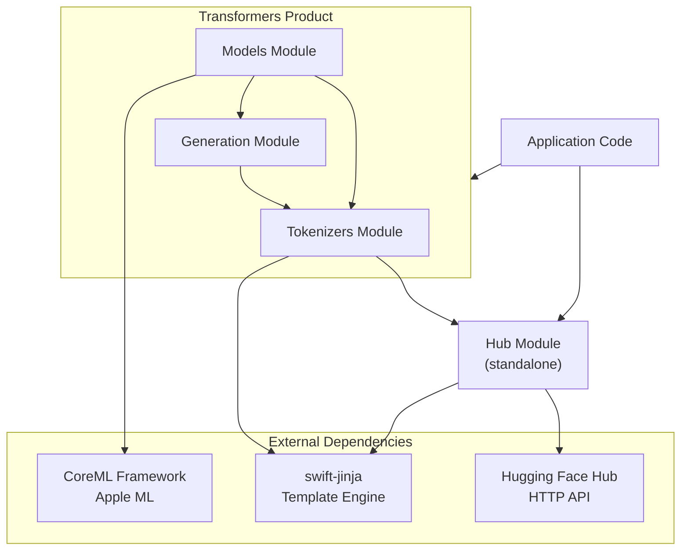
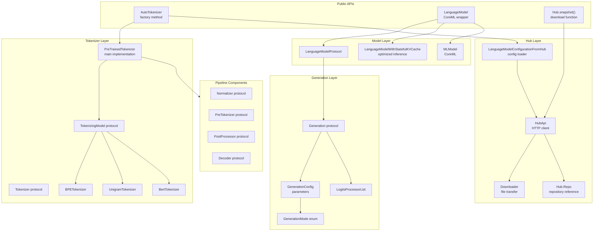
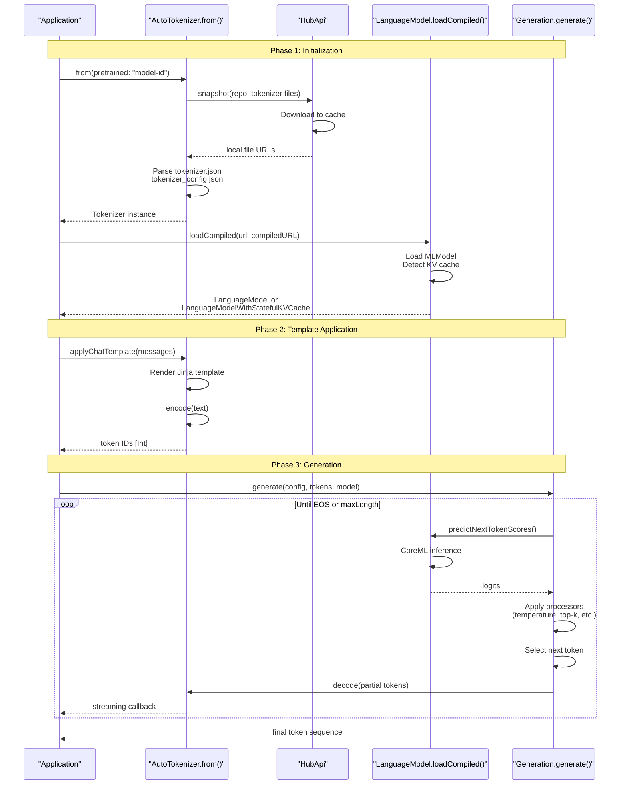
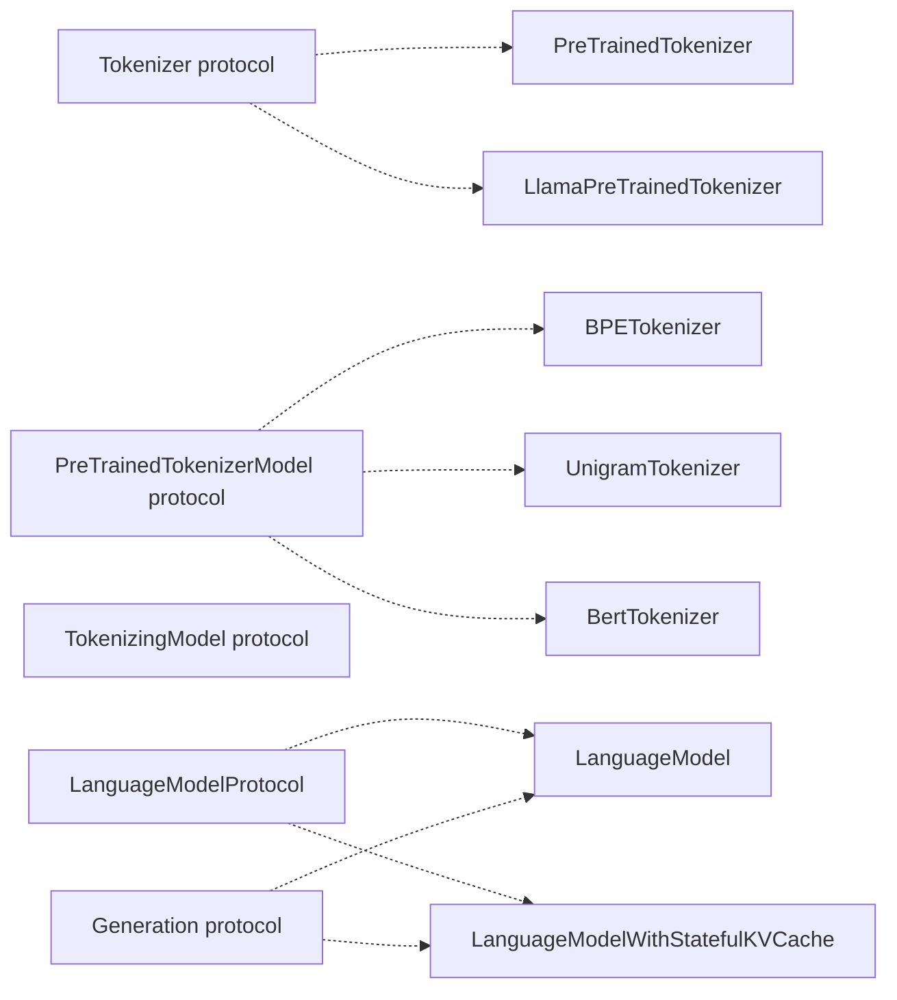
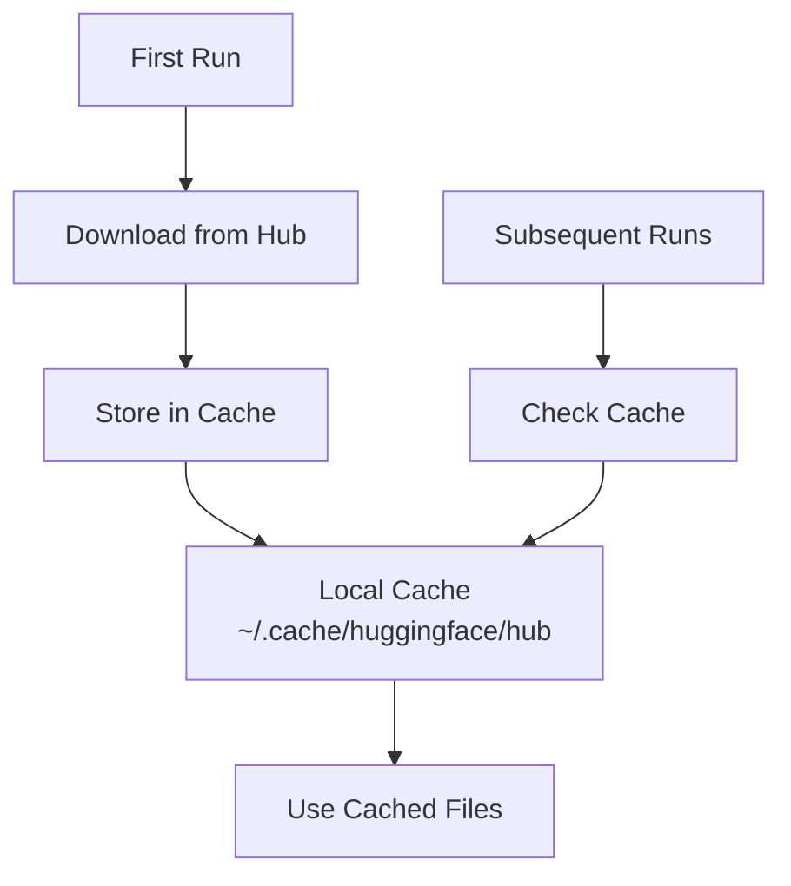

<!-- source: DeepWiki mcp.deepwiki.com · repo huggingface/swift-transformers · page 1 Overview · fetched 2026-10-26 -->

# Overview

<details>
<summary>Relevant source files</summary>

The following files were used as context for generating this wiki page:

- [LICENSE](LICENSE)
- [Package.swift](Package.swift)
- [README.md](README.md)
- [Sources/Generation/GenerationConfig.swift](Sources/Generation/GenerationConfig.swift)
- [Tests/TokenizersTests/Resources/tokenizer.json](Tests/TokenizersTests/Resources/tokenizer.json)
- [Tests/TokenizersTests/Resources/tokenizer_config.json](Tests/TokenizersTests/Resources/tokenizer_config.json)
- [media/swift-t-banner.png](media/swift-t-banner.png)

</details>


`swift-transformers` is a Swift library that brings language model capabilities to iOS and macOS applications through a modular architecture designed for on-device machine learning. The library provides utilities for tokenization, model management, and text generation, with seamless integration to the Hugging Face Hub for model downloads and CoreML for on-device inference.

This page covers the library's architecture, core modules, and design principles. For installation instructions, see [Installation and Setup](#1.2). For a complete working example, see [Quick Start Guide](#1.3). For detailed module documentation, see [Tokenizers](#2), [Hub](#3), [Models](#4), and [Generation](#5).

Sources: [README.md:15-21](), [Package.swift:11-18]()

## Purpose and Scope

The library addresses three key challenges in bringing language models to Swift applications:

1. **Text Processing**: Converting text to token IDs and back, with support for chat templates and special tokens
2. **Model Management**: Downloading, caching, and loading language models from Hugging Face Hub
3. **Text Generation**: Orchestrating model inference with various decoding strategies

The library is designed for applications that need to run language models locally on Apple devices using CoreML, without requiring server-side inference infrastructure.

Sources: [README.md:19-26]()

## Module Architecture

The library consists of four primary modules that build on each other in a layered dependency structure:



**Module Dependency Table**

| Module | Dependencies | Purpose |
|--------|-------------|---------|
| `Hub` | `swift-jinja` | Model downloads, file management, configuration loading |
| `Tokenizers` | `Hub`, `swift-jinja` | Text tokenization, chat templates, encoding/decoding |
| `Generation` | `Tokenizers` | Text generation algorithms and logits processing |
| `Models` | `Tokenizers`, `Generation` | CoreML model wrappers and inference orchestration |

Sources: [Package.swift:11-32](), [README.md:25-26]()

## Core Components and Code Entities

The following diagram maps high-level concepts to concrete Swift types in the codebase:



Sources: [Package.swift:14-26](), [README.md:32-37]()

## End-to-End Workflow

A typical usage flow involves three phases: initialization, template application, and generation. The following diagram shows how data flows through the system from model identifier to generated text:



Sources: [README.md:28-106]()

## Module Responsibilities

### Hub Module

The `Hub` module provides the foundation for all model and tokenizer acquisition:

**Key Types:**
- `HubApi`: HTTP client for Hugging Face Hub API
- `Downloader`: Manages file downloads with resume capability and progress reporting
- `Hub.Repo`: Repository reference with `id` and `type` properties
- `LanguageModelConfigurationFromHub`: Lazy configuration loader

**Capabilities:**
- Resume-capable downloads with retry logic
- Local caching with integrity verification (ETag, SHA256)
- Offline mode using cached files
- Progress callbacks for download status

Sources: [Package.swift:24](), [README.md:67-82]()

### Tokenizers Module

The `Tokenizers` module handles all text processing:

**Key Types:**
- `AutoTokenizer`: Factory for creating tokenizer instances
- `PreTrainedTokenizer`: Main tokenizer implementation with full pipeline
- `TokenizingModel`: Protocol implemented by `BPETokenizer`, `UnigramTokenizer`, `BertTokenizer`
- Pipeline components: `Normalizer`, `PreTokenizer`, `PostProcessor`, `Decoder`

**Capabilities:**
- Text encoding to token IDs
- Token decoding to text
- Chat template rendering via Jinja
- Special token handling
- Tool calling format support

Sources: [Package.swift:26](), [README.md:28-64]()

### Models Module

The `Models` module wraps CoreML models for text generation:

**Key Types:**
- `LanguageModel`: Basic CoreML model wrapper
- `LanguageModelWithStatefulKVCache`: Optimized wrapper for models with stateful key-value caching
- `LanguageModelProtocol`: Common interface for both implementations

**Capabilities:**
- CoreML model loading from compiled `.mlmodelc` files
- Automatic KV cache detection
- Token score prediction
- Context length management

Sources: [Package.swift:25](), [README.md:84-106]()

### Generation Module

The `Generation` module implements text generation algorithms:

**Key Types:**
- `Generation`: Protocol implemented by model classes
- `GenerationConfig`: Configuration structure with all generation parameters
- `GenerationMode`: Enum with values `.greedy`, `.sample`, `.beam`, `.groupBeam`, `.contrastiveSearch`
- `LogitsProcessorList`: Chain of logits processors

**Capabilities:**
- Multiple generation strategies
- Temperature, top-k, top-p, min-p sampling
- Repetition penalty
- Streaming output via callbacks

Sources: [Package.swift:23](), [Sources/Generation/GenerationConfig.swift:1-124]()

## Design Principles

### Protocol-Oriented Design

The library uses Swift protocols extensively to enable flexibility and testability:



This enables:
- Easy mocking for tests
- Alternative implementations without breaking existing code
- Composition of pipeline components

Sources: [Package.swift:7-9]()

### Configuration-Driven Instantiation

Components are instantiated based on JSON configuration files downloaded from Hugging Face Hub:

| Configuration File | Purpose | Used By |
|-------------------|---------|---------|
| `tokenizer_config.json` | Tokenizer metadata and special tokens | `AutoTokenizer` |
| `tokenizer.json` | Full tokenizer specification (vocab, merges, pipeline) | `AutoTokenizer` |
| `config.json` | Model architecture and generation parameters | `LanguageModel` |

This allows the library to automatically configure itself for any model without code changes.

Sources: [Tests/TokenizersTests/Resources/tokenizer_config.json:1-9](), [Tests/TokenizersTests/Resources/tokenizer.json:1-51]()

### Offline-First Architecture

After initial download, the library operates entirely offline:



**Offline Capabilities:**
- Models and tokenizers cached locally after first download
- `AutoTokenizer.from(modelFolder:)` loads from local directory
- `LanguageModel.loadCompiled(url:tokenizer:)` uses pre-bundled assets
- Metadata stored for integrity verification

This design enables:
- Reduced latency after initial setup
- Operation without network connectivity
- Privacy-preserving on-device inference
- Ability to bundle models with app distribution

Sources: [README.md:91-119]()

### Modern Swift Concurrency

The library uses Swift's modern concurrency features throughout:

**Async/Await:**
- `AutoTokenizer.from(pretrained:)` is `async throws`
- `Hub.snapshot()` is `async throws`
- All network operations use structured concurrency

**Actor Isolation:**
- `NetworkMonitor` actor for connectivity detection
- Thread-safe state management in downloaders

**Strict Concurrency:**
- All targets compiled with `StrictConcurrency` enabled
- Sendable conformance for safe concurrent access

Sources: [Package.swift:6-9]()

## Integration Points

### Hugging Face Hub

The library integrates with Hugging Face Hub's HTTP API:

- Repository access via `https://huggingface.co/{repo-id}`
- File metadata via `/api/models/{repo-id}`
- Direct file downloads with range request support
- Redirect security policies for CDN endpoints

Sources: [README.md:67-82]()

### CoreML

Integration with Apple's CoreML framework:

- Loading compiled models (`.mlmodelc` format)
- `MLModel` wrapper for prediction
- Compute unit selection (CPU, GPU, Neural Engine)
- Stateful models with `MLState` for KV caching

Sources: [Package.swift:25]()

### swift-jinja

Integration with the `swift-jinja` template engine:

- Chat template rendering from Jinja2 templates
- Variable substitution and control flow
- Filter functions for text manipulation
- Used by `applyChatTemplate()` method

Sources: [Package.swift:20](), [README.md:32-37]()

## Typical Usage Pattern

A complete example showing initialization, template application, and generation:

```swift
// 1. Initialize tokenizer (downloads from Hub if needed)
let tokenizer = try await AutoTokenizer.from(
    pretrained: "deepseek-ai/DeepSeek-R1-Distill-Qwen-7B"
)

// 2. Load compiled CoreML model
let modelURL = URL(fileURLWithPath: "path/to/model.mlmodelc")
let model = try LanguageModel.loadCompiled(url: modelURL, tokenizer: tokenizer)

// 3. Prepare input with chat template
let messages = [["role": "user", "content": "Explain Swift concurrency"]]
let inputTokens = try tokenizer.applyChatTemplate(messages: messages)

// 4. Configure generation
let config = GenerationConfig(
    maxNewTokens: 100,
    temperature: 0.7,
    topP: 0.9
)

// 5. Generate text
let output = try model.generate(
    inputTokens: inputTokens,
    config: config
) { inProgressGeneration in
    // Stream partial results
    print(inProgressGeneration.text, terminator: "")
}
```

For detailed usage examples, see [Quick Start Guide](#1.3).

Sources: [README.md:28-106]()

## Platform Requirements

The library supports:

- **iOS**: 16.0 and later
- **macOS**: 13.0 and later
- **Swift**: 5.9 and later

All targets are compiled with strict concurrency checking enabled for thread safety.

Sources: [Package.swift:13](), [Package.swift:7-9]()

## License

The library is released under the Apache 2.0 license.

Sources: [LICENSE:1-202](), [README.md:169-171]()

---

