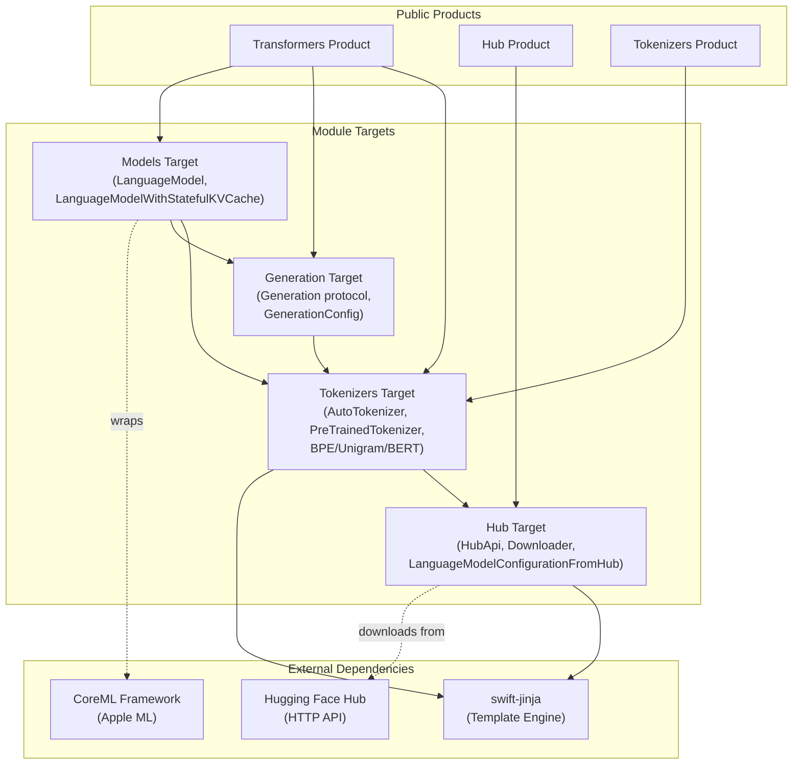
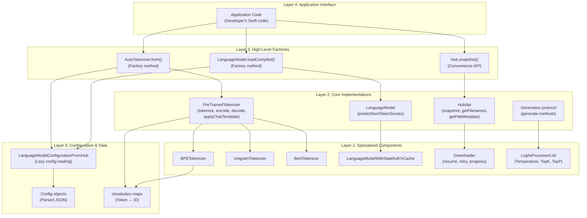
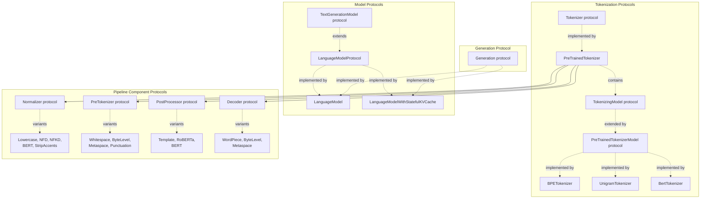
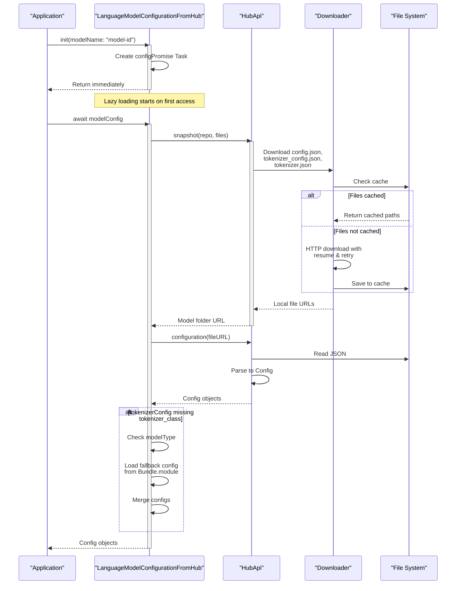
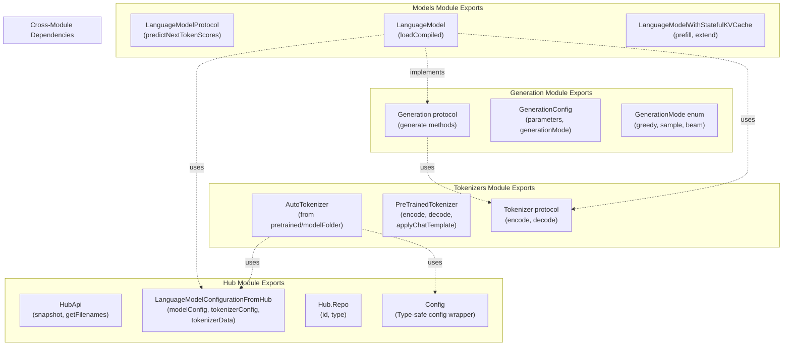
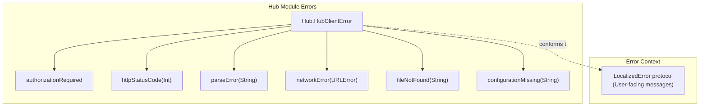

<!-- source: DeepWiki mcp.deepwiki.com · repo huggingface/swift-transformers · page 1.1 Architecture · fetched 2026-10-26 -->

# Architecture

<details>
<summary>Relevant source files</summary>

The following files were used as context for generating this wiki page:

- [LICENSE](LICENSE)
- [Package.swift](Package.swift)
- [README.md](README.md)
- [Sources/Generation/GenerationConfig.swift](Sources/Generation/GenerationConfig.swift)
- [Sources/Hub/Hub.swift](Sources/Hub/Hub.swift)
- [Tests/TokenizersTests/Resources/tokenizer.json](Tests/TokenizersTests/Resources/tokenizer.json)
- [Tests/TokenizersTests/Resources/tokenizer_config.json](Tests/TokenizersTests/Resources/tokenizer_config.json)
- [media/swift-t-banner.png](media/swift-t-banner.png)

</details>


This document describes the overall system architecture of swift-transformers, explaining how the four core modules (Hub, Tokenizers, Models, Generation) interact, their dependency relationships, and the layered design pattern. For specific module details, see the individual module pages: [Hub](#3), [Tokenizers](#2), [Models](#4), and [Generation](#5).

## Module Overview

The swift-transformers library is organized into four primary modules, each with distinct responsibilities. These modules are defined as separate targets in the Swift Package Manager configuration and exposed through library products.

### Core Modules

| Module | Purpose | Primary Classes | Dependencies |
|--------|---------|-----------------|--------------|
| **Hub** | Model acquisition, file downloads, configuration management | `HubApi`, `Downloader`, `LanguageModelConfigurationFromHub` | `swift-jinja` |
| **Tokenizers** | Text-to-token conversion, chat templating | `AutoTokenizer`, `PreTrainedTokenizer`, tokenizing models | Hub, `swift-jinja` |
| **Generation** | Text generation algorithms, logits processing | `Generation` protocol, `GenerationConfig`, `LogitsProcessorList` | Tokenizers |
| **Models** | CoreML model loading and inference | `LanguageModel`, `LanguageModelWithStatefulKVCache` | Tokenizers, Generation |

The **Transformers** product aggregates Tokenizers, Generation, and Models into a single import for application developers, while Hub can be used independently for model downloads.

**Module Dependency Graph**



Sources: [Package.swift:11-32]()

## Layered Architecture

The system follows a layered architecture pattern where each layer builds abstractions on top of lower layers. This design enforces clear separation of concerns and enables independent testing and development of each layer.

**Layer Structure**



**Layer Responsibilities:**

- **Layer 0**: Raw data structures parsed from JSON files, vocabulary maps, and metadata
- **Layer 1**: Algorithm implementations (tokenizing models, download logic, generation strategies)
- **Layer 2**: Orchestration classes that compose Layer 1 components into cohesive workflows
- **Layer 3**: Factory methods and convenience APIs that simplify common initialization patterns
- **Layer 4**: Application code that consumes the library

Sources: [Package.swift:11-32](), [Sources/Hub/Hub.swift:10-109]()

## Key Abstractions and Protocols

The library uses protocol-oriented design extensively to enable flexibility and extensibility. Core abstractions define contracts that multiple implementations fulfill.

**Protocol Hierarchy**



**Core Type Definitions:**

| Abstraction | Location | Purpose |
|-------------|----------|---------|
| `Tokenizer` | Tokenizers module | Base tokenization interface (encode, decode) |
| `TokenizingModel` | Tokenizers module | Core tokenization algorithm (BPE, Unigram, BERT) |
| `LanguageModelProtocol` | Models module | Model inference interface |
| `Generation` | Generation module | Text generation algorithm contract |
| `Config` | Hub module | Type-safe configuration wrapper |

Sources: [Package.swift:22-26]()

## Configuration Loading Architecture

Configuration management is centralized in the `LanguageModelConfigurationFromHub` class, which provides lazy, asynchronous loading of model and tokenizer configurations with comprehensive fallback mechanisms.

**Configuration Loading Flow**



**Fallback Configuration Sources:**

1. **Primary**: `tokenizer_config.json` from Hub repository
2. **Fallback**: Bundled configurations in `Sources/Hub/Resources/`
3. **Inference**: Capitalize `model_type` to guess `tokenizer_class`

Sources: [Sources/Hub/Hub.swift:111-340]()

## Data Flow: Download to Inference

The complete data pipeline from model discovery to text generation demonstrates how all modules collaborate.

**End-to-End Data Pipeline**

```mermaid
flowchart LR
    subgraph "Phase 1: Discovery"
        A["Developer specifies<br/>model identifier"]
        B["Hub.Repo(id:)"]
        C["HubApi.snapshot()"]
    end
    
    subgraph "Phase 2: Download"
        D["Downloader instances"]
        E["Resume-capable<br/>HTTP transfers"]
        F["Local cache<br/>~/.cache/huggingface"]
    end
    
    subgraph "Phase 3: Configuration"
        G["LanguageModelConfigurationFromHub"]
        H["Parse JSON files:<br/>config.json,<br/>tokenizer_config.json,<br/>tokenizer.json"]
        I["Config objects"]
    end
    
    subgraph "Phase 4: Instantiation"
        J["AutoTokenizer.from()"]
        K["TokenizingModel.from()<br/>BPE/Unigram/BERT"]
        L["Build pipeline:<br/>Normalizer + PreTokenizer +<br/>PostProcessor + Decoder"]
        M["PreTrainedTokenizer"]
        
        N["LanguageModel.loadCompiled()"]
        O["Load .mlmodelc"]
        P["Detect KV cache"]
        Q["LanguageModel or<br/>LanguageModelWithStatefulKVCache"]
    end
    
    subgraph "Phase 5: Runtime"
        R["Text → encode()"]
        S["applyChatTemplate()"]
        T["generate() loop"]
        U["CoreML inference"]
        V["LogitsProcessorList"]
        W["Token selection"]
        X["decode() → text"]
    end
    
    A --> B --> C
    C --> D --> E --> F
    F --> G --> H --> I
    I --> J --> K --> L --> M
    I --> N --> O --> P --> Q
    M --> R --> S --> T
    Q --> T
    T --> U --> V --> W
    W --> T
    W --> X
```



Sources: [Sources/Hub/Hub.swift:219-245](), [README.md:32-106]()

## Module Interaction Patterns

The modules interact through well-defined interfaces, with each module exposing specific classes and protocols for cross-module communication.

**Module Communication**



**Key Interaction Points:**

1. **Hub → Tokenizers**: `LanguageModelConfigurationFromHub` provides parsed configurations
2. **Tokenizers → Models**: `Tokenizer` protocol enables token encoding/decoding
3. **Generation → Tokenizers**: `Generation` protocol requires tokenizer for EOS detection
4. **Models → Generation**: `LanguageModel` implements `Generation` protocol

Sources: [Package.swift:22-26](), [Sources/Hub/Hub.swift:111-154]()

## Concurrency and Threading Model

The library uses Swift's modern concurrency features (`async`/`await`) throughout, with strict concurrency checking enabled at the package level.

**Concurrency Configuration:**

- **Strict Concurrency**: Enabled via `StrictConcurrency` experimental feature
- **Sendable Conformance**: Core types marked `Sendable` for safe cross-actor usage
- **Async Initialization**: Configuration loading uses `Task` for lazy evaluation
- **Actor Isolation**: Thread-safe state management in `Downloader` and cache systems

```swift
// Example: Lazy async configuration loading
let configPromise: Task<Configurations, Error>
public var modelConfig: Config? {
    get async throws {
        try await configPromise.value.modelConfig
    }
}
```

Sources: [Package.swift:6-9](), [Sources/Hub/Hub.swift:117-164]()

## Error Handling Strategy

The library defines structured error types for each module, enabling precise error handling and recovery strategies.

**Error Type Hierarchy**



**Error Categories:**

| Category | Error Types | Recovery Strategy |
|----------|-------------|-------------------|
| Network | `networkError`, `httpStatusCode` | Retry with exponential backoff |
| Authentication | `authorizationRequired` | Prompt for Hub token |
| Parsing | `parseError`, `jsonSerialization` | Check configuration format |
| File System | `fileNotFound`, `fileSystemError` | Verify cache integrity |
| Configuration | `configurationMissing` | Use fallback configurations |

Sources: [Sources/Hub/Hub.swift:18-77]()

## Extension Points

The architecture provides several extension points for customization:

**Extensibility Mechanisms:**

| Extension Point | Protocol/Factory | Use Case |
|-----------------|------------------|----------|
| Custom Tokenizers | `Tokenizer`, `TokenizingModel` | Add new tokenization algorithms |
| Pipeline Components | `Normalizer`, `PreTokenizer`, `PostProcessor`, `Decoder` | Customize text processing |
| Generation Strategies | `Generation` protocol | Implement new generation modes |
| Configuration Formats | `Config` parsing | Support custom configuration schemas |

**Factory Pattern Usage:**

- `AutoTokenizer.from()`: Automatic tokenizer instantiation based on configuration
- `TokenizingModel.from()`: Factory for BPE, Unigram, BERT tokenizers
- Component factories: `Normalizer.from()`, `PreTokenizer.from()`, etc.

Sources: [Sources/Generation/GenerationConfig.swift:100-121]()

## Summary

The swift-transformers architecture achieves several design goals:

1. **Modularity**: Clear separation between Hub (acquisition), Tokenizers (processing), Models (inference), and Generation (synthesis)
2. **Layered Design**: Each layer builds abstractions on lower layers with minimal coupling
3. **Protocol-Oriented**: Extensive use of protocols enables flexibility and testing
4. **Offline-First**: Comprehensive caching and fallback mechanisms for reliable offline operation
5. **Modern Swift**: Full adoption of async/await, strict concurrency, and type safety

The dependency flow (Hub → Tokenizers → Generation/Models) ensures that higher-level modules can rely on stable lower-level abstractions, while protocol-oriented design enables customization without modifying core implementations.

---

