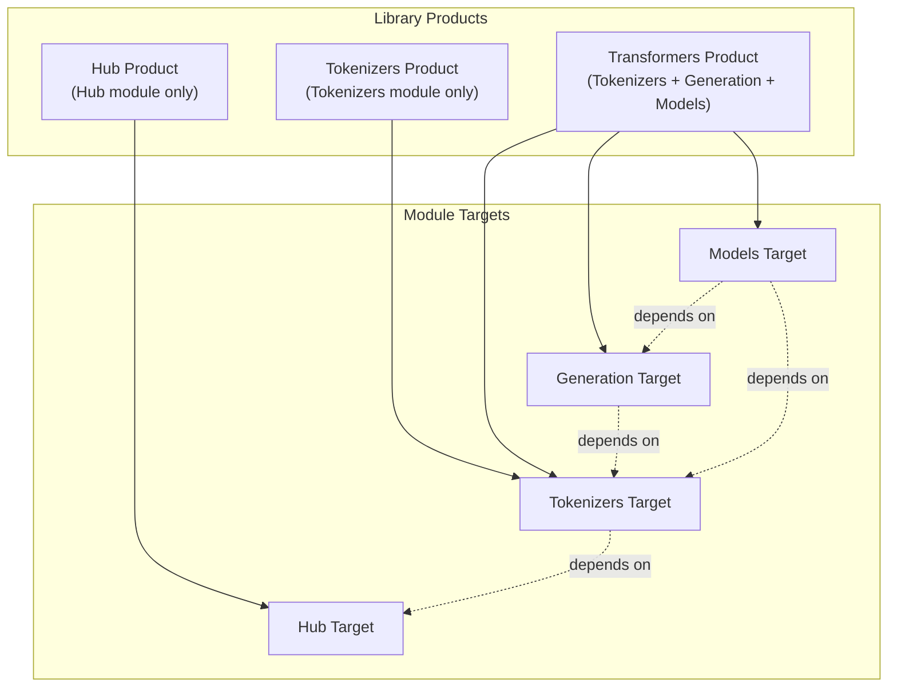
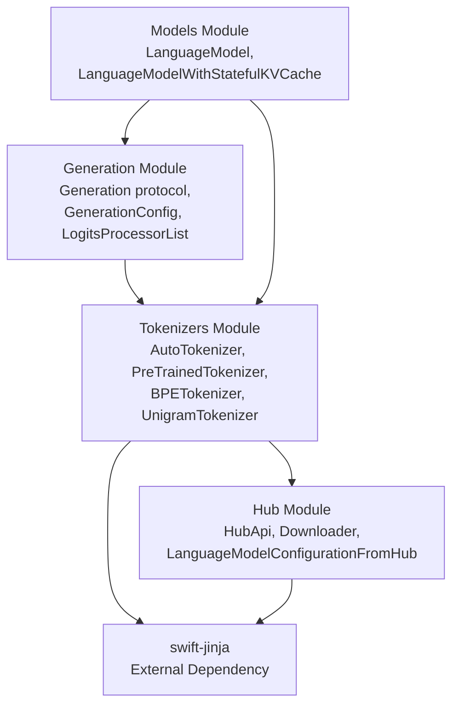

<!-- source: DeepWiki mcp.deepwiki.com · repo huggingface/swift-transformers · page 1.2 Installation and Setup · fetched 2026-10-26 -->

# Installation and Setup

<details>
<summary>Relevant source files</summary>

The following files were used as context for generating this wiki page:

- [LICENSE](LICENSE)
- [Package.swift](Package.swift)
- [README.md](README.md)
- [Sources/Generation/GenerationConfig.swift](Sources/Generation/GenerationConfig.swift)
- [Tests/TokenizersTests/Resources/tokenizer.json](Tests/TokenizersTests/Resources/tokenizer.json)
- [Tests/TokenizersTests/Resources/tokenizer_config.json](Tests/TokenizersTests/Resources/tokenizer_config.json)
- [media/swift-t-banner.png](media/swift-t-banner.png)

</details>


This page covers the installation of swift-transformers via Swift Package Manager, including platform requirements, dependency configuration, and available library products. For architectural details about how the modules interact, see [Architecture](#1.1). For complete usage examples, see [Quick Start Guide](#1.3).

---

## Platform Requirements

swift-transformers requires:

| Requirement | Minimum Version |
|------------|----------------|
| Swift Tools | 5.9 |
| iOS | 16.0 |
| macOS | 13.0 |

The library depends on Apple's CoreML framework for model inference, which is only available on Apple platforms. All targets are built with strict concurrency checking enabled to ensure thread safety.

**Sources:** [Package.swift:1-13]()

---

## Swift Package Manager Integration

### Adding to Package.swift

To add swift-transformers as a dependency to a Swift package, add the following to your `Package.swift` file:

```swift
dependencies: [
    .package(url: "https://github.com/huggingface/swift-transformers", from: "0.1.17")
]
```

Then add the appropriate product to your target's dependencies. The library provides three products with different module combinations (see [Available Products](#available-products) below).

**Example: Using the Transformers Product**

```swift
targets: [
    .target(
        name: "YourTargetName",
        dependencies: [
            .product(name: "Transformers", package: "swift-transformers")
        ]
    )
]
```

**Sources:** [README.md:121-142](), [Package.swift:11-18]()

### Adding to Xcode Project

For Xcode projects:

1. Navigate to **File → Add Package Dependencies...**
2. Enter the repository URL: `https://github.com/huggingface/swift-transformers`
3. Select version `0.1.17` or later
4. Choose the appropriate product for your target (see below)

---

## Available Products

swift-transformers exposes three distinct products, allowing you to include only the functionality your application needs:



**Product Comparison**

| Product | Modules Included | Use Case |
|---------|-----------------|----------|
| `Hub` | Hub | Download and cache models from Hugging Face Hub only |
| `Tokenizers` | Tokenizers (+ Hub) | Text tokenization and chat templating |
| `Transformers` | Tokenizers, Generation, Models (+ Hub) | Complete language model inference pipeline |

### Hub Product

Use when you only need to download files from Hugging Face Hub:

```swift
dependencies: [
    .product(name: "Hub", package: "swift-transformers")
]
```

Import with: `import Hub`

### Tokenizers Product

Use when you need tokenization but not model inference:

```swift
dependencies: [
    .product(name: "Tokenizers", package: "swift-transformers")
]
```

Import with: `import Tokenizers` (Hub is automatically available)

### Transformers Product

The complete product for language model applications. This is the most commonly used option:

```swift
dependencies: [
    .product(name: "Transformers", package: "swift-transformers")
]
```

Import with: `import Hub`, `import Tokenizers`, `import Generation`, and/or `import Models` as needed.

**Sources:** [Package.swift:14-18](), [README.md:25-26]()

---

## Module Dependency Structure

Understanding the internal dependency graph helps when troubleshooting build issues or selecting the appropriate product:



**Dependency Details**

- **Hub**: Foundation module with no internal dependencies. Depends on `swift-jinja` for template processing.
- **Tokenizers**: Depends on Hub for configuration loading and on `swift-jinja` for chat template rendering.
- **Generation**: Depends on Tokenizers for token encoding/decoding.
- **Models**: Depends on both Tokenizers and Generation to provide complete inference capabilities.

The dependency on `swift-jinja` (version 2.0.0+) is managed automatically by Swift Package Manager and does not require manual configuration.

**Sources:** [Package.swift:19-26]()

---

## External Dependencies

swift-transformers has a single external dependency:

| Package | Version | Purpose |
|---------|---------|---------|
| [swift-jinja](https://github.com/huggingface/swift-jinja) | 2.0.0+ | Jinja2 template engine for chat template rendering |

The `Jinja` product from swift-jinja is used by:
- **Hub module**: For processing configuration templates
- **Tokenizers module**: For applying chat templates via `AutoTokenizer.applyChatTemplate()`

This dependency is automatically resolved by Swift Package Manager.

**Sources:** [Package.swift:19-21]()

---

## Concurrency Settings

All targets are built with Swift's strict concurrency checking enabled:

```swift
let swiftSettings: [SwiftSetting] = [
    .enableExperimentalFeature("StrictConcurrency")
]
```

This ensures thread-safe operation when using async/await patterns throughout the library. The setting is applied at the package level and does not require configuration in consuming projects.

**Sources:** [Package.swift:6-9]()

---

## Verification

After adding the dependency, verify the installation by importing the modules in your Swift code:

```swift
import Hub
import Tokenizers
import Generation
import Models
```

For a minimal verification that the library is correctly installed:

```swift
import Tokenizers

// This will compile if the installation succeeded
let config = GenerationConfig(maxNewTokens: 50)
print("swift-transformers installed successfully")
```

---

## License

swift-transformers is licensed under the Apache License 2.0. See [LICENSE]() for the complete license text.

**Sources:** [LICENSE:1-201]()

---

## Next Steps

Now that swift-transformers is installed, proceed to:

- **[Quick Start Guide](#1.3)**: Complete working example of downloading a model and generating text
- **[Architecture](#1.1)**: Understand how the modules interact
- **[Hub](#3)**: Learn about downloading and caching models
- **[Tokenizers](#2)**: Learn about text tokenization and chat templates

**Sources:** [README.md:1-172](), [Package.swift:1-33]()

---

