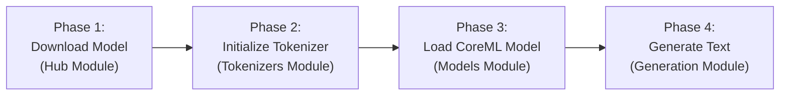
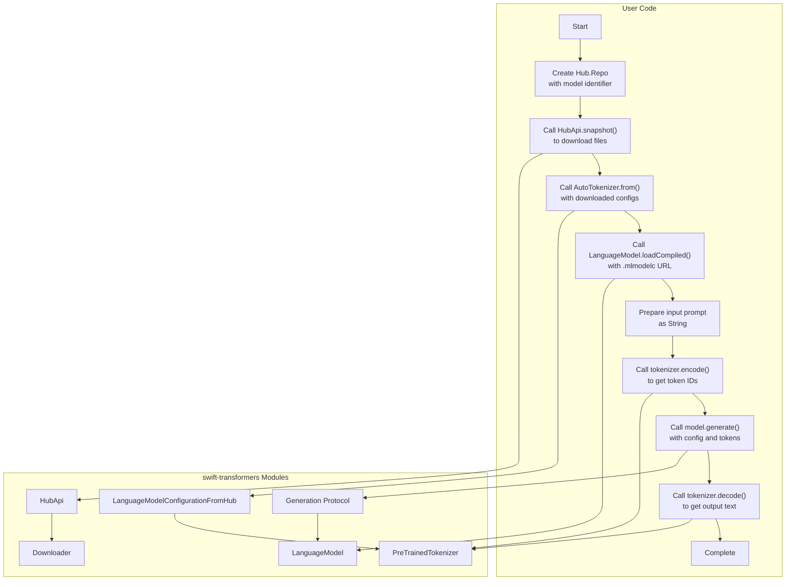
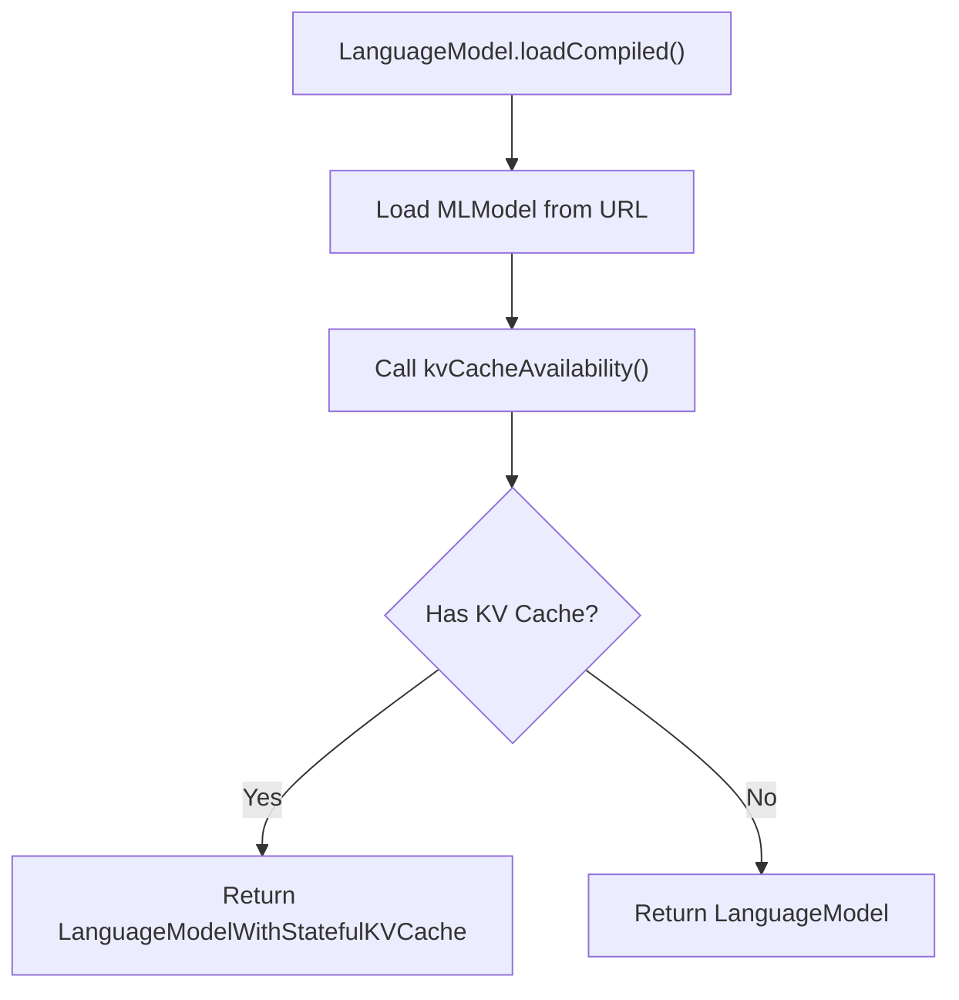
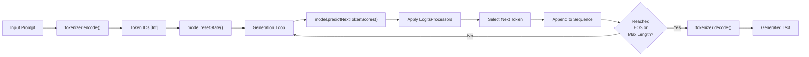

<!-- source: DeepWiki mcp.deepwiki.com · repo huggingface/swift-transformers · page 1.3 Quick Start Guide · fetched 2026-10-26 -->

# Quick Start Guide

<details>
<summary>Relevant source files</summary>

The following files were used as context for generating this wiki page:

- [LICENSE](LICENSE)
- [README.md](README.md)
- [Sources/Hub/HubApi.swift](Sources/Hub/HubApi.swift)
- [Sources/Models/LanguageModel.swift](Sources/Models/LanguageModel.swift)
- [Sources/Models/LanguageModelTypes.swift](Sources/Models/LanguageModelTypes.swift)
- [Sources/Tokenizers/Tokenizer.swift](Sources/Tokenizers/Tokenizer.swift)
- [Tests/HubTests/HubApiTests.swift](Tests/HubTests/HubApiTests.swift)
- [Tests/TokenizersTests/Resources/tokenizer.json](Tests/TokenizersTests/Resources/tokenizer.json)
- [Tests/TokenizersTests/Resources/tokenizer_config.json](Tests/TokenizersTests/Resources/tokenizer_config.json)
- [media/swift-t-banner.png](media/swift-t-banner.png)

</details>


This guide provides a complete working example demonstrating the end-to-end workflow of using swift-transformers: downloading a model from Hugging Face Hub, initializing a tokenizer, loading a CoreML model, and generating text. 

For detailed information about installation and package setup, see [Installation and Setup](#1.2). For in-depth coverage of individual modules, see [Tokenizers](#2), [Hub](#3), [Models](#4), and [Generation](#5).

## Overview

The swift-transformers workflow consists of four main phases that build upon each other. Each phase uses a dedicated module to provide clean separation of concerns:



**Sources:** [README.md:23-120]()

## Prerequisites

Before starting, ensure:

- **Platform Requirements:** macOS 15.0+, iOS 18.0+, tvOS 18.0+, visionOS 2.0+, or watchOS 11.0+
- **CoreML Model:** A compiled CoreML language model (`.mlmodelc` format)
- **Network Access:** Internet connectivity for initial model download (optional for bundled models)
- **Swift Package:** swift-transformers added to your project (see [Installation and Setup](#1.2))

**Sources:** [Sources/Models/LanguageModel.swift:15](), [README.md:121-142]()

## Basic Workflow

The following diagram maps the conceptual workflow to specific code entities in swift-transformers:



**Sources:** [Sources/Hub/HubApi.swift:346-698](), [Sources/Tokenizers/Tokenizer.swift:851-972](), [Sources/Models/LanguageModel.swift:153-183]()

## Step-by-Step Implementation

### Phase 1: Download Model Files

Use `HubApi.snapshot()` to download required files from Hugging Face Hub. The method handles progress reporting, resumable downloads, and offline caching.

```swift
import Hub

let repo = Hub.Repo(id: "your-model-id")
let modelDirectory = try await HubApi.shared.snapshot(
    from: repo,
    matching: ["config.json", "tokenizer.json", "tokenizer_config.json", "*.mlmodelc/*"]
) { progress in
    print("Download progress: \(progress.fractionCompleted * 100)%")
}
```

| Parameter | Type | Description |
|-----------|------|-------------|
| `from` | `Hub.Repo` | Repository identifier containing the model |
| `matching` | `[String]` | Glob patterns for files to download |
| `progressHandler` | `(Progress) -> Void` | Closure called with download progress |

**Key Classes:**
- `HubApi` [Sources/Hub/HubApi.swift:71-128]() - Main API client for Hub interactions
- `Hub.Repo` [Sources/Hub/HubApi.swift:80]() - Repository identifier structure
- `Downloader` [Sources/Hub/HubApi.swift:547]() - Handles individual file downloads with resume capability

**Sources:** [Sources/Hub/HubApi.swift:575-658](), [README.md:67-82]()

### Phase 2: Initialize Tokenizer

Use `AutoTokenizer.from()` to create a tokenizer instance. This factory method automatically selects the appropriate tokenizer type based on configuration files.

```swift
import Tokenizers

let tokenizer = try await AutoTokenizer.from(
    pretrained: "your-model-id"
)
```

For offline scenarios with bundled files:

```swift
let tokenizerFolder: URL = // path to folder containing tokenizer files
let tokenizer = try await AutoTokenizer.from(
    modelFolder: tokenizerFolder
)
```

**Key Classes:**
- `AutoTokenizer` [Sources/Tokenizers/Tokenizer.swift:851]() - Factory for creating tokenizer instances
- `PreTrainedTokenizer` [Sources/Tokenizers/Tokenizer.swift:454-842]() - Main tokenizer implementation
- `LanguageModelConfigurationFromHub` - Loads tokenizer configuration files

**Sources:** [Sources/Tokenizers/Tokenizer.swift:861-932](), [README.md:91-119]()

### Phase 3: Load CoreML Model

Use `LanguageModel.loadCompiled()` to load a compiled CoreML model. The method automatically detects KV cache support and returns the appropriate model type.

```swift
import Models

let modelURL: URL = // path to compiled .mlmodelc file
let model = try LanguageModel.loadCompiled(
    url: modelURL,
    computeUnits: .cpuAndGPU,
    tokenizer: tokenizer  // Optional: reuse tokenizer to avoid re-downloading
)
```

**Model Detection Flow:**



**Key Classes:**
- `LanguageModel` [Sources/Models/LanguageModel.swift:21-87]() - Standard model wrapper
- `LanguageModelWithStatefulKVCache` [Sources/Models/LanguageModel.swift:485-563]() - Optimized model with state management
- `MLModel` - CoreML framework's model class

**Sources:** [Sources/Models/LanguageModel.swift:162-183](), [Sources/Models/LanguageModel.swift:269-321]()

### Phase 4: Generate Text

Use the `generate()` method with a `GenerationConfig` to produce text. The method supports streaming output via callbacks.

```swift
import Generation

let config = GenerationConfig(
    maxNewTokens: 100,
    temperature: 0.7,
    topK: 50,
    doSample: true
)

let output = try await model.generate(
    config: config,
    prompt: "Explain the Swift programming language in one sentence.",
    callback: { token, probability in
        // Optional: handle streaming tokens
        print(token, terminator: "")
    }
)

print("Generated text: \(output)")
```

**Generation Process:**



**Key Components:**
- `GenerationConfig` - Configuration parameters for generation behavior
- `Generation` protocol - Defines the generation interface
- `LogitsProcessorList` - Applies temperature, top-k, top-p sampling
- `PredictionStringCallback` - Callback type for streaming output

**Sources:** [Sources/Models/LanguageModel.swift:456-478](), [Sources/Models/LanguageModelTypes.swift:96-119]()

## Complete Working Example

Here is a minimal, complete example combining all phases:

```swift
import Foundation
import Hub
import Tokenizers
import Models
import Generation

// Phase 1: Download Model
let repo = Hub.Repo(id: "mlx-community/Qwen2.5-0.5B-Instruct-2bit-mlx")
let modelDirectory = try await HubApi.shared.snapshot(
    from: repo,
    matching: ["config.json", "tokenizer*.json", "*.mlmodelc/*"]
)

// Phase 2: Initialize Tokenizer
let tokenizer = try await AutoTokenizer.from(pretrained: repo.id)

// Phase 3: Load CoreML Model
let modelURL = modelDirectory.appending(path: "model.mlmodelc")
let model = try LanguageModel.loadCompiled(
    url: modelURL,
    tokenizer: tokenizer
)

// Phase 4: Generate Text
let config = GenerationConfig(
    maxNewTokens: 50,
    temperature: 0.8,
    doSample: true
)

let prompt = "What is Swift?"
let output = try await model.generate(
    config: config,
    prompt: prompt
) { token, _ in
    print(token, terminator: "")
    fflush(stdout)
}

print("\n\nFinal output: \(output)")
```

**Sources:** [README.md:23-88](), [Tests/HubTests/HubApiTests.swift:218-251]()

## Chat Template Support

For conversational models, use `applyChatTemplate()` to format messages according to the model's template:

```swift
let messages: [[String: Any]] = [
    ["role": "system", "content": "You are a helpful assistant."],
    ["role": "user", "content": "Explain async/await in Swift."]
]

let tokenIds = try tokenizer.applyChatTemplate(messages: messages)
let output = try await model.generate(
    config: config,
    tokens: .tensor(MLTensor(tokenIds))
)
```

**Sources:** [Sources/Tokenizers/Tokenizer.swift:696-841](), [README.md:28-64]()

## Data Flow Summary

The following table summarizes the data transformations through each phase:

| Phase | Input | Processing | Output | Key Class |
|-------|-------|------------|--------|-----------|
| **Download** | Model ID (String) | HTTP download with retry | Local file URLs | `HubApi` |
| **Tokenization** | Text (String) | Normalize, pre-tokenize, encode | Token IDs ([Int]) | `PreTrainedTokenizer` |
| **Model Loading** | .mlmodelc URL | Load MLModel, detect capabilities | `LanguageModel` instance | `LanguageModel` |
| **Generation** | Token IDs, Config | Iterative prediction, sampling | Token IDs ([Int]) | `Generation` protocol |
| **Decoding** | Token IDs ([Int]) | Decode, post-process | Text (String) | `PreTrainedTokenizer` |

**Sources:** [Sources/Tokenizers/Tokenizer.swift:614-673](), [Sources/Models/LanguageModel.swift:60-86]()

## Offline Usage

For bundled models that don't require network access:

```swift
// Use local file paths
let tokenizerFolder: URL = Bundle.main.url(forResource: "tokenizer", withExtension: nil)!
let modelURL: URL = Bundle.main.url(forResource: "model", withExtension: "mlmodelc")!

// Initialize without network calls
let tokenizer = try await AutoTokenizer.from(modelFolder: tokenizerFolder)
let model = try LanguageModel.loadCompiled(url: modelURL, tokenizer: tokenizer)

// Generate as normal
let output = try await model.generate(config: config, prompt: "Hello")
```

**Key Points:**
- Pass `tokenizer` parameter to `loadCompiled()` to prevent Hub configuration fetching
- Ensure tokenizer files (`tokenizer.json`, `tokenizer_config.json`) are bundled with the app
- Model initialization is synchronous after initial loading

**Sources:** [README.md:91-119](), [Sources/Models/LanguageModel.swift:40-56]()

## Error Handling

Common errors and their handling:

| Error Type | Cause | Resolution |
|------------|-------|------------|
| `HubClientError.authorizationRequired` | Gated model without token | Set `HF_TOKEN` environment variable |
| `HubClientError.fileNotFound` | Missing model file | Verify model ID and file patterns |
| `TokenizerError.missingConfig` | Missing tokenizer files | Ensure `tokenizer.json` is downloaded |
| `TokenizerError.unsupportedTokenizer` | Unknown tokenizer type | Use `strict: false` in AutoTokenizer |
| `EnvironmentError.offlineModeError` | Missing cache in offline mode | Download files before going offline |

**Sources:** [Sources/Hub/HubApi.swift:288-308](), [Sources/Tokenizers/Tokenizer.swift:18-52]()

## Next Steps

- **Tokenizer Details:** Learn about chat templates, special tokens, and custom tokenizers in [Tokenizers](#2)
- **Hub Configuration:** Explore offline mode, authentication, and custom endpoints in [Hub](#3)
- **Model Optimization:** Understand KV cache and compute unit selection in [Models](#4)
- **Generation Strategies:** Configure sampling, beam search, and streaming in [Generation](#5)
- **Testing:** See how to validate tokenization and model behavior in [Testing](#6)

**Sources:** [README.md:144-168]()

---

