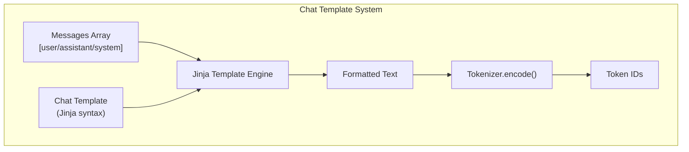
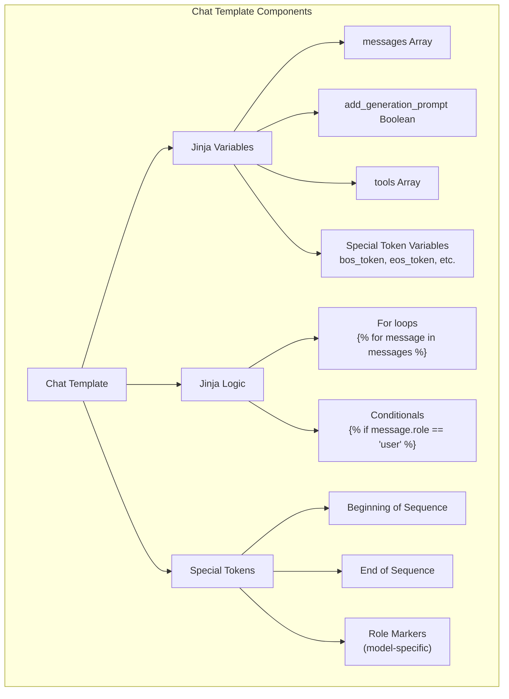
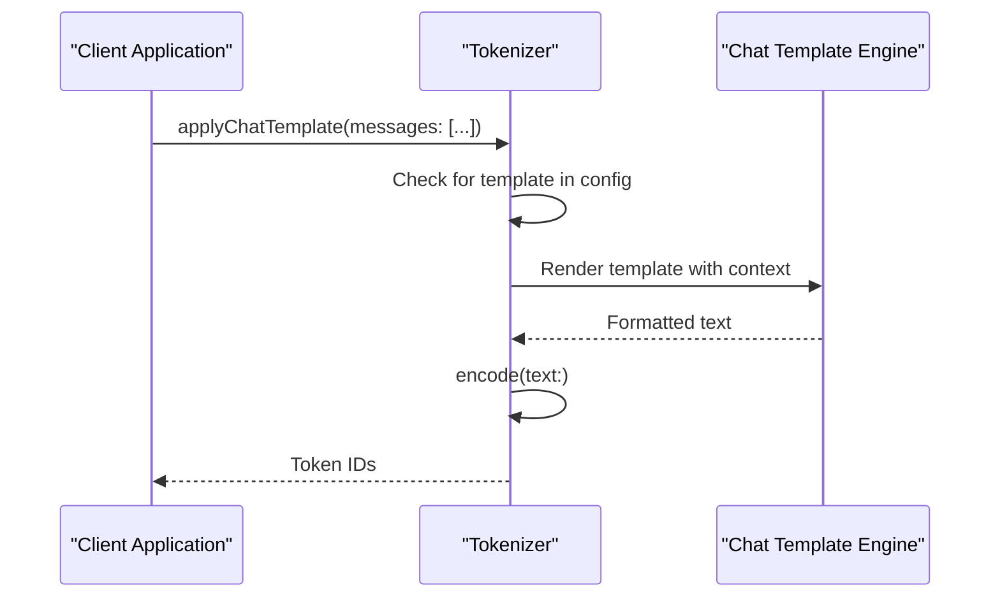
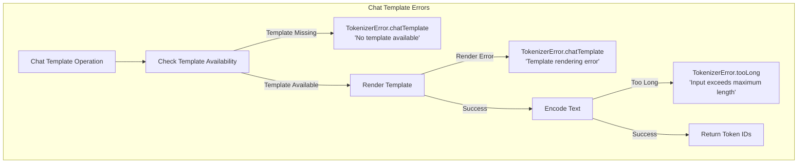

<!-- source: DeepWiki mcp.deepwiki.com · repo huggingface/swift-transformers · page 2.2 Chat Templates · fetched 2026-10-26 -->

# Chat Templates

<details>
<summary>Relevant source files</summary>

The following files were used as context for generating this wiki page:

- [LICENSE](LICENSE)
- [README.md](README.md)
- [Sources/Tokenizers/Tokenizer.swift](Sources/Tokenizers/Tokenizer.swift)
- [Tests/TokenizersTests/ChatTemplateTests.swift](Tests/TokenizersTests/ChatTemplateTests.swift)
- [Tests/TokenizersTests/Resources/tokenizer.json](Tests/TokenizersTests/Resources/tokenizer.json)
- [Tests/TokenizersTests/Resources/tokenizer_config.json](Tests/TokenizersTests/Resources/tokenizer_config.json)
- [media/swift-t-banner.png](media/swift-t-banner.png)

</details>


Chat templates are a mechanism in swift-transformers to format conversational data into the specific structure expected by different language models. They provide a standardized way to convert messages between users and assistants into properly formatted prompts that models can understand.

This page explains how to use chat templates with tokenizers to format conversations for text generation. For information about tokenization in general, see [Tokenizers](#2).

## Overview of Chat Templates

Chat templates use the Jinja templating engine to define how conversations should be formatted. Each language model typically has its own chat template that defines the required structure, including special tokens and formatting that the model was trained with.



Sources: [Sources/Tokenizers/Tokenizer.swift:137-142](), [Sources/Tokenizers/Tokenizer.swift:169-205]()

Chat templates are typically defined in the model's configuration and loaded automatically when you initialize a tokenizer using AutoTokenizer. The templates can handle various conversation formats, including:

- Simple user/assistant exchanges
- Conversations with system messages
- Conversations with tools/functions
- Multimodal conversations (e.g., with images)

## Chat Template Structure

Chat templates are written in Jinja syntax and use model-specific formatting. Here's how the components are structured:



Sources: [Sources/Tokenizers/Tokenizer.swift:487-550]()

Different models use different formats for their chat templates:

| Model Family | Chat Template Format Example |
|--------------|------------------------------|
| Llama        | `<s>[INST] {{message.content}} [/INST]` |
| Phi          | `<\|user\|>{{message.content}}<\|end\|><\|assistant\|>` |
| Qwen         | `<\|im_start\|>user\n{{message.content}}<\|im_end\|>` |
| Mistral      | `<s>[INST] {{message.content}} [/INST]` |

## Using Chat Templates

The Tokenizer protocol provides several methods for applying chat templates to messages:



Sources: [Sources/Tokenizers/Tokenizer.swift:427-563]()

### Basic Usage

To use chat templates, first load a tokenizer for your model:

```swift
let tokenizer = try await AutoTokenizer.from(pretrained: "microsoft/Phi-3-mini-128k-instruct")
```

Then format a conversation using the chat template:

```swift
let messages = [
    ["role": "user", "content": "Hello, how are you?"]
]

// Apply the chat template from the model's configuration
let encoded = try tokenizer.applyChatTemplate(messages: messages)
```

The `applyChatTemplate` method automatically formats the conversation according to the model's expected format and returns the token IDs ready for model input.

Sources: [Tests/TokenizersTests/ChatTemplateTests.swift:17-25]()

### Custom Templates

You can also provide a custom chat template instead of using the one from the model's configuration:

```swift
// Using string literal
let customTemplate = "{{bos_token}}{{ ' [USER] ' + message['content'] + ' [/USER] ' }}{{ ' [ASSISTANT] ' + message['content'] + ' ' + eos_token}}"

let encoded = try tokenizer.applyChatTemplate(messages: messages, chatTemplate: customTemplate)
```

Alternatively, you can use the `ChatTemplateArgument` enum:

```swift
// Using ChatTemplateArgument.literal
let encoded = try tokenizer.applyChatTemplate(
    messages: messages, 
    chatTemplate: .literal(customTemplate)
)
```

Sources: [Tests/TokenizersTests/ChatTemplateTests.swift:48-68]()

### Named Templates

Some models provide multiple templates in their configuration. You can select a specific template by name:

```swift
// Using a named template from the configuration
let encoded = try tokenizer.applyChatTemplate(
    messages: messages, 
    chatTemplate: .name("default")
)
```

Most models with multiple templates include a "default" template and possibly a "tool_use" template for function calling.

Sources: [Tests/TokenizersTests/ChatTemplateTests.swift:72-81](), [Sources/Tokenizers/Tokenizer.swift:487-518]()

### Checking Template Availability

You can check if a tokenizer has a chat template available:

```swift
if tokenizer.hasChatTemplate {
    // Use chat template
    let encoded = try tokenizer.applyChatTemplate(messages: messages)
} else {
    // Fall back to regular encoding
    let encoded = tokenizer.encode(text: "Your regular text here")
}
```

Sources: [Tests/TokenizersTests/ChatTemplateTests.swift:174-180](), [Sources/Tokenizers/Tokenizer.swift:428-430]()

## Advanced Features

### Tool/Function Calling

Many modern language models support tool calling (function calling), allowing the model to use external tools or APIs. Chat templates can include tool specifications that are rendered into the prompt:

```swift
// Define a tool for getting weather information
let weatherTool: [String: Any] = [
    "type": "function",
    "function": [
        "name": "get_current_weather",
        "description": "Get the current weather",
        "parameters": [
            "type": "object",
            "properties": [
                "location": [
                    "type": "string",
                    "description": "The city and state"
                ],
                "unit": [
                    "type": "string",
                    "enum": ["celsius", "fahrenheit"]
                ]
            ],
            "required": ["location"]
        ]
    ]
]

// Apply template with tool specification
let encoded = try tokenizer.applyChatTemplate(
    messages: messages,
    tools: [weatherTool]
)
```

When tools are provided, the tokenizer automatically selects the appropriate template (usually named "tool_use") from the model's configuration, if available.

Sources: [Tests/TokenizersTests/ChatTemplateTests.swift:83-172](), [Sources/Tokenizers/Tokenizer.swift:435-448]()

### Multimodal Content

Some models support multimodal inputs, combining text with other modalities like images. Chat templates can handle these multimodal conversations:

```swift
let visionMessages = [
    [
        "role": "user",
        "content": [
            ["type": "text", "text": "What's in this image?"],
            ["type": "image", "image_url": "example.jpg"]
        ]
    ]
]

let encoded = try tokenizer.applyChatTemplate(messages: visionMessages)
```

For vision models, the chat template properly formats the text and includes placeholders for images.

Sources: [Tests/TokenizersTests/ChatTemplateTests.swift:182-218]()

### Additional Context and Configuration

You can provide additional context and configuration when applying chat templates:

```swift
let encoded = try tokenizer.applyChatTemplate(
    messages: messages,
    chatTemplate: nil,           // Use model's template
    addGenerationPrompt: true,   // Add special tokens for generation
    truncation: true,            // Truncate if too long
    maxLength: 1024,             // Maximum sequence length
    tools: [weatherTool],        // Tool specifications
    additionalContext: ["tools_in_user_message": false]  // Additional context variables
)
```

The `additionalContext` parameter allows passing custom variables to the Jinja template engine, which can be useful for fine-tuning the template behavior.

Sources: [Sources/Tokenizers/Tokenizer.swift:196-205](), [Sources/Tokenizers/Tokenizer.swift:531-537]()

## Error Handling

When working with chat templates, several errors can occur:



Sources: [Sources/Tokenizers/Tokenizer.swift:15-45](), [Tests/TokenizersTests/ChatTemplateTests.swift:220-232]()

Common error scenarios include:
- The tokenizer doesn't have a chat template and none was provided
- The template contains invalid Jinja syntax
- The template expects variables that aren't provided
- The encoded output exceeds the maximum allowed length

You can handle these errors with standard Swift error handling:

```swift
do {
    let encoded = try tokenizer.applyChatTemplate(messages: messages)
    // Use encoded tokens
} catch let TokenizerError.chatTemplate(message) {
    // Handle chat template error
    print("Chat template error: \(message)")
} catch let TokenizerError.tooLong(message) {
    // Handle sequence too long error
    print("Sequence too long: \(message)")
} catch {
    // Handle other errors
    print("Error: \(error)")
}
```

Sources: [Sources/Tokenizers/Tokenizer.swift:37-39](), [Tests/TokenizersTests/ChatTemplateTests.swift:227-231]()

## Implementation Details

Internally, the chat template system uses the Jinja template engine, which is included as a dependency in `Package.swift`. The chat template is rendered with a context that includes:

- `messages`: The array of message dictionaries
- `add_generation_prompt`: Boolean that indicates whether to add a prompt for model generation
- `tools`: Optional array of tool specifications
- Special token variables (`bos_token`, `eos_token`, etc.) from the tokenizer configuration
- Any additional context variables provided

After the template is rendered, the resulting text is encoded into token IDs using the tokenizer's `encode` method.

Sources: [Sources/Tokenizers/Tokenizer.swift:520-553](), [Package.swift:16]()

---

