<!-- source: DeepWiki mcp.deepwiki.com · repo huggingface/swift-transformers · page 3 Hub · fetched 2026-10-26 -->

# Hub

<details>
<summary>Relevant source files</summary>

The following files were used as context for generating this wiki page:

- [LICENSE](LICENSE)
- [README.md](README.md)
- [Sources/Hub/Hub.swift](Sources/Hub/Hub.swift)
- [Sources/Hub/HubApi.swift](Sources/Hub/HubApi.swift)
- [Tests/HubTests/HubApiTests.swift](Tests/HubTests/HubApiTests.swift)
- [Tests/TokenizersTests/Resources/tokenizer.json](Tests/TokenizersTests/Resources/tokenizer.json)
- [Tests/TokenizersTests/Resources/tokenizer_config.json](Tests/TokenizersTests/Resources/tokenizer_config.json)
- [media/swift-t-banner.png](media/swift-t-banner.png)

</details>


## Purpose and Scope

The Hub module provides the foundational infrastructure for interacting with the Hugging Face Model Hub. It handles model discovery, file downloads with resume capability, local caching, metadata management, configuration loading, and offline mode support. The module abstracts the complexities of network operations, file integrity verification, and configuration parsing, enabling other modules (Tokenizers, Models, Generation) to seamlessly access models from the Hub.

The Hub module consists of three main components:
- **HubApi** - The primary client for HTTP operations, file downloads, and metadata retrieval
- **LanguageModelConfigurationFromHub** - Lazy loading of model and tokenizer configurations
- **Downloader** - Robust file transfer with resume, retry, and progress tracking (see [Downloader](#3.2))

For snapshot downloads and file retrieval, see [Hub API](#3.1). For configuration loading details, see [Configuration Loading](#3.3).

## Architecture Overview

The Hub module is organized into several interconnected components that handle different aspects of Hub interaction:

**Diagram: Hub Module Component Architecture**

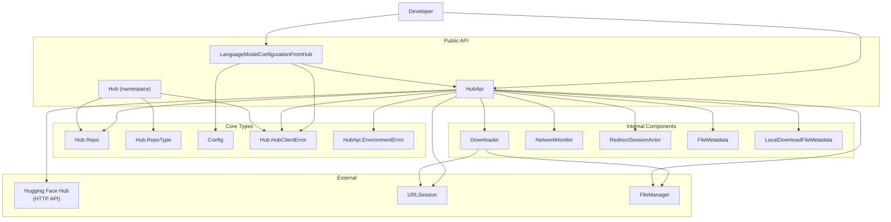

Sources: [Sources/Hub/Hub.swift:1-341](), [Sources/Hub/HubApi.swift:1-873]()

## Core Components

### Hub Namespace

The `Hub` enum serves as a namespace for Hub-related types and provides convenience methods that use the shared `HubApi` instance. It doesn't contain instance data but organizes types and static methods for Hub interaction.

**Key Types in Hub Namespace:**

| Type | Purpose | Location |
|------|---------|----------|
| `Hub.Repo` | Represents a repository with ID and type | [Sources/Hub/Hub.swift:93-108]() |
| `Hub.RepoType` | Enum for repository types (models, datasets, spaces) | [Sources/Hub/Hub.swift:80-87]() |
| `Hub.HubClientError` | Comprehensive error types for Hub operations | [Sources/Hub/Hub.swift:23-77]() |

Sources: [Sources/Hub/Hub.swift:10-16](), [Sources/Hub/Hub.swift:875-929]()

### HubApi Class

`HubApi` is the primary client for interacting with the Hugging Face Hub. It handles HTTP requests, file downloads, metadata retrieval, and local caching.

**HubApi Configuration:**

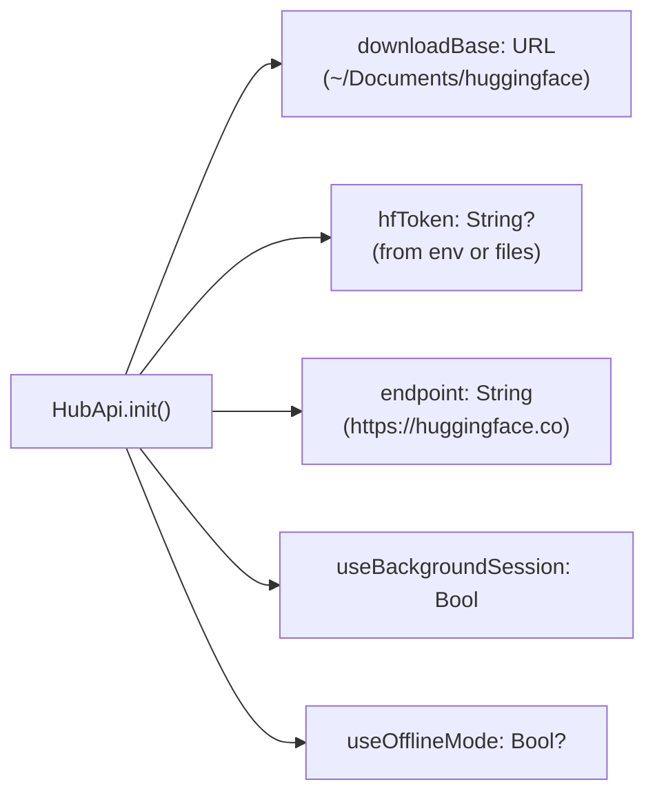

**Token Resolution Priority:**
1. `HF_TOKEN` environment variable
2. `HUGGING_FACE_HUB_TOKEN` environment variable
3. `HF_TOKEN_PATH` file
4. `HF_HOME/token` file
5. `~/.cache/huggingface/token` file
6. `~/.huggingface/token` file

Sources: [Sources/Hub/HubApi.swift:71-128](), [Sources/Hub/HubApi.swift:130-164]()

### Repository References

The `Hub.Repo` struct identifies a repository on the Hub:

```swift
// Models repository (default type)
let repo = Hub.Repo(id: "microsoft/phi-2")

// Dataset repository
let dataset = Hub.Repo(id: "squad", type: .datasets)

// Spaces repository
let space = Hub.Repo(id: "stabilityai/stable-diffusion", type: .spaces)
```

The `localRepoLocation()` method computes the local cache path:
```
downloadBase / {type} / {id}
// Example: ~/Documents/huggingface/models/microsoft/phi-2
```

Sources: [Sources/Hub/Hub.swift:93-108](), [Sources/Hub/HubApi.swift:347-349]()

## Snapshot Downloads

The snapshot system downloads multiple files from a repository with progress tracking, resume capability, and integrity verification.

**Diagram: Snapshot Download Flow**

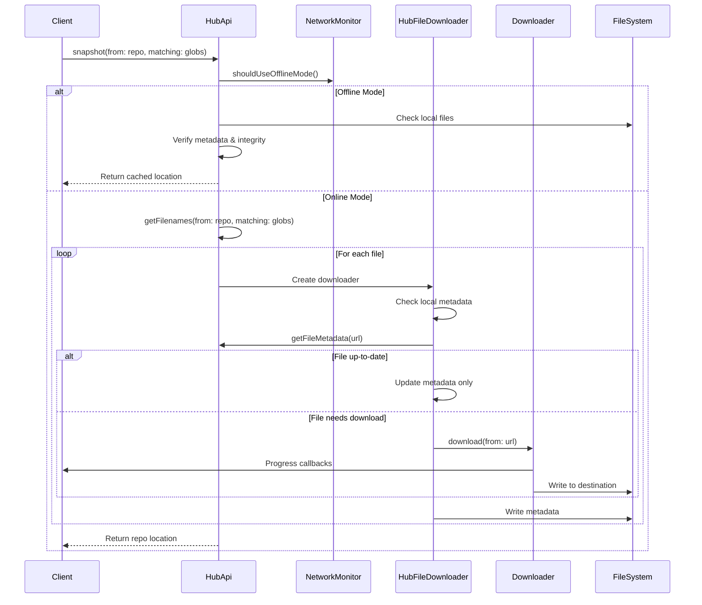

**Snapshot Method Signatures:**

```swift
// Basic snapshot
func snapshot(
    from repo: Repo,
    revision: String = "main",
    matching globs: [String] = [],
    progressHandler: @escaping (Progress) -> Void = { _ in }
) async throws -> URL

// With download speed
func snapshot(
    from repo: Repo,
    revision: String = "main",
    matching globs: [String] = [],
    progressHandler: @escaping (Progress, Double?) -> Void
) async throws -> URL
```

**Glob Pattern Examples:**

| Pattern | Matches |
|---------|---------|
| `"*.json"` | All JSON files in root |
| `"*.safetensors"` | All SafeTensors weight files |
| `"config.json"` | Specific file |
| `["config.json", "tokenizer.json"]` | Multiple specific files |
| `"**/*.bin"` | All .bin files recursively |

Sources: [Sources/Hub/HubApi.swift:576-698](), [Sources/Hub/HubApi.swift:450-573]()

## File Metadata and Caching

The Hub module implements a sophisticated caching and metadata system to minimize downloads and ensure file integrity.

**Diagram: Metadata and Caching System**

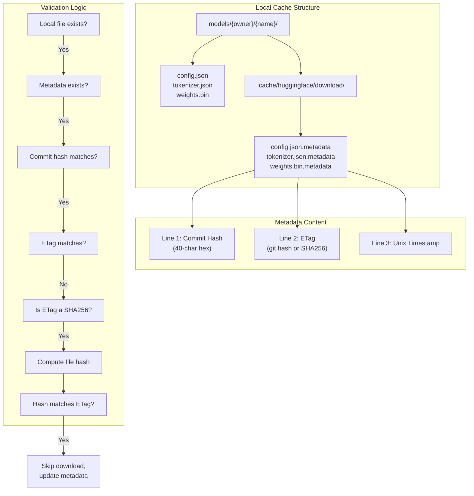

**FileMetadata Structure:**

| Field | Type | Purpose |
|-------|------|---------|
| `commitHash` | `String?` | Git commit hash from `X-Repo-Commit` header |
| `etag` | `String?` | File version identifier (git hash or SHA256) |
| `location` | `String` | Download URL (may be CDN) |
| `size` | `Int?` | File size in bytes |
| `xetFileData` | `XetFileData?` | Xet protocol optimization data |

**LocalDownloadFileMetadata Structure:**

| Field | Type | Purpose |
|-------|------|---------|
| `commitHash` | `String` | Commit hash when file was downloaded |
| `etag` | `String` | ETag of downloaded file |
| `filename` | `String` | Relative path in repository |
| `timestamp` | `Date` | When metadata was last updated |

Sources: [Sources/Hub/HubApi.swift:351-448](), [Sources/Hub/HubApi.swift:701-815]()

### Download Decision Logic

**Diagram: File Download Decision Tree**

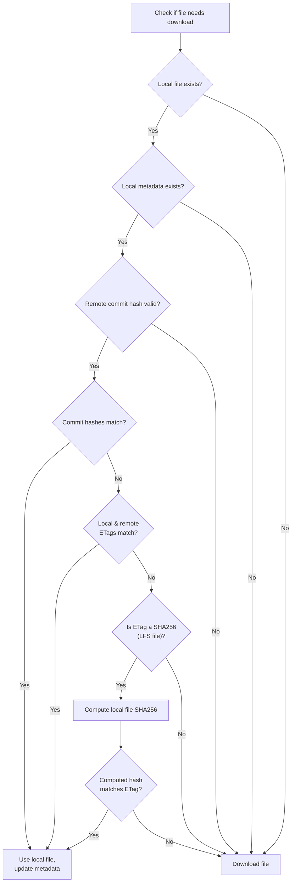

Sources: [Sources/Hub/HubApi.swift:499-572]()

### Integrity Verification

For large files (LFS), the Hub uses SHA256 hashing for integrity verification:

```swift
// SHA256 computation in chunks to avoid memory issues
func computeFileHash(file url: URL) throws -> String {
    let fileHandle = try FileHandle(forReadingFrom: url)
    var hasher = SHA256()
    let chunkSize = 1024 * 1024 // 1MB chunks
    
    while autoreleasepool(invoking: {
        let chunk = try? fileHandle.read(upToCount: chunkSize)
        guard let chunk, !chunk.isEmpty else { return false }
        hasher.update(data: chunk)
        return true
    }) {}
    
    return hasher.finalize().hex // 64-character hex string
}
```

Sources: [Sources/Hub/HubApi.swift:408-437]()

## Network Monitoring and Offline Mode

The Hub module includes automatic network monitoring to determine when to use offline mode.

**NetworkMonitor Architecture:**

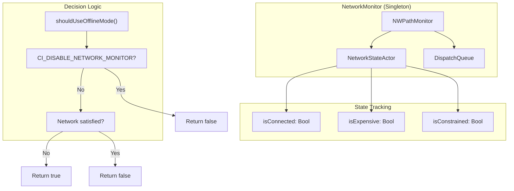

**Offline Mode Validation:**

When in offline mode, the Hub validates cached files:

1. **Check repository directory exists** - Throw `offlineModeError` if missing
2. **Check files exist** - Throw `offlineModeError` if empty
3. **For each file:**
   - Check metadata exists
   - If ETag is SHA256 (LFS file), compute file hash
   - Verify hash matches ETag
   - Throw `fileIntegrityError` on mismatch

Sources: [Sources/Hub/HubApi.swift:818-872](), [Sources/Hub/HubApi.swift:586-623]()

## HTTP Operations

The `HubApi` class provides HTTP methods for interacting with the Hub API.

### Request Methods

**GET Requests:**

```swift
func httpGet(for url: URL) async throws -> (Data, HTTPURLResponse) {
    // Adds Authorization header if hfToken present
    // Throws HubClientError for 401/403/404/other HTTP errors
}
```

**HEAD Requests (Metadata):**

```swift
func httpHead(for url: URL) async throws -> HTTPURLResponse {
    // Uses shared RedirectSessionActor
    // Only allows relative redirects (security)
    // Returns response with headers
}
```

**Redirect Handling:**

The Hub uses a shared `RedirectSessionActor` for HEAD requests to:
- Prevent creating multiple URLSession instances
- Allow only relative redirects (blocks absolute redirects for security)
- Handle LFS (Large File Storage) redirects properly

Sources: [Sources/Hub/HubApi.swift:186-249](), [Sources/Hub/HubApi.swift:82-86]()

### Repository File Listing

**getFilenames() Method:**

```swift
func getFilenames(
    from repo: Repo,
    revision: String = "main",
    matching globs: [String] = []
) async throws -> [String]
```

**Implementation:**
1. Queries Hub API: `GET /api/{type}/{id}/revision/{revision}`
2. Parses response for `siblings` array
3. Applies glob pattern filtering
4. Returns matching filenames

**Response Structure:**

```json
{
  "siblings": [
    {"rfilename": "config.json"},
    {"rfilename": "pytorch_model.bin"},
    {"rfilename": "tokenizer.json"}
  ]
}
```

Sources: [Sources/Hub/HubApi.swift:166-285](), [Sources/Hub/HubApi.swift:172-184]()

## Configuration System

The `Config` struct provides flexible access to JSON configuration data with support for both snake_case and camelCase property access.

**Diagram: Config Access and Conversion**

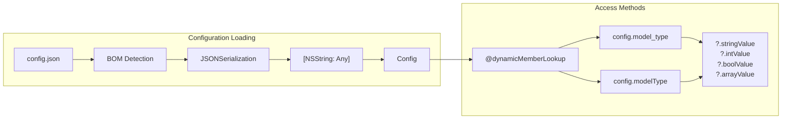

### Dynamic Member Lookup

The `Config` struct uses `@dynamicMemberLookup` to enable flexible property access:

```swift
// Both snake_case and camelCase work
let modelType = config.model_type?.stringValue  // snake_case from JSON
let modelType = config.modelType?.stringValue   // camelCase converted

// Nested access
let maxLength = config.task_specific_params?.summarization?.max_length?.intValue
```

**Case Conversion:**
- Converts camelCase → snake_case for dictionary lookup
- Example: `modelType` → `model_type`
- Implemented in `subscript(dynamicMember:)` via `camelToSnake()`

### Type Conversion Methods

| Method | Return Type | Description |
|--------|-------------|-------------|
| `.value` | `Any` | Raw value from dictionary |
| `.stringValue` | `String?` | Converts to String if possible |
| `.string()` | `String?` | Alias for stringValue |
| `.intValue` | `Int?` | Converts to Int if possible |
| `.boolValue` | `Bool?` | Converts to Bool if possible |
| `.arrayValue` | `[Config]?` | Returns array of Config objects |
| `.tokenValue` | `(UInt, String)?` | Parses token ID and content |
| `.dictionary()` | `[NSString: Any]?` | Returns underlying dictionary |
| `.dictionary(or:)` | `[NSString: Any]` | Returns dictionary with fallback |

### BOM (Byte Order Mark) Handling

The Hub module handles JSON files with BOM prefixes (common in files from Python):

```swift
extension JSONSerialization {
    static func bomPreservingJsonObject(with data: Data) throws -> Any {
        var parseData = data
        // Skip UTF-8 BOM (0xEF, 0xBB, 0xBF) if present
        if data.count >= 3,
           data[0] == 0xEF,
           data[1] == 0xBB,
           data[2] == 0xBF {
            parseData = data.dropFirst(3)
        }
        return try jsonObject(with: parseData, options: [])
    }
}
```

Sources: [Sources/Hub/Hub.swift:73-145](), [Sources/Hub/HubApi.swift:311-329]()

## Language Model Configuration Loading

`LanguageModelConfigurationFromHub` handles lazy loading of model and tokenizer configurations with fallback mechanisms.

**Diagram: Configuration Loading Process**

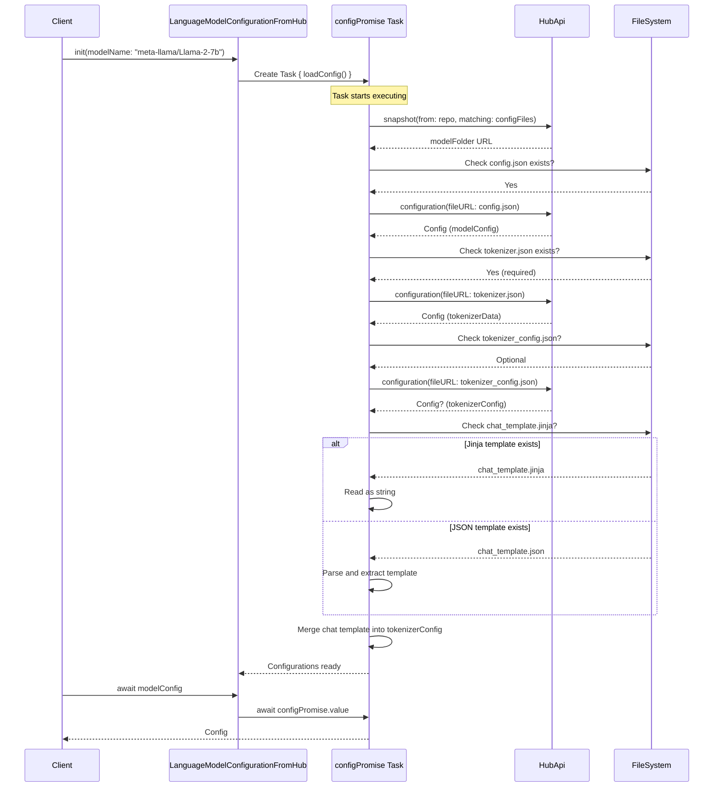

### Configuration Properties

The class exposes three async properties backed by a single `Task`:

| Property | Type | Required | Description |
|----------|------|----------|-------------|
| `modelConfig` | `Config?` | No | Architecture and parameters from config.json |
| `tokenizerConfig` | `Config?` | No | Tokenizer settings from tokenizer_config.json |
| `tokenizerData` | `Config` | Yes | Vocabulary and data from tokenizer.json |
| `modelType` | `String?` | No | Extracted from modelConfig.model_type |

### Initialization Methods

**From Hub (Downloads files):**

```swift
let configLoader = LanguageModelConfigurationFromHub(
    modelName: "microsoft/phi-2",
    revision: "main",  // default
    hubApi: .shared    // default
)
```

**From Local Folder:**

```swift
let configLoader = LanguageModelConfigurationFromHub(
    modelFolder: URL(fileURLWithPath: "/path/to/model"),
    hubApi: .shared    // default
)
```

### Files Downloaded

The snapshot request downloads these files if they exist:

```swift
let filesToDownload = [
    "config.json",           // Model configuration
    "tokenizer_config.json", // Tokenizer settings
    "chat_template.jinja",   // Jinja chat template
    "chat_template.json",    // JSON chat template
    "tokenizer.json"         // Tokenizer data (required)
]
```

Sources: [Sources/Hub/Hub.swift:117-155](), [Sources/Hub/Hub.swift:219-245]()

### Tokenizer Config Fallback Logic

When `tokenizerConfig` is missing or incomplete, the class applies fallback strategies:

**Diagram: Tokenizer Config Resolution**

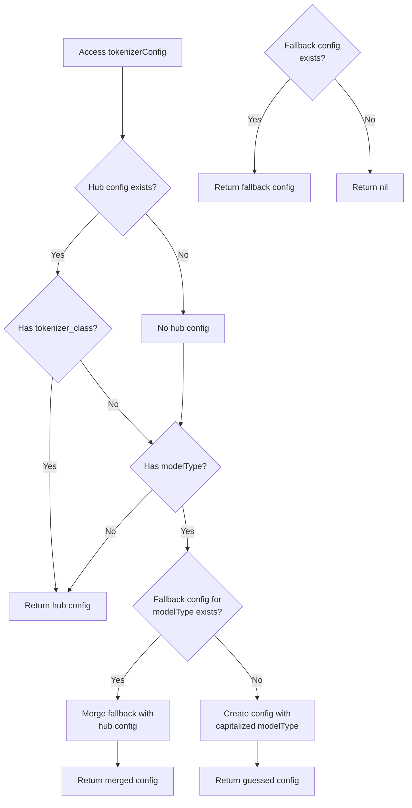

**Fallback Configuration Files:**

Bundled in `Sources/Hub/Resources/`:
- `llama_tokenizer_config.json`
- `gpt2_tokenizer_config.json`
- Additional model-specific configs

These provide default tokenizer settings when the repository doesn't include them.

Sources: [Sources/Hub/Hub.swift:174-197](), [Sources/Hub/Hub.swift:319-340]()

### Chat Template Integration

Chat templates are loaded with preference order:

1. **chat_template.jinja** - Raw Jinja template file (preferred)
2. **chat_template.json** - JSON file with template string
3. **tokenizer_config.json** - Template embedded in tokenizer config

The template is automatically merged into `tokenizerConfig`:

```swift
if let chatTemplate {
    if var configDict = tokenizerConfig?.dictionary() {
        configDict["chat_template"] = .init(chatTemplate)
        tokenizerConfig = Config(configDict)
    } else {
        tokenizerConfig = Config(["chat_template": chatTemplate])
    }
}
```

Sources: [Sources/Hub/Hub.swift:274-298]()

## Error Handling

The Hub module defines comprehensive error types for different failure scenarios.

### Hub.HubClientError

Primary error enum for Hub operations:

| Error Case | Trigger | Common Causes |
|------------|---------|---------------|
| `authorizationRequired` | 401 or 403 HTTP status | Missing/invalid token for private repos |
| `httpStatusCode(Int)` | Non-success HTTP status | Server errors, rate limiting |
| `fileNotFound(String)` | 404 HTTP status | Incorrect filename or repo path |
| `networkError(URLError)` | Network failures | No internet, connection timeout |
| `resourceNotFound(String)` | Model/resource missing | Typo in model name |
| `configurationMissing(String)` | Required file absent | Incomplete repository |
| `fileSystemError(Error)` | File I/O failure | Permission issues, disk full |
| `parseError(String)` | JSON parsing failure | Corrupted/malformed config files |
| `jsonSerialization(URL, String)` | JSON decode failure | Invalid JSON format |
| `parse` | Generic parse error | Unexpected response format |
| `unexpectedError` | Unknown failure | Rare edge cases |
| `downloadError(String)` | Download failure | Network issues, cancellation |

### HubApi.EnvironmentError

Errors related to local environment and file validation:

| Error Case | Description |
|------------|-------------|
| `invalidMetadataError(String)` | Metadata file corrupted or missing required fields |
| `offlineModeError(String)` | Required files not available locally in offline mode |
| `fileIntegrityError(String)` | File hash doesn't match expected ETag |
| `fileWriteError(String)` | Failed to write file or metadata to disk |

**Diagram: Error Flow in Snapshot Download**

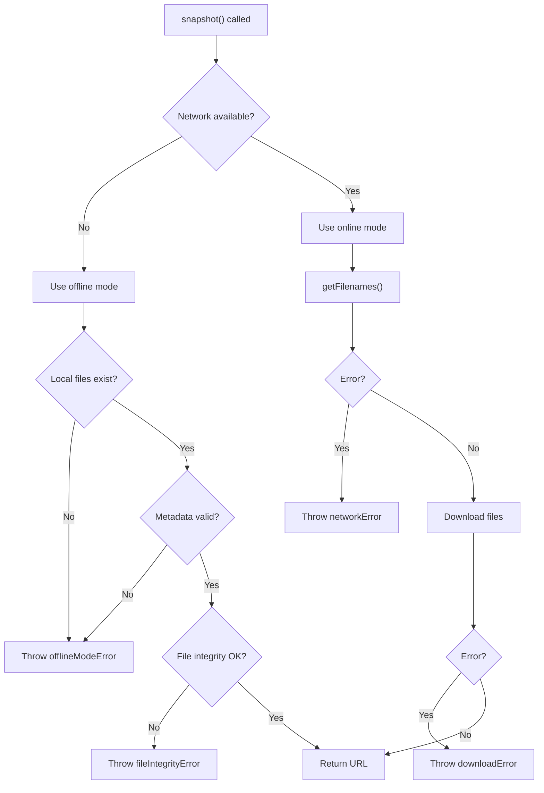

Sources: [Sources/Hub/Hub.swift:23-77](), [Sources/Hub/HubApi.swift:288-308]()

## Usage Examples

### Basic Snapshot Download

```swift
let hubApi = HubApi()
let repo = Hub.Repo(id: "microsoft/phi-2")

do {
    let localPath = try await hubApi.snapshot(
        from: repo,
        matching: ["*.json", "*.safetensors"]
    ) { progress in
        print("Progress: \(progress.fractionCompleted * 100)%")
    }
    print("Model files at: \(localPath)")
} catch let error as Hub.HubClientError {
    print("Hub error: \(error.localizedDescription)")
} catch {
    print("Unexpected error: \(error)")
}
```

### Configuration Loading

```swift
// From Hub
let config = LanguageModelConfigurationFromHub(
    modelName: "meta-llama/Llama-2-7b-chat-hf"
)

// Access configurations
let modelType = try await config.modelType
let vocabSize = try await config.modelConfig?.vocab_size?.intValue
let tokenizerClass = try await config.tokenizerConfig?.tokenizer_class?.stringValue

// From local folder
let localConfig = LanguageModelConfigurationFromHub(
    modelFolder: URL(fileURLWithPath: "/path/to/model")
)
```

### File Metadata Retrieval

```swift
let hubApi = HubApi()
let repo = Hub.Repo(id: "microsoft/phi-2")

// Get all JSON files metadata
let metadataList = try await hubApi.getFileMetadata(
    from: repo,
    matching: "*.json"
)

for metadata in metadataList {
    print("File: \(metadata.location)")
    print("Size: \(metadata.size ?? 0) bytes")
    print("ETag: \(metadata.etag ?? "unknown")")
    print("Commit: \(metadata.commitHash ?? "unknown")")
}
```

### Custom Endpoint and Token

```swift
// Use custom HF endpoint (e.g., for mirrors)
let hubApi = HubApi(
    downloadBase: URL(fileURLWithPath: "/custom/cache"),
    hfToken: "hf_...",
    endpoint: "https://hf-mirror.com",
    useBackgroundSession: false
)

// Download with progress and speed tracking
let url = try await hubApi.snapshot(
    from: repo,
    matching: "*.safetensors"
) { progress, speed in
    let percent = progress.fractionCompleted * 100
    let mbps = (speed ?? 0) / 1_000_000
    print("Progress: \(percent)% at \(mbps) MB/s")
}
```

### Offline Mode Usage

```swift
// Force offline mode
let hubApi = HubApi(useOfflineMode: true)

do {
    // This will use cached files or fail if not available
    let path = try await hubApi.snapshot(
        from: Hub.Repo(id: "microsoft/phi-2"),
        matching: ["*.json"]
    )
    print("Using cached files at: \(path)")
} catch HubApi.EnvironmentError.offlineModeError(let message) {
    print("Offline mode error: \(message)")
} catch HubApi.EnvironmentError.fileIntegrityError(let message) {
    print("File integrity error: \(message)")
}
```

Sources: [Tests/HubTests/HubApiTests.swift:14-83](), [Tests/HubTests/HubApiTests.swift:176-299]()

## Error Handling

The Hub module includes comprehensive error handling through the `HubClientError` enum. Errors are categorized by type and provide descriptive messages:

| Error Type | Description | Common Scenarios |
|------------|-------------|-----------------|
| `authorizationRequired` | Authentication failed | Private repositories |
| `httpStatusCode` | HTTP error occurred | Server errors |
| `networkError` | Network communication failed | Connectivity issues |
| `resourceNotFound` | Requested model doesn't exist | Typos in model names |
| `configurationMissing` | Required config file is missing | Incomplete model repos |
| `fileSystemError` | File operation failed | Permissions issues |
| `parseError` | JSON parsing failed | Malformed config files |

Sources: [Sources/Hub/Hub.swift:12-52]()

## Integration with Other Components

The Hub module serves as a foundation for other components in the Swift Transformers library:

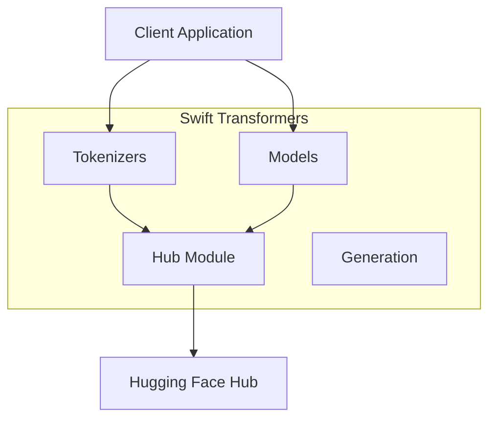

The Hub module is used by:
- The Tokenizers module to download tokenizer configurations and data
- The Models module to download model configurations and weights
- Client applications directly when they need to access model configurations

Sources: [Sources/Hub/Hub.swift:147-303]()

---

